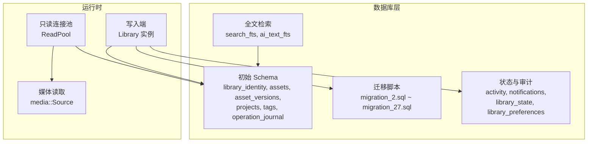
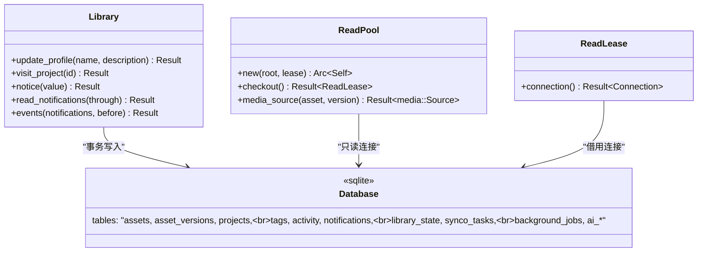
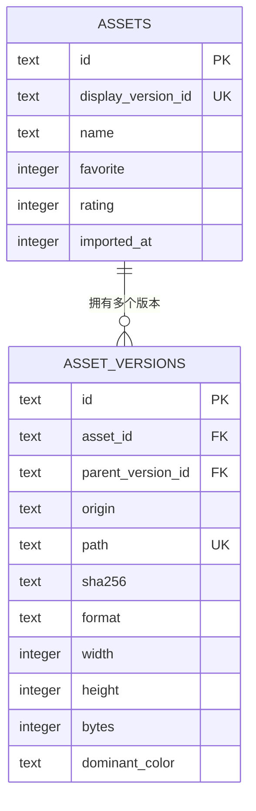
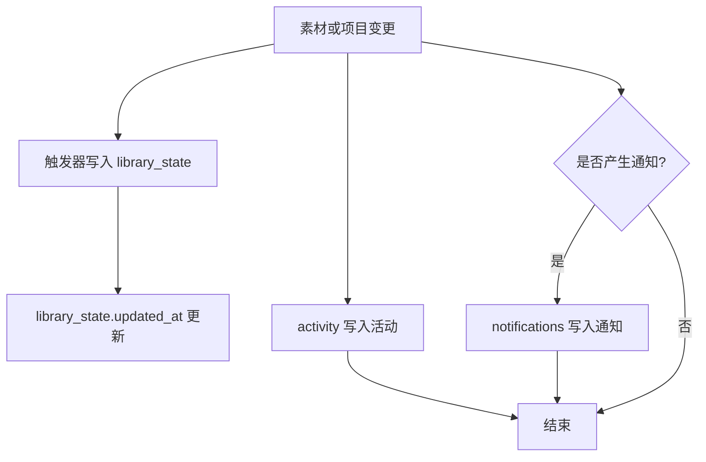
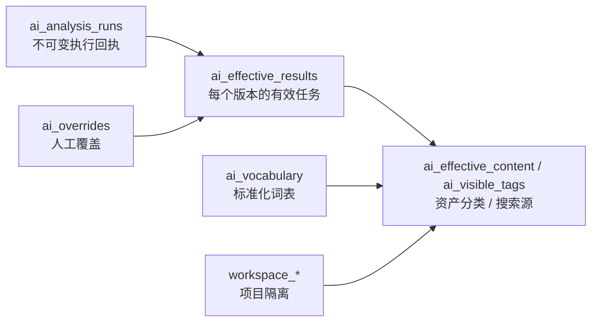
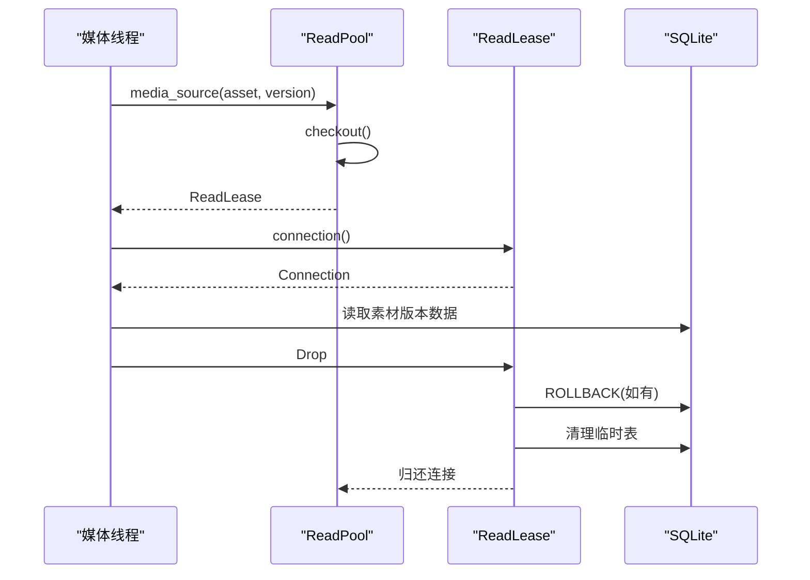
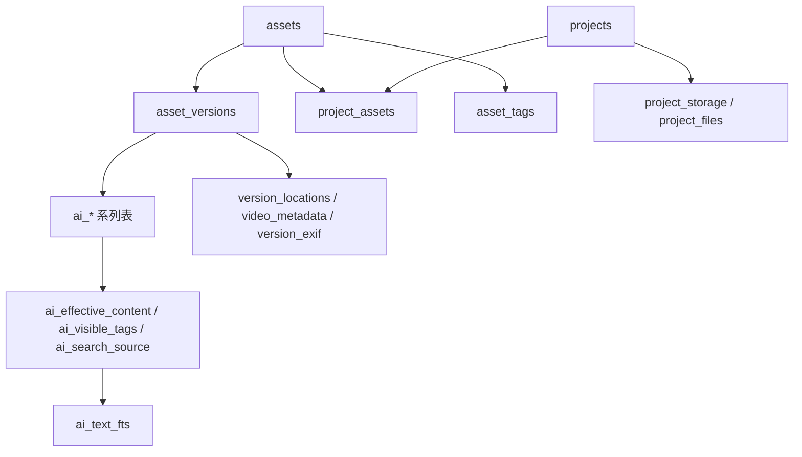

# 数据库设计与 Schema

> Repo Wiki 节点 `database-schema`
> 导出自 Qoder 知识库快照 `8fbe02f6-57c2-4874-b725-1a8130851fd9`，代码基线 `7a7a8e75e18bd90294e09cd422dd7ed5a04813a0`（分支 main，zh-CN）。

<cite>
**本文引用的文件**   
- [schema.sql](../../../../crates/moriq-library/src/database/schema.sql)
- [journal.rs](../../../../crates/moriq-library/src/database/journal.rs)
- [read_pool.rs](../../../../crates/moriq-library/src/database/read_pool.rs)
- [migration_2.sql](../../../../crates/moriq-library/src/database/migrations/migration_2.sql)
- [migration_3.sql](../../../../crates/moriq-library/src/database/migrations/migration_3.sql)
- [migration_4.sql](../../../../crates/moriq-library/src/database/migrations/migration_4.sql)
- [migration_5.sql](../../../../crates/moriq-library/src/database/migrations/migration_5.sql)
- [migration_6.sql](../../../../crates/moriq-library/src/database/migrations/migration_6.sql)
- [migration_7.sql](../../../../crates/moriq-library/src/database/migrations/migration_7.sql)
- [migration_8.sql](../../../../crates/moriq-library/src/database/migrations/migration_8.sql)
- [migration_9.sql](../../../../crates/moriq-library/src/database/migrations/migration_9.sql)
- [migration_10.sql](../../../../crates/moriq-library/src/database/migrations/migration_10.sql)
- [migration_11.sql](../../../../crates/moriq-library/src/database/migrations/migration_11.sql)
- [migration_13.sql](../../../../crates/moriq-library/src/database/migrations/migration_13.sql)
- [migration_14.sql](../../../../crates/moriq-library/src/database/migrations/migration_14.sql)
- [migration_15.sql](../../../../crates/moriq-library/src/database/migrations/migration_15.sql)
- [migration_16.sql](../../../../crates/moriq-library/src/database/migrations/migration_16.sql)
- [migration_17.sql](../../../../crates/moriq-library/src/database/migrations/migration_17.sql)
- [migration_18.sql](../../../../crates/moriq-library/src/database/migrations/migration_18.sql)
- [migration_19.sql](../../../../crates/moriq-library/src/database/migrations/migration_19.sql)
- [migration_20.sql](../../../../crates/moriq-library/src/database/migrations/migration_20.sql)
- [migration_21.sql](../../../../crates/moriq-library/src/database/migrations/migration_21.sql)
- [migration_22.sql](../../../../crates/moriq-library/src/database/migrations/migration_22.sql)
- [migration_23.sql](../../../../crates/moriq-library/src/database/migrations/migration_23.sql)
- [migration_24.sql](../../../../crates/moriq-library/src/database/migrations/migration_24.sql)
- [migration_26.sql](../../../../crates/moriq-library/src/database/migrations/migration_26.sql)
- [migration_27.sql](../../../../crates/moriq-library/src/database/migrations/migration_27.sql)
</cite>

## 目录
1. [引言](#引言)
2. [项目结构](#项目结构)
3. [核心组件](#核心组件)
4. [架构总览](#架构总览)
5. [详细组件分析](#详细组件分析)
6. [依赖关系分析](#依赖关系分析)
7. [性能与并发特性](#性能与并发特性)
8. [故障排查指南](#故障排查指南)
9. [结论](#结论)
10. [附录：迁移演进与版本策略](#附录迁移演进与版本策略)

## 引言
本文件面向 Moriq Space 的 SQLite 数据库设计与 Schema，聚焦以下目标：
- 说明整体表结构、字段定义、主外键与约束。
- 解释单写者模式在事务管理、并发控制和数据一致性上的实现。
- 梳理变更追踪、活动记录、通知和恢复机制。
- 提供完整的索引设计、查询模式和优化建议。
- 描述数据库初始化、迁移策略与版本管理机制。

该数据库服务于资源库、素材、版本、项目、标签、任务、AI 结果及工作区等核心领域，以 SQLite 作为单机单写存储后端，并通过应用层连接池隔离读取路径。

## 项目结构
数据库相关代码集中在 `moriq-library` 模块中，关键位置如下：
- 初始 Schema 与触发器：[schema.sql](../../../../crates/moriq-library/src/database/schema.sql)
- 操作日志、活动与通知读写接口：[journal.rs](../../../../crates/moriq-library/src/database/journal.rs)
- 只读连接池与媒体读取流程：[read_pool.rs](../../../../crates/moriq-library/src/database/read_pool.rs)
- 按版本号递增的增量迁移脚本：`migrations/migration_N.sql`

**图表来源**
- [schema.sql:1-42](../../../../crates/moriq-library/src/database/schema.sql#L1-L42)
- [journal.rs:1-316](../../../../crates/moriq-library/src/database/journal.rs#L1-L316)
- [read_pool.rs:1-97](../../../../crates/moriq-library/src/database/read_pool.rs#L1-L97)

**章节来源**
- [schema.sql:1-42](../../../../crates/moriq-library/src/database/schema.sql#L1-L42)
- [journal.rs:1-316](../../../../crates/moriq-library/src/database/journal.rs#L1-L316)
- [read_pool.rs:1-97](../../../../crates/moriq-library/src/database/read_pool.rs#L1-L97)

## 核心组件
本节从数据模型角度总结核心实体及其职责：

| 类别 | 主要表或视图 | 职责 | 关键约束与索引 |
|---|---|---|---|
| 资源库身份与偏好 | `library_identity`、`library_preferences`、`library_state` | 标识资源库、保存显示名与描述、维护元数据更新时间 | `library_identity.id` 为主键；`library_preferences.key` 唯一；`library_state.id=1` |
| 素材与版本 | `assets`、`asset_versions` | 素材标题、收藏、评分、回收站时间、编辑时间；版本路径、哈希、尺寸、字节数、颜色 | 多 CHECK 约束；`sha256`、`asset_id`、`parent_version_id` 索引 |
| 顺序与维护 | `asset_order`、`assets_append_order` 触发器 | 使用稠密追加序列避免深 OFFSET 扫描 | `position` 主键且非负；`asset_id` 唯一 |
| 项目与成员 | `projects`、`project_assets` | 项目名称、父项目、最近访问；素材与项目关联 | 复合主键 `(project_id, asset_id)` |
| 标签与归类 | `tags`、`asset_tags` | 标签名称与素材归类 | 反向索引 `tag_id, asset_id` |
| 操作日志 | `operation_journal` | 外部操作的准备、提交、中断阶段跟踪 | `phase` 枚举检查 |
| 活动与通知 | `activity`、`notifications` | 用户操作历史、系统通知、未读计数 | 活动与通知均按自增 ID 分页 |
| 同步与任务 | `synco_tasks`、`background_jobs`、`background_job_items`、`background_job_errors` | Synco 传输、后台任务调度、逐项进度与失败原因 | 多状态与优先级索引 |
| AI 与分析 | `ai_results`、`ai_analysis_runs`、`ai_effective_results`、`ai_overrides`、`ai_vocabulary`、`ai_embeddings`、`people`、`detected_faces`、`person_vectors` | 分类、描述、嵌入向量、人物识别、人工覆盖 | 多视图与 FTS 触发器维护 |
| 工作区 | `workspace_people`、`workspace_folders`、`workspace_jobs`、`workspace_collections` | 项目级可见范围与工作区隔离 | 按 workspace 索引 |
| 搜索 | `search_fts`、`ai_text_fts` | 素材名称/备注/标签、AI 文本内容三igram 全文检索 | FTS5 + 触发器同步 |
| 其他扩展 | `smart_collections`、`file_locations`、`import_context`、`project_storage`、`project_files`、`version_locations`、`video_metadata`、`version_exif`、`purge_jobs`、`orphan_quarantine`、`virtual_folders` | 智能集合、原生路径、导入上下文、项目存储、地理位置、视频元数据、EXIF、永久删除、孤立文件隔离、虚拟文件夹 | 对应外键与唯一约束 |

这些组件共同构成“素材为中心”的元数据模型，并围绕版本化、项目隔离、AI 增强与可恢复性持续演进。

**章节来源**
- [schema.sql:1-42](../../../../crates/moriq-library/src/database/schema.sql#L1-L42)
- [migration_2.sql:1-9](../../../../crates/moriq-library/src/database/migrations/migration_2.sql#L1-L9)
- [migration_3.sql:1-4](../../../../crates/moriq-library/src/database/migrations/migration_3.sql#L1-L4)
- [migration_4.sql:1-3](../../../../crates/moriq-library/src/database/migrations/migration_4.sql#L1-L3)
- [migration_5.sql:1-9](../../../../crates/moriq-library/src/database/migrations/migration_5.sql#L1-L9)
- [migration_6.sql:1-4](../../../../crates/moriq-library/src/database/migrations/migration_6.sql#L1-L4)
- [migration_7.sql:1-5](../../../../crates/moriq-library/src/database/migrations/migration_7.sql#L1-L5)
- [migration_8.sql:1-31](../../../../crates/moriq-library/src/database/migrations/migration_8.sql#L1-L31)
- [migration_9.sql:1-4](../../../../crates/moriq-library/src/database/migrations/migration_9.sql#L1-L4)
- [migration_10.sql:1-43](../../../../crates/moriq-library/src/database/migrations/migration_10.sql#L1-L43)
- [migration_11.sql:1-7](../../../../crates/moriq-library/src/database/migrations/migration_11.sql#L1-L7)
- [migration_13.sql:1-3](../../../../crates/moriq-library/src/database/migrations/migration_13.sql#L1-L3)
- [migration_14.sql:1-12](../../../../crates/moriq-library/src/database/migrations/migration_14.sql#L1-L12)
- [migration_15.sql:1-30](../../../../crates/moriq-library/src/database/migrations/migration_15.sql#L1-L30)
- [migration_16.sql:1-5](../../../../crates/moriq-library/src/database/migrations/migration_16.sql#L1-L5)
- [migration_17.sql:1-7](../../../../crates/moriq-library/src/database/migrations/migration_17.sql#L1-L7)
- [migration_18.sql:1-3](../../../../crates/moriq-library/src/database/migrations/migration_18.sql#L1-L3)
- [migration_19.sql:1-4](../../../../crates/moriq-library/src/database/migrations/migration_19.sql#L1-L4)
- [migration_20.sql:1-4](../../../../crates/moriq-library/src/database/migrations/migration_20.sql#L1-L4)
- [migration_21.sql:1-6](../../../../crates/moriq-library/src/database/migrations/migration_21.sql#L1-L6)
- [migration_22.sql:1-3](../../../../crates/moriq-library/src/database/migrations/migration_22.sql#L1-L3)
- [migration_23.sql:1-128](../../../../crates/moriq-library/src/database/migrations/migration_23.sql#L1-L128)
- [migration_24.sql:1-35](../../../../crates/moriq-library/src/database/migrations/migration_24.sql#L1-L35)
- [migration_26.sql:1-47](../../../../crates/moriq-library/src/database/migrations/migration_26.sql#L1-L47)
- [migration_27.sql:1-9](../../../../crates/moriq-library/src/database/migrations/migration_27.sql#L1-L9)

## 架构总览
SQLite 在本项目中承担“单一事实源”，所有写操作由单个 `Library` 实例串行执行，读操作通过 `ReadPool` 复用只读连接。Schema 由初始 SQL 与按版本递增的迁移脚本组成；活动、通知和状态通过触发器与专用表自动维护；AI 能力通过多个表和视图组合出“有效内容”与“可见标签”。

**图表来源**
- [journal.rs:1-316](../../../../crates/moriq-library/src/database/journal.rs#L1-L316)
- [read_pool.rs:1-97](../../../../crates/moriq-library/src/database/read_pool.rs#L1-L97)
- [schema.sql:1-42](../../../../crates/moriq-library/src/database/schema.sql#L1-L42)

**章节来源**
- [journal.rs:1-316](../../../../crates/moriq-library/src/database/journal.rs#L1-L316)
- [read_pool.rs:1-97](../../../../crates/moriq-library/src/database/read_pool.rs#L1-L97)
- [schema.sql:1-42](../../../../crates/moriq-library/src/database/schema.sql#L1-L42)

## 详细组件分析

### 素材与版本模型
素材 `assets` 表示逻辑对象，`asset_versions` 表示具体物理或导出版本。二者通过 `display_version_id` 建立当前显示版本的引用，同时保留版本链 `parent_version_id`。

- 主键：`assets.id`、`asset_versions.id`
- 外键：`asset_versions.asset_id -> assets.id`，`asset_versions.parent_version_id -> asset_versions.id`
- 唯一约束：`assets.display_version_id`、`asset_versions.path`、`asset_versions(id, asset_id)`
- CHECK 约束：收藏为 0/1，评分 0-5，宽高与字节为正，sha256 长度 64，origin 枚举
- 索引：`versions_hash`、`versions_asset`、`versions_parent`、`versions_color`

素材顺序采用独立 `asset_order` 表配合插入触发器维护稠密序号，避免 `OFFSET` 深分页。

**章节来源**
- [schema.sql:1-42](../../../../crates/moriq-library/src/database/schema.sql#L1-L42)
- [migration_6.sql:1-4](../../../../crates/moriq-library/src/database/migrations/migration_6.sql#L1-L4)

### 项目、标签与归类
项目支持父子层次结构，素材与项目是多对多关系；标签是全局词汇，素材与标签也是多对多关系。

- `projects`：项目主键、名称唯一、父项目、最近访问时间
- `project_assets`：复合主键 `(project_id, asset_id)`
- `tags`：标签主键、名称唯一
- `asset_tags`：复合主键 `(asset_id, tag_id)`，反向索引便于按标签查找素材

**章节来源**
- [schema.sql:1-42](../../../../crates/moriq-library/src/database/schema.sql#L1-L42)
- [migration_8.sql:1-31](../../../../crates/moriq-library/src/database/migrations/migration_8.sql#L1-L31)

### 活动、通知与库状态
活动 `activity` 与通知 `notifications` 是两类时序记录：
- 活动：记录素材导入、重命名、收藏、评分、备注、回收站、标签变化、项目创建与修改、版本新增等。
- 通知：记录系统级消息、级别、可选素材关联与重试类型，并提供已读截止位点。
- `library_state`：单行表维护资源库元数据最新时间戳，由大量 INSERT/UPDATE/DELETE 触发器更新。

**图表来源**
- [migration_10.sql:1-43](../../../../crates/moriq-library/src/database/migrations/migration_10.sql#L1-L43)
- [migration_11.sql:1-7](../../../../crates/moriq-library/src/database/migrations/migration_11.sql#L1-L7)

**章节来源**
- [migration_10.sql:1-43](../../../../crates/moriq-library/src/database/migrations/migration_10.sql#L1-L43)
- [migration_11.sql:1-7](../../../../crates/moriq-library/src/database/migrations/migration_11.sql#L1-L7)
- [journal.rs:1-316](../../../../crates/moriq-library/src/database/journal.rs#L1-L316)

### 搜索与全文索引
项目引入两层 FTS：
- `search_fts`：基于素材名称、备注与标签聚合的三igram 全文索引。
- `ai_text_fts`：基于 AI 描述、OCR、标签与分类词表的全文索引。

两者均通过触发器在素材、标签、AI 结果、覆盖与拒绝标签变化时同步更新。

**章节来源**
- [migration_8.sql:1-31](../../../../crates/moriq-library/src/database/migrations/migration_8.sql#L1-L31)
- [migration_15.sql:1-30](../../../../crates/moriq-library/src/database/migrations/migration_15.sql#L1-L30)
- [migration_23.sql:1-128](../../../../crates/moriq-library/src/database/migrations/migration_23.sql#L1-L128)
- [migration_27.sql:1-9](../../../../crates/moriq-library/src/database/migrations/migration_27.sql#L1-L9)

### 后台任务、Synco 与恢复
后台任务表 `background_jobs` 与明细表 `background_job_items` 支持排队、运行、暂停、取消、完成状态，并记录进度、失败数、错误、生成号与创建时间。`background_job_payload` 保存任务附加参数，`background_job_errors` 记录逐项失败原因。

Synco 任务表 `synco_tasks` 记录发送版本、请求体、状态、返回结果、确认信息与复制清理状态。

恢复相关表包括：
- `operation_journal`：外部操作阶段（prepared、committed、interrupted）。
- `import_context`：导入平台、来源与项目上下文。
- `purge_jobs`、`purge_files`：永久删除任务与受管文件映射。
- `orphan_quarantine`：孤立文件的隔离操作与原位置。

**章节来源**
- [migration_4.sql:1-3](../../../../crates/moriq-library/src/database/migrations/migration_4.sql#L1-L3)
- [migration_5.sql:1-9](../../../../crates/moriq-library/src/database/migrations/migration_5.sql#L1-L9)
- [migration_9.sql:1-4](../../../../crates/moriq-library/src/database/migrations/migration_9.sql#L1-L4)
- [migration_14.sql:1-12](../../../../crates/moriq-library/src/database/migrations/migration_14.sql#L1-L12)
- [migration_18.sql:1-3](../../../../crates/moriq-library/src/database/migrations/migration_18.sql#L1-L3)
- [migration_19.sql:1-4](../../../../crates/moriq-library/src/database/migrations/migration_19.sql#L1-L4)
- [migration_20.sql:1-4](../../../../crates/moriq-library/src/database/migrations/migration_20.sql#L1-L4)
- [migration_22.sql:1-3](../../../../crates/moriq-library/src/database/migrations/migration_22.sql#L1-L3)

### AI 结果、覆盖与工作区
AI 数据经过多次重构：
- 早期 `ai_results` 直接保存模型结果。
- 之后拆分为不可变 `ai_analysis_runs`、有效指针 `ai_effective_results`、人工覆盖 `ai_overrides`、拒绝标签 `ai_rejected_tags`。
- 视图 `ai_effective_content`、`ai_visible_tags`、`asset_ai_categories`、`ai_search_source` 组合出最终展示内容。
- 后续引入 `ai_vocabulary` 标准化分类与主题，并通过 `enabled`、`position` 控制可见性与排序。
- 工作区扩展后，AI 分类与搜索按项目隔离，`workspace_vocabulary` 合并全局词表与项目配置。

**图表来源**
- [migration_15.sql:1-30](../../../../crates/moriq-library/src/database/migrations/migration_15.sql#L1-L30)
- [migration_23.sql:1-128](../../../../crates/moriq-library/src/database/migrations/migration_23.sql#L1-L128)
- [migration_24.sql:1-35](../../../../crates/moriq-library/src/database/migrations/migration_24.sql#L1-L35)
- [migration_26.sql:1-47](../../../../crates/moriq-library/src/database/migrations/migration_26.sql#L1-L47)
- [migration_27.sql:1-9](../../../../crates/moriq-library/src/database/migrations/migration_27.sql#L1-L9)

**章节来源**
- [migration_15.sql:1-30](../../../../crates/moriq-library/src/database/migrations/migration_15.sql#L1-L30)
- [migration_23.sql:1-128](../../../../crates/moriq-library/src/database/migrations/migration_23.sql#L1-L128)
- [migration_24.sql:1-35](../../../../crates/moriq-library/src/database/migrations/migration_24.sql#L1-L35)
- [migration_26.sql:1-47](../../../../crates/moriq-library/src/database/migrations/migration_26.sql#L1-L47)
- [migration_27.sql:1-9](../../../../crates/moriq-library/src/database/migrations/migration_27.sql#L1-L9)

### 只读连接池与媒体读取
`ReadPool` 负责：
- 维护最多 4 个空闲只读连接。
- 打开数据库时使用只读标志。
- 设置 busy timeout 与 PRAGMA 缓存参数。
- 租约释放时回滚遗留事务、清理临时表，并归还连接。

媒体读取通过 `media::Source::from_read_connection` 获取带资源库租约的连接，保证读取期间资源库生命周期不被提前关闭。

**图表来源**
- [read_pool.rs:1-97](../../../../crates/moriq-library/src/database/read_pool.rs#L1-L97)

**章节来源**
- [read_pool.rs:1-97](../../../../crates/moriq-library/src/database/read_pool.rs#L1-L97)

## 依赖关系分析
数据库内部存在以下主要依赖：
- 素材 `assets` 被 `asset_versions`、`project_assets`、`asset_tags`、`ai_*` 相关表间接依赖。
- 版本 `asset_versions` 被地理位置、EXIF、视频元数据、AI 结果、背景任务项、导入上下文等依赖。
- 项目 `projects` 被 `project_assets`、`project_storage`、`project_files`、工作区表依赖。
- AI 结果通过视图组合出最终展示，受词表和工作区影响。
- 活动与通知由触发器自动维护，依赖素材、项目、版本等实体变更。

**图表来源**
- [schema.sql:1-42](../../../../crates/moriq-library/src/database/schema.sql#L1-L42)
- [migration_15.sql:1-30](../../../../crates/moriq-library/src/database/migrations/migration_15.sql#L1-L30)
- [migration_23.sql:1-128](../../../../crates/moriq-library/src/database/migrations/migration_23.sql#L1-L128)
- [migration_26.sql:1-47](../../../../crates/moriq-library/src/database/migrations/migration_26.sql#L1-L47)

**章节来源**
- [schema.sql:1-42](../../../../crates/moriq-library/src/database/schema.sql#L1-L42)
- [migration_15.sql:1-30](../../../../crates/moriq-library/src/database/migrations/migration_15.sql#L1-L30)
- [migration_23.sql:1-128](../../../../crates/moriq-library/src/database/migrations/migration_23.sql#L1-L128)
- [migration_26.sql:1-47](../../../../crates/moriq-library/src/database/migrations/migration_26.sql#L1-L47)

## 性能与并发特性

### 单写者模式
- 所有写操作由 `Library` 实例发起，并使用 SQLite 事务。例如更新资料、访问项目、写入通知、查询活动与通知均通过事务或原子语句执行。
- 测试验证了资料更新的原子性、访问项目不修改内容时间、以及备份恢复后状态一致。

**章节来源**
- [journal.rs:1-316](../../../../crates/moriq-library/src/database/journal.rs#L1-L316)

### 并发控制
- 写入端独占 SQLite 连接；读取端通过 `ReadPool` 复用只读连接，并设置 `busy_timeout`。
- 只读连接启用缓存与临时存储优化 PRAGMA，限制空闲连接数量上限，并在归还前清理临时表与回滚未完成事务。

**章节来源**
- [read_pool.rs:1-97](../../../../crates/moriq-library/src/database/read_pool.rs#L1-L97)

### 索引与查询优化
- 素材顺序表 `asset_order` 使用稠密序号避免深 OFFSET。
- 常用查询字段建有索引：`assets.imported_at`、`assets.favorite`、`asset_versions.sha256`、`asset_versions.asset_id`、`asset_versions.parent_version_id`、`asset_versions.dominant_color`、`asset_tags.tag_id`、`projects.visited_at`、`activity.id`、`notifications.read_at`、`background_jobs.state,inflight,priority,created_at`、`synco_tasks.state,created_at`、`synco_tasks.copy_removed,state`、`orphan_quarantine.state,id`。
- FTS 使用三igram 分词器，适合中文短词搜索。

**章节来源**
- [schema.sql:1-42](../../../../crates/moriq-library/src/database/schema.sql#L1-L42)
- [migration_2.sql:1-9](../../../../crates/moriq-library/src/database/migrations/migration_2.sql#L1-L9)
- [migration_5.sql:1-9](../../../../crates/moriq-library/src/database/migrations/migration_5.sql#L1-L9)
- [migration_10.sql:1-43](../../../../crates/moriq-library/src/database/migrations/migration_10.sql#L1-L43)
- [migration_14.sql:1-12](../../../../crates/moriq-library/src/database/migrations/migration_14.sql#L1-L12)
- [migration_19.sql:1-4](../../../../crates/moriq-library/src/database/migrations/migration_19.sql#L1-L4)
- [migration_20.sql:1-4](../../../../crates/moriq-library/src/database/migrations/migration_20.sql#L1-L4)
- [migration_8.sql:1-31](../../../../crates/moriq-library/src/database/migrations/migration_8.sql#L1-L31)
- [migration_15.sql:1-30](../../../../crates/moriq-library/src/database/migrations/migration_15.sql#L1-L30)

### 常见查询示例
以下为典型查询思路（不展示具体 SQL 文本）：
- 按收藏与时间分页：使用 `assets_favorites` 索引，结合 `imported_at DESC, id DESC`。
- 按哈希去重导入：使用 `versions_hash` 索引查找已有 `sha256`。
- 按素材 ID 查最新版本：先查 `assets.display_version_id`，再查 `asset_versions`。
- 按标签筛选素材：使用 `asset_tags_reverse` 索引定位 `tag_id` 对应的素材。
- 按项目成员查询：使用 `project_assets` 复合主键。
- 活动与通知分页：使用 `id` 降序游标分页，避免全表扫描。
- AI 内容搜索：通过 `ai_text_fts` 进行三igram 全文检索。

**章节来源**
- [schema.sql:1-42](../../../../crates/moriq-library/src/database/schema.sql#L1-L42)
- [migration_10.sql:1-43](../../../../crates/moriq-library/src/database/migrations/migration_10.sql#L1-L43)
- [migration_15.sql:1-30](../../../../crates/moriq-library/src/database/migrations/migration_15.sql#L1-L30)

## 故障排查指南
常见问题与定位要点：

| 现象 | 可能原因 | 排查方式 |
|---|---|---|
| 写入阻塞或繁忙 | 写入端持有锁，读取端等待 | 检查 `ReadPool.busy_timeout` 与连接池占用情况 |
| 通知未读计数异常 | 已读截止位点未及时更新 | 检查 `notifications.read_at` 与 `read_notifications` 调用 |
| 活动缺失 | 触发器未触发或事务未提交 | 检查素材/项目变更记录与事务提交路径 |
| 搜索无结果 | FTS 未同步或分词问题 | 检查 `search_fts`、`ai_text_fts` 与触发器同步 |
| 后台任务卡住 | 任务状态未推进或失败项堆积 | 检查 `background_jobs`、`background_job_errors` |
| 导入中断 | `import_context` 或 `operation_journal` 残留 | 检查导入上下文与操作阶段 |
| 永久删除不一致 | `purge_jobs`、`purge_files` 状态异常 | 检查任务提交标记与文件映射 |
| 孤立文件未处理 | `orphan_quarantine` 状态异常 | 检查隔离状态与恢复/清理路径 |

**章节来源**
- [journal.rs:1-316](../../../../crates/moriq-library/src/database/journal.rs#L1-L316)
- [migration_4.sql:1-3](../../../../crates/moriq-library/src/database/migrations/migration_4.sql#L1-L3)
- [migration_9.sql:1-4](../../../../crates/moriq-library/src/database/migrations/migration_9.sql#L1-L4)
- [migration_14.sql:1-12](../../../../crates/moriq-library/src/database/migrations/migration_14.sql#L1-L12)
- [migration_20.sql:1-4](../../../../crates/moriq-library/src/database/migrations/migration_20.sql#L1-L4)

## 结论
该数据库以 SQLite 为单写存储核心，围绕素材与版本构建可扩展的数据模型。通过迁移脚本逐步增加功能，并以触发器与 FTS 维持活动、通知、状态与搜索的一致性。读取路径通过连接池与只读标志提升并发性能，同时保持与写入端的事务隔离。AI 与工作区能力通过视图与词表抽象，使分类、主题与搜索在项目范围内可控。整体设计强调可恢复性、可观测性与渐进式演进。

## 附录：迁移演进与版本策略

### 迁移总体策略
- 初始 Schema 由 `schema.sql` 定义基础表、外键、索引与触发器，并设置 `user_version = 1`。
- 每次变更通过 `migrations/migration_N.sql` 添加表、列、索引、视图或触发器，并将 `user_version` 设置为 N。
- 测试用例展示了从旧版本升级到新版本后，身份、偏好、项目与活动记录的保留行为。

**章节来源**
- [schema.sql:1-42](../../../../crates/moriq-library/src/database/schema.sql#L1-L42)
- [journal.rs:1-316](../../../../crates/moriq-library/src/database/journal.rs#L1-L316)

### 迁移清单概览
| 版本 | 主要内容 |
|---|---|
| 2 | 回收站、笔记、评分索引、智能集合、活动记录 |
| 3 | 原生路径登记、资源库偏好 |
| 4 | 导入上下文与项目上下文 |
| 5 | Synco 任务、返回版本、确认状态 |
| 6 | 版本主色与颜色索引 |
| 7 | 项目文件存储位置与相对路径 |
| 8 | 项目父级、大小写无关路径索引、素材 FTS |
| 9 | 永久删除任务与受管文件暂存 |
| 10 | 项目访问、通知、库更新时间与大量活动触发器 |
| 11 | 版本地理位置与活动触发 |
| 13 | 视频探测元数据 |
| 14 | 后台任务与图像指纹 |
| 15 | 任务类型扩展、AI 结果、嵌入、分类、人物、FTS |
| 16 | 虚拟文件夹与成员 |
| 17 | EXIF 规范化与筛选索引 |
| 18 | 后台任务附加参数 |
| 19 | Synco 副本清理状态 |
| 20 | 孤立文件可恢复隔离 |
| 21 | 人物代表向量与索引迁移 |
| 22 | 后台任务逐项失败原因 |
| 23 | AI 回执、有效结果、覆盖、拒绝标签与搜索视图 |
| 24 | 词表扩展、启用状态与有效内容视图更新 |
| 26 | 项目 AI 配置、人物、分组、任务、集合与工作区隔离 |
| 27 | 标签仅来自当前生效描述结果 |

**章节来源**
- [migration_2.sql:1-9](../../../../crates/moriq-library/src/database/migrations/migration_2.sql#L1-L9)
- [migration_3.sql:1-4](../../../../crates/moriq-library/src/database/migrations/migration_3.sql#L1-L4)
- [migration_4.sql:1-3](../../../../crates/moriq-library/src/database/migrations/migration_4.sql#L1-L3)
- [migration_5.sql:1-9](../../../../crates/moriq-library/src/database/migrations/migration_5.sql#L1-L9)
- [migration_6.sql:1-4](../../../../crates/moriq-library/src/database/migrations/migration_6.sql#L1-L4)
- [migration_7.sql:1-5](../../../../crates/moriq-library/src/database/migrations/migration_7.sql#L1-L5)
- [migration_8.sql:1-31](../../../../crates/moriq-library/src/database/migrations/migration_8.sql#L1-L31)
- [migration_9.sql:1-4](../../../../crates/moriq-library/src/database/migrations/migration_9.sql#L1-L4)
- [migration_10.sql:1-43](../../../../crates/moriq-library/src/database/migrations/migration_10.sql#L1-L43)
- [migration_11.sql:1-7](../../../../crates/moriq-library/src/database/migrations/migration_11.sql#L1-L7)
- [migration_13.sql:1-3](../../../../crates/moriq-library/src/database/migrations/migration_13.sql#L1-L3)
- [migration_14.sql:1-12](../../../../crates/moriq-library/src/database/migrations/migration_14.sql#L1-L12)
- [migration_15.sql:1-30](../../../../crates/moriq-library/src/database/migrations/migration_15.sql#L1-L30)
- [migration_16.sql:1-5](../../../../crates/moriq-library/src/database/migrations/migration_16.sql#L1-L5)
- [migration_17.sql:1-7](../../../../crates/moriq-library/src/database/migrations/migration_17.sql#L1-L7)
- [migration_18.sql:1-3](../../../../crates/moriq-library/src/database/migrations/migration_18.sql#L1-L3)
- [migration_19.sql:1-4](../../../../crates/moriq-library/src/database/migrations/migration_19.sql#L1-L4)
- [migration_20.sql:1-4](../../../../crates/moriq-library/src/database/migrations/migration_20.sql#L1-L4)
- [migration_21.sql:1-6](../../../../crates/moriq-library/src/database/migrations/migration_21.sql#L1-L6)
- [migration_22.sql:1-3](../../../../crates/moriq-library/src/database/migrations/migration_22.sql#L1-L3)
- [migration_23.sql:1-128](../../../../crates/moriq-library/src/database/migrations/migration_23.sql#L1-L128)
- [migration_24.sql:1-35](../../../../crates/moriq-library/src/database/migrations/migration_24.sql#L1-L35)
- [migration_26.sql:1-47](../../../../crates/moriq-library/src/database/migrations/migration_26.sql#L1-L47)
- [migration_27.sql:1-9](../../../../crates/moriq-library/src/database/migrations/migration_27.sql#L1-L9)