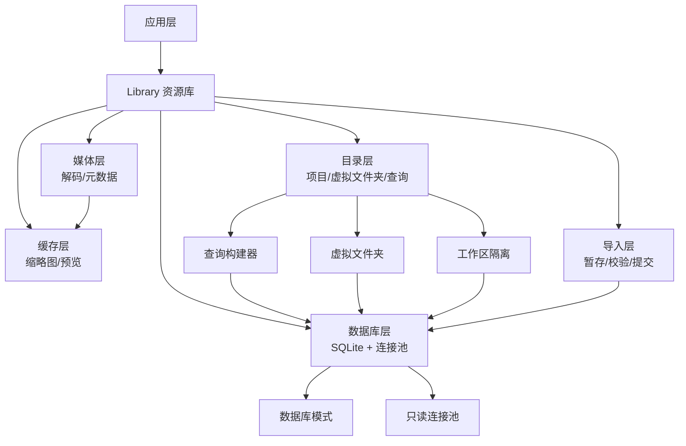
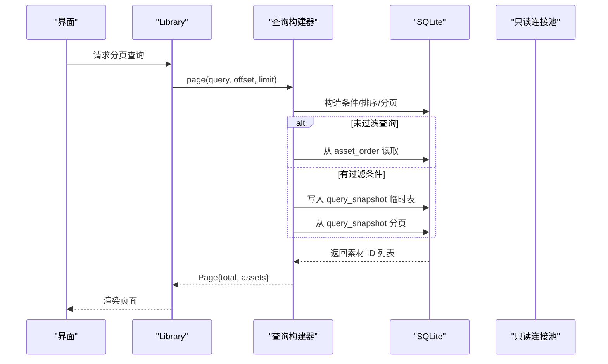
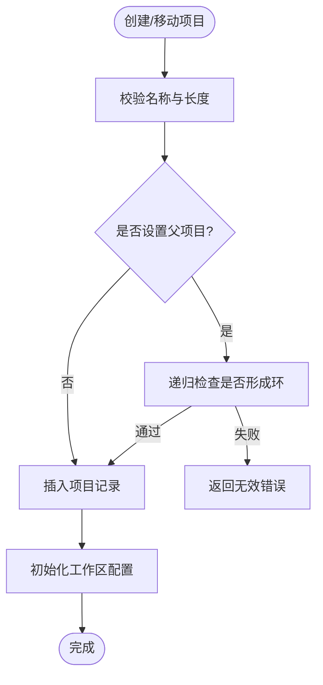
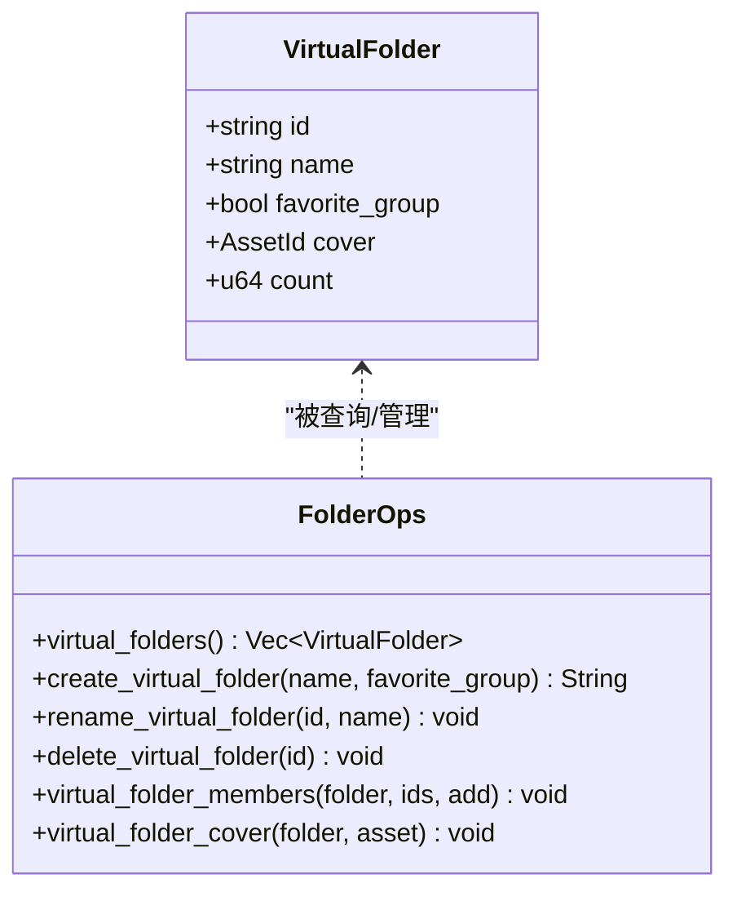
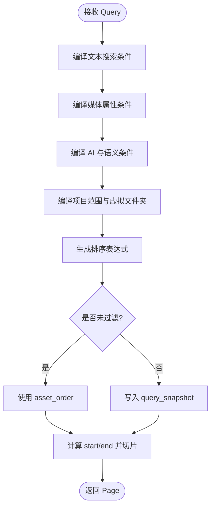
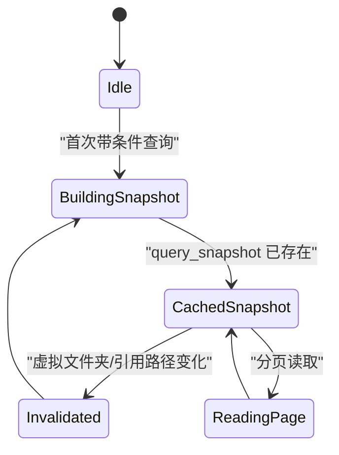
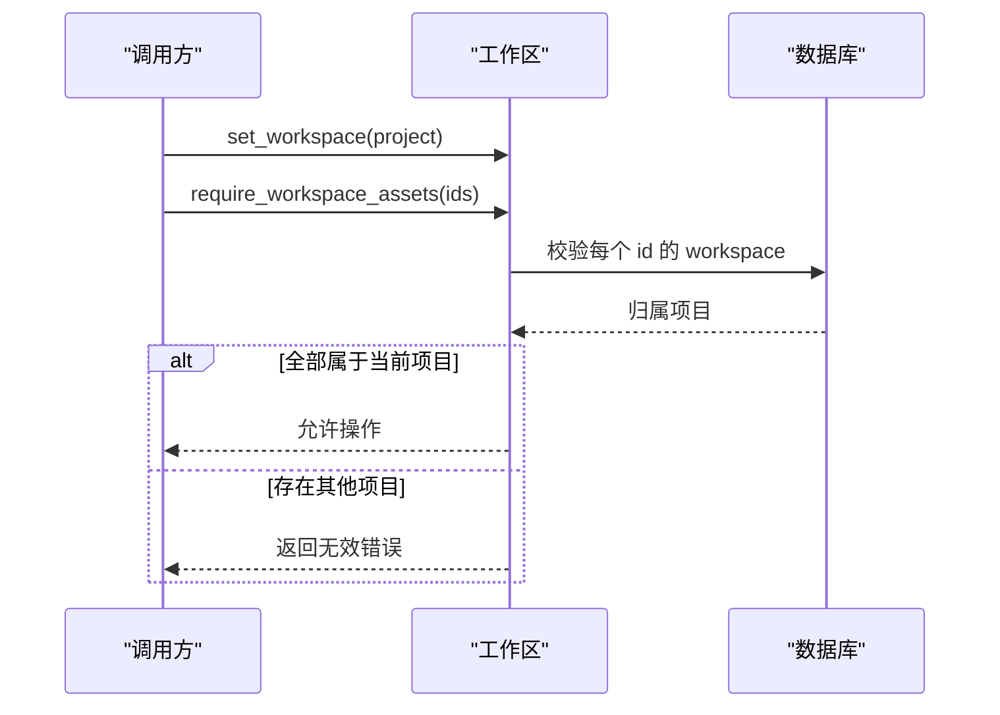
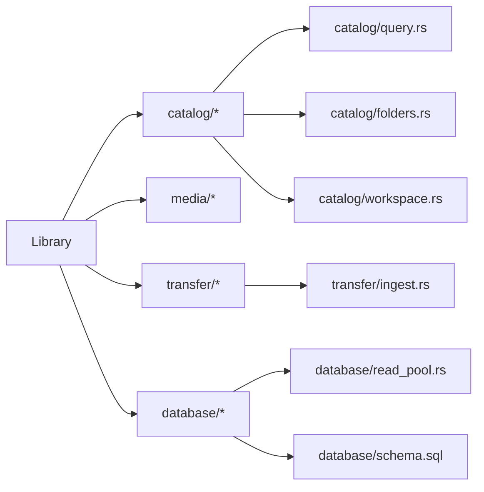
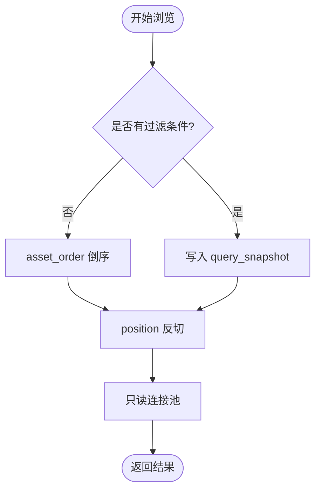

# 目录管理系统

> Repo Wiki 节点 `catalog-management`
> 导出自 Qoder 知识库快照 `8fbe02f6-57c2-4874-b725-1a8130851fd9`，代码基线 `7a7a8e75e18bd90294e09cd422dd7ed5a04813a0`（分支 main，zh-CN）。

<cite>
**本文引用的文件**   
- [库入口](../../../../crates/moriq-library/src/lib.rs)
- [核心实现](../../../../crates/moriq-library/src/library/core.rs)
- [生命周期与导航](../../../../crates/moriq-library/src/library/lifecycle.rs)
- [资源库目录](../../../../crates/moriq-library/src/catalog/catalog.rs)
- [查询构建器](../../../../crates/moriq-library/src/catalog/query.rs)
- [虚拟文件夹](../../../../crates/moriq-library/src/catalog/folders.rs)
- [工作区隔离](../../../../crates/moriq-library/src/catalog/workspace.rs)
- [读取连接池](../../../../crates/moriq-library/src/database/read_pool.rs)
- [数据库模式](../../../../crates/moriq-library/src/database/schema.sql)
- [操作日志](../../../../crates/moriq-library/src/database/journal.rs)
- [缓存清理](../../../../crates/moriq-library/src/media/cache.rs)
- [导入流程](../../../../crates/moriq-library/src/transfer/ingest.rs)
</cite>

## 目录
1. [引言](#引言)
2. [项目结构](#项目结构)
3. [核心组件](#核心组件)
4. [架构总览](#架构总览)
5. [详细组件分析](#详细组件分析)
6. [依赖关系分析](#依赖关系分析)
7. [性能与内存管理](#性能与内存管理)
8. [疑难排查指南](#疑难排查指南)
9. [结论](#结论)
10. [附录：目录 API 参考](#附录目录-api-参考)

## 引言
本文件面向“目录管理系统”，围绕资源库中的项目组织、文件夹结构、内容浏览与检索进行系统化说明。重点包括：
- 项目与工作区隔离、虚拟文件夹、收藏分组等目录组织方式。
- 查询构建器的条件组合、排序规则与分页机制。
- 目录索引的维护策略，包括顺序表、查询快照、全文搜索和增量更新。
- 面向浏览与管理的 CRUD API，覆盖项目、标签、虚拟文件夹、素材归属、引用重定位等。
- 复杂查询场景示例，如多条件筛选、全文搜索、语义与人脸关联。
- 大数据集浏览的性能优化与内存控制方案。

## 项目结构
资源库目录相关能力主要位于 `moriq-library` 子模块中，按职责分层：
- 库生命周期与持久化：创建、打开、迁移、锁、清单校验。
- 目录与项目：项目树、工作区范围、虚拟文件夹、成员管理。
- 查询与检索：查询构建、排序、分页、全文与 AI 语义索引。
- 数据库与并发：SQLite 模式、只读连接池、临时表清理。
- 媒体与缓存：缩略图、预览、可重建缓存清理。
- 导入与事务：暂存、校验、原子提交、恢复。

**图表来源**
- [库入口:1-120](../../../../crates/moriq-library/src/lib.rs#L1-L120)
- [资源库目录:1-80](../../../../crates/moriq-library/src/catalog/catalog.rs#L1-L80)
- [查询构建器:1-60](../../../../crates/moriq-library/src/catalog/query.rs#L1-L60)
- [虚拟文件夹:1-60](../../../../crates/moriq-library/src/catalog/folders.rs#L1-L60)
- [工作区隔离:1-60](../../../../crates/moriq-library/src/catalog/workspace.rs#L1-L60)
- [读取连接池:1-60](../../../../crates/moriq-library/src/database/read_pool.rs#L1-L60)
- [数据库模式:1-42](../../../../crates/moriq-library/src/database/schema.sql#L1-L42)

**章节来源**
- [库入口:1-120](../../../../crates/moriq-library/src/lib.rs#L1-L120)

## 核心组件
- Library：资源库抽象，封装目录、项目、查询、导入、维护等能力。
- 查询构建器：将用户筛选、排序、分页转换为 SQL 条件、排序与分页参数，并复用查询快照。
- 虚拟文件夹：在现有素材上定义逻辑集合（收藏分组、自定义分组），支持封面、成员增删。
- 工作区隔离：通过当前项目上下文限制读写范围，防止跨项目误操作。
- 只读连接池：为媒体与浏览提供稳定、可复用的只读连接，自动清理临时表。
- 数据库模式：资产、版本、项目、标签、AI 分类、人脸、虚拟文件夹等实体与索引。

**章节来源**
- [库入口:1-120](../../../../crates/moriq-library/src/lib.rs#L1-L120)
- [查询构建器:1-120](../../../../crates/moriq-library/src/catalog/query.rs#L1-L120)
- [虚拟文件夹:1-120](../../../../crates/moriq-library/src/catalog/folders.rs#L1-L120)
- [工作区隔离:1-120](../../../../crates/moriq-library/src/catalog/workspace.rs#L1-L120)
- [读取连接池:1-97](../../../../crates/moriq-library/src/database/read_pool.rs#L1-L97)
- [数据库模式:1-42](../../../../crates/moriq-library/src/database/schema.sql#L1-L42)

## 架构总览
目录管理系统采用“单写者 + 多读者”的模式：
- 写入端持有资源库独占锁，负责项目变更、导入、索引更新、迁移。
- 读取端通过只读连接池访问 SQLite，避免阻塞写入；临时表由连接回收时清理。
- 查询结果优先走轻量级顺序表或查询快照，减少深分页扫描。
- 全文搜索与 AI 语义索引独立于主查询条件，用于加速文本匹配。

**图表来源**
- [查询构建器:1-200](../../../../crates/moriq-library/src/catalog/query.rs#L1-L200)
- [读取连接池:1-97](../../../../crates/moriq-library/src/database/read_pool.rs#L1-L97)

**章节来源**
- [查询构建器:1-200](../../../../crates/moriq-library/src/catalog/query.rs#L1-L200)
- [读取连接池:1-97](../../../../crates/moriq-library/src/database/read_pool.rs#L1-L97)

## 详细组件分析

### 项目组织与文件夹结构
资源库目录以“项目”为基本组织单元，支持父子层级、命名校验、循环检测与视图聚合。
- 项目创建：校验名称长度与字符，插入 projects 表，并初始化工作区配置。
- 子项目创建：保留 parent_id，建立项目树关系。
- 移动项目：递归后代检查，拒绝移入自身或后代形成环。
- 根目录结构：包含 assets、versions、projects、thumbnails、previews、indexes、metadata、staging、trash、recovery、backups 等受控目录。

**图表来源**
- [资源库目录:80-160](../../../../crates/moriq-library/src/catalog/catalog.rs#L80-L160)
- [工作区隔离:120-200](../../../../crates/moriq-library/src/catalog/workspace.rs#L120-L200)

**章节来源**
- [资源库目录:1-160](../../../../crates/moriq-library/src/catalog/catalog.rs#L1-L160)
- [库入口:120-200](../../../../crates/moriq-library/src/lib.rs#L120-L200)

### 虚拟文件夹与内容导航
虚拟文件夹是在素材集合之上定义的逻辑分组，不改变素材物理位置。
- 列出虚拟文件夹：按 kind、name 排序，附带封面与成员数。
- 创建/重命名/删除：校验名称长度与项目归属，删除仅移除关联。
- 成员管理：批量添加/移除成员，上限 10000，确保成员属于当前工作区。
- 封面选择：必须是有效成员；失效后按导入时间回退。

**图表来源**
- [虚拟文件夹:1-200](../../../../crates/moriq-library/src/catalog/folders.rs#L1-L200)

**章节来源**
- [虚拟文件夹:1-200](../../../../crates/moriq-library/src/catalog/folders.rs#L1-L200)

### 查询构建器：条件组合、排序与分页
查询构建器负责把高层查询对象编译为 SQL，同时处理全文搜索、AI 语义、人脸、标签、颜色、尺寸、评分、收藏、存储状态、日期范围、格式、分类等条件。
- 条件组合：
  - 文本搜索：短词使用列内 instr 匹配；长词启用全文搜索表。
  - 项目范围：递归 descendants 匹配子项目，或 exact 精确匹配。
  - 收藏/回收站：favorite、deleted_at 标志位。
  - 媒体属性：format、width、height、bytes、rating、orientation。
  - 标签与分配：untagged、unassigned、tag 名称匹配。
  - 颜色与编辑时间：dominant_color、edited_since。
  - 存储状态：storage 是否存在 file_locations。
  - 日期边界：since、before。
  - 媒体类型：raw/video/all。
  - AI 分类：category、person、semantic_ids、themes、medium、legacy_category。
  - 虚拟文件夹：folder 字段匹配 virtual_folder_assets。
- 排序规则：
  - 新到旧、旧到新、名称、大小、评分。
  - 语义活跃排序基于 JSON 键序。
- 分页机制：
  - 未过滤查询直接使用 asset_order 倒序。
  - 有过滤条件则写入 query_snapshot 临时表，按 position 升序分页。
  - 单次最大 limit 为 128，避免大页导致内存与传输压力。

**图表来源**
- [查询构建器:1-200](../../../../crates/moriq-library/src/catalog/query.rs#L1-L200)

**章节来源**
- [查询构建器:1-200](../../../../crates/moriq-library/src/catalog/query.rs#L1-L200)

### 目录索引维护策略
- 顺序索引 asset_order：Dense 追加序号，避免深 OFFSET 扫描，适用于未过滤浏览。
- 查询快照 query_snapshot：对带条件的查询结果建立临时位置表，复用多次分页。
- 全文搜索索引：search_fts 与 ai_text_fts，用于长词全文匹配。
- AI 语义索引：asset_ai_categories、ai_effective_content、detected_faces 等表参与筛选。
- 增量更新：
  - 导入阶段生成缩略图、哈希、元数据，并在提交后更新资产与版本信息。
  - 虚拟文件夹成员变更触发 snapshot 失效，下次查询重建快照。
  - 外部引用路径更新会清除快照，保证后续查询一致。

**图表来源**
- [查询构建器:60-160](../../../../crates/moriq-library/src/catalog/query.rs#L60-L160)
- [虚拟文件夹:120-200](../../../../crates/moriq-library/src/catalog/folders.rs#L120-L200)
- [生命周期与导航:120-177](../../../../crates/moriq-library/src/library/lifecycle.rs#L120-L177)

**章节来源**
- [查询构建器:60-160](../../../../crates/moriq-library/src/catalog/query.rs#L60-L160)
- [虚拟文件夹:120-200](../../../../crates/moriq-library/src/catalog/folders.rs#L120-L200)
- [数据库模式:1-42](../../../../crates/moriq-library/src/database/schema.sql#L1-L42)

### 工作区隔离与安全
工作区通过当前项目上下文约束所有读写操作：
- 设置工作区：set_workspace 指定当前项目；空表示资源库聚合视图。
- 查询转换：workspace_query 强制 project_exact，拒绝与上下文冲突的查询。
- 对象归属校验：require_workspace_object 校验文件夹、人物、任务等对象属于当前项目。
- 资产归属校验：require_workspace_assets 校验所选素材均属于当前项目。
- 复制资产到项目：copy_to_project 克隆资产，可选择保留注释、标签、AI 结果。

**图表来源**
- [工作区隔离:1-200](../../../../crates/moriq-library/src/catalog/workspace.rs#L1-L200)

**章节来源**
- [工作区隔离:1-200](../../../../crates/moriq-library/src/catalog/workspace.rs#L1-L200)

## 依赖关系分析
- Library 依赖 catalog、media、transfer、database 等模块。
- 查询构建器依赖 media 扩展（raw/sql 格式）与 video 工具函数。
- 虚拟文件夹与工作区隔离依赖 projects、virtual_folders、workspace_folders 等表。
- 只读连接池依赖 rusqlite，设置 PRAGMA 以提升性能并清理临时表。
- 导入流程依赖 organize、native、video、similarity 等工具生成元数据与签名。

**图表来源**
- [库入口:1-120](../../../../crates/moriq-library/src/lib.rs#L1-L120)
- [读取连接池:1-97](../../../../crates/moriq-library/src/database/read_pool.rs#L1-L97)
- [导入流程:1-120](../../../../crates/moriq-library/src/transfer/ingest.rs#L1-L120)

**章节来源**
- [库入口:1-120](../../../../crates/moriq-library/src/lib.rs#L1-L120)

## 性能与内存管理
- 分页优化：
  - 未过滤浏览使用 asset_order 倒序，避免全表扫描。
  - 带条件查询使用 query_snapshot 临时表，position 索引快速切片。
  - 单次 limit 最大 128，降低网络与内存开销。
- 只读连接池：
  - 复用连接，busy_timeout 降低竞争。
  - PRAGMA cache_size、temp_store=FILE 提升临时表性能。
  - Drop 时自动 ROLLBACK 并清理临时表，最多缓存 4 个连接。
- 缓存清理：
  - 按预算淘汰 previews 与 thumbnails/256 下可重建文件。
  - 跳过符号链接与非 UUID 文件名，统计移除字节数。
- 导入内存估算：
  - 根据图像宽高、色彩深度估算解码缓冲与输入缓冲，限制过大媒体。
  - 视频统一使用较大预算，RAW 使用原生估算。

**图表来源**
- [查询构建器:60-160](../../../../crates/moriq-library/src/catalog/query.rs#L60-L160)
- [读取连接池:1-97](../../../../crates/moriq-library/src/database/read_pool.rs#L1-L97)
- [缓存清理:1-87](../../../../crates/moriq-library/src/media/cache.rs#L1-L87)
- [导入流程:120-200](../../../../crates/moriq-library/src/transfer/ingest.rs#L120-L200)

**章节来源**
- [查询构建器:60-160](../../../../crates/moriq-library/src/catalog/query.rs#L60-L160)
- [读取连接池:1-97](../../../../crates/moriq-library/src/database/read_pool.rs#L1-L97)
- [缓存清理:1-87](../../../../crates/moriq-library/src/media/cache.rs#L1-L87)
- [导入流程:120-200](../../../../crates/moriq-library/src/transfer/ingest.rs#L120-L200)

## 疑难排查指南
- 资源库锁定：
  - 若提示资源库正被其他进程使用，需关闭已有窗口或进程后再打开。
- 清单与身份不一致：
  - library.toml 与 catalog.db 的 identity 不匹配会阻止打开，应从备份恢复。
- 迁移失败：
  - 迁移前会备份旧数据库，失败时可回滚至备份；注意 user_version 升级。
- 查询范围冲突：
  - 当工作区与查询指定项目不一致时，会拒绝查询并提示重新打开页面。
- 虚拟文件夹异常：
  - 如果虚拟文件夹或智能集合损坏，仍应能返回其他摘要，但会记录错误项。
- 通知与活动分页：
  - 使用 before 游标分页，避免深扫描；unread 计数仅在通知模式下计算。

**章节来源**
- [核心实现:1-120](../../../../crates/moriq-library/src/library/core.rs#L1-L120)
- [生命周期与导航:1-120](../../../../crates/moriq-library/src/library/lifecycle.rs#L1-L120)
- [操作日志:1-120](../../../../crates/moriq-library/src/database/journal.rs#L1-L120)

## 结论
目录管理系统通过清晰的项目隔离、灵活的虚拟文件夹、强大的查询构建器与稳健的索引维护策略，实现了高效的大数据集浏览与管理。只读连接池与临时表清理保障了并发安全，导入流程的暂存与校验保证了数据一致性。未来可在全文搜索索引与 AI 语义索引方面继续优化，以进一步提升复杂查询性能。

## 附录：目录 API 参考

以下 API 以 Library 方法为中心，描述典型用途、参数与返回值含义。为避免泄露实现细节，此处不给出代码片段，仅提供行为契约与路径引用。

- 项目与项目树
  - create_child_project(name, parent): 创建子项目，返回 ProjectId。
    - 参数：name 字符串；parent 可选 ProjectId。
    - 返回：ProjectId。
    - 行为：校验名称长度，插入 projects 表，初始化工作区配置，清空查询快照。
    - 参考：[资源库目录:80-140](../../../../crates/moriq-library/src/catalog/catalog.rs#L80-L140)
  - move_project(id, parent): 调整项目父级。
    - 参数：id ProjectId；parent 可选 ProjectId。
    - 行为：递归后代检测防环，更新 parent_id，清空快照。
    - 参考：[资源库目录:140-200](../../../../crates/moriq-library/src/catalog/catalog.rs#L140-L200)

- 标签管理
  - rename_tag(source, target): 重命名标签。
    - 参数：source/target 字符串。
    - 行为：在当前工作区内映射资产标签，保留成员，删除空标签。
    - 参考：[资源库目录:200-280](../../../../crates/moriq-library/src/catalog/catalog.rs#L200-L280)
  - delete_tag(name): 删除标签及关联。
    - 参数：name 字符串。
    - 行为：清理资产标签关联，保持搜索结果一致。
    - 参考：[资源库目录:280-340](../../../../crates/moriq-library/src/catalog/catalog.rs#L280-L340)

- 虚拟文件夹
  - virtual_folders(): 列出当前项目的虚拟文件夹。
    - 返回：VirtualFolder 列表。
    - 参考：[虚拟文件夹:1-60](../../../../crates/moriq-library/src/catalog/folders.rs#L1-L60)
  - create_virtual_folder(name, favorite_group): 创建虚拟文件夹。
    - 返回：文件夹 id。
    - 参考：[虚拟文件夹:60-120](../../../../crates/moriq-library/src/catalog/folders.rs#L60-L120)
  - rename_virtual_folder(id, name): 重命名。
    - 参考：[虚拟文件夹:120-160](../../../../crates/moriq-library/src/catalog/folders.rs#L120-L160)
  - delete_virtual_folder(id): 删除。
    - 行为：清空快照。
    - 参考：[虚拟文件夹:160-200](../../../../crates/moriq-library/src/catalog/folders.rs#L160-L200)
  - virtual_folder_members(folder, ids, add): 批量增减成员。
    - 参数：folder 字符串；ids AssetId 数组；add bool。
    - 参考：[虚拟文件夹:120-200](../../../../crates/moriq-library/src/catalog/folders.rs#L120-L200)
  - virtual_folder_cover(folder, asset): 设置封面。
    - 行为：校验成员有效性。
    - 参考：[虚拟文件夹:200-246](../../../../crates/moriq-library/src/catalog/folders.rs#L200-L246)

- 工作区与项目复制
  - set_workspace(project): 设置工作区。
    - 参考：[工作区隔离:120-160](../../../../crates/moriq-library/src/catalog/workspace.rs#L120-L160)
  - workspace(): 获取当前项目。
    - 参考：[工作区隔离:160-180](../../../../crates/moriq-library/src/catalog/workspace.rs#L160-L180)
  - copy_to_project(ids, project, annotations): 复制到项目。
    - 参数：ids AssetId 数组；project ProjectId；annotations bool。
    - 行为：去重、克隆资产、选择性保留注释与标签。
    - 参考：[工作区隔离:1-120](../../../../crates/moriq-library/src/catalog/workspace.rs#L1-L120)

- 查询与分页
  - page(query, offset, limit): 分页查询。
    - 参数：Query 对象；offset usize；limit usize。
    - 返回：Page{total, offset, assets}。
    - 行为：构建条件、排序、分页；未过滤走 asset_order，否则写 query_snapshot。
    - 参考：[查询构建器:1-200](../../../../crates/moriq-library/src/catalog/query.rs#L1-L200)
  - neighborhood(query, anchor, direction): 锚点附近浏览。
    - 参数：anchor AssetId；direction i8。
    - 返回：Neighborhood{selected, position, page}。
    - 参考：[资源库目录:1-80](../../../../crates/moriq-library/src/catalog/catalog.rs#L1-L80)
  - selection_range(query, first, last): 选择范围。
    - 参数：first/last AssetId。
    - 行为：限制一次最多 10000 张。
    - 参考：[资源库目录:80-140](../../../../crates/moriq-library/src/catalog/catalog.rs#L80-L140)

- 引用与重定位
  - reference_hash(asset, version): 读取预期 SHA256。
    - 参考：[资源库目录:340-420](../../../../crates/moriq-library/src/catalog/catalog.rs#L340-L420)
  - relocate_reference(asset, version, new_path): 提交新路径并校验。
    - 行为：比对哈希与身份，清空快照。
    - 参考：[资源库目录:420-559](../../../../crates/moriq-library/src/catalog/catalog.rs#L420-L559)

- 元数据与事件
  - update_profile(name, description): 更新库名与描述。
    - 参考：[操作日志:1-60](../../../../crates/moriq-library/src/database/journal.rs#L1-L60)
  - visit_project(id): 更新项目最近访问时间。
    - 参考：[操作日志:60-100](../../../../crates/moriq-library/src/database/journal.rs#L60-L100)
  - events(notifications, before): 分页读取活动或通知。
    - 返回：EventPage{items, unread, more}。
    - 参考：[操作日志:100-200](../../../../crates/moriq-library/src/database/journal.rs#L100-L200)

- 导航历史
  - saved_navigation(): 读取浏览历史。
    - 行为：限制大小，解析 JSON。
    - 参考：[生命周期与导航:1-60](../../../../crates/moriq-library/src/library/lifecycle.rs#L1-L60)
  - save_navigation(value): 保存浏览历史。
    - 行为：校验条目数量、滚动位置、查询语义 IDs 长度。
    - 参考：[生命周期与导航:60-120](../../../../crates/moriq-library/src/library/lifecycle.rs#L60-L120)

- 导入与暂存
  - Ticket.copy(cancel): 分块复制并校验长度。
    - 行为：响应取消标志，写入 ready 回执。
    - 参考：[导入流程:60-120](../../../../crates/moriq-library/src/transfer/ingest.rs#L60-L120)
  - Ticket.prepare(cancel): 解码并生成缩略图、哈希、元数据。
    - 返回：Prepared。
    - 参考：[导入流程:120-200](../../../../crates/moriq-library/src/transfer/ingest.rs#L120-L200)