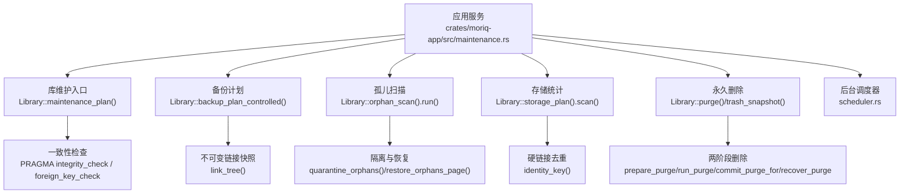
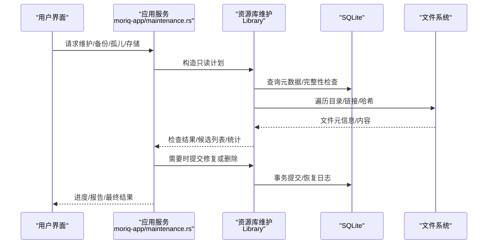
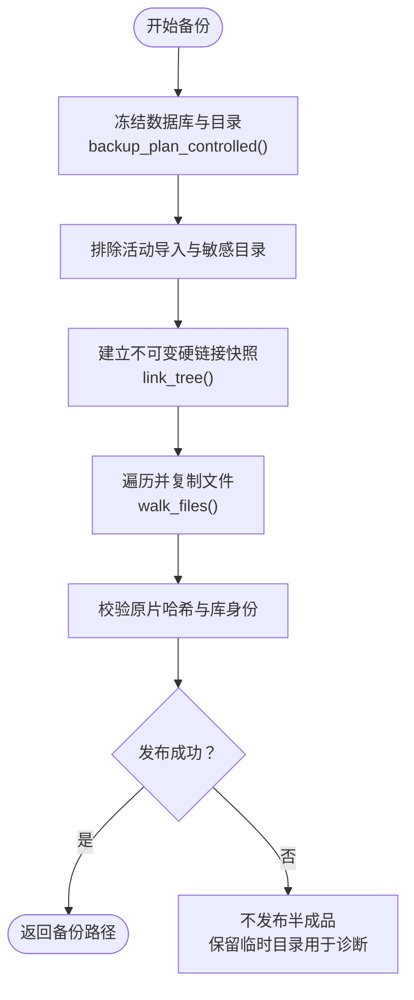
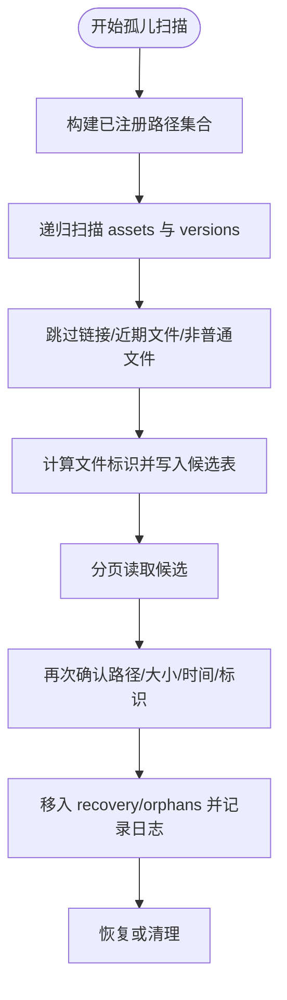
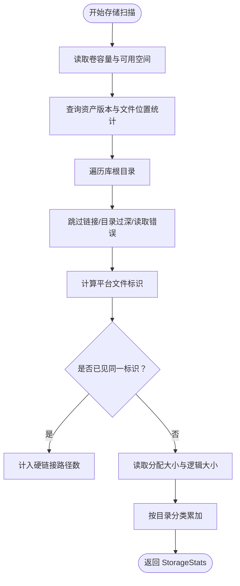
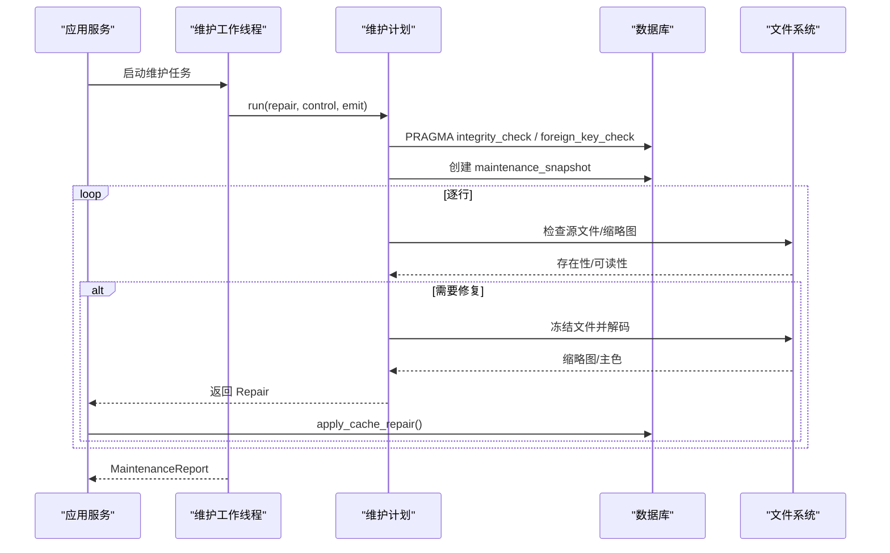
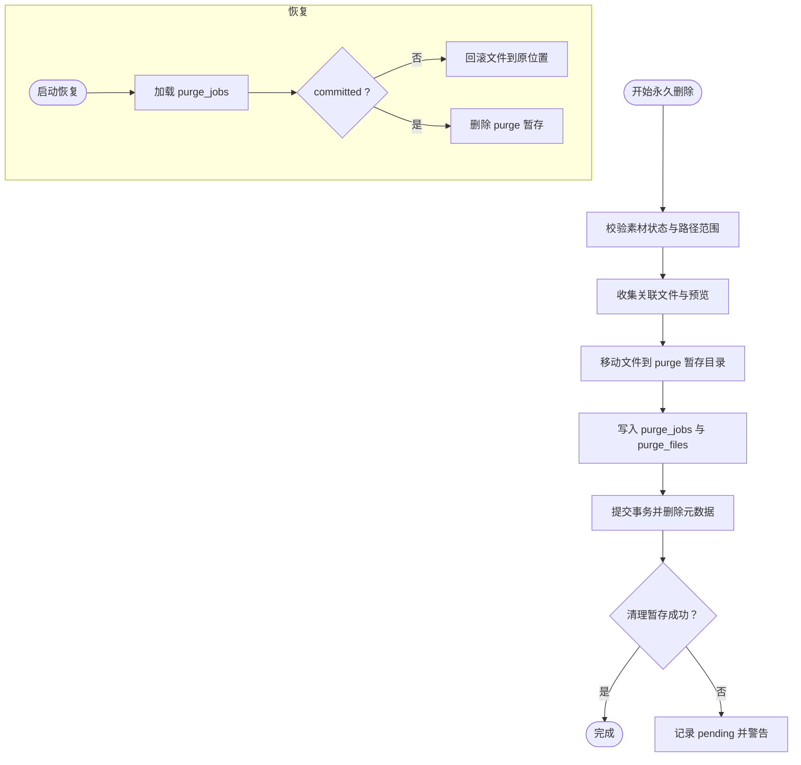
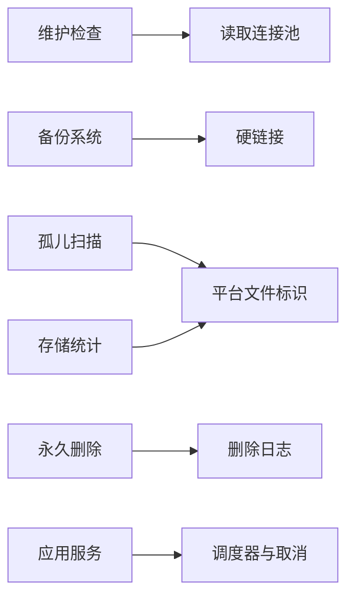

# 维护工具集

> Repo Wiki 节点 `maintenance-tools`
> 导出自 Qoder 知识库快照 `8fbe02f6-57c2-4874-b725-1a8130851fd9`，代码基线 `7a7a8e75e18bd90294e09cd422dd7ed5a04813a0`（分支 main，zh-CN）。

<cite>
**本文引用的文件**
- [maintenance.rs](../../../../crates/moriq-library/src/maintenance/maintenance.rs)
- [backup.rs](../../../../crates/moriq-library/src/maintenance/backup.rs)
- [orphans.rs](../../../../crates/moriq-library/src/maintenance/orphans.rs)
- [purge.rs](../../../../crates/moriq-library/src/maintenance/purge.rs)
- [storage.rs](../../../../crates/moriq-library/src/maintenance/storage.rs)
- [maintenance.rs](../../../../crates/moriq-app/src/maintenance.rs)
- [scheduler.rs](../../../../crates/moriq-app/src/scheduler.rs)
</cite>

## 目录
1. [引言](#引言)
2. [项目结构](#项目结构)
3. [核心组件](#核心组件)
4. [架构总览](#架构总览)
5. [详细组件分析](#详细组件分析)
6. [依赖关系分析](#依赖关系分析)
7. [性能与资源特性](#性能与资源特性)
8. [故障排查指南](#故障排查指南)
9. [结论](#结论)

## 引言
本文件面向维护工具集的代码级文档，聚焦以下能力：
- 备份与恢复：一致快照、独立克隆、增量式可恢复删除。
- 孤儿文件清理：扫描、隔离、恢复与清理建议。
- 存储统计：空间占用、硬链接去重、分类统计与重复路径识别。
- 维护任务：一致性检查、缓存修复、进度监控与取消。
- 安全策略：路径校验、链接防护、身份校验与两阶段提交。
- 自动化调度：后台任务循环、取消登记与失败退避。

该实现采用“计划—执行”分离模式：先在写入线程中冻结数据库和目录视图，再在独立工作线程中执行 I/O；所有破坏性操作通过日志与暂存目录支持恢复，避免中途失败造成数据不一致。

## 项目结构
维护功能集中在 `moriq-library` 的 `maintenance` 子模块，并由 `moriq-app` 暴露为异步服务接口。关键文件职责如下：

**图示来源**
- [maintenance.rs:1-200](../../../../crates/moriq-library/src/maintenance/maintenance.rs#L1-L200)
- [backup.rs:1-200](../../../../crates/moriq-library/src/maintenance/backup.rs#L1-L200)
- [orphans.rs:1-200](../../../../crates/moriq-library/src/maintenance/orphans.rs#L1-L200)
- [storage.rs:1-200](../../../../crates/moriq-library/src/maintenance/storage.rs#L1-L200)
- [purge.rs:1-200](../../../../crates/moriq-library/src/maintenance/purge.rs#L1-L200)
- [maintenance.rs:1-244](../../../../crates/moriq-app/src/maintenance.rs#L1-L244)
- [scheduler.rs:1-200](../../../../crates/moriq-app/src/scheduler.rs#L1-L200)

**章节来源**
- [maintenance.rs:1-200](../../../../crates/moriq-library/src/maintenance/maintenance.rs#L1-L200)
- [backup.rs:1-200](../../../../crates/moriq-library/src/maintenance/backup.rs#L1-L200)
- [orphans.rs:1-200](../../../../crates/moriq-library/src/maintenance/orphans.rs#L1-L200)
- [storage.rs:1-200](../../../../crates/moriq-library/src/maintenance/storage.rs#L1-L200)
- [purge.rs:1-200](../../../../crates/moriq-library/src/maintenance/purge.rs#L1-L200)
- [maintenance.rs:1-244](../../../../crates/moriq-app/src/maintenance.rs#L1-L244)
- [scheduler.rs:1-200](../../../../crates/moriq-app/src/scheduler.rs#L1-L200)

## 核心组件
- 维护检查：冻结读取连接池，创建临时快照表，逐项检查版本文件、缩略图与主色，并返回可选修复项。
- 备份系统：冻结目录与数据库，生成不可变链接快照，排除活动导入暂存，支持独立克隆与发布前校验。
- 孤儿文件：扫描未注册受管文件，记录修改时间与平台文件标识，分页复核后移入隔离区，支持恢复或清理。
- 存储统计：按目录分类统计分配空间与唯一文件大小，按平台文件标识去重硬链接，报告卷容量与可用空间。
- 永久删除：两阶段移动、提交与恢复日志，严格限制路径范围，拒绝链接与外部目标。
- 应用服务层：将上述能力封装为异步 API，提供进度、取消、批量与身份校验。

**章节来源**
- [maintenance.rs:1-200](../../../../crates/moriq-library/src/maintenance/maintenance.rs#L1-L200)
- [backup.rs:1-200](../../../../crates/moriq-library/src/maintenance/backup.rs#L1-L200)
- [orphans.rs:1-200](../../../../crates/moriq-library/src/maintenance/orphans.rs#L1-L200)
- [storage.rs:1-200](../../../../crates/moriq-library/src/maintenance/storage.rs#L1-L200)
- [purge.rs:1-200](../../../../crates/moriq-library/src/maintenance/purge.rs#L1-L200)
- [maintenance.rs:1-244](../../../../crates/moriq-app/src/maintenance.rs#L1-L244)

## 架构总览
维护流程遵循统一模式：
1. 应用层通过 `read_plan` 或 `call` 获取当前活动库实例。
2. 库层构造只读计划对象，携带根路径、读取池与租约。
3. 计划对象执行 I/O 密集工作，必要时写入临时文件或 SQLite 临时表。
4. 破坏性操作通过日志、暂存目录或事务保证可恢复。
5. 应用层聚合结果、更新 UI 状态，并在需要时调用写入端应用修复。

**图示来源**
- [maintenance.rs:1-244](../../../../crates/moriq-app/src/maintenance.rs#L1-L244)
- [maintenance.rs:1-200](../../../../crates/moriq-library/src/maintenance/maintenance.rs#L1-L200)
- [backup.rs:1-200](../../../../crates/moriq-library/src/maintenance/backup.rs#L1-L200)
- [orphans.rs:1-200](../../../../crates/moriq-library/src/maintenance/orphans.rs#L1-L200)
- [storage.rs:1-200](../../../../crates/moriq-library/src/maintenance/storage.rs#L1-L200)
- [purge.rs:1-200](../../../../crates/moriq-library/src/maintenance/purge.rs#L1-L200)

## 详细组件分析

### 备份与恢复
备份分为两个阶段：
- 冻结阶段：在写入线程内复制数据库、生成 `library.toml`、对受管目录建立硬链接快照，并清理未完成导入上下文。
- 复制与发布阶段：深度受限地遍历冻结目录，计数并复制文件，发布前校验原片哈希与库身份。

**图示来源**
- [backup.rs:1-200](../../../../crates/moriq-library/src/maintenance/backup.rs#L1-L200)
- [backup.rs:201-400](../../../../crates/moriq-library/src/maintenance/backup.rs#L201-L400)

关键设计要点：
- 备份位置不能位于资源库内部，避免递归与覆盖。
- 独立克隆会重置库标识、清空同步任务与后台作业状态。
- 已中断导入的暂存文件被保留，以便后续恢复。
- 复制过程使用深度上限与符号链接检测，防止恶意或异常目录结构。
- 发布前重新打开备份中的数据库，校验无引用丢失的原片哈希。

**章节来源**
- [backup.rs:1-200](../../../../crates/moriq-library/src/maintenance/backup.rs#L1-L200)
- [backup.rs:201-400](../../../../crates/moriq-library/src/maintenance/backup.rs#L201-L400)
- [maintenance.rs:1-244](../../../../crates/moriq-app/src/maintenance.rs#L1-L244)

### 孤儿文件检测与清理
孤儿扫描流程：
1. 构建已注册路径集合，包含素材版本、项目文件、操作日志与待删除文件。
2. 从 `assets` 与 `versions` 目录递归扫描，跳过链接与近期修改文件。
3. 计算平台文件标识与修改时间，写入临时 SQLite 候选表。
4. 分页读取候选，二次确认文件存在性与元数据不变后，移入 `recovery/orphans`。

**图示来源**
- [orphans.rs:1-200](../../../../crates/moriq-library/src/maintenance/orphans.rs#L1-L200)
- [orphans.rs:201-355](../../../../crates/moriq-library/src/maintenance/orphans.rs#L201-L355)

安全与恢复机制：
- 隔离操作使用 UUID 命名文件，并维护 `orphan_quarantine` 表跟踪状态。
- 恢复流程验证原始路径与目标路径格式，拒绝覆盖现有文件。
- 清理模式标记为 `purging`，失败时保留中间状态以便重试。
- 重启后可自动恢复未完成隔离，避免卡死在中间态。

**章节来源**
- [orphans.rs:1-200](../../../../crates/moriq-library/src/maintenance/orphans.rs#L1-L200)
- [orphans.rs:201-355](../../../../crates/moriq-library/src/maintenance/orphans.rs#L201-L355)

### 存储分析与重复检测
存储统计由 `storage_plan().scan()` 完成，输出包括：
- 卷总空间与可用空间。
- 托管已注册字节数与外部引用已注册字节数。
- 已分配空间、唯一文件字节数、硬链接路径数。
- 按目录分类的空间分布。

**图示来源**
- [storage.rs:1-200](../../../../crates/moriq-library/src/maintenance/storage.rs#L1-L200)
- [storage.rs:201-261](../../../../crates/moriq-library/src/maintenance/storage.rs#L201-L261)

去重策略：
- 使用 `file_id::FileId` 的 inode、低分辨率索引或高分辨率 ID 作为键，跨平台比较硬链接。
- 仅对首次出现的文件累计分配空间与唯一字节，重复路径仅增加 `linked_paths`。
- 分类函数根据相对路径首段归类，便于定位冗余类型。

**章节来源**
- [storage.rs:1-200](../../../../crates/moriq-library/src/maintenance/storage.rs#L1-L200)
- [storage.rs:201-261](../../../../crates/moriq-library/src/maintenance/storage.rs#L201-L261)

### 维护检查与缓存修复
维护检查在独立于写入线程的工作队列中运行，避免阻塞导入与编辑：
- 先执行数据库完整性与外键检查。
- 创建临时快照表，投影版本路径、哈希、主色与平台编码路径。
- 逐项检查源文件是否存在、缩略图是否可解码、主色是否缺失。
- 若需要修复，冻结对应文件并尝试重建缩略图或提取主色，返回修复候选。
- 应用修复前校验版本哈希与来源路径，确保写入端仍持有最新元数据。

**图示来源**
- [maintenance.rs:1-200](../../../../crates/moriq-library/src/maintenance/maintenance.rs#L1-L200)
- [maintenance.rs:1-244](../../../../crates/moriq-app/src/maintenance.rs#L1-L244)

**章节来源**
- [maintenance.rs:1-200](../../../../crates/moriq-library/src/maintenance/maintenance.rs#L1-L200)
- [maintenance.rs:1-244](../../../../crates/moriq-app/src/maintenance.rs#L1-L244)

### 永久删除与两阶段恢复
永久删除采用两阶段协议：
1. 准备阶段：收集受管文件、预览、项目文件与 Synco 导出文件，校验所有权与路径范围。
2. 移动阶段：将文件移动到 `trash/purge-{job}/xxx.part`，写入 `purge_jobs` 与 `purge_files`。
3. 提交阶段：删除关联元数据、资产版本与项目关系，标记 job 已提交。
4. 恢复阶段：启动时检查未完成删除，未提交则回滚文件位置，已提交则清理暂存。

**图示来源**
- [purge.rs:1-200](../../../../crates/moriq-library/src/maintenance/purge.rs#L1-L200)
- [purge.rs:201-400](../../../../crates/moriq-library/src/maintenance/purge.rs#L201-L400)

**章节来源**
- [purge.rs:1-200](../../../../crates/moriq-library/src/maintenance/purge.rs#L1-L200)
- [purge.rs:201-400](../../../../crates/moriq-library/src/maintenance/purge.rs#L201-L400)

## 依赖关系分析
维护子系统依赖以下核心能力：
- 读取池与只读连接：保证一致性快照且不影响写入端。
- 临时文件与临时数据库：隔离中间结果，降低内存峰值。
- 平台文件标识：跨操作系统进行硬链接去重。
- 文件系统原子操作：rename 与 hard_link 用于不可变快照与两阶段删除。
- 应用层调度器：管理后台任务生命周期、取消令牌与失败退避。

**图示来源**
- [maintenance.rs:1-200](../../../../crates/moriq-library/src/maintenance/maintenance.rs#L1-L200)
- [backup.rs:1-200](../../../../crates/moriq-library/src/maintenance/backup.rs#L1-L200)
- [orphans.rs:1-200](../../../../crates/moriq-library/src/maintenance/orphans.rs#L1-L200)
- [storage.rs:1-200](../../../../crates/moriq-library/src/maintenance/storage.rs#L1-L200)
- [purge.rs:1-200](../../../../crates/moriq-library/src/maintenance/purge.rs#L1-L200)
- [scheduler.rs:1-200](../../../../crates/moriq-app/src/scheduler.rs#L1-L200)

**章节来源**
- [maintenance.rs:1-200](../../../../crates/moriq-library/src/maintenance/maintenance.rs#L1-L200)
- [backup.rs:1-200](../../../../crates/moriq-library/src/maintenance/backup.rs#L1-L200)
- [orphans.rs:1-200](../../../../crates/moriq-library/src/maintenance/orphans.rs#L1-L200)
- [storage.rs:1-200](../../../../crates/moriq-library/src/maintenance/storage.rs#L1-L200)
- [purge.rs:1-200](../../../../crates/moriq-library/src/maintenance/purge.rs#L1-L200)
- [scheduler.rs:1-200](../../../../crates/moriq-app/src/scheduler.rs#L1-L200)

## 性能与资源特性
- 只读快照：维护与存储扫描使用临时 SQLite 表与临时文件，避免长期 WAL 事务。
- 内存控制：维护解码共享全局媒体预算，按批获取许可，避免挤占导入线程。
- 目录遍历：使用栈式遍历与深度上限，防止大库导致内存膨胀。
- 去重统计：按平台文件标识去重硬链接，减少重复物理空间统计。
- 进度上报：备份与存储扫描使用原子计数器与回调，便于 UI 显示进度。
- 取消支持：各阶段均检查取消标志，失败时不发布半成品。

[本节为通用性能讨论，不直接分析具体代码行]

## 故障排查指南
常见错误与处理建议：
- 数据库完整性检查失败：提示保留原库并从备份恢复，不要直接修复损坏库。
- 外键检查失败：说明存在失效引用，应停止维护并从备份恢复。
- 备份位置非法：选择资源库之外的磁盘目录。
- 备份发现符号链接：先检查资源库完整性，再重试。
- 孤儿文件元数据变化：跳过差异项，避免误删活跃文件。
- 隔离恢复失败：检查 `recovery/orphans` 下文件是否存在，重试恢复。
- 永久删除路径无效：确认文件属于受管区域且未被其他素材引用。
- 删除恢复冲突：当原位置与暂存文件同时存在时，需人工干预并保留双方文件。
- 后台任务连续失败：调度器会暂停任务并记录原因，检查通知后重试。

**章节来源**
- [maintenance.rs:1-200](../../../../crates/moriq-library/src/maintenance/maintenance.rs#L1-L200)
- [backup.rs:1-200](../../../../crates/moriq-library/src/maintenance/backup.rs#L1-L200)
- [orphans.rs:1-200](../../../../crates/moriq-library/src/maintenance/orphans.rs#L1-L200)
- [purge.rs:1-200](../../../../crates/moriq-library/src/maintenance/purge.rs#L1-L200)
- [scheduler.rs:1-200](../../../../crates/moriq-app/src/scheduler.rs#L1-L200)

## 结论
该维护工具集以“冻结—执行—恢复”为核心思想，在保证一致性的前提下提供备份、孤儿清理、存储统计与维护检查。其优势在于：
- 强安全性：路径白名单、链接防护、身份校验与两阶段删除。
- 高可恢复性：临时快照、隔离区与删除日志确保中断可恢复。
- 良好可扩展性：计划对象抽象出 I/O 边界，便于扩展新维护任务。
- 可控资源使用：临时数据库、深度限制与取消标志避免长时间阻塞。

建议在自动化场景中：
- 使用独立克隆备份用于迁移或离线归档。
- 定期运行孤儿扫描与存储统计，结合清理建议释放空间。
- 通过调度器配置定时任务，并结合取消接口实现交互式暂停。
- 在重大变更前始终先备份，再执行维护修复。

[本节为总结性内容，不直接分析具体代码行]