# 领域模型层设计

> Repo Wiki 节点 `domain-model-layer`
> 导出自 Qoder 知识库快照 `8fbe02f6-57c2-4874-b725-1a8130851fd9`，代码基线 `7a7a8e75e18bd90294e09cd422dd7ed5a04813a0`（分支 main，zh-CN）。

<cite>
**本文引用的文件**   
- [moriq-domain/src/lib.rs](../../../crates/moriq-domain/src/lib.rs)
- [moriq-domain/src/jobs.rs](../../../crates/moriq-domain/src/jobs.rs)
- [moriq-domain/src/ai.rs](../../../crates/moriq-domain/src/ai.rs)
- [moriq-domain/Cargo.toml](../../../crates/moriq-domain/Cargo.toml)
</cite>

## 目录
1. [引言](#引言)
2. [项目结构](#项目结构)
3. [核心领域实体](#核心领域实体)
4. [架构总览](#架构总览)
5. [详细组件分析](#详细组件分析)
6. [依赖关系分析](#依赖关系分析)
7. [性能与约束特性](#性能与约束特性)
8. [序列化与反序列化](#序列化与反序列化)
9. [使用示例：跨层传递领域对象](#使用示例跨层传递领域对象)
10. [故障排查指南](#故障排查指南)
11. [结论](#结论)

## 引言
本仓库的领域模型层集中在 `moriq-domain` crate，提供稳定的、无 I/O 依赖的纯数据结构、枚举和纯函数式校验逻辑。它承担以下职责：
- 定义资产、版本、项目、标签等核心业务概念。
- 用枚举和结构体组合表达查询规则、任务种类、AI 分类配置、用户偏好等复杂领域状态。
- 通过输入验证和预算限制保证数据合法，避免 SQL、文件系统路径直接进入领域层。
- 提供可序列化的稳定协议类型，用于 UI、存储、后台任务和推理子系统之间的消息交换。

该层不持有数据库连接、渲染器或网络客户端，只输出“可以安全传递给其他层的值”。

**章节来源**
- [moriq-domain/Cargo.toml:1-10](../../../crates/moriq-domain/Cargo.toml#L1-L10)

## 项目结构
`moriq-domain` 由三个主要源文件组成：
- `lib.rs`：核心身份标识、资产、项目、查询、编辑、导出、维护报告、位置信息等主领域模型。
- `jobs.rs`：任务种类、任务状态、模型 ID、任务错误等运行时协议类型。
- `ai.rs`：AI 分类、主题、媒体类型、AI 配置档案及 AI 编辑命令。

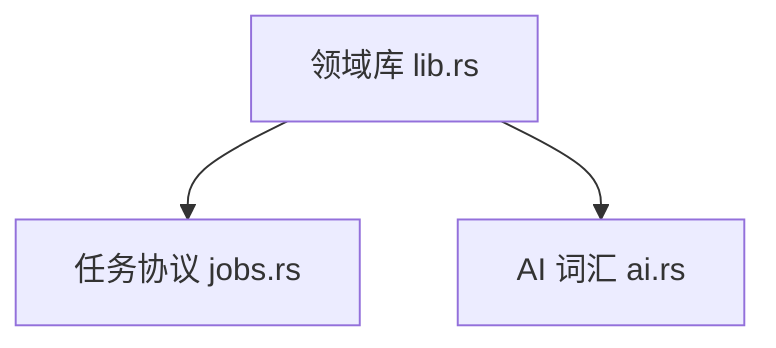

**图表来源**
- [moriq-domain/src/lib.rs:1-711](../../../crates/moriq-domain/src/lib.rs#L1-L711)
- [moriq-domain/src/jobs.rs:1-229](../../../crates/moriq-domain/src/jobs.rs#L1-L229)
- [moriq-domain/src/ai.rs:1-187](../../../crates/moriq-domain/src/ai.rs#L1-L187)

**章节来源**
- [moriq-domain/src/lib.rs:1-711](../../../crates/moriq-domain/src/lib.rs#L1-L711)
- [moriq-domain/src/jobs.rs:1-229](../../../crates/moriq-domain/src/jobs.rs#L1-L229)
- [moriq-domain/src/ai.rs:1-187](../../../crates/moriq-domain/src/ai.rs#L1-L187)

## 核心领域实体
本节聚焦文档目标中的关键类型：`Asset`、`AssetVersion`、`Project`、`Tag`、`JobKind`，以及与之密切相关的身份标识和查询模型。

### 身份标识
系统使用强类型 UUID 标识符表示核心实体，而不是裸字符串或整数：
- `LibraryId`
- `AssetId`
- `AssetVersionId`
- `ProjectId`

这些标识符具备相等性、哈希、可克隆、可复制、可序列化和可显示能力，并默认生成随机新 UUID，避免新建对象复用已有身份。

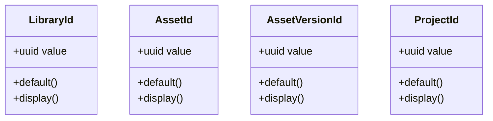

**图表来源**
- [moriq-domain/src/lib.rs:1-60](../../../crates/moriq-domain/src/lib.rs#L1-L60)

### Asset（资产）
`Asset` 描述一个已入库的可检索资源。关键字段包括：
- `id`：资产唯一标识。
- `version_id`：当前可见版本的标识。
- `name`、`format`、`width`、`height`、`bytes`：基本元数据。
- `favorite`、`rating`：用户评分与收藏标记。
- `tags`：文本标签列表。
- `imported_at`：导入时间戳。

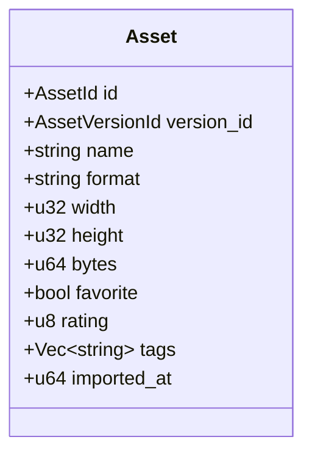

**图表来源**
- [moriq-domain/src/lib.rs:60-110](../../../crates/moriq-domain/src/lib.rs#L60-L110)

### AssetVersion（资产版本）
`AssetVersion` 描述资产的具体版本：
- `id`：版本唯一标识。
- `origin`：来源说明。
- `parent`：可选父版本，体现版本链。

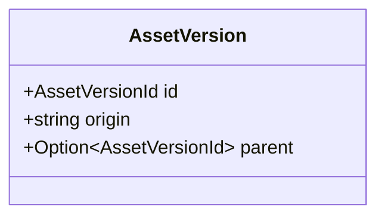

**图表来源**
- [moriq-domain/src/lib.rs:201-230](../../../crates/moriq-domain/src/lib.rs#L201-L230)

### Project（项目）
`Project` 表示项目的聚合视图：
- `visited_at`：最近访问时间。
- `id`：项目标识。
- `parent`：可选父项目，形成层级。
- `name`：项目名称。
- `count`：项目内资源数量。

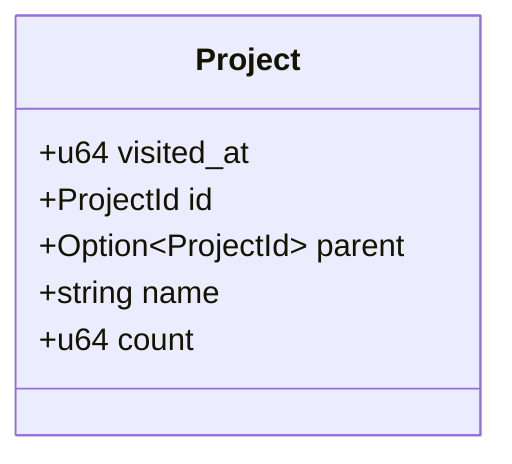

**图表来源**
- [moriq-domain/src/lib.rs:40-70](../../../crates/moriq-domain/src/lib.rs#L40-L70)

### Tag（标签）
领域层没有独立的 `Tag` 实体类；标签以字符串形式出现在 `Asset.tags` 中，并通过查询和批量编辑参与领域操作。这使标签保持轻量，同时仍能被过滤、添加和移除。

相关使用点：
- `Asset.tags`：资产标签集合。
- `Rule::Tag(String)`：按标签筛选。
- `Edit::AddTags` / `Edit::RemoveTags`：修改标签。
- `BatchPatch.add_tags` / `remove_tags`：批量标签变更。
- `Organizer.tags`：统计标签计数。

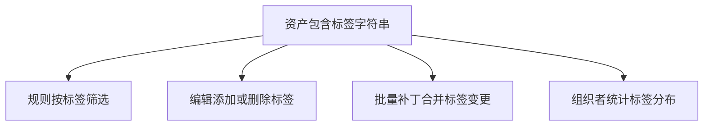

**图表来源**
- [moriq-domain/src/lib.rs:60-110](../../../crates/moriq-domain/src/lib.rs#L60-L110)
- [moriq-domain/src/lib.rs:110-190](../../../crates/moriq-domain/src/lib.rs#L110-L190)
- [moriq-domain/src/lib.rs:480-600](../../../crates/moriq-domain/src/lib.rs#L480-L600)

**章节来源**
- [moriq-domain/src/lib.rs:40-110](../../../crates/moriq-domain/src/lib.rs#L40-L110)
- [moriq-domain/src/lib.rs:201-230](../../../crates/moriq-domain/src/lib.rs#L201-L230)

## 架构总览
领域模型层位于应用、UI、库服务和持久化层之间，作为稳定契约边界。上层构造领域对象，下层消费领域对象，但不应直接构造数据库行或 UI 控件。

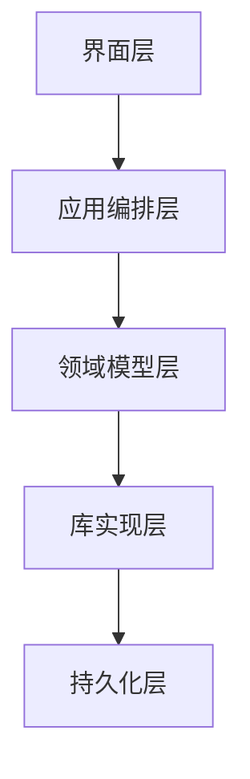

**图表来源**
- [moriq-domain/src/lib.rs:1-711](../../../crates/moriq-domain/src/lib.rs#L1-L711)
- [moriq-domain/src/jobs.rs:1-229](../../../crates/moriq-domain/src/jobs.rs#L1-L229)
- [moriq-domain/src/ai.rs:1-187](../../../crates/moriq-domain/src/ai.rs#L1-L187)

**章节来源**
- [moriq-domain/src/lib.rs:1-711](../../../crates/moriq-domain/src/lib.rs#L1-L711)

## 详细组件分析

### 查询与规则树：Query、Rule、MetadataPredicate
查询不是 SQL 字符串，而是结构化、可序列化的表达式树：
- `Query`：顶层查询条件，包含媒体类型、排序、分页语义、项目范围、评分阈值、尺寸阈值、颜色、标签等。
- `Rule`：递归规则树，支持 `All`、`Any`、`Not` 分组，以及名称、备注、标签、格式、评分、收藏、原始文件、位置存在性等原子条件。
- `MetadataPredicate`：字段级元数据谓词，带最小值和最大值区间。

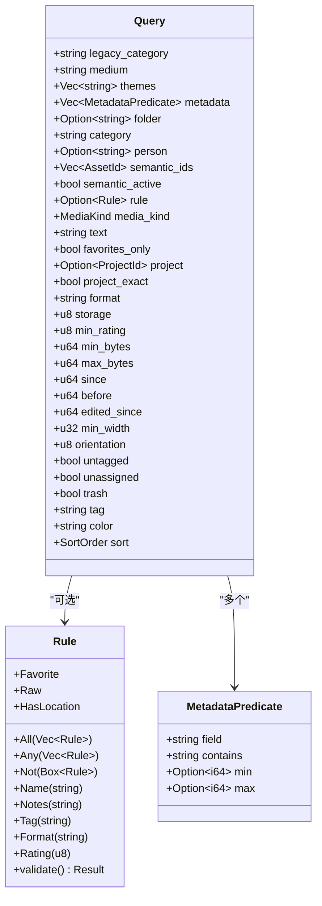

**图表来源**
- [moriq-domain/src/lib.rs:90-190](../../../crates/moriq-domain/src/lib.rs#L90-L190)

#### 规则校验流程
`Rule::validate` 通过深度优先遍历限制规则树的复杂度：
- 最大深度为 8。
- 节点总数不超过 64。
- `All`/`Any` 子项数量为 1～64。
- 文字类条件长度在 1～1024 字节。
- 评分必须为 0～5。

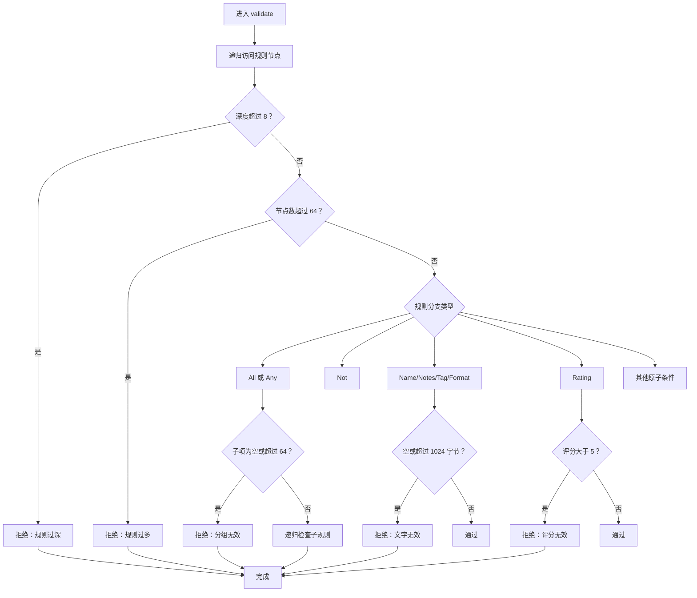

**图表来源**
- [moriq-domain/src/lib.rs:120-190](../../../crates/moriq-domain/src/lib.rs#L120-L190)

**章节来源**
- [moriq-domain/src/lib.rs:90-190](../../../crates/moriq-domain/src/lib.rs#L90-L190)

### 任务协议：JobKind、ModelId、JobState、TaskError
任务协议将业务任务与底层持久化字符串解耦：
- `ModelId`：AI 模型稳定标识，如中文剪影、Florence、人脸、Qwen 等。
- `JobKind`：任务种类，包括元数据、完整性、指纹、缩略图、批处理、不同模型的分析和 Qwen 分类/描述/人脸任务。
- `JobState`：任务状态，包括排队、运行、暂停、完成、取消。
- `TaskError`：任务错误类别，包括取消、过时资源库、非法输入、存储错误、运行时错误和服务不可用。

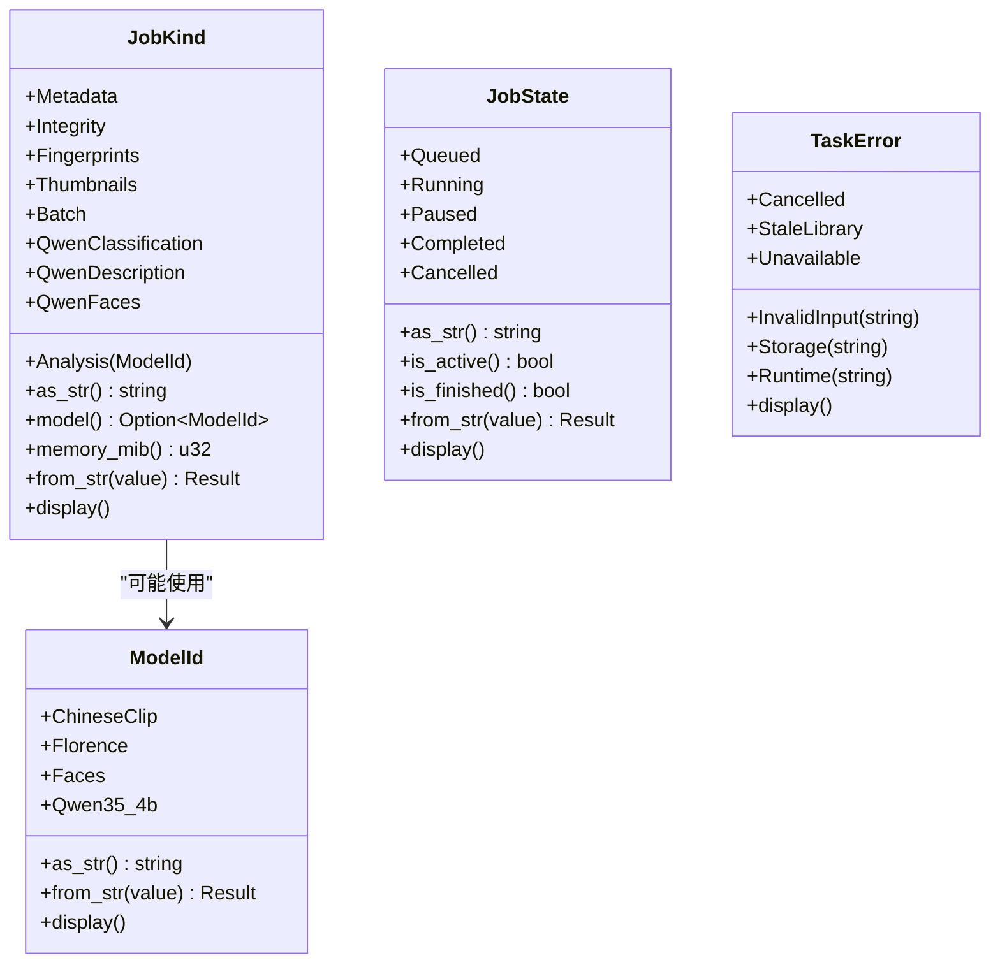

**图表来源**
- [moriq-domain/src/jobs.rs:1-160](../../../crates/moriq-domain/src/jobs.rs#L1-L160)

#### 任务解析与调度决策
`JobKind::from_str` 将持久化字符串解析为枚举；未知值会被拒绝，防止错误调度。`JobKind::model` 决定任务是否关联某个模型，`JobKind::memory_mib` 给出共享内存预算。

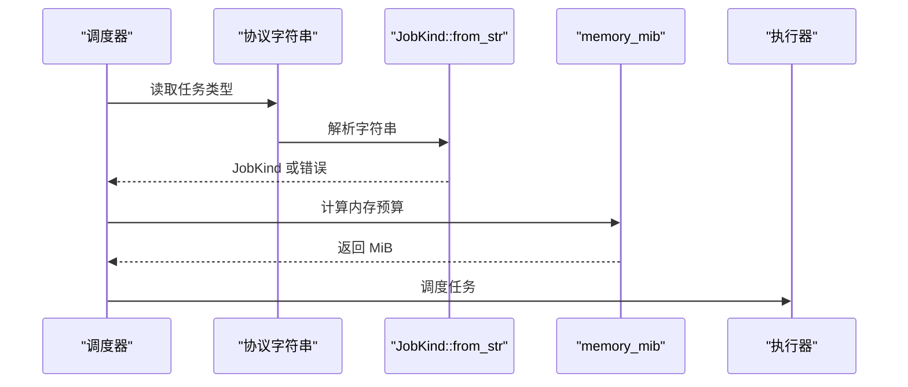

**图表来源**
- [moriq-domain/src/jobs.rs:60-160](../../../crates/moriq-domain/src/jobs.rs#L60-L160)

**章节来源**
- [moriq-domain/src/jobs.rs:1-229](../../../crates/moriq-domain/src/jobs.rs#L1-L229)

### AI 领域：AiProfile、AiCategory、AiGroup、AiEdit
AI 领域强调稳定分类身份和上下文预算控制：
- `AiCategoryKind`：区分媒介与主题。
- `AiCategory`：分类身份、标签、定义和启用状态。
- `AiProfile`：AI 配置档案，含修订号、主题上限和分类集合。
- `AiGroup`：将稳定查询与 AI 分组绑定，可用于展示封面和计数。
- `AiEdit`：AI 分类、媒介、主题、描述、拒绝标签、提升标签等编辑命令。

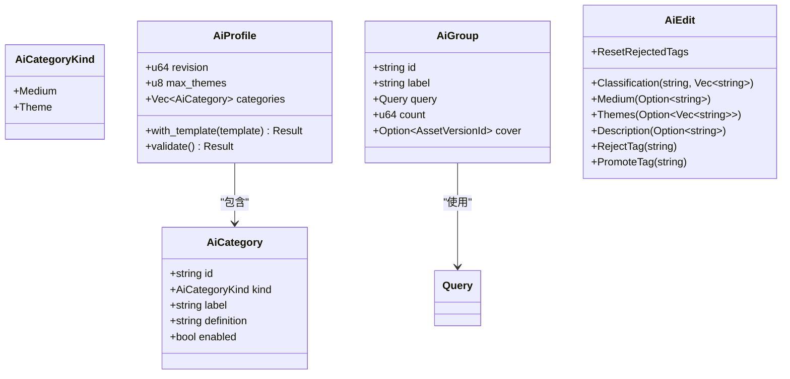

**图表来源**
- [moriq-domain/src/ai.rs:1-187](../../../crates/moriq-domain/src/ai.rs#L1-L187)
- [moriq-domain/src/lib.rs:90-190](../../../crates/moriq-domain/src/lib.rs#L90-L190)

#### AI 配置合并与校验
`AiProfile::with_template` 合并模板分类，保留旧分类身份，并对未包含的分类隐藏而非删除；随后重新校验。`AiProfile::validate` 限制：
- 启用主题最多 24 个。
- 识别说明字符总数最多 1600。
- 主题上限 1～8。
- 分类总数最多 64。
- 分类 ID 命名规范、唯一且非空。
- 标签唯一且非空。
- 固定媒介不能删除，只能禁用。

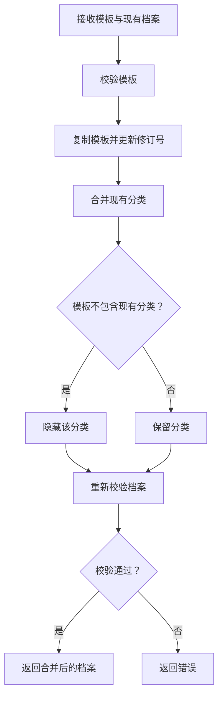

**图表来源**
- [moriq-domain/src/ai.rs:20-120](../../../crates/moriq-domain/src/ai.rs#L20-L120)

**章节来源**
- [moriq-domain/src/ai.rs:1-187](../../../crates/moriq-domain/src/ai.rs#L1-L187)

### 用户设置、编辑与批量操作
领域层还提供用户偏好、编辑命令和批量操作模型：
- `UserSettings`：AI、语言、外观、同步工具、导入偏好等。
- `ImportPreferences`：并发数和内存预算，带自动计算和校验。
- `Edit`：单个资产的垃圾回收、收藏、评分、标签、项目、备注编辑。
- `BatchPatch`：批量补丁，支持收藏、评分、备注、分类、标签和项目。
- `BatchScope`：指定资产集合或查询范围。

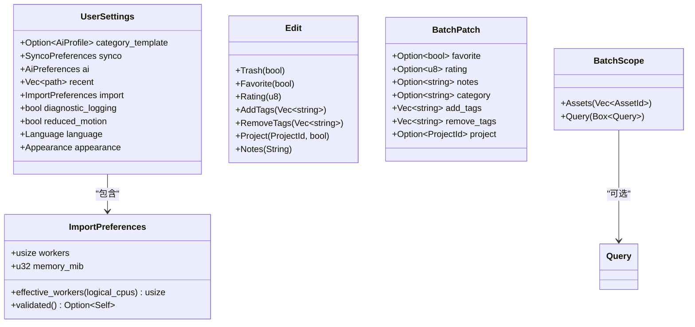

**图表来源**
- [moriq-domain/src/lib.rs:260-480](../../../crates/moriq-domain/src/lib.rs#L260-L480)

**章节来源**
- [moriq-domain/src/lib.rs:260-480](../../../crates/moriq-domain/src/lib.rs#L260-L480)

## 依赖关系分析
`moriq-domain` 仅依赖两个外部 crate：
- `serde`：用于序列化与反序列化。
- `uuid`：用于强类型身份标识。

内部模块依赖关系如下：
- `lib.rs` 暴露所有公开领域类型。
- `lib.rs` 引入 `ai.rs` 和 `jobs.rs`。
- `ai.rs` 引用 `lib.rs` 中的 `Query` 和 `AssetVersionId`。
- `jobs.rs` 独立定义任务协议，被 `lib.rs` 暴露。

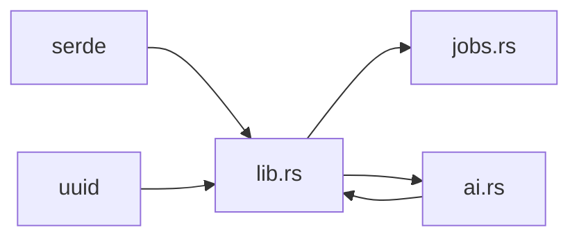

**图表来源**
- [moriq-domain/Cargo.toml:1-10](../../../crates/moriq-domain/Cargo.toml#L1-L10)
- [moriq-domain/src/lib.rs:1-20](../../../crates/moriq-domain/src/lib.rs#L1-L20)
- [moriq-domain/src/ai.rs:1-20](../../../crates/moriq-domain/src/ai.rs#L1-L20)

**章节来源**
- [moriq-domain/Cargo.toml:1-10](../../../crates/moriq-domain/Cargo.toml#L1-L10)
- [moriq-domain/src/lib.rs:1-20](../../../crates/moriq-domain/src/lib.rs#L1-L20)

## 性能与约束特性
领域模型通过静态枚举和有限状态减少运行时歧义：
- `JobKind::memory_mib` 直接给出内存预算，避免运行时猜测。
- `JobState::is_active` / `is_finished` 提供快速状态判断。
- `Rule::validate` 限制规则树深度与规模，防止恶意或异常查询造成资源消耗。
- `AiProfile::validate` 限制主题数量和说明字符总量，保护本地模型上下文预算。
- `ImportPreferences::effective_workers` 根据 CPU 数量计算并发，保留界面响应余量。
- `ImportPreferences::validated` 对并发数和内存预算做硬约束。
- `AssetLocation::valid` 校验经纬度有效性和标签长度。

这些设计使领域层既是“语义中心”，也是“第一道防线”。

**章节来源**
- [moriq-domain/src/jobs.rs:60-160](../../../crates/moriq-domain/src/jobs.rs#L60-L160)
- [moriq-domain/src/lib.rs:120-190](../../../crates/moriq-domain/src/lib.rs#L120-L190)
- [moriq-domain/src/ai.rs:40-120](../../../crates/moriq-domain/src/ai.rs#L40-L120)
- [moriq-domain/src/lib.rs:420-520](../../../crates/moriq-domain/src/lib.rs#L420-L520)
- [moriq-domain/src/lib.rs:650-711](../../../crates/moriq-domain/src/lib.rs#L650-L711)

## 序列化与反序列化
领域模型大量使用 `serde`：
- 身份标识：`LibraryId`、`AssetId`、`AssetVersionId`、`ProjectId` 均派生 `Serialize` 和 `Deserialize`。
- 枚举：`ProjectTemplate`、`MediaKind`、`SortOrder`、`ExportFormat`、`Resampling`、`ExportLayout`、`Language`、`Appearance` 等支持序列化。
- 结构体：`Query`、`Rule`、`MetadataPredicate`、`UserSettings`、`SavedVisit`、`SavedNavigation`、`ImportPreferences`、`AiCategory`、`AiProfile` 等均支持序列化。
- `Rule` 使用带标签和内容的序列化格式，便于在不同层间传递结构化规则。
- `JobKind`、`ModelId`、`JobState` 提供稳定的字符串协议映射，并支持从字符串解析。

注意事项：
- 对于需要兼容历史格式的枚举，应使用显式 `FromStr` 或自定义序列化策略。
- 对于敏感或易变 UI 状态，谨慎决定是否纳入持久化字段。
- 对于路径字段，应避免把任意路径直接放入领域层；当前 `UserSettings` 和 `ImportPreferences` 中的路径和数值字段应由上层校验后再写入。

**章节来源**
- [moriq-domain/src/lib.rs:1-200](../../../crates/moriq-domain/src/lib.rs#L1-L200)
- [moriq-domain/src/lib.rs:260-480](../../../crates/moriq-domain/src/lib.rs#L260-L480)
- [moriq-domain/src/ai.rs:1-120](../../../crates/moriq-domain/src/ai.rs#L1-L120)
- [moriq-domain/src/jobs.rs:1-160](../../../crates/moriq-domain/src/jobs.rs#L1-L160)

## 使用示例：跨层传递领域对象
下面通过典型流程展示领域对象如何在不同层之间传递。注意：示例描述的是调用顺序和数据流向，不展示具体代码内容。

### 创建并保存项目
1. 上层构建 `Project`，填充项目 ID、名称、父项目和计数。
2. 将 `Project` 传给库层，用于索引、显示和维护。
3. 持久化层读取 `Project` 并写入数据库。
4. 查询时返回 `Project`，供 UI 展示。

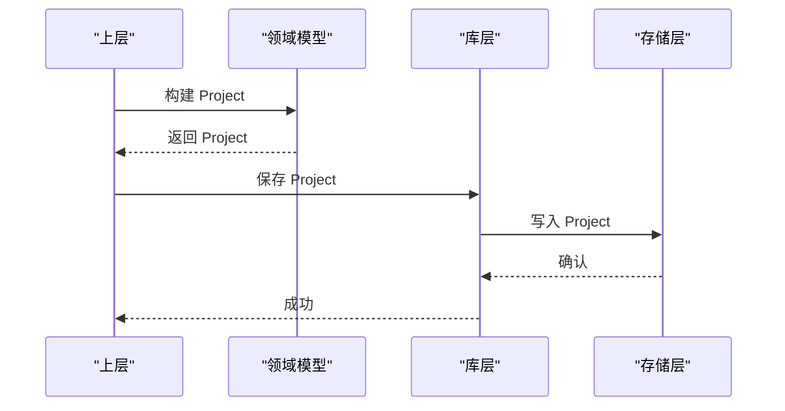

**图表来源**
- [moriq-domain/src/lib.rs:40-70](../../../crates/moriq-domain/src/lib.rs#L40-L70)

### 按规则查询资产
1. UI 构造 `Query`，并可选择嵌套 `Rule`。
2. 调用 `Rule::validate` 进行预算校验。
3. 将合法 `Query` 传给库层。
4. 库层转换为存储查询，返回 `Page`，其中包含 `Asset` 列表。

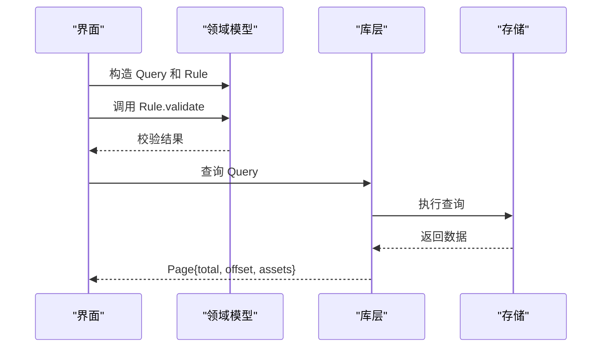

**图表来源**
- [moriq-domain/src/lib.rs:90-190](../../../crates/moriq-domain/src/lib.rs#L90-L190)
- [moriq-domain/src/lib.rs:600-640](../../../crates/moriq-domain/src/lib.rs#L600-L640)

### 提交后台任务
1. 上层选择 `JobKind`，例如元数据、缩略图或某个模型的分析任务。
2. 根据 `JobKind::memory_mib` 分配内存预算。
3. 调度器解析协议字符串为 `JobKind`，避免未知值进入执行路径。
4. 执行器完成任务后更新 `JobState`，并可能产生 `TaskError`。

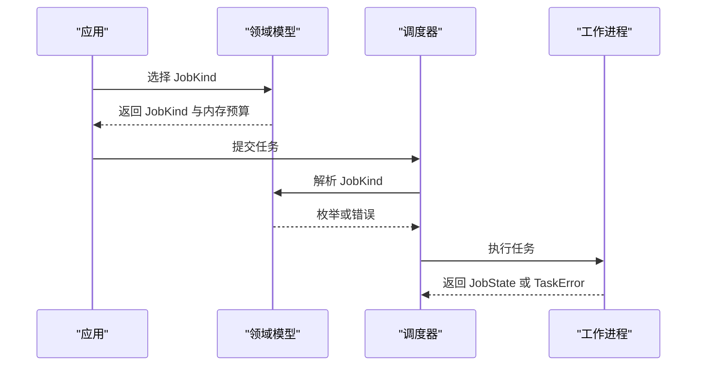

**图表来源**
- [moriq-domain/src/jobs.rs:1-160](../../../crates/moriq-domain/src/jobs.rs#L1-L160)

### 合并 AI 分类配置
1. 上层加载现有 `AiProfile` 和新模板 `AiProfile`。
2. 调用 `with_template` 合并分类。
3. 内部再次校验，确保主题数量、说明字符、分类 ID 和固定媒介约束满足。
4. 返回新的 `AiProfile`，供后续 AI 推理和 UI 展示使用。

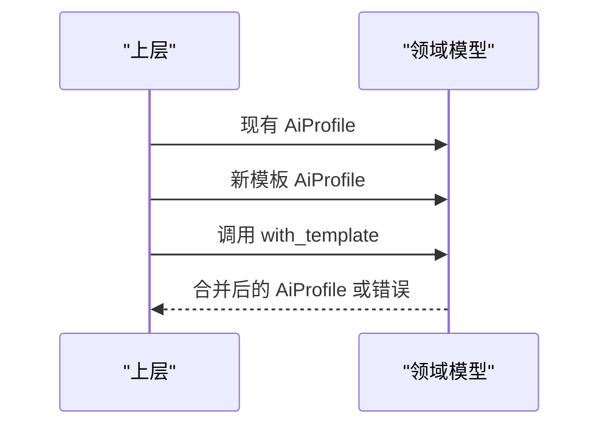

**图表来源**
- [moriq-domain/src/ai.rs:20-120](../../../crates/moriq-domain/src/ai.rs#L20-L120)

## 故障排查指南
常见领域层问题及定位方式：

| 现象 | 可能原因 | 排查建议 |
|---|---|---|
| 规则查询失败或超时 | 规则树过深、节点过多、文字过长 | 检查 `Rule::validate` 返回的错误信息 |
| AI 推理上下文过大 | 启用主题过多或说明字符过多 | 检查 `AiProfile::validate` 的限制 |
| 任务无法调度 | 协议字符串未登记或枚举解析失败 | 检查 `JobKind::from_str` 和 `ModelId::from_str` |
| 任务内存不足 | 任务类型预算设置不当 | 检查 `JobKind::memory_mib` |
| 导入并发过高导致界面卡顿 | 并发数未合理限制 | 检查 `ImportPreferences::effective_workers` 和 `validated` |
| 地图链接无效 | 经纬度超出范围或标签过长 | 检查 `AssetLocation::valid` |

**章节来源**
- [moriq-domain/src/lib.rs:120-190](../../../crates/moriq-domain/src/lib.rs#L120-L190)
- [moriq-domain/src/ai.rs:40-120](../../../crates/moriq-domain/src/ai.rs#L40-L120)
- [moriq-domain/src/jobs.rs:1-160](../../../crates/moriq-domain/src/jobs.rs#L1-L160)
- [moriq-domain/src/lib.rs:420-520](../../../crates/moriq-domain/src/lib.rs#L420-L520)
- [moriq-domain/src/lib.rs:650-711](../../../crates/moriq-domain/src/lib.rs#L650-L711)

## 结论
`moriq-domain` 通过强类型身份、枚举驱动的状态机、结构化查询规则和严格的输入校验，构建了清晰、稳定、可测试的领域模型层。它将业务语义与实现细节解耦，使上层可以专注于编排，下层可以专注于持久化与执行，而领域层负责保证数据的合法性、一致性和可序列化性。

在实际使用中，应优先构造领域对象，再将其交给库层和持久化层；不应让 SQL、文件系统路径或 UI 状态污染领域模型。对复杂业务概念，应继续使用枚举和结构体组合表达，并通过纯函数式方法做校验与转换。