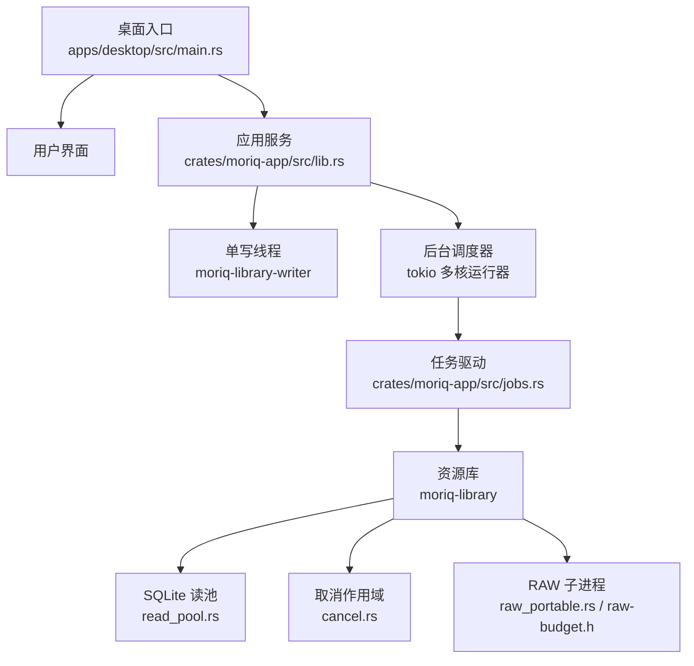
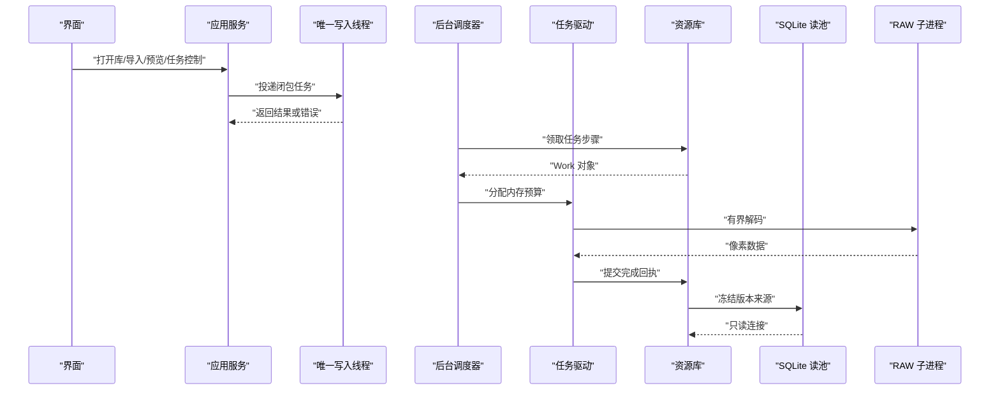
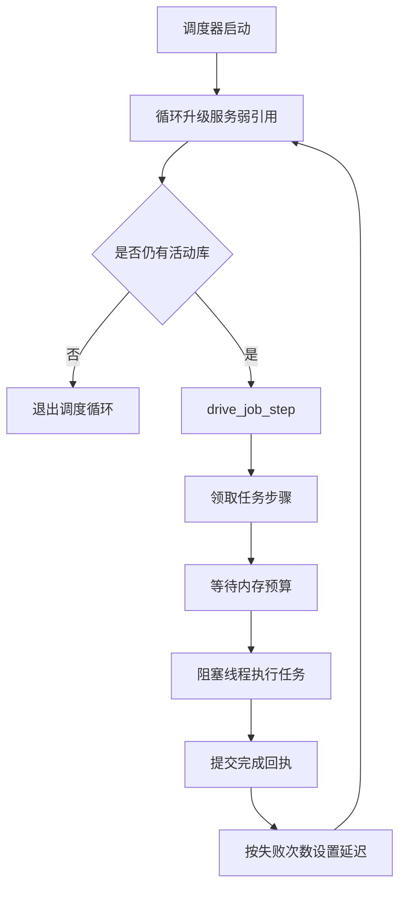
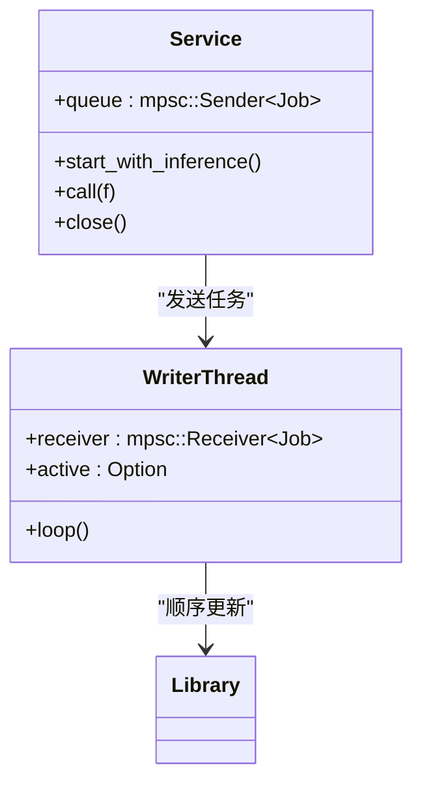
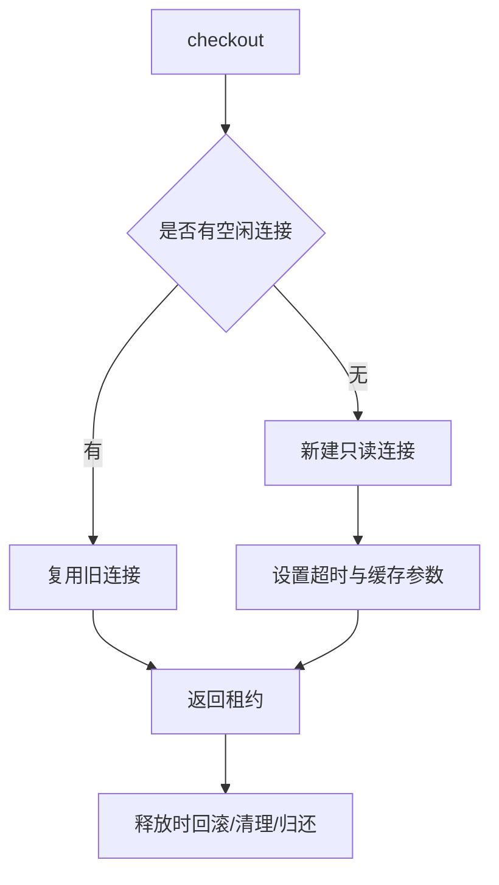
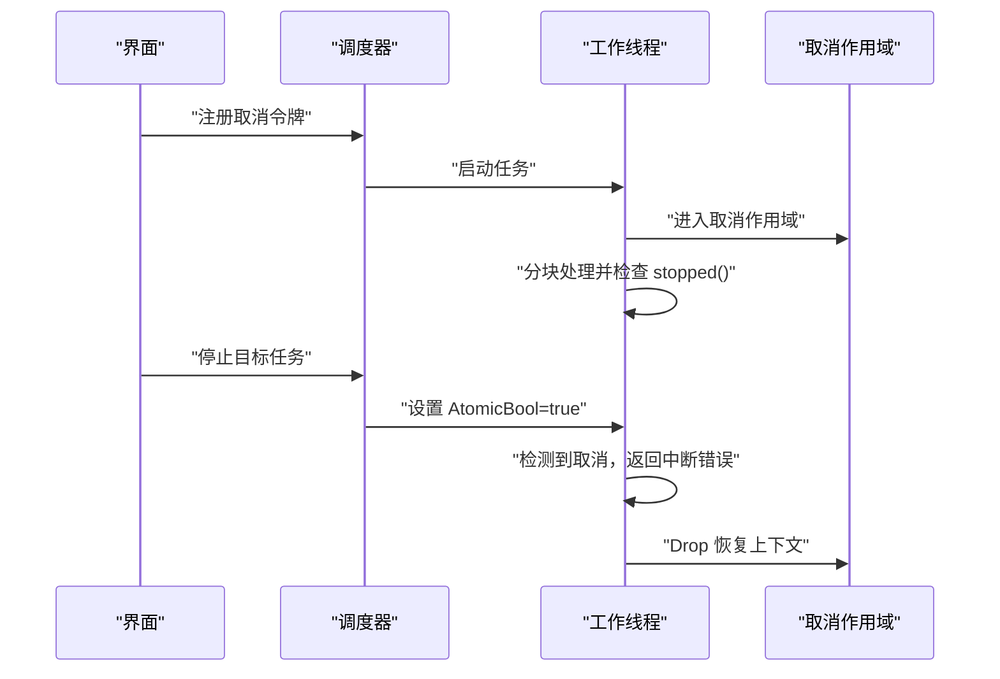
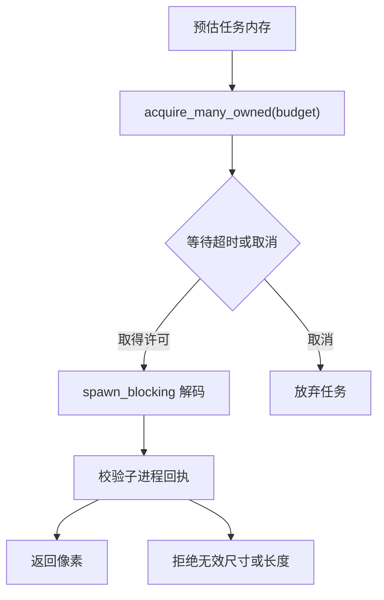
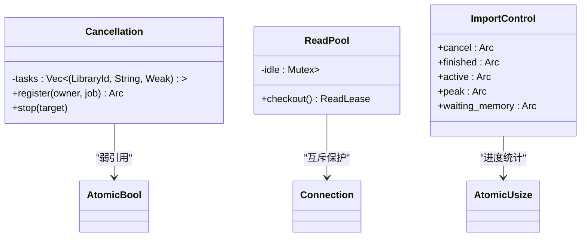
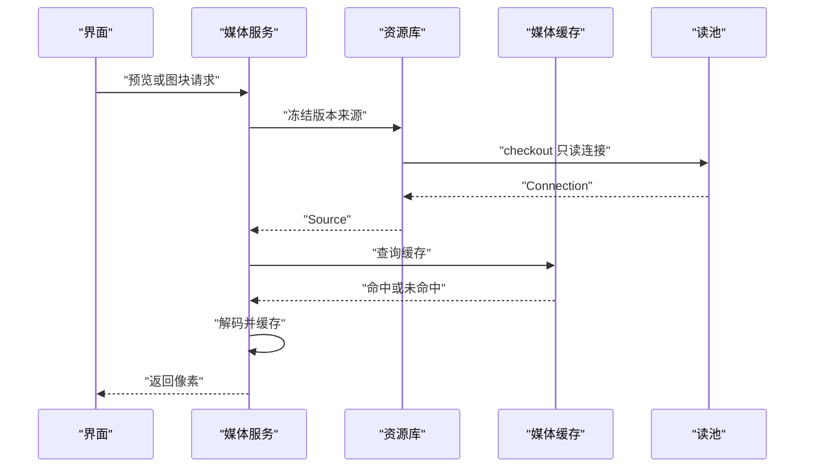
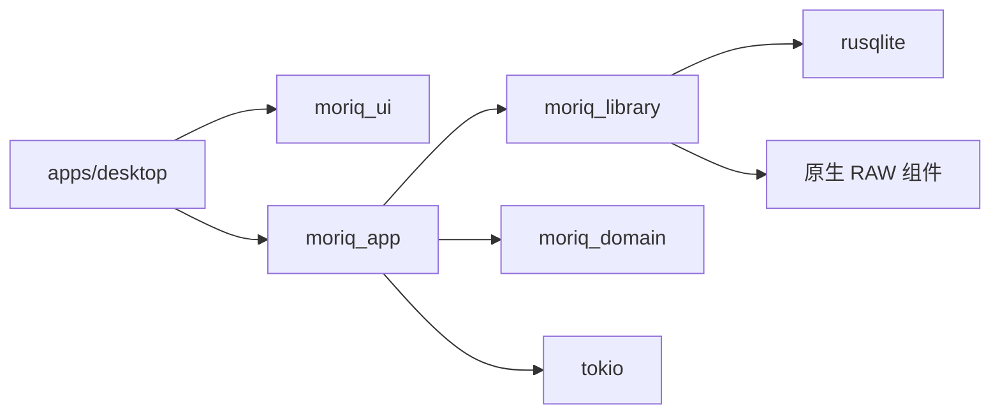

# 并发与同步模型

> Repo Wiki 节点 `concurrency-model`
> 导出自 Qoder 知识库快照 `8fbe02f6-57c2-4874-b725-1a8130851fd9`，代码基线 `7a7a8e75e18bd90294e09cd422dd7ed5a04813a0`（分支 main，zh-CN）。

<cite>
**本文引用的文件**   
- [apps/desktop/src/main.rs](../../../apps/desktop/src/main.rs)
- [crates/moriq-app/src/lib.rs](../../../crates/moriq-app/src/lib.rs)
- [crates/moriq-app/src/scheduler.rs](../../../crates/moriq-app/src/scheduler.rs)
- [crates/moriq-app/src/jobs.rs](../../../crates/moriq-app/src/jobs.rs)
- [crates/moriq-app/src/media.rs](../../../crates/moriq-app/src/media.rs)
- [crates/moriq-library/src/database/read_pool.rs](../../../crates/moriq-library/src/database/read_pool.rs)
- [crates/moriq-library/src/tasks/cancel.rs](../../../crates/moriq-library/src/tasks/cancel.rs)
- [crates/moriq-library/src/tasks/jobs.rs](../../../crates/moriq-library/src/tasks/jobs.rs)
- [crates/moriq-library/src/media/raw_portable.rs](../../../crates/moriq-library/src/media/raw_portable.rs)
- [crates/moriq-library/native/raw-budget.h](../../../crates/moriq-library/native/raw-budget.h)
</cite>

## 目录
1. [引言](#引言)
2. [项目结构](#项目结构)
3. [核心组件](#核心组件)
4. [架构总览](#架构总览)
5. [详细组件分析](#详细组件分析)
6. [依赖关系分析](#依赖关系分析)
7. [性能考量](#性能考量)
8. [故障排查指南](#故障排查指南)
9. [结论](#结论)

## 引言
本文面向 Moriq Space 的并发与同步模型，重点说明以下方面：
- tokio 异步运行时在桌面应用中的使用方式、任务调度边界、取消机制和错误传播。
- SQLite 单写者模式如何保证数据一致性。
- 读写分离策略、读池工作机制和连接复用。
- 内存预算管理系统，包括对 OOM 和内存泄漏的防护。
- 并发安全的数据结构，如原子变量、信号量、互斥锁的作用域。
- 调试并发问题的技巧和性能调优建议。

整体设计遵循“界面不直接持有数据库连接、媒体 I/O 不在 UI 线程执行”的原则，通过单一写入通道串行化所有持久化变更，同时用只读连接池和高并发读计划提升查询吞吐。

## 项目结构
本项目由多个 crate 组成，与并发相关的关键路径如下：
- 桌面入口负责日志初始化、参数解析和启动 UI。
- `moriq-app` 提供服务句柄、唯一写入队列、调度器、内存预算、推理调用和媒体计划。
- `moriq-library` 提供资源库实现、SQLite 读池、后台任务、取消作用域和原生 RAW 解码子进程。
- 原生层通过固定协议报告 RAW 子进程内存占用，并与父端工作空间共同构成完整预算。

**图表来源**
- [apps/desktop/src/main.rs:10-36](../../../apps/desktop/src/main.rs#L10-L36)
- [crates/moriq-app/src/lib.rs:130-218](../../../crates/moriq-app/src/lib.rs#L130-L218)
- [crates/moriq-app/src/scheduler.rs:24-85](../../../crates/moriq-app/src/scheduler.rs#L24-L85)
- [crates/moriq-app/src/jobs.rs:66-165](../../../crates/moriq-app/src/jobs.rs#L66-L165)
- [crates/moriq-library/src/database/read_pool.rs:1-97](../../../crates/moriq-library/src/database/read_pool.rs#L1-L97)
- [crates/moriq-library/src/tasks/cancel.rs:1-85](../../../crates/moriq-library/src/tasks/cancel.rs#L1-L85)
- [crates/moriq-library/src/media/raw_portable.rs:1-120](../../../crates/moriq-library/src/media/raw_portable.rs#L1-L120)
- [crates/moriq-library/native/raw-budget.h:1-24](../../../crates/moriq-library/native/raw-budget.h#L1-L24)

**章节来源**
- [apps/desktop/src/main.rs:10-97](../../../apps/desktop/src/main.rs#L10-L97)
- [crates/moriq-app/src/lib.rs:1-260](../../../crates/moriq-app/src/lib.rs#L1-L260)

## 核心组件
- **桌面入口**：初始化日志、解析命令行参数并启动 UI；启动失败时弹出错误对话框。
- **应用服务**：封装共享资源，包括媒体缓存、推理执行器、消息通道、信号量和取消管理器。
- **唯一写入线程**：通过阻塞接收器顺序处理闭包任务，UI 和业务逻辑不能直接访问数据库。
- **后台调度器**：独立线程运行一个小型 tokio 多核运行时，负责从资源库领取任务、等待内存预算、执行推理或媒体处理，并把结果写回数据库。
- **SQLite 读池**：维护少量只读连接，复用空闲连接，避免频繁创建销毁连接带来的开销。
- **取消作用域**：基于线程局部状态和原子布尔值，为阻塞型媒体任务提供可中断能力。
- **RAW 子进程预算**：通过 C/C++ 头文件估算子进程内存，并以二进制协议向父进程报告。

**章节来源**
- [apps/desktop/src/main.rs:10-36](../../../apps/desktop/src/main.rs#L10-L36)
- [crates/moriq-app/src/lib.rs:130-218](../../../crates/moriq-app/src/lib.rs#L130-L218)
- [crates/moriq-app/src/scheduler.rs:24-85](../../../crates/moriq-app/src/scheduler.rs#L24-L85)
- [crates/moriq-library/src/database/read_pool.rs:1-97](../../../crates/moriq-library/src/database/read_pool.rs#L1-L97)
- [crates/moriq-library/src/tasks/cancel.rs:1-85](../../../crates/moriq-library/src/tasks/cancel.rs#L1-L85)
- [crates/moriq-library/src/media/raw_portable.rs:1-120](../../../crates/moriq-library/src/media/raw_portable.rs#L1-L120)
- [crates/moriq-library/native/raw-budget.h:1-24](../../../crates/moriq-library/native/raw-budget.h#L1-L24)

## 架构总览
Moriq Space 的并发模型可以概括为三层：
1. **异步协调层**：UI 和上层 API 通过 `Service` 发起请求，最终通过 `mpsc::Sender` 投递到唯一写入线程。
2. **调度层**：独立线程上的 tokio 运行时驱动任务生命周期，包括资源检查、预算等待、执行和回执提交。
3. **存储与计算层**：SQLite 读池承担读取，原生 RAW 子进程承担重型解码，两者均受取消和预算约束。

**图表来源**
- [crates/moriq-app/src/lib.rs:130-218](../../../crates/moriq-app/src/lib.rs#L130-L218)
- [crates/moriq-app/src/scheduler.rs:24-85](../../../crates/moriq-app/src/scheduler.rs#L24-L85)
- [crates/moriq-app/src/jobs.rs:66-165](../../../crates/moriq-app/src/jobs.rs#L66-L165)
- [crates/moriq-library/src/database/read_pool.rs:1-97](../../../crates/moriq-library/src/database/read_pool.rs#L1-L97)
- [crates/moriq-library/src/media/raw_portable.rs:1-120](../../../crates/moriq-library/src/media/raw_portable.rs#L1-L120)

## 详细组件分析

### tokio 异步运行时与任务调度
- **桌面入口**：main 函数仅负责日志、参数和 UI 启动，不包含复杂异步逻辑。
- **应用服务构造**：创建一个容量为 16 的消息通道，并启动名为 `moriq-library-writer` 的阻塞线程作为唯一写入者。
- **后台调度器**：启动一个 tokio 多核运行时，worker_threads 设置为 2，启用时间功能。它持续升级弱引用获取当前活动库，然后驱动单个任务步骤。
- **任务驱动**：每个任务步骤最多循环 64 次，尝试领取更多工作；如果某一步耗时超过 250 毫秒就退出循环，让调度器轮询其他任务。
- **错误传播**：调度器根据任务错误类型调整重试退避；连续失败达到阈值时会暂停库的后续任务，并在日志中记录详细信息。

**图表来源**
- [crates/moriq-app/src/scheduler.rs:24-85](../../../crates/moriq-app/src/scheduler.rs#L24-L85)
- [crates/moriq-app/src/jobs.rs:66-165](../../../crates/moriq-app/src/jobs.rs#L66-L165)

**章节来源**
- [apps/desktop/src/main.rs:10-36](../../../apps/desktop/src/main.rs#L10-L36)
- [crates/moriq-app/src/lib.rs:130-218](../../../crates/moriq-app/src/lib.rs#L130-L218)
- [crates/moriq-app/src/scheduler.rs:24-120](../../../crates/moriq-app/src/scheduler.rs#L24-L120)
- [crates/moriq-app/src/jobs.rs:66-175](../../../crates/moriq-app/src/jobs.rs#L66-L175)

### SQLite 单写者模式
- **唯一写入通道**：`Service` 内部有一个 `mpsc::channel::<Job>(16)`，写入闭包通过 `call` 方法排队执行。
- **写入线程**：阻塞接收器顺序消费任务，修改 `Option<Library>` 状态。
- **UI 隔离**：文档注释明确指出 UI 不拥有数据库连接，也不执行媒体 I/O。
- **好处**：避免了多线程竞争写入 SQLite，简化了事务、迁移和状态一致性。

**图表来源**
- [crates/moriq-app/src/lib.rs:130-218](../../../crates/moriq-app/src/lib.rs#L130-L218)

**章节来源**
- [crates/moriq-app/src/lib.rs:1-260](../../../crates/moriq-app/src/lib.rs#L1-L260)

### 读写分离与读池机制
- **读池结构**：包含数据库根路径、用于保护库生命周期的租约、以及空闲连接列表。
- **连接获取**：先从空闲列表取连接；没有则新建只读连接，设置 busy_timeout，并启用负缓存大小以优化查询性能。
- **租约语义**：`ReadLease` 持有可选连接和池引用；Drop 时回滚未提交事务、清理临时表，再把连接归还池中（最多保留 4 个）。
- **媒体读取**：`media_source` 通过读池 checkout 连接，再构建媒体源，使媒体线程可以在写入端之外安全读取。

**图表来源**
- [crates/moriq-library/src/database/read_pool.rs:1-97](../../../crates/moriq-library/src/database/read_pool.rs#L1-L97)

**章节来源**
- [crates/moriq-library/src/database/read_pool.rs:1-97](../../../crates/moriq-library/src/database/read_pool.rs#L1-L97)

### 取消机制与错误传播
- **线程局部取消作用域**：`Scope::enter` 在当前线程安装取消标志，`Drop` 恢复之前的上下文，防止取消状态泄漏到下一项任务。
- **取消检查**：`stopped` 读取当前线程作用域中的原子布尔值；`check` 将取消状态转换为资源库错误。
- **分块复制**：长 IO 操作在每块之间检查取消，立即返回中断错误，避免长时间无法停止。
- **任务级取消**：调度器登记 `(LibraryId, job, Weak<AtomicBool>)`，支持针对单个任务或全部任务取消；UI 侧只刷新投影，不直接驱动任务。

**图表来源**
- [crates/moriq-library/src/tasks/cancel.rs:1-85](../../../crates/moriq-library/src/tasks/cancel.rs#L1-L85)
- [crates/moriq-app/src/scheduler.rs:1-23](../../../crates/moriq-app/src/scheduler.rs#L1-L23)
- [crates/moriq-app/src/jobs.rs:66-165](../../../crates/moriq-app/src/jobs.rs#L66-L165)

**章节来源**
- [crates/moriq-library/src/tasks/cancel.rs:1-85](../../../crates/moriq-library/src/tasks/cancel.rs#L1-L85)
- [crates/moriq-app/src/scheduler.rs:1-23](../../../crates/moriq-app/src/scheduler.rs#L1-L23)
- [crates/moriq-app/src/jobs.rs:1-65](../../../crates/moriq-app/src/jobs.rs#L1-L65)

### 内存预算管理与防 OOM
- **全局预算信号量**：`import_memory` 初始容量为 4096 MiB，任务在执行前申请对应内存。
- **任务预算**：每个任务的 `memory_mib()` 由任务种类决定；推理类任务会先准备模型，再申请内存。
- **RAW 子进程预算**：C/C++ 头文件根据传感器尺寸、输出边长和像素通道估算子进程内存，父端额外加固定工作区，并通过固定协议上报。
- **解码限制**：主进程限制输出边长不超过 65535，校验回执长度、标识头和像素尺寸，防止异常大图像导致 OOM。
- **超时保护**：RAW 解码最多等待 120 秒，超时后杀死子进程并返回错误。

**图表来源**
- [crates/moriq-app/src/jobs.rs:66-165](../../../crates/moriq-app/src/jobs.rs#L66-L165)
- [crates/moriq-library/src/media/raw_portable.rs:1-120](../../../crates/moriq-library/src/media/raw_portable.rs#L1-L120)
- [crates/moriq-library/native/raw-budget.h:1-24](../../../crates/moriq-library/native/raw-budget.h#L1-L24)

**章节来源**
- [crates/moriq-app/src/jobs.rs:66-165](../../../crates/moriq-app/src/jobs.rs#L66-L165)
- [crates/moriq-library/src/media/raw_portable.rs:1-120](../../../crates/moriq-library/src/media/raw_portable.rs#L1-L120)
- [crates/moriq-library/native/raw-budget.h:1-24](../../../crates/moriq-library/native/raw-budget.h#L1-L24)

### 并发安全的数据结构设计
- **原子布尔**：用于跨线程取消信号；登记时使用弱引用，避免任务结束后仍持有强引用导致泄漏。
- **互斥锁**：读池使用 `Mutex<Vec<Connection>>` 管理空闲连接；取消集合也使用互斥锁保护任务列表。
- **信号量**：`import_slots`、`maintenance_slot`、`read_slots`、`job_slot`、`import_memory` 分别限制并发导入、维护、读取、任务阶段和内存预算。
- **Arc 与弱引用**：调度器持有服务弱引用，最后一个公开服务释放后停止调度；取消令牌使用 `Weak<AtomicBool>` 自动清理已释放记录。
- **线程局部状态**：取消作用域通过 `thread_local!` 保存当前取消标志，确保取消不会跨线程泄漏。

**图表来源**
- [crates/moriq-app/src/scheduler.rs:1-23](../../../crates/moriq-app/src/scheduler.rs#L1-L23)
- [crates/moriq-library/src/database/read_pool.rs:1-97](../../../crates/moriq-library/src/database/read_pool.rs#L1-L97)
- [crates/moriq-app/src/lib.rs:180-260](../../../crates/moriq-app/src/lib.rs#L180-L260)

**章节来源**
- [crates/moriq-app/src/scheduler.rs:1-23](../../../crates/moriq-app/src/scheduler.rs#L1-L23)
- [crates/moriq-library/src/database/read_pool.rs:1-97](../../../crates/moriq-library/src/database/read_pool.rs#L1-L97)
- [crates/moriq-app/src/lib.rs:180-260](../../../crates/moriq-app/src/lib.rs#L180-L260)

### 媒体读取与预览流程
- **区域会话**：通过 `region_session_cancellable` 冻结版本来源并传入取消标志，供分块读取。
- **图块解码**：`region_tile_cancellable` 按会话预估内存，等待预算后解码指定区域。
- **预览缓存**：预览先查缓存，再冻结来源解码；可缓存结果存入 `MediaCache`。
- **对比预览**：对比两个版本时顺序解码，避免两个解码器同时抢占内存。

**图表来源**
- [crates/moriq-app/src/media.rs:1-277](../../../crates/moriq-app/src/media.rs#L1-L277)
- [crates/moriq-library/src/database/read_pool.rs:1-97](../../../crates/moriq-library/src/database/read_pool.rs#L1-L97)

**章节来源**
- [crates/moriq-app/src/media.rs:1-277](../../../crates/moriq-app/src/media.rs#L1-L277)

## 依赖关系分析
- `apps/desktop` 依赖 `moriq_ui` 启动 UI。
- `moriq_app` 依赖 `moriq_library`、`moriq_domain`、`tokio`、`futures`。
- `moriq_library` 依赖 rusqlite、原生 RAW 组件、图像处理库。
- 关键外部依赖包括 tokio 运行时、rusqlite、图像处理库和原生子进程。

**图表来源**
- [apps/desktop/src/main.rs:10-36](../../../apps/desktop/src/main.rs#L10-L36)
- [crates/moriq-app/src/lib.rs:1-260](../../../crates/moriq-app/src/lib.rs#L1-L260)
- [crates/moriq-library/src/media/raw_portable.rs:1-120](../../../crates/moriq-library/src/media/raw_portable.rs#L1-L120)

**章节来源**
- [apps/desktop/src/main.rs:10-97](../../../apps/desktop/src/main.rs#L10-L97)
- [crates/moriq-app/src/lib.rs:1-260](../../../crates/moriq-app/src/lib.rs#L1-L260)
- [crates/moriq-library/src/media/raw_portable.rs:1-120](../../../crates/moriq-library/src/media/raw_portable.rs#L1-L120)

## 性能考量
- **调度器 worker_threads=2**：适合轻量任务调度，避免过多调度线程争抢 CPU。
- **读池连接上限**：最多保留 4 个空闲只读连接，减少连接创建开销，同时避免过多连接争用磁盘。
- **SQLite 缓存参数**：负 `cache_size` 表示 KiB 单位，配合临时文件存储降低内存压力。
- **任务批处理上限**：单次调度循环最多处理 64 步，防止长任务独占调度器。
- **RAII 资源清理**：读连接在 Drop 时回滚事务、清理临时表，避免资源泄漏。
- **RAW 子进程限制**：OMP_NUM_THREADS=1，避免并行解码放大峰值内存。
- **预算等待周期**：每 25 毫秒检查一次取消和预算，兼顾响应性和吞吐量。

[本节为通用性能讨论，不直接分析具体代码片段]

## 故障排查指南
- **任务连续失败**：调度器会在连续失败后暂停库任务并记录详情；检查日志中的“后台任务连续失败”提示。
- **RAW 解码失败**：可能由于机型/压缩不支持、文件损坏或超出预算；查看子进程返回码和错误信息。
- **取消不生效**：确认取消作用域是否正确安装，且任务循环中是否检查 `stopped()`。
- **连接池锁失效**：读池返回“读取连接池锁失效”表示互斥锁被破坏，需检查是否存在 panic 或异常路径绕过 Drop。
- **内存不足**：检查 `import_memory` 剩余容量、最大任务预算和 RAW 输出边长限制。
- **UI 卡顿**：确认媒体解码是否在 `spawn_blocking` 中执行，避免阻塞 UI 线程。

**章节来源**
- [crates/moriq-app/src/scheduler.rs:24-120](../../../crates/moriq-app/src/scheduler.rs#L24-L120)
- [crates/moriq-library/src/media/raw_portable.rs:1-120](../../../crates/moriq-library/src/media/raw_portable.rs#L1-L120)
- [crates/moriq-library/src/tasks/cancel.rs:1-85](../../../crates/moriq-library/src/tasks/cancel.rs#L1-L85)
- [crates/moriq-library/src/database/read_pool.rs:1-97](../../../crates/moriq-library/src/database/read_pool.rs#L1-L97)

## 结论
Moriq Space 的并发与同步模型围绕“单写者 + 读池 + 预算控制 + 取消作用域”展开：
- 通过唯一写入线程保证 SQLite 数据一致性。
- 通过读池和只读连接提升查询效率。
- 通过信号量和子进程预算防止 OOM。
- 通过线程局部取消作用域和安全原语实现可靠的中断。
- 通过 tokio 调度器协调后台任务，但保持 UI 与 I/O 职责清晰。

这套模型适合本地媒体库场景：写入频率低、读取频率高、媒体解码昂贵且易膨胀。未来若需要更高吞吐，可考虑扩展读池大小、增加预算监控指标、细化任务优先级，但应继续维持单写者不变，以避免引入复杂的分布式一致性成本。