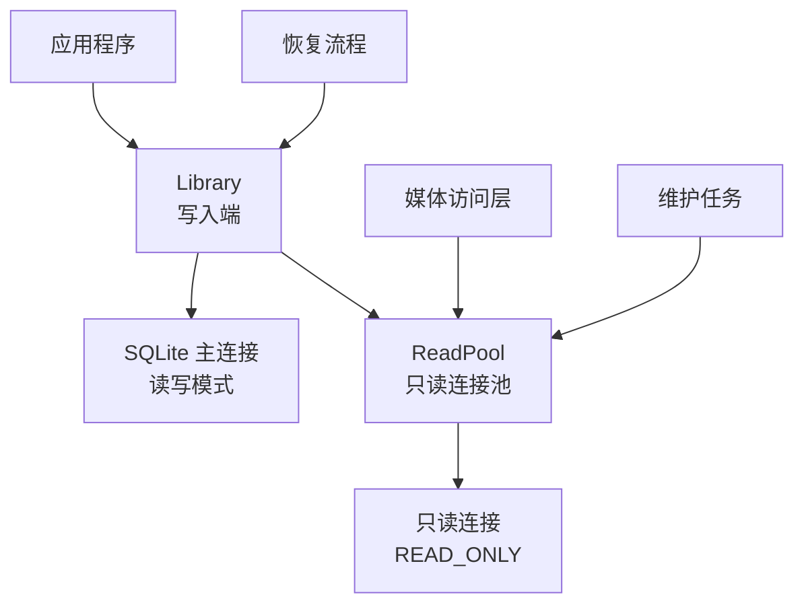
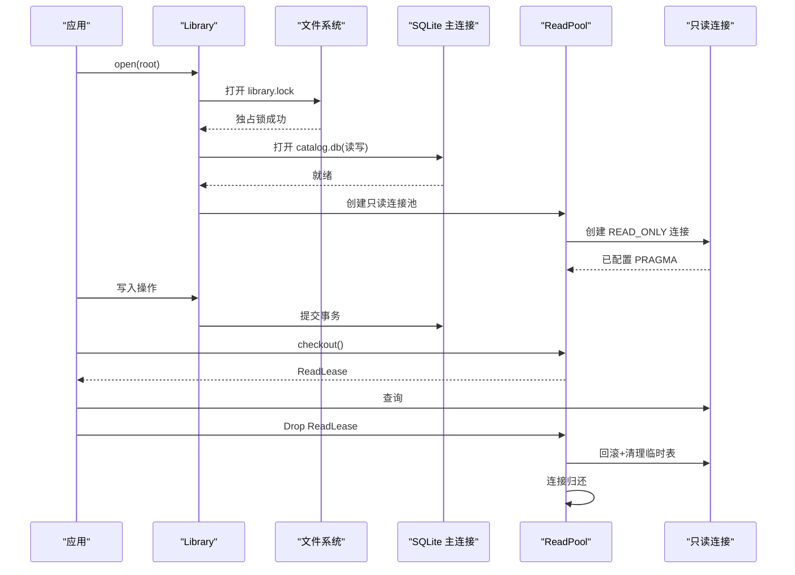
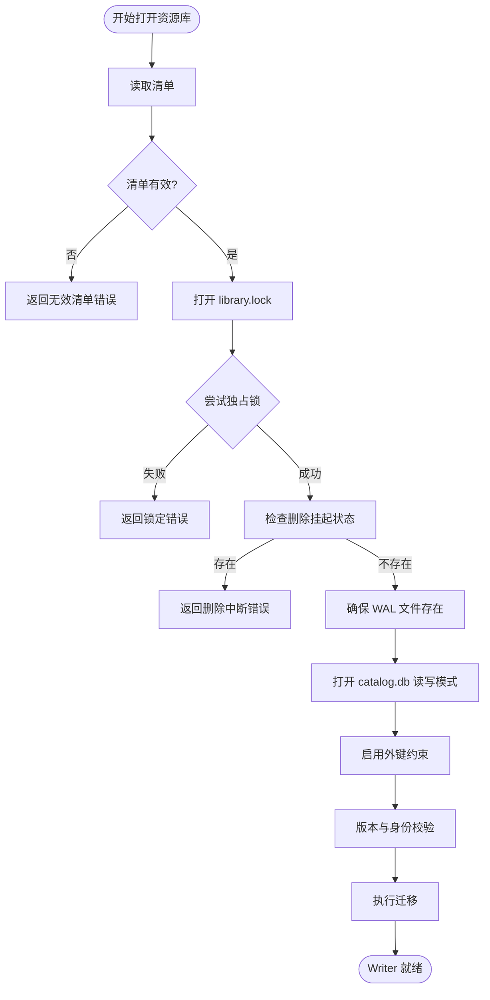
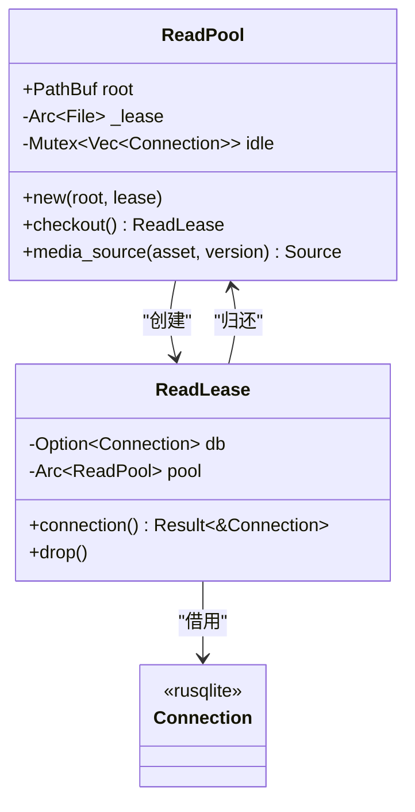
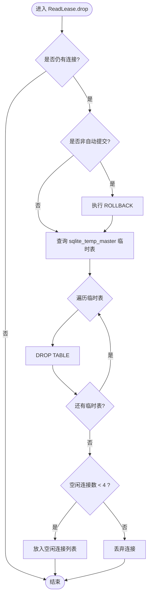
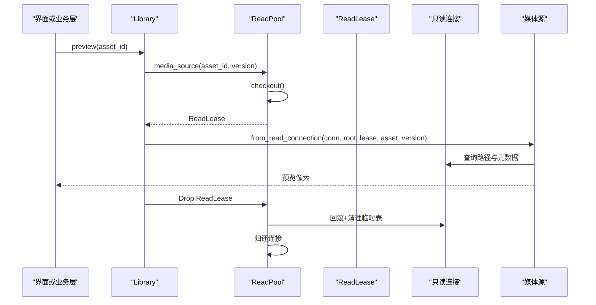
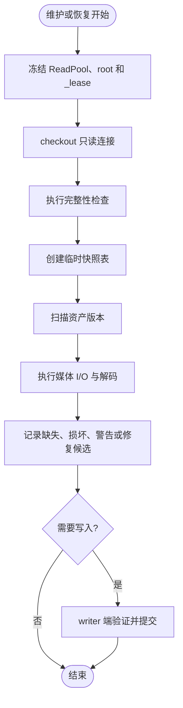
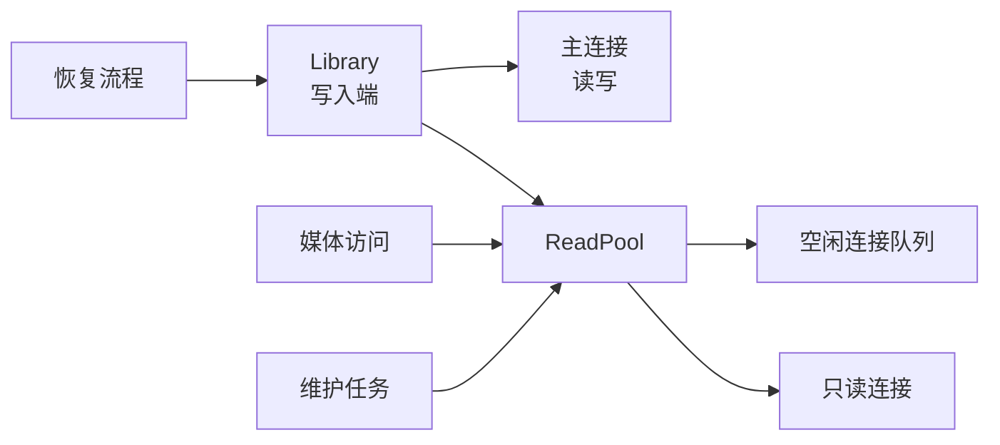

# SQLite 单写者模式与读写分离

> Repo Wiki 节点 `sqlite-single-writer`
> 导出自 Qoder 知识库快照 `8fbe02f6-57c2-4874-b725-1a8130851fd9`，代码基线 `7a7a8e75e18bd90294e09cd422dd7ed5a04813a0`（分支 main，zh-CN）。

<cite>
**本文引用的文件**   
- [read_pool.rs](../../../crates/moriq-library/src/database/read_pool.rs)
- [core.rs](../../../crates/moriq-library/src/library/core.rs)
- [lifecycle.rs](../../../crates/moriq-library/src/library/lifecycle.rs)
- [access.rs](../../../crates/moriq-library/src/media/access.rs)
- [maintenance.rs](../../../crates/moriq-library/src/maintenance/maintenance.rs)
- [recovery.rs](../../../crates/moriq-library/src/transfer/recovery.rs)
- [schema.sql](../../../crates/moriq-library/src/database/schema.sql)
</cite>

## 目录
1. [引言](#引言)
2. [项目结构](#项目结构)
3. [核心组件](#核心组件)
4. [架构总览](#架构总览)
5. [详细组件分析](#详细组件分析)
6. [依赖关系分析](#依赖关系分析)
7. [性能考量](#性能考量)
8. [故障排查指南](#故障排查指南)
9. [结论](#结论)

## 引言
Moriq Space 的媒体资源库以 SQLite 作为唯一持久化层。为了避免多进程或多线程并发写入导致数据库损坏，系统在应用层实现“单写者”模式：只有一个 Library 实例持有可写数据库连接，所有其他读取操作通过只读连接池完成。本文聚焦以下目标：
- 解释 WriteLease（写入租约）如何保证单一写入权限。
- 解析 ReadPool 的连接池管理、只读连接创建、租约机制和连接复用策略。
- 说明 ReadLease 的生命周期管理，包括自动事务回滚、临时表清理和连接归还。
- 分析 PRAGMA 优化配置对性能的影响。
- 解释 Arc<File> 资源库租约如何在读取期间保护库生命周期。
- 提供连接泄漏检测方法和性能调优建议。

## 项目结构
与 SQLite 单写者和读写分离直接相关的代码集中在 `crates/moriq-library` 中：
- `database/read_pool.rs`：只读连接池、ReadLease 生命周期。
- `library/core.rs`：资源库打开、独占锁、写入端初始化、迁移和 WAL 标志设置。
- `library/lifecycle.rs`：外部引用校验、资源库生命周期辅助。
- `media/access.rs`：媒体预览入口，使用只读连接池获取媒体源。
- `maintenance/maintenance.rs`：维护任务通过只读连接执行完整性检查与快照扫描。
- `transfer/recovery.rs`：恢复流程在 worker 侧冻结媒体，最终由 writer 提交日志。
- `database/schema.sql`：数据库初始结构，开启外键约束。

**图表来源**
- [core.rs:100-200](../../../crates/moriq-library/src/library/core.rs#L100-L200)
- [read_pool.rs:1-97](../../../crates/moriq-library/src/database/read_pool.rs#L1-L97)
- [access.rs:1-23](../../../crates/moriq-library/src/media/access.rs#L1-L23)
- [maintenance.rs:1-120](../../../crates/moriq-library/src/maintenance/maintenance.rs#L1-L120)
- [recovery.rs:1-120](../../../crates/moriq-library/src/transfer/recovery.rs#L1-L120)

**章节来源**
- [read_pool.rs:1-97](../../../crates/moriq-library/src/database/read_pool.rs#L1-L97)
- [core.rs:100-200](../../../crates/moriq-library/src/library/core.rs#L100-L200)

## 核心组件
- **WriteLease（写入租约）**：通过操作系统级独占文件锁锁定 `library.lock`，确保同一时刻只有一个 Library 能打开数据库进行写入。
- **ReadPool（只读连接池）**：维护少量空闲只读连接，按需创建、复用，并设置只读、忙超时和 PRAGMA 优化。
- **ReadLease（读取租约）**：封装一次连接借用，Drop 时自动回滚事务、清理临时表，并将连接放回池中。
- **Arc<File> 资源库租约**：在读取路径上持有指向库根目录中的文件句柄，防止读取期间库被删除或替换。

**章节来源**
- [core.rs:120-180](../../../crates/moriq-library/src/library/core.rs#L120-L180)
- [read_pool.rs:1-97](../../../crates/moriq-library/src/database/read_pool.rs#L1-L97)
- [lifecycle.rs:1-177](../../../crates/moriq-library/src/library/lifecycle.rs#L1-L177)

## 架构总览
Moriq Space 的 SQLite 访问模型可以概括为：
1. 应用启动后，Library::open 打开资源库目录，取得独占锁，创建或打开主数据库连接。
2. 主连接以读写模式打开，启用外键约束，执行版本检查和迁移。
3. ReadPool 从资源库租约中建立只读连接池，用于媒体线程、维护任务和恢复相关读取。
4. 任何写入都通过 Library 实例及其主连接完成；读取通过 ReadPool.checkout 获得 ReadLease。

**图表来源**
- [core.rs:100-200](../../../crates/moriq-library/src/library/core.rs#L100-L200)
- [read_pool.rs:10-97](../../../crates/moriq-library/src/database/read_pool.rs#L10-L97)

**章节来源**
- [core.rs:100-200](../../../crates/moriq-library/src/library/core.rs#L100-L200)
- [read_pool.rs:10-97](../../../crates/moriq-library/src/database/read_pool.rs#L10-L97)

## 详细组件分析

### WriteLease：单写者保护机制
WriteLease 的核心不是 Rust 类型，而是应用层通过文件锁实现的“写入租约”。其关键行为如下：
- 打开 `library.lock` 并以独占模式尝试加锁。
- 如果加锁失败，返回锁定错误，阻止第二个 Library 实例同时写入。
- 如果检测到删除挂起状态，直接拒绝打开，避免中断的删除过程被覆盖。
- 打开数据库前创建 WAL 相关文件占位符，确保 WAL 模式工作正常。
- 打开主连接时设置较短的 busy_timeout，因为写入端需要快速感知阻塞。

这种设计将 SQLite 的“单写者”语义从底层扩展到了进程/线程层面，避免多个 Writer 竞争同一个数据库文件。

**图表来源**
- [core.rs:120-200](../../../crates/moriq-library/src/library/core.rs#L120-L200)

**章节来源**
- [core.rs:120-200](../../../crates/moriq-library/src/library/core.rs#L120-L200)

### ReadPool：连接池设计与复用策略
ReadPool 是一个轻量级的只读连接池，职责包括：
- 持有资源库根路径和 `Arc<File>` 租约。
- 维护一个受 Mutex 保护的 idle 向量，存放可复用 Connection。
- 在 checkout 时优先复用空闲连接，否则新建只读连接。
- 新建连接时设置只读标志、busy_timeout 和 PRAGMA 优化。
- 通过 media_source 暴露给媒体访问层，把连接、根路径和资源库租约一起交给媒体源。

连接池容量上限为 4：Drop 时仅在空闲连接数小于 4 时才归还连接。这既限制了连接数量，又允许常见读取场景复用连接。

**图表来源**
- [read_pool.rs:1-97](../../../crates/moriq-library/src/database/read_pool.rs#L1-L97)

**章节来源**
- [read_pool.rs:1-97](../../../crates/moriq-library/src/database/read_pool.rs#L1-L97)

### ReadLease：生命周期管理与资源清理
ReadLease 的关键在于 Drop 实现。它承担以下责任：
1. 如果当前连接仍存在且未处于自动提交模式，则执行 ROLLBACK。
2. 查询 sqlite_temp_master 中类型为 table 的临时表。
3. 逐个 DROP 这些临时表，避免跨请求残留。
4. 若空闲连接数小于 4，则将连接放回 idle 向量。

这个设计保证了：
- 即使调用方忘记显式结束事务，也能在租约结束时回滚。
- 维护任务等可能创建临时表的读取操作不会污染后续请求。
- 连接不会被无限增长，避免连接泄漏。

**图表来源**
- [read_pool.rs:50-97](../../../crates/moriq-library/src/database/read_pool.rs#L50-L97)

**章节来源**
- [read_pool.rs:50-97](../../../crates/moriq-library/src/database/read_pool.rs#L50-L97)

### 资源库租约 Arc<File>：读取期间的库生命周期保护
在 ReadPool 和读取路径中，`_lease: Arc<File>` 的作用是：
- 构造 ReadPool 时传入资源库租约，并在 media_source 中将其传递给媒体源。
- 只要媒体源或读取任务仍持有该 Arc<File>，对应文件就不会被操作系统回收。
- 配合资源库删除逻辑，可防止读取过程中库目录被意外删除或替换。
- recovery 和 maintenance 等后台任务也通过 `_lease: Arc<File>` 绑定到当前 Library，避免跨 Library 误用。

这种保护不是 SQLite 内部机制，而是应用层通过 Rust 所有权模型和文件句柄寿命实现的“文件级租约”。

**章节来源**
- [read_pool.rs:1-30](../../../crates/moriq-library/src/database/read_pool.rs#L1-L30)
- [recovery.rs:40-120](../../../crates/moriq-library/src/transfer/recovery.rs#L40-L120)
- [maintenance.rs:10-40](../../../crates/moriq-library/src/maintenance/maintenance.rs#L10-L40)

### PRAGMA 优化配置：cache_size 与 temp_store
ReadPool 在新建只读连接时执行以下 PRAGMA：
- `PRAGMA cache_size=-8192`：负值表示以 KiB 为单位，这里设置为约 8 MiB 的缓存大小，提升页面缓存命中率。
- `PRAGMA temp_store=FILE`：将临时表和临时索引写入磁盘而非内存，适合大型临时结果集。
- `PRAGMA temp.cache_size=-2048`：临时缓存约 2 MiB，限制临时表内存占用。

维护任务在执行大规模扫描前也会显式设置 `temp_store=FILE` 和 `temp.cache_size=-2048`，并创建 `maintenance_snapshot` 临时表，从而把大查询从主表转移到临时表，降低主连接压力。

这些配置对性能的影响：
- 提高只读查询吞吐，尤其在大表扫描、JOIN 和排序场景。
- 控制临时对象内存峰值，避免长时间占用 RSS。
- 在 SSD 或高性能存储上效果更明显；机械盘上需权衡 I/O 开销。

**章节来源**
- [read_pool.rs:30-45](../../../crates/moriq-library/src/database/read_pool.rs#L30-L45)
- [maintenance.rs:80-120](../../../crates/moriq-library/src/maintenance/maintenance.rs#L80-L120)

### 媒体读取流程：从 ReadLease 到媒体源
媒体访问层通过 Library.preview 调用 media_source，后者从 ReadPool 借出连接，并把连接、根路径和资源库租约交给媒体源。这样媒体解码可以在不持有写连接的情况下运行，同时保持对库文件的强引用。

**图表来源**
- [access.rs:1-23](../../../crates/moriq-library/src/media/access.rs#L1-L23)
- [read_pool.rs:10-45](../../../crates/moriq-library/src/database/read_pool.rs#L10-L45)

**章节来源**
- [access.rs:1-23](../../../crates/moriq-library/src/media/access.rs#L1-L23)
- [read_pool.rs:10-45](../../../crates/moriq-library/src/database/read_pool.rs#L10-L45)

### 维护任务与恢复流程中的读写分离
维护任务通过 maintenance_plan 冻结读取连接池、根路径和资源库租约，然后在 worker 侧执行：
- 通过 ReadPool.checkout 获取只读连接。
- 执行 integrity_check 和 foreign_key_check。
- 创建临时快照表 maintenance_snapshot。
- 逐条检查文件是否存在、缩略图是否有效、颜色是否需要修复。
- 修复候选回到 writer 端，由 apply_cache_repair 验证哈希和路径后再提交。

恢复流程类似：worker 侧冻结媒体、创建硬链接快照、准备导入数据，最后由 writer 执行 install_prepared 并提交 operation_journal。

**图表来源**
- [maintenance.rs:10-200](../../../crates/moriq-library/src/maintenance/maintenance.rs#L10-L200)
- [recovery.rs:40-200](../../../crates/moriq-library/src/transfer/recovery.rs#L40-L200)

**章节来源**
- [maintenance.rs:10-200](../../../crates/moriq-library/src/maintenance/maintenance.rs#L10-L200)
- [recovery.rs:40-200](../../../crates/moriq-library/src/transfer/recovery.rs#L40-L200)

## 依赖关系分析
- Library 是唯一写入端，持有 rusqlite::Connection 的主连接。
- ReadPool 依赖 rusqlite::Connection 的只读实例，并通过 Mutex<Vec<Connection>> 管理空闲连接。
- ReadLease 依赖 ReadPool 和 Connection，Drop 时反向影响两者。
- 媒体访问层依赖 ReadPool 提供的连接，但不直接持有写连接。
- 维护任务和恢复流程依赖 ReadPool 和 Library 的公共能力，但严格区分 worker 读取与 writer 提交。

**图表来源**
- [core.rs:100-200](../../../crates/moriq-library/src/library/core.rs#L100-L200)
- [read_pool.rs:1-97](../../../crates/moriq-library/src/database/read_pool.rs#L1-L97)
- [maintenance.rs:10-120](../../../crates/moriq-library/src/maintenance/maintenance.rs#L10-L120)
- [recovery.rs:40-120](../../../crates/moriq-library/src/transfer/recovery.rs#L40-L120)

**章节来源**
- [core.rs:100-200](../../../crates/moriq-library/src/library/core.rs#L100-L200)
- [read_pool.rs:1-97](../../../crates/moriq-library/src/database/read_pool.rs#L1-L97)

## 性能考量
### 连接池大小
当前实现最多保留 4 个空闲只读连接。对于典型桌面应用：
- 低并发浏览、预览、维护任务通常足够。
- 如果大量并行媒体解码或批量查询出现等待，可适当增加连接上限。
- 增加连接会提升内存和 SQLite 并发读取开销，需要结合负载测试调整。

### 超时配置
- 写入端 busy_timeout 为 500 毫秒，偏向快速失败，避免写入长时间阻塞。
- 只读连接 busy_timeout 为 5 秒，更适合长时间查询和维护任务。
- 如果查询变慢，应先优化 SQL、索引和临时表策略，再考虑增大超时。

### PRAGMA 调优
- cache_size=-8192 适合中等规模资源库；超大库可逐步提升到 16MiB 或更高，观察 RSS。
- temp_store=FILE 适合复杂查询；纯内存场景下可评估 MEMORY，但需警惕内存峰值。
- temp.cache_size=-2048 可作为默认起点；大批量维护任务可根据内存预算上调。

### 连接复用与泄漏防护
- ReadLease.Drop 自动回滚和清理临时表，降低长事务风险。
- 空闲连接上限为 4，避免无界增长。
- 若发现连接持续增长，应检查是否有路径绕过 ReadLease 或直接持有 Connection。

[本节为通用性能建议，不直接分析具体源码行]

## 故障排查指南

### 常见问题与定位方法
1. **数据库锁定或写入冲突**
   - 现象：写入时报错，提示资源库被锁定。
   - 原因：另一个 Library 实例仍持有 library.lock 独占锁。
   - 排查：确认是否重复打开同一资源库，或存在后台任务未释放写连接。

2. **只读查询缓慢**
   - 现象：预览、概览、维护任务耗时增加。
   - 原因：缺少索引、临时表过大、缓存不足。
   - 排查：检查查询是否使用临时表；确认 PRAGMA cache_size 和 temp_store 是否生效。

3. **连接泄漏迹象**
   - 现象：进程内存持续增长，SQLite 连接数异常。
   - 原因：未按 ReadLease 生命周期使用连接，或自定义代码直接持有 Connection。
   - 排查：统计 ReadLease 创建与 Drop 次数；检查是否存在长期持有的连接引用。

4. **临时表残留**
   - 现象：多次维护后临时表数量异常。
   - 原因：早期事务未正确回滚或 Drop 路径提前返回。
   - 排查：确认 ReadLease.Drop 是否被执行；检查维护任务是否捕获错误后跳过清理。

5. **资源库被意外删除**
   - 现象：读取媒体时报文件不存在。
   - 原因：读取路径未持有 Arc<File> 租约。
   - 排查：确认 media_source 是否传递了资源库租约；检查后台任务是否克隆了 ReadPool 和租约。

**章节来源**
- [core.rs:120-200](../../../crates/moriq-library/src/library/core.rs#L120-L200)
- [read_pool.rs:30-97](../../../crates/moriq-library/src/database/read_pool.rs#L30-L97)
- [maintenance.rs:80-160](../../../crates/moriq-library/src/maintenance/maintenance.rs#L80-L160)

## 结论
Moriq Space 通过应用层“单写者”模式与 SQLite 读写分离，实现了稳定可靠的资源库持久化：
- 写入端通过 library.lock 独占锁保证单一 Writer。
- 读取端通过 ReadPool 管理只读连接，避免共享写连接带来的锁竞争。
- ReadLease 通过 Drop 自动回滚、清理临时表、归还连接，降低资源泄漏风险。
- Arc<File> 资源库租约在读取期间保护库文件不被意外删除。
- PRAGMA cache_size 与 temp_store 在只读路径上提升缓存命中并控制临时对象内存。

在生产环境中，建议结合负载特征调整连接池上限、PRAGMA 参数和超时配置，并通过监控连接生命周期和临时表数量来预防泄漏。