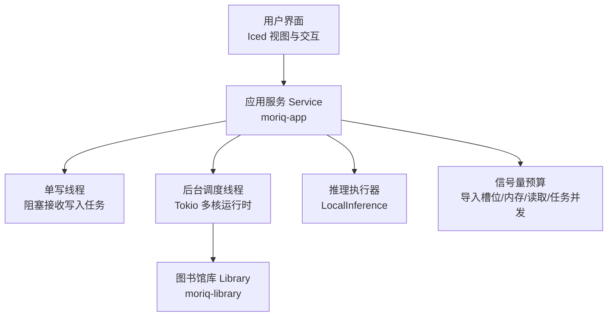
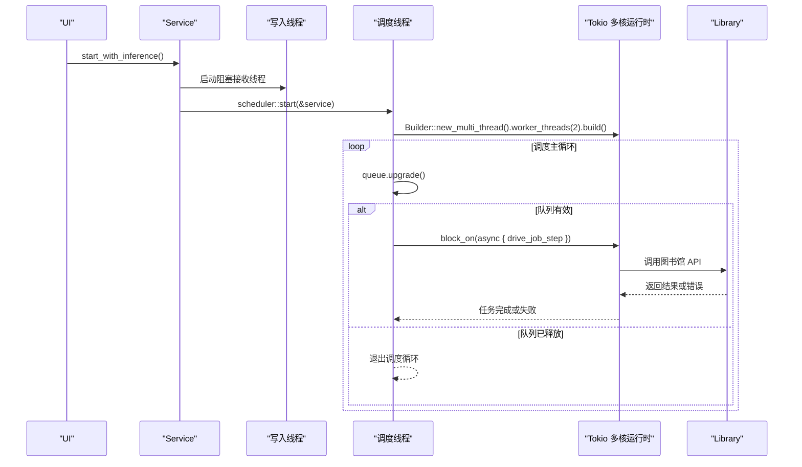
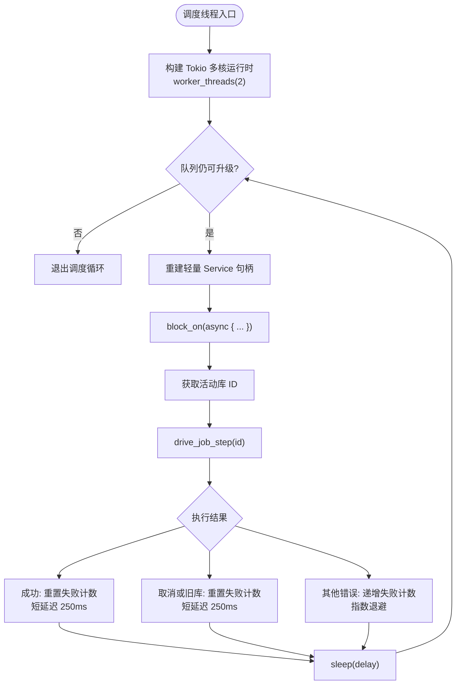
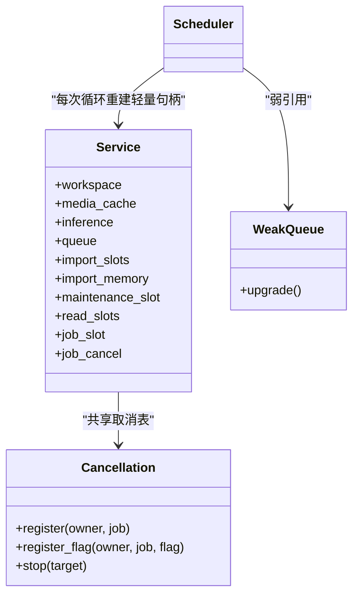
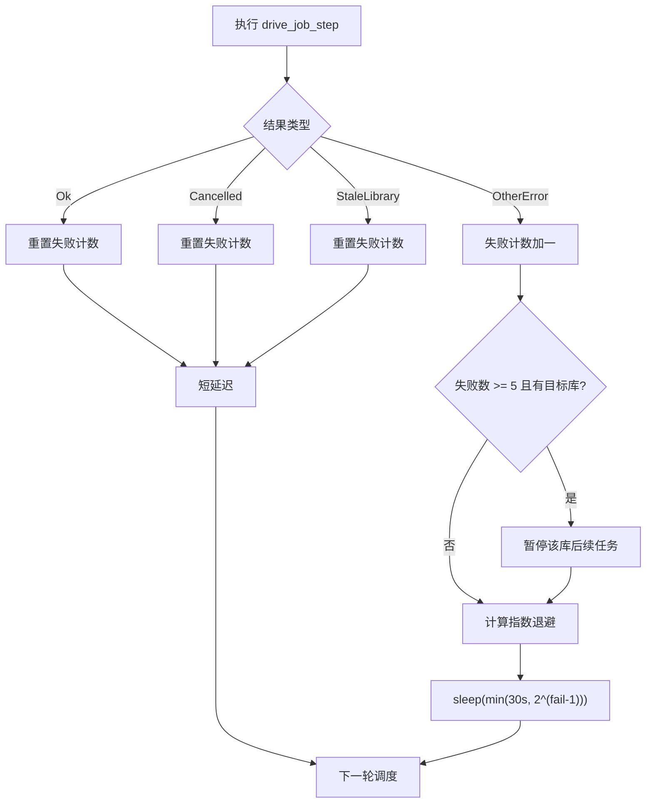
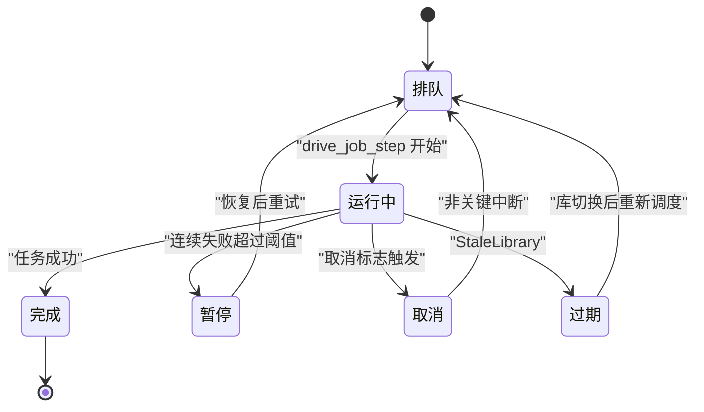
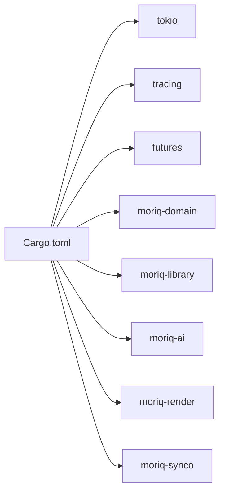

# Tokio 异步运行时与任务调度

> Repo Wiki 节点 `tokio-async-runtime`
> 导出自 Qoder 知识库快照 `8fbe02f6-57c2-4874-b725-1a8130851fd9`，代码基线 `7a7a8e75e18bd90294e09cd422dd7ed5a04813a0`（分支 main，zh-CN）。

<cite>
**本文引用的文件**
- [scheduler.rs](../../../crates/moriq-app/src/scheduler.rs)
- [lib.rs](../../../crates/moriq-app/src/lib.rs)
- [launch.rs](../../../crates/moriq-app/src/launch.rs)
- [Cargo.toml](../../../crates/moriq-app/Cargo.toml)
- [ARCHITECTURE.md](../../../ARCHITECTURE.md)
</cite>

## 目录
1. [引言](#引言)
2. [项目结构](#项目结构)
3. [核心组件](#核心组件)
4. [架构总览](#架构总览)
5. [详细组件分析](#详细组件分析)
6. [依赖关系分析](#依赖关系分析)
7. [性能考量](#性能考量)
8. [故障排查指南](#故障排查指南)
9. [结论](#结论)

## 引言
本文聚焦 Moriq Space 中 Tokio 异步运行时的使用方式，重点解释后台调度线程如何创建独立的 multi-thread 运行时、为何配置两个工作线程、后台调度循环如何通过弱队列所有权驱动 Service、如何重建 Service、执行 `drive_job_step`，以及失败重试的指数退避策略。同时说明任务生命周期中的失败计数、连续失败暂停、StaleLibrary 处理、恢复逻辑，以及 `block_on` 在同步代码中的边界作用，并给出调试异步调度的实践建议。

## 项目结构
Moriq Space 采用按领域和职责划分的 crate 结构：
- `moriq-app` 是应用层协调器，负责服务启动、写入队列、资源预算、取消控制和后台调度。
- `moriq-library` 提供阻塞式持久化、媒体计划、恢复日志等底层能力。
- `moriq-runtime` 提供共享 pinned-runtime 完整性校验。
- UI 层不直接持有数据库连接或执行媒体 I/O，所有状态变更都通过 `Service` 的写入队列串行执行。



**图表来源**
- [lib.rs:201-260](../../../crates/moriq-app/src/lib.rs#L201-L260)
- [scheduler.rs:1-120](../../../crates/moriq-app/src/scheduler.rs#L1-L120)

**章节来源**
- [ARCHITECTURE.md:1-155](../../../ARCHITECTURE.md#L1-L155)
- [Cargo.toml:1-25](../../../crates/moriq-app/Cargo.toml#L1-L25)

## 核心组件
- **Service**：应用公共协调器，封装写入队列、推理执行器、媒体缓存和多个信号量预算（导入并发、导入内存、维护并发、读取并发、任务并发）。UI 通过它发起请求，而不是直接访问数据库或解码器。
- **写入队列**：由独立线程阻塞消费 `mpsc::Receiver`，确保 SQLite 写入序列化。
- **后台调度线程**：拥有弱队列引用，当最后一个公开 `Service` 被释放时自动停止调度，并在活跃工作完成后释放当前库。
- **Tokio 多核运行时**：调度线程内部创建一个 `new_multi_thread()` 运行时，用于驱动 `drive_job_step` 等异步任务。
- **取消控制**：基于 `Arc<AtomicBool>` 的弱引用登记表，支持按库和任务名精确取消。

**章节来源**
- [lib.rs:60-120](../../../crates/moriq-app/src/lib.rs#L60-L120)
- [lib.rs:201-260](../../../crates/moriq-app/src/lib.rs#L201-L260)
- [scheduler.rs:1-40](../../../crates/moriq-app/src/scheduler.rs#L1-L40)

## 架构总览
后台调度流程从 `Service::start_with_inference` 开始，依次创建写入线程、初始化信号量、启动调度器，最终由调度线程构建 Tokio 运行时并进入主循环。



**图表来源**
- [lib.rs:201-260](../../../crates/moriq-app/src/lib.rs#L201-L260)
- [scheduler.rs:40-120](../../../crates/moriq-app/src/scheduler.rs#L40-L120)

**章节来源**
- [lib.rs:201-260](../../../crates/moriq-app/src/lib.rs#L201-L260)
- [scheduler.rs:40-120](../../../crates/moriq-app/src/scheduler.rs#L40-L120)

## 详细组件分析

### 独立调度线程与 Tokio 多核运行时
调度线程通过 `tokio::runtime::Builder::new_multi_thread()` 创建专用运行时，并设置 `worker_threads(2)`。该运行时仅用于驱动调度相关异步逻辑，如获取当前活动库身份、执行 `drive_job_step`。运行时本身不持有全局 UI 状态，也不直接操作 UI 线程。



**图表来源**
- [scheduler.rs:40-120](../../../crates/moriq-app/src/scheduler.rs#L40-L120)

**章节来源**
- [scheduler.rs:40-120](../../../crates/moriq-app/src/scheduler.rs#L40-L120)

#### worker_threads(2) 的配置原因与权衡
- **目的**：为后台调度提供轻量级异步执行环境，避免在 UI 线程上执行可能阻塞或长时间运行的任务；同时避免过多线程带来上下文切换和调度开销。
- **权衡**：
  - 优点：隔离调度逻辑，支持异步 I/O 与时间轮驱动；对大多数任务而言，两个工作线程足以并行推进多个调度步骤。
  - 缺点：若单个任务包含大量 CPU 密集或长耗时阻塞操作，两个线程可能不足以充分并行；但调度器本身更偏向“协调与步进”，而非重型计算。
- **适用场景**：适合以“多次小步推进”的任务模型，配合 `job_slot` 等信号量限制并发。

**章节来源**
- [scheduler.rs:40-120](../../../crates/moriq-app/src/scheduler.rs#L40-L120)

### 弱队列所有权与 Service 重建
调度线程持有的是 `service.queue.downgrade()`，即 `mpsc::Sender` 的弱引用。其设计要点如下：
- 当最后一个公开 `Service` 被释放后，`queue.upgrade()` 会失败，调度循环自然退出。
- 每次循环内重新构造一个轻量 `Service` 句柄，只保留必要字段，避免长期持有强引用导致资源泄漏。
- 这种设计让“服务关闭”成为调度终止的信号源之一，无需额外显式停机通道。



**图表来源**
- [lib.rs:60-120](../../../crates/moriq-app/src/lib.rs#L60-L120)
- [scheduler.rs:1-40](../../../crates/moriq-app/src/scheduler.rs#L1-L40)

**章节来源**
- [scheduler.rs:40-120](../../../crates/moriq-app/src/scheduler.rs#L40-L120)

### drive_job_step 执行流程与错误重试
调度循环对每次任务执行的结果进行分类处理：
- **成功**：重置失败计数，使用固定短延迟继续下一次调度。
- **取消或 StaleLibrary**：视为可恢复或预期中断，重置失败计数，使用短延迟。
- **其他错误**：
  - 增加失败计数。
  - 如果失败次数达到阈值且能识别目标库，则暂停该库后续任务，并记录诊断信息。
  - 使用指数退避延迟，上限为固定值。



**图表来源**
- [scheduler.rs:40-120](../../../crates/moriq-app/src/scheduler.rs#L40-L120)

**章节来源**
- [scheduler.rs:40-120](../../../crates/moriq-app/src/scheduler.rs#L40-L120)

### 任务生命周期管理
任务生命周期由以下机制共同保障：
- **失败计数与连续失败暂停**：调度器累计连续失败次数；达到阈值时对目标库执行暂停，防止错误风暴。
- **取消语义**：`Cancellation` 登记每个任务的 `Arc<AtomicBool>`，支持按库和任务名精确取消；弱引用清理已释放令牌。
- **StaleLibrary 处理**：当当前活动库发生变化时，旧请求应拒绝执行并返回 `StaleLibrary`；调度器将其视为可恢复中断，不累积失败。
- **恢复逻辑**：测试覆盖了在等待预算期间切换库的场景，确保旧库请求被拒绝，新库打开后任务检查点可恢复并最终完成。



**图表来源**
- [scheduler.rs:1-120](../../../crates/moriq-app/src/scheduler.rs#L1-L120)
- [lib.rs:400-446](../../../crates/moriq-app/src/lib.rs#L400-L446)

**章节来源**
- [scheduler.rs:1-120](../../../crates/moriq-app/src/scheduler.rs#L1-L120)
- [lib.rs:400-446](../../../crates/moriq-app/src/lib.rs#L400-L446)

### block_on 在同步代码中的使用场景
调度线程在两种情况下使用 `block_on`：
1. **调度主循环内**：包裹一次完整的任务执行，包括获取活动库身份和执行 `drive_job_step`。
2. **暂停任务时**：当需要更新库状态以暂停后续任务时，再次调用 `block_on` 调用 `pause_jobs_after_error`。

这不是 UI 线程上的 `block_on`，而是调度线程自身阻塞等待 Tokio 运行时执行异步闭包。它避免了将 UI 线程拖入后台 I/O 或推理流程。

```mermaid
sequenceDiagram
    participant Sched as "调度线程"
    participant RT as "Tokio 运行时"
    participant Svc as "Service"
    participant Lib as "Library"

    Sched->>RT: block_on(async {
        owner = call(active => active.as_ref().map(Library::id))
        drive_job_step(owner)
    })
    RT->>Svc: call(...)
    Svc->>Lib: 查询活动库身份
    Lib-->>Svc: 返回库 ID
    RT->>Svc: drive_job_step(id)
    Note over Sched,RT: 第二次 block_on 仅在需要暂停任务时使用
```

**图表来源**
- [scheduler.rs:40-120](../../../crates/moriq-app/src/scheduler.rs#L40-L120)

**章节来源**
- [scheduler.rs:40-120](../../../crates/moriq-app/src/scheduler.rs#L40-L120)

### 为什么不在 UI 线程直接运行任务
- **UI 响应性**：UI 线程必须优先处理窗口事件、渲染和用户输入；直接在 UI 线程执行数据库读写、媒体解码或推理会导致界面卡顿甚至无响应。
- **职责分离**：`Service` 是唯一协调者，所有状态变更经过单写线程串行执行，保证一致性；UI 只负责展示投影和发起请求。
- **资源隔离**：Tokio 运行时和后台调度线程可以独立管理超时、取消和资源释放，而 UI 线程保持轻量。

**章节来源**
- [ARCHITECTURE.md:1-155](../../../ARCHITECTURE.md#L1-L155)
- [lib.rs:201-260](../../../crates/moriq-app/src/lib.rs#L201-L260)

## 依赖关系分析
`moriq-app` 依赖 `tokio`、`tracing`、`futures` 以及多个业务 crate。Tokio 提供多核运行时、信号量、通道和阻塞任务调度；tracing 提供结构化日志；`moriq-library` 提供底层持久化和媒体能力。



**图表来源**
- [Cargo.toml:1-25](../../../crates/moriq-app/Cargo.toml#L1-L25)

**章节来源**
- [Cargo.toml:1-25](../../../crates/moriq-app/Cargo.toml#L1-L25)

## 性能考量
- **双工作线程**：适合调度型负载，避免过多线程开销；若未来任务包含大量 CPU 密集计算，需评估是否调整 `worker_threads` 或将重计算卸载到原生线程池。
- **信号量预算**：导入并发、导入内存、读取并发和任务并发分别受控，防止一次性耗尽系统资源。
- **指数退避**：失败重试采用指数增长延迟，上限固定，避免雪崩式重试。
- **单写串行化**：SQLite 写入由单线程串行执行，降低锁竞争和数据不一致风险。
- **弱引用清理**：调度线程在最后一个 `Service` 释放后自动退出，减少僵尸线程和资源泄漏概率。

[本节为通用性能指导，不直接分析具体源码行]

## 故障排查指南
- **启用 tracing 日志**：
  - 检查应用是否启用了诊断日志偏好。
  - 关注调度失败的警告日志，尤其是连续失败和暂停任务的记录。
- **监控任务状态**：
  - 通过 UI 或 API 查看背景任务状态变化，确认是否出现“paused”“running”“completed”等状态。
  - 注意切库过程中旧任务是否被正确拒绝并恢复。
- **定位阻塞点**：
  - 观察 `job_slot`、`import_memory`、`read_slots` 等信号量占用情况，判断是否存在资源瓶颈。
  - 区分 UI 卡顿与后台任务卡顿：前者通常由 UI 线程阻塞引起，后者由调度或底层 I/O 引起。
- **调试异步调度技巧**：
  - 在关键路径添加 tracing span，标记“获取库身份”“drive_job_step”“暂停任务”等阶段。
  - 使用最小复现用例，例如模拟库锁定、切库、预算等待失败等场景。
  - 结合测试覆盖行为：取消独立性、切库时拒绝旧结果、服务释放后调度停止。

**章节来源**
- [lib.rs:100-140](../../../crates/moriq-app/src/lib.rs#L100-L140)
- [scheduler.rs:1-120](../../../crates/moriq-app/src/scheduler.rs#L1-L120)

## 结论
Moriq Space 的 Tokio 异步运行时使用遵循清晰的职责边界：UI 不直接运行任务，`Service` 统一协调，写入线程串行化数据库操作，后台调度线程使用专用的 multi-thread 运行时驱动任务步进。`worker_threads(2)` 在调度场景中平衡了并发与开销；弱队列所有权确保服务关闭后调度自然终止；失败重试采用指数退避与连续失败暂停，提升鲁棒性。通过 tracing、任务状态监控和信号量分析，可以有效调试异步调度问题。