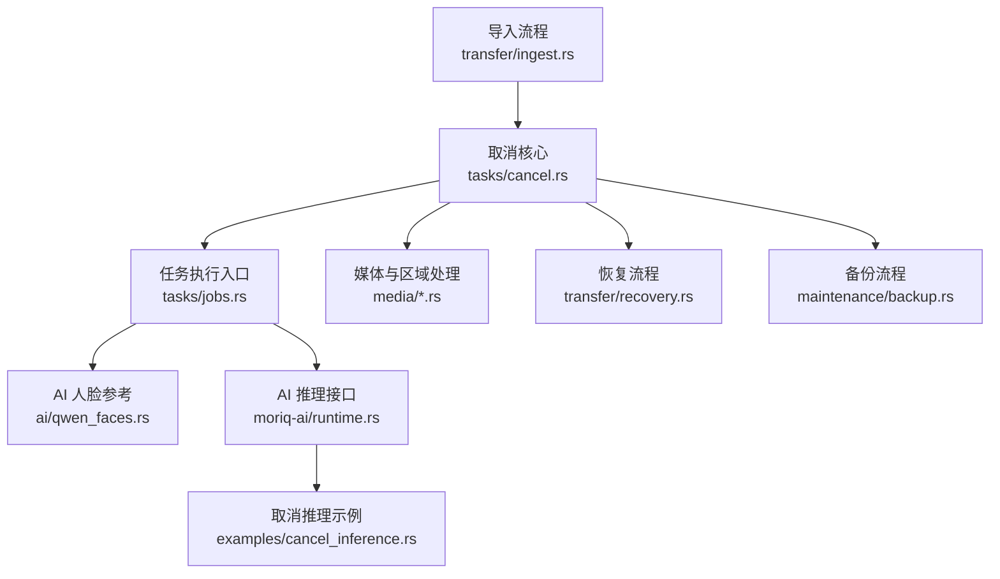
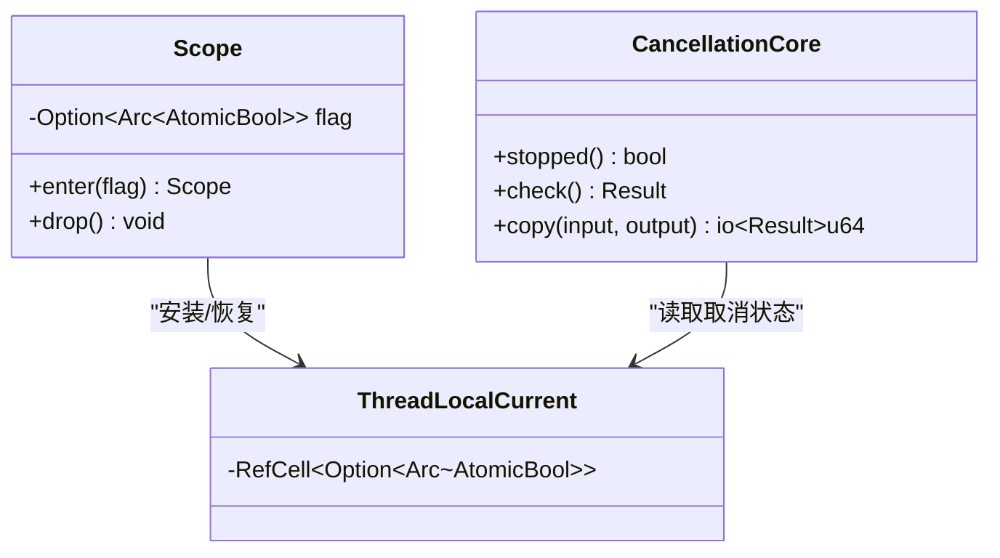
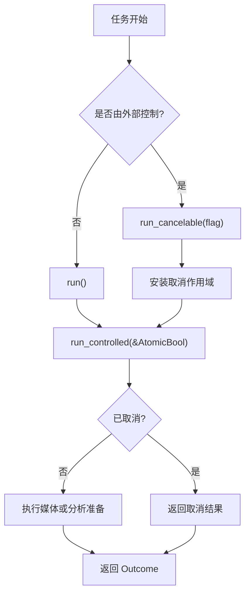
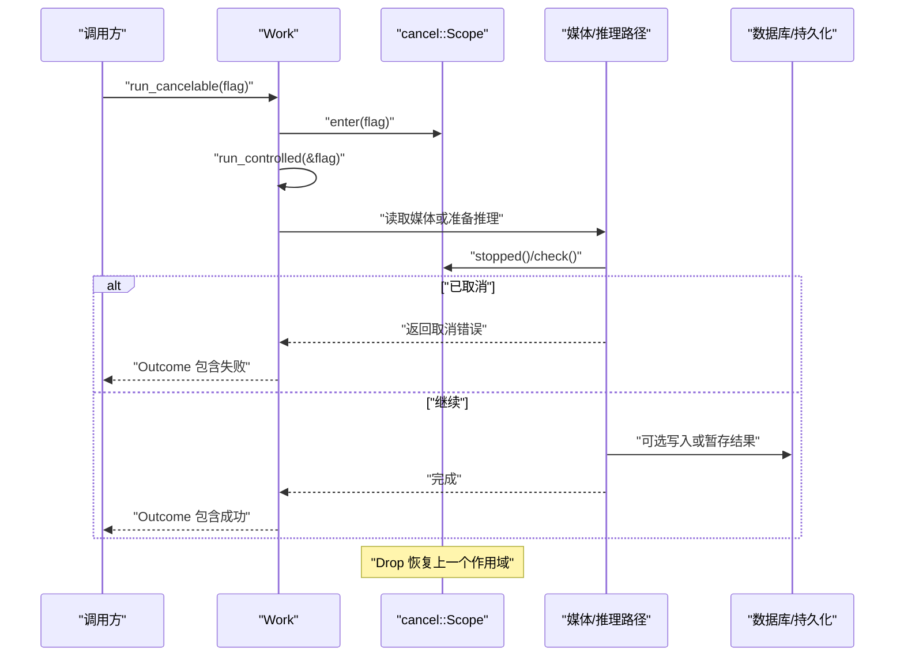
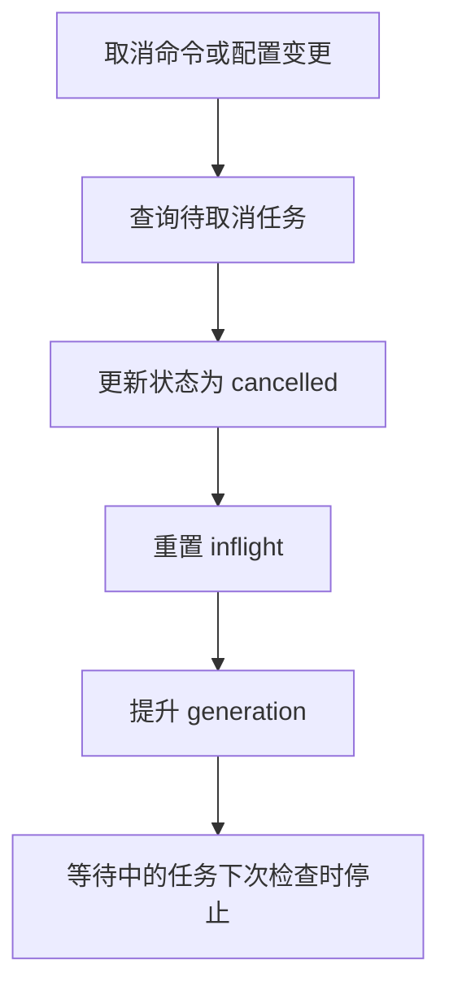
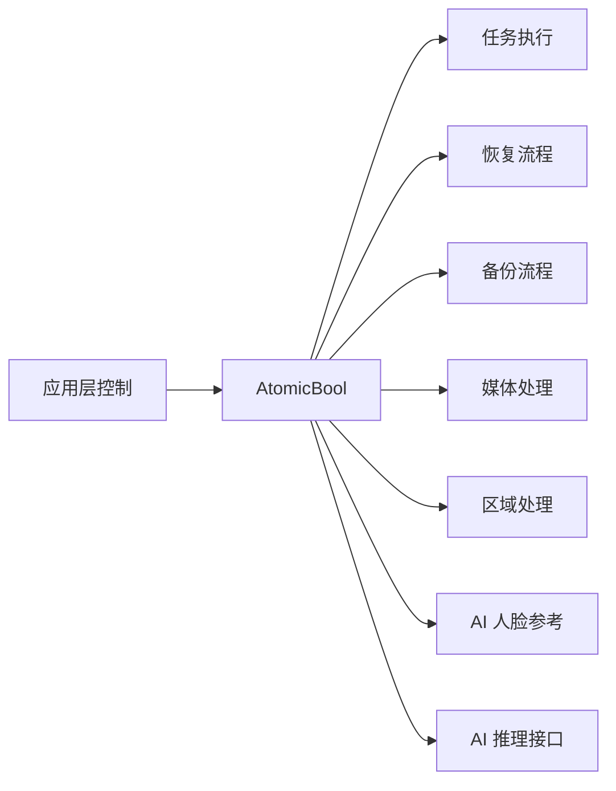
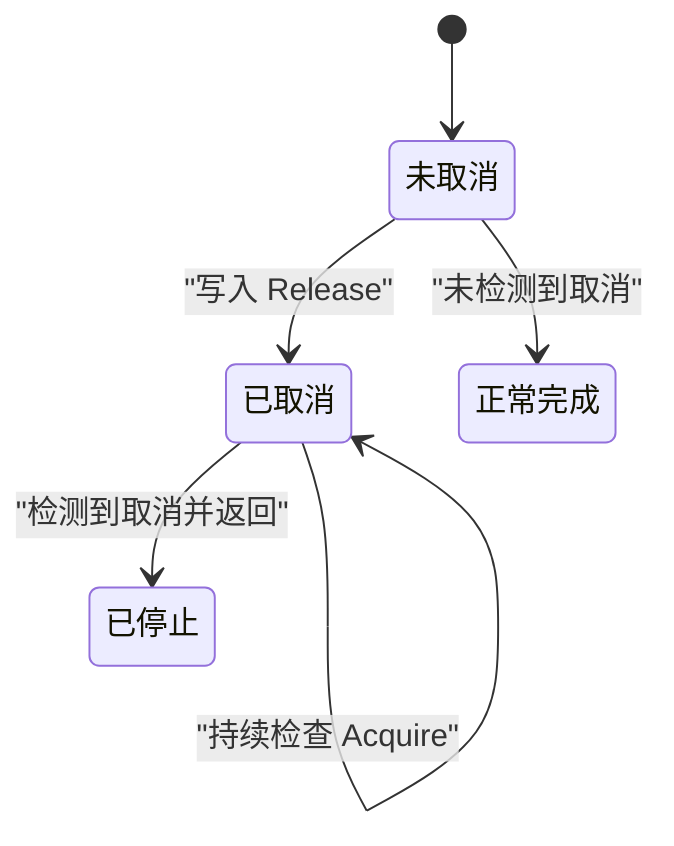

# 任务取消系统与原子操作

> Repo Wiki 节点 `cancellation-system`
> 导出自 Qoder 知识库快照 `8fbe02f6-57c2-4874-b725-1a8130851fd9`，代码基线 `7a7a8e75e18bd90294e09cd422dd7ed5a04813a0`（分支 main，zh-CN）。

<cite>
**本文引用的文件**   
- [crates/moriq-library/src/tasks/cancel.rs](../../../crates/moriq-library/src/tasks/cancel.rs)
- [crates/moriq-library/src/tasks/jobs.rs](../../../crates/moriq-library/src/tasks/jobs.rs)
- [crates/moriq-library/src/ai/qwen_faces.rs](../../../crates/moriq-library/src/ai/qwen_faces.rs)
- [crates/moriq-library/src/media/media.rs](../../../crates/moriq-library/src/media/media.rs)
- [crates/moriq-library/src/media/region.rs](../../../crates/moriq-library/src/media/region.rs)
- [crates/moriq-library/src/media/native.rs](../../../crates/moriq-library/src/media/native.rs)
- [crates/moriq-library/src/media/raw_portable.rs](../../../crates/moriq-library/src/media/raw_portable.rs)
- [crates/moriq-library/src/maintenance/backup.rs](../../../crates/moriq-library/src/maintenance/backup.rs)
- [crates/moriq-library/src/transfer/recovery.rs](../../../crates/moriq-library/src/transfer/recovery.rs)
- [crates/moriq-library/src/transfer/ingest.rs](../../../crates/moriq-library/src/transfer/ingest.rs)
- [crates/moriq-ai/src/runtime.rs](../../../crates/moriq-ai/src/runtime.rs)
- [crates/moriq-ai/examples/cancel_inference.rs](../../../crates/moriq-ai/examples/cancel_inference.rs)
</cite>

## 目录
1. [引言](#引言)
2. [项目结构中的取消位置](#项目结构中的取消位置)
3. [核心组件：取消作用域与线程局部状态](#核心组件取消作用域与线程局部状态)
4. [AtomicBool 的语义与内存可见性](#atomicbool-的语义与内存可见性)
5. [任务执行入口：run_cancelable 与 run_controlled](#任务执行入口run_cancelable-与-run_controlled)
6. [取消检查点设计模式](#取消检查点设计模式)
7. [批量停止与目标定位](#批量停止与目标定位)
8. [跨模块取消传播路径](#跨模块取消传播路径)
9. [多线程安全性与竞态避免](#多线程安全性与竞态避免)
10. [调试技巧与常见陷阱](#调试技巧与常见陷阱)
11. [性能特征与优化建议](#性能特征与优化建议)
12. [结论](#结论)

## 引言
Moriq Space 的任务取消系统围绕“按线程的作用域取消标志”构建，而不是依赖全局单例或跨任务共享的复杂锁。其核心思想是：
- 使用 `Arc<AtomicBool>` 作为可复制、可共享的取消令牌。
- 通过 `cancel::Scope` 将取消令牌绑定到当前线程。
- 在长耗时循环、媒体读取、推理准备和数据库事务等关键路径上插入取消检查点。
- 在调度层将后台任务标记为 `cancelled`，并在需要时阻止过期结果提交。

这套设计适合多工作线程、异步恢复、批量任务和 AI 推理等多种场景，同时保持取消信号传播简单、可测试且不会泄漏到后续任务。

## 项目结构中的取消位置
取消逻辑集中在库层的任务子系统，并被媒体处理、维护任务、传输恢复、AI 推理等上层模块复用：

**图示来源**
- [crates/moriq-library/src/tasks/cancel.rs:1-85](../../../crates/moriq-library/src/tasks/cancel.rs#L1-L85)
- [crates/moriq-library/src/tasks/jobs.rs:20-50](../../../crates/moriq-library/src/tasks/jobs.rs#L20-L50)
- [crates/moriq-library/src/ai/qwen_faces.rs:1-40](../../../crates/moriq-library/src/ai/qwen_faces.rs#L1-L40)
- [crates/moriq-ai/src/runtime.rs:1-40](../../../crates/moriq-ai/src/runtime.rs#L1-L40)
- [crates/moriq-library/src/transfer/recovery.rs:50-120](../../../crates/moriq-library/src/transfer/recovery.rs#L50-L120)
- [crates/moriq-library/src/transfer/ingest.rs:130-150](../../../crates/moriq-library/src/transfer/ingest.rs#L130-L150)
- [crates/moriq-library/src/maintenance/backup.rs:40-50](../../../crates/moriq-library/src/maintenance/backup.rs#L40-L50)

**章节来源**
- [crates/moriq-library/src/tasks/cancel.rs:1-85](../../../crates/moriq-library/src/tasks/cancel.rs#L1-L85)
- [crates/moriq-library/src/tasks/jobs.rs:1-50](../../../crates/moriq-library/src/tasks/jobs.rs#L1-L50)

## 核心组件：取消作用域与线程局部状态
取消系统的中心是线程局部的取消标志栈。每个线程有一个槽位，用于保存当前作用域的 `Arc<AtomicBool>`。

### 关键类型与职责
| 名称 | 职责 | 行为说明 |
|---|---|---|
| `CURRENT` | 线程局部存储 | 保存当前作用域的可选取消标志。 |
| `Scope` | 作用域管理对象 | 进入时安装标志，退出时恢复之前的标志。 |
| `stopped()` | 取消检查函数 | 读取当前作用域中的取消标志。 |
| `check()` | 取消转换函数 | 若已停止，返回资源库错误；否则返回成功。 |
| `copy()` | 分块复制辅助函数 | 在每次读取前检查取消，避免长 IO 无法及时停止。 |

**图示来源**
- [crates/moriq-library/src/tasks/cancel.rs:28-85](../../../crates/moriq-library/src/tasks/cancel.rs#L28-L85)

### 作用域生命周期
1. 调用者创建 `Arc<AtomicBool>` 作为取消令牌。
2. 调用 `Scope::enter` 将令牌压入当前线程上下文。
3. 子任务通过 `stopped()` 或 `check()` 感知取消。
4. `Scope` 析构时恢复之前的上下文，避免取消状态泄漏给下一个任务。

这种“栈式作用域”设计保证：
- 同一线程中嵌套调用不会互相覆盖。
- 取消范围只影响当前作用域内的代码。
- 即使任务提前返回或 panic，`Drop` 也能恢复上下文。

**章节来源**
- [crates/moriq-library/src/tasks/cancel.rs:28-85](../../../crates/moriq-library/src/tasks/cancel.rs#L28-L85)

## AtomicBool 的语义与内存可见性
系统中对 `AtomicBool` 的使用遵循清晰的写读语义：

| 操作方向 | 使用的序 | 含义 |
|---|---|---|
| 写入取消标志 | `Ordering::Release` | 确保取消前的所有副作用对其他线程可见。 |
| 读取取消标志 | `Ordering::Acquire` | 确保看到取消标志后，能看到之前释放顺序建立的数据关系。 |
| 报告层读取 | `Ordering::Relaxed` | 仅用于 UI 或报表中的最终状态快照，不要求强同步语义。 |

### 为什么这样选择
- **Release/Acquire** 提供轻量级跨线程可见性保证，不需要 `SeqCst` 的全局序列化开销。
- **Relaxed** 用于非关键路径的状态上报，例如导入报告中的 `cancelled` 字段。
- 取消检查通常是“尽快退出”，因此更关注“一旦看到取消就停止”，而不是精确排序多个无关内存写。

### 内存可见性要点
- 生产者线程设置 `true` 时使用 `Release`。
- 消费者线程读取 `true` 时使用 `Acquire`。
- 如果业务还涉及其他共享状态（如媒体句柄、临时目录），需要在取消前后显式协调清理；取消标志本身不提供完整内存屏障语义之外的同步保证。

**章节来源**
- [crates/moriq-library/src/tasks/cancel.rs:51-58](../../../crates/moriq-library/src/tasks/cancel.rs#L51-L58)
- [crates/moriq-library/src/tasks/jobs.rs:42-50](../../../crates/moriq-library/src/tasks/jobs.rs#L42-L50)
- [crates/moriq-library/src/ai/qwen_faces.rs:25-35](../../../crates/moriq-library/src/ai/qwen_faces.rs#L25-L35)
- [crates/moriq-app/src/import.rs:142-145](../../../crates/moriq-app/src/import.rs#L142-L145)

## 任务执行入口：run_cancelable 与 run_controlled
`Work` 是任务执行的核心封装。它提供了两种主要入口：

| 方法 | 输入 | 行为 | 适用场景 |
|---|---|---|---|
| `run(self)` | 无外部取消控制 | 内部创建未触发的 `AtomicBool`，等价于不可取消执行。 | 不需要外部取消的内部任务。 |
| `run_cancelable(flag)` | `Arc<AtomicBool>` | 安装取消作用域，然后委托给 `run_controlled`。 | 可由外部取消的任务。 |
| `run_controlled(cancel)` | `&AtomicBool` | 检查取消、执行媒体读取或分析准备，返回 `Outcome`。 | 被 `run_cancelable` 或调度器复用。 |
| `execute(cancel)` | `Arc<AtomicBool>` | 决定本地完成还是交给 AI 推理。 | 统一调度入口。 |

**图示来源**
- [crates/moriq-library/src/tasks/jobs.rs:20-60](../../../crates/moriq-library/src/tasks/jobs.rs#L20-L60)

### 区别总结
- `run_cancelable` 负责**作用域绑定**：把 `Arc<AtomicBool>` 安装到当前线程。
- `run_controlled` 负责**业务执行**：检查取消、分支任务类型、准备图片或元数据。
- `execute` 进一步区分普通任务与 AI 推理任务，并决定是否构造 `InferenceWork`。

**章节来源**
- [crates/moriq-library/src/tasks/jobs.rs:20-60](../../../crates/moriq-library/src/tasks/jobs.rs#L20-L60)
- [crates/moriq-library/src/tasks/jobs.rs:200-260](../../../crates/moriq-library/src/tasks/jobs.rs#L200-L260)

## 取消检查点设计模式
取消检查点不是单一 API，而是一组协作模式：

1. **作用域入口检查**  
   在执行开始前检查 `AtomicBool`，避免启动无意义的计算。
2. **线程局部检查**  
   通过 `cancel::stopped()` 和 `cancel::check()` 访问当前线程作用域。
3. **IO 循环检查**  
   在 `copy` 等长 IO 循环中每块读取前检查取消。
4. **媒体读取检查**  
   在区域扫描、原始图片读取、原生解码器等路径中定期检查。
5. **AI 推理检查**  
   在人脸参考资料扫描和推理接口中传递 `AtomicBool`。

**图示来源**
- [crates/moriq-library/src/tasks/jobs.rs:20-60](../../../crates/moriq-library/src/tasks/jobs.rs#L20-L60)
- [crates/moriq-library/src/tasks/cancel.rs:51-85](../../../crates/moriq-library/src/tasks/cancel.rs#L51-L85)
- [crates/moriq-library/src/media/region.rs:218-245](../../../crates/moriq-library/src/media/region.rs#L218-L245)
- [crates/moriq-library/src/ai/qwen_faces.rs:20-50](../../../crates/moriq-library/src/ai/qwen_faces.rs#L20-L50)

**章节来源**
- [crates/moriq-library/src/tasks/cancel.rs:51-85](../../../crates/moriq-library/src/tasks/cancel.rs#L51-L85)
- [crates/moriq-library/src/media/region.rs:60-70](../../../crates/moriq-library/src/media/region.rs#L60-L70)
- [crates/moriq-library/src/media/native.rs:90-100](../../../crates/moriq-library/src/media/native.rs#L90-L100)
- [crates/moriq-library/src/media/raw_portable.rs:55-65](../../../crates/moriq-library/src/media/raw_portable.rs#L55-L65)

## 批量停止与目标定位
取消不仅作用于单个任务，还能影响一批后台任务。调度层通过数据库状态实现批量取消：

| 操作 | 行为 |
|---|---|
| 更新任务状态 | 将 `queued`、`running`、`paused` 中的任务设为 `cancelled`。 |
| 重置并发计数 | 将 `inflight` 归零，避免任务误判仍在运行。 |
| 提升版本世代 | 修改 `generation`，用于拒绝过期回执。 |
| 分类配置变更 | 当 AI 分类定义变化时，取消相关任务并要求重新整理。 |

**图示来源**
- [crates/moriq-library/src/tasks/jobs.rs:460-485](../../../crates/moriq-library/src/tasks/jobs.rs#L460-L485)
- [crates/moriq-library/src/tasks/jobs.rs:585-655](../../../crates/moriq-library/src/tasks/jobs.rs#L585-L655)
- [crates/moriq-library/src/ai/ai_profile.rs:100-145](../../../crates/moriq-library/src/ai/ai_profile.rs#L100-L145)

### 目标定位策略
- **按任务 ID 取消**：精确停止某个后台任务。
- **按任务种类取消**：例如取消所有 `analysis:%` 类 AI 任务。
- **按工作区取消**：在项目空间升级或分类定义变化时，取消受影响的背景任务。
- **按状态过滤**：只取消排队、运行或暂停任务，避免干扰已完成或已取消任务。

**章节来源**
- [crates/moriq-library/src/tasks/jobs.rs:460-485](../../../crates/moriq-library/src/tasks/jobs.rs#L460-L485)
- [crates/moriq-library/src/tasks/jobs.rs:585-655](../../../crates/moriq-library/src/tasks/jobs.rs#L585-L655)
- [crates/moriq-library/src/ai/ai_profile.rs:100-145](../../../crates/moriq-library/src/ai/ai_profile.rs#L100-L145)

## 跨模块取消传播路径
取消信号从应用层传入，沿多条路径扩散：

**图示来源**
- [crates/moriq-ai/examples/cancel_inference.rs:12-35](../../../crates/moriq-ai/examples/cancel_inference.rs#L12-L35)
- [crates/moriq-ai/src/runtime.rs:25-40](../../../crates/moriq-ai/src/runtime.rs#L25-L40)
- [crates/moriq-library/src/transfer/recovery.rs:50-120](../../../crates/moriq-library/src/transfer/recovery.rs#L50-L120)
- [crates/moriq-library/src/maintenance/backup.rs:40-50](../../../crates/moriq-library/src/maintenance/backup.rs#L40-L50)
- [crates/moriq-library/src/media/media.rs:235-265](../../../crates/moriq-library/src/media/media.rs#L235-L265)
- [crates/moriq-library/src/media/region.rs:218-245](../../../crates/moriq-library/src/media/region.rs#L218-L245)
- [crates/moriq-library/src/ai/qwen_faces.rs:20-50](../../../crates/moriq-library/src/ai/qwen_faces.rs#L20-L50)

### 典型路径
1. **AI 推理取消**  
   示例程序创建 `AtomicBool`，由计时器线程触发取消，随后调用 `infer_controlled`。
2. **恢复流程取消**  
   恢复过程安装取消作用域，并在关键步骤调用 `check()`。
3. **备份流程取消**  
   备份任务在安装作用域后检查取消，并在多次写入前检查。
4. **媒体处理取消**  
   媒体和区域处理通过 `cancel::Scope` 将取消传播到深层 IO。

**章节来源**
- [crates/moriq-ai/examples/cancel_inference.rs:12-35](../../../crates/moriq-ai/examples/cancel_inference.rs#L12-L35)
- [crates/moriq-ai/src/runtime.rs:25-40](../../../crates/moriq-ai/src/runtime.rs#L25-L40)
- [crates/moriq-library/src/transfer/recovery.rs:50-120](../../../crates/moriq-library/src/transfer/recovery.rs#L50-L120)
- [crates/moriq-library/src/maintenance/backup.rs:40-50](../../../crates/moriq-library/src/maintenance/backup.rs#L40-L50)
- [crates/moriq-library/src/media/media.rs:235-265](../../../crates/moriq-library/src/media/media.rs#L235-L265)

## 多线程安全性与竞态避免
### 安全性保证
- **共享状态最小化**：取消标志通过 `Arc<AtomicBool>` 共享，而不是全局可变状态。
- **线程局部作用域**：`CURRENT` 是线程局部变量，避免不同任务互相覆盖取消上下文。
- **RAII 作用域**：`Scope` 的 `Drop` 保证退出时恢复上一个上下文。
- **明确内存序**：写入用 `Release`，读取用 `Acquire`，避免可见性问题。
- **任务身份与世代号**：通过 `abort_token` 和 `generation` 防止旧任务完成后覆盖新结果。

### 如何避免取消竞态
| 风险 | 做法 |
|---|---|
| 忘记检查取消 | 在循环、IO、数据库查询前插入 `check()` 或 `stopped()`。 |
| 作用域过早释放 | 让 `Scope` 持有整个任务生命周期，不要提前 drop。 |
| 取消泄漏到下一任务 | 依赖 `Scope::Drop` 恢复上下文，不要手动清空 `CURRENT`。 |
| 旧任务覆盖新任务 | 使用任务 ID 和 `generation` 拒绝过期回执。 |
| 报告状态不一致 | 报告字段可用 `Relaxed`，但业务判断必须使用正确同步语义。 |

**图示来源**
- [crates/moriq-library/src/tasks/cancel.rs:51-65](../../../crates/moriq-library/src/tasks/cancel.rs#L51-L65)
- [crates/moriq-library/src/tasks/jobs.rs:20-60](../../../crates/moriq-library/src/tasks/jobs.rs#L20-L60)

**章节来源**
- [crates/moriq-library/src/tasks/cancel.rs:28-85](../../../crates/moriq-library/src/tasks/cancel.rs#L28-L85)
- [crates/moriq-library/src/tasks/jobs.rs:20-60](../../../crates/moriq-library/src/tasks/jobs.rs#L20-L60)

## 调试技巧与常见陷阱
### 调试技巧
1. **确认作用域是否安装**  
   检查调用链是否在任务入口处调用 `Scope::enter`。
2. **确认取消标志是否被写入**  
   在触发取消的位置确认 `store(true, Release)` 确实执行。
3. **确认读取路径是否使用 Acquire**  
   特别是循环、媒体扫描、AI 推理等高频路径。
4. **使用示例程序验证**  
   `cancel_inference` 展示了如何通过计时器线程触发取消，并验证错误消息。
5. **检查任务状态迁移**  
   查看数据库中任务是否从 `running` 变为 `cancelled`。
6. **区分“逻辑取消”和“资源清理”**  
   取消标志只表示“应停止”，不负责自动关闭文件、释放 GPU 或删除临时目录。

### 常见陷阱
| 陷阱 | 现象 | 修复建议 |
|---|---|---|
| 忘记检查取消标志 | 任务长时间无法停止 | 在循环、IO、数据库查询前加入 `check()`。 |
| 过早释放取消令牌 | 作用域结束后取消失效 | 让 `Scope` 持有整个任务生命周期。 |
| 使用全局可变状态 | 任务间相互污染 | 改用 `Arc<AtomicBool>` 和线程局部作用域。 |
| 忽略 Drop 语义 | 取消泄漏到下一任务 | 不要绕过 `Scope` 的生命周期。 |
| 只检查一次 | 长任务中途不响应 | 在长循环中重复检查。 |
| 误以为取消会自动清理资源 | 临时文件、连接残留 | 在取消分支中显式清理。 |
| 报告字段与业务判断混用 | UI 显示与决策不一致 | 报告字段可用 `Relaxed`，业务逻辑使用正确同步语义。 |

**章节来源**
- [crates/moriq-ai/examples/cancel_inference.rs:12-35](../../../crates/moriq-ai/examples/cancel_inference.rs#L12-L35)
- [crates/moriq-library/src/tasks/cancel.rs:51-85](../../../crates/moriq-library/src/tasks/cancel.rs#L51-L85)
- [crates/moriq-library/src/transfer/ingest.rs:130-150](../../../crates/moriq-library/src/transfer/ingest.rs#L130-L150)

## 性能特征与优化建议
### 性能特征
- **取消检查成本低**：`AtomicBool::load(Acquire)` 通常是一个轻量级加载指令。
- **频繁检查路径需谨慎**：极短内联循环中过度检查可能增加分支预测压力。
- **IO 密集型任务受益明显**：`copy` 等长 IO 路径通过分块检查显著提升可中断性。
- **数据库批量取消成本低**：直接更新状态列，避免逐条通知。

### 优化建议
- **热点路径合并检查**：将多个连续检查合并为一个条件分支。
- **优先检查昂贵操作前**：先检查取消，再分配大内存或发起网络请求。
- **避免在热路径创建 Arc**：尽量复用已有的 `Arc<AtomicBool>`。
- **将取消检查靠近阻塞点**：文件系统、数据库、AI 进程等阻塞点前必须检查。
- **保留可观测性**：在取消分支记录日志或指标，便于定位卡住的任务。

[本节为通用指导，不直接分析具体文件]

## 结论
Moriq Space 的任务取消系统以 `cancel::Scope` 和 `Arc<AtomicBool>` 为核心，采用线程局部作用域、明确的原子序语义、以及多层取消检查点，构建了可扩展且可测试的取消模型。它既支持单任务取消，也支持批量任务和目标定位取消；既能中断媒体 IO，又能传播到 AI 推理和恢复流程。

在实际使用中，最关键的原则是：
- 始终通过 `Scope` 安装取消上下文。
- 在所有长耗时路径上插入取消检查。
- 使用 `Release` 写入、`Acquire` 读取。
- 配合任务身份和版本世代，避免过期结果污染系统。
- 显式清理取消分支中的资源，不把取消当作万能清理钩子。