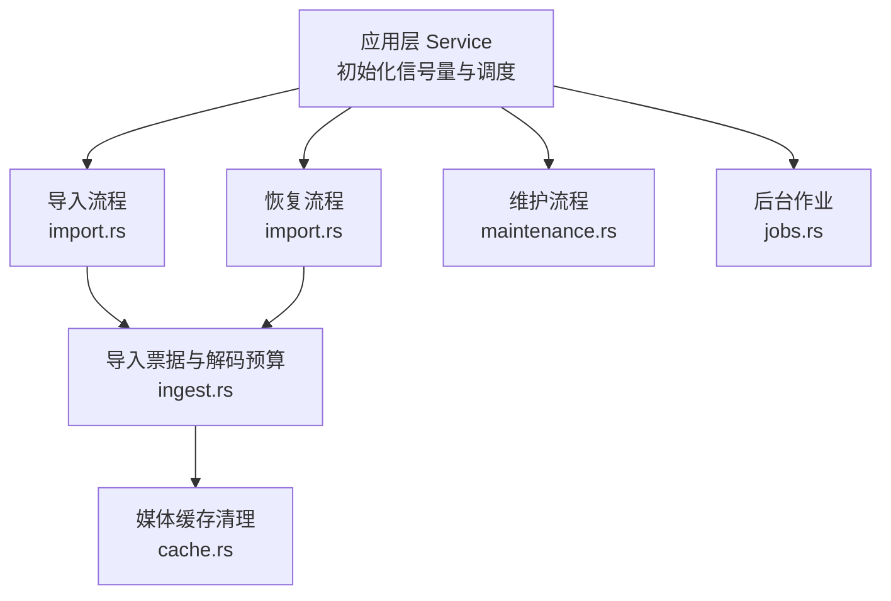
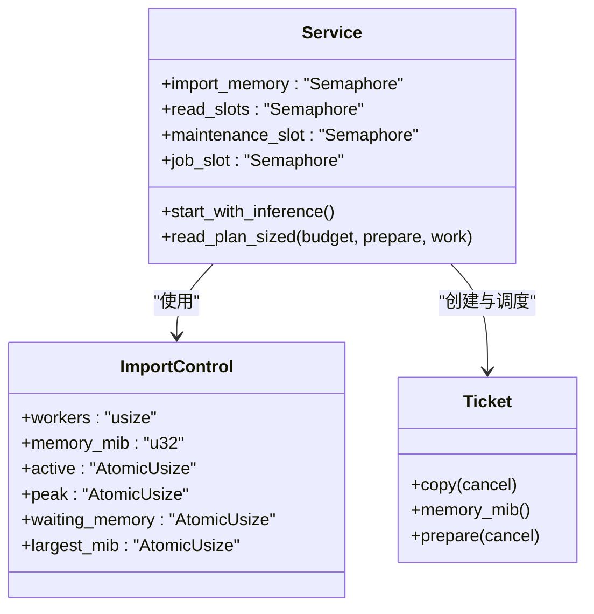
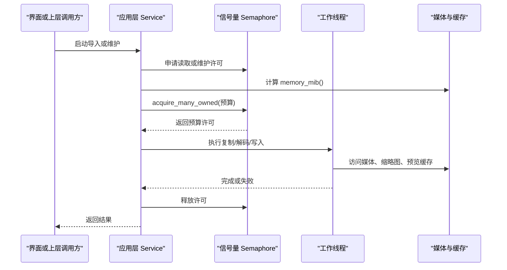
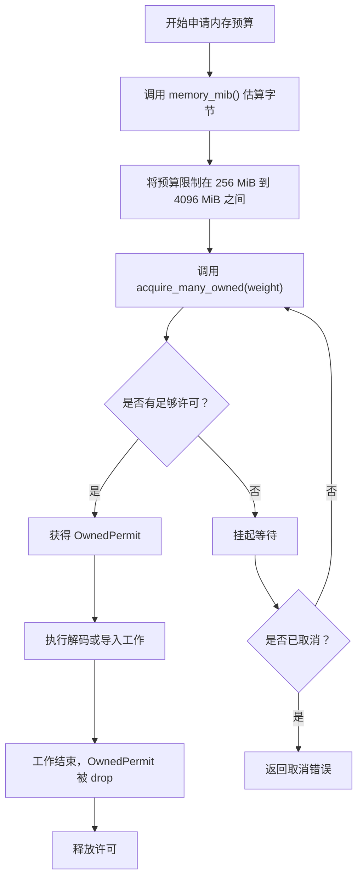
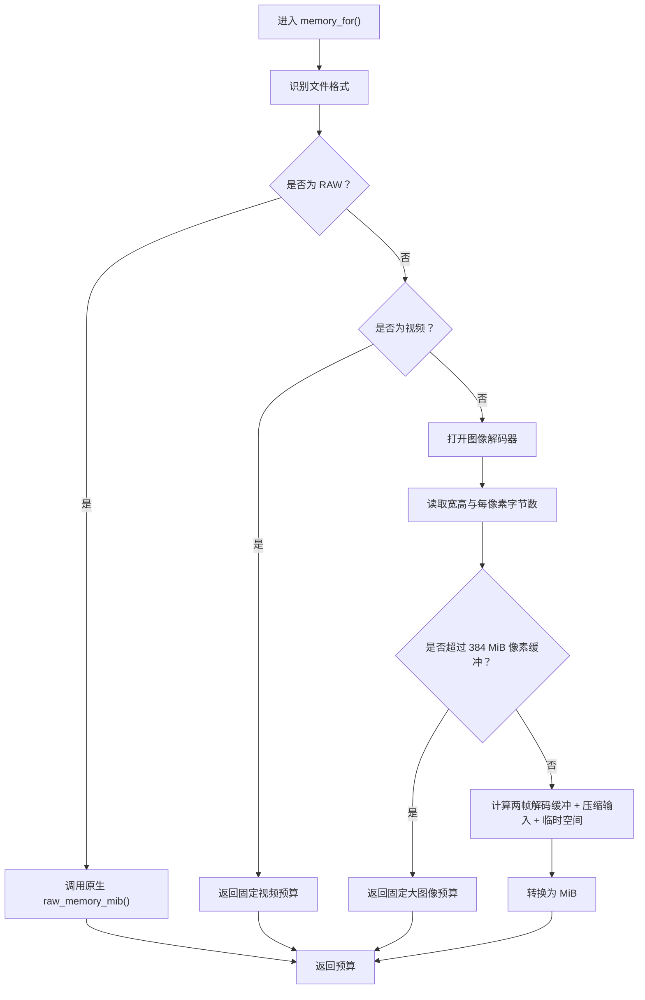
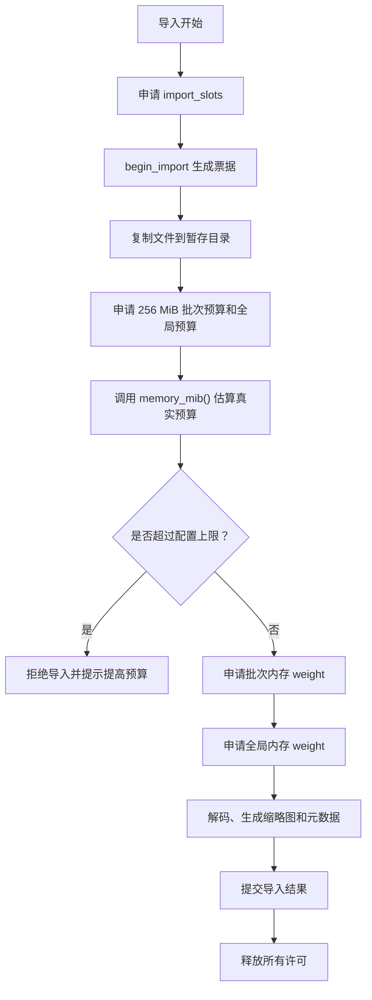
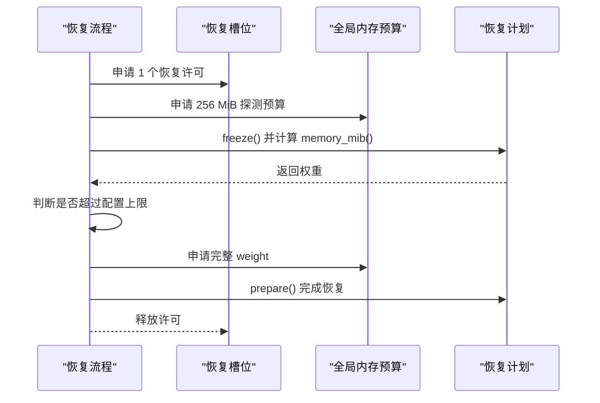
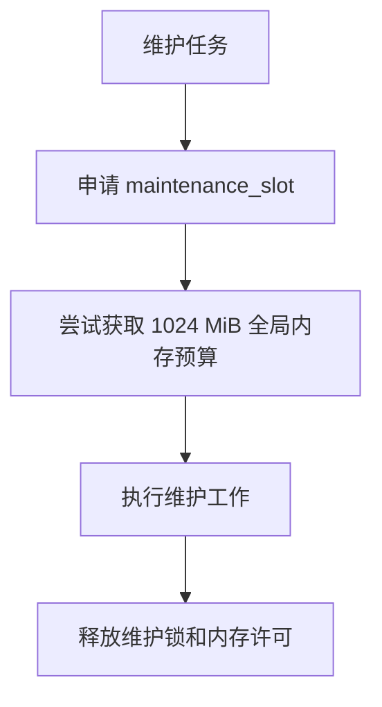
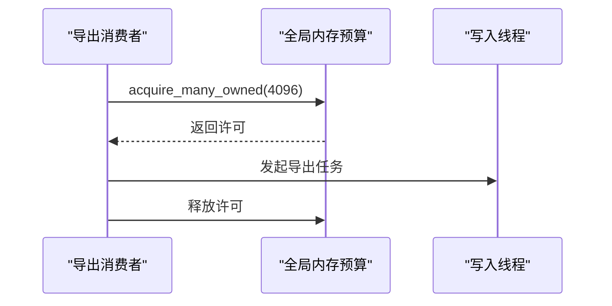
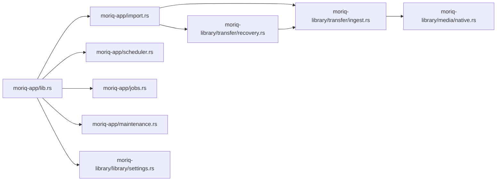

# 内存预算管理与信号量控制

> Repo Wiki 节点 `memory-budget-management`
> 导出自 Qoder 知识库快照 `8fbe02f6-57c2-4874-b725-1a8130851fd9`，代码基线 `7a7a8e75e18bd90294e09cd422dd7ed5a04813a0`（分支 main，zh-CN）。

<cite>
**本文引用的文件**   
- [lib.rs](../../../crates/moriq-app/src/lib.rs)
- [import.rs](../../../crates/moriq-app/src/import.rs)
- [scheduler.rs](../../../crates/moriq-app/src/scheduler.rs)
- [jobs.rs](../../../crates/moriq-app/src/jobs.rs)
- [maintenance.rs](../../../crates/moriq-app/src/maintenance.rs)
- [ingest.rs](../../../crates/moriq-library/src/transfer/ingest.rs)
- [recovery.rs](../../../crates/moriq-library/src/transfer/recovery.rs)
- [cache.rs](../../../crates/moriq-library/src/media/cache.rs)
- [settings.rs](../../../crates/moriq-library/src/library/settings.rs)
</cite>

## 目录
1. [引言](#引言)
2. [项目结构与职责边界](#项目结构与职责边界)
3. [核心组件：信号量与内存预算](#核心组件信号量与内存预算)
4. [架构总览](#架构总览)
5. [详细组件分析](#详细组件分析)
6. [依赖关系分析](#依赖关系分析)
7. [性能考量与调优建议](#性能考量与调优建议)
8. [故障排查指南](#故障排查指南)
9. [结论](#结论)

## 引言
本文聚焦 Moriq Space 的内存预算管理系统，重点解释以下问题：
- `Semaphore` 在系统中的多重用途：导入内存预算、读取并发许可、维护许可和作业许可。
- 如何根据任务的 `memory_mib()` 动态申请内存预算。
- 内存申请失败时的重试、取消和资源回滚策略。
- 导入流程中的预分配、媒体解码缓存控制，以及导出阶段的内存优化。
- 内存泄漏检测工具的使用方式，包括堆剖析与快照分析。
- 根据硬件配置调整信号量初始值和内存预算阈值的实践建议。

## 项目结构与职责边界
Moriq Space 将资源控制分为应用层和服务层两部分：
- 应用层负责初始化全局信号量、构建 `Service`、暴露导入和维护入口，并把工作调度到写入线程或后台任务。
- 服务层负责媒体导入、恢复、转储、缓存清理等实际 I/O 与解码逻辑，并对外暴露 `memory_mib()` 用于预算估算。

**图示来源**  
- [lib.rs:90-100](../../../crates/moriq-app/src/lib.rs#L90-L100)
- [lib.rs:240-252](../../../crates/moriq-app/src/lib.rs#L240-L252)
- [import.rs:1-50](../../../crates/moriq-app/src/import.rs#L1-L50)
- [ingest.rs:1-40](../../../crates/moriq-library/src/transfer/ingest.rs#L1-L40)
- [cache.rs:1-20](../../../crates/moriq-library/src/media/cache.rs#L1-L20)

**章节来源**  
- [lib.rs:90-100](../../../crates/moriq-app/src/lib.rs#L90-L100)
- [lib.rs:240-252](../../../crates/moriq-app/src/lib.rs#L240-L252)

## 核心组件：信号量与内存预算
`Service` 持有多个 `Arc<Semaphore>`，用于协调不同资源的并发与内存占用：
- `import_memory`：全局导入内存预算，初始值为 4096 MB。
- `read_slots`：读取并发许可，初始值为 4。
- `maintenance_slot`：维护操作独占许可，初始值为 1。
- `job_slot`：后台作业独占许可，初始值为 1。

这些信号量不是单纯的“计数锁”，而是把“资源可用”和“内存预算足够”统一为一种可等待、可释放、可跨线程传递的许可模型。

**图示来源**  
- [lib.rs:90-100](../../../crates/moriq-app/src/lib.rs#L90-L100)
- [lib.rs:120-160](../../../crates/moriq-app/src/lib.rs#L120-L160)
- [ingest.rs:1-30](../../../crates/moriq-library/src/transfer/ingest.rs#L1-L30)

**章节来源**  
- [lib.rs:90-100](../../../crates/moriq-app/src/lib.rs#L90-L100)
- [lib.rs:240-252](../../../crates/moriq-app/src/lib.rs#L240-L252)
- [lib.rs:350-410](../../../crates/moriq-app/src/lib.rs#L350-L410)

## 架构总览
系统的关键执行路径是：
1. 用户触发导入、恢复、维护或后台作业。
2. 应用层先申请对应信号量许可。
3. 如果需要媒体解码，则调用 `memory_mib()` 估算预算。
4. 通过 `acquire_many_owned` 申请全局内存预算。
5. 在工作线程中执行复制、解码、写入或清理。
6. 完成后释放所有许可，使其他任务继续竞争资源。

**图示来源**  
- [import.rs:300-478](../../../crates/moriq-app/src/import.rs#L300-L478)
- [lib.rs:350-410](../../../crates/moriq-app/src/lib.rs#L350-L410)
- [ingest.rs:80-140](../../../crates/moriq-library/src/transfer/ingest.rs#L80-L140)

## 详细组件分析

### 信号量的多重用途与设计考量
| 信号量 | 初始值 | 主要用途 | 设计考量 |
|---|---:|---|---|
| `import_memory` | 4096 | 全局导入内存预算 | 限制同时解码和暂存图像的峰值内存，避免单批导入撑爆进程。 |
| `read_slots` | 4 | 冻结读取计划、共享媒体执行 | 控制同时进入数据库查询、媒体计划构建和阻塞解码的任务数量。 |
| `maintenance_slot` | 1 | 维护任务独占 | 维护操作可能扫描、备份、清理，需要避免与高开销导入竞争。 |
| `job_slot` | 1 | 后台作业独占 | 保证 AI、推理或长期后台任务不会与导入互相抢占关键资源。 |

初始化位置集中在 `Service::start_with_inference`，其中明确设置了四个信号量的初始容量。测试用例也断言了这些默认值，说明它们是稳定契约的一部分。

**章节来源**  
- [lib.rs:240-252](../../../crates/moriq-app/src/lib.rs#L240-L252)
- [tests.rs:411-428](../../../crates/moriq-app/src/tests.rs#L411-L428)
- [tests.rs:476-491](../../../crates/moriq-app/src/tests.rs#L476-L491)

### `acquire_many_owned` 的工作原理
`acquire_many_owned(count)` 是 Tokio 信号量的批量获取方法，语义如下：
- 如果当前可用许可数大于等于 `count`，立即返回一个拥有全部 `count` 个许可的 OwnedPermit。
- 否则挂起当前异步任务，直到有足够许可被释放，或被取消。
- 当 OwnedPermit 被 drop 时，自动归还所有许可。

在 Moriq Space 中，它被用于：
- 读取计划：按计划的 `memory_mib()` 申请全局内存预算。
- 导入工作：按单个媒体的 `memory_mib()` 申请批次内存和全局内存。
- 恢复流程：先申请固定小预算探测，再按实际权重申请完整预算。
- 导出测试与工作调度：按任务类型或显式预算申请许可。

**图示来源**  
- [lib.rs:374-410](../../../crates/moriq-app/src/lib.rs#L374-L410)
- [import.rs:380-478](../../../crates/moriq-app/src/import.rs#L380-L478)
- [import.rs:140-190](../../../crates/moriq-app/src/import.rs#L140-L190)

**章节来源**  
- [lib.rs:350-410](../../../crates/moriq-app/src/lib.rs#L350-L410)
- [import.rs:140-190](../../../crates/moriq-app/src/import.rs#L140-L190)
- [import.rs:380-478](../../../crates/moriq-app/src/import.rs#L380-L478)

### 内存预算估算：`memory_mib()`
`memory_mib()` 是内存预算的核心估算点。它在不同位置提供预算输入：
- `Ticket::memory_mib()`：对已暂存的导入票据估算解码预算。
- `Recovery::Work::memory_mib()`：对恢复记录估算预算。
- `Ingest::memory_for()`：根据图像尺寸、颜色深度、压缩输入和临时缓冲区计算预估字节数。
- RAW 文件：委托原生代码估算。
- 视频：直接采用固定预算。
- 超大图像：采用固定保守预算。

**图示来源**  
- [ingest.rs:80-140](../../../crates/moriq-library/src/transfer/ingest.rs#L80-L140)
- [native.rs:64-70](../../../crates/moriq-library/src/media/native.rs#L64-L70)

**章节来源**  
- [ingest.rs:80-140](../../../crates/moriq-library/src/transfer/ingest.rs#L80-L140)
- [recovery.rs:100-120](../../../crates/moriq-library/src/transfer/recovery.rs#L100-L120)

### 导入流程中的内存预分配与解码缓存控制
导入流程采用分层控制：
1. **导入槽位**：`import_slots` 限制并发导入任务数量。
2. **批次内存**：每个导入工作内部维护一个本地 `Semaphore`，用于限制同一批次的媒体解码总量。
3. **全局内存**：`import_memory` 限制整个进程的导入相关内存。
4. **读取并发**：`read_slots` 限制同时进入数据库和媒体计划的任务。
5. **预算上限**：`ImportControl::with_preferences` 将 `memory_mib` 钳制在 256 MiB 到 4096 MiB。
6. **进度指标**：`active`、`peak`、`waiting_memory`、`largest_mib` 暴露给监控和界面。

**图示来源**  
- [import.rs:300-478](../../../crates/moriq-app/src/import.rs#L300-L478)
- [ingest.rs:1-80](../../../crates/moriq-library/src/transfer/ingest.rs#L1-L80)

**章节来源**  
- [import.rs:300-478](../../../crates/moriq-app/src/import.rs#L300-L478)
- [lib.rs:120-160](../../../crates/moriq-app/src/lib.rs#L120-L160)

### 恢复流程中的预算控制
恢复流程与普通导入类似，但更强调稳健性：
- 每次恢复计划先申请 1 个恢复槽位。
- 先用 256 MiB 探测预算冻结计划并估算 `memory_mib()`。
- 如果估算超出 `control.memory_mib.clamp(256, 4096)`，直接拒绝。
- 成功后才申请完整预算并准备媒体。
- 恢复期间会检查取消标志，避免长时间阻塞。

**图示来源**  
- [import.rs:60-140](../../../crates/moriq-app/src/import.rs#L60-L140)
- [recovery.rs:100-120](../../../crates/moriq-library/src/transfer/recovery.rs#L100-L120)

**章节来源**  
- [import.rs:60-140](../../../crates/moriq-app/src/import.rs#L60-L140)
- [recovery.rs:100-120](../../../crates/moriq-library/src/transfer/recovery.rs#L100-L120)

### 维护与后台作业的内存隔离
- `maintenance_slot` 初始值为 1，确保维护任务独占运行。
- 维护任务仍可与导入共享 `import_memory`，但会通过尝试获取 1024 MiB 预算来降低与高负载导入的竞争概率。
- `job_slot` 初始值为 1，用于隔离后台作业，例如 AI 推理或其他长期任务。

**图示来源**  
- [maintenance.rs:160-180](../../../crates/moriq-app/src/maintenance.rs#L160-L180)
- [lib.rs:240-252](../../../crates/moriq-app/src/lib.rs#L240-L252)

**章节来源**  
- [maintenance.rs:160-180](../../../crates/moriq-app/src/maintenance.rs#L160-L180)
- [jobs.rs:100-120](../../../crates/moriq-app/src/jobs.rs#L100-L120)

### 导出过程中的内存优化
导出相关的测试显示：
- 导出可以等待共享内存预算，而不阻塞写入器。
- 导出的消费端通过 `acquire_many_owned(4096)` 申请全局预算。
- 这体现了导出与导入共享同一个内存预算池，从而避免两者同时高峰叠加。

**图示来源**  
- [export_budget_tests.rs:20-60](../../../crates/moriq-app/src/export_budget_tests.rs#L20-L60)

**章节来源**  
- [export_budget_tests.rs:20-60](../../../crates/moriq-app/src/export_budget_tests.rs#L20-L60)

### 内存泄漏检测与诊断工具
仓库中未直接实现专用内存泄漏检测框架，但可以通过以下方式诊断：
- **堆剖析**：启用 Rust profiling 支持（如 `profiling` crate）或使用平台工具，捕获导入、恢复、维护期间的堆快照。
- **内存快照分析**：结合运行时统计指标 `active`、`peak`、`waiting_memory`、`largest_mib`，定位峰值发生在解码、暂存还是缓存阶段。
- **日志与跟踪**：导入失败时会记录警告；恢复失败会汇总失败信息，可用于定位异常媒体。
- **缓存清理报告**：`trim` 返回 `CacheReport`，包含剩余字节、移除文件和跳过项数量，有助于确认磁盘缓存回收是否有效。

建议的实践：
- 在大型导入前开启详细日志。
- 对比 `peak` 与 `largest_mib`，判断是瞬时解码峰值还是单次媒体过大。
- 观察 `waiting_memory`，判断是否存在大量任务因预算不足而排队。
- 定期运行缓存清理，防止预览和缩略图膨胀。

**章节来源**  
- [import.rs:420-478](../../../crates/moriq-app/src/import.rs#L420-L478)
- [cache.rs:20-87](../../../crates/moriq-library/src/media/cache.rs#L20-L87)

## 依赖关系分析

**图示来源**  
- [lib.rs:90-100](../../../crates/moriq-app/src/lib.rs#L90-L100)
- [import.rs:1-50](../../../crates/moriq-app/src/import.rs#L1-L50)
- [ingest.rs:1-40](../../../crates/moriq-library/src/transfer/ingest.rs#L1-L40)
- [recovery.rs:100-120](../../../crates/moriq-library/src/transfer/recovery.rs#L100-L120)
- [settings.rs:240-260](../../../crates/moriq-library/src/library/settings.rs#L240-L260)

**章节来源**  
- [lib.rs:90-100](../../../crates/moriq-app/src/lib.rs#L90-L100)
- [import.rs:1-50](../../../crates/moriq-app/src/import.rs#L1-L50)
- [ingest.rs:1-40](../../../crates/moriq-library/src/transfer/ingest.rs#L1-L40)

## 性能考量与调优建议
### 信号量初始值调优
| 场景 | 建议 | 理由 |
|---|---|---|
| 多核 CPU 且内存充足 | 保持 `import_memory=4096`，适当增加 `read_slots` | 提升并发读取和媒体计划构建吞吐。 |
| 内存较小或 SSD 较慢 | 降低 `import_memory`，保持 `read_slots=4` | 避免过多解码任务争抢内存和磁盘带宽。 |
| 频繁维护任务 | 保持 `maintenance_slot=1`，避免与导入重叠 | 维护本身可能扫描大量文件，不应与导入混战。 |
| AI 或后台推理任务 | 保持 `job_slot=1`，并与导入错峰执行 | 防止推理模型与媒体解码共同造成峰值溢出。 |

### 内存预算阈值调优
- `ImportControl::with_preferences` 将 `memory_mib` 钳制在 256 MiB 到 4096 MiB。
- 对于 24 MP JPEG 或多并发导入，应优先增大 `memory_mib`，而不是盲目提高 worker 数量。
- 若 `largest_mib` 接近配置上限，说明单媒体解码压力大，应优先调整该媒体处理策略或预算。
- 若 `waiting_memory` 长期偏高，说明全局预算过小，导致任务排队。

### 缓存与 I/O 优化
- 定期运行缓存清理，目标预算建议参考 UI 中的 4 GiB 磁盘预览预算。
- 对 RAW 文件，注意原生预算估算可能比常规图像更大。
- 视频导入使用固定预算，适合批量控制，但需关注整体导入队列长度。

**章节来源**  
- [lib.rs:120-160](../../../crates/moriq-app/src/lib.rs#L120-L160)
- [settings.rs:240-260](../../../crates/moriq-library/src/library/settings.rs#L240-L260)
- [storage.rs:130-145](../../../crates/moriq-ui/src/storage.rs#L130-L145)

## 故障排查指南
常见问题与定位思路：
- **导入失败并提示预算不足**：检查 `largest_mib` 是否接近配置上限；必要时提高 `memory_mib`。
- **导入卡顿但 CPU 不高**：检查 `waiting_memory`，可能是全局预算耗尽导致任务排队。
- **恢复中断后无法恢复**：查看恢复失败列表，确认媒体是否损坏或源文件变化。
- **维护任务长时间占用资源**：确认是否与其他高负载导入同时进行；维护使用独占锁，应避免重叠。
- **导出阻塞写入**：检查导出是否仍在持有全局预算；导出应等待预算而非阻塞写入线程。

推荐排查步骤：
1. 查看导入报告中的 `imported`、`duplicates`、`failed`、`failures`。
2. 观察 `active`、`peak`、`waiting_memory`、`largest_mib` 四个指标。
3. 对失败的媒体单独重试，判断是否为个别坏文件。
4. 运行缓存清理，确认 `removed_bytes` 是否正常增长。
5. 如有必要，采集堆快照，定位解码、暂存或缓存路径上的大对象。

**章节来源**  
- [import.rs:300-478](../../../crates/moriq-app/src/import.rs#L300-L478)
- [cache.rs:20-87](../../../crates/moriq-library/src/media/cache.rs#L20-L87)

## 结论
Moriq Space 的内存预算管理系统以 `Semaphore` 为核心，将“并发许可”和“内存预算”统一为可组合、可等待、可释放的资源模型。`import_memory` 控制全局解码压力，`read_slots` 控制读取并发，`maintenance_slot` 和 `job_slot` 隔离高开销维护与后台作业。`memory_mib()` 提供任务级预算估算，`acquire_many_owned` 提供动态内存申请能力。配合恢复、导入、维护和缓存清理，该系统能够在不同硬件条件下保持稳定吞吐，同时避免内存峰值失控。

实际调优应以硬件配置为依据：内存充足时提高预算和并发，内存紧张时降低预算并减少并发；同时利用指标和日志持续观察峰值、等待数和失败原因，逐步收敛到稳定运行的参数区间。