# 并发安全模式与最佳实践

> Repo Wiki 节点 `concurrency-safety-patterns`
> 导出自 Qoder 知识库快照 `8fbe02f6-57c2-4874-b725-1a8130851fd9`，代码基线 `7a7a8e75e18bd90294e09cd422dd7ed5a04813a0`（分支 main，zh-CN）。

<cite>
**本文引用的文件**   
- [架构说明](../../../ARCHITECTURE.md)
- [工作区配置](../../../Cargo.toml)
- [领域模型入口](../../../crates/moriq-domain/src/lib.rs)
- [应用服务入口](../../../crates/moriq-app/src/lib.rs)
- [后台任务调度器](../../../crates/moriq-app/src/scheduler.rs)
- [媒体缓存](../../../crates/moriq-app/src/cache.rs)
- [资源库核心实现](../../../crates/moriq-library/src/library/core.rs)
- [只读连接池](../../../crates/moriq-library/src/database/read_pool.rs)
- [视频播放状态](../../../crates/moriq-library/src/media/video.rs)
- [图库库根模块](../../../crates/moriq-library/src/lib.rs)
</cite>

## 目录

1. [引言](#引言)
2. [项目结构](#项目结构)
3. [核心并发组件](#核心并发组件)
4. [架构总览](#架构总览)
5. [关键组件详解](#关键组件详解)
6. [依赖关系分析](#依赖关系分析)
7. [并发陷阱与解决方案](#并发陷阱与解决方案)
8. [性能与可观测性](#性能与可观测性)
9. [并发测试方法](#并发测试方法)
10. [结论](#结论)

## 引言

Moriq Space 是一个以桌面 UI 为主、围绕本地资源库展开的多模块 Rust 工程。它通过分层设计把“纯领域数据”“阻塞式持久化”“应用协调层”和“UI 展示层”解耦，从而把并发问题从随机散布在业务逻辑中，收敛到少数明确边界上。

本文聚焦以下目标：

- 解释 `Arc`、`Mutex`、`RwLock` 在本仓库中的选择原则。
- 说明何时使用共享所有权而不是可变引用。
- 分析 `LibraryId` 等不可变标识符的并发安全性。
- 解释 `Weak` 如何避免循环依赖并支持优雅退出。
- 说明 `moriq-domain` 的纯数据设计如何降低并发复杂度。
- 描述 `Service` 作为协调器的并发控制策略。
- 总结死锁预防、优先级反转处理和优雅降级实践。
- 给出竞争条件模拟和数据一致性验证的测试思路。

## 项目结构

仓库采用 Cargo workspace 组织多个 crate：

| 层级 | 主要职责 | 并发相关特点 |
|---|---|---|
| `moriq-domain` | 可序列化领域类型、身份标识、查询规则 | 无 I/O、无外部副作用；所有类型通常 `Clone`，适合跨线程传递快照 |
| `moriq-library` | 阻塞式数据库、媒体计划、导入导出、维护工具 | 单写者 SQLite；只读连接池；文件级互斥锁保护库生命周期 |
| `moriq-app` | 应用协调层、调度、预算、取消、系统集成 | 信号量限制并发；消息队列驱动后台任务；弱引用持有运行期 |
| `moriq-ui` | Iced 界面、瞬态视图状态、请求回执 | 不直接持有数据库连接或媒体解码器；通过 Service 发送请求 |
| `apps/desktop` | 平台入口、图标、命令行参数 | 启动整个应用生命周期 |

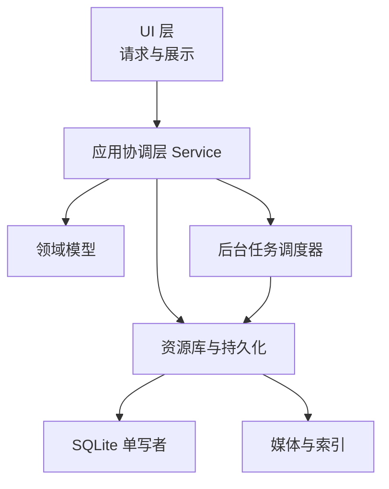

**图表来源**
- [架构说明:1-40](../../../ARCHITECTURE.md#L1-L40)
- [图库库根模块:1-40](../../../crates/moriq-library/src/lib.rs#L1-L40)
- [应用服务入口:1-40](../../../crates/moriq-app/src/lib.rs#L1-L40)

**章节来源**
- [架构说明:1-40](../../../ARCHITECTURE.md#L1-L40)
- [工作区配置:1-20](../../../Cargo.toml#L1-L20)

## 核心并发组件

### 1. 不可变标识符：`LibraryId`、`AssetId`、`ProjectId`

这些标识符由领域层宏生成，本质上是带类型约束的 UUID。它们具有以下并发特性：

- 值类型，不是引用。
- 可 `Copy` 或 `Clone`。
- 没有内部可变状态。
- 不参与文件系统、数据库或运行时对象的生命周期。
- 可以在 UI、应用层、资源库、任务、取消标志之间自由复制。

因此，标识符本身不需要锁。真正需要保护的通常是“某个 `LibraryId` 对应的资源库实例”，而不是 ID 字符串或 UUID 值。

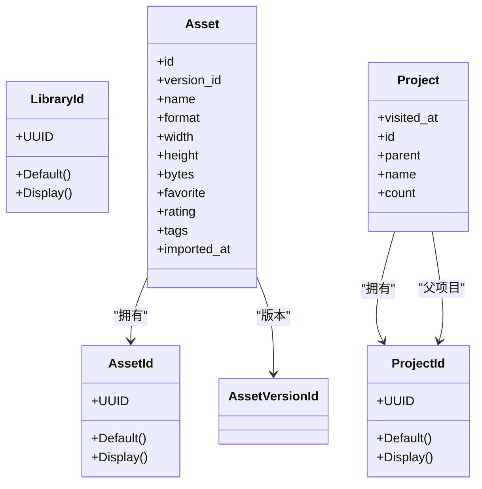

**图表来源**
- [领域模型入口:20-60](../../../crates/moriq-domain/src/lib.rs#L20-L60)

**章节来源**
- [领域模型入口:20-60](../../../crates/moriq-domain/src/lib.rs#L20-L60)

### 2. 共享所有权 vs 可变引用

本项目对共享所有权的使用遵循一个简单原则：**跨线程或跨作用域共享可变状态时使用 `Arc`，同一线程内短期可变状态优先使用局部可变引用。**

典型场景包括：

| 场景 | 选择 | 原因 |
|---|---|---|
| 多协程共享进度计数器 | `Arc<AtomicUsize>` | 原子操作比锁更轻，且语义是数值递增 |
| 多任务共享取消标志 | `Arc<AtomicBool>` | 布尔取消位只需原子读写 |
| 后台调度器持有 Service | `Weak<Service>` | 防止最后一个 Service 被释放后仍无法退出 |
| 读取连接池 | `Arc<Mutex<Vec<Connection>>>` | 池较小，且获取/归还操作很短 |
| 视频帧缓冲 | `Arc<Mutex<PlaybackFrames>>` | 写端替换最新帧，读端只取最近帧 |
| 媒体缓存状态 | `Arc<Mutex<State>>` | 缓存更新与淘汰需要保护内部时钟和条目 |

**章节来源**
- [应用服务入口:40-120](../../../crates/moriq-app/src/lib.rs#L40-L120)
- [后台任务调度器:1-40](../../../crates/moriq-app/src/scheduler.rs#L1-L40)
- [媒体缓存:1-20](../../../crates/moriq-app/src/cache.rs#L1-L20)
- [视频播放状态:90-140](../../../crates/moriq-library/src/media/video.rs#L90-L140)

### 3. 为什么几乎没有 `RwLock`

在当前代码库中，共享可变状态普遍使用 `Mutex`，而不是 `RwLock`。这并非因为读多写少场景不存在，而是因为：

- 大多数临界区很短，例如原子计数、取消标志设置、连接借出。
- 连接池内部维护空闲连接列表，长度很小。
- 数据库访问已经通过 SQLite 的只读连接池和单写者策略做粗粒度隔离。
- 引入 `RwLock` 会增加 API 语义成本（`read()` / `write()`），而当前状态的共享范围足够小，用单一互斥锁表达更清晰。
- 项目顶层禁止 `unwrap` 和 `expect`，但允许在已验证的同步上下文里使用 `lock().unwrap_or_else(...)`，这使得 `Mutex` 成为首选默认方案。

**章节来源**
- [媒体缓存:1-20](../../../crates/moriq-app/src/cache.rs#L1-L20)
- [只读连接池:1-40](../../../crates/moriq-library/src/database/read_pool.rs#L1-L40)
- [工作区配置:70-80](../../../Cargo.toml#L70-L80)

## 架构总览

Moriq Space 的并发边界非常明确：

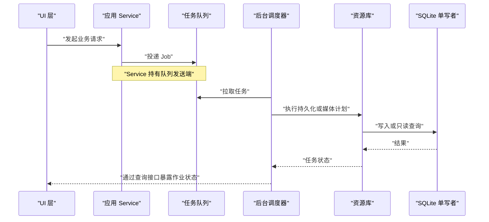

**图表来源**
- [应用服务入口:1-60](../../../crates/moriq-app/src/lib.rs#L1-L60)
- [后台任务调度器:1-120](../../../crates/moriq-app/src/scheduler.rs#L1-L120)
- [资源库核心实现:80-120](../../../crates/moriq-library/src/library/core.rs#L80-L120)

这个流程的关键点是：

1. UI 不直接持有数据库连接。
2. 应用层通过有界队列协调 UI 请求和后台任务。
3. 资源库负责持久化、媒体计划和恢复日志。
4. SQLite 只有一个写者，读操作走只读连接池。
5. 后台调度器使用弱引用持有 Service，避免阻止应用退出。

**章节来源**
- [架构说明:100-155](../../../ARCHITECTURE.md#L100-L155)
- [应用服务入口:1-60](../../../crates/moriq-app/src/lib.rs#L1-L60)
- [后台任务调度器:1-120](../../../crates/moriq-app/src/scheduler.rs#L1-L120)

## 关键组件详解

### 领域模型：纯数据与无副作用

`moriq-domain` 明确声明自己是“纯库身份和 UI 投影”，不包含 I/O 或渲染依赖。它的主要并发价值是：

- 将业务实体建模为可序列化的数据结构。
- 用强类型 ID 替代裸字符串或裸 UUID。
- 把查询规则、媒体种类、排序顺序等输入约束在枚举和结构体中。
- 通过规则校验函数限制组合深度和节点数量，防止无限递归和无界筛选。

这种设计让并发编程更容易：

- 领域数据可以安全复制。
- 不同线程可以持有相同领域快照而不产生别名。
- 错误信息可以携带结构化上下文，如 `TaskError`、`JobKind`、`ModelId`。
- 持久化和 UI 只消费领域数据，不负责构造领域不变量。

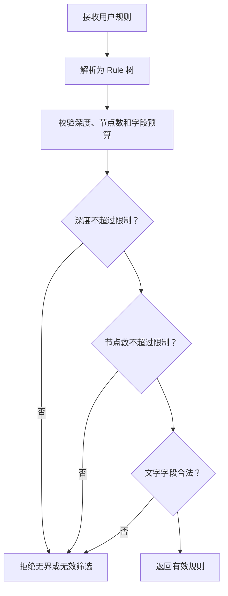

**图表来源**
- [领域模型入口:100-170](../../../crates/moriq-domain/src/lib.rs#L100-L170)

**章节来源**
- [领域模型入口:1-40](../../../crates/moriq-domain/src/lib.rs#L1-L40)
- [领域模型入口:100-170](../../../crates/moriq-domain/src/lib.rs#L100-L170)

### Service 层：协调器模式

`Service` 是应用层的公共协调器。它封装了：

- 工作空间项目范围。
- 媒体缓存。
- 推理运行器抽象。
- 任务队列发送端。
- 导入并发槽。
- 导入内存预算。
- 维护任务槽。
- 读取任务槽。
- 通用任务槽。
- 取消注册表。

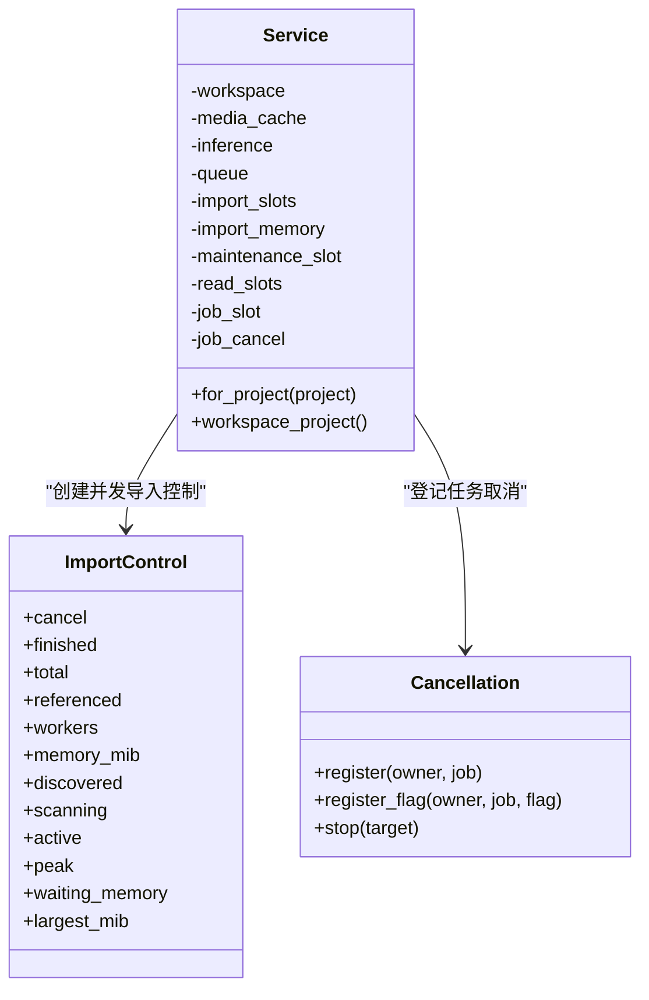

**图表来源**
- [应用服务入口:40-120](../../../crates/moriq-app/src/lib.rs#L40-L120)
- [后台任务调度器:1-40](../../../crates/moriq-app/src/scheduler.rs#L1-L40)

Service 的并发责任包括：

- 为 UI 请求绑定项目上下文。
- 限制导入任务的并行数量和内存占用。
- 为每个任务分配取消标志。
- 把持久化、媒体、AI 和系统调用统一到有限资源下。
- 对外暴露的是结构化结果，而不是底层线程细节。

**章节来源**
- [应用服务入口:40-120](../../../crates/moriq-app/src/lib.rs#L40-L120)

### 取消与弱引用：避免循环依赖

取消系统使用 `Cancellation` 保存 `(LibraryId, job_name, Weak<AtomicBool>)`。它的行为如下：

1. 登记任务时创建 `Arc<AtomicBool>`。
2. 将 `Arc` 克隆给实际工作项。
3. 同时把 `Weak<AtomicBool>` 存入调度器。
4. 停止任务时尝试提升弱引用。
5. 如果 `Strong` 引用仍存在，则设置取消标志。
6. 如果 `Strong` 引用已释放，则清理记录。

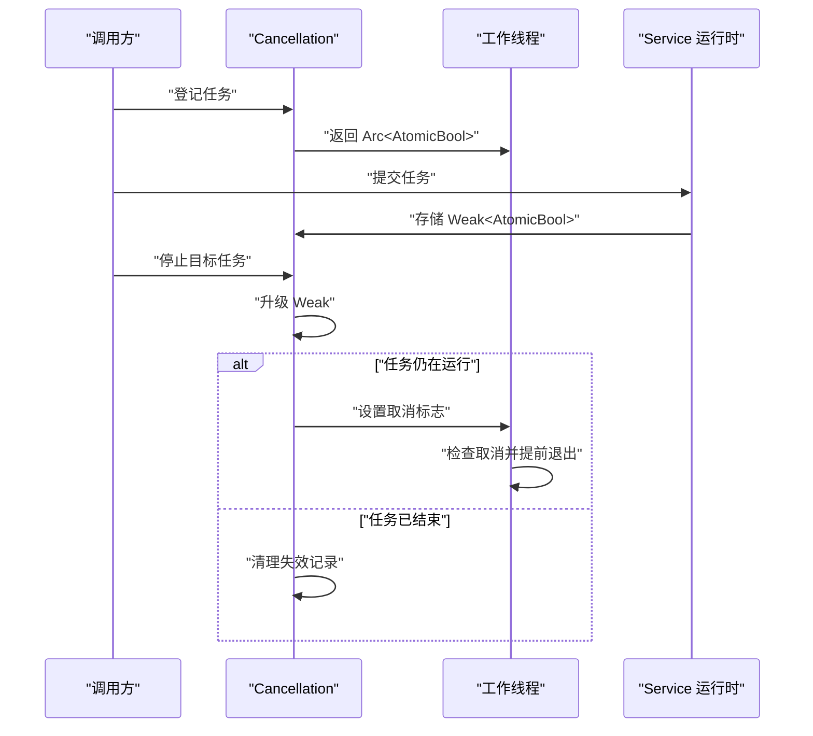

**图表来源**
- [后台任务调度器:1-40](../../../crates/moriq-app/src/scheduler.rs#L1-L40)

这里有两个关键点：

- `Weak` 只表示“可能还存在”，不阻止 `Arc` 释放。
- 调度器自身也使用 `Weak<Service>`，当最后一个公开 Service 被释放时，调度循环会退出。

这避免了“UI 持有 Service、Service 持有调度器、调度器又持有 Service”这类潜在循环。

**章节来源**
- [后台任务调度器:1-120](../../../crates/moriq-app/src/scheduler.rs#L1-L120)

### 资源库锁与单写者

资源库打开时会创建 `library.lock` 文件并使用独占文件锁。这一步用于防止多个窗口或进程同时修改同一个资源库。

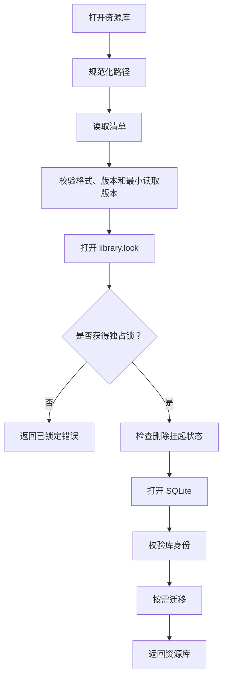

**图表来源**
- [资源库核心实现:80-120](../../../crates/moriq-library/src/library/core.rs#L80-L120)

该模式的并发意义是：

- 文件锁保证物理资源库不被多进程并发写入。
- SQLite 事务和 WAL 文件配合单写者策略。
- 只读连接池提供并发读取，但不绕过写者一致性。
- 身份校验确保清单和数据库一致。

**章节来源**
- [资源库核心实现:80-120](../../../crates/moriq-library/src/library/core.rs#L80-L120)

### 只读连接池与租约

`ReadPool` 维护一组空闲的只读连接，并通过 `ReadLease` 管理生命周期。其并发策略是：

- 使用 `Mutex` 保护空闲连接列表。
- 借出连接时先从池取，否则新建只读连接。
- 归还连接时回滚未提交事务，清理临时表。
- 池大小限制在固定范围内。
- 租约还持有资源库文件句柄，用于保护读取期间的库生命周期。

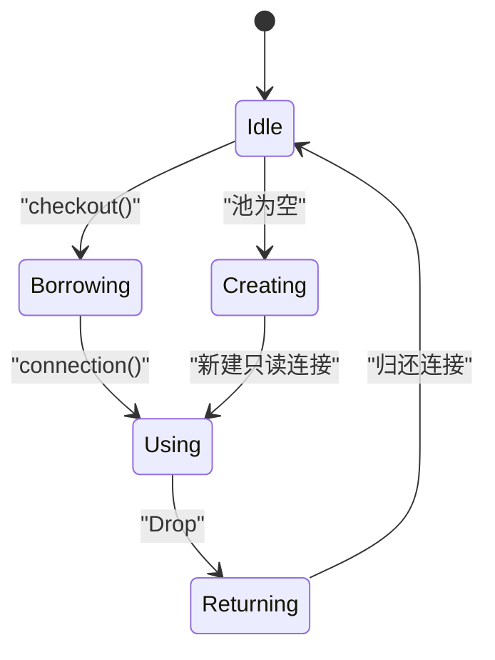

**图表来源**
- [只读连接池:1-97](../../../crates/moriq-library/src/database/read_pool.rs#L1-L97)

**章节来源**
- [只读连接池:1-97](../../../crates/moriq-library/src/database/read_pool.rs#L1-L97)

### 视频播放状态：短临界区替换

视频播放使用 `Arc<Mutex<PlaybackFrames>>` 共享帧状态。重要行为是：

- 解码线程不断替换最新帧，而不是累积历史帧。
- 渲染端只读取最新帧。
- 位置、时长、接收计数和错误信息一起受同一锁保护。
- 锁持有时间极短，只在写入一帧时加锁。

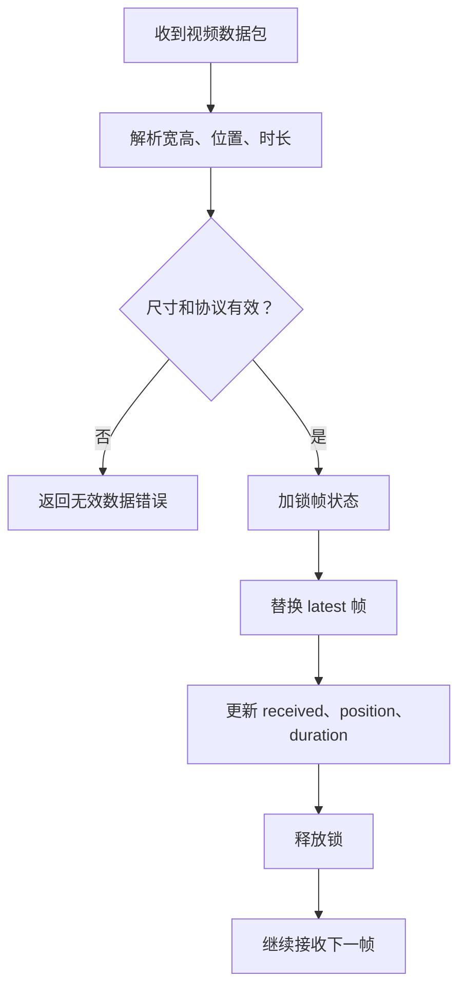

**图表来源**
- [视频播放状态:90-140](../../../crates/moriq-library/src/media/video.rs#L90-L140)

**章节来源**
- [视频播放状态:90-140](../../../crates/moriq-library/src/media/video.rs#L90-L140)

## 依赖关系分析

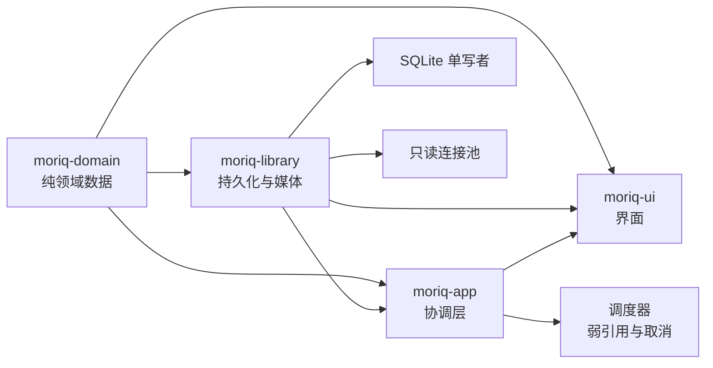

**图表来源**
- [架构图说明:1-40](../../../ARCHITECTURE.md#L1-L40)
- [图库库根模块:1-40](../../../crates/moriq-library/src/lib.rs#L1-L40)
- [应用服务入口:1-40](../../../crates/moriq-app/src/lib.rs#L1-L40)

依赖方向体现了并发边界：

- 领域层不依赖任何基础设施。
- 资源库依赖领域模型，但不依赖 UI。
- 应用层依赖资源库和领域模型，并协调 UI 与后台任务。
- UI 只依赖应用层暴露的协调接口。

**章节来源**
- [架构说明:1-40](../../../ARCHITECTURE.md#L1-L40)

## 并发陷阱与解决方案

### 1. 死锁预防

仓库中的锁都遵循“短临界区”原则：

- 取消标志使用原子变量，不加锁。
- 连接池的锁只保护少量连接借用和归还。
- 视频帧状态只在替换一帧时加锁。
- 资源库级别的互斥通过文件锁和 SQLite 事务完成，不在热点路径上重复加细粒度锁。

建议新增代码时遵循：

1. 不要在一个锁内调用可能阻塞的外部 I/O。
2. 不要在持有高竞争锁时执行长时间计算。
3. 不要嵌套多个同级别锁。
4. 如果必须加锁，尽量把临界区缩小到最小数据更新。
5. 对可能失败的锁操作使用明确错误处理，而不是静默忽略。

**章节来源**
- [媒体缓存:1-20](../../../crates/moriq-app/src/cache.rs#L1-L20)
- [只读连接池:1-40](../../../crates/moriq-library/src/database/read_pool.rs#L1-L40)
- [视频播放状态:90-140](../../../crates/moriq-library/src/media/video.rs#L90-L140)

### 2. 优先级反转

本项目没有显式的优先级线程调度，而是通过资源配额缓解优先级反转风险：

- 导入任务使用信号量限制并行数量。
- 导入内存使用信号量限制同时进入解码阶段的内存占用。
- 维护任务、读取任务和通用任务分别有独立槽位。
- 后台调度器使用固定数量的工作线程。

这样可以让 UI 相关的交互不会长期被重型媒体任务阻塞。

**章节来源**
- [应用服务入口:40-120](../../../crates/moriq-app/src/lib.rs#L40-L120)

### 3. 优雅降级

优雅降级体现在多个层面：

| 场景 | 降级策略 |
|---|---|
| 资源库被其他进程锁定 | 返回 `Locked`，提示用户关闭冲突窗口或进程 |
| 旧任务失败 | 指数退避重试，连续失败后暂停作业 |
| 切库或库失效 | 拒绝旧结果，清理任务状态 |
| 连接池锁失效 | 返回明确的无效状态错误 |
| 视频帧状态锁失效 | 返回 IO 错误，终止帧接收 |
| 清单过大或损坏 | 拒绝打开，提示恢复 |

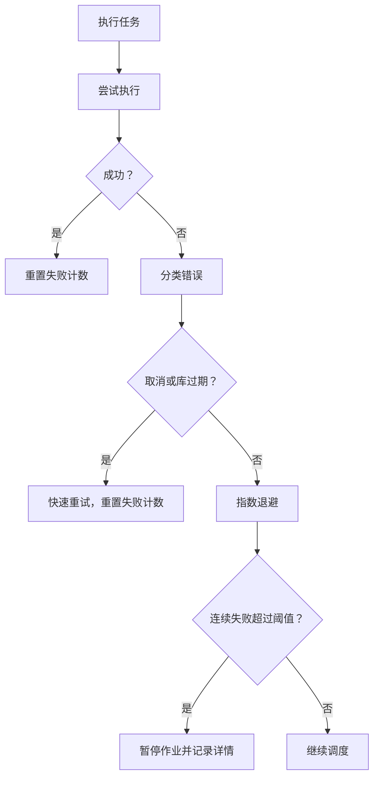

**图表来源**
- [后台任务调度器:60-140](../../../crates/moriq-app/src/scheduler.rs#L60-L140)

**章节来源**
- [后台任务调度器:60-140](../../../crates/moriq-app/src/scheduler.rs#L60-L140)

### 4. 何时使用共享所有权而非可变引用

| 情况 | 推荐方式 |
|---|---|
| 多个线程共享计数器 | `Arc<AtomicUsize>` |
| 多个任务共享取消标志 | `Arc<AtomicBool>` |
| 需要跨线程共享可变容器 | `Arc<Mutex<T>>` |
| 只需要跨线程共享不可变数据 | `Arc<T>` |
| 需要避免阻止所有者释放 | `Weak<T>` |
| 同一线程短期可变状态 | 局部可变引用 |
| 只读共享状态且临界区较长 | 考虑按功能拆分，必要时再评估 `RwLock` |

**章节来源**
- [应用服务入口:40-120](../../../crates/moriq-app/src/lib.rs#L40-L120)
- [后台任务调度器:1-40](../../../crates/moriq-app/src/scheduler.rs#L1-L40)

## 性能与可观测性

仓库在性能和并发方面做了若干取舍：

- 开发构建中对图像解码、重采样、哈希等热路径单独优化。
- 发布构建启用薄 LTO。
- 只读连接池复用连接，减少频繁创建 SQLite 连接的开销。
- 视频帧采用替换策略，避免内存随播放时间增长。
- 任务调度器对失败进行指数退避，上限为固定延迟。
- 导入任务根据 CPU 并行度和用户偏好计算 worker 数量。
- 所有任务错误通过结构化类型区分取消、库过期、存储、运行时等类别。

需要注意：

- 架构文档明确指出，现有自动化回归不能替代大型库容量基准、真实模型推理、桌面视觉验收或强制进程终止后的恢复测试。
- 语义索引和目录排序的性能变更需要单独的测量设计。

**章节来源**
- [工作区配置:30-80](../../../Cargo.toml#L30-L80)
- [架构说明:120-155](../../../ARCHITECTURE.md#L120-L155)

## 并发测试方法

### 1. 模拟竞争条件

可用方法包括：

- 创建多个 `Cancellation` 登记，验证取消仅影响目标任务。
- 在导入等待内存预算时切换库，验证旧任务被拒绝。
- 在旧库任务恢复过程中重新打开库，验证最终状态正确。
- 使用临时目录创建多个资源库，验证锁、身份和迁移路径。
- 对视频帧管道构造多个数据包，验证最新帧覆盖旧帧。
- 对连接池并发借出和归还，验证连接数量和状态一致。

### 2. 验证数据一致性

重点验证：

- 任务取消后，取消标志状态符合预期。
- 切库后，旧库任务不再出现在新库上下文中。
- 资源库打开失败时不会留下不一致的中间状态。
- 只读连接归还后会清理临时表。
- 领域规则树不会因恶意输入导致栈溢出或无限循环。
- UI 回执能匹配对应库和项目，不会被后续切换覆盖。

### 3. 测试设计原则

- 测试应关注可见行为，而不是内部锁实现。
- 对异步任务使用轮询或通道断言完成状态。
- 对共享状态使用确定性输入，避免依赖系统时钟。
- 对失败路径显式构造错误，而不是依赖“偶尔失败”。
- 对资源库测试使用临时目录，避免污染真实库。

**章节来源**
- [后台任务调度器:140-283](../../../crates/moriq-app/src/scheduler.rs#L140-L283)
- [领域模型入口:100-170](../../../crates/moriq-domain/src/lib.rs#L100-L170)
- [图库库根模块:240-325](../../../crates/moriq-library/src/lib.rs#L240-L325)

## 结论

Moriq Space 的并发安全模式可以概括为：

1. **用领域模型承载不变数据**，让跨线程传递变得廉价且安全。
2. **用 Service 作为唯一协调点**，把 UI、持久化、媒体和 AI 调度收敛到一个边界。
3. **用单写者 SQLite 和文件锁保护资源库**，避免多进程或多窗口并发破坏。
4. **用 `Arc` 和 `Mutex` 保护少量短临界区**，避免引入复杂读锁语义。
5. **用 `Weak` 和原子取消标志避免循环依赖和僵尸任务**。
6. **用信号量和预算限制重型任务**，缓解优先级反转。
7. **用指数退避、错误分类和任务暂停实现优雅降级**。
8. **用单元测试和集成测试模拟切库、取消、恢复和并发导入**，验证可见一致性。

对于未来扩展，建议继续保持“领域纯数据 + 协调层集中并发 + 基础设施阻塞执行”的分层，并在新增共享可变状态时优先考虑：能否拆成消息、快照或不可变结构，而不是直接扩大锁范围。