# 扩展点与插件机制

> Repo Wiki 节点 `extension-points`
> 导出自 Qoder 知识库快照 `8fbe02f6-57c2-4874-b725-1a8130851fd9`，代码基线 `7a7a8e75e18bd90294e09cd422dd7ed5a04813a0`（分支 main，zh-CN）。

<cite>
**本文引用的文件**   
- [架构文档](../../ARCHITECTURE.md)
- [AI 库入口](../../crates/moriq-ai/src/lib.rs)
- [AI 模型清单与安装器](../../crates/moriq-ai/src/models.rs)
- [Windows 媒体解码适配](../../crates/moriq-library/src/media/native.rs)
- [视频格式与工具适配](../../crates/moriq-library/src/media/video.rs)
- [导出计划与导出执行](../../crates/moriq-library/src/transfer/export.rs)
- [界面主题系统](../../crates/moriq-ui/src/theme.rs)
- [应用设置服务](../../crates/moriq-app/src/settings.rs)
- [领域设置类型](../../crates/moriq-domain/src/lib.rs)
- [资源库设置持久化](../../crates/moriq-library/src/library/settings.rs)
</cite>

## 目录
1. [引言](#引言)
2. [项目结构中的扩展边界](#项目结构中的扩展边界)
3. [核心扩展点总览](#核心扩展点总览)
4. [架构总览](#架构总览)
5. [详细组件分析](#详细组件分析)
6. [依赖关系分析](#依赖关系分析)
7. [性能与可维护性特征](#性能与可维护性特征)
8. [故障排查指南](#故障排查指南)
9. [插件开发指南](#插件开发指南)
10. [实际扩展示例](#实际扩展示例)
11. [结论](#结论)

## 引言
Moriq Space 的扩展能力不是“运行时动态加载任意二进制模块”的传统插件框架，而是围绕“清单 + 配置 + 隔离进程 + 固定接口”的可组合扩展体系。它通过以下机制支持演进：

- AI 模型通过内置清单和下载校验机制扩展新的模型规格。
- 媒体解码通过平台隔离工作程序和固定扩展名列表扩展新文件格式。
- UI 主题通过语义颜色、明暗主题和样式构造函数扩展外观。
- 配置系统通过领域类型和持久化读写扩展用户设置。
- 导出系统通过枚举式导出格式扩展输出类型。

这种设计强调可验证性、安全性与可恢复性，而不是无边界反射或动态库加载。

**章节来源**
- [架构文档:1-28](../../ARCHITECTURE.md#L1-L28)

## 项目结构中的扩展边界
仓库按功能域划分 crate，每个 crate 承担明确职责：

| 层级 | 主要职责 | 扩展方式 |
|---|---|---|
| `moriq-domain` | 序列化类型、输入校验、无 I/O 领域模型 | 新增领域枚举、结构体和校验规则 |
| `moriq-ai` | 本地模型清单、下载、卸载、推理入口 | 增加模型清单条目和推理适配器 |
| `moriq-library` | 媒体探测、导入、存储、导出、工作流 | 扩展扩展名、解码路径、导出格式 |
| `moriq-app` | 应用编排、调度、预算、取消、UI 服务桥接 | 新增服务方法并调用底层库 |
| `moriq-ui` | Iced 界面、状态、主题、交互反馈 | 修改主题、添加视图逻辑 |
| `apps/desktop` | 桌面入口和资源打包 | 调整构建产物和命令参数 |

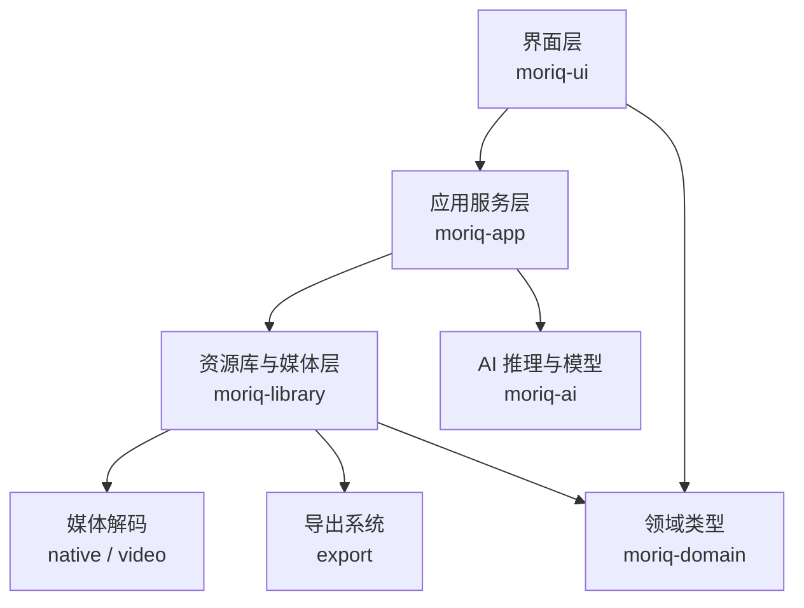

**图表来源**
- [架构文档:12-28](../../ARCHITECTURE.md#L12-L28)

**章节来源**
- [架构文档:12-28](../../ARCHITECTURE.md#L12-L28)

## 核心扩展点总览
Moriq Space 的核心扩展点可以归纳为五类：

1. **AI 模型注册表**：通过 `workers/ai/models.json` 提供固定版本的模型清单，配合 `moriq-ai` 的安装、校验、卸载和推理流程。
2. **媒体解码扩展点**：通过静态扩展名列表、RAW 识别、视频扩展名列表和隔离解码进程支持新图像、RAW 和视频格式。
3. **UI 主题定制**：通过明暗主题、语义颜色常量、自适应解析器和样式构造函数实现外观定制。
4. **配置扩展点**：通过 `UserSettings`、`AiPreferences`、`ImportPreferences` 等类型以及持久化读写函数扩展设置项。
5. **导出格式扩展点**：通过 `ExportFormat` 和 `ImageFormat` 映射扩展新的导出目标。

这些扩展点共同遵循“声明式扩展 + 严格校验 + 显式集成”的原则。

**章节来源**
- [AI 库入口:1-15](../../crates/moriq-ai/src/lib.rs#L1-L15)
- [Windows 媒体解码适配:1-20](../../crates/moriq-library/src/media/native.rs#L1-L20)
- [视频格式与工具适配:1-20](../../crates/moriq-library/src/media/video.rs#L1-L20)
- [界面主题系统:1-30](../../crates/moriq-ui/src/theme.rs#L1-L30)
- [领域设置类型:332-426](../../crates/moriq-domain/src/lib.rs#L332-L426)
- [导出计划与导出执行:102-118](../../crates/moriq-library/src/transfer/export.rs#L102-L118)

## 架构总览
下图展示扩展点在系统中的位置和数据流向：

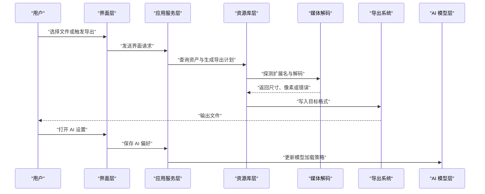

**图表来源**
- [应用设置服务:49-76](../../crates/moriq-app/src/settings.rs#L49-L76)
- [导出计划与导出执行:12-118](../../crates/moriq-library/src/transfer/export.rs#L12-L118)
- [Windows 媒体解码适配:309-356](../../crates/moriq-library/src/media/native.rs#L309-L356)

## 详细组件分析

### AI 模型注册表与动态模型发现
AI 模型的扩展不是通过运行时扫描外部模块完成，而是通过**内置清单 + 版本化安装 + 完整性校验**的组合机制。

#### 关键数据模型
- `ModelFile`：描述单个权重文件的本地路径、下载地址、SHA-256 和字节数。
- `ModelSpec`：描述模型身份、名称、修订、许可证、来源、最低内存要求和文件清单。
- `ModelInfo`：面向界面的已安装状态、可续传标记和总大小。
- `DownloadControl`：控制暂停、已下载字节数和总字节数。
- `Hardware`：描述本机内存、可用内存、逻辑 CPU 和运行提供者。

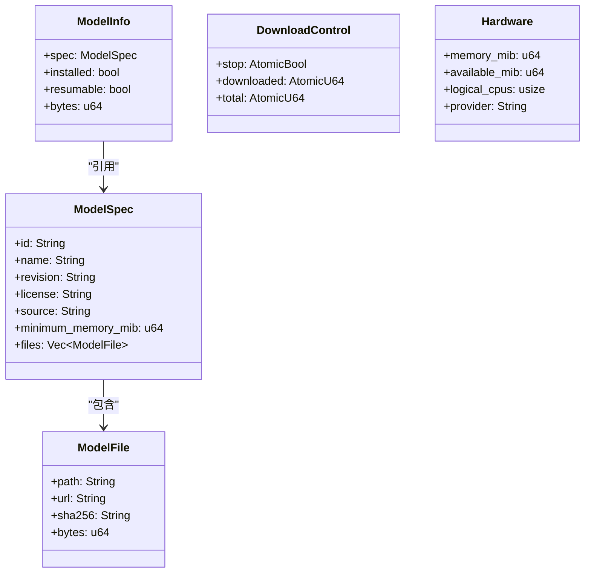

**图表来源**
- [AI 模型清单与安装器:13-38](../../crates/moriq-ai/src/models.rs#L13-L38)

#### 模型发现与清单加载
模型清单由 `registry()` 从嵌入的资源中读取 JSON 并反序列化为 `Vec<ModelSpec>`。当前仓库结构中清单位于 `workers/ai/models.json`，并通过 `include_str!` 在编译期嵌入到二进制中。这意味着：

- 新增模型不需要修改 Rust 源码逻辑。
- 新增模型需要修改清单文件并在构建产物中包含该清单。
- 模型 ID 是稳定标识；修订用于区分同一模型的不同权重版本。
- 清单本身是扩展点，而不是运行时模块扫描。

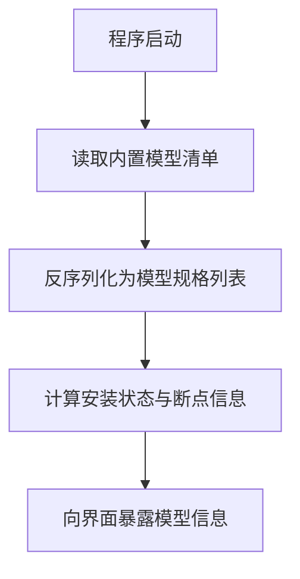

**图表来源**
- [AI 模型清单与安装器:57-63](../../crates/moriq-ai/src/models.rs#L57-L63)
- [AI 模型清单与安装器:91-124](../../crates/moriq-ai/src/models.rs#L91-L124)

#### 模型安装、校验与生命周期
模型安装使用分块范围下载、断点续传、重试和 SHA-256 校验。安装完成后，会写入 `current.json` 表示活跃版本，并使用共享锁防止并发安装、卸载和推理访问冲突。

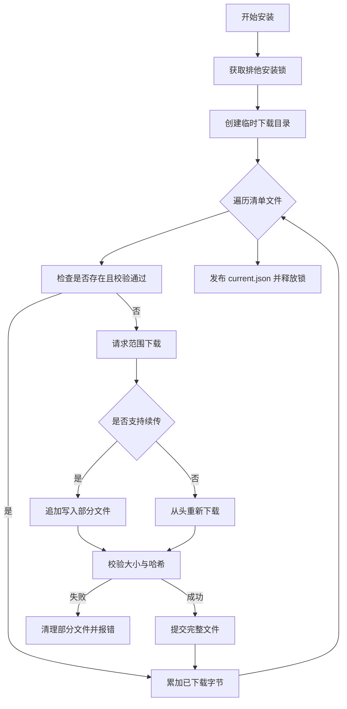

**图表来源**
- [AI 模型清单与安装器:274-469](../../crates/moriq-ai/src/models.rs#L274-L469)

#### 推理集成与卸载
`moriq-ai` 暴露推理入口、受控推理、卸载和“保持加载”开关。应用设置中的 `on_demand` 偏好会通过 `set_keep_loaded` 切换模型加载策略，使 AI 行为可通过配置扩展，而不必修改推理代码。

**章节来源**
- [AI 库入口:1-15](../../crates/moriq-ai/src/lib.rs#L1-L15)
- [AI 模型清单与安装器:57-124](../../crates/moriq-ai/src/models.rs#L57-L124)
- [AI 模型清单与安装器:274-469](../../crates/moriq-ai/src/models.rs#L274-L469)
- [应用设置服务:64-76](../../crates/moriq-app/src/settings.rs#L64-L76)

### 媒体解码器的扩展点
媒体解码扩展分为三类：**图像扩展名**、**RAW 扩展名**、**视频扩展名**。

#### 图像与 RAW 扩展点
- `IMPORT_EXTENSIONS` 定义可导入的普通图像和视频扩展名。
- `RAW_EXTENSIONS` 定义相机 RAW 扩展名。
- `raw_extension()` 将扩展名匹配为内部 RAW 标识。
- `supported_path()` 判断路径是否属于可导入的图片、RAW 或视频。
- `decode_file()` 根据扩展名决定走 RAW 解码还是系统图像解码。

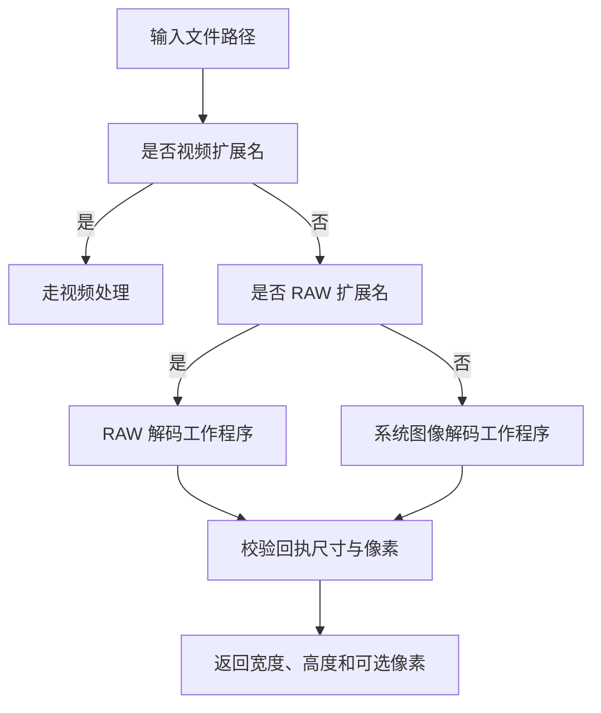

**图表来源**
- [Windows 媒体解码适配:309-356](../../crates/moriq-library/src/media/native.rs#L309-L356)

#### 视频扩展点
视频格式通过 `video::EXTENSIONS` 统一声明，并由 FFmpeg 工具链处理。新增视频格式通常需要：

1. 扩展 `video::EXTENSIONS`。
2. 确保发行包包含对应 FFmpeg 编解码能力。
3. 更新 `IMPORT_EXTENSIONS` 以允许导入。
4. 验证导入、探测、预览和导出流程。

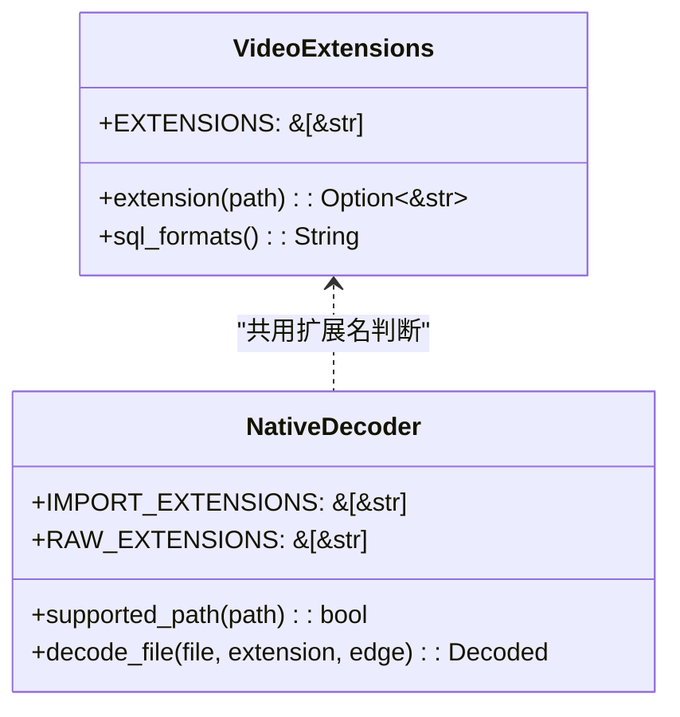

**图表来源**
- [视频格式与工具适配:9-20](../../crates/moriq-library/src/media/video.rs#L9-L20)
- [Windows 媒体解码适配:332-356](../../crates/moriq-library/src/media/native.rs#L332-L356)

#### 安全与隔离
解码不直接信任任意系统库路径，而是：

- 使用隔离临时目录。
- 对内置工作程序进行 SHA-256 校验。
- 限制输出边长。
- 校验子进程输出的魔数、尺寸和像素长度。
- 超时后终止解码进程。

这保证了扩展新解码器时，恶意或损坏的解码产物不会破坏主进程。

**章节来源**
- [Windows 媒体解码适配:1-20](../../crates/moriq-library/src/media/native.rs#L1-L20)
- [Windows 媒体解码适配:201-308](../../crates/moriq-library/src/media/native.rs#L201-L308)
- [Windows 媒体解码适配:309-356](../../crates/moriq-library/src/media/native.rs#L309-L356)
- [视频格式与工具适配:1-20](../../crates/moriq-library/src/media/video.rs#L1-L20)

### UI 主题系统的定制能力
UI 主题不是简单的全局颜色表，而是一套**语义化、明暗自适应、控件级样式工厂**的系统。

#### 主题能力
- `application_theme(Appearance)` 根据明暗偏好返回不同主题。
- `adaptive(theme, color)` 将语义颜色映射到当前主题的调色板。
- `foreground()` 和 `text_color()` 提供前景色和文本样式。
- `panel()`、`sidebar()`、`modal()`、`primary()`、`secondary()` 等函数提供控件样式。

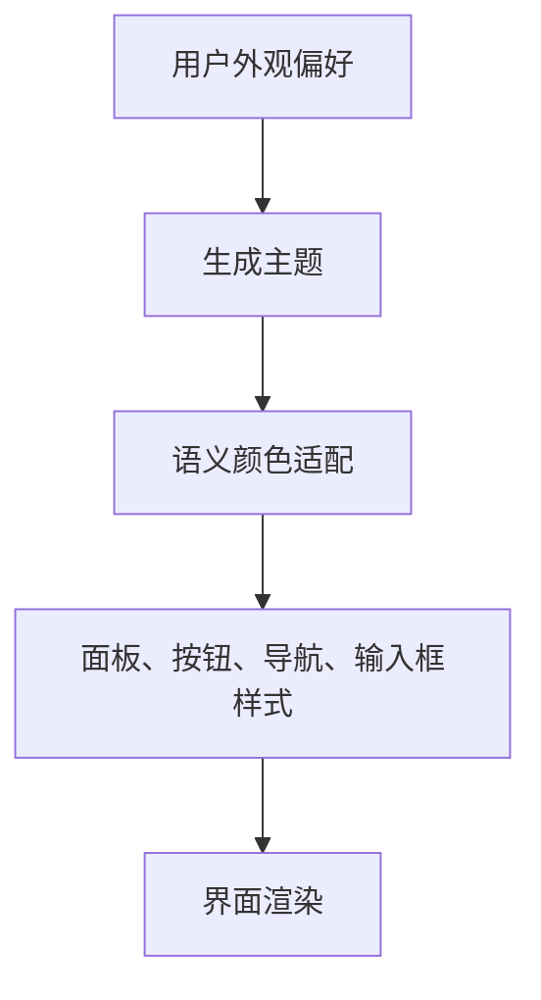

**图表来源**
- [界面主题系统:1-30](../../crates/moriq-ui/src/theme.rs#L1-L30)
- [界面主题系统:31-100](../../crates/moriq-ui/src/theme.rs#L31-L100)

#### 定制建议
- 优先修改语义颜色常量，如 `BLUE`、`TEXT`、`BG`。
- 如果需要深色模式差异，应覆盖 `adaptive()` 中的分支。
- 如果需要改变控件圆角、边框或阴影，应复用现有样式构造函数。
- 不建议在视图层硬编码 RGB 颜色，以免破坏明暗一致性。

注意：当前主题系统没有“主题插件加载器”，它通过配置和应用主题函数实现扩展，而不是运行时动态加载主题模块。

**章节来源**
- [界面主题系统:1-30](../../crates/moriq-ui/src/theme.rs#L1-L30)
- [界面主题系统:31-100](../../crates/moriq-ui/src/theme.rs#L31-L100)
- [界面主题系统:201-483](../../crates/moriq-ui/src/theme.rs#L201-L483)

### 配置系统的扩展机制
配置系统分为三层：

1. **领域类型层**：`UserSettings`、`AiPreferences`、`ImportPreferences`、`Appearance`、`Language` 等定义配置结构。
2. **应用服务层**：`Service` 暴露异步 API，将 UI 请求转换为持久化操作。
3. **资源库设置层**：`moriq-library::settings` 负责读取、合并、迁移和保存设置。

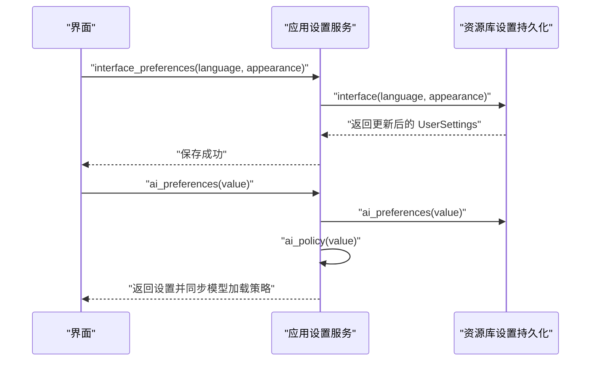

**图表来源**
- [应用设置服务:35-76](../../crates/moriq-app/src/settings.rs#L35-L76)
- [领域设置类型:332-426](../../crates/moriq-domain/src/lib.rs#L332-L426)
- [资源库设置持久化:37-119](../../crates/moriq-library/src/library/settings.rs#L37-L119)

#### 新增设置选项的步骤
1. 在 `moriq-domain` 中添加字段和默认值。
2. 在 `moriq-library::settings` 中实现读取、保存和迁移逻辑。
3. 在 `moriq-app::settings` 中暴露服务方法。
4. 在 UI 中绑定设置项。
5. 在测试中覆盖旧配置迁移和新字段行为。

当前设置系统已有语言、外观、减少动效、诊断日志、Synco、AI、导入并发和最近资源库等扩展点。

**章节来源**
- [应用设置服务:1-76](../../crates/moriq-app/src/settings.rs#L1-L76)
- [领域设置类型:332-426](../../crates/moriq-domain/src/lib.rs#L332-L426)
- [资源库设置持久化:37-119](../../crates/moriq-library/src/library/settings.rs#L37-L119)

### 导出格式的扩展点
导出系统基于不可变导出计划：先在写线程冻结资产版本和元数据，再在工作线程执行转换。

#### 导出格式映射
- `ExportFormat::Original`：原文件导出或回退 PNG。
- `ExportFormat::Jpeg/Png/Webp/Tiff/Bmp`：对应 `image` crate 的 `ImageFormat`。
- 文件名后缀根据格式推导。
- 视频目前仅支持原文件导出，不支持图片转换选项。

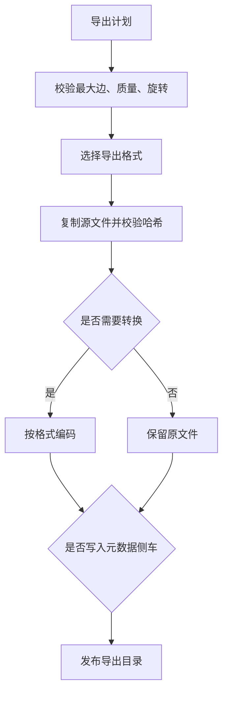

**图表来源**
- [导出计划与导出执行:12-118](../../crates/moriq-library/src/transfer/export.rs#L12-L118)

#### 扩展新导出格式
要新增导出格式，通常需要在 `export.rs` 中：

1. 扩展 `ExportFormat`。
2. 将新格式映射到 `ImageFormat`。
3. 补充后缀映射。
4. 处理元数据附加逻辑。
5. 更新 UI 和测试。

**章节来源**
- [导出计划与导出执行:12-118](../../crates/moriq-library/src/transfer/export.rs#L12-L118)

## 依赖关系分析
扩展点之间的耦合关系如下：

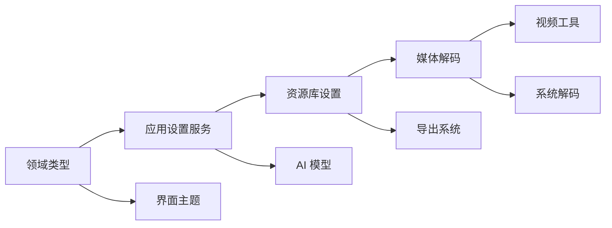

**图表来源**
- [架构文档:12-28](../../ARCHITECTURE.md#L12-L28)

### 耦合与内聚
- `moriq-domain` 保持低耦合，只定义类型和校验。
- `moriq-app` 作为协调层，避免 UI 直接访问磁盘。
- `moriq-library` 集中媒体、数据库、导入导出和设置持久化。
- `moriq-ui` 专注界面和主题，不直接持有 Service 之外的复杂状态。
- AI 和媒体解码都通过显式接口和错误类型与上层解耦。

### 潜在循环依赖风险
当前设计通过分层避免循环依赖：UI 依赖 App，App 依赖 Library，Library 依赖 Domain。AI 和检索等能力通过独立 crate 暴露。扩展时应避免让领域层反向依赖 UI 或具体解码实现。

**章节来源**
- [架构文档:12-28](../../ARCHITECTURE.md#L12-L28)

## 性能与可维护性特征
- **模型清单编译期嵌入**：减少运行时解析开销，但要求清单变更随构建产物同步。
- **模型安装分块与断点续传**：降低大权重下载失败成本。
- **SHA-256 校验缓存**：避免重复扫描大文件时频繁哈希。
- **解码隔离进程**：将不可信解码结果限制在短生命周期进程中。
- **输出边长与像素预算**：防止超大图像耗尽内存。
- **导出计划冻结**：避免导出期间源文件变化导致不一致。
- **主题 LazyLock**：避免每次绘制重建主题对象。

这些优化使扩展点更可靠，但也意味着扩展不能绕过预算、校验和隔离边界。

**章节来源**
- [AI 模型清单与安装器:201-273](../../crates/moriq-ai/src/models.rs#L201-L273)
- [Windows 媒体解码适配:201-308](../../crates/moriq-library/src/media/native.rs#L201-L308)
- [导出计划与导出执行:64-118](../../crates/moriq-library/src/transfer/export.rs#L64-L118)
- [界面主题系统:1-30](../../crates/moriq-ui/src/theme.rs#L1-L30)

## 故障排查指南

### AI 模型问题
| 现象 | 可能原因 | 处理建议 |
|---|---|---|
| 模型显示未安装 | `current.json` 缺失或修订不一致 | 在模型页面更新或重新安装 |
| 安装卡住 | 并发安装锁或网络限速 | 等待任务结束，检查下载源 |
| 校验失败 | 权重损坏或被篡改 | 删除断点后重试安装 |
| 推理时报版本不一致 | 显示版本与已加载版本不匹配 | 刷新模型状态并重新执行推理 |

**章节来源**
- [AI 模型清单与安装器:91-124](../../crates/moriq-ai/src/models.rs#L91-L124)
- [AI 模型清单与安装器:274-469](../../crates/moriq-ai/src/models.rs#L274-L469)

### 媒体解码问题
| 现象 | 可能原因 | 处理建议 |
|---|---|---|
| 系统解码失败 | 系统缺少格式解码器 | 检查系统编解码器或改用包含内置 RAW 的发行包 |
| RAW 探测超时 | 传感器布局探测耗时过长 | 检查原片是否损坏或厂商格式异常 |
| 输出尺寸无效 | 解码器返回异常宽高或像素长度 | 确认文件未损坏，必要时重新导入 |
| 文件超出预算 | 输入过大或视频头过大 | 缩小输入或使用支持的预览路径 |

**章节来源**
- [Windows 媒体解码适配:201-308](../../crates/moriq-library/src/media/native.rs#L201-L308)
- [Windows 媒体解码适配:309-356](../../crates/moriq-library/src/media/native.rs#L309-L356)

### 导出问题
| 现象 | 可能原因 | 处理建议 |
|---|---|---|
| 导出失败 | 最大边、质量或旋转参数非法 | 使用 0～8192、1～100 和 0/90/180/270 |
| 视频无法转图片 | 视频仅支持原文件导出 | 移除图片转换选项 |
| 导出目录被拒绝 | 导出位置位于 `.moriq` 资源库下 | 选择资源库外目录 |

**章节来源**
- [导出计划与导出执行:64-118](../../crates/moriq-library/src/transfer/export.rs#L64-L118)

### 设置问题
| 现象 | 可能原因 | 处理建议 |
|---|---|---|
| 设置未生效 | UI 未调用保存接口 | 检查服务调用链 |
| 模型策略未同步 | 偏好保存成功但未调用 `ai_policy` | 检查 `ai_preferences` 后续逻辑 |
| 旧设置丢失 | 配置迁移未覆盖新字段 | 检查持久化迁移逻辑 |

**章节来源**
- [应用设置服务:35-76](../../crates/moriq-app/src/settings.rs#L35-L76)
- [资源库设置持久化:37-119](../../crates/moriq-library/src/library/settings.rs#L37-L119)

## 插件开发指南

### 通用原则
1. **优先声明式扩展**：清单、枚举、配置字段优于反射或动态库。
2. **显式契约**：所有扩展点应有清晰的数据结构和错误类型。
3. **隔离不可信输入**：解码、网络、模型权重都应经过校验。
4. **可恢复**：中断、取消、并发和损坏场景应有明确状态。
5. **可测试**：每个扩展点应有单元测试或回归测试。

### AI 模型插件
- 新增模型时编辑模型清单，添加 `ModelSpec` 和对应的 `ModelFile`。
- 确保 URL、SHA-256、字节数和路径一致。
- 如需新推理后端，扩展 `moriq-ai` 的推理入口并保持与现有模型规范兼容。
- 通过 `set_keep_loaded` 控制模型加载策略，而不是直接替换运行时。

### 媒体格式插件
- 新增图像或 RAW 格式：更新 `IMPORT_EXTENSIONS` 或 `RAW_EXTENSIONS`。
- 新增视频格式：更新 `video::EXTENSIONS` 并确保 FFmpeg 支持。
- 不要绕过 `decode_file()` 的扩展名判断，否则会破坏预算和安全校验。
- 如果引入新原生解码器，必须复用隔离进程、临时目录和 SHA-256 校验。

### UI 主题插件
- 修改语义颜色常量以全局调整配色。
- 覆盖 `adaptive()` 中明暗映射以适配深色模式。
- 复用现有样式构造函数，避免在视图层硬编码样式。
- 如需完全自定义主题，应封装新的主题构造函数，而不是直接修改 Iced 主题对象。

### 配置插件
- 在领域层定义新字段和默认值。
- 在资源库设置层实现读取、保存和向后兼容迁移。
- 在应用服务层暴露异步 API。
- 在 UI 层绑定设置项并处理错误。

### 生命周期管理
- **初始化**：加载清单、主题、设置和运行时组件。
- **运行期**：接受用户操作，调用服务层，保持取消和预算。
- **变更期**：先校验，再持久化，最后应用运行时效果。
- **销毁期**：释放模型、解码资源、取消后台任务和清理临时文件。

### 错误处理
- 区分用户输入错误、存储错误、运行时错误和网络错误。
- 对可恢复错误提供继续、重试或降级。
- 对不可信输入一律拒绝，而不是尝试猜测修复。
- 错误消息应便于用户理解，同时保留调试上下文。

**章节来源**
- [AI 库入口:1-15](../../crates/moriq-ai/src/lib.rs#L1-L15)
- [Windows 媒体解码适配:309-356](../../crates/moriq-library/src/media/native.rs#L309-L356)
- [界面主题系统:1-30](../../crates/moriq-ui/src/theme.rs#L1-L30)
- [应用设置服务:35-76](../../crates/moriq-app/src/settings.rs#L35-L76)

## 实际扩展示例

### 示例一：添加新的 AI 模型
步骤：
1. 准备模型清单条目，包括 `id`、`name`、`revision`、`license`、`source`、`minimum_memory_mib` 和 `files`。
2. 计算每个权重文件的 SHA-256 和字节数。
3. 将清单添加到 `workers/ai/models.json`。
4. 构建并安装模型。
5. 在 AI 设置中启用或禁用按需加载。
6. 验证安装状态、推理流程和卸载流程。

注意事项：
- 清单中的 URL 必须是可信来源。
- 模型修订变更后，旧安装不会被自动升级。
- 安装失败会保留断点，但不会自动恢复。

**章节来源**
- [AI 模型清单与安装器:13-38](../../crates/moriq-ai/src/models.rs#L13-L38)
- [AI 模型清单与安装器:274-469](../../crates/moriq-ai/src/models.rs#L274-L469)

### 示例二：添加新的导出格式
步骤：
1. 在导出模块中新增 `ExportFormat` 变体。
2. 将其映射到合适的 `ImageFormat`。
3. 补充输出文件后缀。
4. 如需附加元数据，添加编码器处理分支。
5. 更新 UI 导出选项和测试。

注意事项：
- 视频仍只能原文件导出，除非显式扩展视频导出逻辑。
- 新增格式仍需遵守最大边、质量和旋转校验。
- 不应跳过源文件哈希校验。

**章节来源**
- [导出计划与导出执行:64-118](../../crates/moriq-library/src/transfer/export.rs#L64-L118)

### 示例三：添加新的媒体格式
步骤：
1. 如果是普通图像或 RAW：更新 `IMPORT_EXTENSIONS` 或 `RAW_EXTENSIONS`。
2. 如果是视频：更新 `video::EXTENSIONS`。
3. 确认系统或 FFmpeg 能正确解码该格式。
4. 运行导入、探测、预览和导出测试。
5. 检查预算、超时和解码错误路径。

注意事项：
- 新增扩展名不等于新增解码能力。
- 若引入新原生解码器，必须使用隔离进程和完整性校验。
- 避免直接读取原始文件句柄进入解码器，应通过 `decode_file()` 的预算路径。

**章节来源**
- [Windows 媒体解码适配:332-356](../../crates/moriq-library/src/media/native.rs#L332-L356)
- [视频格式与工具适配:9-20](../../crates/moriq-library/src/media/video.rs#L9-L20)

### 示例四：添加新的用户设置
步骤：
1. 在领域类型中添加字段和默认值。
2. 在资源库设置层实现读写和迁移。
3. 在应用服务层暴露异步保存方法。
4. 在 UI 中绑定设置项。
5. 覆盖旧配置迁移和默认值测试。

注意事项：
- 设置保存应串行化，避免并发覆盖。
- 新增字段应保持向后兼容。
- 运行时副作用应在服务层触发，不在持久化层执行。

**章节来源**
- [领域设置类型:332-426](../../crates/moriq-domain/src/lib.rs#L332-L426)
- [资源库设置持久化:37-119](../../crates/moriq-library/src/library/settings.rs#L37-L119)
- [应用设置服务:35-76](../../crates/moriq-app/src/settings.rs#L35-L76)

## 结论
Moriq Space 的扩展点设计以“清单、枚举、配置和隔离”为核心，而不是开放式的动态插件系统。这种设计的优势是：

- 模型、格式和设置都可以通过少量声明式变更扩展。
- 所有外部输入都经过哈希、预算、超时和进程隔离保护。
- 推理、解码、导出和设置都有明确的错误边界。
- 扩展行为可测试、可审计、可回滚。

对于开发者而言，最佳实践是优先扩展声明式数据，其次扩展枚举和配置，最后才引入新的原生组件。这样既能保持 Moriq Space 的安全性和稳定性，又能持续扩展 AI 模型、媒体格式、UI 主题和导出能力。