# AI 推理数据流

> Repo Wiki 节点 `ai-inference-flow`
> 导出自 Qoder 知识库快照 `8fbe02f6-57c2-4874-b725-1a8130851fd9`，代码基线 `7a7a8e75e18bd90294e09cd422dd7ed5a04813a0`（分支 main，zh-CN）。

<cite>
**本文引用的文件**   
- [moriq-ai/src/lib.rs](../../../../crates/moriq-ai/src/lib.rs)
- [moriq-ai/src/qwen_faces.rs](../../../../crates/moriq-ai/src/qwen_faces.rs)
- [moriq-ai/src/runtime.rs](../../../../crates/moriq-ai/src/runtime.rs)
- [moriq-ai/src/models.rs](../../../../crates/moriq-ai/src/models.rs)
- [moriq-ai/src/llama.rs](../../../../crates/moriq-ai/src/llama.rs)
- [workers/ai/models.json](../../../../workers/ai/models.json)
- [moriq-app/src/inference.rs](../../../../crates/moriq-app/src/inference.rs)
- [moriq-app/src/jobs.rs](../../../../crates/moriq-app/src/jobs.rs)
- [moriq-domain/src/ai.rs](../../../../crates/moriq-domain/src/ai.rs)
- [moriq-library/src/ai/qwen_faces.rs](../../../../crates/moriq-library/src/ai/qwen_faces.rs)
- [moriq-library/src/ai/similarity.rs](../../../../crates/moriq-library/src/ai/similarity.rs)
- [moriq-library/src/ai/portraits.rs](../../../../crates/moriq-library/src/ai/portraits.rs)
- [moriq-library/src/ai/analysis.rs](../../../../crates/moriq-library/src/ai/analysis.rs)
- [moriq-retrieval/src/lib.rs](../../../../crates/moriq-retrieval/src/lib.rs)
</cite>

## 目录
1. [引言](#引言)
2. [项目结构](#项目结构)
3. [核心组件](#核心组件)
4. [架构总览](#架构总览)
5. [详细组件分析](#详细组件分析)
6. [依赖关系分析](#依赖关系分析)
7. [性能与内存优化](#性能与内存优化)
8. [故障排查指南](#故障排查指南)
9. [结论](#结论)

## 引言
本文聚焦 Moriq Space 的 AI 推理数据流，围绕“模型检测→模型加载→图像预处理→推理执行→结果存储→索引更新”完整链路展开。重点说明 Qwen3.5-4B 模型管理机制、人脸检测与人物匹配流程、相似性检索实现，以及 GPU/CPU 自动选择与内存控制策略。文档同时提供面向用户的模型配置调优和推理性能优化建议。

## 项目结构
AI 能力由四个主要层次协作：
- 应用层：任务编排、取消控制、模型就绪检查、工作调度。
- 库层：数据库与媒体处理、人脸参考裁剪、结果持久化、指纹与相似度检索。
- AI 运行时层：Qwen 模型清单、安装校验、本地 llama.cpp 受控进程启动与推理边界。
- 领域与检索层：统一 AI 分类定义、向量编码、语义检索与近似图片检索。

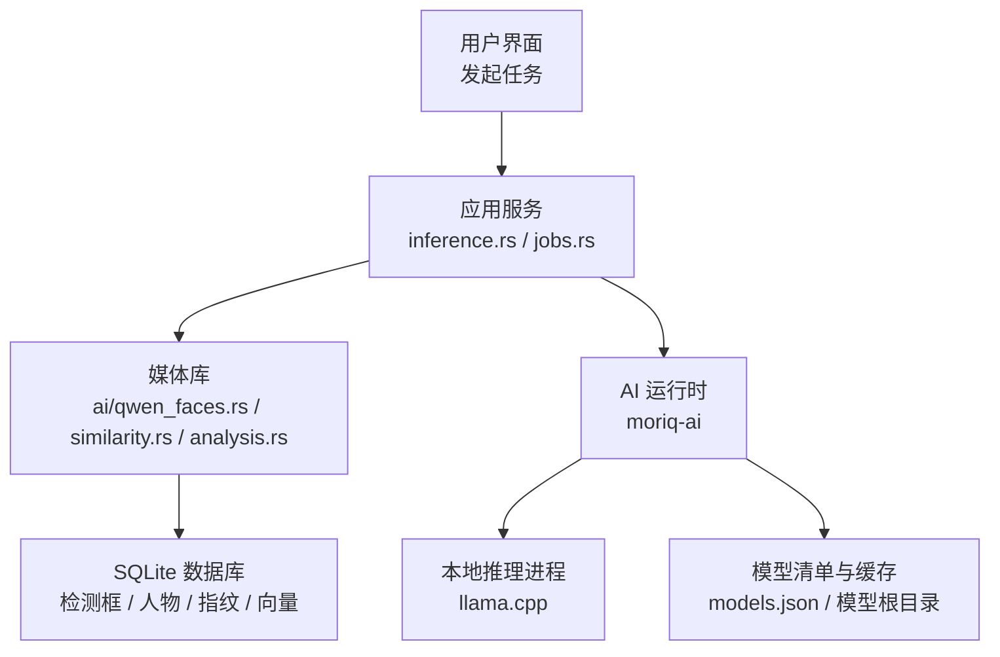

**图表来源**
- [moriq-app/src/inference.rs:1-120](../../../../crates/moriq-app/src/inference.rs#L1-L120)
- [moriq-app/src/jobs.rs:1-175](../../../../crates/moriq-app/src/jobs.rs#L1-L175)
- [moriq-library/src/ai/qwen_faces.rs:1-120](../../../../crates/moriq-library/src/ai/qwen_faces.rs#L1-L120)
- [moriq-library/src/ai/similarity.rs:1-80](../../../../crates/moriq-library/src/ai/similarity.rs#L1-L80)
- [moriq-ai/src/llama.rs:1-120](../../../../crates/moriq-ai/src/llama.rs#L1-L120)
- [workers/ai/models.json:1-24](../../../../workers/ai/models.json#L1-L24)

**章节来源**
- [moriq-app/src/inference.rs:1-120](../../../../crates/moriq-app/src/inference.rs#L1-L120)
- [moriq-app/src/jobs.rs:1-175](../../../../crates/moriq-app/src/jobs.rs#L1-L175)
- [moriq-ai/src/lib.rs:1-15](../../../../crates/moriq-ai/src/lib.rs#L1-L15)

## 核心组件
- Qwen 模型管理：清单解析、SHA-256 校验、可恢复下载、版本目录隔离、安装状态与摘要缓存。
- 本地推理边界：通过一次性锁保护的模型服务进程，绑定端口、密钥、GPU/CPU 参数与资源预算。
- 人脸推理：结构化 JSON Schema 约束、坐标规范化、置信度过滤、参考图拼接与身份判断。
- 结果持久化：检测框、人物归属、修订标识写入 `detected_faces`，AI 回执写入 `ai_results`。
- 相似性检索：感知指纹（DCT+颜色+宽高比）+ SQL 范围筛选 + 汉明距离与颜色差评分。
- 语义检索：中文 CLIP 向量归一化、余弦相似度 Top-K 检索。

**章节来源**
- [moriq-ai/src/models.rs:1-120](../../../../crates/moriq-ai/src/models.rs#L1-L120)
- [moriq-ai/src/llama.rs:1-120](../../../../crates/moriq-ai/src/llama.rs#L1-L120)
- [moriq-ai/src/qwen_faces.rs:1-120](../../../../crates/moriq-ai/src/qwen_faces.rs#L1-L120)
- [moriq-library/src/ai/qwen_faces.rs:1-120](../../../../crates/moriq-library/src/ai/qwen_faces.rs#L1-L120)
- [moriq-library/src/ai/similarity.rs:1-80](../../../../crates/moriq-library/src/ai/similarity.rs#L1-L80)
- [moriq-retrieval/src/lib.rs:1-120](../../../../crates/moriq-retrieval/src/lib.rs#L1-L120)

## 架构总览
整体推理路径分为两条：
- 人脸识别与人物匹配：从图片到 Qwen 视觉模型返回人脸框与候选人物。
- 通用分类/描述推理：基于 AiProfile 的分类标签与描述生成。

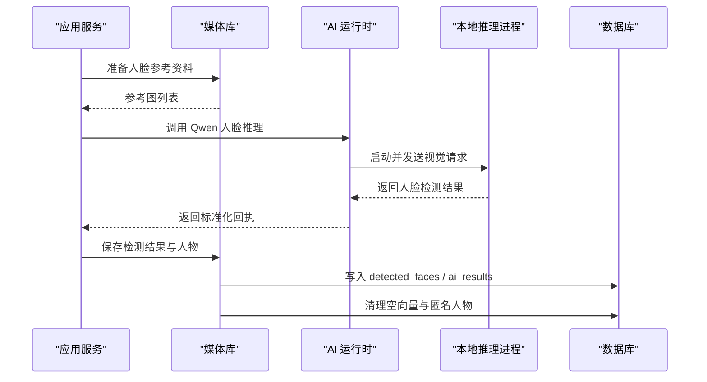

**图表来源**
- [moriq-app/src/inference.rs:1-120](../../../../crates/moriq-app/src/inference.rs#L1-L120)
- [moriq-library/src/ai/qwen_faces.rs:1-120](../../../../crates/moriq-library/src/ai/qwen_faces.rs#L1-L120)
- [moriq-ai/src/qwen_faces.rs:1-120](../../../../crates/moriq-ai/src/qwen_faces.rs#L1-L120)
- [moriq-ai/src/llama.rs:1-120](../../../../crates/moriq-ai/src/llama.rs#L1-L120)

## 详细组件分析

### 模型检测与加载流程
Qwen 模型以固定清单形式内置，包含权重与多模态投影文件、哈希值、目标 URL 与最低内存要求。系统会：
- 解析 `workers/ai/models.json` 获取模型规格。
- 根据操作系统定位模型根目录。
- 使用修订摘要生成稳定目录键，避免不同版本相互覆盖。
- 分块计算 SHA-256，校验完整性；支持断点续传与已安装摘要缓存。
- 推理前再次校验已安装文件，拒绝损坏或不匹配的模型。

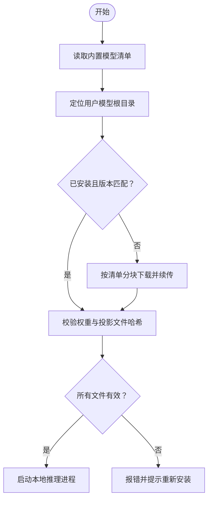

**图表来源**
- [moriq-ai/src/models.rs:1-120](../../../../crates/moriq-ai/src/models.rs#L1-L120)
- [workers/ai/models.json:1-24](../../../../workers/ai/models.json#L1-L24)

**章节来源**
- [moriq-ai/src/models.rs:1-200](../../../../crates/moriq-ai/src/models.rs#L1-L200)
- [workers/ai/models.json:1-24](../../../../workers/ai/models.json#L1-L24)

### 本地推理进程与硬件选择
本地推理通过独立进程运行 llama.cpp，并由 AI 运行时统一管理生命周期：
- 进程启动参数包括模型路径、多模态投影路径、监听地址、最大响应大小、线程数、上下文长度等。
- 显存卸载策略：语言模型层启用 GPU 卸载，视觉投影模块禁用卸载，避免动态人像形状耗尽 Vulkan 分配器。
- 线程数按逻辑 CPU 数量折半并在 1～8 之间限制，减少争用。
- 在 Windows 上通过嵌入保护进程校验二进制完整性，防止被篡改。
- 健康检查与诊断日志用于失败诊断。

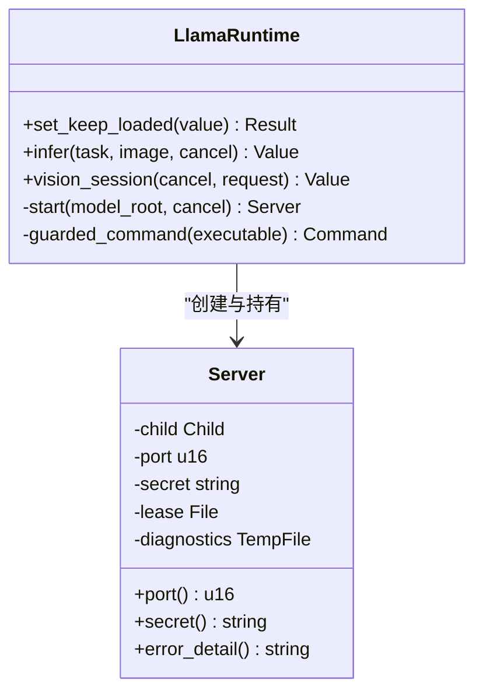

**图表来源**
- [moriq-ai/src/llama.rs:1-120](../../../../crates/moriq-ai/src/llama.rs#L1-L120)
- [moriq-ai/src/runtime.rs:1-82](../../../../crates/moriq-ai/src/runtime.rs#L1-L82)

**章节来源**
- [moriq-ai/src/llama.rs:1-200](../../../../crates/moriq-ai/src/llama.rs#L1-L200)
- [moriq-ai/src/runtime.rs:1-82](../../../../crates/moriq-ai/src/runtime.rs#L1-L82)

### 图像预处理与人脸检测
Qwen 人脸推理不直接输出向量，而是返回结构化人脸框与置信度：
- 输入图片会被设置最大宽高与内存分配上限，防止超大图片导致 OOM。
- 通过 Vision Session 向本地推理进程发送结构化提示词，强制 JSON Schema 约束。
- 人脸坐标被归一化到 `[0,1]`，剔除无效边界、越界坐标与低置信度结果。
- 对每个有效人脸生成方形裁剪图，并放大一定比例以保留周边上下文。

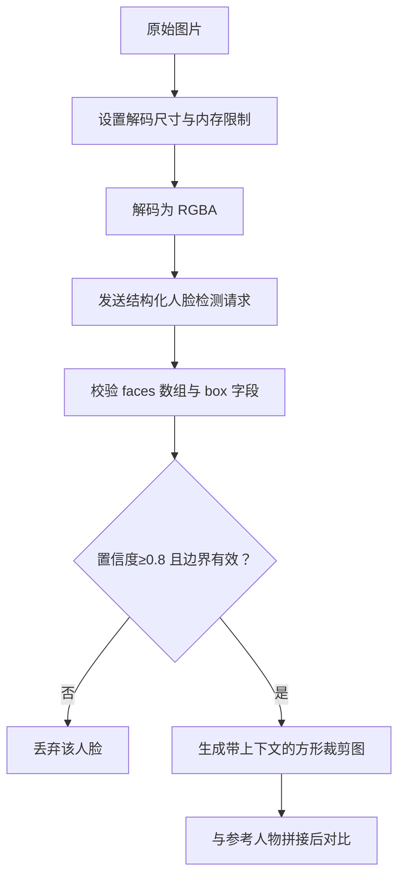

**图表来源**
- [moriq-ai/src/qwen_faces.rs:1-120](../../../../crates/moriq-ai/src/qwen_faces.rs#L1-L120)

**章节来源**
- [moriq-ai/src/qwen_faces.rs:1-172](../../../../crates/moriq-ai/src/qwen_faces.rs#L1-L172)

### 人脸识别与相似性匹配
当前实现采用“真实人脸对比”而非传统特征向量嵌入：
- 扫描阶段从数据库中选取每个人物的最佳预览图，并按其检测框裁出 256×256 参考图。
- 将待测人脸与参考人物并列合成一张对比图，交由 Qwen 判断是否为同一人。
- 匹配阈值：`same_person=true` 且置信度 ≥ 0.95 才认为匹配成功。
- 重复检测抑制：通过重叠率排除重复框；同版本内优先复用历史检测框 ID，减少重建开销。
- 人物未存在时创建“未命名人物”，随后可在人工修正后命名并归属工作区。

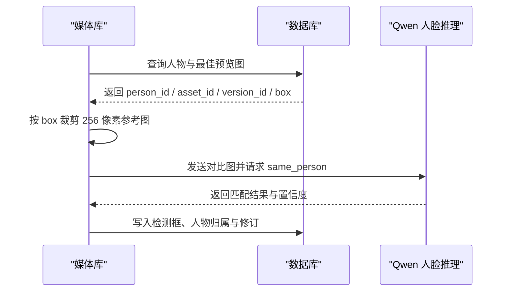

**图表来源**
- [moriq-library/src/ai/qwen_faces.rs:1-120](../../../../crates/moriq-library/src/ai/qwen_faces.rs#L1-L120)
- [moriq-library/src/ai/portraits.rs:1-100](../../../../crates/moriq-library/src/ai/portraits.rs#L1-L100)

**章节来源**
- [moriq-library/src/ai/qwen_faces.rs:1-200](../../../../crates/moriq-library/src/ai/qwen_faces.rs#L1-L200)
- [moriq-library/src/ai/portraits.rs:1-166](../../../../crates/moriq-library/src/ai/portraits.rs#L1-L166)

### 结果存储与索引更新
推理结果进入持久化层，遵循以下规则：
- 检测框必须位于 `[0,1]` 范围内且宽高为正；否则视为非法结果。
- 删除旧版非人工标记检测框，再插入新版本结果，附带模型修订与预处理版本。
- 若检测到人物为空或不在当前工作区，则创建新人物并纳入工作区。
- 同步写入 `ai_results`，记录模型 ID、修订、预处理版本与原始回执。
- 清理无向量的临时人物条目，避免脏数据。

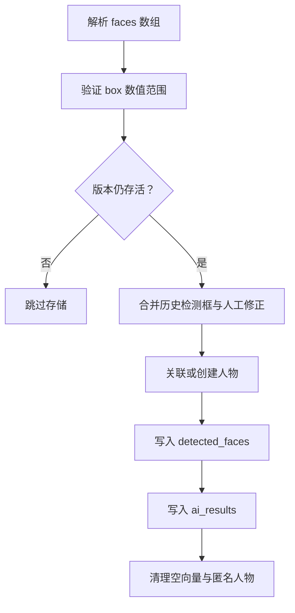

**图表来源**
- [moriq-library/src/ai/qwen_faces.rs:100-200](../../../../crates/moriq-library/src/ai/qwen_faces.rs#L100-L200)

**章节来源**
- [moriq-library/src/ai/qwen_faces.rs:100-200](../../../../crates/moriq-library/src/ai/qwen_faces.rs#L100-L200)

### 相似性搜索与内容指纹
相似性检索不依赖大模型，而是使用轻量感知指纹：
- 将图片缩放到 32×32，计算平均颜色与亮度分布。
- 对亮度矩阵进行二维 DCT，取低频系数排序后得到哈希掩码。
- 指纹包含哈希、RGB 均值与宽高比，存入 `image_fingerprints`。
- 检索时先按宽高比范围过滤，再比较汉明距离与 RGB 色差，最后截断 Top-K。

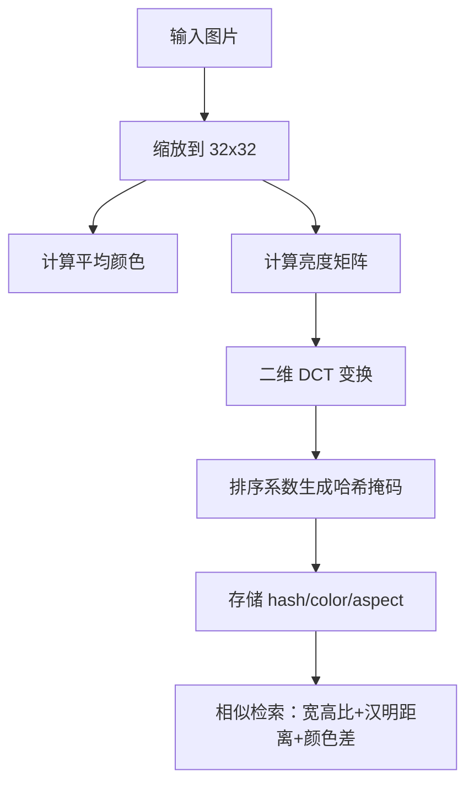

**图表来源**
- [moriq-library/src/ai/similarity.rs:1-80](../../../../crates/moriq-library/src/ai/similarity.rs#L1-L80)
- [moriq-retrieval/src/lib.rs:60-140](../../../../crates/moriq-retrieval/src/lib.rs#L60-L140)

**章节来源**
- [moriq-library/src/ai/similarity.rs:1-131](../../../../crates/moriq-library/src/ai/similarity.rs#L1-L131)
- [moriq-retrieval/src/lib.rs:1-200](../../../../crates/moriq-retrieval/src/lib.rs#L1-L200)

### 语义检索与向量处理
语义检索使用中文 CLIP 向量：
- 输入向量需为有限浮点数，维度不超过 4096，并进行单位归一化。
- 检索过程在只读范围内执行，避免写锁竞争。
- 对每条向量做余弦相似度，维护 Top-400 中间结果并截断至 Top-200。
- 推荐功能基于单张素材的向量，返回最多 8 个高相关名称。

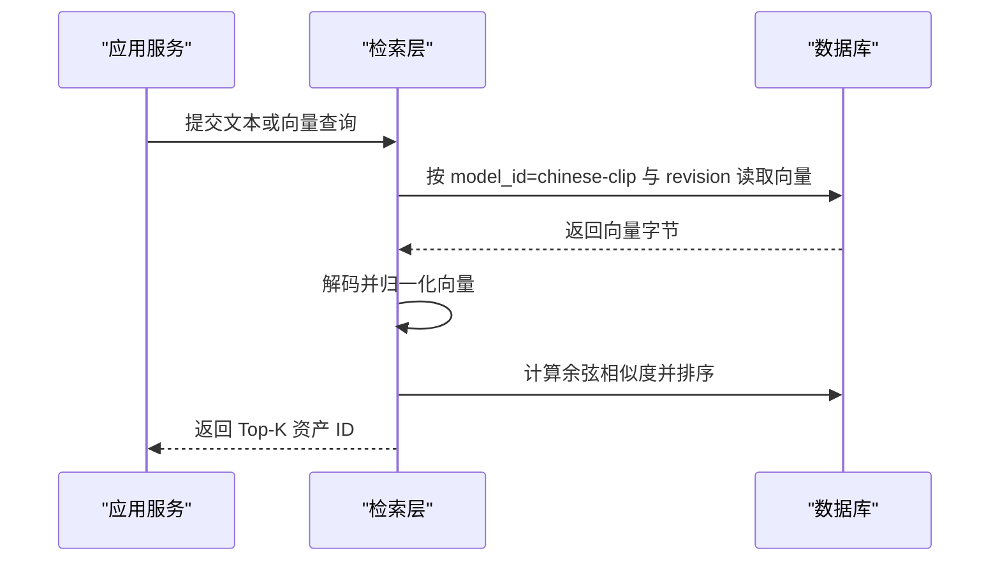

**图表来源**
- [moriq-library/src/ai/analysis.rs:1-80](../../../../crates/moriq-library/src/ai/analysis.rs#L1-L80)
- [moriq-retrieval/src/lib.rs:120-200](../../../../crates/moriq-retrieval/src/lib.rs#L120-L200)

**章节来源**
- [moriq-library/src/ai/analysis.rs:1-200](../../../../crates/moriq-library/src/ai/analysis.rs#L1-L200)
- [moriq-retrieval/src/lib.rs:1-200](../../../../crates/moriq-retrieval/src/lib.rs#L1-L200)

### 任务调度与取消机制
应用层将推理任务封装为后台工作：
- 任务入队前预检查模型是否就绪，避免执行期失败。
- 领取任务后申请共享内存预算，周期性轮询直到获得配额。
- 推理期间持续检查取消标志，UI 未来被丢弃时会主动触发取消。
- 失败任务会中止并记录详细信息，便于重试与排查。

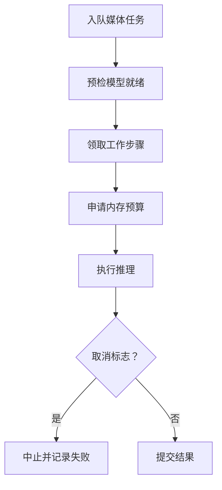

**图表来源**
- [moriq-app/src/jobs.rs:1-175](../../../../crates/moriq-app/src/jobs.rs#L1-L175)
- [moriq-app/src/inference.rs:1-120](../../../../crates/moriq-app/src/inference.rs#L1-L120)

**章节来源**
- [moriq-app/src/jobs.rs:1-175](../../../../crates/moriq-app/src/jobs.rs#L1-L175)
- [moriq-app/src/inference.rs:1-200](../../../../crates/moriq-app/src/inference.rs#L1-L200)

## 依赖关系分析
AI 数据流依赖如下：
- 应用层依赖媒体库的工作封装与领域层 AiProfile。
- 媒体库依赖 SQLite、图像处理、只读检索模块。
- AI 运行时依赖模型清单、系统信息、sha256、临时文件、平台进程 API。
- 本地推理进程依赖 llama.cpp 提供的命令行接口。

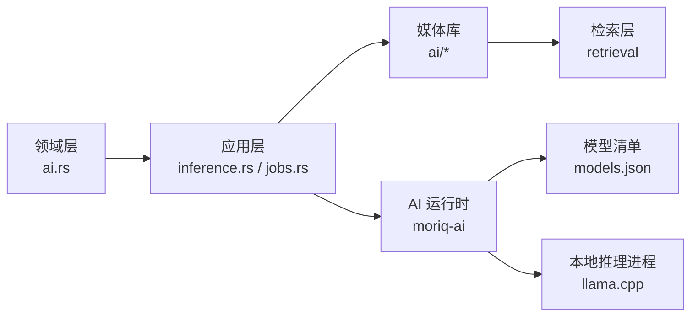

**图表来源**
- [crates/moriq-domain/src/ai.rs:1-120](../../../../crates/moriq-domain/src/ai.rs#L1-L120)
- [crates/moriq-app/src/inference.rs:1-120](../../../../crates/moriq-app/src/inference.rs#L1-L120)
- [crates/moriq-app/src/jobs.rs:1-175](../../../../crates/moriq-app/src/jobs.rs#L1-L175)
- [crates/moriq-library/src/ai/analysis.rs:1-80](../../../../crates/moriq-library/src/ai/analysis.rs#L1-L80)
- [crates/moriq-retrieval/src/lib.rs:1-120](../../../../crates/moriq-retrieval/src/lib.rs#L1-L120)
- [crates/moriq-ai/src/models.rs:1-120](../../../../crates/moriq-ai/src/models.rs#L1-L120)
- [crates/moriq-ai/src/llama.rs:1-120](../../../../crates/moriq-ai/src/llama.rs#L1-L120)

**章节来源**
- [crates/moriq-domain/src/ai.rs:1-187](../../../../crates/moriq-domain/src/ai.rs#L1-L187)
- [crates/moriq-app/src/inference.rs:1-200](../../../../crates/moriq-app/src/inference.rs#L1-L200)
- [crates/moriq-app/src/jobs.rs:1-175](../../../../crates/moriq-app/src/jobs.rs#L1-L175)
- [crates/moriq-library/src/ai/analysis.rs:1-200](../../../../crates/moriq-library/src/ai/analysis.rs#L1-L200)
- [crates/moriq-retrieval/src/lib.rs:1-200](../../../../crates/moriq-retrieval/src/lib.rs#L1-L200)
- [crates/moriq-ai/src/models.rs:1-200](../../../../crates/moriq-ai/src/models.rs#L1-L200)
- [crates/moriq-ai/src/llama.rs:1-200](../../../../crates/moriq-ai/src/llama.rs#L1-L200)

## 性能与内存优化
- 模型常驻策略：可通过常驻开关控制模型服务进程释放时机，关闭常驻时在空闲时主动释放。
- GPU/CPU 自动选择：默认启用语言模型层 GPU 卸载，视觉投影模块保持 CPU 执行，降低动态人像形状的显存压力。
- 线程数限制：按逻辑 CPU 一半设置，最小 1、最大 8，避免过度并行导致抢占。
- 图像解码预算：人脸推理限制最大宽高与内存分配，防止超大图片占用过多内存。
- 向量检索优化：相似性检索使用只读租约，语义检索维护 Top-K 中间集合并及时截断。
- 分类上下文预算：AiProfile 限制主题数量与说明总字数，减少本地模型上下文负载。

**章节来源**
- [moriq-ai/src/llama.rs:120-200](../../../../crates/moriq-ai/src/llama.rs#L120-L200)
- [moriq-ai/src/qwen_faces.rs:60-120](../../../../crates/moriq-ai/src/qwen_faces.rs#L60-L120)
- [moriq-retrieval/src/lib.rs:120-200](../../../../crates/moriq-retrieval/src/lib.rs#L120-L200)
- [moriq-domain/src/ai.rs:1-120](../../../../crates/moriq-domain/src/ai.rs#L1-L120)

## 故障排查指南
- 模型未安装或版本不匹配：
  - 现象：推理前报告需要升级或重新安装。
  - 排查：确认模型根目录下 current.json 与权重哈希一致，必要时重新安装。
- 本地推理进程无法启动：
  - 现象：健康检查超时或诊断日志出现异常。
  - 排查：查看推理进程的临时诊断文件，检查端口占用与平台保护进程校验。
- 人脸结果为空或置信度过低：
  - 现象：faces 为空或未被接受。
  - 排查：检查图片清晰度、人脸遮挡情况与 Qwen 返回的 box 与 confidence。
- 人物未正确分组：
  - 现象：同一人被判为多人。
  - 排查：调整参考图质量，确保正面清晰；人工修正后可提升后续自动匹配。
- 相似性检索无结果：
  - 现象：报告尚未建立近似索引。
  - 排查：先执行相似性索引后台任务，再执行检索。
- 语义检索维度错误：
  - 现象：向量维度无效或非有限值。
  - 排查：检查上游向量编码与归一化流程，确保长度为正且值有限。

**章节来源**
- [moriq-ai/src/models.rs:120-200](../../../../crates/moriq-ai/src/models.rs#L120-L200)
- [moriq-ai/src/llama.rs:1-120](../../../../crates/moriq-ai/src/llama.rs#L1-L120)
- [moriq-ai/src/qwen_faces.rs:1-120](../../../../crates/moriq-ai/src/qwen_faces.rs#L1-L120)
- [moriq-library/src/ai/qwen_faces.rs:100-200](../../../../crates/moriq-library/src/ai/qwen_faces.rs#L100-L200)
- [moriq-library/src/ai/similarity.rs:60-131](../../../../crates/moriq-library/src/ai/similarity.rs#L60-L131)
- [moriq-library/src/ai/analysis.rs:1-80](../../../../crates/moriq-library/src/ai/analysis.rs#L1-L80)

## 结论
Moriq Space 的 AI 推理数据流以 Qwen3.5-4B 为核心，结合严格的结构化输出约束、模型安装校验、本地推理进程治理与数据库一致性保障，形成从模型准备到结果落库的闭环。人脸识别采用真实人脸对比而非特征向量，保证身份判定更贴近实际视觉证据；相似性检索通过轻量指纹实现高效近似匹配，语义检索则通过向量归一化与余弦相似度完成跨库检索。通过常驻策略、GPU/CPU 分层卸载、线程与图像预算控制，系统在可用性与性能之间取得平衡。用户在模型配置与推理性能方面，应关注 AiProfile 上下文规模、线程数、图像尺寸与模型常驻策略，以获得更稳定的体验。