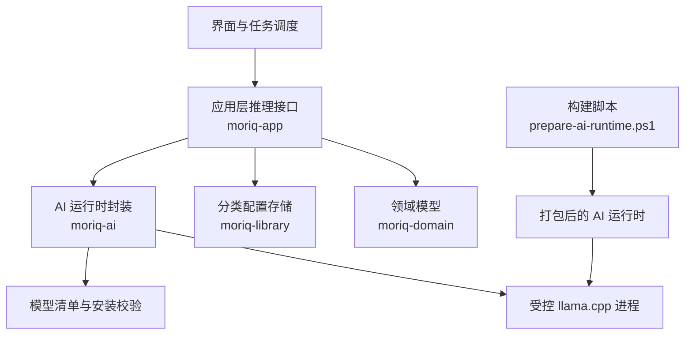
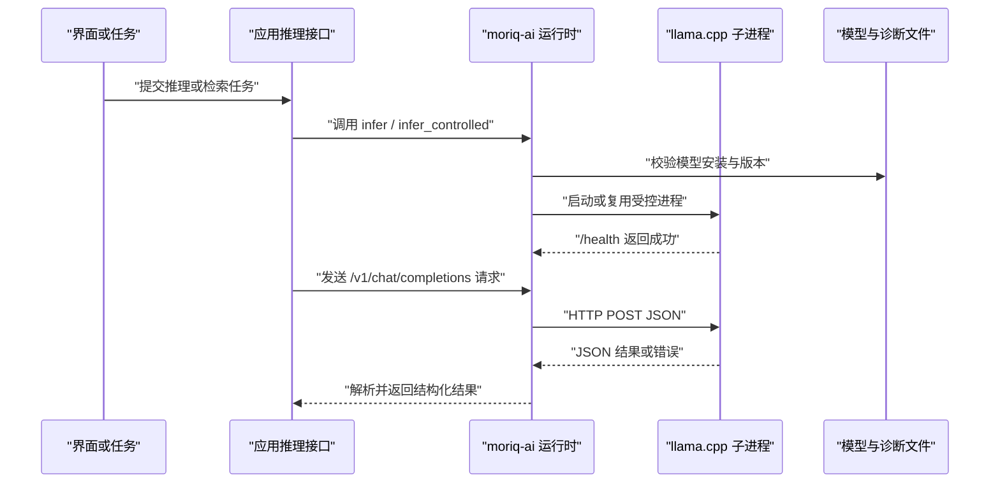
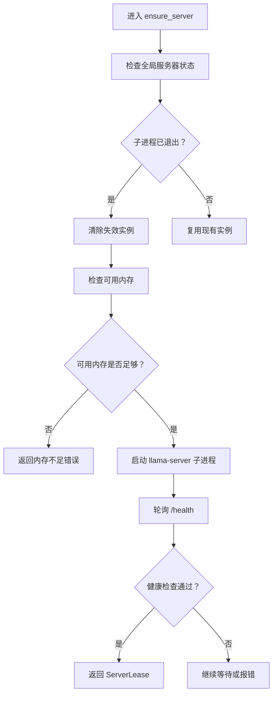
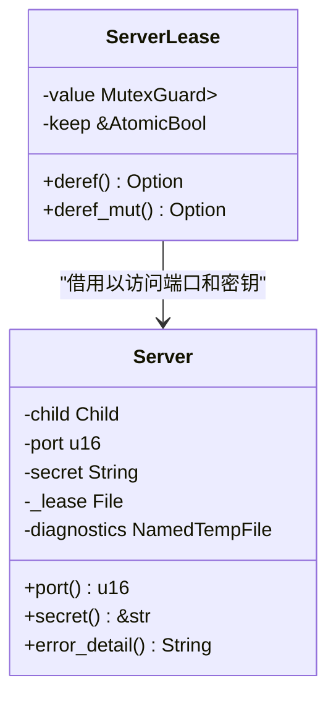
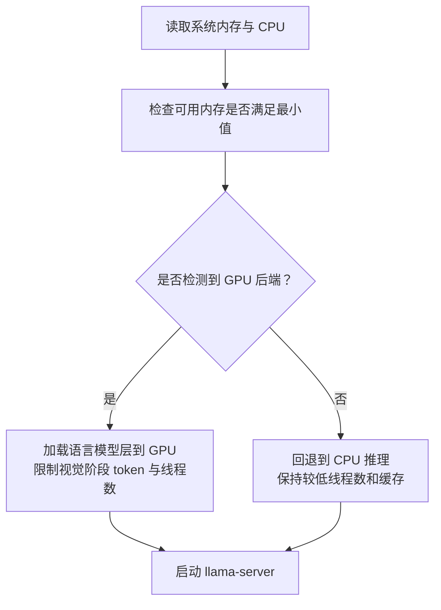
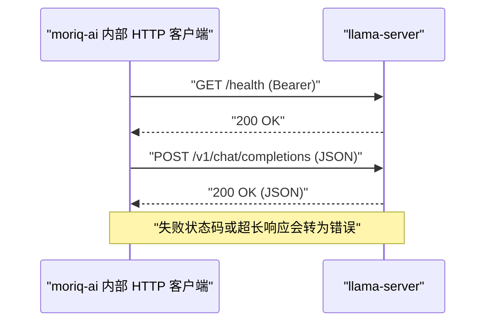
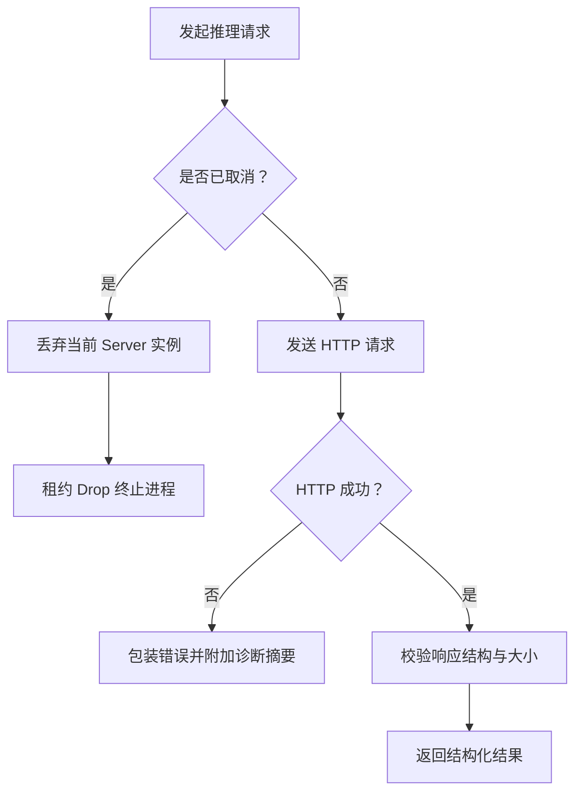
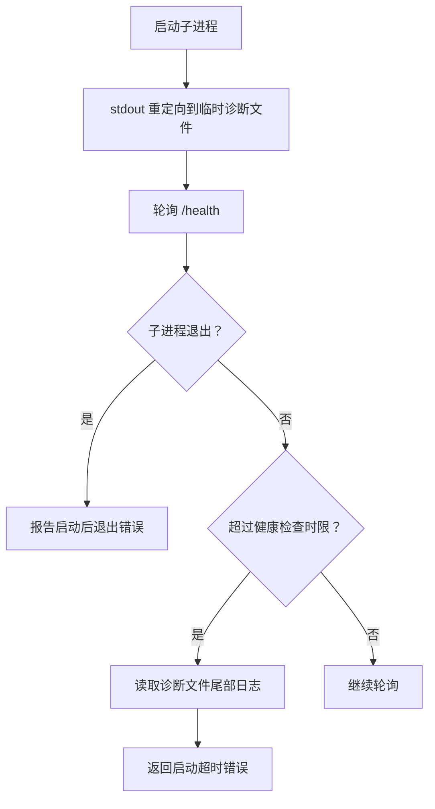
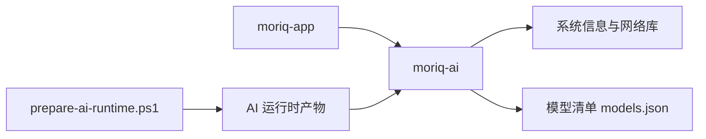

# llama.cpp 服务集成

> Repo Wiki 节点 `llama-server-integration`
> 导出自 Qoder 知识库快照 `8fbe02f6-57c2-4874-b725-1a8130851fd9`，代码基线 `7a7a8e75e18bd90294e09cd422dd7ed5a04813a0`（分支 main，zh-CN）。

<cite>
**本文引用的文件**
- [ARCHITECTURE.md](../../../../ARCHITECTURE.md)
- [crates/moriq-ai/src/lib.rs](../../../../crates/moriq-ai/src/lib.rs)
- [crates/moriq-ai/src/runtime.rs](../../../../crates/moriq-ai/src/runtime.rs)
- [crates/moriq-ai/src/llama.rs](../../../../crates/moriq-ai/src/llama.rs)
- [crates/moriq-ai/src/models.rs](../../../../crates/moriq-ai/src/models.rs)
- [crates/moriq-app/src/inference.rs](../../../../crates/moriq-app/src/inference.rs)
- [crates/moriq-domain/src/ai.rs](../../../../crates/moriq-domain/src/ai.rs)
- [crates/moriq-library/src/ai/ai_profile.rs](../../../../crates/moriq-library/src/ai/ai_profile.rs)
- [scripts/prepare-ai-runtime.ps1](../../../../scripts/prepare-ai-runtime.ps1)
</cite>

## 目录
1. [引言](#引言)
2. [项目结构](#项目结构)
3. [核心组件](#核心组件)
4. [架构总览](#架构总览)
5. [详细组件分析](#详细组件分析)
6. [依赖关系分析](#依赖关系分析)
7. [性能与资源调优](#性能与资源调优)
8. [故障诊断与恢复](#故障诊断与恢复)
9. [结论](#结论)

## 引言
本文说明 Moriq Space 中 llama.cpp 本地推理服务的集成方式。系统通过一个受控的本地 HTTP 子进程运行 Qwen3.5-4B 模型，由上层应用统一调度生命周期、端口分配、参数配置、内存预算、取消信号和错误恢复。文档重点覆盖：

- 受控服务器进程的生命周期管理，包括端口分配、启动参数和资源隔离。
- 服务器租约机制 ServerLease 如何保证进程和模型文件租约正确释放。
- 常驻模式 keep_loaded 对内存占用的影响。
- 硬件检测逻辑与 GPU/CPU 优化策略，包括 Vulkan 后端来源和线程数配置。
- 推理请求的 HTTP 协议格式、超时控制和错误处理。
- 诊断日志收集、进程健康检查和异常恢复策略。
- 性能调优参数与常见问题排查方法。

## 项目结构
该功能跨越多个 crate：

- `moriq-domain`：定义稳定的 AI 分类与主题词表等数据结构。
- `moriq-library`：按库保存 AI 分类配置，并计算分类哈希。
- `moriq-app`：把 UI 或任务调度中的工作分派到本地推理执行器。
- `moriq-ai`：封装模型安装、运行时校验、本地 llama.cpp 进程控制与推理调用。
- 构建脚本 `scripts/prepare-ai-runtime.ps1`：准备带 Vulkan 后端的 llama.cpp 二进制和模型清单。

**图表来源**
- [ARCHITECTURE.md:9-20](../../../../ARCHITECTURE.md#L9-L20)
- [scripts/prepare-ai-runtime.ps1:1-62](../../../../scripts/prepare-ai-runtime.ps1#L1-L62)

**章节来源**
- [ARCHITECTURE.md:9-20](../../../../ARCHITECTURE.md#L9-L20)

## 核心组件
- **受控服务器进程**：以独立子进程形式运行 `llama-server.exe`，仅监听本机回环地址，并通过 Bearer Token 鉴权。
- **ServerLease 租约**：封装全局互斥保护的可选 Server 实例，并在 Drop 时根据 keep_loaded 决定是否保留进程。
- **运行时入口**：`runtime.rs` 提供 `infer`、`infer_controlled`、`set_keep_loaded`、`unload` 等稳定接口。
- **模型与硬件信息**：`models.rs` 暴露 `hardware()`、`registry()`、`installed_path()` 等能力。
- **应用集成层**：`moriq-app/src/inference.rs` 将 UI 和任务队列的请求转换为本地推理调用。

**章节来源**
- [crates/moriq-ai/src/llama.rs:1-120](../../../../crates/moriq-ai/src/llama.rs#L1-L120)
- [crates/moriq-ai/src/runtime.rs:1-82](../../../../crates/moriq-ai/src/runtime.rs#L1-L82)
- [crates/moriq-ai/src/models.rs:1-120](../../../../crates/moriq-ai/src/models.rs#L1-L120)
- [crates/moriq-app/src/inference.rs:1-120](../../../../crates/moriq-app/src/inference.rs#L1-L120)

## 架构总览
整体流程分为三层：

1. **应用层**：接收用户操作或后台任务，构造图片路径、任务类型或语义检索输入。
2. **AI 运行时层**：校验模型是否已安装，按需启动或复用受控 llama.cpp 进程。
3. **子进程层**：llama.cpp 在本地回环地址上提供 `/health` 和 `/v1/chat/completions` 接口。

**图表来源**
- [crates/moriq-app/src/inference.rs:1-120](../../../../crates/moriq-app/src/inference.rs#L1-L120)
- [crates/moriq-ai/src/runtime.rs:23-82](../../../../crates/moriq-ai/src/runtime.rs#L23-L82)
- [crates/moriq-ai/src/llama.rs:201-260](../../../../crates/moriq-ai/src/llama.rs#L201-L260)

## 详细组件分析

### 受控服务器进程生命周期
`Server` 持有子进程句柄、端口、认证密钥、模型文件租约以及诊断临时文件。其关键职责如下：

- **端口分配**：通过绑定 `127.0.0.1:0` 获取操作系统分配的临时端口，避免端口冲突。
- **进程启动参数**：指定模型权重、多模态投影、主机地址、端口、GPU 层数、上下文窗口、并行度、线程数、Jinja、缓存大小、最大图像 token 数等。
- **环境隔离**：清理环境变量后仅保留 Windows 必需的系统变量；Windows 下设置子进程创建标志，限制可见性。
- **诊断输出**：标准输出重定向到临时文件，失败时可读取尾部日志。
- **自动终止**：`Drop` 实现会终止子进程并等待退出，防止僵尸进程。

**图表来源**
- [crates/moriq-ai/src/llama.rs:201-260](../../../../crates/moriq-ai/src/llama.rs#L201-L260)

**章节来源**
- [crates/moriq-ai/src/llama.rs:1-120](../../../../crates/moriq-ai/src/llama.rs#L1-L120)
- [crates/moriq-ai/src/llama.rs:201-260](../../../../crates/moriq-ai/src/llama.rs#L201-L260)

### 服务器租约 ServerLease 与常驻模式
`ServerLease` 是一个借用保护对象的 RAII 租约：

- 它持有全局互斥锁的保护对象和 `keep_loaded` 原子标志。
- 在正常结束、提前返回、模型回复异常或策略变更等所有路径中，Drop 都会确保释放逻辑被调用。
- 如果当前未启用常驻模式，租约结束时将全局服务器实例置空，从而触发进程终止和模型文件租约释放。
- `set_keep_loaded(false)` 还会尝试直接释放空闲运行器，避免频繁启停带来的延迟。

**图表来源**
- [crates/moriq-ai/src/llama.rs:1-120](../../../../crates/moriq-ai/src/llama.rs#L1-L120)

常驻模式的内存影响：

- 开启常驻模式时，已加载的模型权重和进程驻留内存不会主动释放，适合高频推理场景。
- 关闭常驻模式时，推理结束后进程退出，模型权重从内存卸载，但下一次推理需要重新加载。
- 代码还包含最低可用内存门槛，低于阈值时拒绝启动，以避免 OOM。

**章节来源**
- [crates/moriq-ai/src/llama.rs:1-120](../../../../crates/moriq-ai/src/llama.rs#L1-L120)

### 模型文件租约与资源隔离
启动前会调用模型安装校验，并获取 `verified_lease("qwen35-4b")`。该租约与 `Server._lease` 绑定，随 `Server` 析构而释放。这样可以避免以下问题：

- 多个进程同时写入同一模型目录。
- 模型卸载期间仍有推理进程占用模型文件。
- 子进程崩溃后仍持有模型文件句柄。

此外，`guarded_command` 在 Windows 上通过内置的 `ai-guard.exe` 包装真实可执行文件，并对保护程序本身做 SHA-256 校验和幂等部署。

**章节来源**
- [crates/moriq-ai/src/llama.rs:120-200](../../../../crates/moriq-ai/src/llama.rs#L120-L200)
- [crates/moriq-ai/src/runtime.rs:39-82](../../../../crates/moriq-ai/src/runtime.rs#L39-L82)

### 硬件检测与 GPU/CPU 优化策略
`hardware()` 使用系统信息库读取：

- 总内存和可用内存。
- 逻辑处理器数量。
- 固定后端标识：Vulkan · llama.cpp · Qwen3.5-4B。

启动参数中：

- `-ngl 99` 表示尽可能将语言模型层放到 GPU。
- `--no-mmproj-offload` 禁止视觉投影模块卸载到 CPU，避免可变人像形状耗尽 Vulkan 投影分配器。
- `--image-max-tokens 1024` 限制图像相关 token 数量。
- `--cache-ram 256` 限制缓存 RAM。
- `--threads` 设置为逻辑 CPU 数的一半，并在 1 到 8 之间取整，避免过多线程争用。

构建脚本明确下载并打包 Vulkan 后端二进制：

- 固定 llama.cpp 版本 `b11869`。
- 目标归档名称包含 `win-vulkan-x64`。
- 复制 `ggml-vulkan.dll` 和相关动态库。
- 生成 `provenance.json` 记录后端为 Vulkan。

**图表来源**
- [crates/moriq-ai/src/models.rs:40-70](../../../../crates/moriq-ai/src/models.rs#L40-L70)
- [crates/moriq-ai/src/llama.rs:120-200](../../../../crates/moriq-ai/src/llama.rs#L120-L200)
- [scripts/prepare-ai-runtime.ps1:1-62](../../../../scripts/prepare-ai-runtime.ps1#L1-L62)

**章节来源**
- [crates/moriq-ai/src/models.rs:40-70](../../../../crates/moriq-ai/src/models.rs#L40-L70)
- [crates/moriq-ai/src/llama.rs:120-200](../../../../crates/moriq-ai/src/llama.rs#L120-L200)
- [scripts/prepare-ai-runtime.ps1:1-62](../../../../scripts/prepare-ai-runtime.ps1#L1-L62)

### 推理请求的 HTTP 协议格式
受控服务使用 OpenAI 兼容风格的聊天补全接口：

- **健康检查**
  - 方法：GET
  - 路径：`/health`
  - 鉴权：`Authorization: Bearer <随机密钥>`
  - 用途：启动时轮询，确认子进程已加载模型并可接受请求。

- **推理请求**
  - 方法：POST
  - 路径：`/v1/chat/completions`
  - 内容类型：`application/json`
  - 鉴权：`Authorization: Bearer <随机密钥>`
  - 主体：由上层根据任务类型构造 JSON，包含消息、分类模板、描述模板或结构化 schema。
  - 响应：JSON，包含 medium、themes、uncertainties、description、tags 等字段。

- **超时与限流**
  - 健康检查客户端超时：2 秒。
  - 健康检查整体等待时间：120 秒。
  - 推理请求超时：300 秒。
  - 响应体上限：1MB。
  - 非成功 HTTP 状态会被包装为错误，并截断响应正文。

**图表来源**
- [crates/moriq-ai/src/llama.rs:201-260](../../../../crates/moriq-ai/src/llama.rs#L201-L260)
- [crates/moriq-ai/src/llama.rs:300-450](../../../../crates/moriq-ai/src/llama.rs#L300-L450)

**章节来源**
- [crates/moriq-ai/src/llama.rs:201-260](../../../../crates/moriq-ai/src/llama.rs#L201-L260)
- [crates/moriq-ai/src/llama.rs:300-450](../../../../crates/moriq-ai/src/llama.rs#L300-L450)

### 错误处理与取消恢复
错误来源主要包括：

- 模型未安装或版本不匹配。
- 可用内存不足。
- 子进程启动后立即退出。
- 健康检查超时。
- HTTP 非成功状态。
- 响应体超出预算。
- 标签数量或长度不符合协议约束。
- 用户显式取消推理。

取消恢复策略：

- 每个推理调用维护 `AtomicBool` 取消标志。
- 健康检查循环、HTTP 请求循环均周期性检查取消标志。
- 取消发生时，立即丢弃当前 Server 实例，使租约 Drop 释放子进程。
- 示例测试验证取消后可输出取消耗时，并调用 `unload` 完成资源清理。

**图表来源**
- [crates/moriq-ai/src/llama.rs:201-260](../../../../crates/moriq-ai/src/llama.rs#L201-L260)
- [crates/moriq-ai/src/llama.rs:300-450](../../../../crates/moriq-ai/src/llama.rs#L300-L450)
- [crates/moriq-ai/examples/cancel_inference.rs:1-35](../../../../crates/moriq-ai/examples/cancel_inference.rs#L1-L35)

**章节来源**
- [crates/moriq-ai/src/llama.rs:201-260](../../../../crates/moriq-ai/src/llama.rs#L201-L260)
- [crates/moriq-ai/src/llama.rs:300-450](../../../../crates/moriq-ai/src/llama.rs#L300-L450)
- [crates/moriq-ai/examples/cancel_inference.rs:1-35](../../../../crates/moriq-ai/examples/cancel_inference.rs#L1-L35)

### 诊断日志与健康检查
- 子进程标准输出重定向到临时文件。
- `error_detail` 打开诊断文件，定位末尾最多 16KB 内容并解码为字符串。
- 健康检查以 100 毫秒间隔轮询 `/health`，直到成功、子进程退出或达到 120 秒超时。
- 诊断文件在 `Server` 析构时随临时文件一起清理。

**图表来源**
- [crates/moriq-ai/src/llama.rs:1-120](../../../../crates/moriq-ai/src/llama.rs#L1-L120)
- [crates/moriq-ai/src/llama.rs:201-260](../../../../crates/moriq-ai/src/llama.rs#L201-L260)

**章节来源**
- [crates/moriq-ai/src/llama.rs:1-120](../../../../crates/moriq-ai/src/llama.rs#L1-L120)
- [crates/moriq-ai/src/llama.rs:201-260](../../../../crates/moriq-ai/src/llama.rs#L201-L260)

### 应用层集成与工作分派
`LocalInference` 实现 `InferenceRunner`：

- 人脸推理调用 `moriq_ai::llama_faces`。
- 分类推理调用 `moriq_ai::llama_infer_profile`。
- 通用推理调用 `moriq_ai::infer_controlled`。
- 每次调用前检查模型是否安装、查询修订号，并在返回前后检查取消标志。
- 工作分派函数根据 `Work` 种类路由到人脸、推理、分类或描述任务。

**章节来源**
- [crates/moriq-app/src/inference.rs:1-120](../../../../crates/moriq-app/src/inference.rs#L1-L120)
- [crates/moriq-app/src/inference.rs:120-200](../../../../crates/moriq-app/src/inference.rs#L120-L200)

### 分类配置与上下文预算
`AiProfile` 用于控制推理上下文：

- 默认分类包含媒介类型和主题类型。
- 分类定义合计字符数上限为 1600。
- 启用主题最多 24 个。
- 主题上限为 1～8，分类总数最多 64。
- 分类 ID、标签、定义有严格校验规则。
- 配置变化会触发分类任务取消和全文索引重建。

**章节来源**
- [crates/moriq-domain/src/ai.rs:1-187](../../../../crates/moriq-domain/src/ai.rs#L1-L187)
- [crates/moriq-library/src/ai/ai_profile.rs:1-120](../../../../crates/moriq-library/src/ai/ai_profile.rs#L1-L120)

## 依赖关系分析
- `moriq-app` 依赖 `moriq-ai` 提供的推理接口。
- `moriq-ai` 依赖系统库、reqwest、tempfile、fs2、sysinfo、uuid、sha2 等。
- `moriq-ai` 依赖 `workers/ai/models.json` 中的模型规格。
- 构建脚本依赖 GitHub Releases 上的 llama.cpp 二进制包。

**图表来源**
- [crates/moriq-app/src/inference.rs:1-120](../../../../crates/moriq-app/src/inference.rs#L1-L120)
- [crates/moriq-ai/src/models.rs:70-120](../../../../crates/moriq-ai/src/models.rs#L70-L120)
- [scripts/prepare-ai-runtime.ps1:1-62](../../../../scripts/prepare-ai-runtime.ps1#L1-L62)

**章节来源**
- [crates/moriq-app/src/inference.rs:1-120](../../../../crates/moriq-app/src/inference.rs#L1-L120)
- [crates/moriq-ai/src/models.rs:70-120](../../../../crates/moriq-ai/src/models.rs#L70-L120)
- [scripts/prepare-ai-runtime.ps1:1-62](../../../../scripts/prepare-ai-runtime.ps1#L1-L62)

## 性能与资源调优
建议关注以下参数：

| 参数 | 含义 | 推荐策略 |
|---|---|---|
| `-ngl` | 放入 GPU 的层数 | 当前设为 99，尽量利用 GPU；若显存不足则应降低或回退 CPU |
| `--no-mmproj-offload` | 视觉投影模块不卸载到 CPU | 当前禁用卸载，避免 Vulkan 分配器压力；若显存紧张可评估是否允许卸载 |
| `--image-max-tokens` | 图像相关 token 上限 | 当前 1024；大图或多模态任务可适当调整 |
| `--cache-ram` | 缓存 RAM 上限 | 当前 256MB；内存紧张时可降低 |
| `--threads` | 推理线程数 | 当前为逻辑 CPU 数一半且限制 1～8；高核 CPU 不建议无限制增加 |
| `REQUEST_TIMEOUT` | 推理请求超时 | 当前 300 秒；长文本或复杂描述可适当延长，但不宜无限放大 |
| `HEALTH_TIMEOUT` | 健康检查超时 | 当前 120 秒；冷启动较慢时可适当延长 |
| `MAX_RESPONSE_BYTES` | 响应体上限 | 当前 1MB；防止大模型输出撑爆内存 |
| `keep_loaded` | 常驻模式 | 高频推理开启；低频推理关闭以释放内存 |

内存与安全边界：

- 启动前检查可用内存是否至少满足最小值。
- 响应体读取时使用有界读取器，超限直接报错。
- 标签数量和长度受协议限制。
- Windows 下子进程使用受限环境变量和创建标志。

**章节来源**
- [crates/moriq-ai/src/llama.rs:120-200](../../../../crates/moriq-ai/src/llama.rs#L120-L200)
- [crates/moriq-ai/src/llama.rs:201-260](../../../../crates/moriq-ai/src/llama.rs#L201-L260)
- [crates/moriq-ai/src/llama.rs:300-450](../../../../crates/moriq-ai/src/llama.rs#L300-L450)

## 故障诊断与恢复

### 常见问题与排查步骤

| 现象 | 可能原因 | 排查建议 |
|---|---|---|
| 启动后立刻退出 | 子进程崩溃、模型文件缺失、Vulkan 驱动不可用 | 查看诊断文件尾部日志，检查模型安装状态和 Vulkan DLL |
| 启动超时 | 模型加载慢、显存不足、磁盘 IO 慢 | 检查可用内存，减少并发，确认 GPU 驱动和 CUDA/Vulkan 环境 |
| HTTP 推理失败 | 鉴权失败、模型负载高、响应过大 | 检查 Bearer 密钥、观察 HTTP 状态码、确认响应大小不超过 1MB |
| 标签为空或报错 | 模型输出不符合 schema | 检查分类配置和主题定义，确认输出被规范化 |
| 卸载失败 | 仍有推理任务持有全局锁 | 等待任务完成或取消后再卸载 |
| 常驻模式内存不释放 | keep_loaded 为 true | 调用 `set_keep_loaded(false)` 并等待租约释放 |

### 恢复策略
- 健康检查失败时重试有限次数，避免瞬时抖动导致误判。
- 子进程退出时标记实例失效，下次推理自动重建。
- 取消标志传播到健康检查循环和 HTTP 请求循环。
- `unload` 在持有锁的情况下清空全局实例，释放进程和模型租约。
- 分类配置变更后取消旧任务，重建搜索索引。

**章节来源**
- [crates/moriq-ai/src/llama.rs:201-260](../../../../crates/moriq-ai/src/llama.rs#L201-L260)
- [crates/moriq-ai/src/llama.rs:300-450](../../../../crates/moriq-ai/src/llama.rs#L300-L450)
- [crates/moriq-library/src/ai/ai_profile.rs:1-120](../../../../crates/moriq-library/src/ai/ai_profile.rs#L1-L120)

## 结论
Moriq Space 的 llama.cpp 集成采用“应用层调度 + 运行时封装 + 受控子进程”的分层设计。通过端口随机分配、Bearer 鉴权、模型文件租约、诊断日志和内存阈值，系统在可用性、安全性和资源控制之间取得平衡。ServerLease 确保所有提前返回路径都能释放进程，`keep_loaded` 让用户在吞吐和内存占用之间选择。硬件检测与 Vulkan 后端结合，使语言模型优先使用 GPU，同时限制视觉阶段和线程数，降低不稳定因素。对于生产部署，建议结合业务负载调整线程数、token 上限、缓存大小和常驻策略，并以诊断日志和健康检查作为主要排障手段。