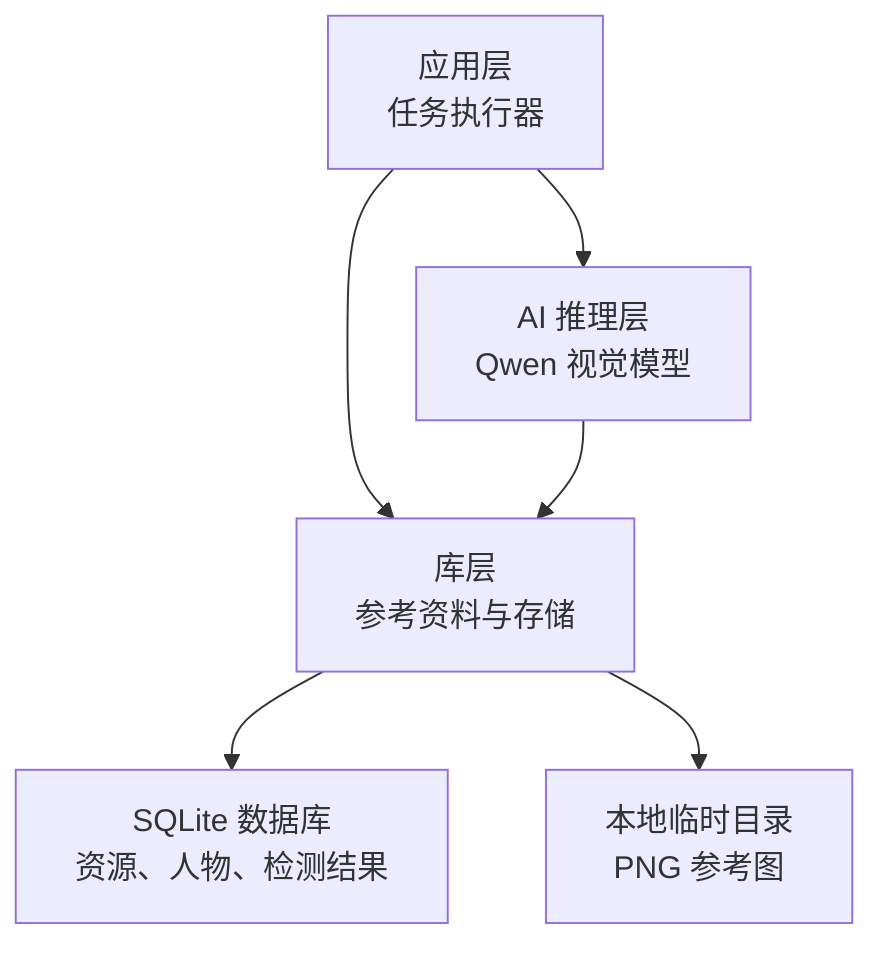
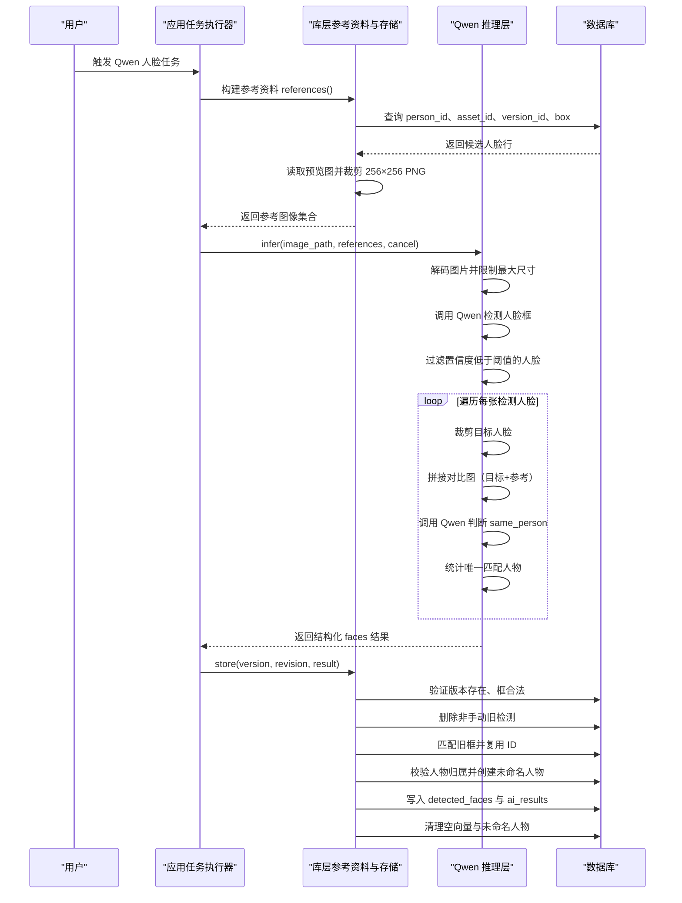
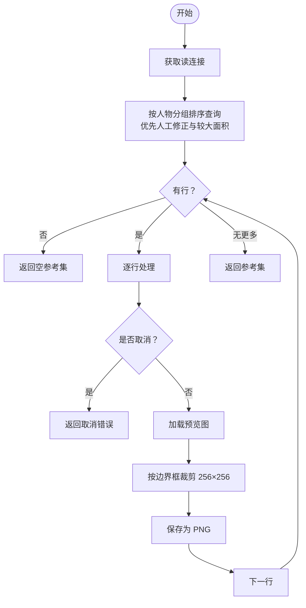
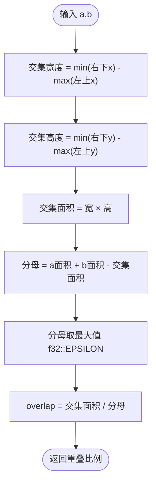
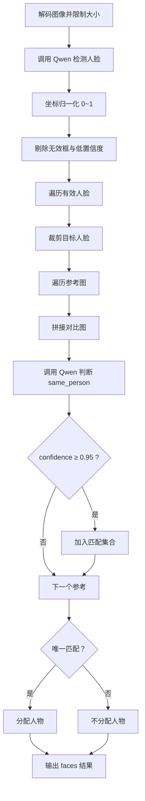
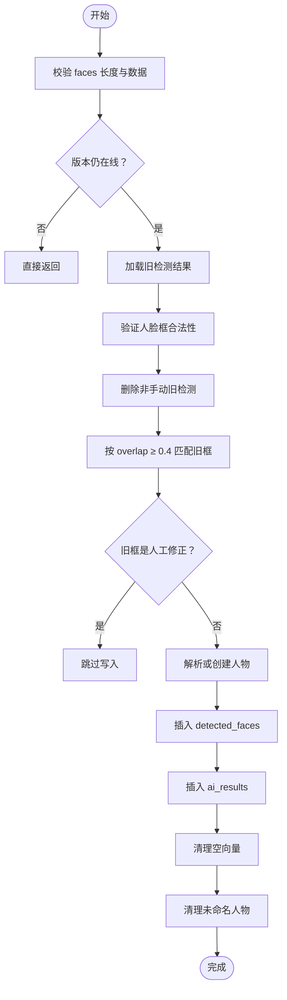
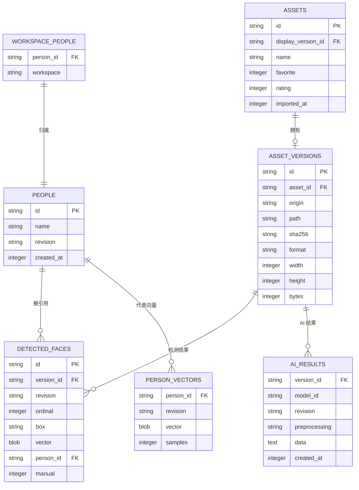
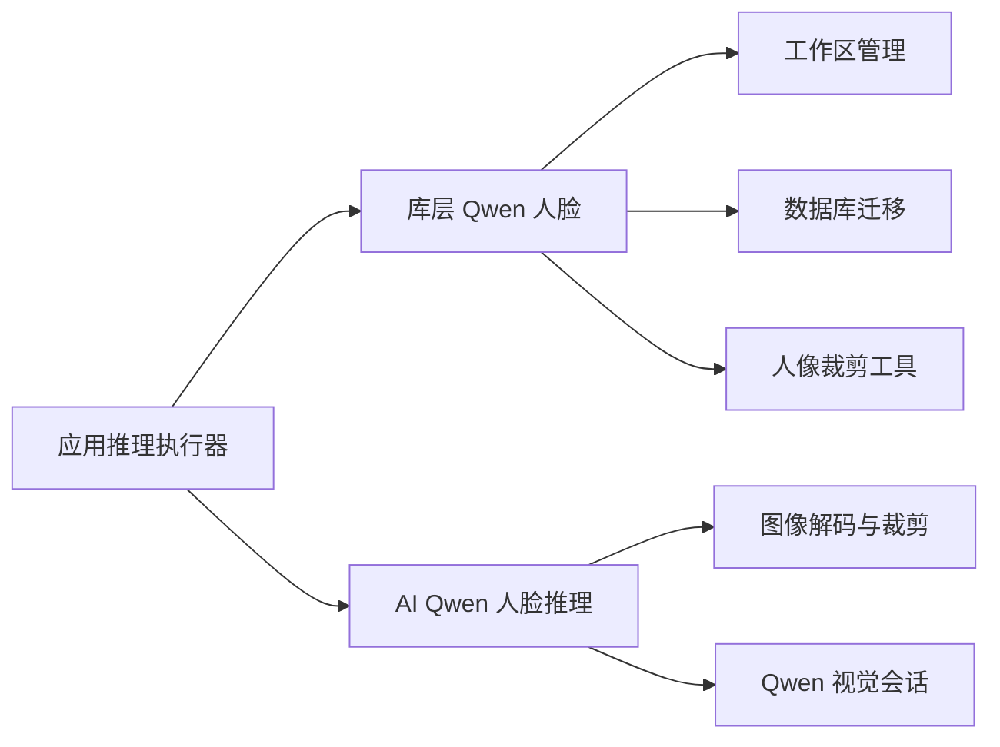

# 人脸识别流水线

> Repo Wiki 节点 `face-recognition-pipeline`
> 导出自 Qoder 知识库快照 `8fbe02f6-57c2-4874-b725-1a8130851fd9`，代码基线 `7a7a8e75e18bd90294e09cd422dd7ed5a04813a0`（分支 main，zh-CN）。

<cite>
**本文引用的文件**   
- [qwen_faces.rs](../../../../crates/moriq-library/src/ai/qwen_faces.rs)
- [qwen_faces.rs](../../../../crates/moriq-ai/src/qwen_faces.rs)
- [inference.rs](../../../../crates/moriq-app/src/inference.rs)
- [workspace.rs](../../../../crates/moriq-library/src/catalog/workspace.rs)
- [migration_15.sql](../../../../crates/moriq-library/src/database/migrations/migration_15.sql)
- [migration_21.sql](../../../../crates/moriq-library/src/database/migrations/migration_21.sql)
- [migration_26.sql](../../../../crates/moriq-library/src/database/migrations/migration_26.sql)
- [schema.sql](../../../../crates/moriq-library/src/database/schema.sql)
- [lib.rs](../../../../crates/moriq-library/src/lib.rs)
- [qwen_faces_smoke.rs](../../../../crates/moriq-app/examples/qwen_faces_smoke.rs)
</cite>

## 目录
1. [简介](#简介)
2. [项目结构](#项目结构)
3. [核心组件](#核心组件)
4. [架构总览](#架构总览)
5. [详细组件分析](#详细组件分析)
6. [依赖关系分析](#依赖关系分析)
7. [性能与精度调优](#性能与精度调优)
8. [故障排查指南](#故障排查指南)
9. [结论](#结论)

## 简介
本文档系统化说明 Qwen 人脸识别流水线的实现，覆盖从数据库读取人脸参考资料、生成参考图像集、执行 Qwen 视觉推理、重复检测排除、结果持久化到人物匹配和版本约束校验的完整路径。重点解释：
- 人物优先级排序与边界框裁剪算法；
- 重叠比例 overlap 的计算方式与重复检测策略；
- 参考图像质量控制标准；
- 人脸框验证、人物匹配算法和版本约束检查；
- 手动修正数据的保留机制与未命名人物的自动清理；
- 数据库事务处理与并发安全性；
- 识别精度调优建议与性能优化技巧。

该流水线由应用层任务编排、库层参考资料准备、AI 推理层识别与比较、以及库层结果持久化四个阶段组成。

## 项目结构
Qwen 人脸识别流水线涉及三个主要 crate：
- `moriq-app`：任务调度与执行入口，把媒体工作项转换为 Qwen 人脸推理请求。
- `moriq-library`：资料库访问、数据库读写、参考资料构建、结果存储、工作区隔离。
- `moriq-ai`：基于 Qwen 视觉模型的推理封装、输入校验、裁剪与对比图构造。

**图表来源**
- [inference.rs:100-170](../../../../crates/moriq-app/src/inference.rs#L100-L170)
- [qwen_faces.rs](../../../../crates/moriq-library/src/ai/qwen_faces.rs)
- [qwen_faces.rs](../../../../crates/moriq-ai/src/qwen_faces.rs)
- [migration_15.sql:1-30](../../../../crates/moriq-library/src/database/migrations/migration_15.sql#L1-L30)

**章节来源**
- [lib.rs:1-160](../../../../crates/moriq-library/src/lib.rs#L1-L160)
- [inference.rs:100-170](../../../../crates/moriq-app/src/inference.rs#L100-L170)

## 核心组件
- **参考资料收集**：按项目范围查询有效素材的人脸记录，优先选择人工修正或面积较大的框，并裁剪为固定尺寸 PNG。
- **Qwen 推理与比对**：对每帧检测出的人脸裁剪后，与每个候选参考图拼接成对比图，调用 Qwen 判断是否同一个人。
- **结果存储与匹配**：验证人脸框合法性，复用旧检测，维护人物归属，写入 `detected_faces` 和 `ai_results`，清理无效向量与未命名人物。
- **工作区与版本约束**：通过工作区投影限制人物归属，确保结果只影响当前项目的可见范围。

**章节来源**
- [qwen_faces.rs:1-120](../../../../crates/moriq-library/src/ai/qwen_faces.rs#L1-L120)
- [qwen_faces.rs:1-172](../../../../crates/moriq-ai/src/qwen_faces.rs#L1-L172)
- [migration_15.sql:1-30](../../../../crates/moriq-library/src/database/migrations/migration_15.sql#L1-L30)

## 架构总览
Qwen 人脸识别流水线是一个多阶段管道：

**图表来源**
- [inference.rs:100-170](../../../../crates/moriq-app/src/inference.rs#L100-L170)
- [qwen_faces.rs:1-120](../../../../crates/moriq-library/src/ai/qwen_faces.rs#L1-L120)
- [qwen_faces.rs:1-172](../../../../crates/moriq-ai/src/qwen_faces.rs#L1-L172)

## 详细组件分析

### 参考资料构建与人物优先级排序
参考资料函数负责从当前工作区中选取“代表性”人脸：
- 仅考虑已关联展示版本的素材；
- 通过窗口函数按人物分组，优先选择人工修正标记的记录，其次选择边界框面积更大的记录；
- 按 `person_id` 顺序返回，避免同一人物的重复参考；
- 从媒体源获取预览图，并使用统一裁剪逻辑输出 256×256 PNG；
- 在扫描过程中响应取消信号，保证长时间任务可中断。

**图表来源**
- [qwen_faces.rs:1-120](../../../../crates/moriq-library/src/ai/qwen_faces.rs#L1-L120)

**章节来源**
- [qwen_faces.rs:1-120](../../../../crates/moriq-library/src/ai/qwen_faces.rs#L1-L120)

### 重叠比例计算与重复检测排除
`overlap(a, b)` 用于衡量两个归一化人脸框的重叠程度：
- 先计算交集宽度与高度；
- 使用交集面积除以两框面积之和减去交集面积的差；
- 分母至少为极小正数，避免除零；
- 当重叠比例达到 0.4 及以上时，认为新旧检测对应同一张人脸，从而复用旧记录 ID。

**图表来源**
- [qwen_faces.rs:1-120](../../../../crates/moriq-library/src/ai/qwen_faces.rs#L1-L120)

**章节来源**
- [qwen_faces.rs:1-120](../../../../crates/moriq-library/src/ai/qwen_faces.rs#L1-L120)

### Qwen 推理流程与参考图像质量控制
AI 推理层完成以下关键步骤：
- 解码输入图像并设置最大宽高与内存上限；
- 调用 Qwen 检测人脸，限定最多 32 张人脸；
- 将坐标规范化为 0~1 区间，并剔除无效或低置信度检测；
- 对每张有效人脸裁剪为正方形边长，再缩放到 256×256；
- 与每个参考图拼接成对比图，调用 Qwen 进行身份判断；
- 只有当某个候选人的判定结果为“同一人”且置信度不低于 0.95，才将其作为匹配人物；
- 若多个候选人均匹配或无人匹配，则不分配人物。

**图表来源**
- [qwen_faces.rs:1-172](../../../../crates/moriq-ai/src/qwen_faces.rs#L1-L172)

**章节来源**
- [qwen_faces.rs:1-172](../../../../crates/moriq-ai/src/qwen_faces.rs#L1-L172)

### 结果存储、人脸框验证与人物匹配
存储函数负责将推理结果安全地落库：
- 校验 `faces` 数组长度不超过 32；
- 检查素材版本是否仍为“在线”状态；
- 对每个返回的人脸框进行严格验证：坐标有限、范围合理、宽高为正、右下角不超过画面；
- 删除本次版本下所有非手动检测，以允许重新计算；
- 对每个新检测尝试匹配旧检测：如果重叠比例达 0.4 以上，则复用旧 ID；
- 如果匹配到的是旧的非手动检测，跳过写入，保留其原有属性；
- 对于匹配到的旧人工修正检测，也跳过写入，保证人工修正不被覆盖；
- 若 Qwen 给出了候选人物，需在工作区内校验该人物是否存在；
- 若未匹配或人物不在工作区，则创建“未命名人物”，并登记到工作区；
- 写入 `detected_faces`，同时写入 `ai_results`；
- 清理该版本下向量为空的 `person_vectors` 记录；
- 清理不再被任何检测结果引用的“未命名人物”。

**图表来源**
- [qwen_faces.rs:1-200](../../../../crates/moriq-library/src/ai/qwen_faces.rs#L1-L200)

**章节来源**
- [qwen_faces.rs:1-200](../../../../crates/moriq-library/src/ai/qwen_faces.rs#L1-L200)

### 数据库模式与工作区隔离
相关表与视图定义如下：
- `people`：人物身份表，包含名称、修订号与创建时间；
- `detected_faces`：检测结果表，包含版本、修订、序号、框、向量、人物、是否人工修正；
- `ai_results`：AI 结果表，按版本、模型、修订、预处理方法主键去重；
- `person_vectors`：人物代表向量表，按人物与修订主键；
- `workspace_people`：人物与工作区归属表，限制人物属于哪个项目；
- `asset_versions`：素材版本表，提供版本到素材的映射；
- `assets`：素材表，提供展示版本与删除标记；
- 工作区视图与触发器确保删除项目时清理关联人物、文件夹与任务。

**图表来源**
- [migration_15.sql:1-30](../../../../crates/moriq-library/src/database/migrations/migration_15.sql#L1-L30)
- [migration_21.sql:1-6](../../../../crates/moriq-library/src/database/migrations/migration_21.sql#L1-L6)
- [migration_26.sql:1-47](../../../../crates/moriq-library/src/database/migrations/migration_26.sql#L1-L47)
- [schema.sql:1-42](../../../../crates/moriq-library/src/database/schema.sql#L1-L42)

**章节来源**
- [migration_15.sql:1-30](../../../../crates/moriq-library/src/database/migrations/migration_15.sql#L1-L30)
- [migration_21.sql:1-6](../../../../crates/moriq-library/src/database/migrations/migration_21.sql#L1-L6)
- [migration_26.sql:1-47](../../../../crates/moriq-library/src/database/migrations/migration_26.sql#L1-L47)
- [workspace.rs:225-242](../../../../crates/moriq-library/src/catalog/workspace.rs#L225-L242)

### 手动修正保留与未命名人物清理
- 手动修正标记为 `manual=1` 的检测不会被自动删除；
- 存储流程会跳过对已有手动修正记录的写入，从而保护人工调整；
- 未命名人物仅在创建时插入，随后若无检测结果引用，会被自动清理；
- 人物归属通过 `workspace_people` 维护，确保不同项目之间的人物数据不会互相污染；
- 删除项目时，触发器会清理该工作区下的人物、文件夹与任务。

**章节来源**
- [qwen_faces.rs:120-200](../../../../crates/moriq-library/src/ai/qwen_faces.rs#L120-L200)
- [migration_26.sql:1-47](../../../../crates/moriq-library/src/database/migrations/migration_26.sql#L1-L47)

### 数据库事务处理与并发安全性
- 参考资料读取使用读池 `ReadPool` 与租约机制，确保读取期间不会阻塞写操作；
- 存储流程直接操作数据库连接，依赖 SQLite 的事务语义；
- 写入前删除非手动旧检测，再按序插入新检测，保证版本内检测结果的一致性；
- 人物创建与归属更新使用 `ON CONFLICT` 策略，避免重复插入冲突；
- 结果写入采用 `INSERT ... ON CONFLICT DO UPDATE`，保证同一版本、模型、修订、预处理方法的幂等更新；
- 清理操作在写入完成后执行，减少中间状态暴露；
- 整体流程适合单线程数据库写入，不适合并行写入同一版本；
- 读取侧支持并发，因为使用读池；写入侧应串行化。

**章节来源**
- [qwen_faces.rs:1-120](../../../../crates/moriq-library/src/ai/qwen_faces.rs#L1-L120)
- [qwen_faces.rs:120-200](../../../../crates/moriq-library/src/ai/qwen_faces.rs#L120-L200)

## 依赖关系分析
Qwen 人脸识别流水线的关键依赖如下：
- 应用层依赖库层的 `references` 与 `store`；
- 库层依赖数据库迁移提供的表结构；
- AI 推理层依赖图像解码、临时目录、Qwen 视觉会话；
- 工作区模块提供版本范围与人物归属能力；
- 测试用例通过真实库实例验证分组与持久化行为。

**图表来源**
- [inference.rs:100-170](../../../../crates/moriq-app/src/inference.rs#L100-L170)
- [qwen_faces.rs:1-120](../../../../crates/moriq-library/src/ai/qwen_faces.rs#L1-L120)
- [qwen_faces.rs:1-172](../../../../crates/moriq-ai/src/qwen_faces.rs#L1-L172)

**章节来源**
- [lib.rs:1-160](../../../../crates/moriq-library/src/lib.rs#L1-L160)
- [inference.rs:100-170](../../../../crates/moriq-app/src/inference.rs#L100-L170)

## 性能与精度调优

### 性能优化建议
- 控制输入图像大小：推理层限制最大宽高为 1600，避免过大图像导致解码与推理开销；
- 限制人脸数量：推理层与存储层都限制最多 32 张人脸，防止单次任务负载过高；
- 使用预览图而非原图构建参考：参考资料构建使用预览边缘图，降低 I/O 与解码成本；
- 批量裁剪与保存 PNG：参考图统一为 256×256，便于后续快速加载；
- 避免重复 IO：对比图拼接后直接保存临时文件，减少多次图像对象复制；
- 使用读池并发读取：参考资料读取通过读池，提升并发读取效率；
- 串行化数据库写入：同一版本的检测结果写入应串行执行，避免竞争条件；
- 利用索引：`detected_faces` 与 `person_vectors` 上已建立常用索引，有助于查询性能。

**章节来源**
- [qwen_faces.rs:1-172](../../../../crates/moriq-ai/src/qwen_faces.rs#L1-L172)
- [qwen_faces.rs:1-200](../../../../crates/moriq-library/src/ai/qwen_faces.rs#L1-L200)

### 识别精度调优建议
- 调整置信度阈值：当前推理层丢弃置信度低于 0.8 的检测，可根据场景提高或降低；
- 调整匹配置信度阈值：当前要求 same_person 置信度不低于 0.95，适合严格身份确认；
- 调整重叠阈值：当前 overlap ≥ 0.4 视为同一人脸，可根据检测稳定性调整；
- 改进参考图质量：确保参考图为清晰正面人脸，避免遮挡、模糊或过小；
- 增加多人比对证据：对比图左右各一张独立人脸，强调眼睛、鼻子、嘴、下颌等稳定结构；
- 使用人工修正：对误判结果可通过人工修正标记保留正确结果；
- 监控未命名人物：未命名人物表示无法匹配，应补充高质量参考图或修正人物归属；
- 控制人物数量：工作区隔离确保不同项目人物不共享，避免跨项目误匹配。

**章节来源**
- [qwen_faces.rs:1-172](../../../../crates/moriq-ai/src/qwen_faces.rs#L1-L172)
- [qwen_faces.rs:120-200](../../../../crates/moriq-library/src/ai/qwen_faces.rs#L120-L200)

## 故障排查指南
- 人脸回执缺少 `faces`：检查 Qwen 输出是否符合 schema，确保返回数组；
- 人脸数量超出预算：单次推理最多 32 张人脸，需限制输入或拆分任务；
- 人脸坐标无效：检查坐标是否为整数、是否在 0~1000 范围内，并确保右下角大于左上角；
- 人脸位置无效：存储层要求坐标在 0~1 区间，宽高为正，右下角不超过 1.001；
- 置信度无效：推理层要求置信度为有限值且在 0~1 区间；
- 匹配结果无效：same_person 必须为布尔，confidence 必须为有限值且在 0~1 区间；
- 任务已停止：扫描与推理过程会响应取消信号，遇到取消即返回错误；
- 版本不存在或非在线：存储层会跳过非在线版本的写入；
- 人物不在工作区：需要确保人物属于当前项目，否则创建未命名人物；
- 未命名人物残留：若无检测结果引用，会自动清理；若仍存在，检查是否有孤立检测结果。

**章节来源**
- [qwen_faces.rs:1-172](../../../../crates/moriq-ai/src/qwen_faces.rs#L1-L172)
- [qwen_faces.rs:120-200](../../../../crates/moriq-library/src/ai/qwen_faces.rs#L120-L200)

## 结论
Qwen 人脸识别流水线通过清晰的阶段划分与严格的校验机制，实现了从参考资料构建、推理比对到结果存储的完整闭环。其设计重点在于：
- 使用实际肖像进行匹配，不依赖合成嵌入；
- 通过 overlap 实现重复检测排除；
- 通过工作区隔离保证人物归属安全；
- 通过手动修正保留机制保护人工调整；
- 通过未命名人物清理机制保持数据整洁；
- 通过多项输入与输出校验保障鲁棒性。

在实际使用中，建议根据业务场景调整置信度与重叠阈值，并提供高质量参考图以获得更稳定的识别效果。对于大规模媒体库，应结合读池并发读取与串行写入策略，平衡性能与一致性。