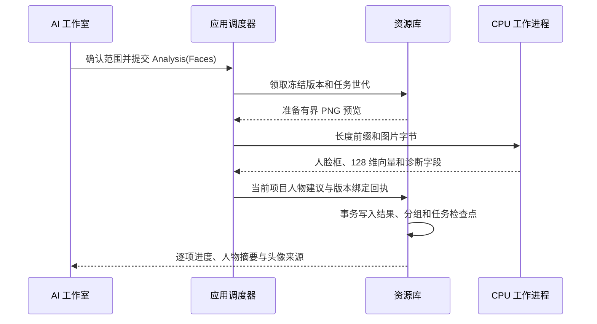

# 人脸识别流水线

> 当前默认流程为 YuNet + SFace CPU，按 2026-11-07 开发更新维护。旧 Qwen 人脸比较仅为兼容或诊断路径。

## 从入口到提交

库层不直接启动模型。`InferenceRunner` 由应用层持有，`LocalInference` 把 `ModelId::Faces` 派发给 CPU 运行器。工作进程启动前校验随构建嵌入的运行组件摘要。

## 原生处理与协议

[face-worker.cpp](../../../../crates/moriq-ai/native/face-worker.cpp) 使用 OpenCV CPU 后端执行 YuNet 检测、SFace 对齐及特征提取。小脸和模糊脸经过质量过滤，特征归一化后返回；不把衣服或背景当作人物特征。

[cpu_faces.rs](../../../../crates/moriq-ai/src/cpu_faces.rs) 通过标准输入、输出的长度前缀传递字节，图片路径不参与原生协议。输入、回执、人脸数量和特征维度有预算检查；取消或超时终止工作进程，迟到结果不提交。

## 分组、迁移与人工操作

- [analysis.rs](../../../../crates/moriq-library/src/ai/analysis.rs) 只在同一项目范围匹配代表向量，一张照片不会自动给两张检测分配同一个人物。
- 保存前读取旧检测，更新自动结果，保留人工命名、合并、纠正或取消归组。
- 从旧修订迁移时，先在该版本所有保留修订中预留序号，迁移检测与新增检测共用序号分配，避免唯一约束冲突暂停整批任务。
- 删除人物分组将已有检测设为 `person_id=NULL, manual=1`，再移除人物和代表向量，保留原照片与已完成分析记录。
- `ai_results` 保存模型身份及修订；`detected_faces`、`people`、`person_vectors` 分别保存检测、人物和代表向量。

## 头像与界面更新

[portraits.rs](../../../../crates/moriq-library/src/ai/portraits.rs) 从有效素材的当前展示版本选择代表人脸并裁剪头像。UI 保留在途头像批次，普通 Tick 和摘要刷新不会取消它；完成后补充新出现的人物，切换范围时作废旧请求。

人脸筛选图库在后台进度变化时合并刷新，保留旧布局与图片，等新布局和页面一起到达后提交。结果在整批结束前逐项显示。成功空人脸列表同样计入“已完成人脸分析”，不因此伪造内容分类。

## 生命周期与兼容路径

Qwen 与 CPU 运行器共用按需加载和批次租约。批次内复用进程，按需模式在最后一个租约释放后卸载；关闭库同时尝试停止两类运行器。

历史 `QwenFaces` 任务和 `llama_faces` 调用仍保留。当前 Qwen 卡片不创建人脸任务，CPU 人脸任务入队会处理同范围内旧的活动 Qwen 人脸任务。不要把兼容代码或旧示例当作当前默认工作流。

相关说明：[AI 工作室与人物整理](../../../AI%20工作室与人物整理.md)、[人脸识别 API](../../../API%20参考文档/Library%20层%20API/AI%20功能%20API/人脸识别%20API.md)。
