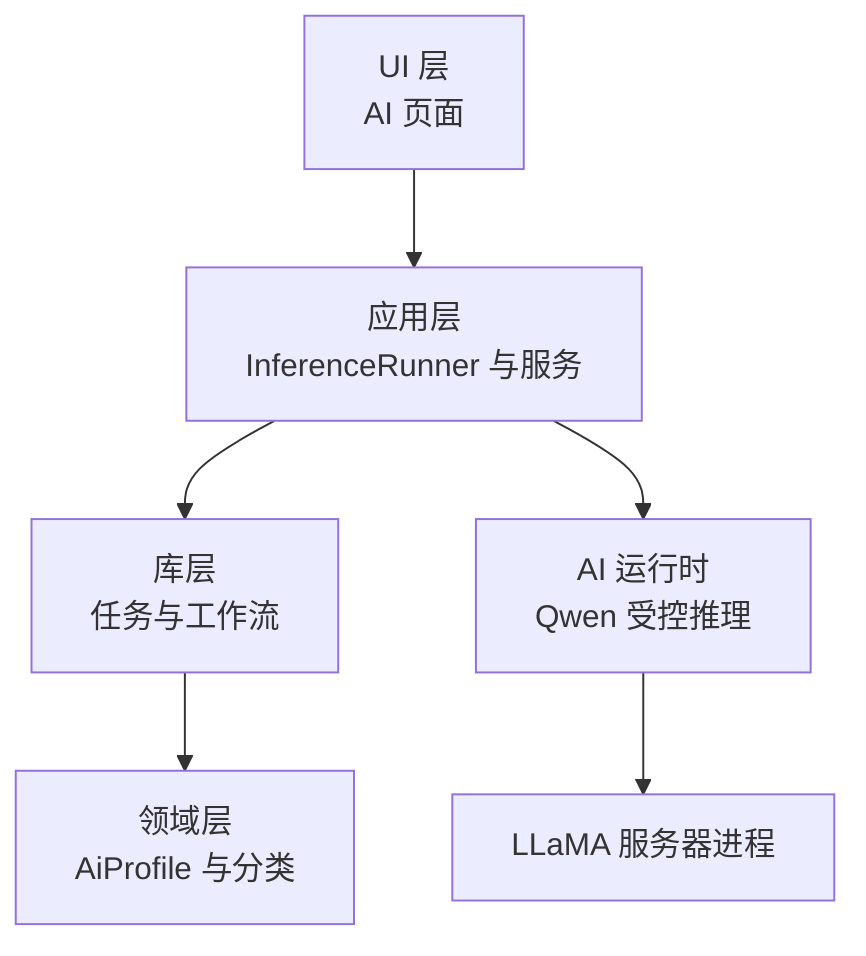
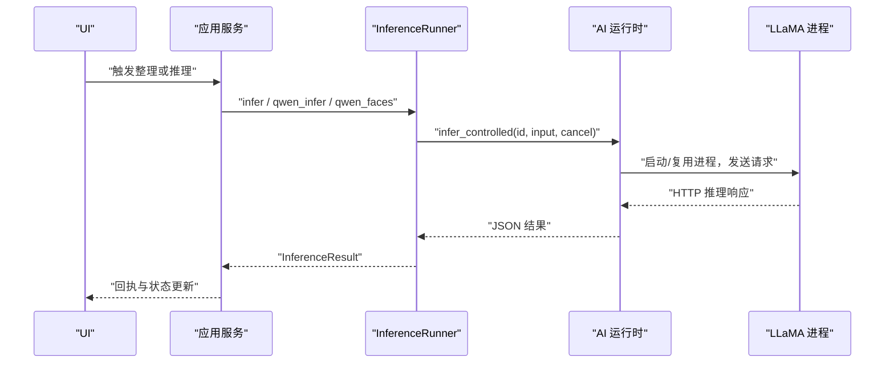
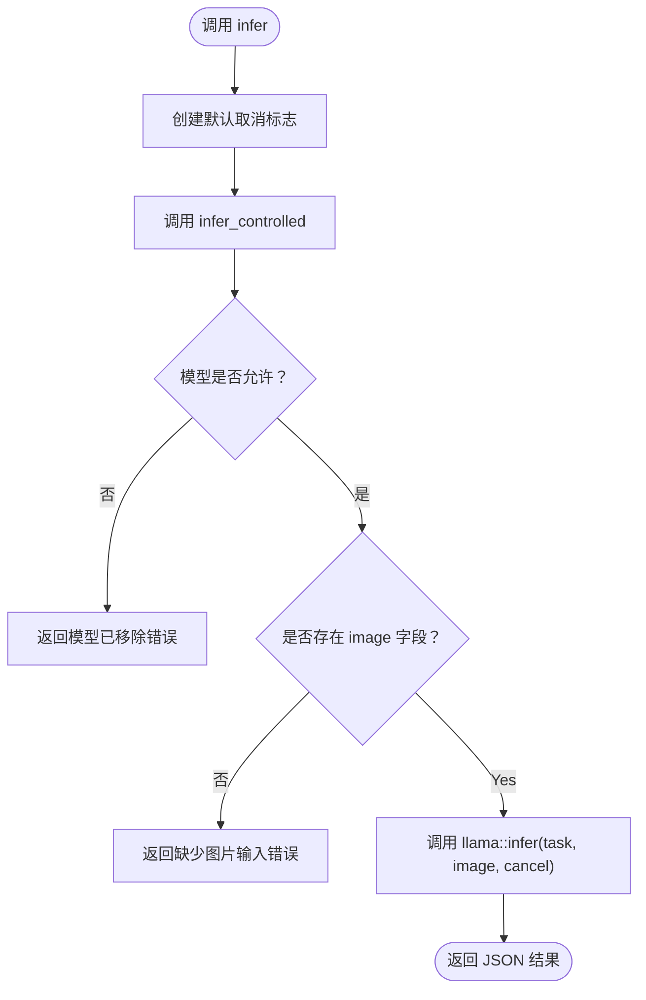
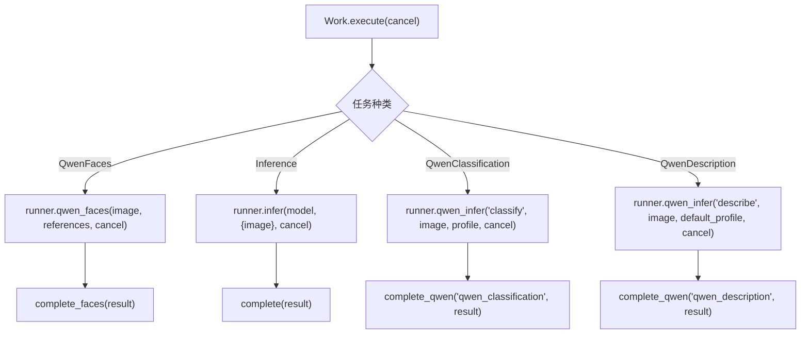
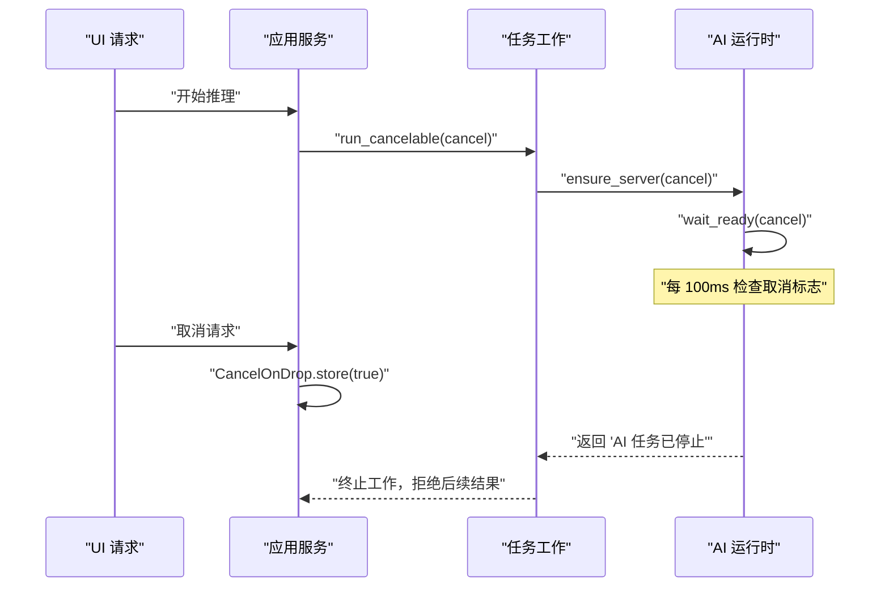
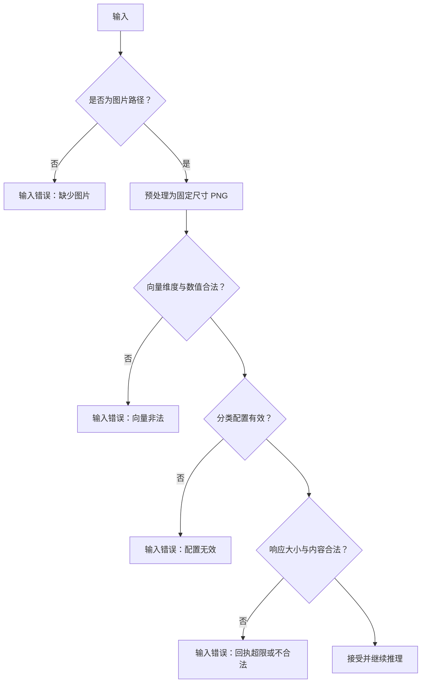
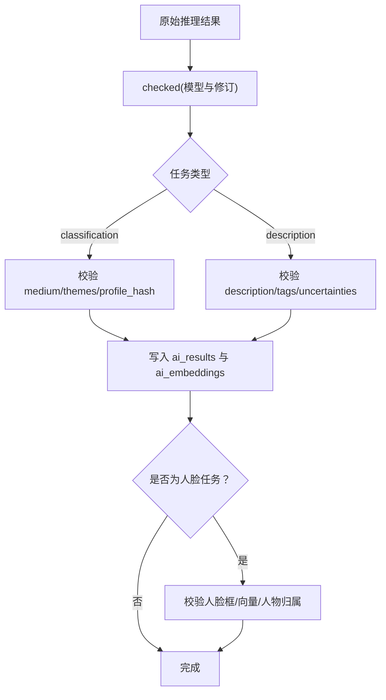
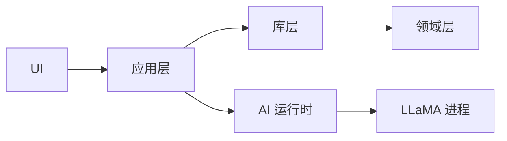

# 推理执行引擎

> Repo Wiki 节点 `inference-execution`
> 导出自 Qoder 知识库快照 `8fbe02f6-57c2-4874-b725-1a8130851fd9`，代码基线 `7a7a8e75e18bd90294e09cd422dd7ed5a04813a0`（分支 main，zh-CN）。

<cite>
**本文引用的文件**   
- [inference.rs](../../../../crates/moriq-app/src/inference.rs)
- [jobs.rs](../../../../crates/moriq-library/src/tasks/jobs.rs)
- [analysis.rs](../../../../crates/moriq-library/src/ai/analysis.rs)
- [qwen_faces.rs](../../../../crates/moriq-library/src/ai/qwen_faces.rs)
- [ai.rs](../../../../crates/moriq-domain/src/ai.rs)
- [lib.rs](../../../../crates/moriq-ai/src/lib.rs)
- [runtime.rs](../../../../crates/moriq-ai/src/runtime.rs)
- [llama.rs](../../../../crates/moriq-ai/src/llama.rs)
- [ai.rs](../../../../crates/moriq-ui/src/ai.rs)
- [inference_tests.rs](../../../../crates/moriq-app/src/inference_tests.rs)
</cite>

## 目录
1. [简介](#简介)
2. [项目结构](#项目结构)
3. [核心组件](#核心组件)
4. [架构总览](#架构总览)
5. [详细组件分析](#详细组件分析)
6. [依赖关系分析](#依赖关系分析)
7. [性能与监控](#性能与监控)
8. [故障排查](#故障排查)
9. [结论](#结论)

## 简介
本技术文档面向 AI 推理执行引擎，聚焦以下目标：
- 统一推理入口设计，明确 `infer` 与 `infer_controlled` 的区别、适用场景和取消语义。
- 说明任务分发机制，覆盖分类、描述、人脸比对等推理任务类型。
- 解释基于原子布尔标志的取消与优雅退出策略。
- 梳理输入验证规则，包括图片格式、尺寸、向量维度与安全边界。
- 描述推理结果标准化、数据转换及存储流程。
- 总结错误分类、重试与降级策略。
- 给出性能监控指标与调试方法。

## 项目结构
该工程采用多 crate 分层组织：
- 应用层负责模型运行器接口、任务编排与 UI 交互。
- 领域层定义稳定的 AI 分类配置与标签。
- 库层负责素材准备、结果校验、持久化与任务调度。
- AI 运行时层封装本地 Qwen 模型进程管理、请求控制与健康检查。
- UI 层负责触发批量整理、模型安装卸载及状态展示。

**图表来源**
- [inference.rs:1-100](../../../../crates/moriq-app/src/inference.rs#L1-L100)
- [jobs.rs:1-120](../../../../crates/moriq-library/src/tasks/jobs.rs#L1-L120)
- [ai.rs:1-120](../../../../crates/moriq-domain/src/ai.rs#L1-L120)
- [lib.rs:1-15](../../../../crates/moriq-ai/src/lib.rs#L1-L15)
- [runtime.rs:1-40](../../../../crates/moriq-ai/src/runtime.rs#L1-L40)
- [llama.rs:1-120](../../../../crates/moriq-ai/src/llama.rs#L1-L120)

**章节来源**
- [inference.rs:1-120](../../../../crates/moriq-app/src/inference.rs#L1-L120)
- [jobs.rs:1-120](../../../../crates/moriq-library/src/tasks/jobs.rs#L1-L120)
- [ai.rs:1-120](../../../../crates/moriq-domain/src/ai.rs#L1-L120)
- [lib.rs:1-15](../../../../crates/moriq-ai/src/lib.rs#L1-L15)

## 核心组件
- **InferenceRunner（应用层推理接口）**  
  提供统一推理门面，包括人脸推理、Qwen 分类/描述推理、通用模型推理、模型修订查询与可用性检查。本地实现通过调用底层 AI 运行时完成真实推理。

- **Work / Execution（库层任务与工作）**  
  将媒体读取、AI 分析、模型推理统一为可取消的工作；按冻结的任务种类分派到具体处理分支。

- **Analysis（库层分析与结果）**  
  负责图片预处理、Qwen 输出校验、向量归一化、结果合并与存储，并维护版本绑定与人工修正优先。

- **Runtime / Llama（AI 运行时与进程控制）**  
  暴露 `infer` 与 `infer_controlled`，封装 Qwen 进程启动、健康检查、请求超时、响应大小限制、内存预算与常驻策略。

- **Domain AiProfile（领域分类配置）**  
  定义媒介与主题分类、默认模板、校验规则与上下文预算约束。

- **UI（用户界面）**  
  触发批量整理、模型安装卸载、人物分组与分类保存，并消费推理回执更新视图。

**章节来源**
- [inference.rs:1-120](../../../../crates/moriq-app/src/inference.rs#L1-L120)
- [jobs.rs:1-200](../../../../crates/moriq-library/src/tasks/jobs.rs#L1-L200)
- [analysis.rs:1-200](../../../../crates/moriq-library/src/ai/analysis.rs#L1-L200)
- [lib.rs:1-15](../../../../crates/moriq-ai/src/lib.rs#L1-L15)
- [runtime.rs:1-40](../../../../crates/moriq-ai/src/runtime.rs#L1-L40)
- [ai.rs:1-120](../../../../crates/moriq-domain/src/ai.rs#L1-L120)
- [ai.rs:201-400](../../../../crates/moriq-ui/src/ai.rs#L201-L400)

## 架构总览
推理执行从 UI 或应用服务发起，经过任务调度、工作准备、模型运行器调用，最终返回标准化结果。

**图表来源**
- [inference.rs:1-120](../../../../crates/moriq-app/src/inference.rs#L1-L120)
- [runtime.rs:1-40](../../../../crates/moriq-ai/src/runtime.rs#L1-L40)
- [llama.rs:201-450](../../../../crates/moriq-ai/src/llama.rs#L201-L450)

## 详细组件分析

### 统一推理入口：infer 与 infer_controlled
- **infer**  
  便捷入口，内部创建默认未设置的取消标志，适合无需外部中断控制的简单调用。
- **infer_controlled**  
  受控入口，显式接收 `AtomicBool` 取消标志，进行模型白名单校验、输入字段校验后调用底层推理。适用于长时间推理、需要取消与优雅退出的场景。

两者差异：
| 维度 | infer | infer_controlled |
| --- | --- | --- |
| 取消支持 | 无外部取消标志 | 支持外部 AtomicBool |
| 输入校验 | 直接委托给受控入口 | 校验模型 ID 与 image 字段 |
| 使用场景 | 一次性、不可取消推理 | 后台任务、UI 请求、批处理 |
| 错误语义 | 字符串错误 | 字符串错误，包含模型退役、输入缺失等 |

**图表来源**
- [lib.rs:1-15](../../../../crates/moriq-ai/src/lib.rs#L1-L15)
- [runtime.rs:1-40](../../../../crates/moriq-ai/src/runtime.rs#L1-L40)

**章节来源**
- [lib.rs:1-15](../../../../crates/moriq-ai/src/lib.rs#L1-L15)
- [runtime.rs:1-40](../../../../crates/moriq-ai/src/runtime.rs#L1-L40)

### 任务类型分发机制
应用层根据工作种类分发到不同推理路径：
- **人脸推理**：`Execution::QwenFaces`  
  先准备人脸参考资料，再调用 `runner.qwen_faces`，最后封装为带模型身份的回执。
- **通用模型推理**：`Execution::Inference`  
  构造 `{image}` 输入，调用 `runner.infer`，用于 CLIP 等向量化任务。
- **Qwen 分类**：`Execution::QwenClassification`  
  以 `classify` 任务调用 `runner.qwen_infer`，并使用当前分类配置。
- **Qwen 描述**：`Execution::QwenDescription`  
  以 `describe` 任务调用 `runner.qwen_infer`，使用默认分类配置。

**图表来源**
- [inference.rs:100-200](../../../../crates/moriq-app/src/inference.rs#L100-L200)
- [jobs.rs:120-200](../../../../crates/moriq-library/src/tasks/jobs.rs#L120-L200)

**章节来源**
- [inference.rs:100-200](../../../../crates/moriq-app/src/inference.rs#L100-L200)
- [jobs.rs:120-200](../../../../crates/moriq-library/src/tasks/jobs.rs#L120-L200)

### 取消标志与优雅退出
取消机制贯穿整个推理链路：
- **应用层 CancelOnDrop**：当 UI 请求 Future 被丢弃时设置取消标志，阻止后台推理继续发布结果。
- **服务层 inference_cancel**：为当前库登记取消令牌，切库或销毁时可统一停止。
- **任务层 run_cancelable**：进入取消作用域，并在各阶段检查取消标志。
- **运行时层 ensure_server/wait_ready/request_controlled**：在健康检查、进程获取与 HTTP 请求循环中周期性检查取消，立即释放所属进程并返回“任务已停止”。

**图表来源**
- [inference.rs:120-200](../../../../crates/moriq-app/src/inference.rs#L120-L200)
- [jobs.rs:1-120](../../../../crates/moriq-library/src/tasks/jobs.rs#L1-L120)
- [llama.rs:201-300](../../../../crates/moriq-ai/src/llama.rs#L201-L300)

**章节来源**
- [inference.rs:120-200](../../../../crates/moriq-app/src/inference.rs#L120-L200)
- [jobs.rs:1-120](../../../../crates/moriq-library/src/tasks/jobs.rs#L1-L120)
- [llama.rs:201-300](../../../../crates/moriq-ai/src/llama.rs#L201-L300)

### 输入验证规则
系统对图片、向量、提示词与回执进行严格校验：
- **图片输入**  
  - Qwen 推理要求 request 中包含 `image` 字段且为字符串路径。
  - 预处理生成固定尺寸的 PNG，便于稳定推理。
- **向量输入**  
  - 向量维度非空且不超过上限，元素必须为有限浮点数，归一化为单位向量。
  - 字节编码长度需匹配解码逻辑。
- **分类配置**  
  - 启用主题数量上限、定义总长度上限、类别总数上限。
  - ID 合法性、唯一性、标签不重复、名称与说明长度限制。
- **安全边界**  
  - 响应最大字节数限制。
  - 回执大小限制。
  - 人脸框坐标范围与面积合法性。
  - 模型白名单仅允许当前支持的模型。

**图表来源**
- [runtime.rs:1-40](../../../../crates/moriq-ai/src/runtime.rs#L1-L40)
- [analysis.rs:1-200](../../../../crates/moriq-library/src/ai/analysis.rs#L1-L200)
- [ai.rs:1-120](../../../../crates/moriq-domain/src/ai.rs#L1-L120)
- [qwen_faces.rs:1-120](../../../../crates/moriq-library/src/ai/qwen_faces.rs#L1-L120)

**章节来源**
- [runtime.rs:1-40](../../../../crates/moriq-ai/src/runtime.rs#L1-L40)
- [analysis.rs:1-200](../../../../crates/moriq-library/src/ai/analysis.rs#L1-L200)
- [ai.rs:1-120](../../../../crates/moriq-domain/src/ai.rs#L1-L120)
- [qwen_faces.rs:1-120](../../../../crates/moriq-library/src/ai/qwen_faces.rs#L1-L120)

### 推理结果标准化与数据转换
标准化流程确保下游存储与检索一致：
- **InferenceResult 检查**：核对模型身份与修订，拒绝不一致结果。
- **Qwen 输出规范化**：按任务类型校验 medium、themes、description、tags、uncertainties，并附加配置摘要。
- **CLIP 向量处理**：将 text_vector 或 image_vector 归一化为单位向量，写入检索索引。
- **人脸结果处理**：校验人脸框与向量，维持人工修正优先，重建人物代表向量。
- **结果合并**：同版本、同模型、同预处理条件下，新结果覆盖旧结果，保留人工分类。

**图表来源**
- [analysis.rs:1-200](../../../../crates/moriq-library/src/ai/analysis.rs#L1-L200)
- [analysis.rs:201-602](../../../../crates/moriq-library/src/ai/analysis.rs#L201-L602)
- [qwen_faces.rs:1-200](../../../../crates/moriq-library/src/ai/qwen_faces.rs#L1-L200)

**章节来源**
- [analysis.rs:1-200](../../../../crates/moriq-library/src/ai/analysis.rs#L1-L200)
- [analysis.rs:201-602](../../../../crates/moriq-library/src/ai/analysis.rs#L201-L602)
- [qwen_faces.rs:1-200](../../../../crates/moriq-library/src/ai/qwen_faces.rs#L1-L200)

### 错误分类、重试与降级策略
- **错误分类**  
  - 输入错误：缺少图片、向量维度非法、分类配置无效、人脸框越界。
  - 运行时错误：模型未安装、模型已退役、进程启动失败、健康检查超时。
  - 网络错误：HTTP 状态码非成功、响应过大、连接异常。
  - 取消错误：用户主动取消、UI 请求丢弃。
  - 存储错误：数据库写入失败、回执过大。
- **重试机制**  
  - 健康检查循环等待模型服务就绪。
  - 进程存活检测与失效实例替换。
  - 线程锁竞争时的短暂休眠与重试。
- **降级策略**  
  - 禁用常驻模式时自动释放空闲模型服务。
  - 内存不足时拒绝启动模型服务。
  - 分类配置校验失败时拒绝推理，避免污染上下文预算。

**章节来源**
- [runtime.rs:1-40](../../../../crates/moriq-ai/src/runtime.rs#L1-L40)
- [llama.rs:201-450](../../../../crates/moriq-ai/src/llama.rs#L201-L450)
- [analysis.rs:1-200](../../../../crates/moriq-library/src/ai/analysis.rs#L1-L200)

## 依赖关系分析
- **应用层依赖库层**：InferenceRunner 调用库层的工作与结果处理。
- **库层依赖领域层**：AiProfile 与分类常量决定提示词与校验规则。
- **AI 运行时依赖进程管理**：llama.cpp 子进程、端口分配、鉴权密钥与环境隔离。
- **UI 依赖应用层**：触发任务队列、模型安装卸载、人物管理与分类保存。

**图表来源**
- [inference.rs:1-200](../../../../crates/moriq-app/src/inference.rs#L1-L200)
- [jobs.rs:1-200](../../../../crates/moriq-library/src/tasks/jobs.rs#L1-L200)
- [ai.rs:1-120](../../../../crates/moriq-domain/src/ai.rs#L1-L120)
- [lib.rs:1-15](../../../../crates/moriq-ai/src/lib.rs#L1-L15)
- [llama.rs:1-120](../../../../crates/moriq-ai/src/llama.rs#L1-L120)

**章节来源**
- [inference.rs:1-200](../../../../crates/moriq-app/src/inference.rs#L1-L200)
- [jobs.rs:1-200](../../../../crates/moriq-library/src/tasks/jobs.rs#L1-L200)
- [ai.rs:1-120](../../../../crates/moriq-domain/src/ai.rs#L1-L120)
- [lib.rs:1-15](../../../../crates/moriq-ai/src/lib.rs#L1-L15)
- [llama.rs:1-120](../../../../crates/moriq-ai/src/llama.rs#L1-L120)

## 性能与监控
关键性能指标与监控点：
- **进程生命周期**  
  - 启动耗时：健康检查超时阈值。
  - 进程存活：try_wait 检测退出。
  - 常驻策略：set_keep_loaded 控制是否释放空闲实例。
- **请求性能**  
  - 请求超时：HTTP 请求最长等待时间。
  - 响应大小：最大响应字节限制。
  - 线程池：逻辑 CPU 数量的一半作为线程数，上下限钳制。
- **资源预算**  
  - 可用内存最低门槛。
  - 缓存 RAM 与图像 token 上限。
  - 向量维度与回执大小限制。
- **调试工具**  
  - 诊断文件：子进程标准输出重定向至临时文件，便于失败时读取尾部日志。
  - 测试用例：FakeRunner 模拟推理过程，验证取消与隔离行为。

建议监控项：
| 指标 | 含义 | 观测方式 |
| --- | --- | --- |
| 健康检查延迟 | 模型服务启动速度 | 健康检查循环耗时 |
| 请求平均耗时 | 单次推理效率 | HTTP 请求起止时间 |
| 响应大小分布 | 回执稳定性 | 响应长度统计 |
| 取消率 | 用户主动中断比例 | 取消标志设置次数 |
| 进程重启次数 | 运行器稳定性 | try_wait 退出计数 |
| 内存占用峰值 | 资源压力 | 可用内存检查 |

**章节来源**
- [llama.rs:201-450](../../../../crates/moriq-ai/src/llama.rs#L201-L450)
- [inference_tests.rs:1-200](../../../../crates/moriq-app/src/inference_tests.rs#L1-L200)

## 故障排查
常见问题与定位方法：
- **模型已退役或不可用**  
  - 现象：推理直接返回模型已移除或未安装。
  - 排查：确认模型清单与已安装路径，重新安装所需模型。
- **图片输入缺失或损坏**  
  - 现象：缺少 image 字段或图片无法解码。
  - 排查：检查预处理生成的 PNG 路径与可读性。
- **向量维度非法**  
  - 现象：向量为空、过长或含非有限值。
  - 排查：检查上游文本或图像向量化模块输出。
- **分类配置无效**  
  - 现象：启用主题过多、定义过长或 ID 不合法。
  - 排查：使用 AiProfile.validate 校验配置。
- **人脸框越界或重复**  
  - 现象：人脸位置超出 [0,1] 范围或重叠度过高。
  - 排查：检查人脸检测结果与裁剪逻辑。
- **进程启动失败**  
  - 现象：健康检查超时或子进程退出。
  - 排查：查看诊断文件尾部日志，检查内存与端口占用。

**章节来源**
- [runtime.rs:1-40](../../../../crates/moriq-ai/src/runtime.rs#L1-L40)
- [analysis.rs:1-200](../../../../crates/moriq-library/src/ai/analysis.rs#L1-L200)
- [qwen_faces.rs:1-200](../../../../crates/moriq-library/src/ai/qwen_faces.rs#L1-L200)
- [llama.rs:201-450](../../../../crates/moriq-ai/src/llama.rs#L201-L450)

## 结论
该推理执行引擎通过统一接口、严格校验、可控进程与强取消语义，实现了稳定、可观测、可回滚的 AI 推理流程。应用层抽象出 InferenceRunner，屏蔽底层运行时细节；库层保证结果标准化与持久化一致性；领域层提供稳定分类契约；运行时层保障进程健康与资源安全。配合 UI 层的任务编排与调试工具，系统能够在复杂业务场景中提供可靠的人脸识别、分类与描述能力。