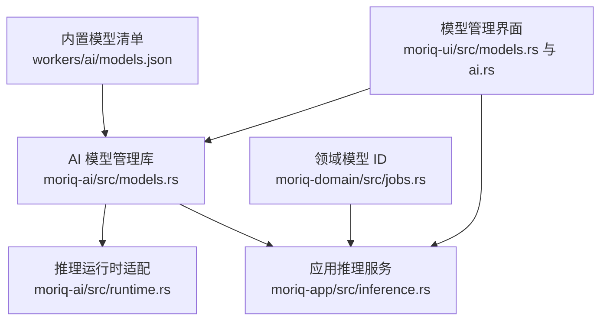
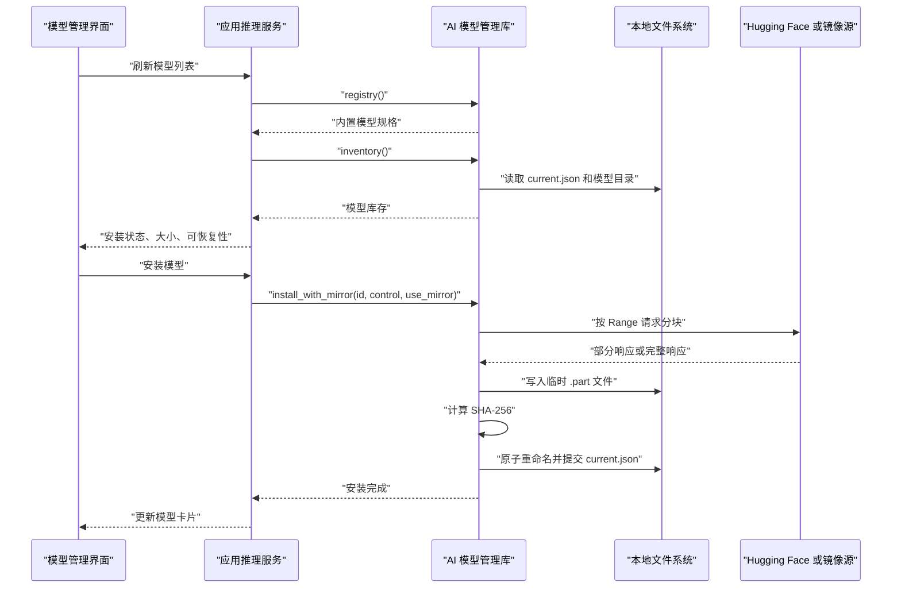
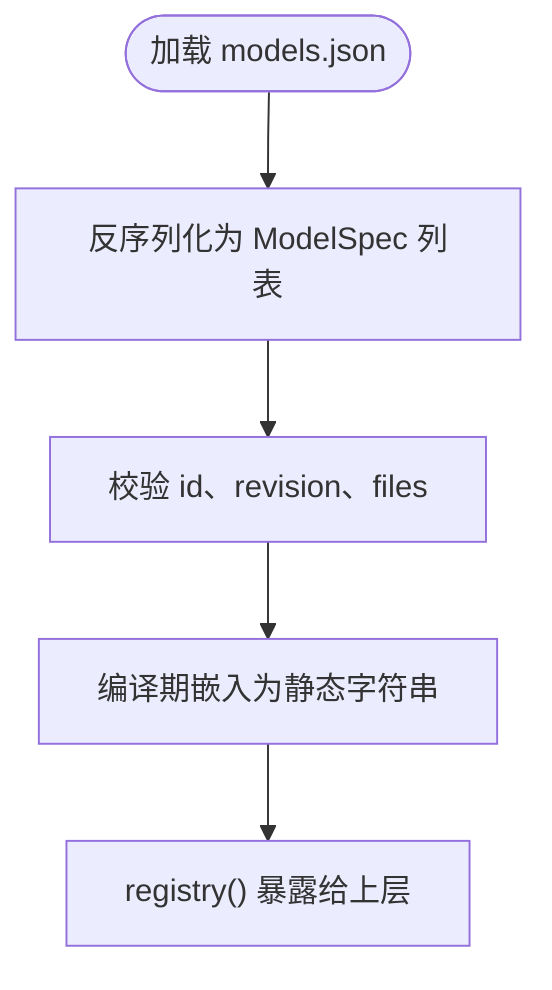
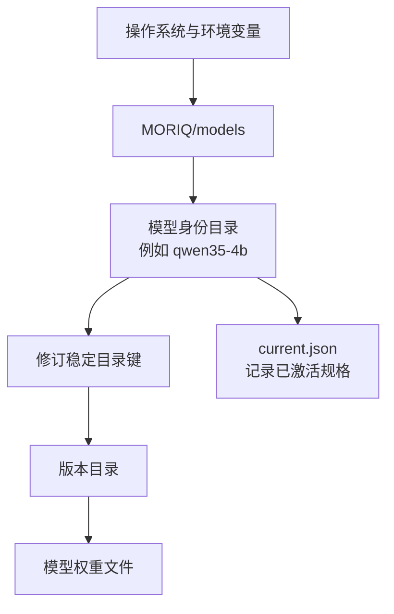
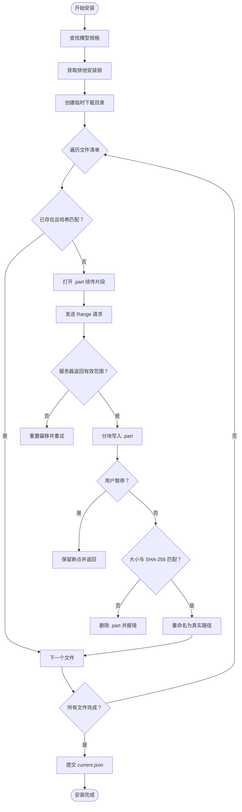
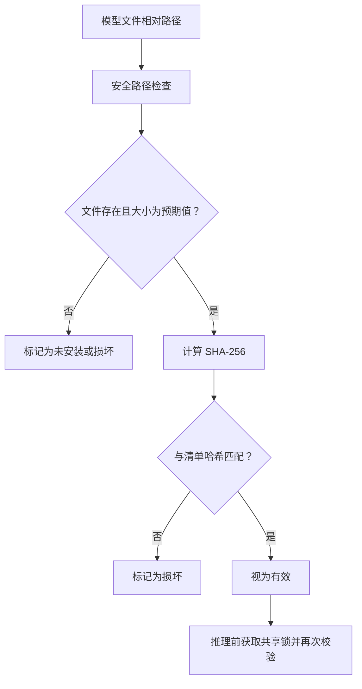
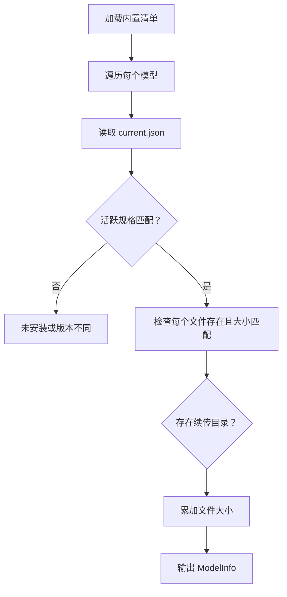
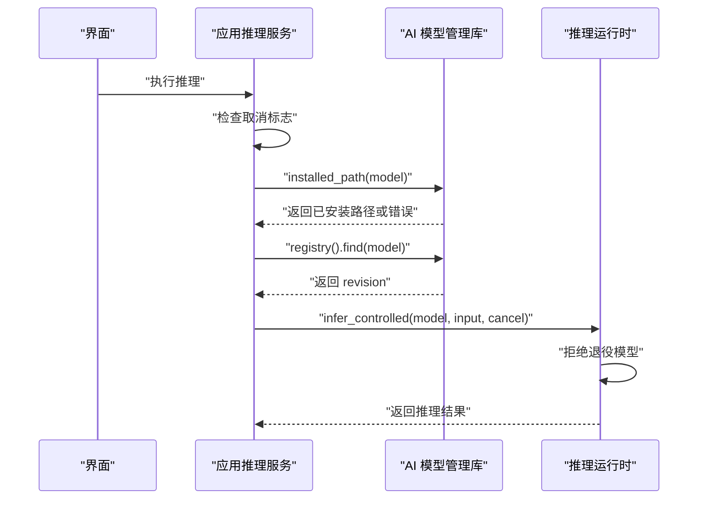
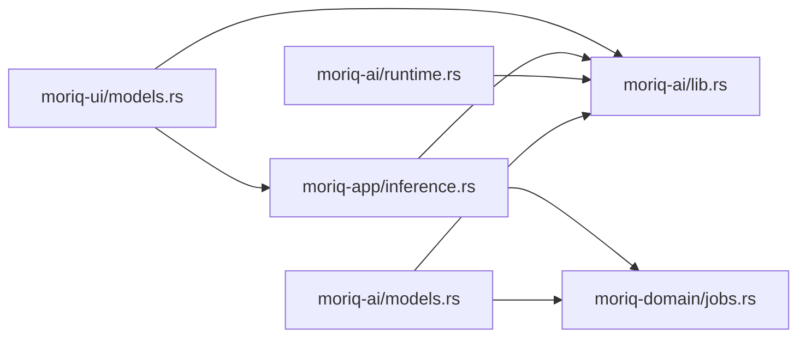

# 模型管理与下载

> Repo Wiki 节点 `model-management`
> 导出自 Qoder 知识库快照 `8fbe02f6-57c2-4874-b725-1a8130851fd9`，代码基线 `7a7a8e75e18bd90294e09cd422dd7ed5a04813a0`（分支 main，zh-CN）。

<cite>
**本文引用的文件**   
- [workers/ai/models.json](../../../../workers/ai/models.json)
- [crates/moriq-ai/src/models.rs](../../../../crates/moriq-ai/src/models.rs)
- [crates/moriq-ai/src/lib.rs](../../../../crates/moriq-ai/src/lib.rs)
- [crates/moriq-ai/src/runtime.rs](../../../../crates/moriq-ai/src/runtime.rs)
- [crates/moriq-domain/src/jobs.rs](../../../../crates/moriq-domain/src/jobs.rs)
- [crates/moriq-app/src/inference.rs](../../../../crates/moriq-app/src/inference.rs)
- [crates/moriq-ui/src/ai.rs](../../../../crates/moriq-ui/src/ai.rs)
- [crates/moriq-ui/src/models.rs](../../../../crates/moriq-ui/src/models.rs)
</cite>

## 目录
1. [简介](#简介)
2. [项目结构](#项目结构)
3. [核心组件](#核心组件)
4. [架构总览](#架构总览)
5. [详细组件分析](#详细组件分析)
6. [依赖关系分析](#依赖关系分析)
7. [性能与资源特性](#性能与资源特性)
8. [故障排除指南](#故障排除指南)
9. [结论](#结论)
10. [附录：模型清单示例与最佳实践](#附录模型清单示例与最佳实践)

## 简介
本文件系统性地说明 Moriq Space AI 的模型管理机制，重点覆盖以下方面：
- 模型注册表 `models.json` 的结构、解析方式、版本锁定和文件清单。
- 模型安装流程：从模型根目录定位到用户数据目录，再到分块下载、断点续传、SHA-256 校验和安全路径检查。
- 模型库存查询如何展示安装状态、文件大小、可恢复性和完整性。
- 卸载、升级和损坏修复的实现逻辑。
- 推理前安全校验以及模型运行时入口。
- 面向用户的配置示例与常见问题排查建议。

## 项目结构
本项目中与模型管理直接相关的代码分布在四个层次：
- 数据定义层：内置模型清单以 JSON 形式嵌入，由 Rust 编译期读取。
- AI 库层：负责模型规格解析、目录定位、安装、卸载、库存查询和下载控制。
- 应用服务层：将模型可用性与本地推理执行绑定，并在任务调度中统一取消和资源预算。
- 用户界面层：展示模型列表、安装进度、来源切换、卸载和设置。

**图表来源**
- [crates/moriq-ai/src/models.rs:1-68](../../../../crates/moriq-ai/src/models.rs#L1-L68)
- [crates/moriq-ai/src/runtime.rs:1-82](../../../../crates/moriq-ai/src/runtime.rs#L1-L82)
- [crates/moriq-app/src/inference.rs:1-200](../../../../crates/moriq-app/src/inference.rs#L1-L200)
- [crates/moriq-ui/src/models.rs:1-200](../../../../crates/moriq-ui/src/models.rs#L1-L200)
- [crates/moriq-domain/src/jobs.rs:1-85](../../../../crates/moriq-domain/src/jobs.rs#L1-L85)

**章节来源**
- [crates/moriq-ai/src/lib.rs:1-15](../../../../crates/moriq-ai/src/lib.rs#L1-L15)
- [crates/moriq-ai/src/models.rs:1-68](../../../../crates/moriq-ai/src/models.rs#L1-L68)

## 核心组件
本节聚焦模型管理的核心数据结构与关键函数，不展开完整实现细节，而是给出职责边界与调用关系。

| 名称 | 职责 | 主要行为 |
|---|---|---|
| `ModelSpec` | 描述一个固定版本的模型 | 包含模型身份、名称、修订号、许可、最低内存要求和文件清单 |
| `ModelFile` | 描述模型中的一个权重或辅助文件 | 包含相对路径、下载地址、预期字节数和 SHA-256 |
| `ModelInfo` | 面向界面的模型摘要 | 暴露是否已安装、是否支持续传、总大小和底层规格 |
| `DownloadControl` | 控制下载生命周期 | 提供停止信号、已下载字节数与总字节数 |
| `registry()` | 加载内置模型清单 | 从编译期嵌入的 JSON 反序列化为 `ModelSpec` 列表 |
| `model_root()` | 定位用户模型根目录 | Windows 使用 `APPDATA`，macOS 使用 `Library/Application Support`，其他平台优先 `XDG_DATA_HOME` |
| `inventory()` | 构建模型库存 | 返回每个模型的规格、安装状态、可恢复性和总大小 |
| `install_with_mirror()` | 安装模型 | 分块下载、续传、范围响应校验、SHA-256 校验、原子提交 |
| `installed_path()` | 验证并返回已安装模型目录 | 检查修订、目录、文件存在性、大小和哈希 |
| `uninstall()` | 卸载模型 | 释放锁、清理当前版本标识、删除目标版本和下载目录 |
| `verified_lease()` | 推理前加锁并再次校验 | 阻止并发安装/卸载，再次校验所有文件哈希 |

**章节来源**
- [crates/moriq-ai/src/models.rs:1-68](../../../../crates/moriq-ai/src/models.rs#L1-L68)
- [crates/moriq-ai/src/models.rs:69-120](../../../../crates/moriq-ai/src/models.rs#L69-L120)
- [crates/moriq-ai/src/models.rs:201-589](../../../../crates/moriq-ai/src/models.rs#L201-L589)
- [crates/moriq-ai/src/lib.rs:1-15](../../../../crates/moriq-ai/src/lib.rs#L1-L15)

## 架构总览
模型管理是一个“声明式清单 + 受控安装 + 运行时校验”的系统。

**图表来源**
- [crates/moriq-ui/src/ai.rs:375-421](../../../../crates/moriq-ui/src/ai.rs#L375-L421)
- [crates/moriq-app/src/inference.rs:1-200](../../../../crates/moriq-app/src/inference.rs#L1-L200)
- [crates/moriq-ai/src/models.rs:201-589](../../../../crates/moriq-ai/src/models.rs#L201-L589)

## 详细组件分析

### 模型注册表与规格定义
模型注册表位于编译期嵌入位置，通过 Rust 字符串包含机制加载。它采用数组形式列出模型规格，每个规格包含：
- `id`：模型稳定身份，例如 `qwen35-4b`。
- `name`：显示名称，例如 `Qwen3.5-4B`。
- `revision`：上游仓库修订号，用于生成稳定目录键。
- `license`：许可证名称。
- `minimum_memory_mib`：模型所需的最低内存提示。
- `files`：文件清单，每项包括相对路径、下载地址、字节数和 SHA-256。

当前注册表中仅登记 Qwen3.5-4B，包含量化 GGUF 主权重和 F16 视觉投影权重两个文件。

**图表来源**
- [workers/ai/models.json:1-24](../../../../workers/ai/models.json#L1-L24)
- [crates/moriq-ai/src/models.rs:61-68](../../../../crates/moriq-ai/src/models.rs#L61-L68)

**章节来源**
- [workers/ai/models.json:1-24](../../../../workers/ai/models.json#L1-L24)
- [crates/moriq-ai/src/models.rs:1-68](../../../../crates/moriq-ai/src/models.rs#L1-L68)

### 模型目录定位与版本隔离
模型根目录由操作系统环境变量决定：
- Windows：`APPDATA/MORIQ/models`。
- macOS：`$HOME/Library/Application Support/MORIQ/models`。
- 其他平台：优先 `XDG_DATA_HOME/MORIQ/models`，否则回退到 `$HOME/.local/share/MORIQ/models`。

每个模型有一个身份目录，例如 `qwen35-4b`；其内部又按修订生成稳定子目录键。该键由 `revision` 的 SHA-256 前 24 个十六进制字符构成，使同一模型的不同修订可以共存且可追溯。

**图表来源**
- [crates/moriq-ai/src/models.rs:69-120](../../../../crates/moriq-ai/src/models.rs#L69-L120)

**章节来源**
- [crates/moriq-ai/src/models.rs:69-120](../../../../crates/moriq-ai/src/models.rs#L69-L120)

### 安装流程与断点续传
安装过程是安全的、幂等的，并且对失败具有较强恢复能力。

核心步骤如下：
1. 根据模型身份查找 `ModelSpec`。
2. 创建模型根目录和排他锁 `install.lock`。
3. 创建临时下载目录 `.download-<revision-key>`。
4. 初始化下载控制对象：总大小和各文件偏移。
5. 构建 HTTP 客户端，限制重定向目标域名。
6. 遍历文件清单，逐个处理：
   - 如果目标文件已存在且 SHA-256 匹配，则跳过。
   - 否则打开 `<文件名>.part` 作为续传片段。
   - 使用 `Range` 头发起范围请求。
   - 校验服务器返回的 `Content-Range`。
   - 分块写入临时文件，同时更新 `DownloadControl.downloaded`。
   - 支持暂停：检测到停止信号后保留断点并返回错误。
   - 下载完成后校验最终大小和 SHA-256。
   - 成功时重命名为真实目标路径。
7. 所有文件成功后，将版本目录重命名为正式版本目录。
8. 原子写入 `current.json`，记录当前激活的模型规格。

**图表来源**
- [crates/moriq-ai/src/models.rs:201-589](../../../../crates/moriq-ai/src/models.rs#L201-L589)

**章节来源**
- [crates/moriq-ai/src/models.rs:201-589](../../../../crates/moriq-ai/src/models.rs#L201-L589)

### 安全路径与完整性校验
系统对模型文件路径和完整性做了多层保护：
- **安全路径检查**：只允许普通路径组件，拒绝反斜杠、空路径和越界组件。
- **大小预检**：先比较文件大小是否与清单一致，避免对大文件重复哈希。
- **SHA-256 校验**：使用 64KB 缓冲区流式计算哈希。
- **缓存优化**：对已校验文件做元数据与哈希缓存，避免反复扫描多 GB 权重。
- **推理前租约校验**：推理前获取共享锁，再次规范化路径并逐文件校验哈希，防止并发替换。

**图表来源**
- [crates/moriq-ai/src/models.rs:69-120](../../../../crates/moriq-ai/src/models.rs#L69-L120)
- [crates/moriq-ai/src/models.rs:201-250](../../../../crates/moriq-ai/src/models.rs#L201-L250)

**章节来源**
- [crates/moriq-ai/src/models.rs:69-120](../../../../crates/moriq-ai/src/models.rs#L69-L120)
- [crates/moriq-ai/src/models.rs:201-250](../../../../crates/moriq-ai/src/models.rs#L201-L250)

### 模型库存查询
`inventory()` 会遍历内置模型清单，并为每个模型构造 `ModelInfo`：
- `spec`：底层模型规格。
- `installed`：当前 `current.json` 中的 `id` 和 `revision` 与清单一致，并且所有文件都存在且大小正确。
- `resumable`：是否存在 `.download-<revision-key>` 目录，表示有未完成下载。
- `bytes`：清单中所有文件字节数之和。

注意：库存查询不会主动对多 GB 权重进行哈希计算，只检查文件和大小；实际完整性在发布 `current.json` 前和推理前验证。

**图表来源**
- [crates/moriq-ai/src/models.rs:100-140](../../../../crates/moriq-ai/src/models.rs#L100-L140)

**章节来源**
- [crates/moriq-ai/src/models.rs:100-140](../../../../crates/moriq-ai/src/models.rs#L100-L140)

### 卸载、升级与损坏修复
- **卸载**：
  - 先调用运行时卸载。
  - 定位模型根目录并校验根目录确实属于 `MORIQ/models`。
  - 获取排他锁，防止卸载与安装冲突。
  - 删除 `current.json`。
  - 仅删除与当前模型相关的版本目录和对应下载目录，忽略无关目录。
- **升级**：
  - 升级不是原地覆盖，而是安装新修订，再原子提交新的 `current.json`。
  - 如果已有目标版本目录但不完整，安装会要求卸载后重新安装。
- **损坏修复**：
  - 若 `installed_path()` 发现文件缺失或哈希不一致，会返回错误，引导用户重新安装。
  - 若下载中断，`.part` 文件保留，界面应显示“继续安装”。

**章节来源**
- [crates/moriq-ai/src/models.rs:500-589](../../../../crates/moriq-ai/src/models.rs#L500-L589)
- [crates/moriq-ai/src/models.rs:140-200](../../../../crates/moriq-ai/src/models.rs#L140-L200)

### 推理前校验与运行时入口
推理链路在应用层先检查模型可用性，再进入 AI 库的受限推理入口：
1. 应用层通过 `LocalInference::ready()` 调用 `installed_path()`，确保模型已完整安装。
2. 应用层通过 `revision()` 从 `registry()` 读取固定修订。
3. AI 运行时层拒绝已退役模型，例如非 `qwen35-4b` 的请求会被拒绝。
4. 推理前可调用 `verified_lease()` 获取共享锁并再次校验文件哈希，避免运行期间被卸载或替换。

**图表来源**
- [crates/moriq-app/src/inference.rs:1-200](../../../../crates/moriq-app/src/inference.rs#L1-L200)
- [crates/moriq-ai/src/runtime.rs:1-82](../../../../crates/moriq-ai/src/runtime.rs#L1-L82)
- [crates/moriq-ai/src/models.rs:201-250](../../../../crates/moriq-ai/src/models.rs#L201-L250)

**章节来源**
- [crates/moriq-app/src/inference.rs:1-200](../../../../crates/moriq-app/src/inference.rs#L1-L200)
- [crates/moriq-ai/src/runtime.rs:1-82](../../../../crates/moriq-ai/src/runtime.rs#L1-L82)
- [crates/moriq-ai/src/models.rs:201-250](../../../../crates/moriq-ai/src/models.rs#L201-L250)

### 用户界面与交互
界面层负责：
- 展示模型分类、搜索和筛选。
- 显示已安装、未安装、可恢复等状态。
- 提供安装、继续安装、卸载、刷新和切换下载源的操作。
- 控制按需加载模式和索引策略。

典型交互：
- 点击“安装模型”时，界面创建 `DownloadControl` 并调用服务层安装接口。
- 下载失败后显示“继续安装”，并保留断点。
- 卸载后清除当前激活模型，但可选择保留索引。

**章节来源**
- [crates/moriq-ui/src/models.rs:1-200](../../../../crates/moriq-ui/src/models.rs#L1-L200)
- [crates/moriq-ui/src/ai.rs:329-421](../../../../crates/moriq-ui/src/ai.rs#L329-L421)

## 依赖关系分析
模型管理涉及多个模块之间的耦合：

- `moriq-ai` 是模型管理和推理的核心库。
- `moriq-app` 把模型可用性与任务执行绑定。
- `moriq-ui` 提供可视化操作。
- `moriq-domain` 提供稳定的模型身份枚举和任务类型。

**图表来源**
- [crates/moriq-ai/src/lib.rs:1-15](../../../../crates/moriq-ai/src/lib.rs#L1-L15)
- [crates/moriq-app/src/inference.rs:1-200](../../../../crates/moriq-app/src/inference.rs#L1-L200)
- [crates/moriq-domain/src/jobs.rs:1-85](../../../../crates/moriq-domain/src/jobs.rs#L1-L85)
- [crates/moriq-ui/src/models.rs:1-200](../../../../crates/moriq-ui/src/models.rs#L1-L200)

**章节来源**
- [crates/moriq-ai/src/lib.rs:1-15](../../../../crates/moriq-ai/src/lib.rs#L1-L15)
- [crates/moriq-app/src/inference.rs:1-200](../../../../crates/moriq-app/src/inference.rs#L1-L200)
- [crates/moriq-domain/src/jobs.rs:1-85](../../../../crates/moriq-domain/src/jobs.rs#L1-L85)

## 性能与资源特性
- **分块下载**：每次请求最多约 8MB 范围，降低单次网络缓冲压力。
- **断点续传**：通过 `.part` 文件和 Range 响应实现，支持暂停后继续。
- **哈希缓存**：对已校验文件缓存元数据和哈希，避免反复计算多 GB 权重。
- **轻量库存查询**：浏览库存时不扫描哈希，只在安装和推理阶段校验。
- **连接超时与重试**：默认连接超时 20 秒，请求超时 60 秒；对 429 和服务器错误进行有限重试，并尊重 `Retry-After`。
- **内存预算**：领域层为不同分析任务分配内存预算，推理前可阻塞等待共享内存。
- **运行时保护**：Windows 上通过内嵌保护进程启动外部推理程序，并对保护程序自身做 SHA-256 校验。

[本节为通用性能说明，不直接分析具体代码行]

## 故障排除指南

| 现象 | 可能原因 | 建议处理 |
|---|---|---|
| 模型显示“未安装” | 缺少 `current.json`、文件或大小不匹配 | 点击“安装模型”；若已存在部分文件，点击“继续安装” |
| 安装失败并提示“下载失败” | 网络不可用、重定向不受信任、服务器限流 | 切换 Hugging Face 或 HF-Mirror，稍后继续；检查断点文件 |
| 提示“模型文件缺失或损坏” | 文件被手动修改、磁盘错误或哈希不一致 | 卸载后重新安装；不要手动编辑 `MORIQ/models` 中的权重 |
| 提示“模型版本需要升级” | `current.json` 中的修订与清单不一致 | 在模型页面执行更新或重新安装 |
| 卸载失败 | 安装正在进行、模型仍被占用或路径异常 | 等待安装完成，关闭相关推理任务后再卸载 |
| 推理时报“此模型已移除” | 使用了已退役模型 ID | 改用 `qwen35-4b` |
| 界面无法读取模型 | 模型目录权限不足或 `current.json` 损坏 | 检查 `APPDATA/MORIQ/models` 或 macOS 对应目录权限，必要时重新安装 |
| 下载速度很慢或被限速 | 服务端返回 429 或带宽受限 | 等待重试，或切换到另一个下载源 |

**章节来源**
- [crates/moriq-ai/src/models.rs:201-589](../../../../crates/moriq-ai/src/models.rs#L201-L589)
- [crates/moriq-ai/src/runtime.rs:1-82](../../../../crates/moriq-ai/src/runtime.rs#L1-L82)
- [crates/moriq-ui/src/models.rs:472-578](../../../../crates/moriq-ui/src/models.rs#L472-L578)

## 结论
Moriq Space 的模型管理系统以静态注册表为中心，结合安全路径、断点续传、SHA-256 校验和原子提交，构建了可靠的本地模型生命周期。模型安装不在应用数据之外任意落盘，而是在用户数据目录下的固定结构中按修订隔离；模型卸载不会误删无关内容；推理前会再次校验完整性并持有共享锁。这种设计适合大权重模型、不稳定网络和桌面端长期运行的场景。

[本节为总结性内容，不直接分析具体代码行]

## 附录：模型清单示例与最佳实践

### 模型清单字段说明
| 字段 | 类型 | 含义 |
|---|---|---|
| `source` | 字符串 | 模型上游仓库地址 |
| `revision` | 字符串 | 上游修订号，用于稳定目录键 |
| `id` | 字符串 | 模型身份，如 `qwen35-4b` |
| `minimum_memory_mib` | 数字 | 模型所需最低内存提示 |
| `files` | 数组 | 模型文件清单 |
| `files[].path` | 字符串 | 安装后的相对路径 |
| `files[].url` | 字符串 | 下载地址 |
| `files[].sha256` | 字符串 | 期望的 SHA-256 |
| `files[].bytes` | 数字 | 期望字节数 |
| `license` | 字符串 | 许可证名称 |
| `name` | 字符串 | 模型显示名称 |

当前清单登记了 Qwen3.5-4B，包含量化 GGUF 主权重和 F16 视觉投影权重。

**章节来源**
- [workers/ai/models.json:1-24](../../../../workers/ai/models.json#L1-L24)

### 推荐实践
- 始终通过界面安装或继续安装模型，避免手动复制权重文件。
- 如果安装中断，不要删除 `.download-<revision-key>` 目录，以便续传。
- 如果模型提示损坏，优先卸载后重新安装，而不是手动替换单个权重。
- 切换下载源不会影响已完成的文件，只会影响下一次安装或续传。
- 如需禁用模型，应先卸载；如需保留索引，可在设置中选择相应选项。
- 推理前确保模型已安装并通过 `installed_path()` 校验。

[本节为通用实践建议，不直接分析具体代码行]