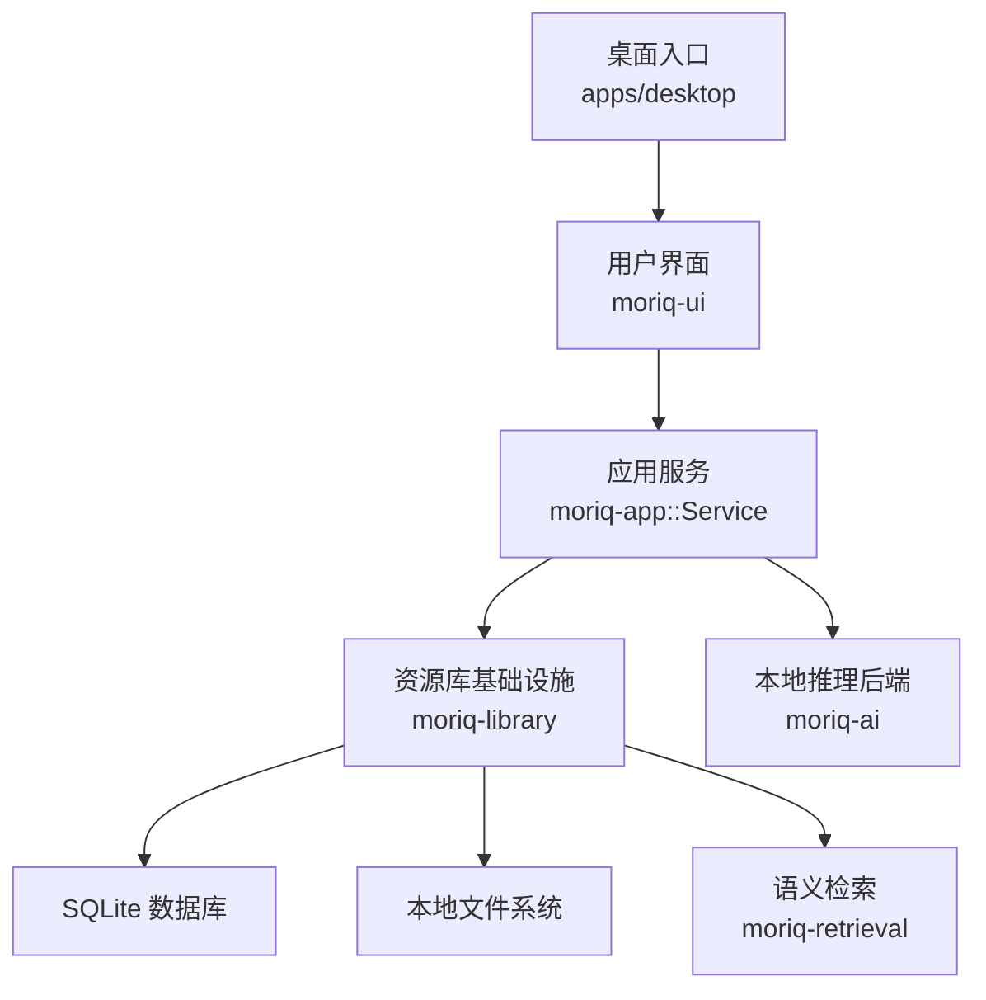
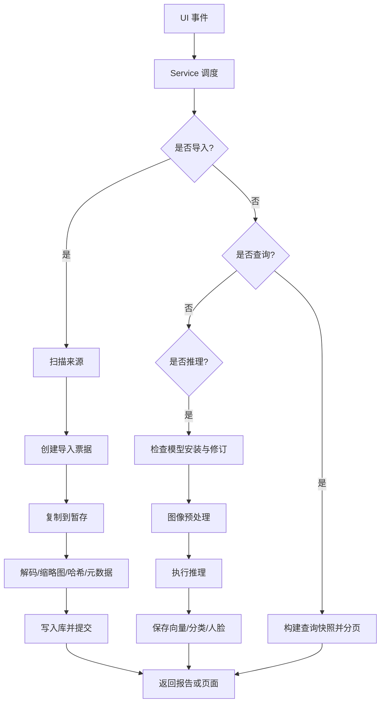
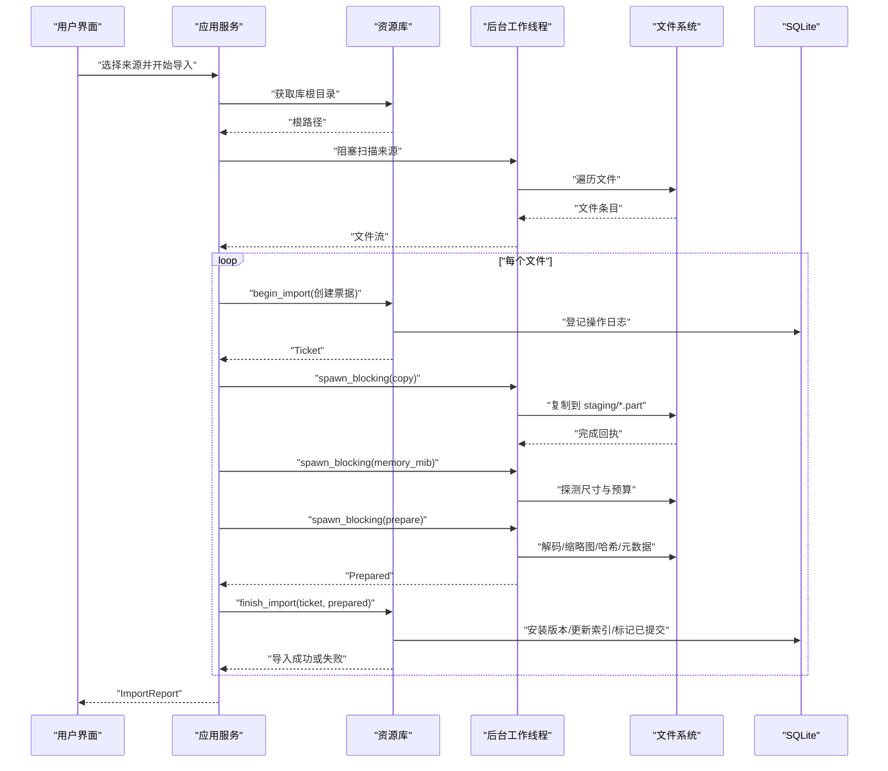
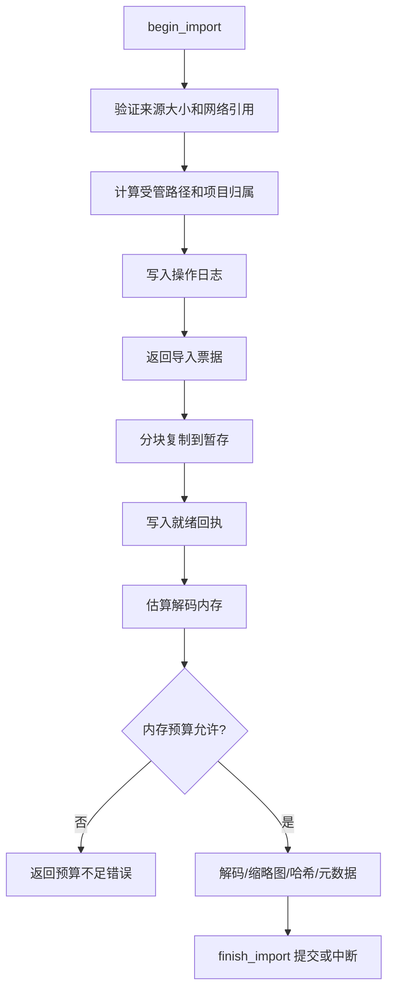
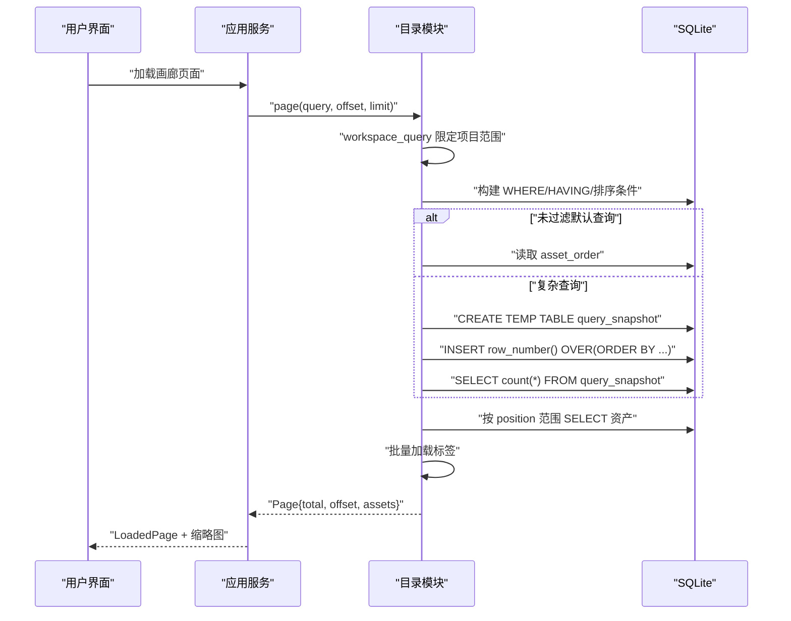
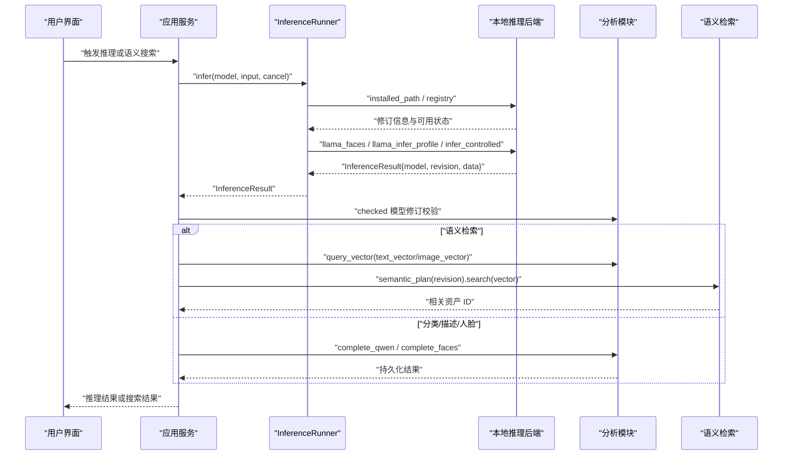
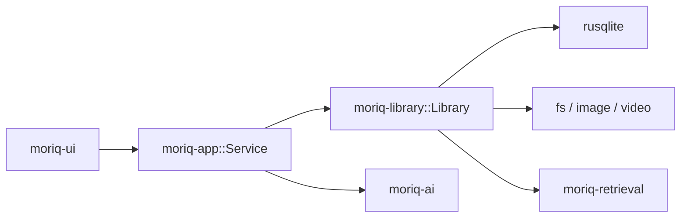

# 数据流设计

> Repo Wiki 节点 `data-flow-design`
> 导出自 Qoder 知识库快照 `8fbe02f6-57c2-4874-b725-1a8130851fd9`，代码基线 `7a7a8e75e18bd90294e09cd422dd7ed5a04813a0`（分支 main，zh-CN）。

<cite>
**本文引用的文件**   
- [架构总览](../../../ARCHITECTURE.md)
- [桌面入口](../../../apps/desktop/src/main.rs)
- [应用服务层](../../../crates/moriq-app/src/lib.rs)
- [导入流程](../../../crates/moriq-app/src/import.rs)
- [推理编排](../../../crates/moriq-app/src/inference.rs)
- [资源库基础设施](../../../crates/moriq-library/src/lib.rs)
- [导入票据与解码准备](../../../crates/moriq-library/src/transfer/ingest.rs)
- [受管导入布局](../../../crates/moriq-library/src/transfer/import.rs)
- [目录查询与分页](../../../crates/moriq-library/src/catalog/query.rs)
- [媒体缓存策略](../../../crates/moriq-library/src/media/cache.rs)
- [用户界面入口](../../../crates/moriq-ui/src/lib.rs)
</cite>

## 目录
1. [引言](#引言)
2. [项目结构](#项目结构)
3. [核心组件](#核心组件)
4. [架构总览](#架构总览)
5. [详细数据流分析](#详细数据流分析)
6. [依赖关系分析](#依赖关系分析)
7. [性能与容量特性](#性能与容量特性)
8. [故障排查指南](#故障排查指南)
9. [结论](#结论)

## 引言
本文围绕 Moriq Space 的数据流设计展开，重点说明三类关键业务流程：素材导入、目录查询和 AI 推理。文档从 UI 请求开始，追踪到 Service 调度、Library 持久化、Catalog 查询、AI 模型执行，以及结果回写和缓存清理；同时解释跨层数据转换、并发控制、取消传播、缓存策略和数据一致性保证。文末提供可操作的瓶颈分析方法与优化建议。

## 项目结构
仓库采用 Rust crate 分层组织，职责边界清晰：
- `apps/desktop`：平台桌面入口，负责日志、参数解析和 UI 启动。
- `moriq-ui`：Iced 原生界面，只持有短暂视图状态，所有磁盘、编解码和目录访问通过 Service。
- `moriq-app`：有界单写入协调层，暴露 Service API，负责导入、维护、任务调度、共享内存预算和取消。
- `moriq-library`：阻塞式基础设施，封装 SQLite 数据库、媒体计划、不可变版本、恢复日志和文件包含关系。
- `moriq-ai`：本地模型下载与推理后端，被 App 层抽象为 InferenceRunner。
- `moriq-domain`：可序列化类型与输入校验，不包含 I/O。
- `moriq-retrieval`：基于相似度的语义检索，独立于 Library 与媒体解码器。
- `moriq-render`：几何与视口计算。
- `moriq-runtime`：运行时完整性校验。
- `moriq-synco`：同用户回环传输，不拥有 Catalog。

**图表来源**  
- [架构总览:13-30](../../../ARCHITECTURE.md#L13-L30)  
- [资源库基础设施:1-60](../../../crates/moriq-library/src/lib.rs#L1-L60)

**章节来源**  
- [架构总览:13-30](../../../ARCHITECTURE.md#L13-L30)  
- [资源库基础设施:1-60](../../../crates/moriq-library/src/lib.rs#L1-L60)

## 核心组件
- **Service**：面向 UI 的协调器，冻结工作区范围，统一管理导入并发、内存预算、维护许可、读租约、作业取消队列。UI 不直接持有数据库连接或执行媒体 I/O。
- **Library**：阻塞式持久化层，负责资产版本、项目归属、缩略图、索引、恢复日志、备份与维护。数据库写入端唯一，读取使用只读连接池。
- **Ticket**：导入票据，封装来源、相对路径、项目、期望字节数、操作标识和库锁租约，使文件线程可以安全复制和预解码，最终由写入端提交。
- **InferenceRunner**：推理运行器接口，统一人脸推理、分类、描述和通用推理调用，并绑定模型修订信息。
- **Query/Page**：目录查询对象，支持文本、收藏、格式、评分、尺寸、标签、文件夹、语义、人物、内容主题等过滤，返回带总数、偏移和资产列表的分页结果。
- **Media Cache Plan**：仅对可重建预览和缩略图做预算淘汰，原始媒体、AI 结果、恢复文件和互操作数据不被视为缓存。

**章节来源**  
- [应用服务层:1-120](../../../crates/moriq-app/src/lib.rs#L1-L120)  
- [导入票据与解码准备:1-40](../../../crates/moriq-library/src/transfer/ingest.rs#L1-L40)  
- [推理编排:1-60](../../../crates/moriq-app/src/inference.rs#L1-L60)  
- [目录查询与分页:1-60](../../../crates/moriq-library/src/catalog/query.rs#L1-L60)  
- [媒体缓存策略:1-30](../../../crates/moriq-library/src/media/cache.rs#L1-L30)

## 架构总览
Moriq Space 的数据流遵循“界面无状态、服务有边界、持久化阻塞、推理隔离”的原则：
1. UI 发起请求并持有请求生成号，Service 返回收据，后续刷新只更新对应域。
2. 导入、扫描、解码、推理等耗时操作放在后台任务，受作业槽、导入槽、共享内存预算限制。
3. Library 是单一写入者；Catalog 查询先构建临时快照表，再按位置分页读取。
4. AI 推理结果携带模型身份和修订号，旧版本结果不能覆盖当前分类。
5. 所有错误通过 JobError 区分取消、库切换、无效输入、存储、运行时和不可用服务等类别。

**图表来源**  
- [导入流程:201-478](../../../crates/moriq-app/src/import.rs#L201-L478)  
- [导入票据与解码准备:201-442](../../../crates/moriq-library/src/transfer/ingest.rs#L201-L442)  
- [目录查询与分页:1-200](../../../crates/moriq-library/src/catalog/query.rs#L1-L200)  
- [推理编排:1-200](../../../crates/moriq-app/src/inference.rs#L1-L200)

## 详细数据流分析

### 素材导入流程
目标：把外部文件或文件夹转换为库内受管版本，建立缩略图、哈希、元数据、相似度签名，并写入 Catalog。

#### 端到端时序

**图表来源**  
- [导入流程:201-478](../../../crates/moriq-app/src/import.rs#L201-L478)  
- [导入票据与解码准备:201-442](../../../crates/moriq-library/src/transfer/ingest.rs#L201-L442)  
- [资源库基础设施:1-60](../../../crates/moriq-library/src/lib.rs#L1-L60)

#### 关键处理逻辑
- **文件选择与扫描**：UI 将平台拖放或选择的结果交给 Service；Service 在阻塞线程中遍历来源，去重后形成 `ImportFile` 流。
- **验证与票据创建**：`begin_import` 检查文件大小、网络引用限制、项目名称和相对路径，写入操作日志并返回 Ticket。
- **受管布局**：根据项目和相对路径计算库内路径，避免覆盖现有文件，必要时生成序列后缀。
- **复制与回执**：分块复制至 `staging/*.part`，记录 `.ready` 回执，防止不完整文件被恢复引擎当作有效媒体。
- **解码与指标**：视频走视频解码分支，图片走栅格解码分支；生成缩略图、主色、相似度签名、元数据和耗时指标。
- **内存准入**：估算解码所需内存，分别受局部批量预算和全局共享内存预算限制，拒绝超大图像。
- **提交与清理**：写入成功后标记操作为 `committed`，清理暂存文件；失败则标记 `interrupted`，保留恢复入口。

**图表来源**  
- [导入票据与解码准备:1-200](../../../crates/moriq-library/src/transfer/ingest.rs#L1-L200)  
- [受管导入布局:1-200](../../../crates/moriq-library/src/transfer/import.rs#L1-L200)  
- [导入流程:300-478](../../../crates/moriq-app/src/import.rs#L300-L478)

**章节来源**  
- [导入流程:201-478](../../../crates/moriq-app/src/import.rs#L201-L478)  
- [导入票据与解码准备:1-442](../../../crates/moriq-library/src/transfer/ingest.rs#L1-L442)  
- [受管导入布局:1-200](../../../crates/moriq-library/src/transfer/import.rs#L1-L200)

### 查询流程
目标：根据 UI 筛选条件构造 SQL 条件，建立临时查询快照，按位置分页返回资产及缩略图关联。

#### 端到端时序

**图表来源**  
- [目录查询与分页:1-200](../../../crates/moriq-library/src/catalog/query.rs#L1-L200)  
- [目录查询与分页:201-284](../../../crates/moriq-library/src/catalog/query.rs#L201-L284)

#### 关键处理逻辑
- **工作区限定**：`workspace_query` 把当前 UI 的项目上下文注入查询，避免跨项目污染。
- **全文搜索**：短文本使用 `instr` 匹配名称、备注和 AI 搜索体；长文本优先走 FTS 表。
- **过滤器组合**：收藏、垃圾桶、格式、评分、字节范围、导入时间、宽高比、标签、颜色、存储位置、文件夹、语义 ID、人物、内容主题、历史分类等条件拼接为 SQL。
- **快照缓存**：相同 `Query` 复用临时表计数，避免重复规划昂贵视图。
- **分页策略**：默认顺序反向读取 `asset_order`，其他查询正向读取 `query_snapshot`，最大页大小限制为 128。
- **标签批量加载**：对当前页资产一次性拉取真实标签和可见 AI 标签，减少逐行展开。

**章节来源**  
- [目录查询与分页:1-284](../../../crates/moriq-library/src/catalog/query.rs#L1-L284)

### AI 推理流程
目标：加载模型、预处理图像或文本、执行推理、返回带模型修订的分析结果，并在需要时执行语义检索或推荐。

#### 端到端时序

**图表来源**  
- [推理编排:1-200](../../../crates/moriq-app/src/inference.rs#L1-L200)  
- [推理编排:201-339](../../../crates/moriq-app/src/inference.rs#L201-L339)

#### 关键处理逻辑
- **模型可用性**：`LocalInference.ready` 检查模型安装路径；`revision` 从内置清单解析固定修订。
- **推理执行**：人脸、分类、描述和通用推理都经过 `infer_controlled`，传入取消标志。
- **撤销保护**：推理前、推理后多次检查取消标志；若 UI 丢弃 future，`CancelOnDrop` 会发出取消信号。
- **修订校验**：推理结果必须与当前检索使用的模型修订一致，否则拒绝。
- **语义检索**：文本或图像向量经 `analysis::query_vector` 转为查询形式，再由检索计划执行相似度搜索。
- **推荐读取**：`recommendations` 读取当前版本的语义推荐，避免旧版本结果影响新素材。

**章节来源**  
- [推理编排:1-339](../../../crates/moriq-app/src/inference.rs#L1-L339)

## 依赖关系分析
- **UI 依赖 Service**：UI 只发送消息并接收 typed effect，不直接访问磁盘、数据库或解码器。
- **Service 依赖 Library**：Service 通过 `call` 把工作投递到 Library 的阻塞线程，保持 UI 响应性。
- **Service 依赖 InferenceRunner**：推理实现解耦，测试或不同后端可替换。
- **Library 依赖 SQLite 和文件系统**：数据库变更集中到单一写入端，文件操作使用安全路径和命名空间。
- **Retrieval 独立于 Library**：语义检索只依赖明确的库作用域和向量索引，不耦合媒体解码或模型运行时。

**图表来源**  
- [架构总览:13-30](../../../ARCHITECTURE.md#L13-L30)  
- [资源库基础设施:1-60](../../../crates/moriq-library/src/lib.rs#L1-L60)

**章节来源**  
- [架构总览:13-30](../../../ARCHITECTURE.md#L13-L30)  
- [应用服务层:1-120](../../../crates/moriq-app/src/lib.rs#L1-L120)  
- [资源库基础设施:1-60](../../../crates/moriq-library/src/lib.rs#L1-L60)

## 性能与容量特性

### 导入性能特征
- **扫描阶段**：阻塞线程遍历来源，使用通道缓冲 128 个条目，避免 UI 卡顿。
- **并发控制**：导入工作最多 `buffer_unordered(workers.clamp(1, 32))`，workers 由用户偏好和系统并行度决定。
- **内存控制**：每个导入票据有局部批量内存预算和全局共享内存预算；预估解码像素乘积过大时回退到固定预算。
- **I/O 安全**：分块复制、同步刷新、长度校验、`.ready` 回执，确保崩溃恢复不会把部分文件当完整媒体。

### 查询性能特征
- **快照复用**：相同 `Query` 复用临时快照表计数，减少重复规划。
- **分页上限**：每页最多 128 条，降低单次 SQL 和 UI 渲染压力。
- **标签批量加载**：一页内一次性拉取标签，避免 N+1 查询。
- **布局尺寸**：`layout_sizes` 直接从排序表和版本表读取宽高，不需要解码原图。

### AI 推理性能特征
- **预算分配**：语义搜索和图像向量推理分别申请固定内存预算，避免阻塞整个进程。
- **取消快速停止**：推理前后检查取消标志，UI 丢弃请求时自动取消后台任务。
- **修订一致性**：向量检索必须与推理所用模型修订一致，避免缓存错位。

### 缓存策略
- **可重建缓存**：`previews` 和 `thumbnails/256` 可按 UUID 文件名重建，支持按字节预算淘汰。
- **非缓存数据**：原始媒体、AI 结果、恢复目录、互操作输出不会被删除。
- **只读统计**：修剪过程使用临时内存数据库，按修改时间和路径排序，逐步删除最小文件直到达到预算。

**章节来源**  
- [导入流程:201-478](../../../crates/moriq-app/src/import.rs#L201-L478)  
- [目录查询与分页:1-284](../../../crates/moriq-library/src/catalog/query.rs#L1-L284)  
- [推理编排:1-339](../../../crates/moriq-app/src/inference.rs#L1-L339)  
- [媒体缓存策略:1-87](../../../crates/moriq-library/src/media/cache.rs#L1-L87)

## 故障排查指南

### 常见问题定位
- **导入失败且报告失败次数增加**：检查 `import_stream` 中 `failures` 是否超过 100 条限制，查看最近失败的标签和错误消息。
- **内存预算不足**：若提示单张图片解码预计需要过多 MiB，应提高导入内存预算或减少并发 workers。
- **库切换导致提交失败**：`finish_import` 会校验票据所属库根，切换库会拒绝提交；此时应等待恢复流程重新登记。
- **查询结果异常**：确认当前工作区项目是否正确；复杂查询会清空快照缓存，重新构建临时表。
- **AI 推理不可用**：检查模型是否安装、修订是否登记、运行时是否可用；若 UI 提前关闭请求，推理会被取消。

### 诊断建议
- **启用诊断日志**：桌面入口会根据设置写入 `desktop.log`，便于跟踪 UI 启动、日志目标和错误出口。
- **观察进度计数器**：`ImportControl` 暴露 `discovered`、`active`、`peak`、`waiting_memory`、`largest_mib`，可用于判断扫描、解码和内存排队情况。
- **检查恢复日志**：`operation_journal` 中的 `prepared`、`committed`、`interrupted` 可帮助判断导入是否进入恢复流程。
- **分析查询计划**：对于慢查询，关注是否频繁重建 `query_snapshot`，以及是否命中 FTS 或简单 `instr` 路径。

**章节来源**  
- [桌面入口:1-97](../../../apps/desktop/src/main.rs#L1-L97)  
- [导入流程:201-478](../../../crates/moriq-app/src/import.rs#L201-L478)  
- [导入票据与解码准备:201-442](../../../crates/moriq-library/src/transfer/ingest.rs#L201-L442)  
- [目录查询与分页:1-284](../../../crates/moriq-library/src/catalog/query.rs#L1-L284)  
- [推理编排:1-339](../../../crates/moriq-app/src/inference.rs#L1-L339)

## 结论
Moriq Space 的数据流以 Service 为中心，将 UI 请求、导入流水线、目录查询和 AI 推理统一到一致的并发、取消和错误模型中。导入流程通过票据机制分离文件 I/O 与数据库提交；查询流程通过临时快照表实现稳定分页；推理流程通过模型修订校验和预算控制保证正确性与稳定性。整体设计强调“可恢复、可取消、可度量”，适合大规模媒体库场景。未来优化可集中在语义索引构建成本、大体积视频解码预算、SQL 条件复杂度以及缓存命中率上，但需保持原有一致性边界和失败路径不变。