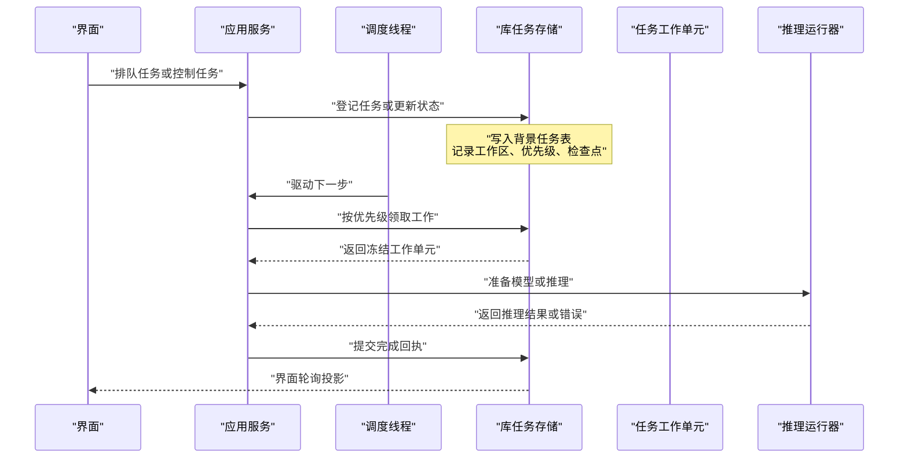
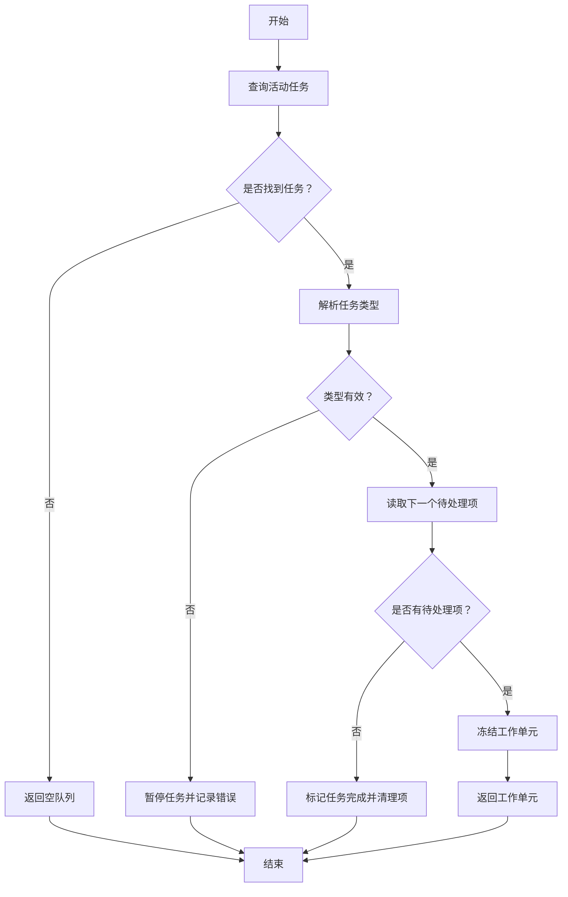
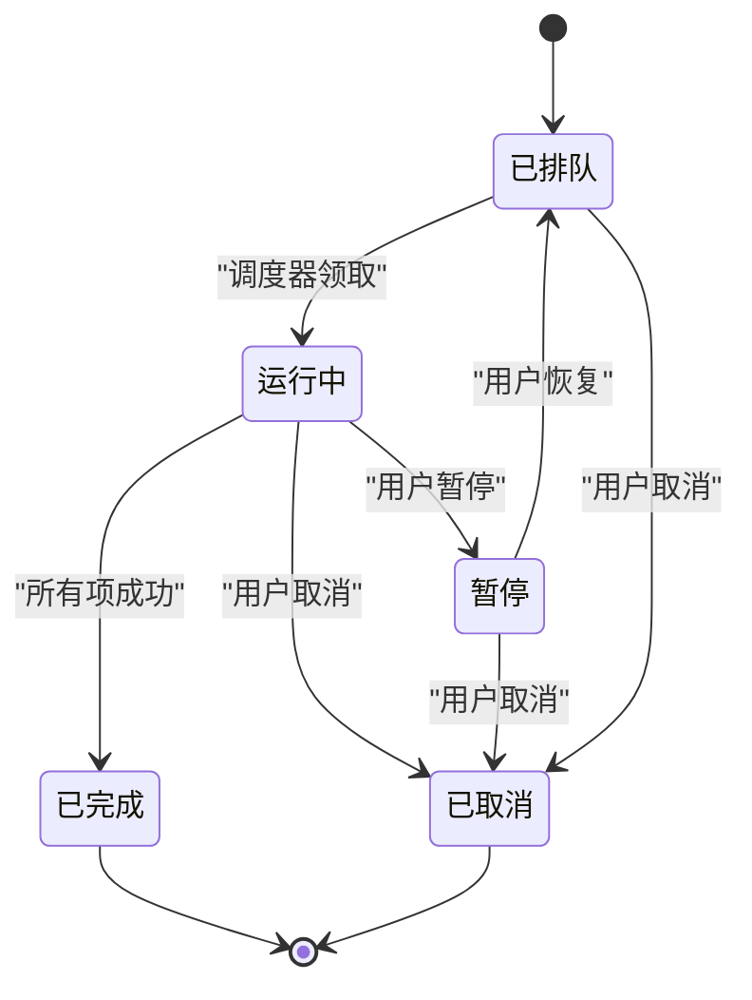
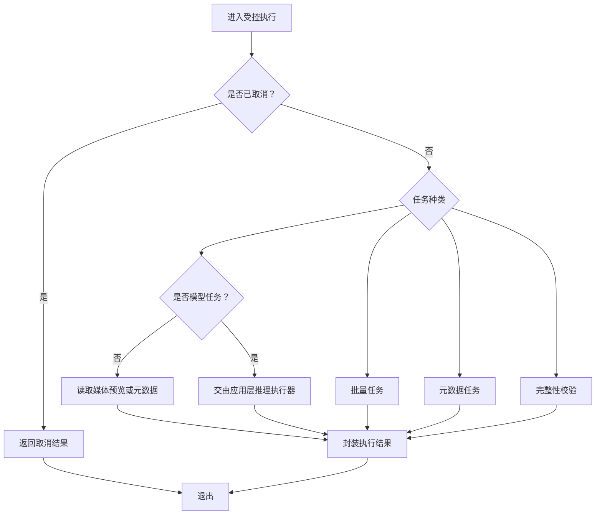
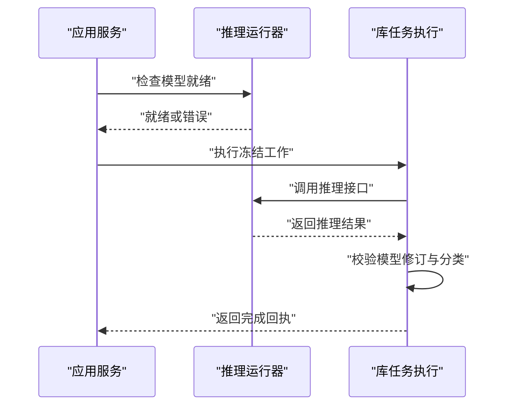
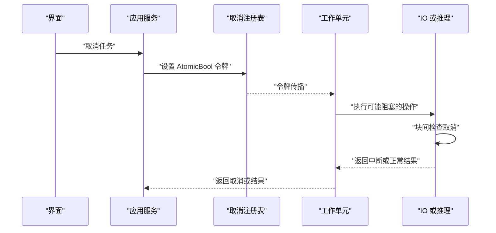
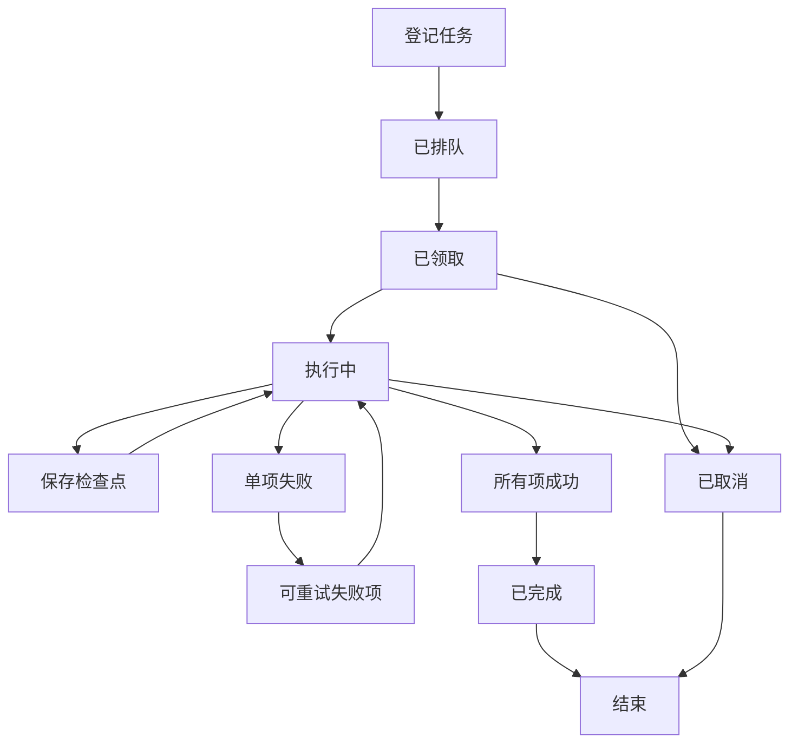
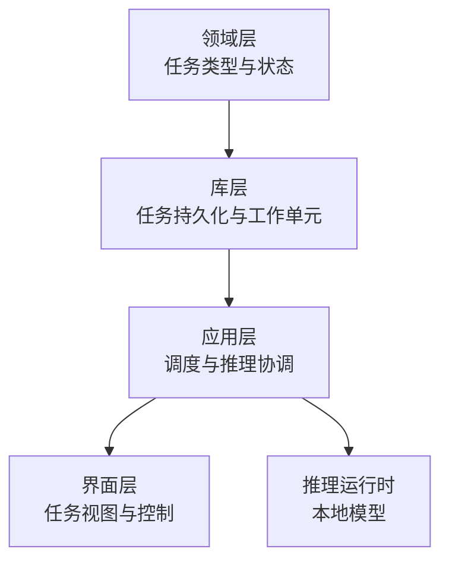
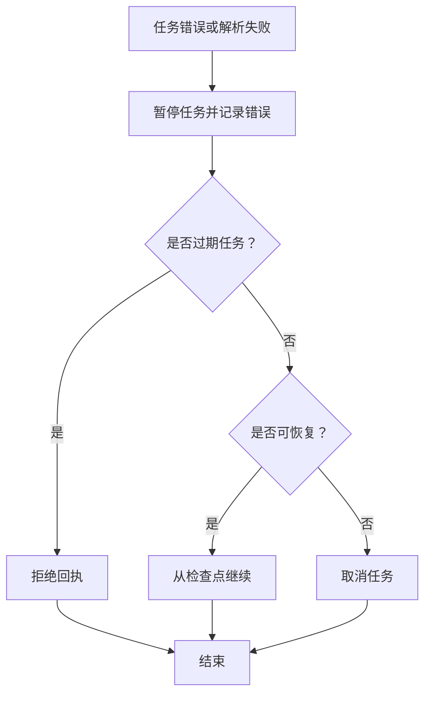

# 任务调度数据流

> Repo Wiki 节点 `job-scheduling-flow`
> 导出自 Qoder 知识库快照 `8fbe02f6-57c2-4874-b725-1a8130851fd9`，代码基线 `7a7a8e75e18bd90294e09cd422dd7ed5a04813a0`（分支 main，zh-CN）。

<cite>
**本文引用的文件**   
- [ARCHITECTURE.md](../../../ARCHITECTURE.md)
- [crates/moriq-app/src/scheduler.rs](../../../crates/moriq-app/src/scheduler.rs)
- [crates/moriq-app/src/jobs.rs](../../../crates/moriq-app/src/jobs.rs)
- [crates/moriq-app/src/inference.rs](../../../crates/moriq-app/src/inference.rs)
- [crates/moriq-library/src/tasks/cancel.rs](../../../crates/moriq-library/src/tasks/cancel.rs)
- [crates/moriq-library/src/tasks/jobs.rs](../../../crates/moriq-library/src/tasks/jobs.rs)
- [crates/moriq-domain/src/jobs.rs](../../../crates/moriq-domain/src/jobs.rs)
- [crates/moriq-ui/src/tasks.rs](../../../crates/moriq-ui/src/tasks.rs)
- [crates/moriq-ui/src/batch.rs](../../../crates/moriq-ui/src/batch.rs)
- [crates/moriq-library/src/library/core.rs](../../../crates/moriq-library/src/library/core.rs)
</cite>

## 目录
1. [引言](#引言)
2. [项目结构与职责边界](#项目结构与职责边界)
3. [核心组件](#核心组件)
4. [架构总览](#架构总览)
5. [详细组件分析](#详细组件分析)
6. [依赖关系分析](#依赖关系分析)
7. [性能与并发特性](#性能与并发特性)
8. [故障恢复策略](#故障恢复策略)
9. [监控与调试指南](#监控与调试指南)
10. [结论](#结论)

## 引言
本文聚焦 Moriq Space 的后台任务调度数据流，围绕“任务队列管理→优先级调度→资源分配→执行监控→状态同步”这条主线，解释媒体处理、AI 推理与维护任务的执行路径，并说明取消机制、生命周期、内存预算和故障恢复。文档同时给出面向用户的监控与调试方法，帮助非专业读者理解系统行为。

## 项目结构与职责边界
Moriq Space 的任务相关代码横跨领域层、库层、应用层和界面层：

| 层级 | 主要职责 | 关键实现位置 |
|---|---|---|
| 领域层 | 定义任务类型、模型标识、任务状态和错误类型等稳定协议 | [crates/moriq-domain/src/jobs.rs:1-229](../../../crates/moriq-domain/src/jobs.rs#L1-L229) |
| 库层 | 持久化任务队列、检查点、失败项、工作区隔离和可恢复执行 | [crates/moriq-library/src/tasks/jobs.rs:1-960](../../../crates/moriq-library/src/tasks/jobs.rs#L1-L960)、[crates/moriq-library/src/tasks/cancel.rs:1-85](../../../crates/moriq-library/src/tasks/cancel.rs#L1-L85) |
| 应用层 | 启动调度线程、申请资源、驱动任务步骤、对接推理运行器 | [crates/moriq-app/src/scheduler.rs:1-283](../../../crates/moriq-app/src/scheduler.rs#L1-L283)、[crates/moriq-app/src/jobs.rs:1-175](../../../crates/moriq-app/src/jobs.rs#L1-L175)、[crates/moriq-app/src/inference.rs:1-339](../../../crates/moriq-app/src/inference.rs#L1-L339) |
| 界面层 | 提交任务、控制暂停/恢复/取消、轮询投影、展示失败详情 | [crates/moriq-ui/src/tasks.rs:1-509](../../../crates/moriq-ui/src/tasks.rs#L1-L509)、[crates/moriq-ui/src/batch.rs:1-76](../../../crates/moriq-ui/src/batch.rs#L1-L76) |

整体设计遵循“界面只负责投影和命令，应用层拥有执行，库层拥有持久化”的边界。领域层不直接访问磁盘或 UI，UI 也不直接读写数据库。

**章节来源**
- [ARCHITECTURE.md:1-155](../../../ARCHITECTURE.md#L1-L155)

## 核心组件
- **任务类型与状态**：`JobKind`、`ModelId`、`JobState`、`TaskError` 构成任务协议。它们通过字符串持久化，解析失败会被拒绝，避免未知类型被静默接受。
- **任务工作单元**：`Work` 冻结任务身份、版本、工作区、源对象和内存预算；`Outcome` 封装执行结果，包括图像预览、分析结果和修订号。
- **取消作用域**：基于线程局部 `AtomicBool` 令牌，提供进入/退出作用域的细粒度取消，避免跨任务泄漏。
- **调度服务**：单线程调度循环，弱引用持有队列，最后一个公开服务释放后停止；每个循环最多尝试一次任务步骤，并根据错误指数退避重试。
- **推理运行器**：统一抽象本地 AI 推理接口，支持 Qwen 人脸、分类、描述及通用推理；未配置时返回不可用错误。
- **界面任务视图**：轮询后台任务投影，发送排队和控制命令，加载逐项失败信息，并在进度变化时刷新分类与筛选布局。

**章节来源**
- [crates/moriq-domain/src/jobs.rs:1-229](../../../crates/moriq-domain/src/jobs.rs#L1-L229)
- [crates/moriq-library/src/tasks/jobs.rs:1-200](../../../crates/moriq-library/src/tasks/jobs.rs#L1-L200)
- [crates/moriq-library/src/tasks/cancel.rs:1-85](../../../crates/moriq-library/src/tasks/cancel.rs#L1-L85)
- [crates/moriq-app/src/scheduler.rs:1-200](../../../crates/moriq-app/src/scheduler.rs#L1-L200)
- [crates/moriq-app/src/inference.rs:1-200](../../../crates/moriq-app/src/inference.rs#L1-L200)
- [crates/moriq-ui/src/tasks.rs:1-200](../../../crates/moriq-ui/src/tasks.rs#L1-L200)

## 架构总览
下图展示任务从界面提交到持久化、调度、执行、监控再到状态回写的完整路径。

**图表来源**
- [crates/moriq-app/src/scheduler.rs:1-200](../../../crates/moriq-app/src/scheduler.rs#L1-L200)
- [crates/moriq-app/src/jobs.rs:1-175](../../../crates/moriq-app/src/jobs.rs#L1-L175)
- [crates/moriq-library/src/tasks/jobs.rs:1-200](../../../crates/moriq-library/src/tasks/jobs.rs#L1-L200)
- [crates/moriq-ui/src/tasks.rs:1-200](../../../crates/moriq-ui/src/tasks.rs#L1-L200)

## 详细组件分析

### 任务队列管理与优先级调度
任务在库中按工作区隔离登记，并带有稳定的类型标识和优先级。调度器每次仅领取一项未完成的工作，按以下顺序选择：
- 先排除已完成或已取消任务；
- 优先选择仍在活动状态的任务；
- 在同类活动中优先高优先级；
- 同优先级时优先较早创建；
- 再使用任务标识作为最终排序键。

领取时会冻结任务当前版本、工作区和检查点，避免后续库切换或分类定义变更导致旧结果污染当前状态。

**图表来源**
- [crates/moriq-library/src/tasks/jobs.rs:496-536](../../../crates/moriq-library/src/tasks/jobs.rs#L496-L536)

**章节来源**
- [crates/moriq-library/src/tasks/jobs.rs:386-450](../../../crates/moriq-library/src/tasks/jobs.rs#L386-L450)
- [crates/moriq-library/src/tasks/jobs.rs:496-536](../../../crates/moriq-library/src/tasks/jobs.rs#L496-L536)

### 资源分配与并发控制
应用层通过多个信号量控制并发：
- **任务槽位**：限制同时执行的调度步骤数量；
- **导入内存**：以兆字节为单位的共享内存预算，任务类型决定所需预算；
- **维护槽位**：维护类任务独占执行；
- **读取槽位**：限制并发读取；
- **队列通道**：序列化写入端操作。

不同任务类型的内存预算如下：

| 任务类型 | 内存预算（兆字节） | 典型用途 |
|---|---:|---|
| 模型分析、Qwen 分类/描述/人脸 | 3072 | 大模型推理、向量分析 |
| 指纹、缩略图 | 1024 | 媒体解码与预览生成 |
| 批量、元数据、完整性校验 | 128 | 轻量任务或纯元数据处理 |

等待内存时，调度器会周期性检查取消标志，避免长时间阻塞。

**章节来源**
- [crates/moriq-domain/src/jobs.rs:80-120](../../../crates/moriq-domain/src/jobs.rs#L80-L120)
- [crates/moriq-app/src/jobs.rs:70-175](../../../crates/moriq-app/src/jobs.rs#L70-L175)

### 执行监控与状态同步
界面每四帧轮询一次后台任务投影，避免频繁刷新造成重复计算。投影包含任务标识、类型、状态、优先级、已完成数、总数、失败数和错误信息。当分析进度变化时，界面会刷新分类和筛选布局，但不会触发额外轮询。

**图表来源**
- [crates/moriq-domain/src/jobs.rs:120-200](../../../crates/moriq-domain/src/jobs.rs#L120-L200)
- [crates/moriq-library/src/tasks/jobs.rs:436-450](../../../crates/moriq-library/src/tasks/jobs.rs#L436-L450)

**章节来源**
- [crates/moriq-ui/src/tasks.rs:1-200](../../../crates/moriq-ui/src/tasks.rs#L1-L200)
- [crates/moriq-library/src/tasks/jobs.rs:436-450](../../../crates/moriq-library/src/tasks/jobs.rs#L436-L450)

### 不同类型任务的流程

#### 媒体处理任务
媒体处理包括缩略图、指纹、元数据和完整性校验。任务执行时：
- 若需要模型则先确认推理运行器可用；
- 若属于媒体解码，则生成预览或元数据；
- 若属于完整性校验，则验证源对象；
- 若属于批量任务，则返回待写入的分析参数；
- 若属于元数据任务，则生成空或实际元数据记录。

**图表来源**
- [crates/moriq-library/src/tasks/jobs.rs:1-200](../../../crates/moriq-library/src/tasks/jobs.rs#L1-L200)

**章节来源**
- [crates/moriq-library/src/tasks/jobs.rs:1-200](../../../crates/moriq-library/src/tasks/jobs.rs#L1-L200)

#### AI 推理任务
AI 推理分为三类：
- 通用模型推理；
- Qwen 分类；
- Qwen 描述；
- Qwen 人脸。

调度器在执行前调用推理运行器的就绪检查；执行时传递取消标志；推理完成后封装带模型修订的结果，并由库层校验修订与分类哈希，防止旧结果覆盖新配置。

**图表来源**
- [crates/moriq-app/src/inference.rs:1-200](../../../crates/moriq-app/src/inference.rs#L1-L200)
- [crates/moriq-library/src/tasks/jobs.rs:200-400](../../../crates/moriq-library/src/tasks/jobs.rs#L200-L400)

**章节来源**
- [crates/moriq-app/src/inference.rs:1-200](../../../crates/moriq-app/src/inference.rs#L1-L200)
- [crates/moriq-library/src/tasks/jobs.rs:200-400](../../../crates/moriq-library/src/tasks/jobs.rs#L200-L400)

#### 维护任务
维护任务由独立的维护槽位保护，确保同一时间只有一个维护操作执行。维护任务通常用于备份、清理、修复等长期操作，不应与普通媒体任务竞争。

**章节来源**
- [crates/moriq-app/src/lib.rs:246-251](../../../crates/moriq-app/src/lib.rs#L246-L251)

### 取消机制：AtomicBool 令牌传递与优雅终止
取消机制由三层组成：

1. **调度层取消注册表**：维护库、任务名称与弱引用令牌的映射。单个任务取消不影响其他任务；全部取消时跳过仍被工作线程持有的令牌。
2. **任务层取消令牌**：`Work.run_cancelable` 安装取消作用域，执行过程中定期检查。
3. **线程局部取消作用域**：`Scope::enter` 设置当前线程的取消标志，`Drop` 恢复之前的上下文，避免泄漏到下一个任务。

**图表来源**
- [crates/moriq-app/src/scheduler.rs:1-80](../../../crates/moriq-app/src/scheduler.rs#L1-L80)
- [crates/moriq-library/src/tasks/cancel.rs:1-85](../../../crates/moriq-library/src/tasks/cancel.rs#L1-L85)
- [crates/moriq-library/src/tasks/jobs.rs:1-80](../../../crates/moriq-library/src/tasks/jobs.rs#L1-L80)

**章节来源**
- [crates/moriq-app/src/scheduler.rs:1-80](../../../crates/moriq-app/src/scheduler.rs#L1-L80)
- [crates/moriq-library/src/tasks/cancel.rs:1-85](../../../crates/moriq-library/src/tasks/cancel.rs#L1-L85)

### 任务生命周期图
任务生命周期贯穿“登记→排队→领取→执行→提交→完成/取消”。其中检查点是关键：如果任务中断，下次领取会从上次检查点继续，而不是从头重跑。

**图表来源**
- [crates/moriq-library/src/tasks/jobs.rs:302-384](../../../crates/moriq-library/src/tasks/jobs.rs#L302-L384)
- [crates/moriq-library/src/tasks/jobs.rs:618-652](../../../crates/moriq-library/src/tasks/jobs.rs#L618-L652)

**章节来源**
- [crates/moriq-library/src/tasks/jobs.rs:302-384](../../../crates/moriq-library/src/tasks/jobs.rs#L302-L384)
- [crates/moriq-library/src/tasks/jobs.rs:618-652](../../../crates/moriq-library/src/tasks/jobs.rs#L618-L652)

## 依赖关系分析

**图表来源**
- [crates/moriq-domain/src/jobs.rs:1-229](../../../crates/moriq-domain/src/jobs.rs#L1-L229)
- [crates/moriq-library/src/tasks/jobs.rs:1-200](../../../crates/moriq-library/src/tasks/jobs.rs#L1-L200)
- [crates/moriq-app/src/jobs.rs:1-175](../../../crates/moriq-app/src/jobs.rs#L1-L175)
- [crates/moriq-ui/src/tasks.rs:1-200](../../../crates/moriq-ui/src/tasks.rs#L1-L200)

**章节来源**
- [ARCHITECTURE.md:1-155](../../../ARCHITECTURE.md#L1-L155)

## 性能与并发特性
- **调度线程**：使用独立线程运行多核 Tokio 运行时，默认两个工作线程。
- **任务步长限制**：单次调度循环最多尝试 64 次任务步骤，避免长时间占用调度线程。
- **失败退避**：连续失败时使用指数退避，上限约 30 秒，避免快速失败循环。
- **内存预算**：任务类型决定内存配额，推理任务通常需要更大预算。
- **并发限制**：导入内存最大 4096 兆字节，读取并发为 4，维护任务独占，任务槽位为 1。
- **UI 轮询节流**：每四帧轮询一次，避免重复刷新。

这些特性共同保证大库场景下界面响应性、后台任务吞吐量和资源稳定性。

**章节来源**
- [crates/moriq-app/src/scheduler.rs:1-200](../../../crates/moriq-app/src/scheduler.rs#L1-L200)
- [crates/moriq-app/src/jobs.rs:100-175](../../../crates/moriq-app/src/jobs.rs#L100-L175)
- [crates/moriq-ui/src/tasks.rs:1-120](../../../crates/moriq-ui/src/tasks.rs#L1-L120)

## 故障恢复策略
- **解析失败保护**：未知任务类型或状态会被拒绝并暂停，避免错误调度。
- **世代号防护**：提交回执时检查任务世代号和活跃状态，拒绝过期结果。
- **工作区隔离**：任务绑定工作区，切库时旧任务结果被拒绝。
- **分类定义变更保护**：若分类哈希变化，任务被取消并要求重新整理。
- **检查点恢复**：中断后重新打开库可继续未完成任务。
- **连续失败暂停**：调度器连续失败多次后自动暂停活动任务，提示用户检查。

**图表来源**
- [crates/moriq-library/src/tasks/jobs.rs:302-384](../../../crates/moriq-library/src/tasks/jobs.rs#L302-L384)
- [crates/moriq-library/src/tasks/jobs.rs:618-652](../../../crates/moriq-library/src/tasks/jobs.rs#L618-L652)
- [crates/moriq-app/src/scheduler.rs:120-200](../../../crates/moriq-app/src/scheduler.rs#L120-L200)

**章节来源**
- [crates/moriq-library/src/tasks/jobs.rs:302-384](../../../crates/moriq-library/src/tasks/jobs.rs#L302-L384)
- [crates/moriq-library/src/tasks/jobs.rs:618-652](../../../crates/moriq-library/src/tasks/jobs.rs#L618-L652)
- [crates/moriq-app/src/scheduler.rs:120-200](../../../crates/moriq-app/src/scheduler.rs#L120-L200)

## 监控与调试指南

### 查看后台任务列表
- 在界面中打开“任务”面板；
- 系统会自动轮询后台任务投影；
- 可查看任务状态、优先级、完成进度和错误信息；
- 对分析任务，进度变化会刷新分类与筛选布局。

**章节来源**
- [crates/moriq-ui/src/tasks.rs:1-200](../../../crates/moriq-ui/src/tasks.rs#L1-L200)

### 控制任务
- **暂停**：将活动任务转入暂停状态；
- **恢复**：将暂停任务重新排队；
- **取消**：将任务标记为已取消，并向对应执行发出取消信号；
- **调整优先级**：仅允许 -100 到 100；
- **批量控制模型任务**：可一次性暂停、恢复或取消所有模型分析任务。

**章节来源**
- [crates/moriq-library/src/tasks/jobs.rs:452-494](../../../crates/moriq-library/src/tasks/jobs.rs#L452-L494)
- [crates/moriq-ui/src/tasks.rs:120-509](../../../crates/moriq-ui/src/tasks.rs#L120-L509)

### 查看逐项失败
- 点击任务失败详情；
- 系统加载该任务的失败项，包含资产、名称和错误消息；
- 可对失败项进行重试，系统会为旧失败项创建新的重试任务，保留历史。

**章节来源**
- [crates/moriq-library/src/tasks/jobs.rs:308-384](../../../crates/moriq-library/src/tasks/jobs.rs#L308-L384)
- [crates/moriq-ui/src/tasks.rs:1-120](../../../crates/moriq-ui/src/tasks.rs#L1-L120)

### 诊断建议
- 若任务长时间处于“已排队”，检查是否存在更高优先级任务或资源不足；
- 若任务频繁失败，查看失败详情并确认媒体源、模型文件或分类配置；
- 若切库后任务异常，确认是否为旧任务回执；
- 若推理任务不可用，检查模型是否已安装并配置推理运行器；
- 若界面刷新卡顿，减少高频控制操作，避免频繁调整优先级或批量操作。

**章节来源**
- [crates/moriq-app/src/inference.rs:1-200](../../../crates/moriq-app/src/inference.rs#L1-L200)
- [crates/moriq-library/src/tasks/jobs.rs:308-384](../../../crates/moriq-library/src/tasks/jobs.rs#L308-L384)

## 结论
Moriq Space 的任务调度系统通过领域协议、库层持久化和应用层调度形成清晰边界。任务队列按优先级和工作区隔离，资源通过信号量和内存预算控制，执行过程支持取消、检查点和世代号保护，界面仅提供投影和用户命令。该设计既保证了媒体处理、AI 推理和维护任务的可恢复性，也兼顾了界面响应性和系统稳定性。对于用户而言，合理查看任务状态、使用暂停/恢复/取消功能、关注失败详情，是日常使用和排错的关键。