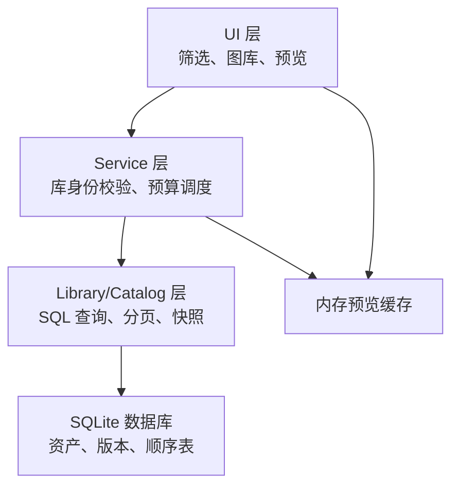
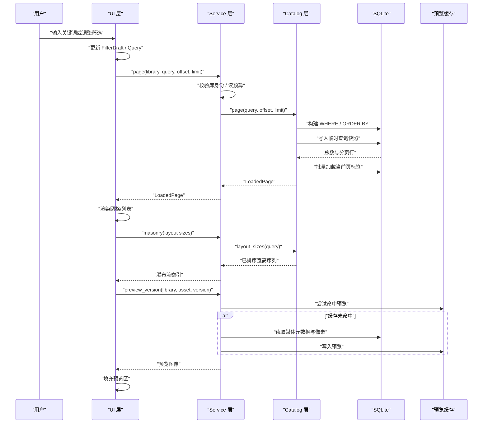
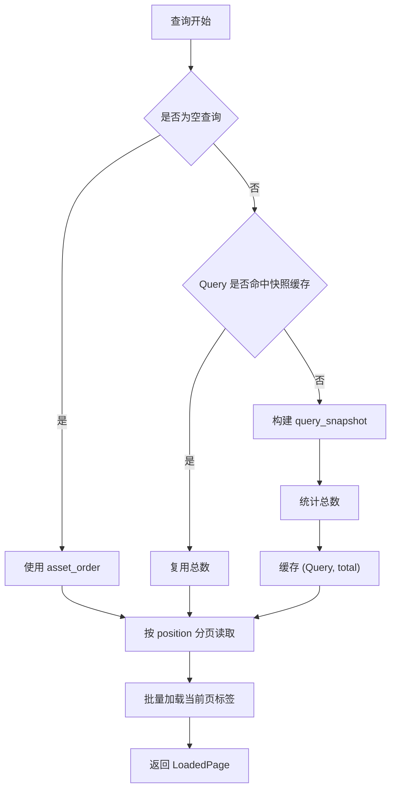
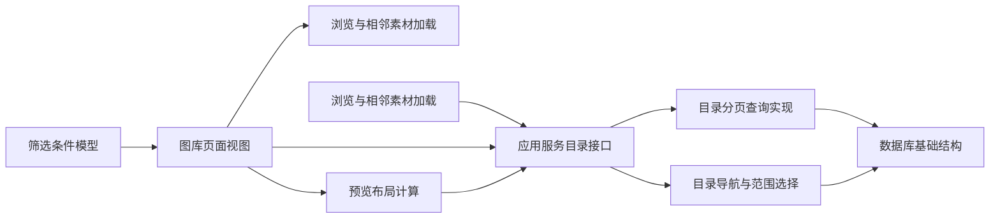

# 查询数据流

> Repo Wiki 节点 `query-data-flow`
> 导出自 Qoder 知识库快照 `8fbe02f6-57c2-4874-b725-1a8130851fd9`，代码基线 `7a7a8e75e18bd90294e09cd422dd7ed5a04813a0`（分支 main，zh-CN）。

<cite>
**本文引用的文件**   
- [架构说明](../../../../ARCHITECTURE.md)
- [应用服务目录接口](../../../../crates/moriq-app/src/catalog.rs)
- [应用服务内存预览缓存](../../../../crates/moriq-app/src/cache.rs)
- [图库页面视图](../../../../crates/moriq-ui/src/gallery.rs)
- [浏览与相邻素材加载](../../../../crates/moriq-ui/src/browsing.rs)
- [筛选条件模型](../../../../crates/moriq-ui/src/filters.rs)
- [预览布局计算](../../../../crates/moriq-ui/src/preview.rs)
- [目录分页查询实现](../../../../crates/moriq-library/src/catalog/query.rs)
- [目录导航与范围选择](../../../../crates/moriq-library/src/catalog/catalog.rs)
- [媒体缓存清理计划](../../../../crates/moriq-library/src/media/cache.rs)
- [数据库基础结构](../../../../crates/moriq-library/src/database/schema.sql)
</cite>

## 目录
1. [引言](#引言)
2. [项目结构与职责边界](#项目结构与职责边界)
3. [核心组件](#核心组件)
4. [系统架构总览](#系统架构总览)
5. [完整查询数据流](#完整查询数据流)
6. [复杂查询条件组合逻辑](#复杂查询条件组合逻辑)
7. [排序与过滤实现](#排序与过滤实现)
8. [缓存策略](#缓存策略)
9. [大数据量分页与内存管理](#大数据量分页与内存管理)
10. [依赖关系分析](#依赖关系分析)
11. [性能分析与优化建议](#性能分析与优化建议)
12. [故障排查指南](#故障排查指南)
13. [结论](#结论)

## 引言
本文面向 Moriq Space 的“查询数据流”，从用户输入查询条件开始，逐步解释 UI 请求、Service 调度、Catalog 查询执行、结果分页、预览加载到最终 UI 渲染的全过程。重点说明复杂查询条件的组合方式、排序与过滤机制、结果缓存与预览缓存的协同关系，并结合源码给出流程图和性能分析。目标是帮助读者在不深入 Rust 细节的情况下，理解大图集场景下查询如何保持响应性和稳定性。

## 项目结构与职责边界
Moriq Space 的查询相关代码分布在三个主要层次：

- UI 层：负责展示、交互、筛选草稿、可见区域计算以及异步任务编排。
- Service 层：作为统一协调者，校验库身份、绑定读写预算、调用 Catalog 并返回 UI 可消费的数据。
- Library/Catalog 层：负责持久化读取、SQL 条件拼接、临时快照、分页、标签批量装配和布局尺寸计算。

**图示来源**
- [架构说明:17-43](../../../../ARCHITECTURE.md#L17-L43)
- [应用服务目录接口:1-120](../../../../crates/moriq-app/src/catalog.rs#L1-L120)
- [图库页面视图:1-120](../../../../crates/moriq-ui/src/gallery.rs#L1-L120)
- [目录分页查询实现:1-80](../../../../crates/moriq-library/src/catalog/query.rs#L1-L80)
- [数据库基础结构:1-42](../../../../crates/moriq-library/src/database/schema.sql#L1-L42)

**章节来源**
- [架构说明:17-43](../../../../ARCHITECTURE.md#L17-L43)

## 核心组件
- **UI 查询状态**：`FilterDraft`、`Query`、`FilterChange` 等类型承载用户筛选、内置快捷筛选、排序、时间、大小、比例、主色调、存储方式等条件。
- **Service 查询入口**：对外暴露 `page`、`masonry`、`neighborhood`、`details`、`preview_version` 等方法，统一处理库身份校验、读计划、写队列和预算限制。
- **Catalog 查询引擎**：`Library::page` 负责把 `Query` 编译为 SQL、维护临时查询快照、计算总数、分页取回资产列表，并批量装配标签。
- **预览与布局**：UI 根据可视范围触发瀑布流布局重建，Service 通过 `layout_sizes` 获取已排序尺寸序列；预览由 Service 调用媒体管线生成，并由进程内 `MediaCache` 管理。

**章节来源**
- [筛选条件模型:1-120](../../../../crates/moriq-ui/src/filters.rs#L1-L120)
- [应用服务目录接口:200-420](../../../../crates/moriq-app/src/catalog.rs#L200-L420)
- [目录分页查询实现:1-120](../../../../crates/moriq-library/src/catalog/query.rs#L1-L120)
- [预览布局计算:1-98](../../../../crates/moriq-ui/src/preview.rs#L1-L98)

## 系统架构总览
下图展示一次典型“图库搜索 + 分页 + 预览”的端到端调用链：

**图示来源**
- [图库页面视图:200-587](../../../../crates/moriq-ui/src/gallery.rs#L200-L587)
- [应用服务目录接口:420-646](../../../../crates/moriq-app/src/catalog.rs#L420-L646)
- [目录分页查询实现:1-200](../../../../crates/moriq-library/src/catalog/query.rs#L1-L200)
- [应用服务内存预览缓存:1-65](../../../../crates/moriq-app/src/cache.rs#L1-L65)

## 完整查询数据流
### 第一阶段：用户查询条件
用户在筛选面板中选择格式、评分、导入时间、文件大小、图片比例、排序方式、主色调、存储方式、标签、AI 主题或类别等选项。这些选项通过 `FilterChange.apply` 写入共享的 `Query`，同时保留其他未修改字段。内置快捷筛选如“最近”“未标记”“高评分”“回收站”等也会直接构造 `Query`。

关键行为：
- 时间范围转换为毫秒时间戳，支持“全部”“近 7 天”“近 30 天”。
- 文件大小同时设置最小值或最大值，而不是替换整个范围。
- 媒介类型会在 RAW/视频/具体格式之间切换，并清空不兼容字段。
- AI 主题/类别会清空互斥维度，避免语义冲突。

**章节来源**
- [筛选条件模型:1-200](../../../../crates/moriq-ui/src/filters.rs#L1-L200)
- [筛选条件模型:200-358](../../../../crates/moriq-ui/src/filters.rs#L200-L358)

### 第二阶段：UI 请求与可见范围
图库页面根据当前查询决定标题、筛选条、空状态和主体内容。当不是列表模式且启用瀑布流时，UI 先计算列数和卡片宽度，再根据滚动位置计算需要展示的块。如果已有匹配的 `MasonryIndex`，则复用布局；否则发起异步重建。

关键行为：
- 使用 `gallery_geometry` 计算可用宽度和列数。
- 使用 `active_masonry` 判断当前几何参数是否与缓存布局一致。
- 使用 `visible_range` 计算当前可视索引范围，避免加载整页数据。

**章节来源**
- [图库页面视图:1-200](../../../../crates/moriq-ui/src/gallery.rs#L1-L200)
- [预览布局计算:1-98](../../../../crates/moriq-ui/src/preview.rs#L1-L98)

### 第三阶段：Service 调度
UI 调用 `Service::page`，传入当前库 ID、`Query`、偏移量和每页数量。Service 内部：
- 校验当前活动库身份，防止跨库污染。
- 通过 `read_plan_sized` 结合缩略图内存占用动态调整读计划预算。
- 将实际查询委托给 `Library::page`。
- 对瀑布流布局调用 `masonry`，进而调用 `layout_sizes`。

**章节来源**
- [应用服务目录接口:420-646](../../../../crates/moriq-app/src/catalog.rs#L420-L646)

### 第四阶段：Catalog 查询执行
`Library::page` 是查询核心。它首先对工作区和项目范围进行约束，然后组装复杂的 WHERE 子句，包括：
- 全文搜索、收藏夹、项目范围、回收站、格式、评分、字节范围、添加时间、宽度、方向、标签、是否已分配、颜色、编辑时间、存储方式、人物、语义 ID、虚拟文件夹、媒体类型、主题、分类等。
- 可选的元数据条件和规则条件。
- 特殊优化：短文本走通用条件，长文本优先走 FTS/AI 文本检索。
- 排序按最新、最早、名称、最大、评分，并在语义排序开启时使用 JSON 中语义 ID 的顺序。

随后：
- 如果查询为空，直接使用 `asset_order`。
- 否则创建临时表 `query_snapshot`，按排序写入带位置的 `asset_id`。
- 缓存 `(Query, total)`，相同 `Query` 可直接复用计数。
- 分页读取当前页资产，再批量加载标签，避免逐条展开 AI 标签视图。

**章节来源**
- [目录分页查询实现:1-200](../../../../crates/moriq-library/src/catalog/query.rs#L1-L200)
- [目录分页查询实现:201-284](../../../../crates/moriq-library/src/catalog/query.rs#L201-L284)
- [数据库基础结构:1-42](../../../../crates/moriq-library/src/database/schema.sql#L1-L42)

### 第五阶段：结果分页与总数
分页采用“密集排名 + 临时快照”的方式，而不是深层 `OFFSET` 扫描：
- 首次非空查询时建立 `query_snapshot`，记录每个资产的 `position`。
- 总数来自快照行数，后续相同查询复用缓存。
- 翻页时按 `position` 区间取值，并按快照顺序或反向顺序（默认全局顺序）取回对应资产。
- 单页上限限制为 128，防止单次结果过大。

**章节来源**
- [目录分页查询实现:120-200](../../../../crates/moriq-library/src/catalog/query.rs#L120-L200)

### 第六阶段：预览加载
选中素材后，UI 调用 `Service::preview_version`，先在进程内 `MediaCache` 中查找键为 `(library_id, asset_id, size)` 的预览。若命中则直接返回；否则调用媒体管线解码或生成预览，并将结果放入缓存。缓存按最近使用时间淘汰，总容量约 256 MiB，条目上限约 48。

此外，UI 还会在焦点变化时复用“进行中”或“已完成”的预览任务，避免重复解码。

**章节来源**
- [浏览与相邻素材加载:1-120](../../../../crates/moriq-ui/src/browsing.rs#L1-L120)
- [应用服务内存预览缓存:1-65](../../../../crates/moriq-app/src/cache.rs#L1-L65)

### 第七阶段：UI 渲染
分页结果返回后，UI 将其映射为 `Tile`，包含资产信息和缩略图句柄。图库渲染器根据瀑布流或列表模式绘制卡片，并绑定点击、双击、悬停、收藏、上下文菜单等事件。详情栏显示选中资产的资料，但磁盘访问和媒体解码仍通过 Service，不直接在 UI 线程完成。

**章节来源**
- [图库页面视图:200-587](../../../../crates/moriq-ui/src/gallery.rs#L200-L587)

## 复杂查询条件组合逻辑
`Library::page` 通过字符串拼接把大量筛选条件组合成一个 SQL WHERE 子句。组合原则如下：

| 条件维度 | 组合方式 | 作用 |
|---|---|---|
| 文本搜索 | 短文本走通用 `instr`，长文本走 FTS/AI 文本检索 | 平衡准确性和速度 |
| 项目范围 | 递归后代项目或精确项目 | 支持文件夹树 |
| 删除状态 | 回收站开关控制 `deleted_at` | 隔离回收站 |
| 格式 | 固定格式或原生/视频集合 | 快速排除无关版本 |
| 评分与大小 | 最小评分、最小/最大字节 | 数值范围过滤 |
| 时间范围 | 导入时间与编辑时间分别过滤 | 区分“发现时间”和“修改时间” |
| 方向 | 横图/竖图/方形 | 几何过滤 |
| 标签 | 有效标签视图 + 项目标签 | 合并 AI 与人工标签 |
| 颜色 | 主色调枚举 | 利用色彩摘要 |
| 存储方式 | 托管导入/外部引用 | 区分数据来源 |
| 语义 | 语义 ID 列表、活跃语义、主题、AI 分类 | 支持相似性与 AI 能力 |
| 虚拟文件夹 | 按虚拟文件夹成员过滤 | 支持智能集合 |
| 元数据/规则 | 可选扩展条件 | 供上层规则引擎注入 |

所有用户输入都通过参数化方式进入 SQL，避免注入风险。JSON 数组用于传递语义 ID 和主题列表，SQL 侧用 `json_each` 匹配。

**章节来源**
- [目录分页查询实现:1-120](../../../../crates/moriq-library/src/catalog/query.rs#L1-L120)

## 排序与过滤实现
### 排序
默认排序为“最新导入 + 资产 ID”，也可按最早、名称、最大、评分排序。当启用语义排序时，排序依据变为语义搜索结果中的 ID 顺序，从而让相似结果排在前面。

### 过滤
过滤分为三层：
1. **SQL 层**：大部分条件在数据库端完成，减少网络/进程间传输开销。
2. **临时快照层**：非空查询先把排序后的 ID 序列写入临时表，后续翻页只按位置扫描。
3. **UI 层**：可见范围过滤，只渲染当前视口内的卡片。

### 相邻素材与范围选择
`Library::neighborhood` 和 `selection_range` 复用当前查询的排序与过滤：
- 通过快照或全局顺序表找到锚点位置。
- 计算前后位置，限制范围选择最多 10000 张。
- UI 层通过 `browse_request` 和库 ID 回执丢弃旧查询结果，防止乱序刷新。

**章节来源**
- [目录分页查询实现:100-200](../../../../crates/moriq-library/src/catalog/query.rs#L100-L200)
- [目录导航与范围选择:1-120](../../../../crates/moriq-library/src/catalog/catalog.rs#L1-L120)
- [浏览与相邻素材加载:120-214](../../../../crates/moriq-ui/src/browsing.rs#L120-L214)

## 缓存策略
查询相关缓存分为两类：**结果缓存**和**预览缓存**。

### 结果缓存
- **临时查询快照**：`query_snapshot` 是 SQLite 临时表，生命周期为当前连接。非空查询首次执行时会重建快照，后续相同 `Query` 复用总数。
- **快照缓存字段**：`Library` 保存 `(Query, total)`，仅当 `Query` 完全相等时复用。
- **默认顺序表**：空查询直接使用 `asset_order`，避免不必要的快照重建。

注意：临时快照不会跨连接复用，但能在同一 Library 实例的多次查询中显著降低重复排序成本。

### 预览缓存
- **进程内内存缓存**：`MediaCache` 使用键 `(library_id, asset_id, size)`，存放预览图像和背景像素。
- **容量控制**：总字节上限约 256 MiB，条目上限约 48，超过则按最近使用时间淘汰。
- **大预览拒绝**：单个预览超过 128 MiB 时直接丢弃，防止异常资源撑爆内存。
- **库切换清理**：库切换时应调用 `clear`，避免不同库之间资产 ID 或版本混淆。

### 磁盘缓存
媒体缓存清理针对 `previews` 和 `thumbnails/256` 目录，按修改时间淘汰可重建文件，并跳过符号链接、非 PNG 或非 UUID 命名文件。

**图示来源**
- [目录分页查询实现:80-200](../../../../crates/moriq-library/src/catalog/query.rs#L80-L200)
- [数据库基础结构:1-42](../../../../crates/moriq-library/src/database/schema.sql#L1-L42)

**章节来源**
- [目录分页查询实现:80-200](../../../../crates/moriq-library/src/catalog/query.rs#L80-L200)
- [应用服务内存预览缓存:1-65](../../../../crates/moriq-app/src/cache.rs#L1-L65)
- [媒体缓存清理计划:1-87](../../../../crates/moriq-library/src/media/cache.rs#L1-L87)

## 大数据量分页与内存管理
### 分页设计
- 使用密集排名 `position`，避免深层 `OFFSET` 导致的随机访问放大。
- 非空查询首建快照，后续翻页只扫描连续位置区间。
- 单页最大 128 条，限制单次结果集体积。
- 默认顺序表 `asset_order` 提供 O(1) 追加和稳定排序基准。

### 内存管理
- 预览缓存限制 256 MiB 和 48 个条目，按 LRU 风格的时间戳淘汰。
- 大预览直接丢弃，防止极端资源破坏整体体验。
- UI 层通过 `active_masonry` 限制一页瀑布流块不超过 128 个。
- 媒体解码和原图读取不在 UI 线程，而是通过 Service 的读计划和工作线程执行。

### 布局与可视范围
- 瀑布流布局只在查询、窗口几何和滚动范围稳定时重建。
- 每次重建会取消上一次任务，避免旧布局覆盖新布局。
- 可视范围计算基于列数、卡片间距和滚动高度，只加载可见区域。

**章节来源**
- [目录分页查询实现:120-284](../../../../crates/moriq-library/src/catalog/query.rs#L120-L284)
- [应用服务内存预览缓存:1-65](../../../../crates/moriq-app/src/cache.rs#L1-L65)
- [预览布局计算:1-98](../../../../crates/moriq-ui/src/preview.rs#L1-L98)
- [图库页面视图:200-587](../../../../crates/moriq-ui/src/gallery.rs#L200-L587)

## 依赖关系分析

**图示来源**
- [筛选条件模型:1-200](../../../../crates/moriq-ui/src/filters.rs#L1-L200)
- [图库页面视图:1-200](../../../../crates/moriq-ui/src/gallery.rs#L1-L200)
- [浏览与相邻素材加载:1-120](../../../../crates/moriq-ui/src/browsing.rs#L1-L120)
- [预览布局计算:1-98](../../../../crates/moriq-ui/src/preview.rs#L1-L98)
- [应用服务目录接口:420-646](../../../../crates/moriq-app/src/catalog.rs#L420-L646)
- [目录分页查询实现:1-200](../../../../crates/moriq-library/src/catalog/query.rs#L1-L200)
- [目录导航与范围选择:1-120](../../../../crates/moriq-library/src/catalog/catalog.rs#L1-L120)
- [数据库基础结构:1-42](../../../../crates/moriq-library/src/database/schema.sql#L1-L42)

**章节来源**
- [应用服务目录接口:420-646](../../../../crates/moriq-app/src/catalog.rs#L420-L646)
- [目录分页查询实现:1-200](../../../../crates/moriq-library/src/catalog/query.rs#L1-L200)

## 性能分析与优化建议
### 已知优化点
- **FTS 与 AI 文本检索**：长文本搜索走专用检索表，避免全表 `instr` 扫描。
- **临时快照**：非空查询只构建一次排序结果，翻页复用。
- **批量标签加载**：按当前页资产 ID 一次性加载标签，避免 N+1 查询。
- **布局尺寸查询**：`layout_sizes` 只取宽高，不解码原图，适合瀑布流布局。
- **预览缓存**：进程内缓存热门预览，减少重复解码。
- **缩略图与首页摘要分离**：首页收藏、分类和项目封面使用轻量摘要，不替换图库查询快照。

### 进一步优化建议
- **缩小查询字段**：仅在必要时加载 AI 分类、人脸、语义主题等重型字段。
- **避免频繁重建布局**：滚动过程中延迟重建瀑布流，仅在滚动停止或几何变化时重建。
- **限制并发预览**：对大视频或多帧媒体增加解码队列和预算上限。
- **监控临时快照大小**：超大结果集会导致临时表膨胀，应限制最大页数或引导用户缩小查询。
- **缓存失效策略**：当标签、分类、AI 内容变更时，显式使 `snapshot` 失效，避免脏读。
- **监控预览缓存命中率**：若命中率低，考虑按视觉相似度复用相近预览，或降低预览分辨率。

[本节为通用性能指导，不直接分析特定代码片段]

## 故障排查指南
### 常见问题
| 现象 | 可能原因 | 排查建议 |
|---|---|---|
| 搜索结果突然变空 | 查询条件发生变化，或临时快照失效 | 检查 `Query` 是否被重置；确认筛选面板状态 |
| 翻页卡顿 | 查询过于复杂或结果集过大 | 缩小时间范围、格式、标签；检查是否启用了语义排序 |
| 预览反复解码 | 预览缓存未命中或库切换后未清理 | 检查 `MediaCache` 是否被清理；确认预览键包含正确尺寸 |
| 相邻素材跳转失败 | 锚点不在当前查询结果中 | 检查 `neighborhood` 返回值；确认查询未中途改变 |
| 范围选择报错 | 两个锚点距离超过 10000 | 提示用户缩小选择范围 |
| 图库布局错乱 | 窗口尺寸或列数变化导致布局失效 | 检查 `gallery_geometry` 和 `active_masonry` |
| 搜索结果不一致 | 临时快照未失效或 AI 数据更新后未重建 | 检查标签、分类、AI 内容变更后是否清空 `snapshot` |

### 定位步骤
1. 确认 UI 层当前 `Query` 与筛选面板一致。
2. 检查 Service 是否调用了正确的库 ID 和查询对象。
3. 查看 Catalog 是否命中临时快照，或未命中是否重建成功。
4. 检查标签批量加载是否返回当前页资产。
5. 确认预览缓存键是否包含库、资产和尺寸。
6. 验证 UI 回执是否丢弃旧任务，例如 `browse_request`、`layout_generation`。

**章节来源**
- [浏览与相邻素材加载:120-214](../../../../crates/moriq-ui/src/browsing.rs#L120-L214)
- [目录分页查询实现:201-284](../../../../crates/moriq-library/src/catalog/query.rs#L201-L284)
- [应用服务内存预览缓存:1-65](../../../../crates/moriq-app/src/cache.rs#L1-L65)

## 结论
Moriq Space 的查询数据流以 UI 交互为入口，以 Service 为协调中心，以 Catalog 的 SQL 查询和临时快照为核心，最终由 UI 按可视范围渲染。其关键优势在于：
- 查询条件在数据库层集中组合，减少 UI 和进程间负载。
- 使用密集排名和临时快照避免深层 OFFSET。
- 预览缓存与布局尺寸查询分离，既保证交互流畅，又避免盲目解码原图。
- 通过库身份校验、预算控制和回执机制，保证多任务、多库切换下的安全性与一致性。

对于大数据集场景，最重要的优化方向是：缩小查询范围、避免频繁重建布局、限制预览和结果集大小，并确保缓存失效策略与 AI/标签变更保持一致。

[本节为总结性内容，不直接分析特定代码片段]