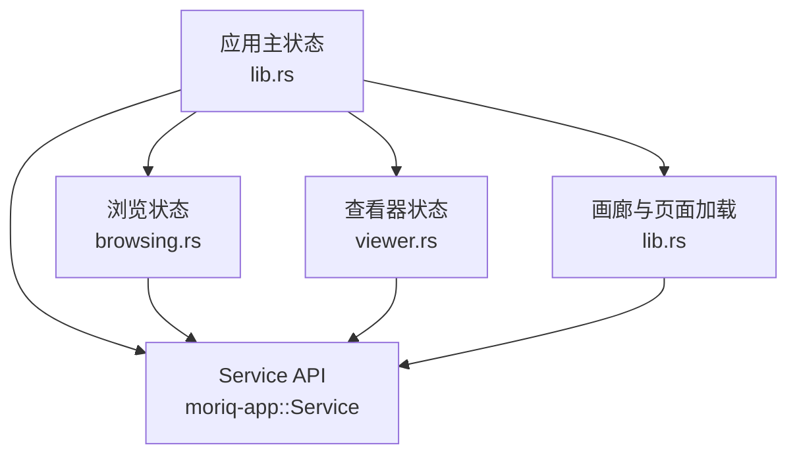
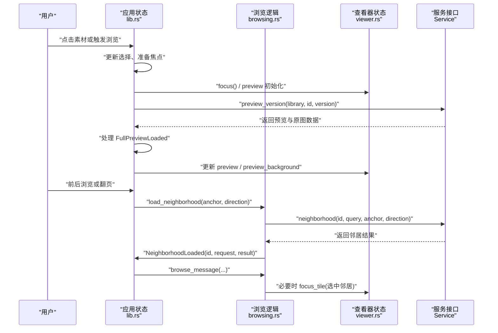
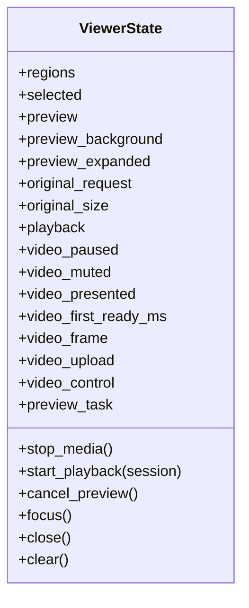
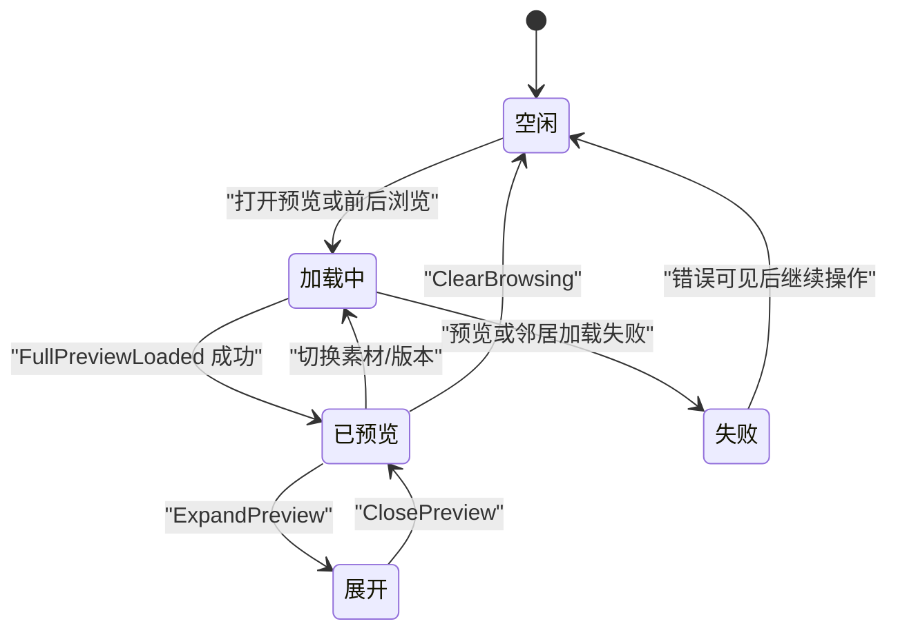
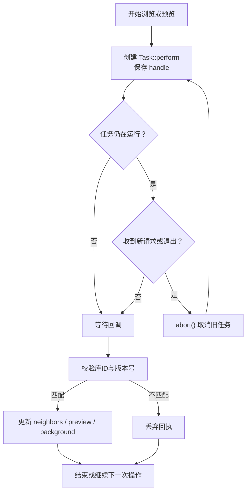
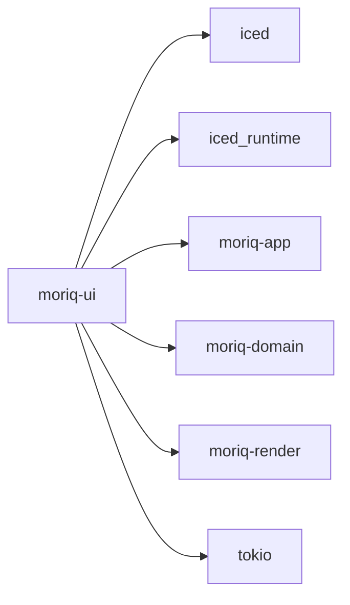
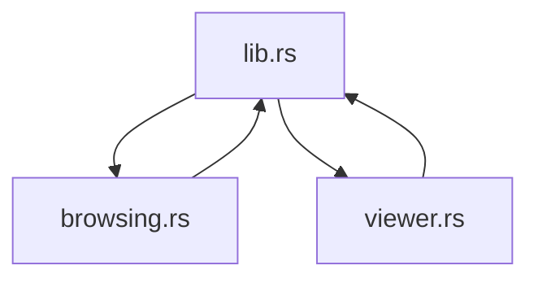

# UI 层查询集成

> Repo Wiki 节点 `ui-query-integration`
> 导出自 Qoder 知识库快照 `8fbe02f6-57c2-4874-b725-1a8130851fd9`，代码基线 `7a7a8e75e18bd90294e09cd422dd7ed5a04813a0`（分支 main，zh-CN）。

<cite>
**本文引用的文件**
- [browsing.rs](../../../../crates/moriq-ui/src/browsing.rs)
- [viewer.rs](../../../../crates/moriq-ui/src/viewer.rs)
- [lib.rs](../../../../crates/moriq-ui/src/lib.rs)
- [Cargo.toml](../../../../crates/moriq-ui/Cargo.toml)
</cite>

## 目录
1. [引言](#引言)
2. [项目结构](#项目结构)
3. [核心组件](#核心组件)
4. [架构总览](#架构总览)
5. [详细组件分析](#详细组件分析)
6. [依赖关系分析](#依赖关系分析)
7. [性能与响应性](#性能与响应性)
8. [故障排查指南](#故障排查指南)
9. [结论](#结论)

## 引言
本文聚焦 UI 层如何把用户浏览、查询和预览行为与后端 Service API 联动。重点解析 `browsing.rs` 中的查询状态管理，包括 `clear_browsing` 的状态清理逻辑、`focus_tile` 的焦点协调机制、浏览任务的创建与取消、重试策略，以及 `browse_request` 版本号在竞态条件处理中的作用；同时说明 `ViewerState` 如何与查询结果联动，涵盖预览加载、背景图处理、版本切换、视频播放生命周期，以及 Iced 消息模型中的 `Message` 传递路径。文末提供 UI 状态转换图、异步任务生命周期图和内存泄漏防护措施，并给出响应性优化技巧与调试方法。

## 项目结构
UI 模块由多个协作文件组成：
- `lib.rs`：应用主状态、Iced 入口、全局 `Message` 枚举、页面刷新、查询与画廊渲染、浏览器相关消息分发。
- `browsing.rs`：围绕当前查询的相邻素材浏览状态、浏览任务生命周期和邻居列表维护。
- `viewer.rs`：预览/原图/视频播放等媒体资源的生命周期管理与状态机。
- `Cargo.toml`：声明 UI 包对 `iced`、`moriq-app`、`moriq-domain`、`moriq-render` 等的依赖。

**图表来源**
- [lib.rs:300-470](../../../../crates/moriq-ui/src/lib.rs#L300-L470)
- [browsing.rs:1-214](../../../../crates/moriq-ui/src/browsing.rs#L1-L214)
- [viewer.rs:1-108](../../../../crates/moriq-ui/src/viewer.rs#L1-L108)
- [Cargo.toml:1-25](../../../../crates/moriq-ui/Cargo.toml#L1-L25)

**章节来源**
- [lib.rs:1-120](../../../../crates/moriq-ui/src/lib.rs#L1-L120)
- [Cargo.toml:1-25](../../../../crates/moriq-ui/Cargo.toml#L1-L25)

## 核心组件
- 应用主状态 `App`（`lib.rs`）：持有 `service`、`library`、`query`、`tiles`、`viewer`、浏览状态字段及所有 UI 事件处理逻辑。
- 浏览状态（`browsing.rs`）：维护 `browse_request`、`browse_task`、`neighbors`、`neighbor_position`、`pending_scroll`、`restored_notes` 等字段，并提供 `clear_browsing`、`load_neighborhood`、`focus_tile`、`browse_message`。
- 查看器状态 `ViewerState`（`viewer.rs`）：管理 `selected`、`preview`、`preview_background`、`original_request`、`preview_task`、视频播放会话等，提供 `stop_media`、`cancel_preview`、`focus`、`close`、`clear`。
- 消息模型（`lib.rs`）：定义 `NeighborhoodLoaded`、`FullPreviewLoaded`、`Browse`、`ClosePreview`、`ExpandPreview`、`Video*` 等相关消息。

**章节来源**
- [lib.rs:300-470](../../../../crates/moriq-ui/src/lib.rs#L300-L470)
- [browsing.rs:1-214](../../../../crates/moriq-ui/src/browsing.rs#L1-L214)
- [viewer.rs:1-108](../../../../crates/moriq-ui/src/viewer.rs#L1-L108)

## 架构总览
UI 采用“界面状态 + Iced 消息”驱动，所有磁盘、编解码、目录查询等重活交给 `moriq-app::Service`。UI 通过 `Task::perform` 发起异步请求，并在回调中发送 `Message` 更新本地状态。

**图表来源**
- [browsing.rs:60-120](../../../../crates/moriq-ui/src/browsing.rs#L60-L120)
- [browsing.rs:120-214](../../../../crates/moriq-ui/src/browsing.rs#L120-L214)
- [lib.rs:1500-2000](../../../../crates/moriq-ui/src/lib.rs#L1500-L2000)
- [lib.rs:2000-2160](../../../../crates/moriq-ui/src/lib.rs#L2000-L2160)
- [viewer.rs:1-108](../../../../crates/moriq-ui/src/viewer.rs#L1-L108)

## 详细组件分析

### 浏览状态与查询生命周期（browsing.rs）
`browsing.rs` 将“当前查询上下文下的相邻素材浏览”抽象为独立职责，核心概念如下：
- `browse_request: u64`：每次启动新的浏览任务自增的版本号，用于丢弃旧请求的回执。
- `browse_task: Option<Handle>`：当前进行中的相邻素材读取任务句柄，支持 `abort()`。
- `neighbors: Vec<Tile>`：已加载的邻居缩略图缓存。
- `neighbor_position: Option<(usize, u64)>`：当前选中项在邻居页中的位置与总页数，用于导航展示。
- `pending_scroll`、`restored_notes`：在查询恢复和滚动定位时的临时状态。

#### clear_browsing：状态清理逻辑
`clear_browsing` 负责在一次重要查询变更或离开浏览上下文时，彻底清理浏览锚点、邻居缓存和进行中任务：
- 调用 `viewer.clear()` 清理查看器图片、选择关联及媒体回执。
- 清除视图坐标与画廊恢复标记。
- 清空对比状态。
- 若存在 `browse_task`，则 `abort()` 取消任务。
- 递增 `browse_request`，使旧回执失效。
- 清空 `neighbors`、`neighbor_position`、`pending_scroll`、`restored_notes` 等浏览辅助状态。
- 重置标签编辑状态，避免残留输入影响后续交互。

该方法是防止“旧浏览结果覆盖新选择”的关键防线。

**章节来源**
- [browsing.rs:15-38](../../../../crates/moriq-ui/src/browsing.rs#L15-L38)

#### load_neighborhood：浏览任务的创建与取消
`load_neighborhood` 按当前 `query` 和锚点素材，异步加载前后相邻素材：
- 若已有 `browse_task`，先 `abort()` 再替换为新任务。
- 递增 `browse_request`，并将新版本号捕获到局部变量 `request`。
- 克隆 `library.info.id`、`query`、`service`，构造闭包调用 `service.neighborhood(id, query, anchor, direction)`。
- 使用 `Task::perform` 包装异步调用，回调发送 `Message::NeighborhoodLoaded(library, request, result)`。
- 将返回的 `handle` 保存进 `browse_task`，以便后续取消。

这里体现了“每次新浏览都会取消旧浏览”的策略，且版本号是区分新旧回执的核心。

**章节来源**
- [browsing.rs:39-84](../../../../crates/moriq-ui/src/browsing.rs#L39-L84)

#### focus_tile：焦点协调机制
`focus_tile` 不是简单设置选中项，而是协调 UI 选择、预览、详情、标签输入等多个子状态：
- 优先合并待处理的收藏状态。
- 如果选中的资产与目标相同，且已有预览任务或背景图，则复用现有预览，直接返回。
- 否则调用 `viewer.focus()` 停止旧媒体并取消旧预览任务。
- 根据是否同资产、同版本决定是否清空预览背景、笔记、详情、标签输入。
- 更新 `tag_input`、`viewer.preview`、`viewer.selected`。
- 尝试恢复之前从详情页携带的备注。
- 若无库连接则提前返回。
- 调用 `service.preview_version(library, id, version)` 获取预览图与背景图，包装成两个 `image::Handle`。
- 将任务句柄保存到 `viewer.preview_task`。
- 若处于展开模式，额外调用 `set_viewer(true)` 保持展开状态。
- 最终用 `Task::batch` 并行执行预览任务、详情刷新和展开控制。

该方法的“复用进行中预览”逻辑，显著减少重复解码和 I/O。

**章节来源**
- [browsing.rs:85-L159](../../../../crates/moriq-ui/src/browsing.rs#L85-L159)

#### browse_message：回执校验与结果处理
`browse_message` 仅接受“当前库 + 当前 `browse_request`”的邻居结果：
- 若库 ID 不匹配或 `browse_request != request`，直接丢弃回执。
- 释放 `browse_task`。
- 成功且有邻居时：
  - 记录 `neighbor_position`。
  - 将 `page.tiles` 转换为带缩略图的 `neighbors`。
  - 若结果中包含被选中的邻居，则调用 `focus_tile(tile)` 自动聚焦。
- 结果为空时：
  - 清空 `viewer.selected`、`viewer.preview`、`neighbors`、`neighbor_position`、`restored_notes`。
  - 设置提示状态，告知用户原先选择的素材不在当前查询中。
- 出错时将错误写入 `error`。

这个回执校验是竞态条件防护的核心：快速连续浏览时，只有最新版本号的邻居结果会被接受。

**章节来源**
- [browsing.rs:160-L214](../../../../crates/moriq-ui/src/browsing.rs#L160-L214)

### 查看器状态与媒体生命周期（viewer.rs）
`ViewerState` 封装了预览、原图、视频、区域标注等资源的生命周期。

**图表来源**
- [viewer.rs:1-108](../../../../crates/moriq-ui/src/viewer.rs#L1-L108)

关键行为：
- `stop_media()`：重置区域标注、增加 `original_request`、清空原图尺寸、播放会话、帧缓冲、上传标志和控制编号。
- `start_playback(session)`：初始化播放状态，绑定播放会话。
- `cancel_preview()`：取走并中止 `preview_task`。
- `focus()`：停止媒体 + 取消预览，适用于切换到新素材。
- `close()`：停止媒体、关闭展开模式。
- `clear()`：完全关闭 + 取消预览 + 清空选择、预览、背景。

这些方法确保 UI 状态与媒体资源解耦，避免悬垂句柄和旧资源泄露。

**章节来源**
- [viewer.rs:1-108](../../../../crates/moriq-ui/src/viewer.rs#L1-L108)

### UI 状态转换图
浏览与查看器的状态变化可概括为以下流程：

该图对应代码中的：
- 进入“加载中”：`load_neighborhood`、`focus_tile` 启动任务。
- “已预览”：`FullPreviewLoaded` 成功处理。
- “失败”：设置 `error`。
- “展开/收起”：`ExpandPreview`、`ClosePreview`。
- “清空”：`clear_browsing`。

**章节来源**
- [browsing.rs:15-L214](../../../../crates/moriq-ui/src/browsing.rs#L15-L214)
- [lib.rs:2000-L2160](../../../../crates/moriq-ui/src/lib.rs#L2000-L2160)
- [viewer.rs:1-L108](../../../../crates/moriq-ui/src/viewer.rs#L1-L108)

### 异步任务生命周期图
浏览和预览任务的生命周期遵循“创建 → 可取消 → 回执校验 → 完成/丢弃”。

**图表来源**
- [browsing.rs:39-L84](../../../../crates/moriq-ui/src/browsing.rs#L39-L84)
- [browsing.rs:160-L214](../../../../crates/moriq-ui/src/browsing.rs#L160-L214)
- [lib.rs:2000-L2160](../../../../crates/moriq-ui/src/lib.rs#L2000-L2160)

### Service API 调用方式与 Message 机制
UI 通过 `Service` 访问底层能力：
- `service.preview_version(library, id, version)`：生成预览图与背景图。
- `service.neighborhood(library_id, query, anchor, direction)`：按查询和锚点加载相邻素材。
- `service.open(path)`：打开库。
- `service.settings()`：加载设置。
- `service.visit_project(library, id)`：跳转到项目。
- `service.rating(id, asset, rating)`：评分更新。

所有调用均包裹在 `Task::perform` 中，回调函数向 `App::update` 投递 `Message`，再由 `App` 分支处理：
- `NeighborhoodLoaded(library, request, result)` → `browse_message`。
- `FullPreviewLoaded(library, id, version, result)` → 更新 `viewer.preview`、`viewer.preview_background`。
- `PageLoaded(generation, result)` → 刷新画廊、重建布局、恢复滚动。
- `PlaybackStarted(...)` → 启动视频播放会话。
- `VideoFrame` / `VideoUploaded` / `VideoControlled` → 视频帧上传与控制反馈。

**章节来源**
- [lib.rs:300-L470](../../../../crates/moriq-ui/src/lib.rs#L300-L470)
- [lib.rs:1500-L2000](../../../../crates/moriq-ui/src/lib.rs#L1500-L2000)
- [lib.rs:2000-L2160](../../../../crates/moriq-ui/src/lib.rs#L2000-L2160)
- [browsing.rs:60-L120](../../../../crates/moriq-ui/src/browsing.rs#L60-L120)

### 竞态条件处理与版本号语义
UI 使用多组版本号解决并发场景：
- `browse_request`：区分不同浏览任务。
- `viewer.original_request`：区分不同原图/预览/视频请求。
- `generation`：区分不同页面加载批次。
- `video_control`：区分不同视频控制命令。

典型保护：
- `browse_message` 检查 `browse_request == request` 且库 ID 一致才接受邻居结果。
- `FullPreviewLoaded` 仅在 `viewer.selected` 与请求的 `id`、`version` 匹配时才更新预览。
- `VideoUploaded`、`VideoControlled`、`PlaybackStarted` 等均要求 `original_request` 或 `video_control` 匹配当前状态。
- `PageLoaded` 要求 `generation == self.generation`。

这组设计有效避免了“旧任务回填覆盖新 UI 状态”的问题。

**章节来源**
- [browsing.rs:160-L214](../../../../crates/moriq-ui/src/browsing.rs#L160-L214)
- [lib.rs:2000-L2160](../../../../crates/moriq-ui/src/lib.rs#L2000-L2160)

### 重试策略
仓库中没有显式“自动重试队列”，但 UI 通过以下机制实现类重试体验：
- 用户再次触发浏览或切换素材时，会取消旧任务并创建新任务。
- 页面加载失败时，错误信息写入 `error`，用户可重新触发刷新或导航。
- `clear_browsing` 会在某些查询变更后主动清理，避免脏状态累积。
- 测试用例验证了“选择并打开同一版本会复用进行中或已完成预览”，从而避免无意义重试。

因此，“重试”更多表现为“用户操作驱动的新请求 + 旧请求取消”，而非后台自动重试循环。

**章节来源**
- [browsing.rs:1-L38](../../../../crates/moriq-ui/src/browsing.rs#L1-L38)
- [browsing.rs:39-L120](../../../../crates/moriq-ui/src/browsing.rs#L39-L120)
- [lib.rs:1500-L1828](../../../../crates/moriq-ui/src/lib.rs#L1500-L1828)

## 依赖关系分析
UI 包的依赖集中在 `Cargo.toml`，并与运行时、领域模型、渲染层耦合：

**图表来源**
- [Cargo.toml:1-25](../../../../crates/moriq-ui/Cargo.toml#L1-L25)

组件内依赖：
- `lib.rs` 聚合所有子模块，包含 `browsing`、`viewer`、`gallery`、`tasks`、`preferences`、`surfaces` 等。
- `browsing.rs` 依赖 `App` 的 `service`、`library`、`query`、`viewer`、`manager`、`preferences` 等。
- `viewer.rs` 依赖 `moriq_app::Playback` 和 `iced_runtime::image`。

**图表来源**
- [lib.rs:1-L120](../../../../crates/moriq-ui/src/lib.rs#L1-L120)
- [browsing.rs:1-L38](../../../../crates/moriq-ui/src/browsing.rs#L1-L38)
- [viewer.rs:1-L30](../../../../crates/moriq-ui/src/viewer.rs#L1-L30)

**章节来源**
- [Cargo.toml:1-25](../../../../crates/moriq-ui/Cargo.toml#L1-L25)
- [lib.rs:1-L120](../../../../crates/moriq-ui/src/lib.rs#L1-L120)

## 性能与响应性
### 预览复用与背景图分离
- `focus_tile` 会判断是否已经存在相同资产和版本的预览任务或背景图，若是则复用，避免重复解码。
- 预览图与背景图分别作为 `image::Handle` 存储，便于适配窗口缩放和填充。
- 当资产或版本变化时，清空 `preview_background`，保证不会显示上一资产的背景。

### 异步解码与 GPU 上传
- 预览和原图解码通过 `Service` 在后台线程完成，UI 只接收 `Message`。
- 视频帧上传使用 `iced_runtime::image::allocate`，并在上传完成前保留上一帧，避免闪烁。
- `video_upload` 标志位控制帧上传状态，`video_first_ready_ms` 记录首次 GPU 就绪时间，用于诊断。

### 查询与页面刷新
- `PageLoaded` 中根据是否提交搜索来决定是否重置画廊、滚动位置和 Masonry 索引。
- `pending_scroll` 用于延迟恢复滚动位置，提升用户感知流畅度。
- `refresh_details` 与预览任务并行执行，减少整体阻塞。

### 建议的优化技巧
- 保持 `browse_request` 和 `original_request` 单调增长，避免回绕后误判。
- 对大图预览启用按需加载和缓存，避免频繁重建 `image::Handle`。
- 将昂贵计算放入 `spawn_blocking`，UI 线程只处理轻量状态更新。
- 使用 `Task::batch` 组合多个互不依赖的任务，提高吞吐。
- 对频繁触发的浏览操作，考虑去抖或节流，例如在快速滑动时暂存 `pending_scroll`。

[本节为通用性能建议，不直接分析具体代码行]

## 故障排查指南
### 常见症状与定位
- **邻居结果不更新**：检查 `browse_request` 是否与回调中的 `request` 一致；确认没有更早的请求覆盖最新版本。
- **预览图不刷新**：检查 `FullPreviewLoaded` 是否匹配当前 `viewer.selected` 的 `id` 和 `version`。
- **视频卡顿或闪烁**：检查 `video_upload`、`video_first_ready_ms`、`video_presented` 是否异常；确认 `original_request` 未发生变化。
- **退出后仍有后台任务**：确认 `ClosePreview` 或 `clear_browsing` 是否调用了 `browse_task.abort()`。
- **旧背景图残留**：确认资产或版本变化时是否清除了 `preview_background`。

### 调试方法
- 利用 `diagnostic_logging_enabled()` 开启诊断日志，观察 Service 调用和错误。
- 在 `App::update` 的关键分支添加日志，记录 `browse_request`、`original_request`、`generation`、`video_control`。
- 使用 UI 录制或截图取证功能（如 `capture` 特性）保存回放证据。
- 通过测试用例复现竞态问题，例如“选择并打开同一版本复用预览”的行为。

**章节来源**
- [lib.rs:300-L470](../../../../crates/moriq-ui/src/lib.rs#L300-L470)
- [lib.rs:1500-L2000](../../../../crates/moriq-ui/src/lib.rs#L1500-L2000)
- [lib.rs:2000-L2160](../../../../crates/moriq-ui/src/lib.rs#L2000-L2160)
- [browsing.rs:1-L38](../../../../crates/moriq-ui/src/browsing.rs#L1-L38)

## 结论
UI 层的查询集成以 `browsing.rs` 的浏览状态为核心，配合 `viewer.rs` 的媒体生命周期管理，形成清晰的“查询 → 任务 → 回执 → UI 更新”链路。通过 `browse_request` 与 `original_request` 等版本号机制，系统能够有效处理竞态条件；通过 `abort()` 与状态清理，避免旧任务污染新状态；通过预览复用和异步解码，提升 UI 响应性。未来可在高频浏览场景中加入更明确的重试与去抖策略，并进一步细化诊断指标，帮助定位预览加载、视频播放和邻居查询的性能瓶颈。