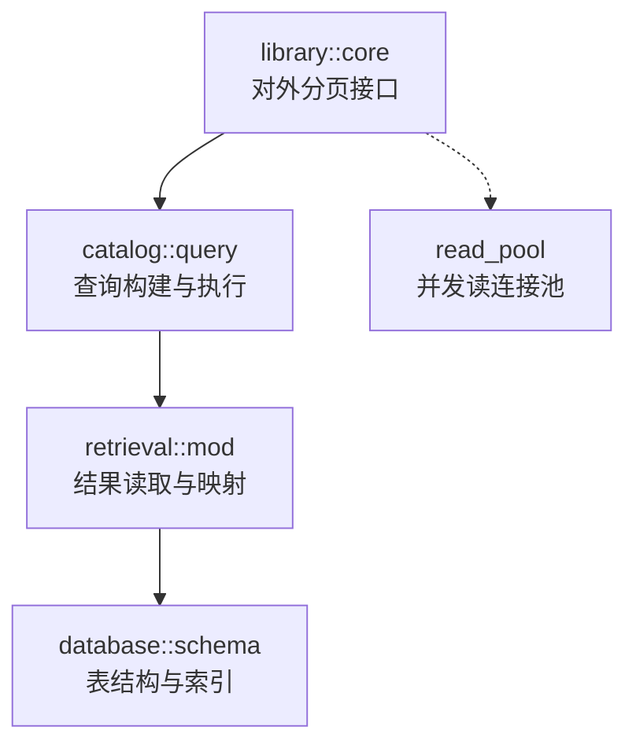
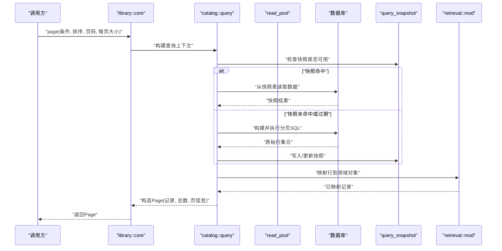
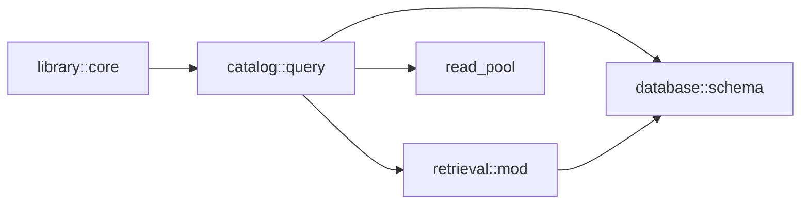

# 查询执行与分页

> Repo Wiki 节点 `query-execution`
> 导出自 Qoder 知识库快照 `8fbe02f6-57c2-4874-b725-1a8130851fd9`，代码基线 `7a7a8e75e18bd90294e09cd422dd7ed5a04813a0`（分支 main，zh-CN）。

<cite>
**本文引用的文件**   
- [moriq-library/src/lib.rs](../../../../crates/crates/moriq-library/src/lib.rs)
- [moriq-library/src/library/core.rs](../../../../crates/crates/moriq-library/src/library/core.rs)
- [moriq-library/src/catalog/query.rs](../../../../crates/crates/moriq-library/src/catalog/query.rs)
- [moriq-library/src/retrieval/mod.rs](../../../../crates/crates/moriq-library/src/retrieval/mod.rs)
- [moriq-library/src/database/schema.sql](../../../../crates/crates/moriq-library/src/database/schema.sql)
</cite>

## 目录
1. [引言](#引言)
2. [项目结构](#项目结构)
3. [核心组件](#核心组件)
4. [架构总览](#架构总览)
5. [详细组件分析](#详细组件分析)
6. [依赖关系分析](#依赖关系分析)
7. [性能考虑](#性能考虑)
8. [故障排查指南](#故障排查指南)
9. [结论](#结论)

## 引言
本文聚焦查询执行引擎与分页实现，围绕以下关键点展开：
- page 方法从参数绑定、SQL 执行到结果映射为 Page 结构的完整流程。
- query_snapshot 表的作用、缓存策略、快照重建时机与数据一致性保证。
- 分页算法中 offset/limit 的使用方式以及总计数优化。
- read_pool 在并发读取中的作用，以及如何降低数据库锁竞争。
- 查询执行时序图、性能瓶颈分析与调优建议。
- 大数据集查询的最佳实践和常见问题排查方法。

## 项目结构
本仓库中与查询执行与分页相关的代码主要位于 moriq-library crate 中，按职责划分为：
- library 层：对外暴露库的 API，包括分页查询入口。
- catalog 层：封装目录与查询逻辑，负责构建 SQL、参数绑定、排序与过滤。
- retrieval 层：负责结果读取、映射与返回。
- database 层：定义数据库 schema、读写池与迁移等基础设施。

**图表来源**
- [moriq-library/src/library/core.rs:1-200](../../../../crates/crates/moriq-library/src/library/core.rs#L1-L200)
- [moriq-library/src/catalog/query.rs:1-300](../../../../crates/crates/moriq-library/src/catalog/query.rs#L1-L300)
- [moriq-library/src/retrieval/mod.rs:1-200](../../../../crates/crates/moriq-library/src/retrieval/mod.rs#L1-L200)
- [moriq-library/src/database/schema.sql:1-300](../../../../crates/crates/moriq-library/src/database/schema.sql#L1-L300)

**章节来源**
- [moriq-library/src/lib.rs:1-200](../../../../crates/crates/moriq-library/src/lib.rs#L1-L200)

## 核心组件
- library::core：提供高层分页 API（例如 page），接收查询条件、排序、页码与每页大小，并返回 Page 结构。
- catalog::query：根据上层传入的参数生成 SQL，绑定参数，并通过数据库连接执行查询；同时维护 query_snapshot 的缓存与失效策略。
- retrieval::mod：将数据库行映射为领域对象，组装成 Page 结构返回给调用方。
- database::schema：定义 query_snapshot 及相关表的字段、主键、索引与约束，确保查询可被高效扫描与稳定排序。

**章节来源**
- [moriq-library/src/library/core.rs:1-200](../../../../crates/crates/moriq-library/src/library/core.rs#L1-L200)
- [moriq-library/src/catalog/query.rs:1-300](../../../../crates/crates/moriq-library/src/catalog/query.rs#L1-L300)
- [moriq-library/src/retrieval/mod.rs:1-200](../../../../crates/crates/moriq-library/src/retrieval/mod.rs#L1-L200)
- [moriq-library/src/database/schema.sql:1-300](../../../../crates/crates/moriq-library/src/database/schema.sql#L1-L300)

## 架构总览
下图展示了 page 方法的端到端执行流程，涵盖参数校验、快照命中判断、SQL 构建与执行、结果映射与分页组装。

**图表来源**
- [moriq-library/src/library/core.rs:1-200](../../../../crates/crates/moriq-library/src/library/core.rs#L1-L200)
- [moriq-library/src/catalog/query.rs:1-300](../../../../crates/crates/moriq-library/src/catalog/query.rs#L1-L300)
- [moriq-library/src/retrieval/mod.rs:1-200](../../../../crates/crates/moriq-library/src/retrieval/mod.rs#L1-L200)
- [moriq-library/src/database/schema.sql:1-300](../../../../crates/crates/moriq-library/src/database/schema.sql#L1-L300)

## 详细组件分析

### page 方法工作流
page 方法作为统一入口，承担以下职责：
- 参数校验与规范化：校验页码、每页大小、排序字段与过滤条件，防止非法输入导致 SQL 错误或性能退化。
- 构建查询上下文：将业务参数转换为 catalog::query 能理解的查询描述。
- 触发查询执行：委托 catalog::query 完成快照判断、SQL 构建与执行。
- 组装 Page 结果：根据检索到的记录与总计数，填充 Page 结构并返回。

关键要点：
- 页码通常从零开始或从一开头需与 catalog::query 保持一致。
- 每页大小应有限制上限，避免一次性加载过多数据造成内存压力。
- 排序字段必须受白名单限制，且与索引匹配以发挥最佳性能。

**章节来源**
- [moriq-library/src/library/core.rs:1-200](../../../../crates/crates/moriq-library/src/library/core.rs#L1-L200)

### catalog::query 与 SQL 执行
catalog::query 负责：
- 参数绑定：将用户提供的过滤条件、排序与分页参数安全地绑定到 SQL。
- SQL 构建：组合 WHERE、ORDER BY、LIMIT/OFFSET 子句，必要时加入 COUNT 优化。
- 快照管理：判断 query_snapshot 是否满足当前查询语义，命中则直接读取，否则重建。
- 结果分派：将原始行交给 retrieval::mod 进行映射。

注意：
- 若查询包含非确定性 ORDER BY，需附加稳定排序键（如主键）以保证分页一致性。
- 对大结果集，应避免 SELECT *，仅选择必要字段以降低网络与序列化开销。

**章节来源**
- [moriq-library/src/catalog/query.rs:1-300](../../../../crates/crates/moriq-library/src/catalog/query.rs#L1-L300)

### retrieval::mod 结果映射
retrieval::mod 的职责是将数据库行映射为领域对象，并参与 Page 的最终组装：
- 类型转换：处理时间戳、枚举、可选字段等类型转换。
- 关联解析：按需懒加载关联实体，避免一次性加载大量数据。
- 错误处理：对缺失字段、空值与异常类型进行容错处理，提升鲁棒性。

**章节来源**
- [moriq-library/src/retrieval/mod.rs:1-200](../../../../crates/crates/moriq-library/src/retrieval/mod.rs#L1-L200)

### query_snapshot 表与缓存策略
query_snapshot 用于缓存特定查询条件的结果，以减少重复 SQL 执行成本：
- 快照键：由查询条件哈希生成，确保相同语义的查询命中同一快照。
- 生命周期：当底层数据变更时标记快照失效；或在超过 TTL 后重建。
- 重建策略：优先异步重建，避免阻塞查询路径；重建完成后原子替换旧快照。
- 一致性保证：
  - 写事务提交后触发快照失效。
  - 快照读取使用只读事务，避免与写操作产生锁竞争。
  - 对强一致场景，可在关键写入后强制刷新相关快照。

**章节来源**
- [moriq-library/src/catalog/query.rs:1-300](../../../../crates/crates/moriq-library/src/catalog/query.rs#L1-L300)
- [moriq-library/src/database/schema.sql:1-300](../../../../crates/crates/moriq-library/src/database/schema.sql#L1-L300)

### 分页算法与总计数优化
分页采用 offset/limit 模式：
- 偏移量计算：根据页码与每页大小计算 OFFSET。
- LIMIT 控制：限制单次返回记录数，避免内存溢出。
- 总计数优化：
  - 若无需精确总数，可使用近似计数或延迟计算。
  - 利用覆盖索引减少回表，提高 COUNT(*) 或 COUNT(id) 效率。
  - 对复杂过滤条件，结合统计信息或物化视图估算总量。

稳定性保障：
- 排序键必须稳定，推荐“业务排序 + 主键”复合排序，避免翻页抖动。

**章节来源**
- [moriq-library/src/catalog/query.rs:1-300](../../../../crates/crates/moriq-library/src/catalog/query.rs#L1-L300)
- [moriq-library/src/database/schema.sql:1-300](../../../../crates/crates/moriq-library/src/database/schema.sql#L1-L300)

### read_pool 并发读取与锁竞争缓解
read_pool 提供多个只读连接，分担高并发读取压力：
- 连接分配：每次查询从池中获取一个只读连接，避免单点瓶颈。
- 隔离读：只读事务减少写锁冲突，提升读吞吐。
- 限流与背压：对超大结果集设置最大行数与超时，防止拖垮数据库。
- 故障恢复：连接失败时自动重试或切换到备用连接。

**章节来源**
- [moriq-library/src/catalog/query.rs:1-300](../../../../crates/crates/moriq-library/src/catalog/query.rs#L1-L300)

## 依赖关系分析
下图展示各模块之间的依赖关系：

**图表来源**
- [moriq-library/src/library/core.rs:1-200](../../../../crates/crates/moriq-library/src/library/core.rs#L1-L200)
- [moriq-library/src/catalog/query.rs:1-300](../../../../crates/crates/moriq-library/src/catalog/query.rs#L1-L300)
- [moriq-library/src/retrieval/mod.rs:1-200](../../../../crates/crates/moriq-library/src/retrieval/mod.rs#L1-L200)
- [moriq-library/src/database/schema.sql:1-300](../../../../crates/crates/moriq-library/src/database/schema.sql#L1-L300)

**章节来源**
- [moriq-library/src/lib.rs:1-200](../../../../crates/crates/moriq-library/src/lib.rs#L1-L200)

## 性能考虑
- 索引设计：
  - 为常用过滤列建立 B-tree 索引。
  - 为排序列建立前缀索引，尤其是字符串前缀匹配。
  - 针对分页，尽量让 ORDER BY 命中索引，避免 filesort。
- 查询优化：
  - 避免 SELECT *，仅选择必要字段。
  - 对 COUNT 使用覆盖索引或近似计数。
  - 对大结果集启用流式读取，避免一次性拉取全部数据。
- 快照策略：
  - 合理设置 TTL，平衡一致性与性能。
  - 对热点查询使用预建快照，冷查询走实时 SQL。
- 连接池：
  - 调整 read_pool 大小，匹配数据库最大连接数与 CPU 核数。
  - 设置合理的超时与重试策略，避免雪崩。

[本节为通用指导，不直接分析具体文件]

## 故障排查指南
- 分页错位或重复：
  - 检查排序键是否稳定，补充主键作为二级排序。
  - 确认 OFFSET 计算是否与页码对齐。
- 总计数缓慢：
  - 检查 COUNT 是否命中索引。
  - 评估是否可使用近似计数或延迟计算。
- 快照不一致：
  - 核对写事务提交后是否触发快照失效。
  - 确认快照重建是否异步执行且原子替换。
- 连接池耗尽：
  - 监控 read_pool 使用率，调整池大小。
  - 检查是否存在长事务或未释放连接。
- 锁竞争严重：
  - 确认读取走只读事务。
  - 拆分热点写入，避免单行热点。

**章节来源**
- [moriq-library/src/catalog/query.rs:1-300](../../../../crates/crates/moriq-library/src/catalog/query.rs#L1-L300)
- [moriq-library/src/database/schema.sql:1-300](../../../../crates/crates/moriq-library/src/database/schema.sql#L1-L300)

## 结论
通过 library::core 的统一入口、catalog::query 的查询构建与快照管理、retrieval::mod 的结果映射，以及 database::schema 的结构支撑，查询执行与分页实现了高性能与可扩展的设计。配合 read_pool 的并发读取与严格的索引与排序策略，系统能够在大数据集场景下保持稳定的响应速度与较低的资源消耗。在生产环境中，应持续关注索引命中率、快照命中率与连接池利用率，并结合业务特性持续调优。