# 查询构建与条件组合

> Repo Wiki 节点 `query-construction`
> 导出自 Qoder 知识库快照 `8fbe02f6-57c2-4874-b725-1a8130851fd9`，代码基线 `7a7a8e75e18bd90294e09cd422dd7ed5a04813a0`（分支 main，zh-CN）。

<cite>
**本文引用的文件**   
- [query.rs](../../../../crates/moriq-library/src/catalog/query.rs)
- [workspace.rs](../../../../crates/moriq-library/src/catalog/workspace.rs)
- [rules.rs](../../../../crates/moriq-library/src/catalog/rules.rs)
- [metadata.rs](../../../../crates/moriq-library/src/media/metadata.rs)
- [schema.sql](../../../../crates/moriq-library/src/database/schema.sql)
</cite>

## 目录
1. [引言](#引言)
2. [项目结构](#项目结构)
3. [核心组件](#核心组件)
4. [架构总览](#架构总览)
5. [详细组件分析](#详细组件分析)
6. [依赖关系分析](#依赖关系分析)
7. [性能考量](#性能考量)
8. [故障排查指南](#故障排查指南)
9. [结论](#结论)

## 引言
本文聚焦 Moriq Space 的查询构建机制，目标是帮助读者理解如何从高层 `Query` 参数生成高效、可缓存且具备工作区隔离能力的 SQL。文档覆盖以下关键点：
- `Query` 的结构语义与筛选字段组合逻辑；
- `workspace_query` 的工作区隔离规则；
- `project_exact` 对查询计划的影响；
- WHERE_HEAD、WHERE_TAIL 与各过滤条件的优先级；
- FTS 全文检索与普通 LIKE 的选择策略；
- 语义搜索参数的序列化方式；
- 元数据筛选与规则引擎的条件扩展点；
- 查询快照与分页流程。

## 项目结构
查询构建位于库层 `moriq-library` 中，主要涉及四个文件：
- `catalog/query.rs`：实现 `Library::page` 等查询入口，负责组装主查询条件、排序、分页和快照。
- `catalog/workspace.rs`：实现工作区范围注入与校验。
- `catalog/rules.rs`：将用户定义的规则树编译为 SQL 条件。
- `media/metadata.rs`：将 EXIF/元数据谓词编译为 SQL 条件。
- `database/schema.sql`：定义资产、版本、项目关联、顺序表等基础结构。

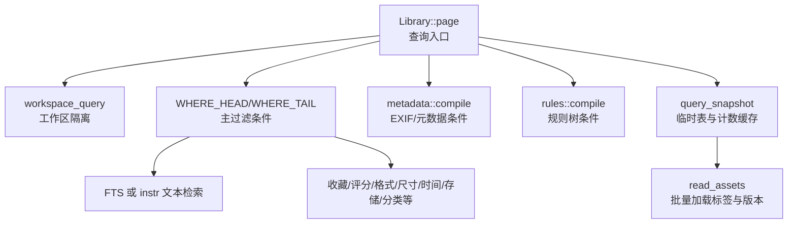

**图示来源**
- [query.rs:1-180](../../../../crates/moriq-library/src/catalog/query.rs#L1-L180)
- [workspace.rs:158-176](../../../../crates/moriq-library/src/catalog/workspace.rs#L158-L176)
- [rules.rs:1-53](../../../../crates/moriq-library/src/catalog/rules.rs#L1-L53)
- [metadata.rs:110-152](../../../../crates/moriq-library/src/media/metadata.rs#L110-L152)
- [schema.sql:1-42](../../../../crates/moriq-library/src/database/schema.sql#L1-L42)

**章节来源**
- [query.rs:1-284](../../../../crates/moriq-library/src/catalog/query.rs#L1-L284)
- [workspace.rs:158-176](../../../../crates/moriq-library/src/catalog/workspace.rs#L158-L176)
- [rules.rs:1-53](../../../../crates/moriq-library/src/catalog/rules.rs#L1-L53)
- [metadata.rs:1-152](../../../../crates/moriq-library/src/media/metadata.rs#L1-L152)
- [schema.sql:1-42](../../../../crates/moriq-library/src/database/schema.sql#L1-L42)

## 核心组件
- `Library::page`：根据 `Query`、偏移量与页大小读取一页素材，必要时建立并复用 `query_snapshot` 临时表作为有序结果集。
- `Library::workspace_query`：将当前工作区强制注入到 `Query.project`，并将 `project_exact` 置为真，同时拒绝与会话范围冲突的请求。
- `metadata::compile`：将 `MetadataPredicate` 列表转换为带参数的 SQL 子句，用于按 EXIF/元数据筛选。
- `rules::compile`：将 `Rule` 表达式树递归编译为 SQL 条件，支持 AND/OR/NOT 组合及常用叶子节点。
- `read_assets`：执行已构造 SQL，并把结果装配为 `Asset`，随后批量加载有效标签。

**章节来源**
- [query.rs:1-120](../../../../crates/moriq-library/src/catalog/query.rs#L1-L120)
- [query.rs:201-284](../../../../crates/moriq-library/src/catalog/query.rs#L201-L284)
- [workspace.rs:158-176](../../../../crates/moriq-library/src/catalog/workspace.rs#L158-L176)
- [metadata.rs:110-152](../../../../crates/moriq-library/src/media/metadata.rs#L110-L152)
- [rules.rs:1-53](../../../../crates/moriq-library/src/catalog/rules.rs#L1-L53)

## 架构总览
查询构建的整体流程如下：

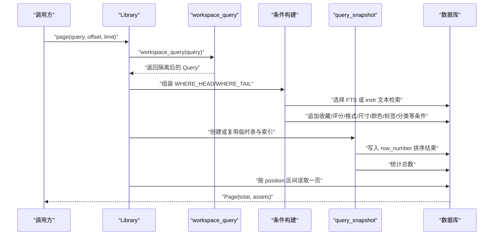

**图示来源**
- [query.rs:1-180](../../../../crates/moriq-library/src/catalog/query.rs#L1-L180)
- [workspace.rs:158-176](../../../../crates/moriq-library/src/catalog/workspace.rs#L158-L176)

## 详细组件分析

### 查询入口与快照机制
`Library::page` 是查询构建的核心。它首先通过 `workspace_query` 获得受工作区约束的 `Query`，然后：
- 决定文本检索模式（FTS 或 `instr`）；
- 拼接主过滤条件字符串；
- 将 `Query` 字段序列化为绑定参数；
- 可选附加元数据条件与规则条件；
- 使用 `row_number()` 写入临时表 `query_snapshot`；
- 基于 `position` 区间进行稳定分页；
- 最后通过 `read_assets` 读取资源并批量加载标签。

关键行为包括：
- 当查询为空时，直接走 `asset_order` 表，避免复杂视图与条件开销；
- 当仅按某个项目且 `project_exact=true` 时，使用更简单的投影语句，只保留项目成员与顺序；
- 非空查询会创建 `query_snapshot` 临时表并建立唯一索引，用于后续分页与总数统计；
- 如果传入的 `Query` 与上次缓存完全一致，则复用已计算的总数，减少重复扫描。

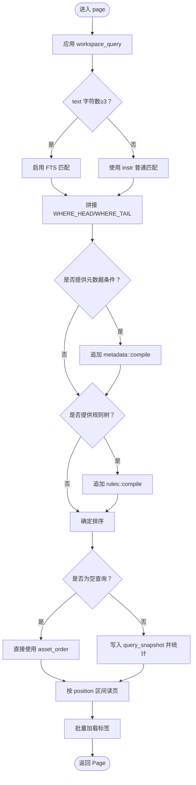

**图示来源**
- [query.rs:1-180](../../../../crates/moriq-library/src/catalog/query.rs#L1-L180)
- [query.rs:201-284](../../../../crates/moriq-library/src/catalog/query.rs#L201-L284)

**章节来源**
- [query.rs:1-180](../../../../crates/moriq-library/src/catalog/query.rs#L1-L180)
- [query.rs:201-284](../../../../crates/moriq-library/src/catalog/query.rs#L201-L284)

### 工作区隔离：workspace_query
`workspace_query` 的职责是把当前会话的项目范围强注入到查询中，并做一致性检查：
- 若当前工作区存在，而 `Query.project` 指向不同项目，则直接返回无效参数错误；
- 否则把 `Query.project` 设为当前工作区项目；
- 同时将 `project_exact` 设置为真，表示该查询只匹配精确项目，不再展开项目层级。

这保证了跨项目的误用会在查询阶段被拒绝，而不是在数据库层产生隐蔽的数据泄漏。

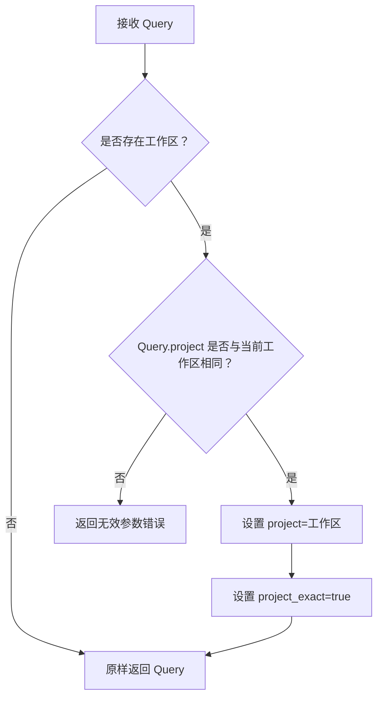

**图示来源**
- [workspace.rs:158-176](../../../../crates/moriq-library/src/catalog/workspace.rs#L158-L176)

**章节来源**
- [workspace.rs:158-176](../../../../crates/moriq-library/src/catalog/workspace.rs#L158-L176)

### 文本检索策略：FTS 与 LIKE
文本检索由 `Query.text` 控制，并根据字符长度选择策略：
- 当 `text` 字符数不少于 3 时，优先尝试 FTS：
  - 先匹配 `search_fts` 中的资源标题；
  - 再匹配 `ai_text_fts` 中的 AI 文本摘要；
- 否则退化为 `instr(lower(...), lower(?))` 的普通模糊匹配，作用于名称、备注、AI 搜索结果与有效标签；
- 所有用户输入均通过参数绑定，避免 SQL 注入。

这意味着短查询会使用通用路径，长查询则利用预建索引提升匹配效率。

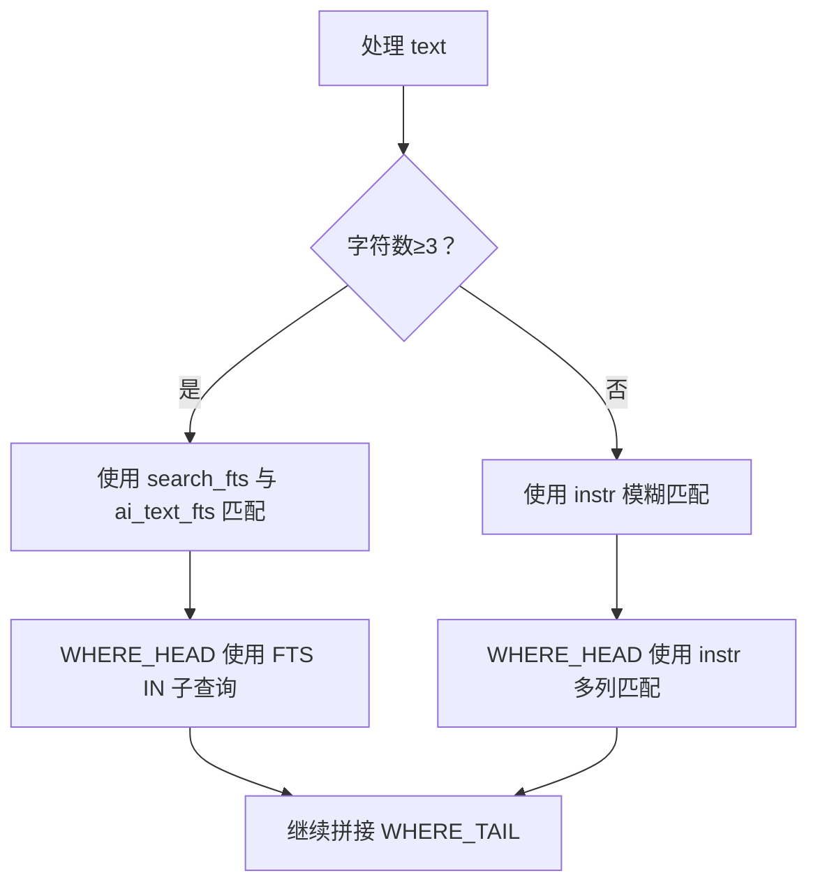

**图示来源**
- [query.rs:10-70](../../../../crates/moriq-library/src/catalog/query.rs#L10-L70)

**章节来源**
- [query.rs:10-70](../../../../crates/moriq-library/src/catalog/query.rs#L10-L70)

### 主过滤条件：WHERE_HEAD 与 WHERE_TAIL
主过滤条件分为两部分：
- `WHERE_HEAD`：负责文本检索入口，以及收藏、项目归属、删除状态、基本属性等前置过滤；
- `WHERE_TAIL`：负责媒体类型、标签、未分配、颜色、编辑时间、存储位置、方向、文件夹、主题、分类等更细粒度条件。

两者通过 Rust 字符串格式化组合，最终形成一条完整的 WHERE 子句。其优先级可以理解为：
1. 文本检索入口（FTS 或 `instr`）；
2. 收藏开关；
3. 项目范围；
4. 删除状态；
5. 格式、大小、宽高与方向；
6. 标签与未分配标记；
7. 颜色、编辑时间与存储状态；
8. 媒体种类、分类、人物、语义 ID、文件夹、主题与分类来源限制。

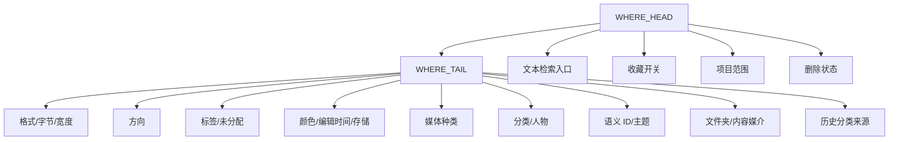

**图示来源**
- [query.rs:10-70](../../../../crates/moriq-library/src/catalog/query.rs#L10-L70)

**章节来源**
- [query.rs:10-70](../../../../crates/moriq-library/src/catalog/query.rs#L10-L70)

### 筛选条件组合逻辑
`Query` 中的筛选字段会被统一序列化为 SQL 参数，并按固定顺序绑定。常见字段及其含义如下：

| 字段 | 含义 | 典型影响 |
|---|---|---|
| `favorites_only` | 是否只保留收藏 | 过滤 `favorite=1` |
| `project` | 目标项目 | 限制项目归属 |
| `trash` | 是否包含回收站 | 控制 `deleted_at` |
| `format` | 指定格式 | 匹配 `v.format` |
| `min_rating` | 最低评分 | 过滤 `rating` |
| `min_bytes` / `max_bytes` | 最小/最大字节 | 过滤文件大小 |
| `since` / `before` | 导入时间范围 | 过滤 `imported_at` |
| `min_width` | 最小宽度 | 过滤 `width` |
| `orientation` | 方向枚举 | 横图/竖图/方形 |
| `untagged` | 无标签 | 排除有效标签 |
| `unassigned` | 未分配 | 排除项目分配 |
| `tag` | 指定标签 | 要求存在对应标签 |
| `color` | 主导色 | 匹配 `dominant_color` |
| `edited_since` | 编辑时间下限 | 过滤 `edited_at` |
| `storage` | 存储状态 | 有文件/无文件 |
| `media_kind` | 媒体种类 | 全部/RAW/视频 |
| `category` | 分类 | 匹配 AI 分类 |
| `person` | 人物 ID | 人脸检测匹配 |
| `semantic_ids` | 语义 ID 列表 | JSON 序列化后参与 IN/NOT IN 判断 |
| `semantic_active` | 是否激活语义排序 | 改变排序与主题过滤 |
| `folder` | 虚拟文件夹 | 匹配 `virtual_folder_assets` |
| `medium` | 内容媒介 | 匹配 `ai_effective_content.medium` |
| `themes` | 主题集合 | JSON 序列化后参与主题排除 |
| `legacy_category` | 历史分类来源 | 兼容旧分类策略 |

这些字段共同构成一个“宽筛”模型：大多数条件以 `?N` 参数形式绑定，默认值通常表示不生效，从而让界面可以灵活组合而不必为每个组合维护独立 SQL。

**章节来源**
- [query.rs:30-120](../../../../crates/moriq-library/src/catalog/query.rs#L30-L120)

### 项目精确查询：project_exact 的性能影响
`project_exact` 是一个重要的性能开关：
- 当 `project_exact=false` 时，项目归属条件使用递归 CTE 查找当前项目及其所有后代项目；
- 当 `project_exact=true` 时，项目归属条件被替换为精确匹配 `pa.project_id=?3`；
- 在工作区模式下，`workspace_query` 会把 `project_exact` 强制设为真，从而避免不必要的层级展开；
- 对于“纯项目页面”，代码还会走一个更轻量的插入路径，只保留项目成员与顺序，跳过大量可选 AI 与筛选视图。

这种设计显著降低了大项目下的查询规划与执行成本。

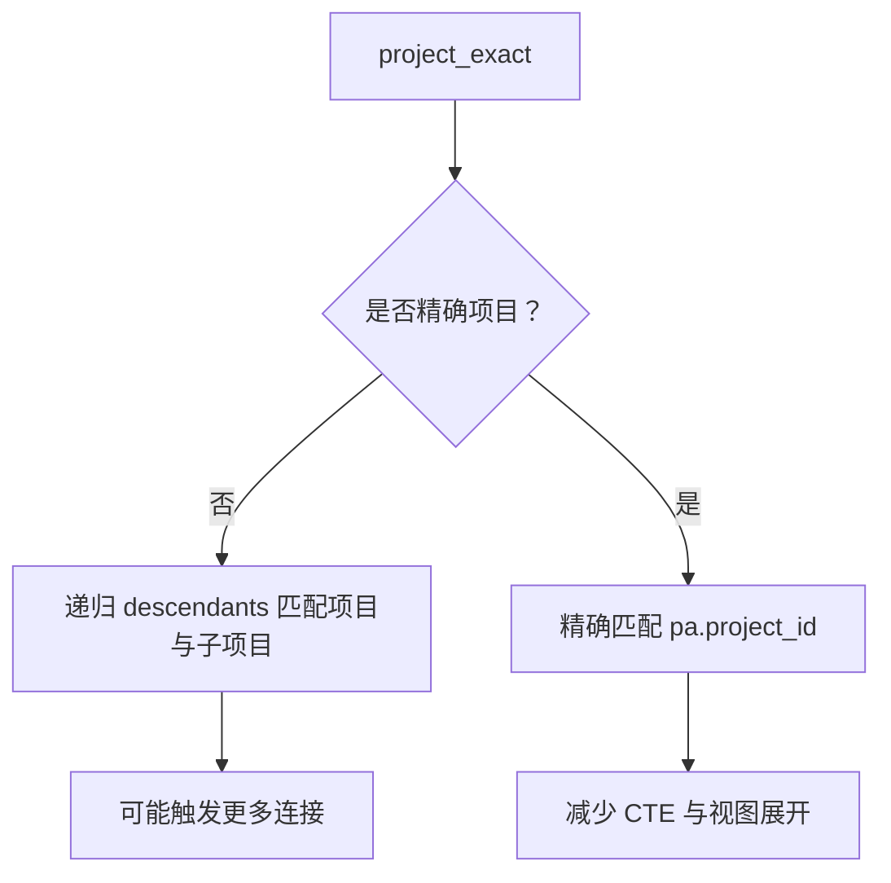

**图示来源**
- [query.rs:30-70](../../../../crates/moriq-library/src/catalog/query.rs#L30-L70)

**章节来源**
- [query.rs:30-70](../../../../crates/moriq-library/src/catalog/query.rs#L30-L70)

### SQL 条件动态拼接过程
SQL 拼接并非简单字符串拼接用户输入，而是分阶段完成：
1. 选择 `WHERE_HEAD`：FTS 模式或 `instr` 模式；
2. 拼接 `WHERE_TAIL`：固定条件与可变条件合并；
3. 根据 `project_exact` 替换项目归属条件；
4. 将所有 `Query` 字段映射为 rusqlite 参数；
5. 如果提供 `metadata`，则在现有条件基础上追加 `metadata::compile` 的结果；
6. 如果提供 `rule`，则在现有条件基础上追加 `rules::compile` 的结果；
7. 根据 `semantic_active` 调整排序；
8. 最终生成 `INSERT INTO query_snapshot SELECT row_number() OVER(ORDER BY ...)` 语句。

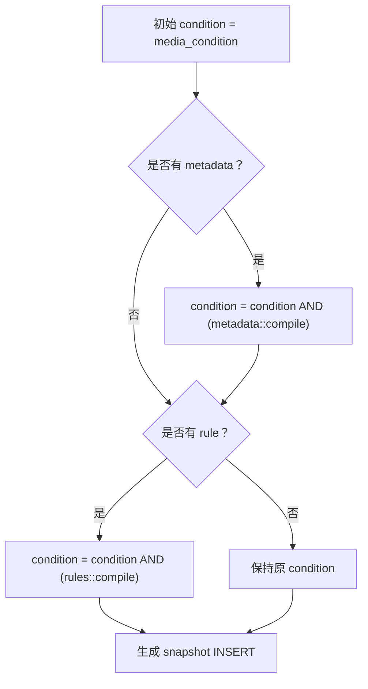

**图示来源**
- [query.rs:70-120](../../../../crates/moriq-library/src/catalog/query.rs#L70-L120)

**章节来源**
- [query.rs:70-120](../../../../crates/moriq-library/src/catalog/query.rs#L70-L120)

### 元数据筛选：metadata::compile
`metadata::compile` 接收一组 `MetadataPredicate`，并生成针对 `version_exif.data` 的 EXISTS 子句。其验证规则包括：
- 最多允许 32 个元数据条件；
- 字段必须属于白名单；
- 文字包含条件不能超过 1024 字符；
- 数值范围不能出现最小值大于最大值；
- `taken_at` 需要特殊解析，去除 ISO 时间戳中的分隔符后再比较；
- 至少需要一个有效条件，否则报错。

生成的 SQL 通过 `json_extract` 访问 JSON 字段，并使用参数化比较，避免注入风险。

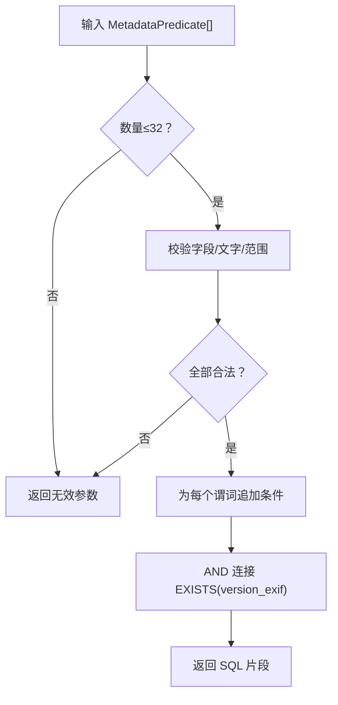

**图示来源**
- [metadata.rs:110-152](../../../../crates/moriq-library/src/media/metadata.rs#L110-L152)

**章节来源**
- [metadata.rs:110-152](../../../../crates/moriq-library/src/media/metadata.rs#L110-L152)

### 规则引擎：rules::compile
`rules::compile` 将规则树编译为 SQL 条件，支持的组合包括：
- `All`：所有子规则都必须满足；
- `Any`：任意子规则满足即可；
- `Not`：取反；
- 叶子规则包括收藏、RAW 格式、地理位置、名称、备注、标签、格式、评分等。

规则在执行前会调用 `validate`，非法规则会转为无效参数错误。叶子节点的值会被加入参数列表，并按类型生成 `instr`、`EXISTS` 或数值比较条件。

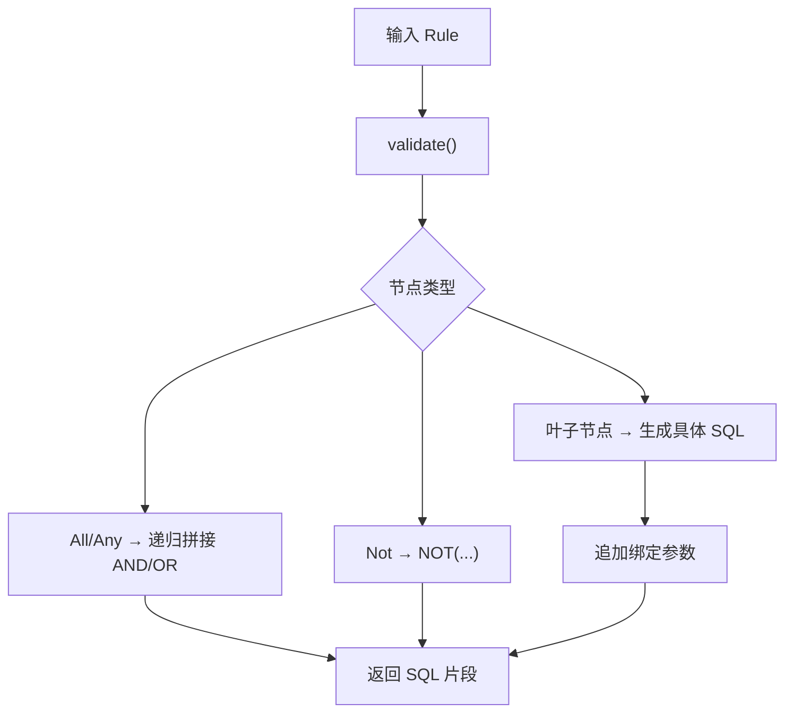

**图示来源**
- [rules.rs:1-53](../../../../crates/moriq-library/src/catalog/rules.rs#L1-L53)

**章节来源**
- [rules.rs:1-53](../../../../crates/moriq-library/src/catalog/rules.rs#L1-L53)

### 语义搜索参数序列化
语义相关字段主要通过 JSON 序列化传递：
- `semantic_ids`：序列化为 JSON 字符串后绑定到 `?22`，配合 `json_each` 判断资产是否在语义列表中；
- `themes`：序列化为 JSON 字符串后绑定，用于排除不包含指定主题的资产；
- `semantic_active`：不仅参与主题过滤，还影响排序逻辑，使结果优先按语义 ID 列表顺序排列。

这种设计允许 UI 将集合型语义信息一次性传给数据库，并通过 SQLite JSON 函数进行集合操作。

**章节来源**
- [query.rs:40-110](../../../../crates/moriq-library/src/catalog/query.rs#L40-L110)

### 查询快照与分页
`query_snapshot` 临时表用于保存排序后的资产 ID 列表及其位置序号：
- 表结构包含 `position` 主键与 `asset_id`；
- 首次非空查询会清空并重建该表；
- 查询结束后统计行数得到总数；
- 分页时按 `position` 区间读取，避免深层 OFFSET 带来的性能退化；
- 如果再次使用相同的 `Query`，可直接复用缓存的总数。

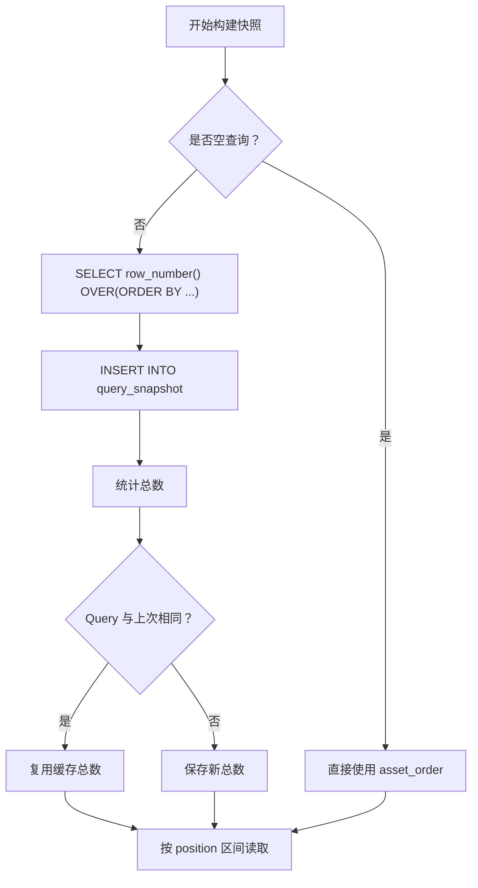

**图示来源**
- [query.rs:100-180](../../../../crates/moriq-library/src/catalog/query.rs#L100-L180)
- [schema.sql:15-22](../../../../crates/moriq-library/src/database/schema.sql#L15-L22)

**章节来源**
- [query.rs:100-180](../../../../crates/moriq-library/src/catalog/query.rs#L100-L180)
- [schema.sql:15-22](../../../../crates/moriq-library/src/database/schema.sql#L15-L22)

## 依赖关系分析
查询构建的关键依赖如下：

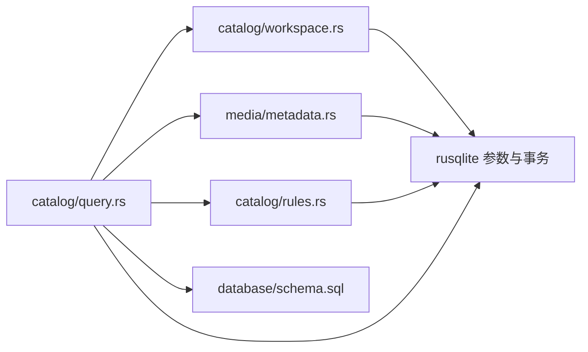

**图示来源**
- [query.rs:1-180](../../../../crates/moriq-library/src/catalog/query.rs#L1-L180)
- [workspace.rs:158-176](../../../../crates/moriq-library/src/catalog/workspace.rs#L158-L176)
- [metadata.rs:110-152](../../../../crates/moriq-library/src/media/metadata.rs#L110-L152)
- [rules.rs:1-53](../../../../crates/moriq-library/src/catalog/rules.rs#L1-L53)
- [schema.sql:1-42](../../../../crates/moriq-library/src/database/schema.sql#L1-L42)

**章节来源**
- [query.rs:1-180](../../../../crates/moriq-library/src/catalog/query.rs#L1-L180)
- [workspace.rs:158-176](../../../../crates/moriq-library/src/catalog/workspace.rs#L158-L176)
- [metadata.rs:110-152](../../../../crates/moriq-library/src/media/metadata.rs#L110-L152)
- [rules.rs:1-53](../../../../crates/moriq-library/src/catalog/rules.rs#L1-L53)
- [schema.sql:1-42](../../../../crates/moriq-library/src/database/schema.sql#L1-L42)

## 性能考量
- **FTS 优先**：较长文本查询使用预建 FTS 表，避免全表 `LIKE`；短文本回退到 `instr`，降低小查询的索引维护成本。
- **工作区精确匹配**：工作区模式强制 `project_exact=true`，避免递归 CTE 展开项目树。
- **快照缓存**：相同 `Query` 复用总数，避免重复计算；临时表加唯一索引保证稳定分页。
- **轻量项目页**：纯项目页面只维护成员与顺序，跳过大量可选 AI 与筛选视图。
- **批量标签加载**：对一页内资产批量加载标签，避免逐条展开 AI 视图。
- **参数化绑定**：所有用户输入通过 rusqlite 参数绑定，避免注入和重复编译。

[本节为通用性能讨论，不直接分析具体代码行]

## 故障排查指南
常见错误与处理模式：

| 场景 | 错误表现 | 原因 | 建议处理 |
|---|---|---|---|
| 工作区与查询项目不一致 | 返回无效参数错误 | `workspace_query` 检测到会话范围与请求项目冲突 | 重新打开页面或刷新工作区 |
| 元数据条件过多 | 返回“最多 32 个元数据条件” | `metadata::compile` 限制谓词数量 | 合并或拆分筛选条件 |
| 元数据字段无效 | 返回“元数据字段、文字或范围无效” | 字段不在白名单、文字过长或范围颠倒 | 检查字段名、长度与上下界 |
| 元数据条件为空 | 返回“元数据检索条件为空” | 传入谓词列表未生成任何条件 | 至少提供一个有效谓词 |
| 规则树非法 | 返回无效参数错误 | `rules::compile` 的 `validate` 失败 | 检查规则组合与叶子节点值 |
| 语义搜索序列化失败 | 返回无效参数错误 | `serde_json` 序列化失败 | 检查 `semantic_ids` 与 `themes` 数据结构 |
| 查询缓慢 | 分页或总数计算耗时 | 未命中快照或使用了复杂条件 | 确认是否重复相同查询、是否启用工作区精确匹配 |

**章节来源**
- [workspace.rs:158-176](../../../../crates/moriq-library/src/catalog/workspace.rs#L158-L176)
- [metadata.rs:110-152](../../../../crates/moriq-library/src/media/metadata.rs#L110-L152)
- [rules.rs:1-53](../../../../crates/moriq-library/src/catalog/rules.rs#L1-L53)
- [query.rs:30-120](../../../../crates/moriq-library/src/catalog/query.rs#L30-L120)

## 结论
Moriq Space 的查询构建机制以 `Library::page` 为中心，围绕 `workspace_query` 的工作区隔离、`WHERE_HEAD/WHERE_TAIL` 的主条件骨架、FTS 与普通匹配的检索策略、JSON 序列化的语义参数、元数据与规则引擎的扩展点，以及 `query_snapshot` 的稳定分页缓存组成完整体系。其设计重点在于：
- 安全性：所有用户输入参数化；
- 可扩展性：元数据与规则树作为条件扩展点；
- 性能：FTS、精确项目匹配、快照缓存与轻量项目页；
- 稳定性：临时表与位置排序避免深层 OFFSET。

对于使用者而言，合理组合 `Query` 字段、保持工作区一致、避免过度复杂的元数据与规则条件，可以获得更可预测且高效的查询体验。