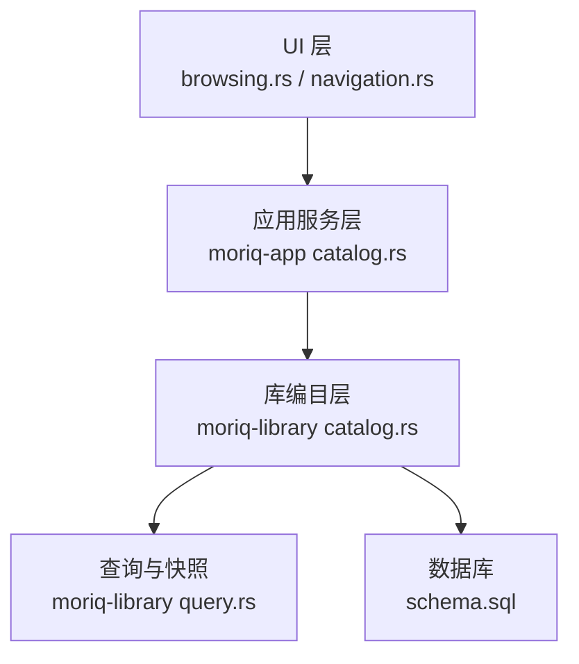
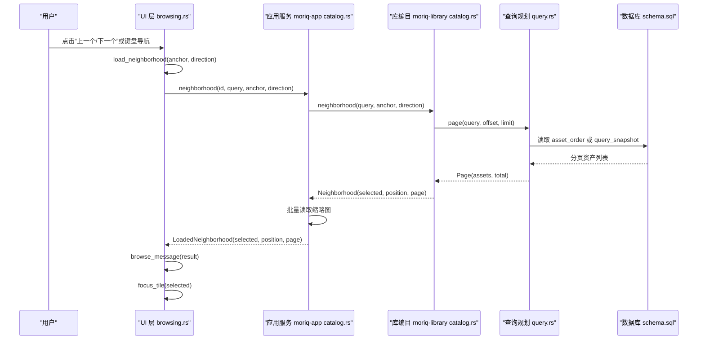
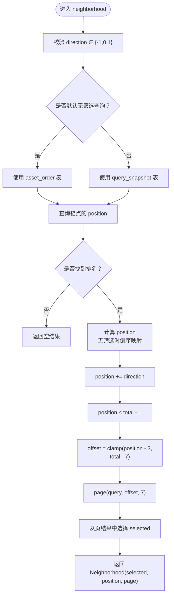
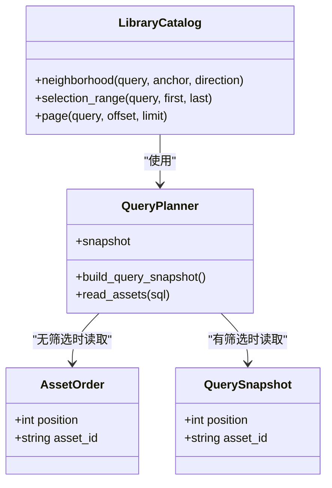
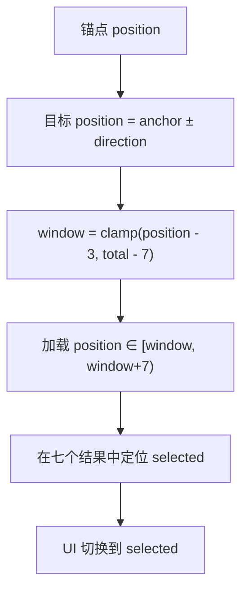
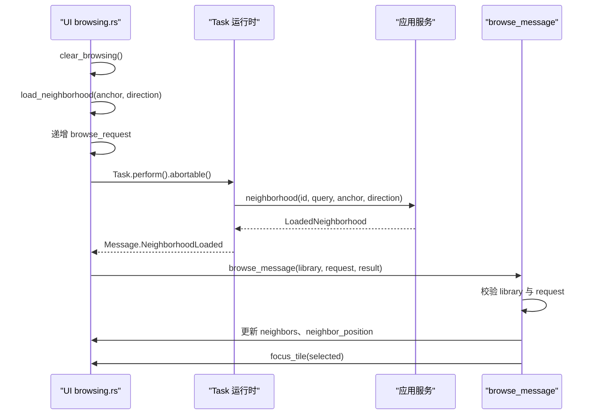
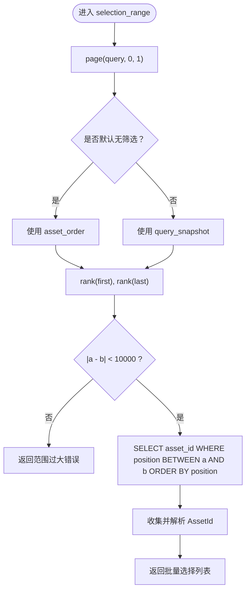
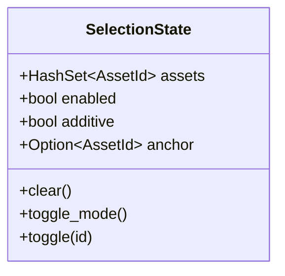
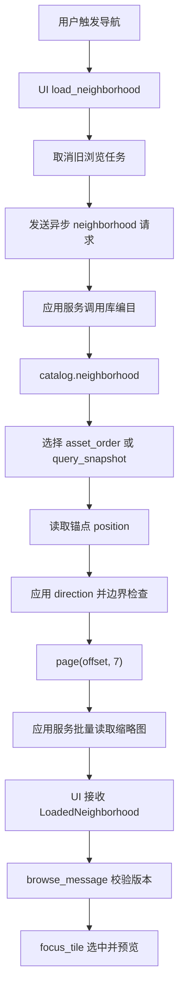
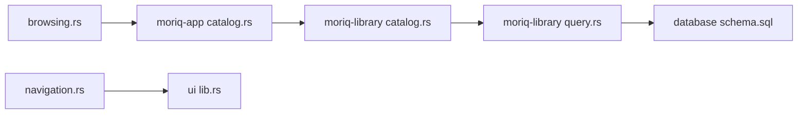

# 相邻素材导航

> Repo Wiki 节点 `neighborhood-navigation`
> 导出自 Qoder 知识库快照 `8fbe02f6-57c2-4874-b725-1a8130851fd9`，代码基线 `7a7a8e75e18bd90294e09cd422dd7ed5a04813a0`（分支 main，zh-CN）。

<cite>
**本文引用的文件**   
- [catalog.rs](../../../../crates/moriq-library/src/catalog/catalog.rs)
- [query.rs](../../../../crates/moriq-library/src/catalog/query.rs)
- [schema.sql](../../../../crates/moriq-library/src/database/schema.sql)
- [catalog.rs](../../../../crates/moriq-app/src/catalog.rs)
- [navigation.rs](../../../../crates/moriq-ui/src/navigation.rs)
- [browsing.rs](../../../../crates/moriq-ui/src/browsing.rs)
- [selection.rs](../../../../crates/moriq-ui/src/selection.rs)
- [lib.rs](../../../../crates/moriq-ui/src/lib.rs)
</cite>

## 目录
1. [引言](#引言)
2. [项目结构](#项目结构)
3. [核心组件](#核心组件)
4. [架构总览](#架构总览)
5. [详细组件分析](#详细组件分析)
6. [依赖关系分析](#依赖关系分析)
7. [性能考量](#性能考量)
8. [故障诊断与排错](#故障诊断与排错)
9. [结论](#结论)

## 引言
本文围绕“相邻素材导航”功能，系统梳理从用户交互到数据库查询、再到 UI 状态同步的完整链路。重点解释：
- 后端 `neighborhood` 方法如何根据锚点素材的定位字段查找前后邻居；
- `direction` 参数的方向控制与边界保护；
- 无筛选时使用 `asset_order`，有筛选时使用 `query_snapshot` 的选择逻辑；
- 跨分页定位与仅加载少量周边素材的设计；
- UI 层 `load_neighborhood` 的异步请求、任务取消、版本校验和状态同步；
- 批量选择 `selection_range` 的位置计算、范围限制与错误处理；
- 导航流程图、UI 交互时序图，以及卡顿问题的诊断与优化建议。

## 项目结构
相邻素材导航涉及三层：
- UI 层：负责触发导航、展示结果、管理浏览状态和预览；
- 应用服务层：负责线程计划、缩略图读取、封装结果；
- 库编目层：负责查询规划、排序、分页、位置索引表访问。

**图表来源**
- [browsing.rs:1-214](../../../../crates/moriq-ui/src/browsing.rs#L1-L214)
- [catalog.rs](../../../../crates/moriq-app/src/catalog.rs)
- [catalog.rs](../../../../crates/moriq-library/src/catalog/catalog.rs)
- [query.rs:120-185](../../../../crates/moriq-library/src/catalog/query.rs#L120-L185)
- [schema.sql:1-42](../../../../crates/moriq-library/src/database/schema.sql#L1-L42)

**章节来源**
- [browsing.rs:1-214](../../../../crates/moriq-ui/src/browsing.rs#L1-L214)
- [catalog.rs](../../../../crates/moriq-app/src/catalog.rs)
- [catalog.rs](../../../../crates/moriq-library/src/catalog/catalog.rs)
- [query.rs:120-185](../../../../crates/moriq-library/src/catalog/query.rs#L120-L185)
- [schema.sql:1-42](../../../../crates/moriq-library/src/database/schema.sql#L1-L42)

## 核心组件
- 库编目层 `neighborhood`：基于当前查询和锚点素材，返回选中素材及其附近最多七条素材，并附带全局位置信息。
- 库编目层 `selection_range`：基于两个锚点，按当前位置顺序返回批量选择的素材 ID 列表，并限制最大范围。
- 查询层 `page`：维护 `asset_order` 与 `query_snapshot` 两套顺序表，实现无筛选与带筛选时的分页读取。
- 应用服务层 `neighborhood`：在线程安全的计划上下文中执行编目查询，并批量读取缩略图，返回可渲染结果。
- UI 层 `load_neighborhood`：发起异步请求、取消旧请求、校验响应版本、更新邻居缓存与焦点。
- UI 层 `browse_message`：处理邻接结果回执，完成视图选择与预览切换。
- UI 层 `focus_tile`：协调预览、详情、标签输入等状态，避免重复解码与无效刷新。

**章节来源**
- [catalog.rs](../../../../crates/moriq-library/src/catalog/catalog.rs)
- [query.rs:120-185](../../../../crates/moriq-library/src/catalog/query.rs#L120-L185)
- [catalog.rs](../../../../crates/moriq-app/src/catalog.rs)
- [browsing.rs:1-214](../../../../crates/moriq-ui/src/browsing.rs#L1-L214)
- [lib.rs:1-260](../../../../crates/moriq-ui/src/lib.rs#L1-L260)

## 架构总览
相邻素材导航的整体数据流如下：

**图表来源**
- [browsing.rs:1-214](../../../../crates/moriq-ui/src/browsing.rs#L1-L214)
- [catalog.rs](../../../../crates/moriq-app/src/catalog.rs)
- [catalog.rs](../../../../crates/moriq-library/src/catalog/catalog.rs)
- [query.rs:120-185](../../../../crates/moriq-library/src/catalog/query.rs#L120-L185)
- [schema.sql:1-42](../../../../crates/moriq-library/src/database/schema.sql#L1-L42)

## 详细组件分析

### 后端 `neighborhood` 算法与边界检查
`neighborhood` 的核心目标是：在“当前查询所对应的排序顺序”中，找到锚点素材的前后邻居，并返回一个适合快速查看的小窗口。

关键步骤：
1. 使用当前工作区与查询构造作用域查询对象。
2. 校验 `direction` 必须为 `-1`、`0` 或 `1`，否则返回无效参数错误。
3. 判断是否为默认无筛选查询：
   - 无筛选：使用 `asset_order` 表；
   - 有筛选：使用 `query_snapshot` 表。
4. 通过 `position` 字段查询锚点素材在全局顺序中的排名。
5. 将排名转换为页面中的相对位置：
   - 无筛选时采用倒序映射；
   - 有筛选时直接使用排名。
6. 按 `direction` 调整目标位置，并使用饱和加法与最大值上限进行边界保护，防止越界。
7. 计算起始偏移，使窗口始终包含锚点附近区域，且固定长度不超过七个条目。
8. 调用 `page` 获取一页素材，再从结果中定位选中素材。

**图表来源**
- [catalog.rs](../../../../crates/moriq-library/src/catalog/catalog.rs)

**章节来源**
- [catalog.rs](../../../../crates/moriq-library/src/catalog/catalog.rs)

#### `direction` 参数处理
- `-1`：向前移动一个邻居；
- `0`：保持当前位置；
- `1`：向后移动一个邻居；
- 其他值直接拒绝，避免非法导航。

#### 边界检查
- 使用饱和加法保证不会下溢；
- 使用 `min(total - 1)` 保证不会超过最后一个素材；
- 窗口偏移通过 `saturating_sub(3)` 和 `min(total.saturating_sub(7))` 控制，确保窗口大小稳定且不越界。

### `asset_order` 与 `query_snapshot` 的选择逻辑
系统维护两种顺序索引：
- `asset_order`：记录所有资产的追加顺序，作为无筛选浏览的基础；
- `query_snapshot`：为带筛选或特定项目的查询生成临时快照，记录该查询下的 `position` 与 `asset_id`。

**图表来源**
- [catalog.rs](../../../../crates/moriq-library/src/catalog/catalog.rs)
- [query.rs:120-185](../../../../crates/moriq-library/src/catalog/query.rs#L120-L185)
- [schema.sql:1-42](../../../../crates/moriq-library/src/database/schema.sql#L1-L42)

#### 选择规则
- 当查询等于默认查询时，说明没有额外筛选条件，直接使用 `asset_order`；
- 否则创建或复用 `query_snapshot` 临时表，并通过窗口函数计算每个资产在该查询下的 `position`；
- `page` 在读取时也会根据是否无筛选决定源表、排序方向和分页区间。

#### `query_snapshot` 构建过程
- 若命中已缓存的查询快照，则直接使用缓存计数；
- 否则清空临时表并插入新快照；
- 对纯项目页面的查询做了优化，只关联必要表，避免复杂视图带来的开销；
- 最终统计总数并缓存 `(query, count)`。

**章节来源**
- [query.rs:120-185](../../../../crates/moriq-library/src/catalog/query.rs#L120-L185)
- [schema.sql:1-42](../../../../crates/moriq-library/src/database/schema.sql#L1-L42)

### 跨分页的邻居查找算法
`neighborhood` 并不要求目标邻居一定位于当前可视页。它的工作方式是：
1. 先拿到锚点的全局 `position`；
2. 按 `direction` 计算目标位置；
3. 以目标位置为中心，选取前后若干位置，构成一个固定长度的窗口；
4. 调用 `page(offset, 7)` 获取这七个素材；
5. 从这七个素材中定位 `selected`。

这样设计的好处是：
- 无论锚点在哪一页，都能用少量数据完成邻居跳转；
- 避免了深 `OFFSET` 扫描；
- 保持了 UI 上“小窗预览 + 快速跳转”的体验。

**图表来源**
- [catalog.rs](../../../../crates/moriq-library/src/catalog/catalog.rs)

**章节来源**
- [catalog.rs](../../../../crates/moriq-library/src/catalog/catalog.rs)

### UI 层 `load_neighborhood` 的异步流程、任务取消与状态同步
UI 层通过 `load_neighborhood` 发起异步导航请求，关键点包括：
- 如果存在正在进行的浏览任务，先中止旧任务；
- 递增 `browse_request` 版本号，用于丢弃过期结果；
- 克隆当前库标识、查询和服务句柄；
- 使用 `Task::perform` 加 `.abortable()` 包装异步调用；
- 保存 handle 以便后续取消；
- 回执处理器 `browse_message` 会校验库标识和请求版本，只有最新请求才更新状态。

**图表来源**
- [browsing.rs:1-214](../../../../crates/moriq-ui/src/browsing.rs#L1-L214)
- [lib.rs:1-260](../../../../crates/moriq-ui/src/lib.rs#L1-L260)

#### 任务取消
- `clear_browsing` 会清理预览、滚动恢复状态、比较面板，并取出 `browse_task` 调用 `abort()`；
- 同时重置 `neighbors`、`neighbor_position`、`pending_scroll` 等状态，避免旧结果污染新浏览；
- `browse_request` 自增，使旧回调被忽略。

#### 状态同步
- `browse_message` 仅在 `browse_request == request` 且库标识一致时才接受结果；
- 成功后设置 `neighbor_position` 与 `neighbors`，并尝试定位选中素材；
- 若锚点不再存在于当前查询，则清空选中项和预览，并显示提示。

**章节来源**
- [browsing.rs:1-214](../../../../crates/moriq-ui/src/browsing.rs#L1-L214)
- [lib.rs:1-260](../../../../crates/moriq-ui/src/lib.rs#L1-L260)

### `selection_range` 的批量选择逻辑
`selection_range` 用于根据两个锚点素材，批量选择它们之间的所有素材。其逻辑要点：
1. 使用当前查询构造作用域查询；
2. 调用一次 `page(query, 0, 1)`，强制初始化查询上下文；
3. 根据是否无筛选选择 `asset_order` 或 `query_snapshot`；
4. 分别查询两个锚点的 `position`；
5. 若两位置差的绝对值达到或超过一万，返回错误，限制单次范围选择规模；
6. 按 `position BETWEEN min(a,b) AND max(a,b)` 查询中间所有 `asset_id`；
7. 按 `position` 排序返回结果。

**图表来源**
- [catalog.rs](../../../../crates/moriq-library/src/catalog/catalog.rs)

#### 位置计算
- 通过 `position` 表示素材在当前查询顺序中的排名；
- 无需加载全部素材即可确定两个素材之间的范围。

#### 范围限制
- 当两位置差大于等于一万时直接报错；
- 这个限制避免一次性选择过多素材导致 UI 卡顿或内存压力。

**章节来源**
- [catalog.rs](../../../../crates/moriq-library/src/catalog/catalog.rs)

### UI 层选择状态模型
UI 层的选择状态由 `SelectionState` 管理，包含：
- 已选素材集合；
- 是否启用批量选择；
- 是否多选模式；
- 批量选择锚点。

重要行为：
- `clear` 会清空选择集合与锚点，避免旧查询泄漏；
- `toggle_mode` 切换模式时清空选择；
- `toggle` 切换单个素材选择状态，并设置锚点；
- 测试验证了重置后锚点消失，以及 Synco 轮询退避策略。

**图表来源**
- [selection.rs:1-88](../../../../crates/moriq-ui/src/selection.rs#L1-L88)

**章节来源**
- [selection.rs:1-88](../../../../crates/moriq-ui/src/selection.rs#L1-L88)

### 导航流程图
以下流程图汇总用户操作到数据落地的完整路径：

**图表来源**
- [browsing.rs:1-214](../../../../crates/moriq-ui/src/browsing.rs#L1-L214)
- [catalog.rs](../../../../crates/moriq-app/src/catalog.rs)
- [catalog.rs](../../../../crates/moriq-library/src/catalog/catalog.rs)
- [query.rs:120-185](../../../../crates/moriq-library/src/catalog/query.rs#L120-L185)

## 依赖关系分析
- UI 层依赖应用服务提供的 `neighborhood` 异步接口；
- 应用服务依赖库编目的同步 `neighborhood` 方法，并在完成后读取缩略图；
- 库编目依赖查询规划器进行分页与顺序表选择；
- 查询规划器依赖数据库中的 `asset_order` 与 `query_snapshot`；
- 导航历史与浏览状态在 UI 层独立维护，避免与数据层耦合。

**图表来源**
- [browsing.rs:1-214](../../../../crates/moriq-ui/src/browsing.rs#L1-L214)
- [catalog.rs](../../../../crates/moriq-app/src/catalog.rs)
- [catalog.rs](../../../../crates/moriq-library/src/catalog/catalog.rs)
- [query.rs:120-185](../../../../crates/moriq-library/src/catalog/query.rs#L120-L185)
- [schema.sql:1-42](../../../../crates/moriq-library/src/database/schema.sql#L1-L42)
- [navigation.rs:1-200](../../../../crates/moriq-ui/src/navigation.rs#L1-L200)
- [lib.rs:1-260](../../../../crates/moriq-ui/src/lib.rs#L1-L260)

**章节来源**
- [browsing.rs:1-214](../../../../crates/moriq-ui/src/browsing.rs#L1-L214)
- [catalog.rs](../../../../crates/moriq-app/src/catalog.rs)
- [catalog.rs](../../../../crates/moriq-library/src/catalog/catalog.rs)
- [query.rs:120-185](../../../../crates/moriq-library/src/catalog/query.rs#L120-L185)
- [schema.sql:1-42](../../../../crates/moriq-library/src/database/schema.sql#L1-L42)
- [navigation.rs:1-200](../../../../crates/moriq-ui/src/navigation.rs#L1-L200)
- [lib.rs:1-260](../../../../crates/moriq-ui/src/lib.rs#L1-L260)

## 性能考量
- 小窗口加载：`neighborhood` 只加载最多七个素材，降低数据库与 UI 渲染压力；
- 位置索引优先：通过 `position` 直接计算邻居，避免全表扫描；
- 无筛选优化：默认查询走 `asset_order`，减少连接和过滤成本；
- 查询快照缓存：`query_snapshot` 在相同查询下复用计数，避免重复计算；
- 项目页面优化：纯项目查询跳过 AI/搜索视图，减少无用规划；
- 异步与取消：UI 层通过 `abortable` 和请求版本号避免陈旧任务影响；
- 缩略图计划：应用服务根据缩略图内存预算选择线程数量，避免解码阻塞主线程；
- 批量选择上限：`selection_range` 限制一万以内范围，防止大规模选择导致卡顿。

[本节为通用性能讨论，不直接分析具体代码行]

## 故障诊断与排错
常见问题与排查思路：

1. **导航无响应或跳转到错误素材**
   - 检查 `direction` 是否合法；
   - 检查锚点是否存在于当前查询；
   - 检查 `neighbor_position` 是否与当前页一致；
   - 确认 `browse_request` 版本未被旧回调覆盖。

2. **切换查询后邻居仍指向旧结果**
   - 确认 `clear_browsing` 是否调用了 `abort()` 并清空 `neighbors`；
   - 确认 `browse_message` 拒绝了非当前库或非当前请求的结果；
   - 检查 UI 是否重新触发了 `load_neighborhood`。

3. **大数据量下导航卡顿**
   - 观察是否频繁重建 `query_snapshot`；
   - 检查是否在一次操作中连续触发多次导航；
   - 评估缩略图内存预算是否过小，导致线程数过少；
   - 检查是否误用大范围 `selection_range`。

4. **批量选择失败**
   - 查看是否触发“一次范围选择最多一万张”的错误；
   - 确认两个锚点都存在于当前查询；
   - 检查 `position` 查询是否因筛选条件变化而失效。

5. **UI 状态不同步**
   - 检查 `focus_tile` 是否因预览任务或背景预览存在而短路；
   - 检查 `restored_notes` 是否与当前资产匹配；
   - 检查 `viewer.selected` 与 `viewer.preview` 是否一致。

**章节来源**
- [browsing.rs:1-214](../../../../crates/moriq-ui/src/browsing.rs#L1-L214)
- [catalog.rs](../../../../crates/moriq-library/src/catalog/catalog.rs)
- [catalog.rs](../../../../crates/moriq-app/src/catalog.rs)
- [selection.rs:1-88](../../../../crates/moriq-ui/src/selection.rs#L1-L88)

## 结论
相邻素材导航是一个以“位置索引 + 小窗口加载 + 异步任务治理”为核心的功能模块。它通过 `position` 字段将复杂的跨页导航简化为整数运算，并通过 `asset_order` 与 `query_snapshot` 的双表机制兼顾无筛选高性能与有筛选正确性。UI 层通过请求版本号和任务取消机制保证状态一致性，配合 `focus_tile` 的状态协调，提供了流畅的浏览体验。对于大数据集场景，应重点关注查询快照重建频率、缩略图解码计划和批量选择范围限制，以避免导航卡顿。