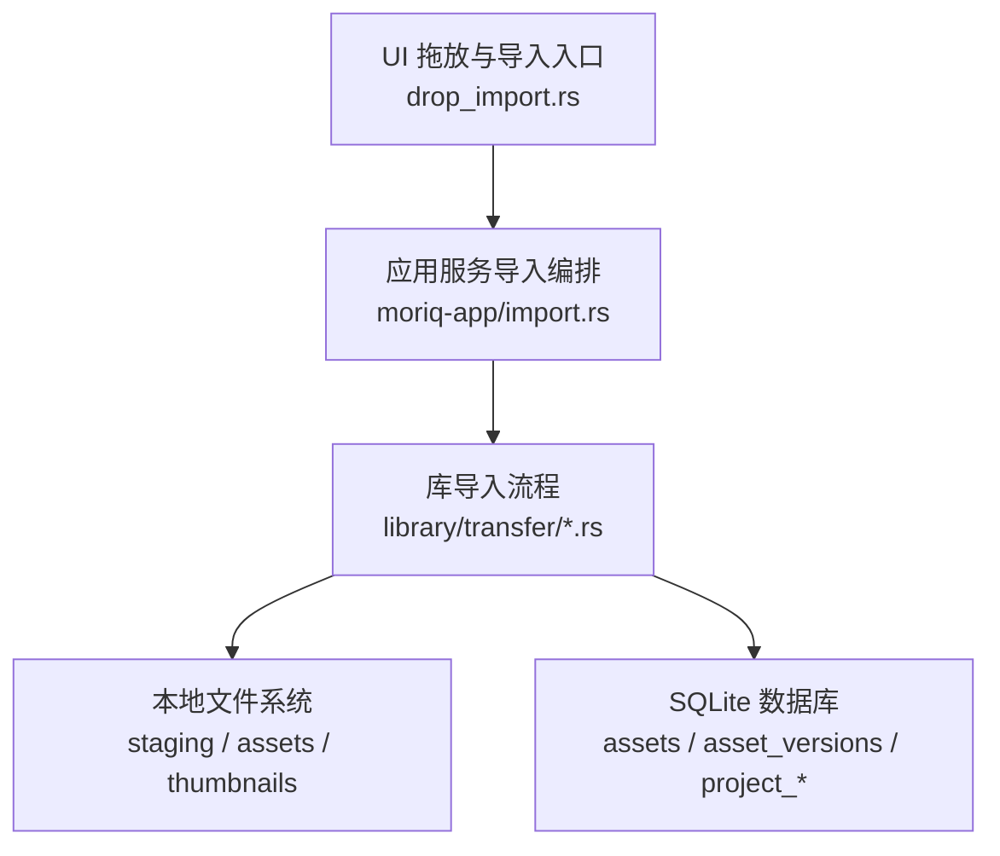
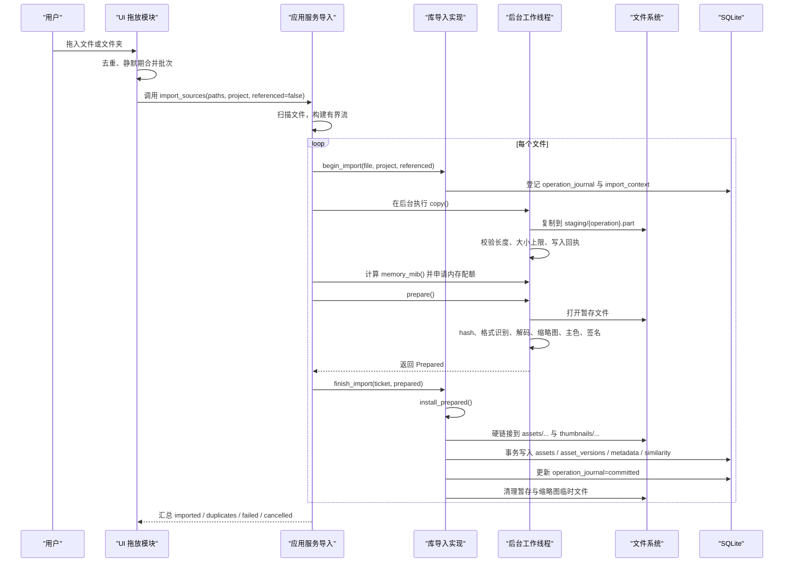
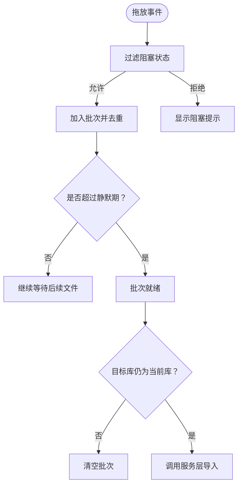
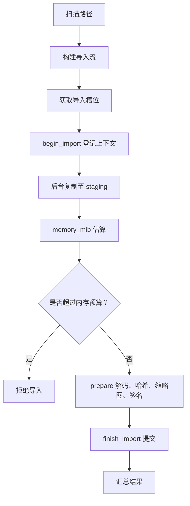
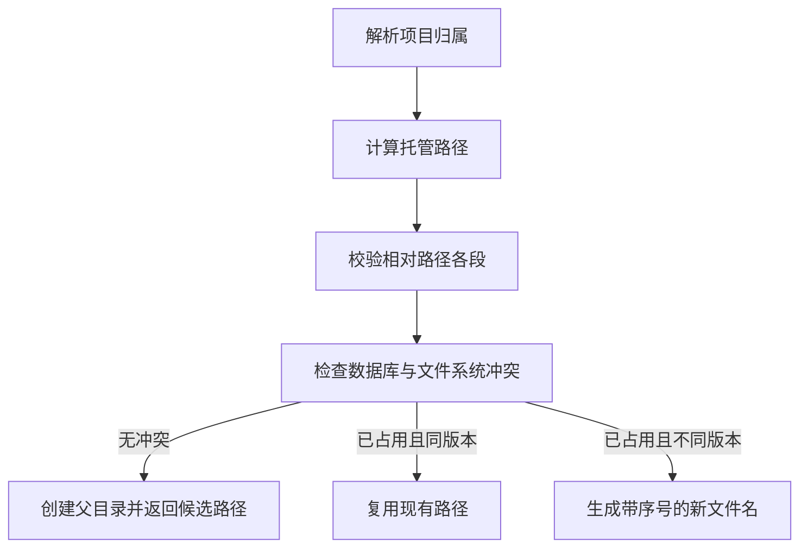
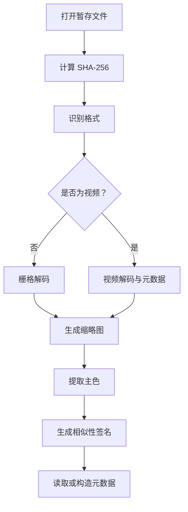
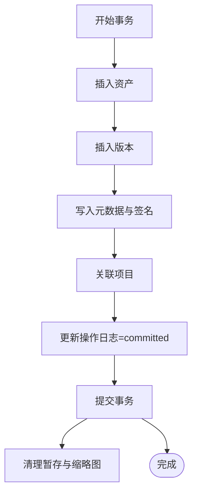
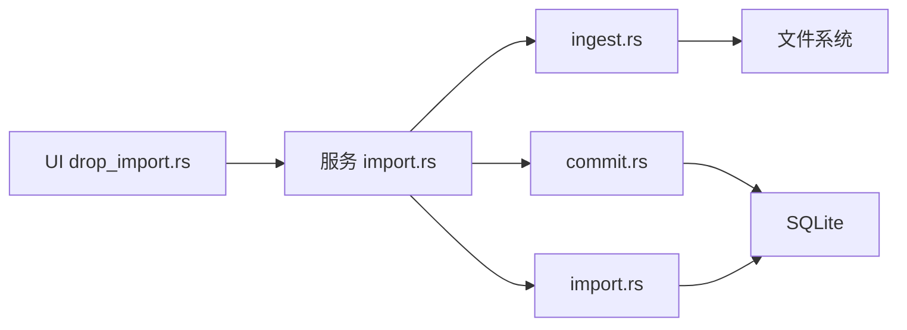

# 素材导入数据流

> Repo Wiki 节点 `import-data-flow`
> 导出自 Qoder 知识库快照 `8fbe02f6-57c2-4874-b725-1a8130851fd9`，代码基线 `7a7a8e75e18bd90294e09cd422dd7ed5a04813a0`（分支 main，zh-CN）。

<cite>
**本文引用的文件**   
- [apps/apps/desktop/src/main.rs](../../../apps/apps/desktop/src/main.rs)
- [crates/moriq-app/src/import.rs](../../../crates/moriq-app/src/import.rs)
- [crates/moriq-library/src/transfer/import.rs](../../../crates/moriq-library/src/transfer/import.rs)
- [crates/moriq-library/src/transfer/ingest.rs](../../../crates/moriq-library/src/transfer/ingest.rs)
- [crates/moriq-library/src/transfer/commit.rs](../../../crates/moriq-library/src/transfer/commit.rs)
- [crates/moriq-ui/src/drop_import.rs](../../../crates/moriq-ui/src/drop_import.rs)
</cite>

## 目录
1. [引言](#引言)
2. [项目结构](#项目结构)
3. [核心组件](#核心组件)
4. [架构总览](#架构总览)
5. [详细组件分析](#详细组件分析)
6. [依赖关系分析](#依赖关系分析)
7. [性能考虑](#性能考虑)
8. [故障诊断指南](#故障诊断指南)
9. [结论](#结论)

## 引言
本文面向 Moriq Space 的“素材导入”能力，聚焦从用户选择文件到素材入库的完整数据流。内容覆盖以下关键阶段：文件验证、路径解析、项目归属确定、托管位置分配、媒体解码、版本创建、索引建立和预览生成；同时区分“托管导入”与“外部引用”两种模式，说明目录命名规则、冲突处理、数据库事务边界及回滚策略，并给出常见问题的诊断方法和性能优化建议。

## 项目结构
导入功能横跨桌面 UI、应用服务层与库实现层：

- 桌面 UI 负责接收拖放或选择事件、合并批量文件、维护导入状态并向服务层发起导入请求。
- 应用服务层负责并发扫描、内存与任务槽位准入控制、票据生命周期管理、取消信号传递和结果汇总。
- 库实现层负责安全路径校验、项目归属解析、托管目录布局、媒体解码、缩略图生成、去重、元数据和相似度签名写入，以及最终数据库提交。

**图表来源**
- [crates/moriq-ui/src/drop_import.rs:1-200](../../../crates/moriq-ui/src/drop_import.rs#L1-L200)
- [crates/moriq-app/src/import.rs:201-478](../../../crates/moriq-app/src/import.rs#L201-L478)
- [crates/moriq-library/src/transfer/commit.rs:11-293](../../../crates/moriq-library/src/transfer/commit.rs#L11-L293)
- [crates/moriq-library/src/transfer/ingest.rs:1-200](../../../crates/moriq-library/src/transfer/ingest.rs#L1-L200)

**章节来源**
- [crates/moriq-ui/src/drop_import.rs:1-200](../../../crates/moriq-ui/src/drop_import.rs#L1-L200)
- [crates/moriq-app/src/import.rs:201-478](../../../crates/moriq-app/src/import.rs#L201-L478)

## 核心组件
- UI 拖放与批量收集：将平台文件事件转为内部批次，使用静默期合并连续拖放，防止重复和状态破坏。
- 服务层导入编排：扫描文件、并发限制、内存预算、票据获取、复制、解码、提交、失败清理与恢复标记。
- 库层导入实现：文件尺寸校验、操作日志登记、托管路径计算、硬链接安装、去重判断、版本与资产记录、元数据与签名写入。
- 媒体解码与预处理：哈希、格式识别、视频或栅格解码、缩略图生成、主色提取、相似性签名、元数据读取。
- 外部引用模式：不复制原片，仅校验源文件哈希后记录文件位置，并在提交时再次校验。

**章节来源**
- [crates/moriq-ui/src/drop_import.rs:1-200](../../../crates/moriq-ui/src/drop_import.rs#L1-L200)
- [crates/moriq-app/src/import.rs:201-478](../../../crates/moriq-app/src/import.rs#L201-L478)
- [crates/moriq-library/src/transfer/import.rs:1-200](../../../crates/moriq-library/src/transfer/import.rs#L1-L200)
- [crates/moriq-library/src/transfer/ingest.rs:1-200](../../../crates/moriq-library/src/transfer/ingest.rs#L1-L200)
- [crates/moriq-library/src/transfer/commit.rs:11-293](../../../crates/moriq-library/src/transfer/commit.rs#L11-L293)

## 架构总览
下图展示一次典型托管导入的时序交互，包括 UI、服务层、库层、文件系统与数据库。

**图表来源**
- [crates/moriq-ui/src/drop_import.rs:200-552](../../../crates/moriq-ui/src/drop_import.rs#L200-L552)
- [crates/moriq-app/src/import.rs:201-478](../../../crates/moriq-app/src/import.rs#L201-L478)
- [crates/moriq-library/src/transfer/ingest.rs:1-200](../../../crates/moriq-library/src/transfer/ingest.rs#L1-L200)
- [crates/moriq-library/src/transfer/commit.rs:11-293](../../../crates/moriq-library/src/transfer/commit.rs#L11-L293)

## 详细组件分析

### UI 拖放与批量导入
UI 层将平台文件事件转换为内部消息，按目标资源库和项目分组为批次。其关键行为如下：

- 过滤阻塞状态：未打开资源库、切换中、忙碌、面板打开、垃圾桶视图、正在停止导入等都会拒绝立即导入。
- 静默期合并：相同目标的多条文件事件会在约 120 毫秒内合并为一个批次，避免频繁启动导入。
- 队列管理：批次保持原始 library/project 上下文；只有当前活跃库与批次一致时才启动导入。
- 启动导入：清空编辑界面，切换到资产视图，构造 ImportControl，并调用服务层的 `import_sources`。

**图表来源**
- [crates/moriq-ui/src/drop_import.rs:1-200](../../../crates/moriq-ui/src/drop_import.rs#L1-L200)
- [crates/moriq-ui/src/drop_import.rs:200-552](../../../crates/moriq-ui/src/drop_import.rs#L200-L552)

**章节来源**
- [crates/moriq-ui/src/drop_import.rs:1-200](../../../crates/moriq-ui/src/drop_import.rs#L1-L200)
- [crates/moriq-ui/src/drop_import.rs:200-552](../../../crates/moriq-ui/src/drop_import.rs#L200-L552)

### 服务层导入编排
服务层承担高并发导入编排职责，核心逻辑包括：

- 扫描与流式处理：使用有界通道扫描多个路径，边扫描边消费，支持取消。
- 并发与工作槽位：通过 `buffer_unordered` 控制并发数量，并通过导入槽位信号量限制同时处理的导入任务数。
- 内存预算：为单次解码估算所需内存，若超出配置上限则拒绝；同时限制全局解码内存和批处理探针内存。
- 票据生命周期：`begin_import` 登记操作日志，`copy` 在后台复制，`prepare` 解码并生成缩略图和签名，`finish_import` 提交结果。
- 失败与中断：解码失败或取消时标记操作为中断，保留可恢复的暂存信息，避免删除用户源文件。

**图表来源**
- [crates/moriq-app/src/import.rs:201-478](../../../crates/moriq-app/src/import.rs#L201-L478)
- [crates/moriq-library/src/transfer/ingest.rs:1-200](../../../crates/moriq-library/src/transfer/ingest.rs#L1-L200)

**章节来源**
- [crates/moriq-app/src/import.rs:201-478](../../../crates/moriq-app/src/import.rs#L201-L478)

### 库层导入与托管路径
库层负责具体文件导入、托管目录布局、去重与数据库提交。

#### 托管导入与外部引用的差异
- 托管导入：
  - 复制源文件到库根下的 `staging`，成功后硬链接到 `assets`。
  - 生成缩略图到 `thumbnails/256`。
  - 根据项目名或相对路径计算目标路径。
  - 写入 `assets`、`asset_versions`、`project_assets`、`video_metadata`、`metadata`、相似性签名表。
- 外部引用：
  - 不复制源文件，也不写入 `assets` 下实际媒体副本。
  - 目标路径位于 `assets/referenced/{version}.{extension}`，但真实媒体仍在外部路径。
  - 在 `file_locations` 中记录外部文件的平台编码路径。
  - 提交前会再次校验外部源文件哈希，确保未发生变化。

#### 项目归属与目录命名规则
- 项目归属优先级：
  - 显式传入的项目 ID。
  - 扫描结果中的 `project_name`，若不存在则查找同名顶级项目，否则创建新顶级项目。
- 托管目录名称：
  - 项目存储目录来自 `project_storage.folder`，不存在时按项目名称生成候选名。
  - 名称需通过组件校验：不允许空值、`.`、`..`、危险字符、尾随空格或点、控制字符、超长 UTF-16、平台保留名称。
  - 若与已有项目存储目录冲突，按 `名称 (序号)` 递增重试，最多尝试一定次数。
- 文件相对路径：
  - 优先使用扫描结果中的 `relative`；否则以父目录加文件名作为 fallback。
  - 对相对路径各段进行组件校验。
  - 如果整个目录作为项目导入，且首段等于项目名，则去除冗余层级。
  - 最终形成 `assets/{folder}/{subpath}/{filename}`。
- 文件名冲突处理：
  - 先检查数据库 `asset_versions.path` 与 `project_files.path`。
  - 若占用的是同一旧版本，视为无需覆盖并直接复用该路径。
  - 否则按 `{stem} (序号).{ext}` 递增生成新文件名，直到找到空闲位置。
  - 若冲突过多，返回无效错误。

**图表来源**
- [crates/moriq-library/src/transfer/import.rs:1-200](../../../crates/moriq-library/src/transfer/import.rs#L1-L200)
- [crates/moriq-library/src/transfer/import.rs:200-352](../../../crates/moriq-library/src/transfer/import.rs#L200-L352)

**章节来源**
- [crates/moriq-library/src/transfer/import.rs:1-200](../../../crates/moriq-library/src/transfer/import.rs#L1-L200)
- [crates/moriq-library/src/transfer/import.rs:200-352](../../../crates/moriq-library/src/transfer/import.rs#L200-L352)

### 媒体解码与索引建立
媒体预处理在后台线程执行，主要产出包括：

- 文件哈希：用于去重与完整性校验。
- 格式识别：优先视频扩展名，其次原生 RAW 扩展名，再根据图像格式推断扩展名。
- 解码：视频走视频解码路径；栅格图片走栅格解码路径。
- 缩略图：生成 PNG 缩略图，保存于暂存目录。
- 主色与相似性签名：非视频媒体生成主色和相似性签名。
- 元数据：栅格媒体读取 EXIF 等元数据，视频媒体写入结构化元数据。
- 尺寸校验：拒绝零宽高，并结合像素乘积估算解码内存。

**图表来源**
- [crates/moriq-library/src/transfer/ingest.rs:1-200](../../../crates/moriq-library/src/transfer/ingest.rs#L1-L200)
- [crates/moriq-library/src/transfer/ingest.rs:200-442](../../../crates/moriq-library/src/transfer/ingest.rs#L200-L442)

**章节来源**
- [crates/moriq-library/src/transfer/ingest.rs:1-200](../../../crates/moriq-library/src/transfer/ingest.rs#L1-L200)
- [crates/moriq-library/src/transfer/ingest.rs:200-442](../../../crates/moriq-library/src/transfer/ingest.rs#L200-L442)

### 数据库事务边界与回滚策略
导入过程使用 SQLite 事务保证一致性，事务边界大致如下：

- 操作日志登记：在开始导入前插入 `operation_journal`，记录操作 ID、暂存路径与初始阶段。
- 导入上下文登记：记录平台、源路径、项目 ID、是否外部引用、相对路径。
- 安装阶段：
  - 复制完成后写入暂存回执。
  - 硬链接媒体与缩略图。
  - 开启事务写入资产、版本、元数据、相似性签名、项目关联。
  - 更新操作日志为已提交。
  - 提交事务。
- 去重分支：
  - 若内容已存在且不属于当前项目，则为该项目创建独立项目文件关联，而不是新增资产版本。
  - 若属于回收站，可能先将素材移出回收站以便复用。
- 失败与中断：
  - 正常失败：将操作日志更新为中断，保留 staging 和 journal，便于恢复。
  - 成功：清理暂存与缩略图临时文件，忘记导入上下文。
  - 外部引用：提交前再次校验源文件哈希，不一致则拒绝。

**图表来源**
- [crates/moriq-library/src/transfer/commit.rs:137-293](../../../crates/moriq-library/src/transfer/commit.rs#L137-L293)

**章节来源**
- [crates/moriq-library/src/transfer/commit.rs:11-293](../../../crates/moriq-library/src/transfer/commit.rs#L11-L293)
- [crates/moriq-library/src/transfer/ingest.rs:200-442](../../../crates/moriq-library/src/transfer/ingest.rs#L200-L442)

## 依赖关系分析
导入链路中组件之间的依赖如下：

- UI 依赖服务层接口，不直接访问文件系统或数据库。
- 服务层依赖库层 API，并通过信号量和原子布尔协调并发、内存与取消。
- 库层依赖文件系统进行暂存、硬链接、缩略图写入；依赖 SQLite 进行资产、版本、项目、元数据与相似性签名持久化。
- 媒体解码依赖原生解码与图像处理库，视频与栅格分别处理。

**图表来源**
- [crates/moriq-ui/src/drop_import.rs:1-200](../../../crates/moriq-ui/src/drop_import.rs#L1-L200)
- [crates/moriq-app/src/import.rs:201-478](../../../crates/moriq-app/src/import.rs#L201-L478)
- [crates/moriq-library/src/transfer/ingest.rs:1-200](../../../crates/moriq-library/src/transfer/ingest.rs#L1-L200)
- [crates/moriq-library/src/transfer/commit.rs:11-293](../../../crates/moriq-library/src/transfer/commit.rs#L11-L293)
- [crates/moriq-library/src/transfer/import.rs:1-200](../../../crates/moriq-library/src/transfer/import.rs#L1-L200)

**章节来源**
- [crates/moriq-app/src/import.rs:201-478](../../../crates/moriq-app/src/import.rs#L201-L478)
- [crates/moriq-library/src/transfer/ingest.rs:1-200](../../../crates/moriq-library/src/transfer/ingest.rs#L1-L200)
- [crates/moriq-library/src/transfer/commit.rs:11-293](../../../crates/moriq-library/src/transfer/commit.rs#L11-L293)
- [crates/moriq-library/src/transfer/import.rs:1-200](../../../crates/moriq-library/src/transfer/import.rs#L1-L200)

## 性能考虑
- 并发控制：
  - 使用 `buffer_unordered` 控制导入并发度，默认范围限制在较小数值，避免 UI 卡顿。
  - 使用导入槽位信号量限制同时进行的全局导入任务数。
- 内存预算：
  - 对单张图片解码估算内存，包含两个解码缓冲、压缩输入和工作区。
  - RAW 与非标准栅格格式采用更保守的内存估计；视频统一采用较大预算。
  - 像素乘积超过阈值时回退到固定预算，防止超大图像导致 OOM。
- 磁盘 I/O：
  - 使用分块复制与同步，减少大文件导入时的内存压力。
  - 使用硬链接安装，避免重复拷贝已确认安全的媒体。
- 去重优化：
  - 基于 SHA-256 与字节数快速判断重复，减少不必要解码。
  - 对重复内容在不同项目间复用版本，只新增项目关联或硬链接。
- 扫描优化：
  - 扫描与导入解耦，通过有界通道平衡发现与处理速度。
  - 扫描阶段排序并去重，避免重复导入。

[本节为通用性能建议，不直接分析具体代码行]

## 故障诊断指南

### 常见问题与定位方法
- 文件为空或超出文件大小预算：
  - 现象：导入失败，提示媒体超出文件大小预算或为空文件。
  - 原因：源文件长度为 0，或超过原生层文件限制。
  - 排查：检查文件大小与原生限制；重新下载或裁剪源文件。
- 相对路径非法或逃逸：
  - 现象：导入时报相对目录无效或无法无损表示。
  - 原因：相对路径包含危险字符、`..`、平台保留名称，或非安全路径。
  - 排查：检查扫描结果中的相对路径，重命名文件夹或文件。
- 托管目录冲突过多：
  - 现象：导入失败，提示项目目录名称冲突过多或同名文件过多。
  - 原因：项目存储目录或文件名长期被占用，序号递增达到上限。
  - 排查：清理残留项目存储目录或移动冲突文件到不同子目录。
- 引用源在导入期间变化：
  - 现象：外部引用导入失败，提示引用源发生变化。
  - 原因：外部源文件在复制后、提交前被修改，哈希不一致。
  - 排查：锁定外部源文件，避免其他进程修改；重新导入。
- 解码尺寸无效：
  - 现象：导入失败，提示图片尺寸无效。
  - 原因：解码后宽度或高度为 0。
  - 排查：检查媒体文件是否损坏；用其他播放器或解码器验证。
- 缩略图解码无像素：
  - 现象：导入失败，提示缩略图解码无像素。
  - 原因：缩略图解码结果为空。
  - 排查：检查暂存文件是否完整；确认格式是否受支持。
- 导入被取消或资源库切换：
  - 现象：导入失败，提示导入已停止或所属资源库已切换。
  - 原因：用户主动取消，或在解码过程中切换了资源库。
  - 排查：查看导入控制状态；避免在导入期间切换资源库。

### 恢复与回滚策略
- 操作日志阶段：
  - `prepared`：已登记操作与暂存路径。
  - `interrupted`：导入中断，保留暂存与日志，供恢复流程处理。
  - `committed`：事务提交成功，可清理暂存。
- 暂存文件：
  - `staging/{operation}.part`：媒体暂存。
  - `staging/{operation}.ready`：已完成暂存的回执。
  - `staging/{operation}.thumb`：缩略图暂存。
- 恢复流程：
  - 服务层提供恢复入口，读取恢复计划并冻结工作。
  - 恢复工作会评估内存需求，必要时拒绝过大媒体。
  - 恢复成功后更新报告；失败时记录失败项。

**章节来源**
- [crates/moriq-app/src/import.rs:1-200](../../../crates/moriq-app/src/import.rs#L1-L200)
- [crates/moriq-app/src/import.rs:201-478](../../../crates/moriq-app/src/import.rs#L201-L478)
- [crates/moriq-library/src/transfer/commit.rs:11-136](../../../crates/moriq-library/src/transfer/commit.rs#L11-L136)
- [crates/moriq-library/src/transfer/ingest.rs:200-442](../../../crates/moriq-library/src/transfer/ingest.rs#L200-L442)

## 结论
Moriq Space 的素材导入流程通过 UI 批量收集、服务层并发编排、库层安全路径与事务提交三层协作，实现了从文件选择到素材入库的可靠数据流。托管导入确保媒体物理落盘并由库统一管理；外部引用则在避免复制的同时，通过哈希校验与位置记录保障一致性。目录命名与冲突处理机制保证了库内路径稳定可复现，而操作日志与暂存回执为导入中断提供了恢复基础。性能方面，并发、内存预算、去重与硬链接共同降低延迟与资源消耗。遇到导入问题时，应优先检查文件大小、相对路径合法性、外部源稳定性、解码尺寸与哈希一致性，并结合操作日志与暂存文件进行定位与恢复。