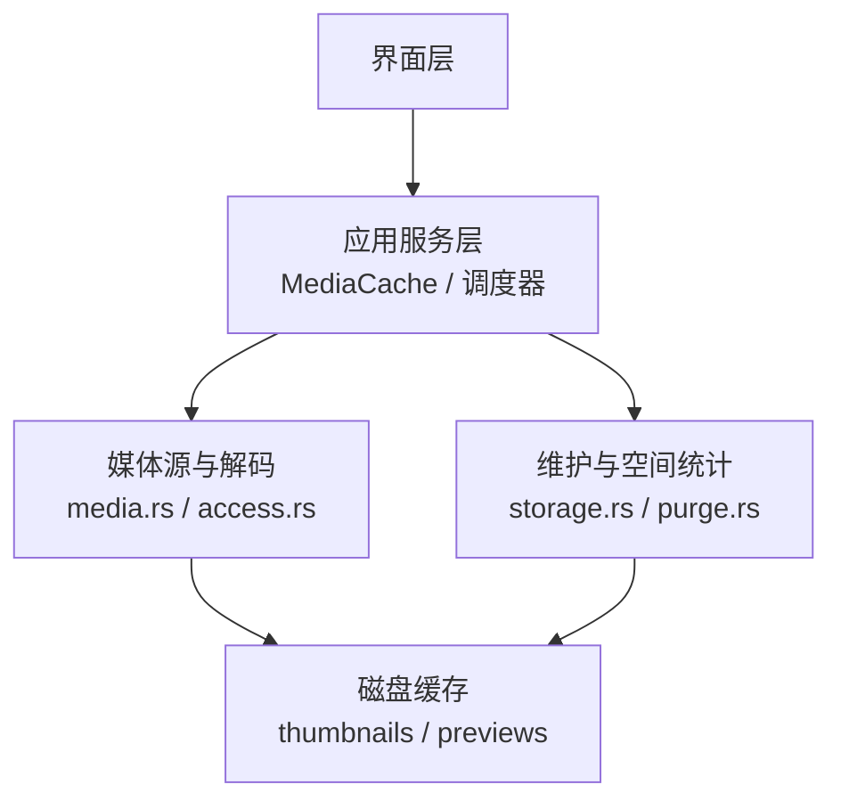
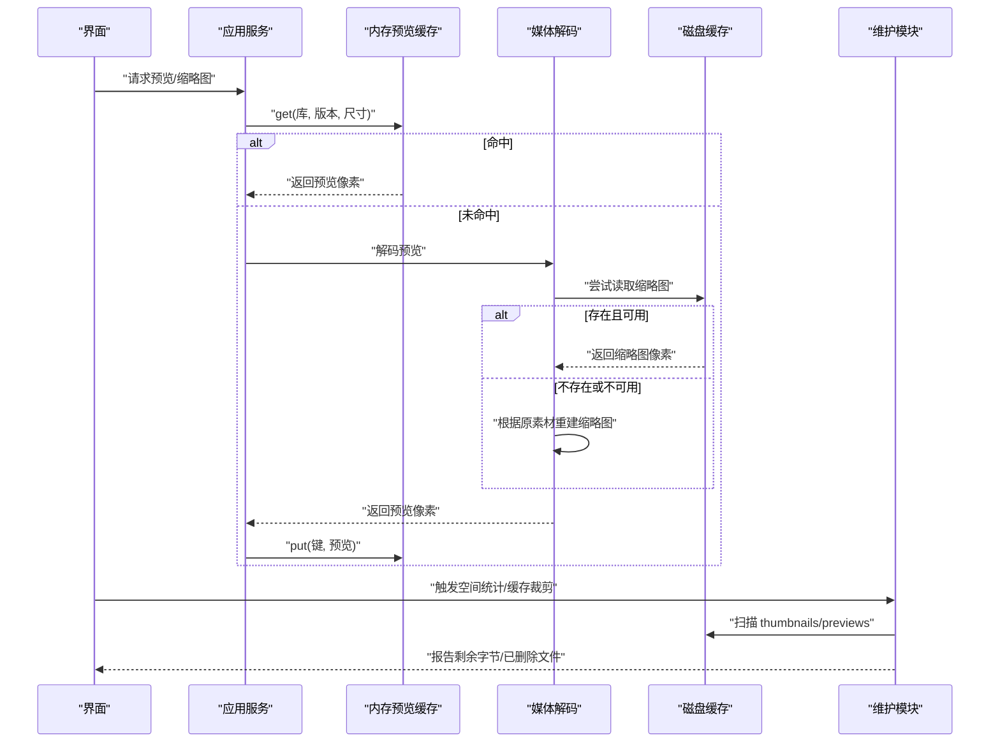
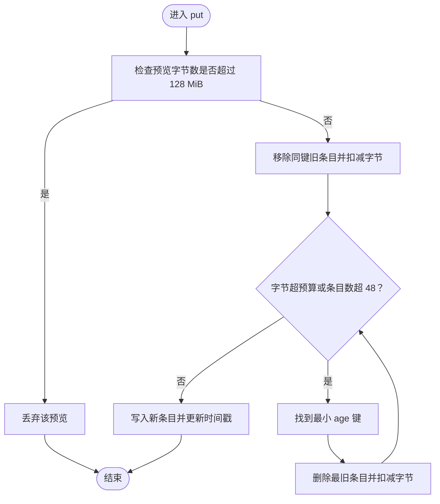
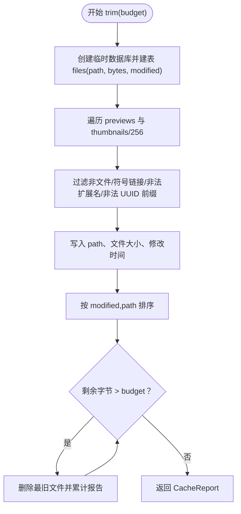
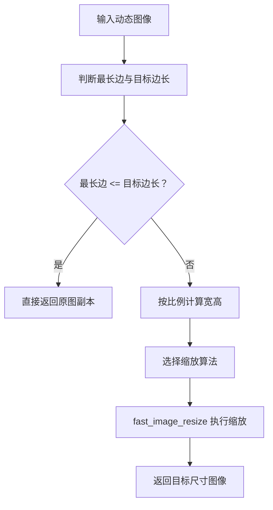
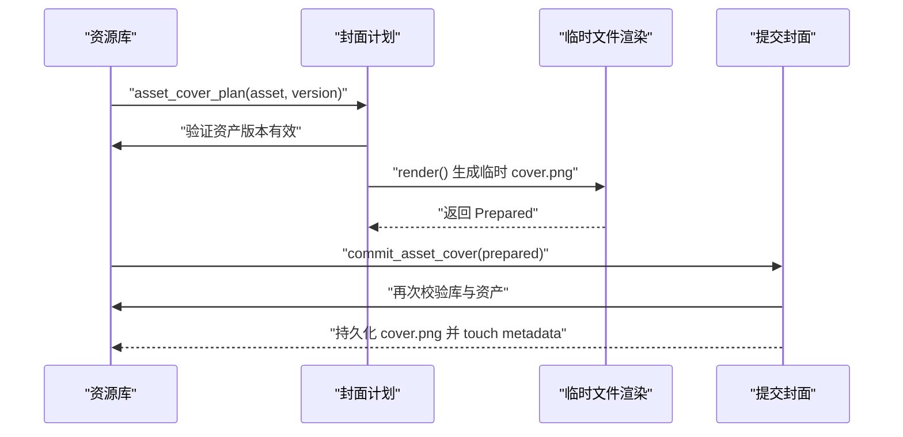
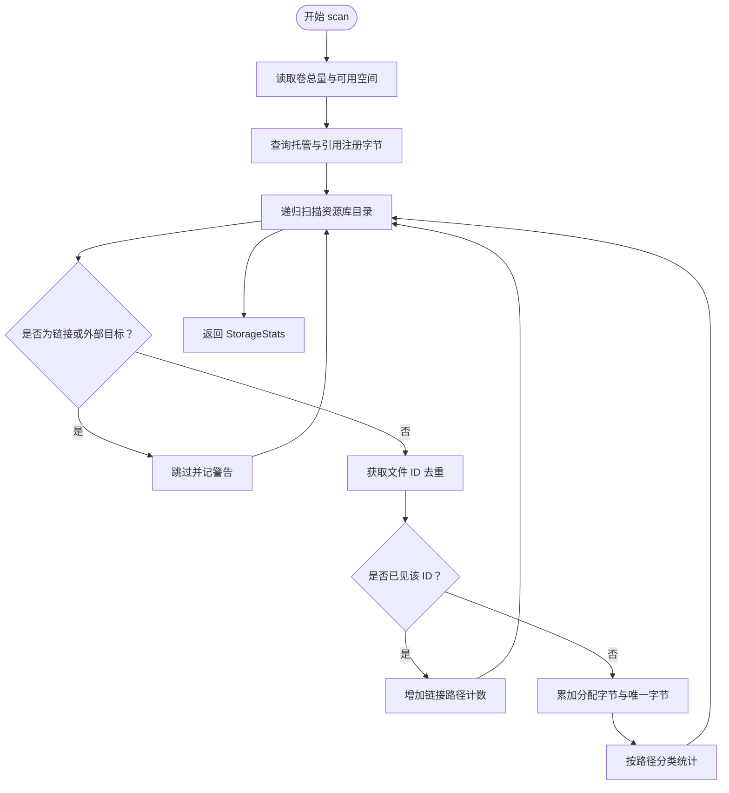
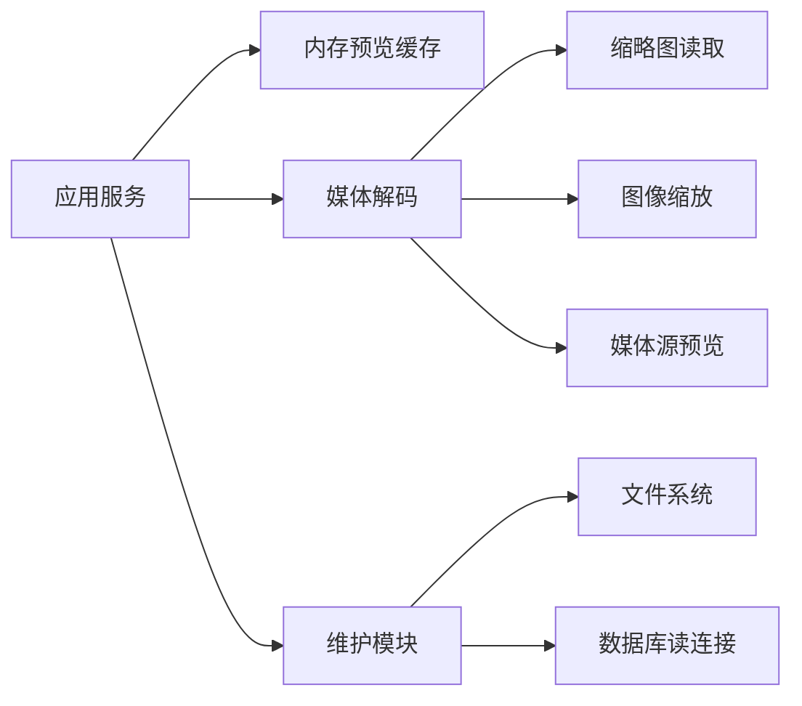

# 缓存管理数据流

> Repo Wiki 节点 `cache-management-flow`
> 导出自 Qoder 知识库快照 `8fbe02f6-57c2-4874-b725-1a8130851fd9`，代码基线 `7a7a8e75e18bd90294e09cd422dd7ed5a04813a0`（分支 main，zh-CN）。

<cite>
**本文引用的文件**   
- [moriq-app/src/cache.rs](../../../crates/moriq-app/src/cache.rs)
- [moriq-app/src/lib.rs](../../../crates/moriq-app/src/lib.rs)
- [moriq-app/src/media.rs](../../../crates/moriq-app/src/media.rs)
- [moriq-app/src/scheduler.rs](../../../crates/moriq-app/src/scheduler.rs)
- [moriq-library/src/media/cache.rs](../../../crates/moriq-library/src/media/cache.rs)
- [moriq-library/src/media/access.rs](../../../crates/moriq-library/src/media/access.rs)
- [moriq-library/src/media/media.rs](../../../crates/moriq-library/src/media/media.rs)
- [moriq-library/src/media/resize.rs](../../../crates/moriq-library/src/media/resize.rs)
- [moriq-library/src/library/library_cover.rs](../../../crates/moriq-library/src/library/library_cover.rs)
- [moriq-library/src/maintenance/storage.rs](../../../crates/moriq-library/src/maintenance/storage.rs)
- [moriq-library/src/maintenance/purge.rs](../../../crates/moriq-library/src/maintenance/purge.rs)
</cite>

## 目录
1. [引言](#引言)
2. [项目结构](#项目结构)
3. [核心组件](#核心组件)
4. [架构总览](#架构总览)
5. [详细组件分析](#详细组件分析)
6. [依赖关系分析](#依赖关系分析)
7. [性能与容量调优](#性能与容量调优)
8. [故障排查指南](#故障排查指南)
9. [结论](#结论)

## 引言
本文聚焦 Moriq Space 的缓存管理数据流，围绕预览图、缩略图、封面等可重建缓存的生成、存储、淘汰和重建展开。系统采用“内存 LRU 预览缓存 + 磁盘可重建图片缓存”的双层设计：内存缓存用于加速当前库的预览访问；磁盘缓存仅保存可通过原素材重新生成的中间产物，并通过字节预算控制实现自动清理。本文还解释缩略图尺寸适配、质量策略、空间统计、依赖追踪与失效机制，并给出性能调优和存储空间管理的实践建议。

## 项目结构
与缓存相关的主要代码分布在应用服务层与资源库媒体层：
- 应用服务层负责共享内存预览缓存、任务调度、库切换时清理缓存。
- 资源库媒体层负责磁盘缩略图读取、预览像素解码、图像缩放、封面持久化以及可重建缓存的扫描与裁剪。
- 维护模块负责存储空间统计、受管路径校验、删除两阶段提交与恢复。

图表来源
- [moriq-app/src/cache.rs:1-65](../../../crates/moriq-app/src/cache.rs#L1-L65)
- [moriq-library/src/media/cache.rs:1-87](../../../crates/moriq-library/src/media/cache.rs#L1-L87)
- [moriq-library/src/maintenance/storage.rs:1-200](../../../crates/moriq-library/src/maintenance/storage.rs#L1-L200)

章节来源
- [moriq-app/src/cache.rs:1-65](../../../crates/moriq-app/src/cache.rs#L1-L65)
- [moriq-library/src/media/cache.rs:1-87](../../../crates/moriq-library/src/media/cache.rs#L1-L87)
- [moriq-library/src/maintenance/storage.rs:1-200](../../../crates/moriq-library/src/maintenance/storage.rs#L1-L200)

## 核心组件
- 内存预览缓存：按库标识、资产版本和尺寸键入，使用递增时间戳实现最近最少使用淘汰，限制条目数与总字节数。
- 磁盘可重建缓存：仅包含 `previews` 与 `thumbnails/256` 下符合命名规范的 PNG 或 RGBA 平面文件，由数据库租约保护，支持按修改时间顺序裁剪。
- 缩略图读取：固定读取 `thumbnails/256/{version}.png`，并限制最大宽高与分配大小。
- 预览解码：通过媒体源获取预览像素，支持从内存缓存命中或解码重建。
- 封面持久化：独立生成临时封面，成功后原子替换 `metadata/cover.png`，失败不污染原有封面。
- 空间统计与维护：分类统计托管原片、追加版本、可重建图片缓存、索引、交接副本、恢复暂存、备份与元数据等占用，去重硬链接，支持取消。

章节来源
- [moriq-app/src/cache.rs:1-65](../../../crates/moriq-app/src/cache.rs#L1-L65)
- [moriq-library/src/media/cache.rs:1-87](../../../crates/moriq-library/src/media/cache.rs#L1-L87)
- [moriq-library/src/media/access.rs:1-23](../../../crates/moriq-library/src/media/access.rs#L1-L23)
- [moriq-library/src/library/library_cover.rs:1-142](../../../crates/moriq-library/src/library/library_cover.rs#L1-L142)
- [moriq-library/src/maintenance/storage.rs:1-200](../../../crates/moriq-library/src/maintenance/storage.rs#L1-L200)

## 架构总览
Moriq Space 的缓存架构由三层组成：
1. 内存预览缓存：位于应用服务进程内，键为 `(LibraryId, AssetVersionId, u32)`，最多保留 48 项，总内存不超过 256 MiB；单条超过 128 MiB 直接丢弃。
2. 磁盘可重建缓存：位于资源库根目录下，只包含可被原素材重建的缩略图和预览像素；原始素材、AI 结果、恢复与互操作文件不属于缓存。
3. 维护与空间统计：扫描资源库根目录，分类统计各区域占用，剔除外部链接，支持取消信号，帮助决策何时触发缓存裁剪。

图表来源
- [moriq-app/src/cache.rs:1-65](../../../crates/moriq-app/src/cache.rs#L1-L65)
- [moriq-library/src/media/access.rs:1-23](../../../crates/moriq-library/src/media/access.rs#L1-L23)
- [moriq-library/src/media/media.rs:349-622](../../../crates/moriq-library/src/media/media.rs#L349-L622)
- [moriq-library/src/media/cache.rs:1-87](../../../crates/moriq-library/src/media/cache.rs#L1-L87)
- [moriq-library/src/maintenance/storage.rs:1-200](../../../crates/moriq-library/src/maintenance/storage.rs#L1-L200)

## 详细组件分析

### 内存预览缓存：LRU 与字节预算
内存缓存以 `Key = (LibraryId, AssetVersionId, u32)` 作为唯一键，内部维护：
- 条目哈希表，值包含预览对象与其使用时间戳。
- 单调递增时钟，每次 get/put 自增，避免整表扫描。
- 总字节数跟踪，按预览图像的 RGBA 背景像素长度计算。

关键行为：
- get：若命中则更新时间戳并克隆返回预览。
- put：若单条预览大于 128 MiB 直接丢弃；否则插入前可能触发 LRU 淘汰，直到满足“总字节不超过 256 MiB 且条目数不超过 48”。
- clear：在库切换或维护后清空，防止旧素材像素残留。

复杂度：
- get：平均 O(1)。
- put：最坏情况下遍历全部条目查找最小年龄键，O(n)，但 n ≤ 48，常数极小。
- 空间：最多 48 个预览，每个预览通常较小；大预览会被丢弃以避免阻塞。

图表来源
- [moriq-app/src/cache.rs:1-65](../../../crates/moriq-app/src/cache.rs#L1-L65)

章节来源
- [moriq-app/src/cache.rs:1-65](../../../crates/moriq-app/src/cache.rs#L1-L65)
- [moriq-app/src/lib.rs:89-249](../../../crates/moriq-app/src/lib.rs#L89-L249)

### 磁盘可重建缓存：扫描、过滤与裁剪
磁盘缓存仅针对可重建路径：
- 目录范围：`previews` 与 `thumbnails/256`。
- 文件名规则：必须是 UUID 前缀，扩展名为 `.png` 或 `-raw-flat1.rgba`、`-raster-flat1.rgba`。
- 平台兼容：跳过符号链接；Windows 上跳过标记为快捷方式的文件属性。
- 扫描过程：将目录内容写入临时 SQLite 表，按修改时间和路径排序，再逐个删除直到剩余字节低于目标预算。

重要特性：
- 使用资源库锁作为租约，确保缓存目录与资源库生命周期一致。
- 不修改原始素材，只删除可重建缓存。
- 删除失败（如文件不存在）会记录跳过，不影响整体进度。

图表来源
- [moriq-library/src/media/cache.rs:1-87](../../../crates/moriq-library/src/media/cache.rs#L1-L87)

章节来源
- [moriq-library/src/media/cache.rs:1-87](../../../crates/moriq-library/src/media/cache.rs#L1-L87)

### 缩略图与预览：尺寸适配和质量优化
缩略图读取：
- 固定路径 `thumbnails/256/{version}.png`，若不存在则返回空。
- 解码时限制最大宽高为 256，最大分配为 1 MiB，防止异常大图导致内存暴涨。

预览解码与重建：
- 优先使用媒体源的预览流程，必要时调用缓存预览。
- 缩略图重建采用有界缩放：按最长边等比缩小，不放大已有小图。
- 默认使用面积滤波，同时支持 Lanczos3、双三次、最近邻等滤镜。
- 输出保持输入颜色类型与预乘 Alpha 信息，避免透明通道失真。

图表来源
- [moriq-library/src/media/resize.rs:1-72](../../../crates/moriq-library/src/media/resize.rs#L1-L72)
- [moriq-library/src/media/access.rs:1-23](../../../crates/moriq-library/src/media/access.rs#L1-L23)

章节来源
- [moriq-library/src/media/access.rs:1-23](../../../crates/moriq-library/src/media/access.rs#L1-L23)
- [moriq-library/src/media/resize.rs:1-72](../../../crates/moriq-library/src/media/resize.rs#L1-L72)

### 封面生成与一致性保证
封面生成采用“先写临时文件，再提交”的两阶段模式：
- 计划阶段冻结库身份、资产与版本，并从媒体源提取 960 宽度的预览边缘图像。
- 渲染阶段将图像写入 `metadata` 下的临时 PNG 文件。
- 提交阶段再次校验库身份、资产状态，成功后持久化为 `metadata/cover.png`，并更新元数据时间戳。
- 任何一步失败均不覆盖原有封面，保证一致性。

图表来源
- [moriq-library/src/library/library_cover.rs:1-142](../../../crates/moriq-library/src/library/library_cover.rs#L1-L142)

章节来源
- [moriq-library/src/library/library_cover.rs:1-142](../../../crates/moriq-library/src/library/library_cover.rs#L1-L142)

### 空间统计与存储管理
空间统计流程：
- 冻结读取连接池、资源库根目录与库身份。
- 查询数据库得到托管原片与引用文件的注册字节。
- 遍历资源库根目录，分类统计 `assets`、`versions`、`thumbnails`、`previews`、`indexes`、`interop`、`staging`、`recovery`、`trash`、`backups` 等区域。
- 去重硬链接：通过文件系统 ID 归一化为可比键，仅首次出现计入分配与唯一字节。
- 支持取消信号与文件计数上报，便于长时间扫描中反馈进度。

图表来源
- [moriq-library/src/maintenance/storage.rs:1-200](../../../crates/moriq-library/src/maintenance/storage.rs#L1-L200)

章节来源
- [moriq-library/src/maintenance/storage.rs:1-200](../../../crates/moriq-library/src/maintenance/storage.rs#L1-L200)

### 缓存一致性：依赖追踪与失效通知
缓存一致性体现在以下层面：
- 内存缓存键包含库标识与资产版本，库切换时主动清理，避免跨库污染。
- 磁盘缓存仅含可重建文件，不修改原素材；删除和清理通过维护流程进行。
- 封面操作通过计划与提交两阶段，并在提交前再次校验库与资产状态。
- 删除流程对受管路径进行白名单校验，拒绝库外位置与不允许关联；采用“移动至暂存 + 数据库提交 + 恢复日志”的两阶段提交，失败时可恢复。
- 资源库租约贯穿缓存与封面操作，防止并发误用。

章节来源
- [moriq-app/src/cache.rs:1-65](../../../crates/moriq-app/src/cache.rs#L1-L65)
- [moriq-library/src/library/library_cover.rs:1-142](../../../crates/moriq-library/src/library/library_cover.rs#L1-L142)
- [moriq-library/src/maintenance/purge.rs:1-200](../../../crates/moriq-library/src/maintenance/purge.rs#L1-L200)

## 依赖关系分析
- 应用服务层依赖内存缓存、媒体解码、调度器和维护模块。
- 媒体解码依赖缩略图读取、图像缩放与媒体源预览。
- 维护模块依赖文件系统、文件系统 ID 与数据库读取连接池。
- 所有涉及磁盘缓存与封面的操作都依赖资源库锁，确保线程安全与库身份一致。

图表来源
- [moriq-app/src/cache.rs:1-65](../../../crates/moriq-app/src/cache.rs#L1-L65)
- [moriq-library/src/media/access.rs:1-23](../../../crates/moriq-library/src/media/access.rs#L1-L23)
- [moriq-library/src/media/resize.rs:1-72](../../../crates/moriq-library/src/media/resize.rs#L1-L72)
- [moriq-library/src/maintenance/storage.rs:1-200](../../../crates/moriq-library/src/maintenance/storage.rs#L1-L200)

## 性能与容量调优
- 内存预览缓存
  - 合理设置预算：默认 256 MiB 与 48 条上限适合大多数桌面场景；若内存紧张可降低预算，若频繁预览同一批素材可适当提高上限。
  - 避免超大预览：单条超过 128 MiB 直接丢弃，防止一次解码撑爆内存。
  - 库切换时及时清理：确保旧库像素不会泄露到新库视图。
- 磁盘缓存裁剪
  - 根据可用空间设定预算：预算越低，越积极删除旧缩略图与预览；预算为 0 可强制重建。
  - 定期运行：结合维护任务在空闲时段执行，减少前台卡顿。
  - 关注跳过计数：若大量跳过，需检查符号链接、Windows 快捷方式或非法命名文件。
- 缩略图质量
  - 默认面积滤波适合快速网格浏览；如需更高视觉质量可在导出或对比场景切换 Lanczos3。
  - 固定 256 像素缩略图平衡速度与清晰度；如需更精细预览可增加专用大图缓存，但应纳入预算管理。
- 空间统计
  - 区分托管原片与引用文件：引用文件不计入托管字节，但参与分配与唯一字节统计。
  - 利用分类统计定位膨胀区域：例如 `thumbnails`、`previews`、`recovery`、`trash`。
  - 使用取消信号中断长时间扫描，避免阻塞主流程。

[本节为通用指导，无需特定文件来源]

## 故障排查指南
- 预览加载缓慢
  - 检查内存缓存命中率；若频繁重建，考虑提高预算或减少无效库切换。
  - 检查磁盘缩略图是否存在；若缺失，确认重建流程是否正常。
- 内存占用过高
  - 确认是否有超大预览被缓存；查看单条预览字节阈值是否被突破。
  - 检查是否在库切换后未清理内存缓存。
- 磁盘空间不足
  - 运行空间统计，定位膨胀目录；调整缓存裁剪预算。
  - 检查是否存在大量硬链接或外部链接导致统计偏差。
- 封面无法更新
  - 确认资产仍在显示版本且未被移入回收站。
  - 检查临时文件是否成功写入 `metadata` 目录；失败时原有封面应保持不变。
- 删除失败或数据不一致
  - 检查是否存在未完成的删除恢复；遵循错误提示先完成恢复。
  - 确认删除路径属于受管区域，且不包含符号链接。

章节来源
- [moriq-app/src/cache.rs:1-65](../../../crates/moriq-app/src/cache.rs#L1-L65)
- [moriq-library/src/media/cache.rs:1-87](../../../crates/moriq-library/src/media/cache.rs#L1-L87)
- [moriq-library/src/library/library_cover.rs:1-142](../../../crates/moriq-library/src/library/library_cover.rs#L1-L142)
- [moriq-library/src/maintenance/purge.rs:1-200](../../../crates/moriq-library/src/maintenance/purge.rs#L1-L200)

## 结论
Moriq Space 的缓存管理以“内存 LRU 预览缓存 + 磁盘可重建图片缓存”为核心，配合严格的字节预算、文件名规范与资源库租约，实现了高性能、低内存占用与强一致性的缓存体系。缩略图与预览通过有界缩放与可选高质量滤镜平衡性能与画质；封面采用两阶段提交保障原子性；维护模块提供空间统计与可控裁剪，帮助用户管理存储空间。在生产环境中，建议根据设备内存与磁盘容量调节预算，定期执行维护任务，并监控跳过与警告指标，以确保系统稳定高效运行。

[本节为总结性内容，无需特定文件来源]