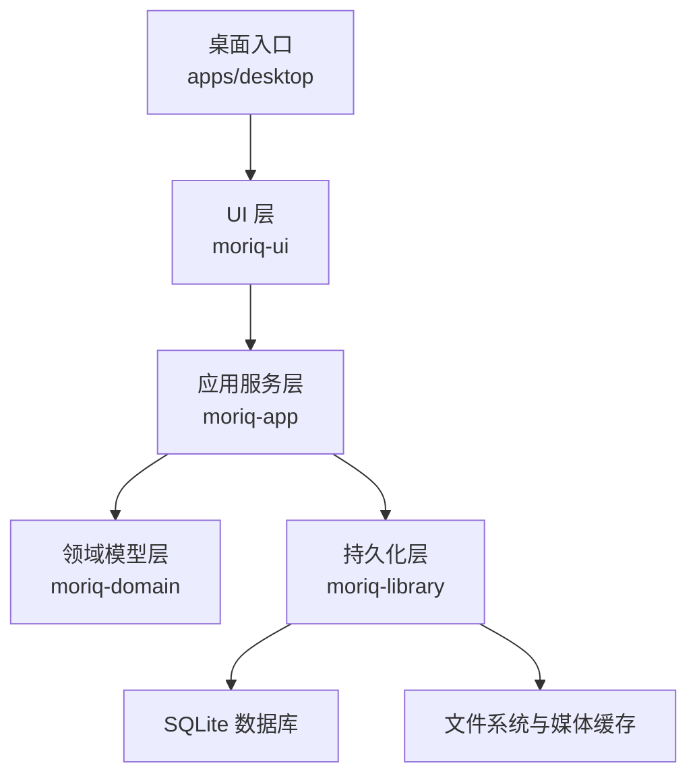
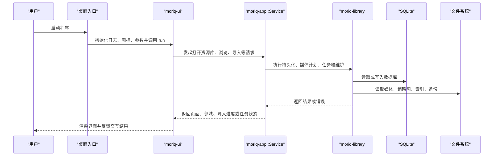
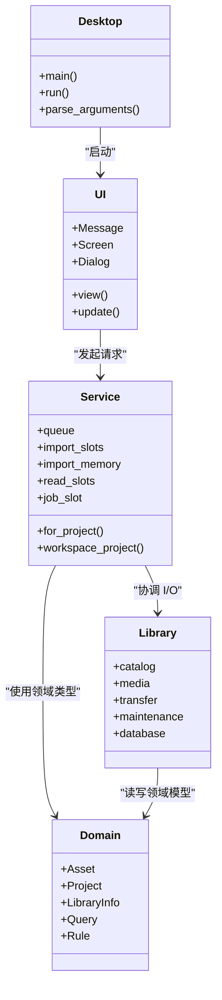
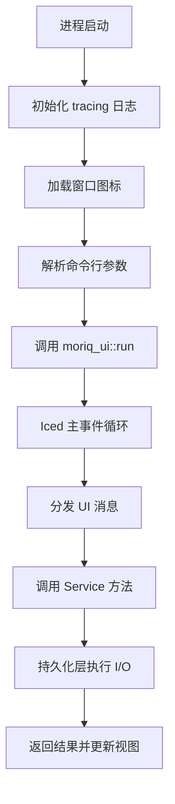
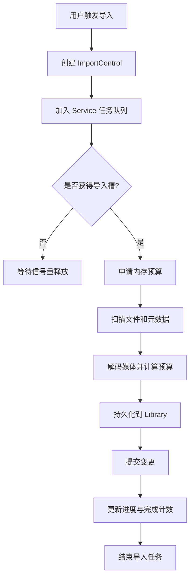
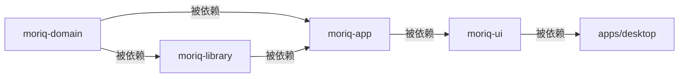

# 整体架构概览

> Repo Wiki 节点 `overall-architecture`
> 导出自 Qoder 知识库快照 `8fbe02f6-57c2-4874-b725-1a8130851fd9`，代码基线 `7a7a8e75e18bd90294e09cd422dd7ed5a04813a0`（分支 main，zh-CN）。

<cite>
**本文引用的文件**   
- [Cargo.toml](../../Cargo.toml)
- [ARCHITECTURE.md](../../ARCHITECTURE.md)
- [apps/desktop/Cargo.toml](../../apps/desktop/Cargo.toml)
- [apps/desktop/src/main.rs](../../apps/desktop/src/main.rs)
- [crates/moriq-ui/Cargo.toml](../../crates/moriq-ui/Cargo.toml)
- [crates/moriq-ui/src/lib.rs](../../crates/moriq-ui/src/lib.rs)
- [crates/moriq-app/Cargo.toml](../../crates/moriq-app/Cargo.toml)
- [crates/moriq-app/src/lib.rs](../../crates/moriq-app/src/lib.rs)
- [crates/moriq-domain/Cargo.toml](../../crates/moriq-domain/Cargo.toml)
- [crates/moriq-domain/src/lib.rs](../../crates/moriq-domain/src/lib.rs)
- [crates/moriq-library/Cargo.toml](../../crates/moriq-library/Cargo.toml)
- [crates/moriq-library/src/lib.rs](../../crates/moriq-library/src/lib.rs)
</cite>

## 目录
1. [简介](#简介)
2. [项目结构](#项目结构)
3. [核心组件](#核心组件)
4. [架构总览](#架构总览)
5. [详细组件分析](#详细组件分析)
6. [依赖关系分析](#依赖关系分析)
7. [性能与运行时特性](#性能与运行时特性)
8. [故障排查指南](#故障排查指南)
9. [结论](#结论)

## 简介
Moriq Space 是一个本地多媒体资源库桌面应用，负责媒体导入、编目、预览、检索、维护及 AI 辅助处理。仓库采用 Rust workspace 多 crate 组织方式，将 UI 呈现、应用服务协调、领域模型定义和持久化基础设施分层解耦。UI 层不直接访问数据库或文件系统；所有 I/O、解码、计划任务和调度由应用服务层统一协调；领域模型层仅保留可序列化类型和输入校验；持久化层封装 SQLite、媒体计划、恢复日志和文件包含关系。

该设计强调：
- 明确职责边界：UI 只负责展示和交互，Service 负责协调，Library 负责阻塞式 I/O。
- 单写者约束：SQLite 写入通过受限队列执行，避免并发写冲突。
- 预算与取消：导入、媒体处理和任务都使用信号量、内存预算和取消状态控制资源。
- 无 I/O 的领域模型：领域类型独立于数据库、网络和图形栈，便于测试和复用。
- 平台入口与桌面事件循环分离：`apps/desktop` 负责命令行参数、图标和日志，UI 框架驱动主事件循环。

## 项目结构
仓库根 Cargo workspace 声明了 `apps/desktop` 与 `crates/*` 作为成员，并集中管理版本、工具链、依赖和发布配置。核心 crate 包括：

| 路径 | 职责 | 关键依赖 |
|---|---|---|
| `apps/desktop` | Windows x86_64 桌面程序入口、图标资源和命令行解析 | `moriq-ui`、`iced`、`rfd`、`image` |
| `crates/moriq-ui` | Iced GUI 界面、视图状态、消息路由和请求回执 | `iced`、`moriq-app`、`moriq-domain`、`tokio` |
| `crates/moriq-app` | 应用服务协调器、调度、导入、备份、设置、推理集成 | `moriq-library`、`moriq-ai`、`moriq-synco`、`tokio` |
| `crates/moriq-domain` | 可序列化领域身份、查询条件、任务错误等纯类型 | `serde`、`uuid` |
| `crates/moriq-library` | 阻塞式持久化、SQLite、媒体计划、AI 存储、转移与恢复 | `rusqlite`、`moriq-domain`、`image`、`moriq-runtime` |

**图示来源**
- [apps/desktop/src/main.rs:1-97](../../apps/desktop/src/main.rs#L1-L97)
- [crates/moriq-ui/src/lib.rs:1-200](../../crates/moriq-ui/src/lib.rs#L1-L200)
- [crates/moriq-app/src/lib.rs:1-200](../../crates/moriq-app/src/lib.rs#L1-L200)
- [crates/moriq-library/src/lib.rs:1-200](../../crates/moriq-library/src/lib.rs#L1-L200)

**章节来源**
- [Cargo.toml:1-80](../../Cargo.toml#L1-L80)
- [ARCHITECTURE.md:1-155](../../ARCHITECTURE.md#L1-L155)

## 核心组件
### 桌面入口与应用启动
`apps/desktop` 是最终可执行程序包。它初始化 tracing 日志、加载窗口图标、解析命令行参数，然后调用 `moriq_ui::run` 进入 UI 生命周期。支持 `--library`、`--import` 以及诊断捕获相关参数。失败时通过系统对话框报告启动错误。

关键点：
- 日志输出到平台指定目录，可通过诊断选项启用或关闭。
- 图标由构建期嵌入资源生成。
- 参数解析严格拒绝未知组合，保证启动行为可预测。

**章节来源**
- [apps/desktop/src/main.rs:1-97](../../apps/desktop/src/main.rs#L1-L97)
- [apps/desktop/Cargo.toml:1-21](../../apps/desktop/Cargo.toml#L1-L21)

### UI 层：moriq-ui
UI 层基于 Iced 构建，负责视图渲染、用户交互、翻译、主题、导航、画廊、查看器、批量操作、导出、规则、上传、轮询等。其模块文档明确指出：所有磁盘、目录和媒体解码工作都属于 Service；UI 只持有瞬时视图状态和请求回执。

关键点：
- 通过 `moriq_app::Service` 发起请求，而不是直接访问数据库或文件系统。
- 使用 Iced 的 `Element`、`Subscription`、`Task` 管理视图、订阅和异步任务。
- 支持 capture 功能开关，用于自动化截图和回归测试。

**章节来源**
- [crates/moriq-ui/src/lib.rs:1-200](../../crates/moriq-ui/src/lib.rs#L1-L200)
- [crates/moriq-ui/Cargo.toml:1-25](../../crates/moriq-ui/Cargo.toml#L1-L25)

### 应用服务层：moriq-app
应用服务层是系统的协调中心。它暴露 `Service`，封装工作区范围、媒体缓存、推理运行器、任务队列和多组信号量（导入槽、内存预算、维护槽、读取槽、任务槽、取消）。UI 不能拥有数据库连接，也不能直接执行媒体 I/O。

关键点：
- 单写者与有限并发：通过 `tokio::sync::Semaphore` 限制导入、读取和维护任务数量。
- 进度与取消：导入控制对象提供取消标志、完成计数、活跃数、峰值和内存等待状态。
- 推理集成：注入 `InferenceRunner`，让后台和交互式推理共享同一执行策略。
- 系统整合：打开模型目录、浏览器源码地址、视频格式判断、诊断日志偏好等。

**章节来源**
- [crates/moriq-app/src/lib.rs:1-200](../../crates/moriq-app/src/lib.rs#L1-L200)
- [crates/moriq-app/Cargo.toml:1-25](../../crates/moriq-app/Cargo.toml#L1-L25)

### 领域模型层：moriq-domain
领域层仅包含可序列化的身份标识、资产、项目、查询条件、规则树、任务错误和结果类型。它没有 I/O 或 UI 依赖，因此可以安全地在 UI、应用服务和持久化之间传递。

关键点：
- 身份标识使用 UUID，具备默认值、显示格式和序列化能力。
- 查询和规则是结构化、有界的数据，不是原始 SQL 或路径字符串。
- 规则验证限制深度、节点数量和字段长度，防止恶意或无界筛选。

**章节来源**
- [crates/moriq-domain/src/lib.rs:1-200](../../crates/moriq-domain/src/lib.rs#L1-L200)
- [crates/moriq-domain/Cargo.toml:1-10](../../crates/moriq-domain/Cargo.toml#L1-L10)

### 持久化层：moriq-library
持久化层封装阻塞式基础设施，包括 Library、Catalog、Media、AI、Transfer、Tasks、Maintenance、Database 等子模块。SQLite 写入被限制为单写者，同时提供读池、迁移、备份、孤儿清理、存储修复等功能。

关键点：
- 显式错误类型：I/O、数据库、图片解码、色彩转换、无效输入、库锁定等。
- 固定目录布局：assets、versions、projects、thumbnails、previews、indexes、metadata、staging、trash、recovery、backups 等。
- 版本与模式：当前 schema 版本为 27，配合迁移脚本管理数据库演进。

**章节来源**
- [crates/moriq-library/src/lib.rs:1-200](../../crates/moriq-library/src/lib.rs#L1-L200)
- [crates/moriq-library/Cargo.toml:1-35](../../crates/moriq-library/Cargo.toml#L1-L35)

## 架构总览
下图展示从桌面入口到 UI、应用服务、领域模型和持久化层的控制流与数据流。

**图示来源**
- [apps/desktop/src/main.rs:1-97](../../apps/desktop/src/main.rs#L1-L97)
- [crates/moriq-ui/src/lib.rs:1-200](../../crates/moriq-ui/src/lib.rs#L1-L200)
- [crates/moriq-app/src/lib.rs:1-200](../../crates/moriq-app/src/lib.rs#L1-L200)
- [crates/moriq-library/src/lib.rs:1-200](../../crates/moriq-library/src/lib.rs#L1-L200)

## 详细组件分析
### 组件职责边界
| 层级 | 主要职责 | 不允许的职责 | 典型接口或产物 |
|---|---|---|---|
| 桌面入口 | 平台入口、命令行解析、日志、图标 | 业务逻辑、UI 渲染 | `main`、`run`、参数解析 |
| UI 层 | 视图、交互、消息、主题、导航、查看器 | 数据库访问、媒体解码 | `Message`、`Screen`、`Dialog` |
| 应用服务层 | 协调 Library、调度、导入、推理、设置、同步 | 直接渲染 UI 或持有原生数据库连接 | `Service`、`ImportControl`、`Opened` |
| 领域模型层 | 身份、资产、项目、查询、规则、任务错误 | I/O、网络、GUI、数据库 | `Asset`、`Query`、`Rule`、`JobKind` |
| 持久化层 | SQLite、媒体计划、恢复、备份、导入导出、AI 存储 | 直接响应 UI 事件 | `Library`、`Error`、各子模块 API |

**图示来源**
- [apps/desktop/src/main.rs:1-97](../../apps/desktop/src/main.rs#L1-L97)
- [crates/moriq-ui/src/lib.rs:1-200](../../crates/moriq-ui/src/lib.rs#L1-L200)
- [crates/moriq-app/src/lib.rs:1-200](../../crates/moriq-app/src/lib.rs#L1-L200)
- [crates/moriq-domain/src/lib.rs:1-200](../../crates/moriq-domain/src/lib.rs#L1-L200)
- [crates/moriq-library/src/lib.rs:1-200](../../crates/moriq-library/src/lib.rs#L1-L200)

### 启动流程时序

**图示来源**
- [apps/desktop/src/main.rs:1-97](../../apps/desktop/src/main.rs#L1-L97)
- [crates/moriq-ui/src/lib.rs:1-200](../../crates/moriq-ui/src/lib.rs#L1-L200)
- [crates/moriq-app/src/lib.rs:1-200](../../crates/moriq-app/src/lib.rs#L1-L200)

### 导入与控制流

**图示来源**
- [crates/moriq-app/src/lib.rs:1-200](../../crates/moriq-app/src/lib.rs#L1-L200)
- [crates/moriq-library/src/lib.rs:1-200](../../crates/moriq-library/src/lib.rs#L1-L200)

### 为什么采用 Rust workspace 多 crate 架构
仓库通过 workspace 统一管理多个 crate，并在 `Cargo.toml` 中集中声明依赖、版本、工具链和编译配置。这种设计的优势包括：

1. **清晰的分层依赖**  
   - `moriq-domain` 不依赖其他业务 crate。
   - `moriq-library` 依赖领域层。
   - `moriq-app` 依赖领域层和持久化层。
   - `moriq-ui` 依赖应用服务层和领域层。
   - `apps/desktop` 依赖 UI 层。

2. **编译与发布一致性**  
   - 单一版本号、Rust edition 和 rust-version。
   - 统一的 release profile，启用 thin LTO 和单 codegen unit。
   - 针对性能敏感 crate 在开发构建中提升优化等级。

3. **可测试性与复用性**  
   - 领域层无 I/O，便于单元测试。
   - 持久化层隔离 SQLite、媒体解码和文件系统。
   - UI 层通过 Service 抽象真实 I/O。

4. **扩展与维护成本更低**  
   - 新增功能通常落在特定 crate 内。
   - 外部依赖集中在 workspace 依赖表，减少重复。
   - 通过 feature 控制可选能力，例如 capture。

**章节来源**
- [Cargo.toml:1-80](../../Cargo.toml#L1-L80)
- [ARCHITECTURE.md:1-155](../../ARCHITECTURE.md#L1-L155)

### 技术栈选择原因
| 技术 | 用途 | 选择理由 |
|---|---|---|
| Iced | GUI 框架 | 提供现代 Rust GUI 生态，支持 wgpu、tokio、SVG、X11、Wayland 等特性，适合跨平台桌面体验。 |
| tokio | 异步运行时 | 与 Iced 运行时集成，提供多线程运行时和同步原语，支撑 Service 的任务队列、信号量和并发控制。 |
| rusqlite | 嵌入式数据库 | 单写者 SQLite 模型简化并发写入问题；bundled 模式减少部署依赖；备份特性支持完整库备份。 |
| image | 图像处理 | 支持 JPEG、PNG、WebP、GIF、BMP、TIFF 等常见格式，满足缩略图和预览需求。 |
| serde / uuid | 序列化与身份 | 领域模型需要稳定、可序列化的 ID 和查询结构；serde 便于持久化和传输。 |
| tracing / tracing-subscriber | 诊断日志 | 支持环境变量过滤、目标过滤和输出重定向，便于桌面端定位问题。 |
| rfd | 系统对话框 | 提供跨平台文件选择和消息对话框，简化原生交互。 |

**章节来源**
- [Cargo.toml:1-80](../../Cargo.toml#L1-L80)
- [apps/desktop/src/main.rs:1-97](../../apps/desktop/src/main.rs#L1-L97)
- [crates/moriq-ui/Cargo.toml:1-25](../../crates/moriq-ui/Cargo.toml#L1-L25)
- [crates/moriq-app/Cargo.toml:1-25](../../crates/moriq-app/Cargo.toml#L1-L25)
- [crates/moriq-library/Cargo.toml:1-35](../../crates/moriq-library/Cargo.toml#L1-L35)

## 依赖关系分析
### Crate 依赖图

**图示来源**
- [Cargo.toml:1-80](../../Cargo.toml#L1-L80)
- [apps/desktop/Cargo.toml:1-21](../../apps/desktop/Cargo.toml#L1-L21)
- [crates/moriq-ui/Cargo.toml:1-25](../../crates/moriq-ui/Cargo.toml#L1-L25)
- [crates/moriq-app/Cargo.toml:1-25](../../crates/moriq-app/Cargo.toml#L1-L25)
- [crates/moriq-domain/Cargo.toml:1-10](../../crates/moriq-domain/Cargo.toml#L1-L10)
- [crates/moriq-library/Cargo.toml:1-35](../../crates/moriq-library/Cargo.toml#L1-L35)

### 耦合与内聚
- 低耦合：UI 不感知 SQLite 细节；Service 不直接渲染；Domain 不感知 I/O。
- 高内聚：Library 内部按 catalog、media、transfer、maintenance、database 分组；App 内部按 catalog、import、inference、jobs、scheduler、settings 分组。
- 风险点：Service 是协调枢纽，若新增全局状态可能打破现有职责边界；应优先通过函数参数、上下文和 Service 方法扩展。

**章节来源**
- [ARCHITECTURE.md:1-155](../../ARCHITECTURE.md#L1-L155)
- [crates/moriq-app/src/lib.rs:1-200](../../crates/moriq-app/src/lib.rs#L1-L200)
- [crates/moriq-library/src/lib.rs:1-200](../../crates/moriq-library/src/lib.rs#L1-L200)

## 性能与运行时特性
- 异步与阻塞混合：UI 和 Service 使用异步运行时，但 Library 明确是阻塞式基础设施，应在专用 worker 中调用，避免阻塞 UI 线程。
- 并发控制：Service 使用多个信号量限制导入、读取、维护和任务并发；导入还受内存预算和工作线程数限制。
- 单写者数据库：SQLite 写入串行化，降低竞争和损坏风险，同时提高恢复和备份一致性。
- 构建优化：release 启用 thin LTO 和单 codegen unit；开发构建中对图像、压缩、颜色空间和图像处理相关 crate 提升优化等级。
- 资源回收：ViewerState、SelectionState 等 UI 状态在退出、失去焦点或切换时释放媒体资源，避免 GPU 和内存泄漏。

[本节为通用性能说明，不直接分析具体代码片段]

## 故障排查指南
### 启动失败
- 现象：桌面弹出“Moriq Space 无法启动”对话框。
- 原因：`main` 捕获 `run` 的错误并以系统消息框展示。
- 排查步骤：
  1. 检查日志目录是否存在，Windows 下通常为 `%LOCALAPPDATA%\MORIQ\logs`，其他平台为 `$HOME/.local/state/moriq`。
  2. 确认 `desktop.log` 是否生成。
  3. 检查命令行参数是否合法，特别是 `--library`、`--import` 和 capture 相关参数。
  4. 检查 Iced、wgpu 和系统图形环境是否正常。

**章节来源**
- [apps/desktop/src/main.rs:1-97](../../apps/desktop/src/main.rs#L1-L97)

### 资源库被占用
- 现象：持久化层返回库锁定错误。
- 原因：另一个窗口或进程正在使用该资源库。
- 排查步骤：
  1. 关闭其他 Moriq Space 实例。
  2. 检查是否有其他进程持有 SQLite 文件或资源库目录锁。
  3. 确认未同时进行备份、导入或删除操作。

**章节来源**
- [crates/moriq-library/src/lib.rs:1-200](../../crates/moriq-library/src/lib.rs#L1-L200)

### 导入卡住或内存过高
- 现象：导入进度停滞、等待内存或峰值内存上升。
- 原因：导入工作受工作线程数和内存预算限制；大图片或视频可能需要更高预算。
- 排查步骤：
  1. 调整 `ImportPreferences` 中的工作线程数和内存上限。
  2. 检查媒体大小、分辨率和格式。
  3. 观察 `ImportControl` 中的 active、waiting_memory、peak 等状态。
  4. 必要时取消导入并重新执行。

**章节来源**
- [crates/moriq-app/src/lib.rs:1-200](../../crates/moriq-app/src/lib.rs#L1-L200)

### 规则查询异常
- 现象：复杂规则导致查询缓慢或被拒绝。
- 原因：规则树存在深度和节点数量限制。
- 排查步骤：
  1. 检查规则树深度是否超过 8 层。
  2. 检查条件总数是否超过 64。
  3. 检查文本字段长度是否超过 1024 字节。
  4. 拆分复杂查询为多个简单查询。

**章节来源**
- [crates/moriq-domain/src/lib.rs:1-200](../../crates/moriq-domain/src/lib.rs#L1-L200)

## 结论
Moriq Space 的整体架构以 Rust workspace 为基础，通过清晰的四层划分实现职责分离：桌面入口负责平台交互，UI 层负责呈现与消息，应用服务层负责协调与资源控制，持久化层负责数据库、媒体和文件 I/O。领域模型层作为稳定契约，贯穿整个系统。

该设计带来的核心价值是：
- 可测试：领域层无 I/O，持久化层可独立验证。
- 可维护：分层依赖清晰，新增功能可落位到对应 crate。
- 可靠：单写者数据库、预算控制和取消语义降低崩溃和数据不一致风险。
- 可扩展：Service 作为协调中心，便于引入新任务、新存储和新推理后端。

未来改进可关注：
- 对大型库容量基准测试进行系统化评估。
- 对语义索引和目录排序性能变化建立测量设计。
- 在保持分层前提下，继续细化 UI 功能边界，逐步向更稳定的特征模块演进。

[本节为总结性内容，不直接分析具体代码片段]