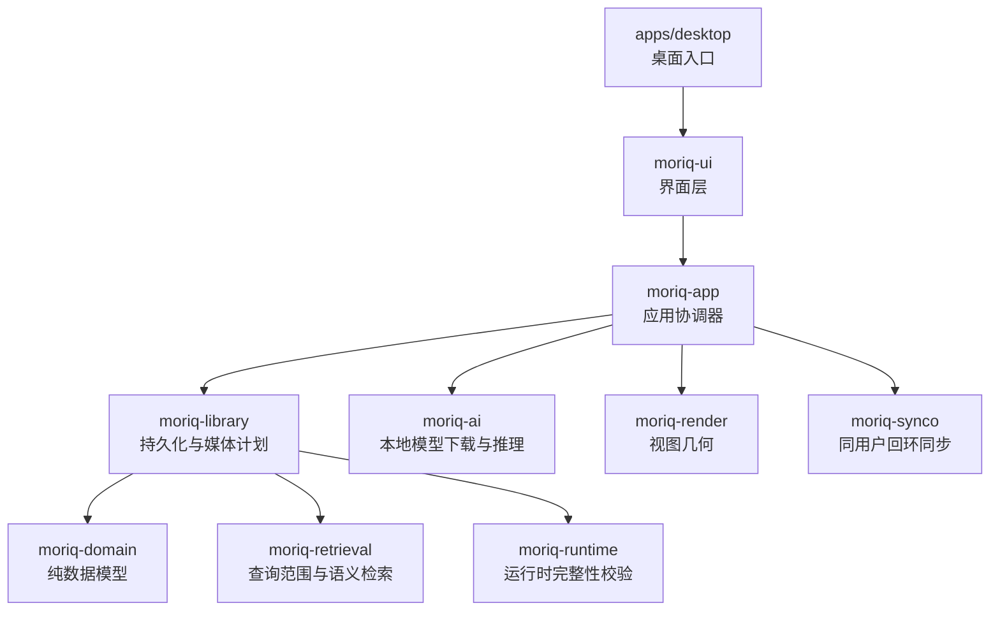
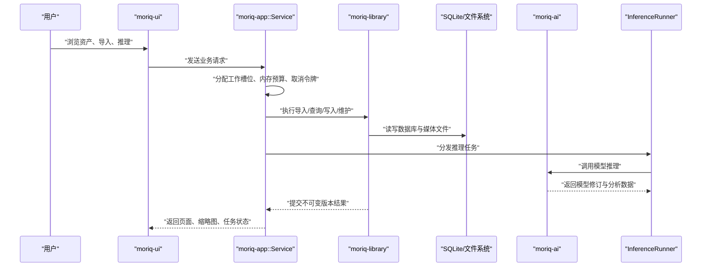
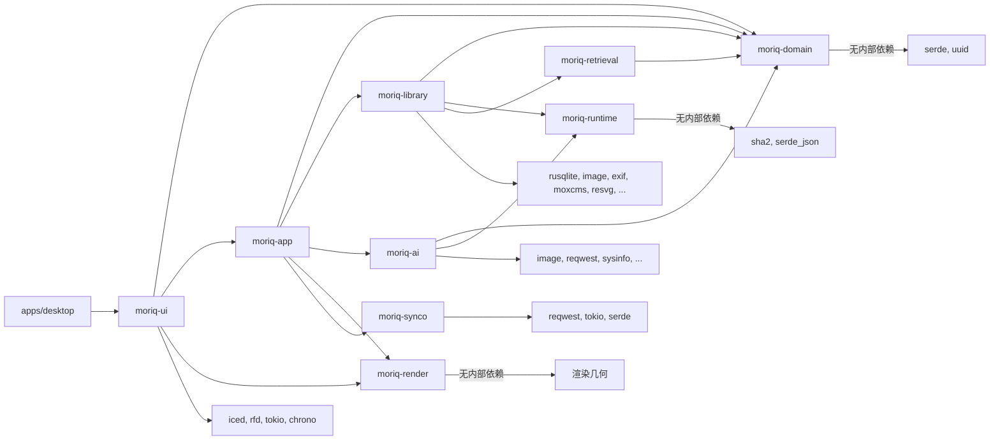
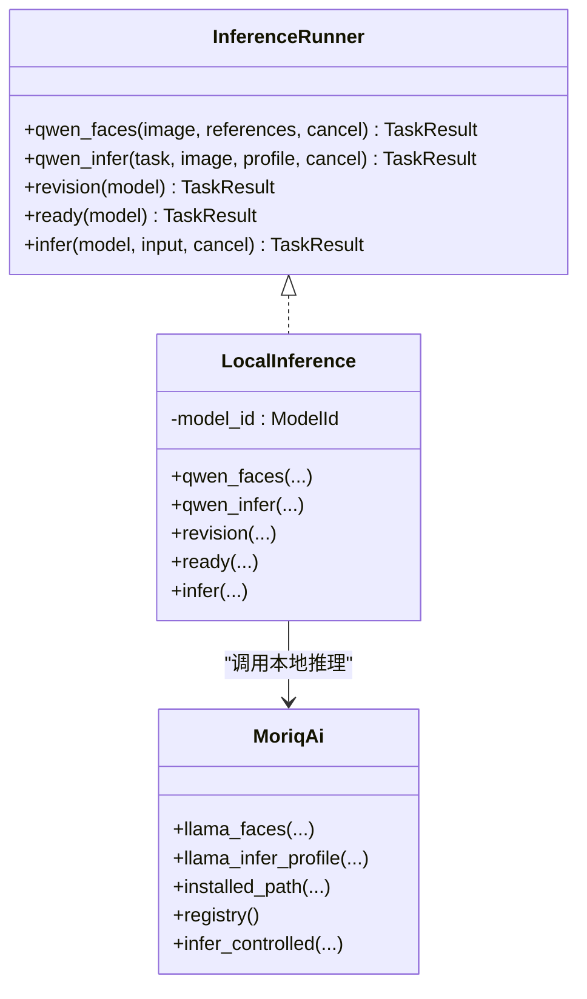
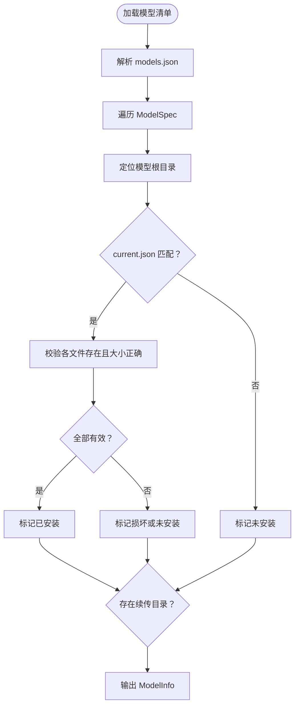
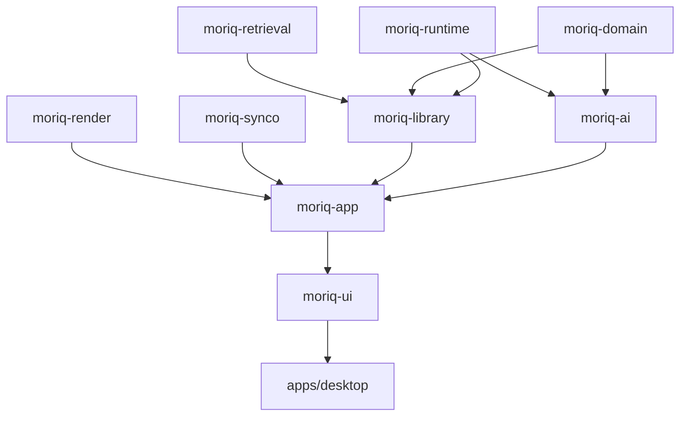

# 模块边界与依赖

> Repo Wiki 节点 `module-boundaries`
> 导出自 Qoder 知识库快照 `8fbe02f6-57c2-4874-b725-1a8130851fd9`，代码基线 `7a7a8e75e18bd90294e09cd422dd7ed5a04813a0`（分支 main，zh-CN）。

<cite>
**本文引用的文件**   
- [Cargo.toml](../../Cargo.toml)
- [ARCHITECTURE.md](../../ARCHITECTURE.md)
- [moriq-domain/Cargo.toml](../../crates/moriq-domain/Cargo.toml)
- [moriq-domain/src/lib.rs](../../crates/moriq-domain/src/lib.rs)
- [moriq-library/Cargo.toml](../../crates/moriq-library/Cargo.toml)
- [moriq-library/src/lib.rs](../../crates/moriq-library/src/lib.rs)
- [moriq-library/src/ai/qwen_faces.rs](../../crates/moriq-library/src/ai/qwen_faces.rs)
- [moriq-app/Cargo.toml](../../crates/moriq-app/Cargo.toml)
- [moriq-app/src/lib.rs](../../crates/moriq-app/src/lib.rs)
- [moriq-app/src/inference.rs](../../crates/moriq-app/src/inference.rs)
- [moriq-ui/Cargo.toml](../../crates/moriq-ui/Cargo.toml)
- [moriq-ui/src/lib.rs](../../crates/moriq-ui/src/lib.rs)
- [moriq-ai/Cargo.toml](../../crates/moriq-ai/Cargo.toml)
- [moriq-ai/src/lib.rs](../../crates/moriq-ai/src/lib.rs)
- [moriq-ai/src/models.rs](../../crates/moriq-ai/src/models.rs)
- [apps/desktop/Cargo.toml](../../apps/desktop/Cargo.toml)
</cite>

## 目录
1. [引言](#引言)
2. [项目结构](#项目结构)
3. [核心模块职责](#核心模块职责)
4. [架构总览](#架构总览)
5. [详细模块分析](#详细模块分析)
6. [依赖关系与导入策略](#依赖关系与导入策略)
7. [扩展点机制](#扩展点机制)
8. [版本管理与构建顺序](#版本管理与构建顺序)
9. [内部 API 暴露原则与私有接口设计](#内部-api-暴露原则与私有接口设计)
10. [模块解耦最佳实践与常见反模式](#模块解耦最佳实践与常见反模式)
11. [性能与资源边界](#性能与资源边界)
12. [故障排查指南](#故障排查指南)
13. [结论](#结论)

## 引言
本仓库采用 Rust Cargo workspace 组织多 crate 应用。整体分层遵循“领域模型 → 持久化与媒体处理 → 应用协调器 → 界面层 → 桌面入口”的单向依赖方向，同时通过 `moriq-runtime`、`moriq-retrieval`、`moriq-synco`、`moriq-render` 等辅助 crate 提供低耦合能力。文档重点说明每个 crate 的职责边界、crate 间依赖图、工作区版本管理方式、内部 API 暴露约定、AI 推理注册表等扩展点，以及解耦实践和反模式。

## 项目结构
顶层 `Cargo.toml` 声明 workspace、成员、统一版本号、edition、workspace-level dependencies 和 lint 规则；`apps/desktop` 是最终可执行程序，`crates/*` 是共享库；`workers/ai/models.json` 被 AI crate 内嵌为模型清单。

**图表来源**
- [Cargo.toml:1-20](../../Cargo.toml#L1-L20)
- [apps/desktop/Cargo.toml:1-21](../../apps/desktop/Cargo.toml#L1-L21)
- [moriq-ui/Cargo.toml:1-25](../../crates/moriq-ui/Cargo.toml#L1-L25)
- [moriq-app/Cargo.toml:1-25](../../crates/moriq-app/Cargo.toml#L1-L25)
- [moriq-library/Cargo.toml:1-35](../../crates/moriq-library/Cargo.toml#L1-L35)
- [moriq-ai/Cargo.toml:1-21](../../crates/moriq-ai/Cargo.toml#L1-L21)

**章节来源**
- [Cargo.toml:1-80](../../Cargo.toml#L1-L80)
- [apps/desktop/Cargo.toml:1-21](../../apps/desktop/Cargo.toml#L1-L21)

## 核心模块职责
- `moriq-domain`：纯序列化和输入校验领域类型，如 `LibraryId`、`AssetId`、`ProjectId`、`Query`、`Rule`、`JobKind`、`ModelId`、`TaskError`、`TaskResult`。不引入 I/O、UI、数据库或解码器依赖。
- `moriq-library`：阻塞式持久化、SQLite 单写者、媒体探测与缓存、AI 结果存储、转移（导入/导出/恢复）、维护任务、工作队列。依赖 domain、runtime、retrieval、image、rusqlite 等。
- `moriq-app`：应用协调器。封装 `Service`，负责调度、并发信号量、内存预算、取消令牌、导入控制、推理执行分发、系统打开链接等操作。对外暴露 UI 所需的分页、缩略图、视频播放、备份控制、存储清理控制等抽象。
- `moriq-ui`：基于 Iced 的界面层。持有瞬态视图状态、消息枚举、导航、主题、预览、查看器、批量编辑等，所有磁盘访问、编解码、目录操作都委托给 `Service`。
- `moriq-ai`：Qwen 与 llama.cpp 相关模型管理、下载、安装校验、硬件信息、推理接口封装。依赖 `moriq-runtime` 做运行时验证。
- 辅助 crate：`moriq-runtime`（运行时完整性校验）、`moriq-retrieval`（带 scope 的相似性/语义读取，不依赖 Library 与媒体解码）、`moriq-synco`（同用户回环传输）、`moriq-render`（网格与视口几何）。

**章节来源**
- [ARCHITECTURE.md:9-26](../../ARCHITECTURE.md#L9-L26)
- [moriq-domain/src/lib.rs:1-20](../../crates/moriq-domain/src/lib.rs#L1-L20)
- [moriq-library/src/lib.rs:1-20](../../crates/moriq-library/src/lib.rs#L1-L20)
- [moriq-app/src/lib.rs:1-20](../../crates/moriq-app/src/lib.rs#L1-L20)
- [moriq-ui/src/lib.rs:1-10](../../crates/moriq-ui/src/lib.rs#L1-L10)
- [moriq-ai/src/lib.rs:1-15](../../crates/moriq-ai/src/lib.rs#L1-L15)

## 架构总览
Moriq Space 的架构强调“请求—协调—持久化—运行时代码”的单向调用链，并通过显式边界避免 UI 直接访问数据库、文件系统或解码器。

**图表来源**
- [moriq-ui/src/lib.rs:1-20](../../crates/moriq-ui/src/lib.rs#L1-L20)
- [moriq-app/src/lib.rs:1-60](../../crates/moriq-app/src/lib.rs#L1-L60)
- [moriq-library/src/lib.rs:1-40](../../crates/moriq-library/src/lib.rs#L1-L40)
- [moriq-app/src/inference.rs:1-40](../../crates/moriq-app/src/inference.rs#L1-L40)
- [moriq-ai/src/lib.rs:1-15](../../crates/moriq-ai/src/lib.rs#L1-L15)

## 详细模块分析

### `moriq-domain`：纯数据模型与输入约束
该 crate 只暴露可序列化身份、查询树、排序选项、任务错误类型等。它使用宏生成 `LibraryId`、`AssetId`、`AssetVersionId`、`ProjectId`，并通过 `Rule::validate` 限制组合规则的深度、节点数量和字段长度，防止无界 SQL 或路径进入领域表示。

关键边界特征：
- 仅依赖 `serde` 和 `uuid`。
- 不包含任何 I/O、网络、数据库、图像解码或 UI 代码。
- 将用户输入的筛选条件建模为有界、类型安全的表达式。

**章节来源**
- [moriq-domain/Cargo.toml:1-10](../../crates/moriq-domain/Cargo.toml#L1-L10)
- [moriq-domain/src/lib.rs:1-20](../../crates/moriq-domain/src/lib.rs#L1-L20)

### `moriq-library`：持久化、媒体计划与 AI 存储
该 crate 是重量级基础设施层。它按功能划分模块：library、catalog、media、ai、transfer、tasks、maintenance、database。对外公开 `Library`、`cache`、`media`、`metadata`、`region`、`video`、`backup`、`maintenance`、`storage`、`export`、`import`、`ingest`、`recovery`、`jobs`、`overview`、`ai_profile`、`analysis`、`portraits`、`qwen_faces`、`similarity` 等公共模块。

关键边界特征：
- 声明 SQLite schema 版本常量，并使用 rusqlite 进行阻塞写入。
- 定义 `MAX_BYTES` 和受控目录列表，限制资源库根结构。
- 将 `moriq_retrieval::Error` 转换为自身 `Error`，隔离外部检索错误语义。
- 在 AI 子模块中只做“准备输入、校验回执、持久化结果”，不负责加载原生推理引擎。

**章节来源**
- [moriq-library/Cargo.toml:1-35](../../crates/moriq-library/Cargo.toml#L1-L35)
- [moriq-library/src/lib.rs:1-120](../../crates/moriq-library/src/lib.rs#L1-L120)

### `moriq-app`：应用协调器与服务边界
`Service` 是 UI 唯一信任的业务协调对象。它持有工作区范围、媒体缓存、推理执行器、通道、多个信号量（导入并发、内存预算、维护、读锁、作业槽）和取消管理器。对外暴露 `Opened`、`Tile`、`LoadedPage`、`ImportControl`、`LibraryCard`、`RegionSession`、`Playback`、`BackupControl`、`MaintenanceControl`、`StorageControl`、`OrphanPlan`、`LibraryRemovalPlan` 等高层类型。

关键边界特征：
- UI 不拥有数据库连接或媒体 I/O。
- 通过 `inference::InferenceRunner` trait 注入推理实现，默认 `LocalInference` 包装 `moriq-ai`。
- 对导入、推理、维护、扫描、设置等用例分别实现模块，但共享同一协调器资源。

**章节来源**
- [moriq-app/Cargo.toml:1-25](../../crates/moriq-app/Cargo.toml#L1-L25)
- [moriq-app/src/lib.rs:1-120](../../crates/moriq-app/src/lib.rs#L1-L120)

### `moriq-ui`：界面层与瞬态状态
UI crate 是 Iced 应用展示层。它集中声明屏幕、对话框、快捷键、消息枚举，并把跨模块消息如 `LifecycleMessage`、`BatchMessage`、`MetadataMessage`、`FolderMessage`、`RegionMessage`、`DeletionMessage`、`CompareMessage`、`RuleMessage`、`StorageMessage`、`JournalMessage`、`ManageMessage` 暴露给外壳适配器。

关键边界特征：
- 明确声明“原生展示，所有磁盘、目录和解码工作属于 Service”。
- 直接使用 `moriq_app::Service` 发起请求，并消费 `Opened`、`LoadedPage`、`ImportControl` 等高层数据结构。
- 使用 `moriq_render::Grid` 做布局计算，但不直接访问底层解码器。

**章节来源**
- [moriq-ui/Cargo.toml:1-25](../../crates/moriq-ui/Cargo.toml#L1-L25)
- [moriq-ui/src/lib.rs:1-40](../../crates/moriq-ui/src/lib.rs#L1-L40)

### `moriq-ai`：模型清单、下载与推理封装
该 crate 暴露 Qwen 人脸推理、llama.cpp 推理、模型清单、安装、卸载、模型根目录、硬件信息和运行时验证。它从 `workers/ai/models.json` 解析内置模型规格，并在 `models.rs` 中实现下载、校验、目录隔离、库存查询和已安装路径验证。

关键边界特征：
- 对外暴露 `registry()`、`installed_path()`、`inventory()`、`hardware()`、`model_root()` 等函数。
- 推理接口分为 `infer`、`infer_controlled`、`llama_infer`、`llama_infer_profile`、`llama_faces`、`unload` 等。
- 依赖 `moriq-runtime` 做运行时完整性校验，避免把底层安全校验逻辑下沉到上层。

**章节来源**
- [moriq-ai/Cargo.toml:1-21](../../crates/moriq-ai/Cargo.toml#L1-L21)
- [moriq-ai/src/lib.rs:1-15](../../crates/moriq-ai/src/lib.rs#L1-L15)
- [moriq-ai/src/models.rs:1-60](../../crates/moriq-ai/src/models.rs#L1-L60)

## 依赖关系与导入策略

### Crate 依赖图

**图表来源**
- [Cargo.toml:12-38](../../Cargo.toml#L12-L38)
- [moriq-domain/Cargo.toml:1-10](../../crates/moriq-domain/Cargo.toml#L1-L10)
- [moriq-runtime/Cargo.toml:1-12](../../crates/moriq-runtime/Cargo.toml#L1-L12)
- [moriq-retrieval/Cargo.toml:1-14](../../crates/moriq-retrieval/Cargo.toml#L1-L14)
- [moriq-synco/Cargo.toml:1-12](../../crates/moriq-synco/Cargo.toml#L1-L12)
- [moriq-render/Cargo.toml:1-7](../../crates/moriq-render/Cargo.toml#L1-L7)
- [moriq-library/Cargo.toml:1-35](../../crates/moriq-library/Cargo.toml#L1-L35)
- [moriq-ai/Cargo.toml:1-21](../../crates/moriq-ai/Cargo.toml#L1-L21)
- [moriq-app/Cargo.toml:1-25](../../crates/moriq-app/Cargo.toml#L1-L25)
- [moriq-ui/Cargo.toml:1-25](../../crates/moriq-ui/Cargo.toml#L1-L25)
- [apps/desktop/Cargo.toml:1-21](../../apps/desktop/Cargo.toml#L1-L21)

### 导入策略
- **领域优先**：所有高层 crate 共享 `moriq-domain` 的身份类型与任务协议，避免在不同层重复定义 UUID 语义。
- **UI 不直连基础设施**：UI 只依赖 `moriq-app::Service`，由 Service 决定何时调用 library、ai、synco 或 render。
- **应用层聚合**：`moriq-app` 是唯一组合 `moriq-library`、`moriq-ai`、`moriq-synco`、`moriq-render` 的 crate。
- **持久化层保守**：`moriq-library` 保留大量 internal modules，仅公开必要模块，降低上层对数据库细节的依赖。
- **AI 实现隔离**：`moriq-app` 通过 `InferenceRunner` trait 解耦具体推理实现，`LocalInference` 再调用 `moriq-ai`。

**章节来源**
- [moriq-app/src/lib.rs:1-60](../../crates/moriq-app/src/lib.rs#L1-L60)
- [moriq-library/src/lib.rs:1-120](../../crates/moriq-library/src/lib.rs#L1-L120)
- [moriq-ui/src/lib.rs:1-40](../../crates/moriq-ui/src/lib.rs#L1-L40)

## 扩展点机制

### 推理执行器扩展点
`moriq-app::inference::InferenceRunner` 定义了统一的推理接口，包括人脸推理、分类描述推理、通用 JSON 推理、模型修订查询和就绪检查。默认实现 `LocalInference` 绑定内置模型 `Qwen35_4b`，并将 `moriq-ai` 的错误转换为 `TaskError::Runtime`。

**图表来源**
- [moriq-app/src/inference.rs:1-40](../../crates/moriq-app/src/inference.rs#L1-L40)
- [moriq-ai/src/lib.rs:1-15](../../crates/moriq-ai/src/lib.rs#L1-L15)

### 模型注册表
模型清单来自 `workers/ai/models.json`，由 `moriq-ai::models::registry()` 解析。每条 `ModelSpec` 包含 id、名称、revision、许可证、来源、最低内存、文件列表。`inventory()` 列出模型是否安装、是否可续传、总大小；`installed_path()` 校验当前激活版本和文件完整性。

**图表来源**
- [moriq-ai/src/models.rs:1-120](../../crates/moriq-ai/src/models.rs#L1-L120)

### 媒体解码器插件现状
当前代码库没有通用的“媒体解码器插件注册表”。媒体解码主要由 `moriq-library` 中的 image、exif、moxcms、resvg、native worker 和 video 模块完成。若未来需要扩展解码器，应参考现有模式：在 `moriq-library/media` 下新增模块，对外暴露有限接口，并通过 `Service` 或 `Library` 的专用方法接入，而不是让 UI 直接选择解码器。

**章节来源**
- [moriq-library/src/lib.rs:40-120](../../crates/moriq-library/src/lib.rs#L40-L120)
- [moriq-ai/src/models.rs:60-160](../../crates/moriq-ai/src/models.rs#L60-L160)

## 版本管理与构建顺序

### Cargo workspace 管理
- 统一 workspace 版本：`version = "1.1.0"`、`edition = "2024"`、`rust-version = "1.99"`。
- 成员包含 `apps/desktop` 和 `crates/*`，排除 vendored 目录。
- 通过 `[workspace.dependencies]` 集中声明 `moriq-*` crate、`iced`、`rusqlite`、`image`、`tokio`、`reqwest`、`serde_json`、`chrono`、`tracing` 等依赖版本。
- 发布配置启用 thin LTO 和单一 codegen unit；开发时提升 `moriq-library`、`image`、`zune-jpeg`、`fast_image_resize` 等热点包优化等级。
- 全局 lint 禁止 unsafe 代码，deny unwrap 和 expect。

### 构建顺序
Cargo 根据 crate 依赖拓扑确定构建顺序：
1. `moriq-runtime`、`moriq-domain`、`moriq-render`、`moriq-retrieval`、`moriq-synco` 作为基础 crate。
2. `moriq-ai` 依赖 domain 和 runtime。
3. `moriq-library` 依赖 domain、runtime、retrieval 及大量第三方库。
4. `moriq-app` 依赖 domain、library、ai、render、synco。
5. `moriq-ui` 依赖 domain、app、render、iced。
6. `apps/desktop` 依赖 ui 和少量打包工具。

**图表来源**
- [Cargo.toml:12-38](../../Cargo.toml#L12-L38)
- [moriq-library/Cargo.toml:1-35](../../crates/moriq-library/Cargo.toml#L1-L35)
- [moriq-app/Cargo.toml:1-25](../../crates/moriq-app/Cargo.toml#L1-L25)
- [moriq-ui/Cargo.toml:1-25](../../crates/moriq-ui/Cargo.toml#L1-L25)
- [apps/desktop/Cargo.toml:1-21](../../apps/desktop/Cargo.toml#L1-L21)

**章节来源**
- [Cargo.toml:1-80](../../Cargo.toml#L1-L80)

## 内部 API 暴露原则与私有接口设计

### 暴露原则
- **领域层最小暴露**：`moriq-domain` 公开身份类型、任务协议、查询和规则。
- **持久化层模块化公开**：`moriq-library` 按 library、catalog、media、ai、transfer、maintenance、storage、backup、jobs 等模块公开能力，但数据库迁移、journal、read_pool、catalog internals、media internals 多为私有。
- **应用层聚合公开**：`moriq-app` 主要暴露 `Service` 和高层结果类型，隐藏调度细节。
- **UI 层暴露消息**：`moriq-ui` 暴露各功能的 Message 类型供 shell 适配，但内部视图组件保持 crate 内可见。
- **推理实现隐藏**：`InferenceRunner` 是 trait，`LocalInference` 是默认实现，允许未来替换为其他推理后端。

### 私有接口设计
- `moriq-library` 内部使用 `#[path = "..."]` 声明模块，只 `pub mod` 需要的子模块。
- `moriq-app` 内部模块如 `cache`、`catalog`、`import`、`interop`、`jobs`、`launch`、`maintenance`、`scan`、`scheduler`、`settings` 大多不被 UI 直接依赖。
- `moriq-ui` 内部消息类型使用 `pub(crate)` 暴露给壳层，例如 `AiMessage`、`BatchMessage`、`FolderMessage`、`LifecycleMessage`、`MetadataMessage`、`RegionMessage`、`DeletionMessage`、`CompareMessage`、`RuleMessage`、`StorageMessage`、`JournalMessage`、`ManageMessage`。
- `moriq-ai` 内部 `llama.rs`、`qwen_faces.rs`、`runtime.rs`、`models.rs` 通过 `lib.rs` 重新导出稳定接口，隐藏实现细节。

**章节来源**
- [moriq-library/src/lib.rs:1-120](../../crates/moriq-library/src/lib.rs#L1-L120)
- [moriq-app/src/lib.rs:1-60](../../crates/moriq-app/src/lib.rs#L1-L60)
- [moriq-ui/src/lib.rs:1-40](../../crates/moriq-ui/src/lib.rs#L1-L40)
- [moriq-ai/src/lib.rs:1-15](../../crates/moriq-ai/src/lib.rs#L1-L15)

## 模块解耦最佳实践与常见反模式

### 最佳实践
- **领域模型零 I/O**：`moriq-domain` 不依赖任何 I/O crate，确保领域类型可测试、可序列化、可跨进程传递。
- **UI 不拥有状态所有权**：UI 只持有瞬态显示状态，实际 library、project、asset 生命周期由 `Service` 管理。
- **单写者与读租约**：持久化层使用 SQLite 单写者和读池，避免 UI 或后台任务直接竞争数据库连接。
- **显式作用域**：语义检索要求显式 library、unassigned 或 project 作用域，避免隐式跨库查询。
- **取消传播**：推理、导入、媒体解码和维护任务都接受取消标志，失败或取消不应被误报为普通错误。
- **版本绑定回执**：AI 结果携带 `ModelId` 和 revision，旧版本结果不能覆盖当前显示版本。

### 常见反模式
- UI 直接调用 rusqlite、image、raw decoder 或文件系统。
- 领域类型混入路径、SQL 片段或 UI 字符串标签。
- 在持久化层直接调用模型运行时加载权重。
- 使用 `unwrap` 或 `expect` 掩盖资源不足、取消、版本不匹配、IO 失败。
- 让 UI 维护 library identity、job queue、memory budget 或 cancellation token。
- 将模型清单、下载 URL、二进制路径硬编码到 UI 或应用协调器之外。

**章节来源**
- [ARCHITECTURE.md:9-26](../../ARCHITECTURE.md#L9-L26)
- [ARCHITECTURE.md:106-155](../../ARCHITECTURE.md#L106-L155)
- [moriq-domain/src/lib.rs:1-20](../../crates/moriq-domain/src/lib.rs#L1-L20)
- [moriq-app/src/inference.rs:1-120](../../crates/moriq-app/src/inference.rs#L1-L120)

## 性能与资源边界
- **内存预算**：导入和推理通过共享内存信号量限制并发，避免解码或向量计算耗尽系统内存。
- **导入进度**：`ImportControl` 暴露 workers、memory_mib、discovered、scanning、active、peak、waiting_memory、largest_mib 等指标，用于 UI 反馈。
- **开发优化**：workspace profile 提升 `moriq-library`、image、jpeg/png/zune-core/fast_image_resize 等热点包的优化等级。
- **发布优化**：启用 thin LTO 和单一 codegen unit，减少二进制体积并提高链接优化效果。
- **视图帧复用**：UI 查看器复用 GPU 图像、按目标视口请求解码，并在失焦、切换资产、减少动画时释放或停止帧请求。

**章节来源**
- [Cargo.toml:40-80](../../Cargo.toml#L40-L80)
- [moriq-app/src/lib.rs:60-160](../../crates/moriq-app/src/lib.rs#L60-L160)
- [ARCHITECTURE.md:48-104](../../ARCHITECTURE.md#L48-L104)

## 故障排查指南

### 常见问题定位
- **模型未安装或版本不匹配**：检查 `moriq-ai::installed_path` 返回的错误，确认 `current.json`、模型文件和 checksum 是否完整。
- **推理不可用**：确认 `InferenceRunner::ready` 能定位已安装模型；若使用默认实现，需确保内置模型 `Qwen35_4b` 已登记。
- **数据库锁定**：`moriq-library` 会返回 `Locked` 错误，通常意味着另一个窗口或进程正在独占写入。
- **规则无效**：`Rule::validate` 会拒绝过深、过多或文字超长的筛选树，调整查询条件后重试。
- **AI 回执无效**：人脸框必须位于归一化坐标范围内且宽高为正，超出限制会被视为无效回执。
- **UI 卡顿或解码压力过大**：检查导入并发数、内存预算、视频播放资源和减少动画偏好。

### 推荐排查步骤
1. 先判断错误发生在 UI 层、应用层、持久化层还是 AI 层。
2. 如果是推理错误，查看模型 ID、revision 和 `installed_path` 输出。
3. 如果是数据库错误，检查单写者是否被阻塞，是否有长时间维护任务。
4. 如果是导入问题，检查文件大小、原始格式、可用内存和磁盘空间。
5. 如果是 UI 展示异常，确认 Service 返回的是当前 library 和 project 上下文的结果。

**章节来源**
- [moriq-library/src/lib.rs:120-200](../../crates/moriq-library/src/lib.rs#L120-L200)
- [moriq-library/src/ai/qwen_faces.rs:1-80](../../crates/moriq-library/src/ai/qwen_faces.rs#L1-L80)
- [moriq-ai/src/models.rs:160-240](../../crates/moriq-ai/src/models.rs#L160-L240)
- [moriq-app/src/inference.rs:40-120](../../crates/moriq-app/src/inference.rs#L40-L120)

## 结论
Moriq Space 的模块边界清晰：`moriq-domain` 提供无副作用领域类型，`moriq-library` 承担持久化与媒体计划，`moriq-app` 作为唯一应用协调器，`moriq-ui` 负责呈现和交互，`moriq-ai` 封装模型管理与推理，`moriq-runtime`、`moriq-retrieval`、`moriq-synco`、`moriq-render` 提供低耦合能力。Cargo workspace 统一管理版本和依赖，构建顺序严格遵循依赖拓扑。扩展点以 trait 和模块边界为主，尤其是 `InferenceRunner` 和模型注册表。遵循“领域无 I/O、UI 不持持久化、推理可替换、回执带版本、取消可传播”的原则，可有效避免耦合加深和资源失控。