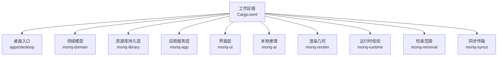
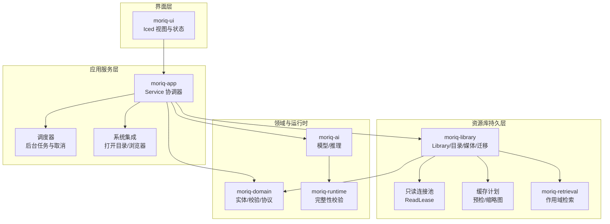
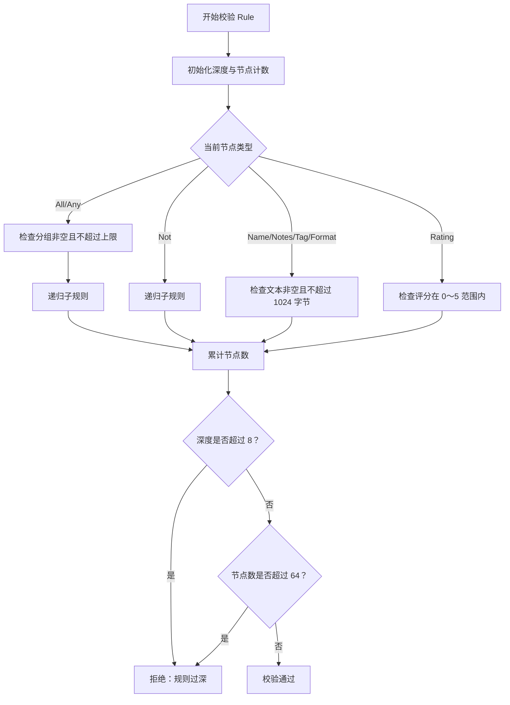
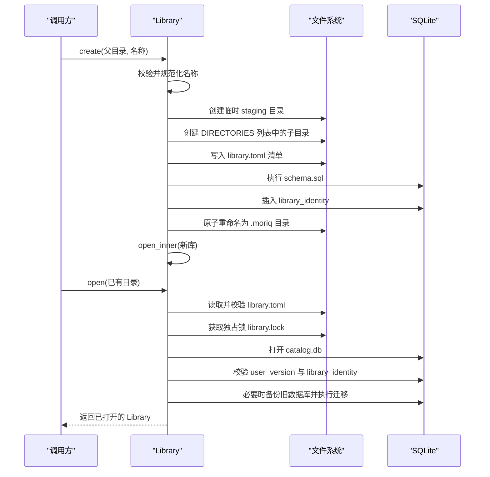
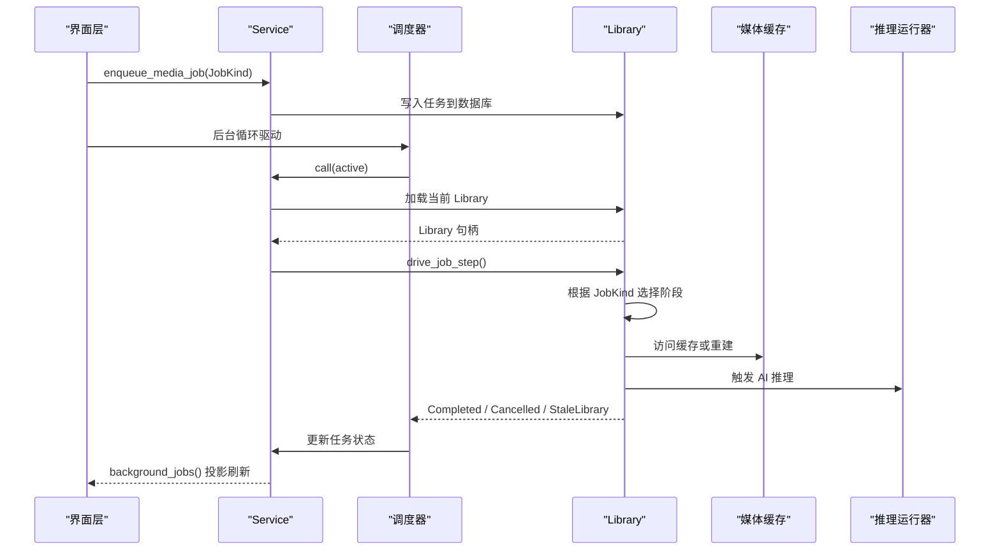
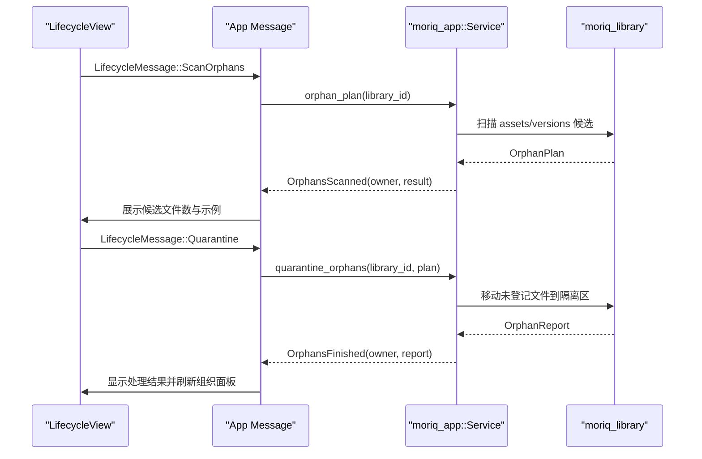
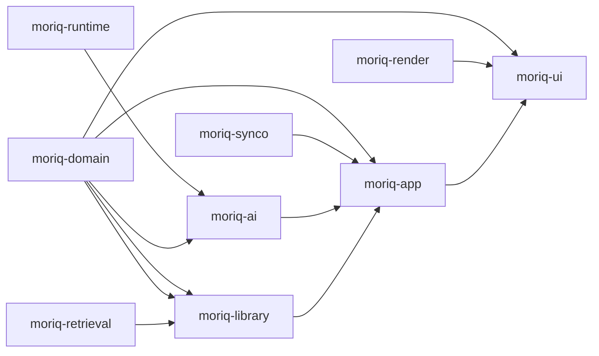

# 核心模块详解

> Repo Wiki 节点 `core-modules`
> 导出自 Qoder 知识库快照 `8fbe02f6-57c2-4874-b725-1a8130851fd9`，代码基线 `7a7a8e75e18bd90294e09cd422dd7ed5a04813a0`（分支 main，zh-CN）。

<cite>
**本文引用的文件**   
- [Cargo.toml](../../Cargo.toml)
- [ARCHITECTURE.md](../../ARCHITECTURE.md)
- [moriq-domain/lib.rs](../../crates/moriq-domain/src/lib.rs)
- [moriq-domain/ai.rs](../../crates/moriq-domain/src/ai.rs)
- [moriq-domain/jobs.rs](../../crates/moriq-domain/src/jobs.rs)
- [moriq-library/lib.rs](../../crates/moriq-library/src/lib.rs)
- [moriq-library/library_core.rs](../../crates/moriq-library/src/library/core.rs)
- [moriq-library/media_cache.rs](../../crates/moriq-library/src/media/cache.rs)
- [moriq-library/read_pool.rs](../../crates/moriq-library/src/database/read_pool.rs)
- [moriq-app/lib.rs](../../crates/moriq-app/src/lib.rs)
- [moriq-app/scheduler.rs](../../crates/moriq-app/src/scheduler.rs)
- [moriq-app/launch.rs](../../crates/moriq-app/src/launch.rs)
- [moriq-ui/lib.rs](../../crates/moriq-ui/src/lib.rs)
- [moriq-ui/lifecycle.rs](../../crates/moriq-ui/src/lifecycle.rs)
</cite>

## 目录
1. [引言](#引言)
2. [项目结构](#项目结构)
3. [核心组件](#核心组件)
4. [架构总览](#架构总览)
5. [详细组件分析](#详细组件分析)
6. [依赖关系分析](#依赖关系分析)
7. [性能与资源控制](#性能与资源控制)
8. [故障排查指南](#故障排查指南)
9. [结论](#结论)

## 引言
Moriq Space 是一个面向本地媒体库、AI 推理与桌面界面的 Rust 应用。仓库采用多 crate 分层设计：领域模型层定义稳定的实体和校验规则；资源库持久层负责 SQLite 数据库、媒体处理、缓存与恢复；应用服务层协调 Catalog、导入、维护、任务调度与 AI；界面层基于 Iced，负责视图状态、交互与请求回执。

整体目标是：以不可变版本与事务日志保证媒体安全，通过单写者 SQLite 与只读连接池提供稳定数据访问，使用有界调度器与共享内存预算控制导入、缩略图生成与 AI 推理，并通过 UI 的 Service 适配层屏蔽底层复杂操作。

**章节来源**
- [ARCHITECTURE.md:1-155](../../ARCHITECTURE.md#L1-L155)

## 项目结构
仓库根 Cargo 工作区声明了 `apps/desktop` 与各 `crates/*`，并统一配置版本、Edition、Rust 版本、常用依赖、发布优化、开发包优化以及禁止 unsafe 代码等 lint 策略。

**图示来源**
- [Cargo.toml:1-80](../../Cargo.toml#L1-L80)

**章节来源**
- [Cargo.toml:1-80](../../Cargo.toml#L1-L80)
- [ARCHITECTURE.md:1-40](../../ARCHITECTURE.md#L1-L40)

## 核心组件
- **moriq-domain**：纯领域类型、身份标识、查询树、AI 分类模板、后台任务协议和用户设置。不包含任何 I/O 或 UI 依赖。
- **moriq-library**：阻塞式基础设施，封装 SQLite 读写、目录结构、媒体探测、缩略图与预览、色彩空间、视频、AI 内容存储、导入导出、恢复日志、维护工具。
- **moriq-app**：单写者协调器。持有 Library、Service、调度器、取消令牌、并发信号量与共享内存预算，对外暴露 UI 可消费的投影结果。
- **moriq-ui**：Iced 原生界面。所有磁盘、编解码和目录查询都委托给 Service；UI 仅维护视图状态、消息流和轻量展示数据。
- **moriq-ai**：本地模型下载、硬件信息、推理运行器接口与运行时完整性校验。
- **moriq-render**：网格、视口等几何计算，无 I/O。
- **moriq-runtime**：共享运行时完整性校验。
- **moriq-retrieval**：带作用域的相似性与语义检索读取接口，不直接依赖 Library 完整实现。
- **moriq-synco**：同用户回环传输，不拥有 Catalog 所有权。

**章节来源**
- [ARCHITECTURE.md:1-40](../../ARCHITECTURE.md#L1-L40)

## 架构总览
Moriq Space 的调用方向自顶向下为：界面层 → 应用服务层 → 资源库持久层 → 领域模型与外部系统。

**图示来源**
- [moriq-ui/lib.rs:1-60](../../crates/moriq-ui/src/lib.rs#L1-L60)
- [moriq-app/lib.rs:1-60](../../crates/moriq-app/src/lib.rs#L1-L60)
- [moriq-library/lib.rs:1-60](../../crates/moriq-library/src/lib.rs#L1-L60)
- [moriq-domain/lib.rs:1-20](../../crates/moriq-domain/src/lib.rs#L1-L20)

## 详细组件分析

### 领域模型层：实体、查询与输入校验
领域层提供稳定的类型契约，重点包括：
- 身份标识：`LibraryId`、`AssetId`、`AssetVersionId`、`ProjectId`，由宏生成，默认产生随机 UUID，支持序列化、显示与哈希。
- 资源与项目：`LibraryInfo`、`Project`、`Asset`、`AssetDetails`、`AssetVersion`，描述库元信息、项目树、资产基础信息与详情。
- 查询与规则：`Query` 聚合多种过滤条件；`Rule` 是组合型表达式，支持全匹配、任意匹配、否定、名称、备注、标签、格式、评分、收藏、RAW、位置存在等。
- AI 分类模板：`AiProfile`、`AiCategory`、`AiGroup`，包含媒介与主题词表、类别启用数量限制、上下文长度限制与合并校验。
- 后台任务协议：`JobKind`、`JobState`、`ModelId`、`TaskError`、`TaskResult`，将数据库字符串映射为强类型枚举，拒绝未知值。
- 用户设置：`UserSettings`、`ImportPreferences`、`AiPreferences`、`SyncoPreferences`、语言与外观偏好。

#### 查询规则校验流程

**图示来源**
- [moriq-domain/lib.rs:1-200](../../crates/moriq-domain/src/lib.rs#L1-L200)

#### AI 分类模板校验要点
- 启用主题最多 24 个。
- 识别说明字符总数最多约 1600。
- 主题上限 1～8，分类总数最多 64。
- 分类 ID 必须 ASCII 小写字母、数字与下划线，不能为空、不能重复、不能以 `_` 开头、不能超过 64。
- 名称与定义不能为空，名称不能超过 32，定义不能超过 512。
- 固定媒介类型不能删除，新增内容应使用主题分类。

**章节来源**
- [moriq-domain/lib.rs:1-200](../../crates/moriq-domain/src/lib.rs#L1-L200)
- [moriq-domain/ai.rs:1-187](../../crates/moriq-domain/src/ai.rs#L1-L187)
- [moriq-domain/jobs.rs:1-200](../../crates/moriq-domain/src/jobs.rs#L1-L200)

### 资源库持久层：目录、迁移、只读池与媒体缓存
`moriq-library` 是阻塞基础设施，对外暴露 Library、Catalog、Media、Transfer、Tasks、Maintenance、Database 等子系统。

#### 资源库创建与打开流程

**图示来源**
- [moriq-library/library_core.rs:1-200](../../crates/moriq-library/src/library/core.rs#L1-L200)
- [moriq-library/lib.rs:1-120](../../crates/moriq-library/src/lib.rs#L1-L120)

#### 只读连接池与媒体源
- `ReadPool` 持有资源库路径、文件租约与空闲连接向量。
- `checkout` 复用最多 4 个只读连接，设置较大 cache_size 与临时存储。
- `media_source` 借助 `ReadLease` 构造 `media::Source`，让媒体线程在保持 Library 生命周期租约的同时安全读取数据库。
- `Drop` 会回滚未提交事务、清理临时表，并在连接池未满时归还连接。

**章节来源**
- [moriq-library/read_pool.rs:1-97](../../crates/moriq-library/src/database/read_pool.rs#L1-L97)

#### 缓存淘汰策略
`Plan::trim` 按预算淘汰可重建的预览与缩略图缓存：
- 扫描 `previews` 与 `thumbnails/256`。
- 跳过非文件、符号链接、不符合扩展名、UUID 前缀非法的文件。
- 按修改时间排序逐步删除，直到剩余字节数低于预算。
- 记录移除文件数、移除字节数与跳过数。

**章节来源**
- [moriq-library/media_cache.rs:1-87](../../crates/moriq-library/src/media/cache.rs#L1-L87)

### 应用服务层：协调器模式与生命周期管理
`moriq-app` 的 `Service` 是 UI 与 Library 之间的协调器：
- 持有工作区项目范围、媒体缓存、推理运行器、任务队列、导入并发信号量、导入内存预算、维护信号量、读信号量、任务信号量与取消注册表。
- `for_project` 冻结后续调用的项目上下文，避免 UI 切换后重新绑定队列任务。
- `ImportControl` 统一管理取消标志、完成计数、总任务数、工作线程数、内存预算、活跃数、峰值等待数等进度状态。
- 调度器 `scheduler::start` 启动独立线程，弱引用队列，最后一个公开 Service 释放后停止调度。
- 失败退避：连续失败指数退避，最大间隔 30 秒；达到阈值后暂停任务并提示。
- 取消机制：`Cancellation` 登记 `(LibraryId, job_name, Weak<AtomicBool>)`，支持全局或目标任务取消，弱引用自动清理。

#### 后台任务调度时序

**图示来源**
- [moriq-app/scheduler.rs:1-200](../../crates/moriq-app/src/scheduler.rs#L1-L200)
- [moriq-app/lib.rs:1-200](../../crates/moriq-app/src/lib.rs#L1-L200)

#### 系统集成的调用点
`launch::open` 在非 Catalog 写入线程中调用系统命令打开文件或目录：
- Windows 使用 `explorer.exe`。
- macOS 使用 `open`。
- Linux 使用 `xdg-open`。
- Windows 特殊处理 `\\?\` 与 UNC 路径，保留 Unicode、空格与 URL。
- 支持“定位”模式：Windows `/select,`、macOS `-R`、Linux 打开父目录。

**章节来源**
- [moriq-app/launch.rs:1-79](../../crates/moriq-app/src/launch.rs#L1-L79)

### 界面层：Iced 应用架构与状态管理
`moriq-ui` 是 Iced 原生界面，职责边界明确：
- 所有磁盘访问、目录查询、媒体解码都委托给 `moriq_app::Service`。
- UI 维护屏幕、对话框、消息、导航、搜索、分页、选择、查看器、批量操作、规则、存储、期刊、任务等状态。
- `Message` 是主消息类型，包含生命周期、导入、浏览、查看器、任务、上传、轮询、比较、区域等子消息。
- 特性如 `features/batch` 正在成为第一个显式边界：它拥有自己的草稿、项目/库上下文、请求生成，并向 Shell 适配器返回类型化效果，而不是直接接收 App 或 Service。

#### UI 生命周期与孤儿文件管理时序

**图示来源**
- [moriq-ui/lifecycle.rs:1-200](../../crates/moriq-ui/src/lifecycle.rs#L1-L200)
- [moriq-ui/lib.rs:1-200](../../crates/moriq-ui/src/lib.rs#L1-L200)

**章节来源**
- [moriq-ui/lib.rs:1-200](../../crates/moriq-ui/src/lib.rs#L1-L200)
- [moriq-ui/lifecycle.rs:1-200](../../crates/moriq-ui/src/lifecycle.rs#L1-L200)

## 依赖关系分析
从依赖方向看，高层模块依赖低层模块，但低层模块不反向依赖高层模块：

**图示来源**
- [Cargo.toml:1-80](../../Cargo.toml#L1-L80)

**章节来源**
- [Cargo.toml:1-80](../../Cargo.toml#L1-L80)
- [ARCHITECTURE.md:1-40](../../ARCHITECTURE.md#L1-L40)

## 性能与资源控制
- **单写者 SQLite**：数据库写操作集中，减少竞争；读操作通过只读连接池提升并发读取能力。
- **导入并发与内存预算**：`ImportPreferences.effective_workers` 根据逻辑 CPU 数与用户偏好计算实际并发，默认自动选择并限制在合理范围；内存预算可配置并在 `ImportControl` 中暴露。
- **任务内存预算**：`JobKind::memory_mib` 为不同任务类型分配不同共享内存准入预算，AI 推理与批量任务使用更高预算，指纹与缩略图使用中等预算，普通元数据与完整性检查使用较低预算。
- **缓存淘汰**：`Plan::trim` 按预算回收预览与缩略图，确保磁盘占用可控，同时只删除可重建缓存。
- **失败退避**：调度器对连续失败进行指数退避，避免雪崩。
- **发布与开发优化**：workspace profile 对 `moriq-library`、`image`、`zune-jpeg`、`fast_image_resize` 等关键包在开发构建中也开启优化，提高编解码与图像处理性能。

**章节来源**
- [moriq-domain/jobs.rs:1-200](../../crates/moriq-domain/src/jobs.rs#L1-L200)
- [moriq-library/media_cache.rs:1-87](../../crates/moriq-library/src/media/cache.rs#L1-L87)
- [moriq-app/scheduler.rs:1-200](../../crates/moriq-app/src/scheduler.rs#L1-L200)
- [Cargo.toml:1-80](../../Cargo.toml#L1-L80)

## 故障排查指南
- **资源库无法打开**
  - 可能原因：清单过大、清单损坏、格式不兼容、schema 版本不支持、最低 reader 版本过高、library_identity 不一致、删除进行中。
  - 排查建议：检查 `library.toml`、`catalog.db`、`catalog.db-wal`、`catalog.db-shm`、`backups` 目录，确认没有同名 `.moriq` 目录残留。
  - 相关实现：[moriq-library/library_core.rs:1-200](../../crates/moriq-library/src/library/core.rs#L1-L200)

- **资源库被锁定**
  - 现象：另一个窗口或进程仍持有 `library.lock`。
  - 排查建议：关闭其他 Moriq Space 实例，检查残留进程。
  - 相关实现：[moriq-library/lib.rs:1-120](../../crates/moriq-library/src/lib.rs#L1-L120)

- **后台任务频繁失败**
  - 现象：调度器指数退避，最终暂停任务并提示错误详情。
  - 排查建议：查看任务错误类型，区分取消、库切换、无效输入、存储、运行时与服务不可用。
  - 相关实现：[moriq-app/scheduler.rs:1-200](../../crates/moriq-app/src/scheduler.rs#L1-L200), [moriq-domain/jobs.rs:1-200](../../crates/moriq-domain/src/jobs.rs#L1-L200)

- **导入卡住或内存过高**
  - 现象：等待共享内存预算，active/waiting_memory/largest_mib 持续增长。
  - 排查建议：降低 `ImportPreferences.memory_mib`，减少 `workers`，检查大文件与高分辨率媒体。
  - 相关实现：[moriq-app/lib.rs:1-200](../../crates/moriq-app/src/lib.rs#L1-L200), [moriq-domain/lib.rs:201-450](../../crates/moriq-domain/src/lib.rs#L201-L450)

- **AI 分类模板无效**
  - 现象：分类 ID、名称、定义、启用数量或固定媒介校验失败。
  - 排查建议：检查分类数量、ID 合法性、名称唯一性、固定媒介是否缺失、上下文大小是否超限。
  - 相关实现：[moriq-domain/ai.rs:1-187](../../crates/moriq-domain/src/ai.rs#L1-L187)

- **UI 生命周期操作无响应**
  - 现象：孤儿文件扫描、隔离、恢复或清理按钮点击后无反馈。
  - 排查建议：确认 `manager.busy` 状态、owner 是否为当前库、是否有确认标志；检查 Service 异步回调是否返回正确 owner。
  - 相关实现：[moriq-ui/lifecycle.rs:1-200](../../crates/moriq-ui/src/lifecycle.rs#L1-L200)

## 结论
Moriq Space 的核心模块围绕“稳定领域模型 + 单写者持久层 + 有界协调器 + 明确 UI 边界”展开。领域层保证类型与校验一致性；资源库层保证数据安全、媒体可恢复与可重建缓存；应用层统一协调 Catalog、导入、维护、任务与推理；界面层专注视图状态与用户交互。通过信号量、预算、取消令牌与失败退避，系统在性能、可靠性与用户体验之间取得平衡。