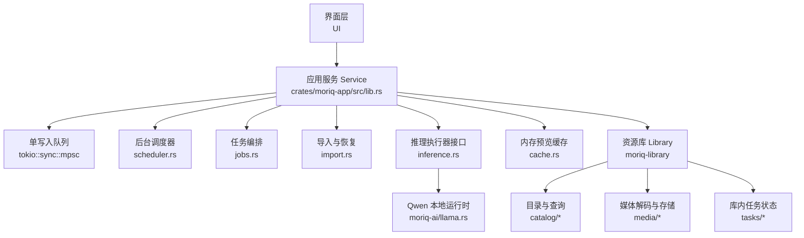
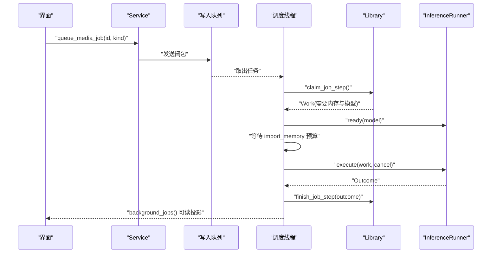
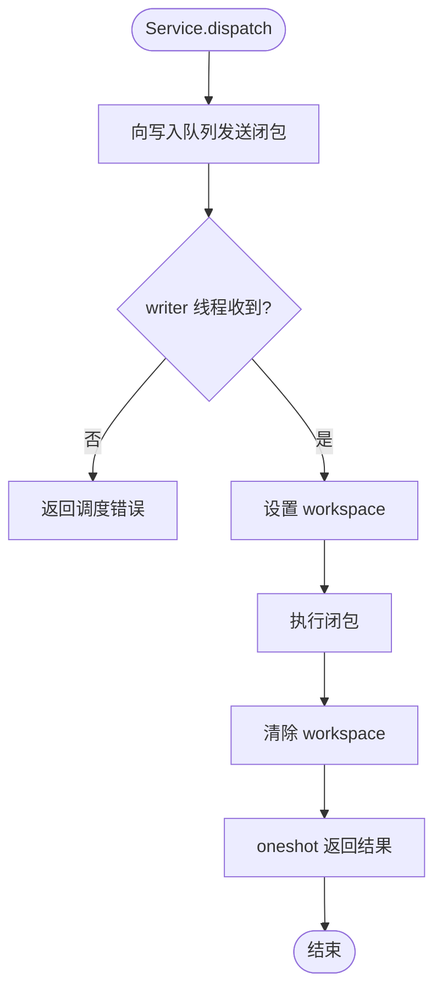
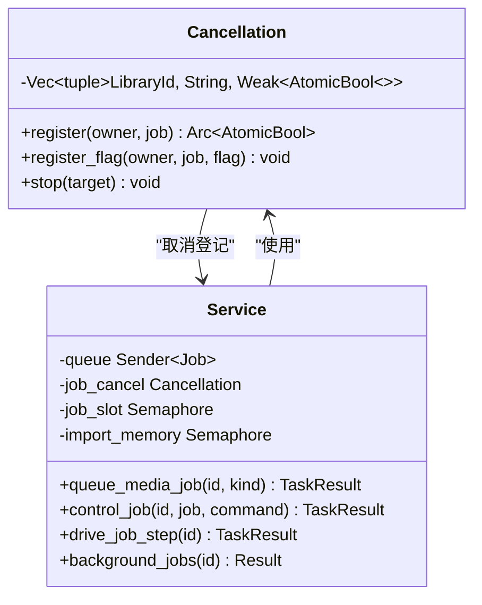
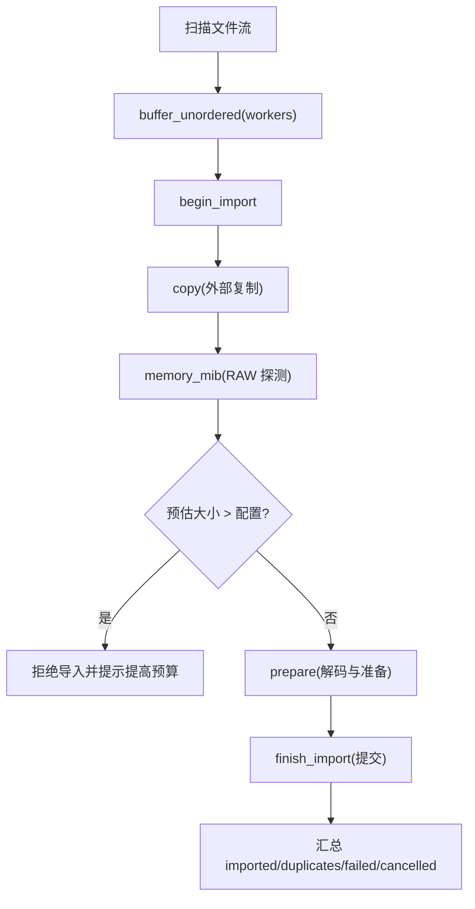
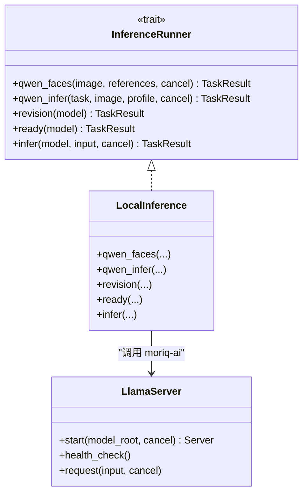
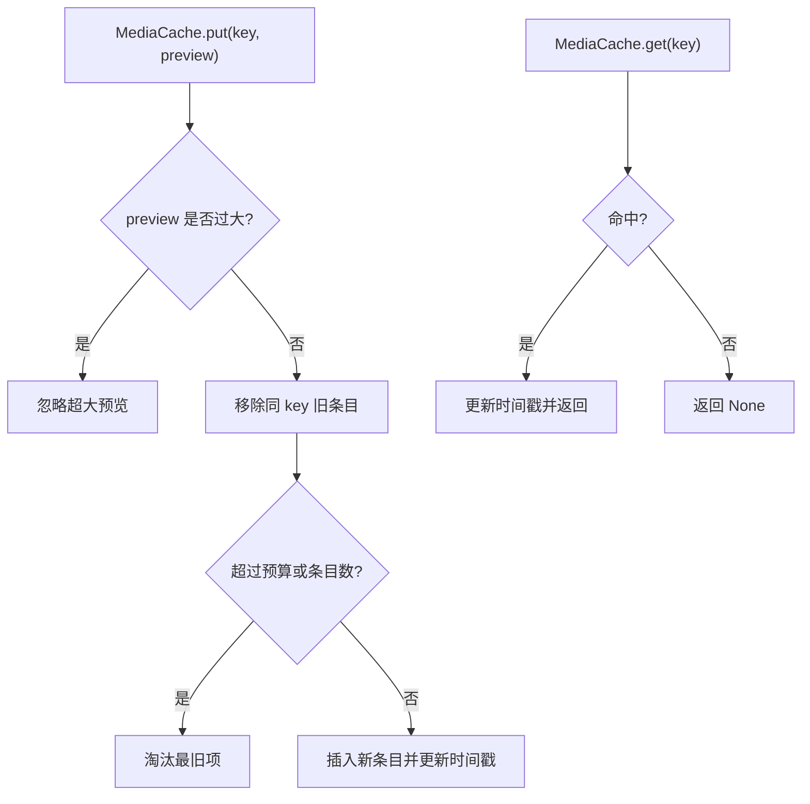
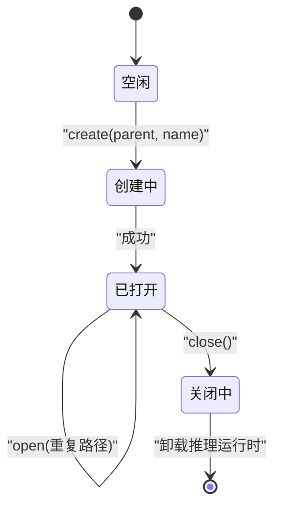
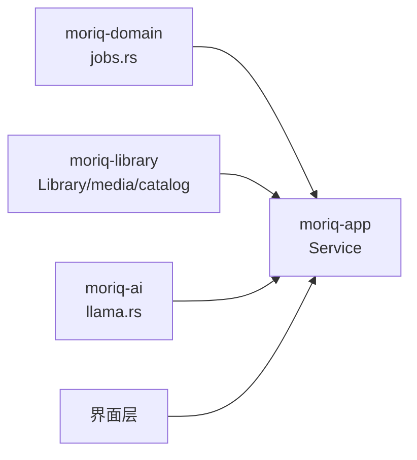

# 应用服务层 (moriq-app)

> Repo Wiki 节点 `app-service`
> 导出自 Qoder 知识库快照 `8fbe02f6-57c2-4874-b725-1a8130851fd9`，代码基线 `7a7a8e75e18bd90294e09cd422dd7ed5a04813a0`（分支 main，zh-CN）。

<cite>
**本文引用的文件**   
- [lib.rs](../../../crates/moriq-app/src/lib.rs)
- [scheduler.rs](../../../crates/moriq-app/src/scheduler.rs)
- [jobs.rs](../../../crates/moriq-app/src/jobs.rs)
- [import.rs](../../../crates/moriq-app/src/import.rs)
- [inference.rs](../../../crates/moriq-app/src/inference.rs)
- [cache.rs](../../../crates/moriq-app/src/cache.rs)
- [launch.rs](../../../crates/moriq-app/src/launch.rs)
- [Cargo.toml](../../../crates/moriq-app/Cargo.toml)
- [jobs.rs](../../../crates/moriq-domain/src/jobs.rs)
- [lifecycle.rs](../../../crates/moriq-library/src/library/lifecycle.rs)
- [cache.rs](../../../crates/moriq-library/src/media/cache.rs)
- [llama.rs](../../../crates/moriq-ai/src/llama.rs)
</cite>

## 目录
1. [引言](#引言)
2. [项目结构](#项目结构)
3. [核心组件](#核心组件)
4. [架构总览](#架构总览)
5. [详细组件分析](#详细组件分析)
6. [依赖关系分析](#依赖关系分析)
7. [性能考量](#性能考量)
8. [故障排查指南](#故障排查指南)
9. [结论](#结论)

## 引言
本文聚焦 Moriq Space 的应用服务层，围绕 Service 协调器模式展开，解释其如何统一管理资源库生命周期、后台任务调度、内存预算控制、推理执行器和媒体缓存。重点说明以下设计：
- 单写入队列与 tokio::sync::mpsc 消息通道实现 UI 与底层逻辑解耦。
- ImportControl 通过原子计数器、并发信号量和内存信号量实现导入工作流的可控并发与内存预算管理。
- 推理执行器抽象 InferenceRunner 支持本地 llama.cpp/Qwen 后端，并可被替换或注入测试。
- 媒体预览缓存采用基于最近使用顺序的内存池策略，并配合磁盘级预览和缩略图清理。
- 资源库从创建、打开到关闭的生命周期由 Service 统一编排，确保取消信号、旧库拒绝和资源释放语义正确。

## 项目结构
moriq-app 是上层协调模块，不直接拥有数据库连接或媒体 I/O；它通过 moriq-library 提供 Library 对象执行持久化与媒体操作，并通过 moriq-ai 管理 Qwen 模型运行期。

**图示来源**
- [lib.rs:201-446](../../../crates/moriq-app/src/lib.rs#L201-L446)
- [scheduler.rs:1-200](../../../crates/moriq-app/src/scheduler.rs#L1-L200)
- [jobs.rs:1-175](../../../crates/moriq-app/src/jobs.rs#L1-L175)
- [import.rs:1-200](../../../crates/moriq-app/src/import.rs#L1-L200)
- [inference.rs:1-200](../../../crates/moriq-app/src/inference.rs#L1-L200)
- [cache.rs:1-65](../../../crates/moriq-app/src/cache.rs#L1-L65)
- [lifecycle.rs:1-177](../../../crates/moriq-library/src/library/lifecycle.rs#L1-L177)
- [llama.rs:1-200](../../../crates/moriq-ai/src/llama.rs#L1-L200)

**章节来源**
- [Cargo.toml:1-25](../../../crates/moriq-app/Cargo.toml#L1-L25)
- [lib.rs:1-200](../../../crates/moriq-app/src/lib.rs#L1-L200)

## 核心组件
- Service：应用服务协调器，持有工作队列、共享信号量、媒体缓存、推理执行器和取消登记表。对外暴露 create/open/close/import/queue_media_job/background_jobs 等 API。
- Cancellation：按库 ID 与任务名登记可取消令牌，支持单项或全局停止，并在弱引用下自动清理已释放记录。
- Job 分发器：单线程阻塞接收器循环消费 mpsc 发送的闭包，保证同一时刻只有一个写操作修改 Library。
- ImportControl：用户可见的导入进度与控制对象，包含 workers、memory_mib、active、peak、waiting_memory、largest_mib 等指标。
- InferenceRunner：推理执行器接口，默认 LocalInference 实现调用 moriq-ai 的 Qwen 能力。
- MediaCache：进程内预览缓存，按版本尺寸键值组织，限制条目数和字节数，淘汰最久未使用项。
- Library 生命周期：Library::create/Library::open/Library::close 由 Service 包装，确保切换时停止旧库任务并释放推理运行时。

**章节来源**
- [lib.rs:1-200](../../../crates/moriq-app/src/lib.rs#L1-L200)
- [lib.rs:201-446](../../../crates/moriq-app/src/lib.rs#L201-L446)
- [scheduler.rs:1-200](../../../crates/moriq-app/src/scheduler.rs#L1-L200)
- [jobs.rs:1-175](../../../crates/moriq-app/src/jobs.rs#L1-L175)
- [import.rs:1-200](../../../crates/moriq-app/src/import.rs#L1-L200)
- [inference.rs:1-200](../../../crates/moriq-app/src/inference.rs#L1-L200)
- [cache.rs:1-65](../../../crates/moriq-app/src/cache.rs#L1-L65)

## 架构总览
Service 将 UI 请求转化为对单一写入线程的闭包投递，同时维护多个有界资源许可：
- import_slots：限制同时进行的外部文件复制与元数据准备数量。
- import_memory：限制全局媒体解码与推理占用内存总量。
- maintenance_slot：限制维护类操作的互斥访问。
- read_slots：限制读取计划冻结与媒体处理并发。
- job_slot：限制后台调度器每次驱动任务的批次数，避免长时间独占调度线程。

**图示来源**
- [jobs.rs:1-175](../../../crates/moriq-app/src/jobs.rs#L1-L175)
- [scheduler.rs:1-200](../../../crates/moriq-app/src/scheduler.rs#L1-L200)
- [inference.rs:1-200](../../../crates/moriq-app/src/inference.rs#L1-L200)
- [lib.rs:201-446](../../../crates/moriq-app/src/lib.rs#L201-L446)

## 详细组件分析

### Service 协调器与工作队列
Service 通过 for_project 冻结项目范围，使 UI 句柄在切库后不再重定向已有队列任务。dispatch 方法将闭包投递到 mpsc 通道，并由 writer 线程依次执行；cancellable 参数允许 UI 侧丢弃 future 时跳过结果回执，但写入仍保持提交语义。

关键点：
- open 会尝试打开候选 Library，若检测到与当前库相同身份则拒绝，防止重复副本污染。
- create 会加载分类模板并保存 AI Profile，成功后切换 active 并停止旧库任务。
- close 先停止所有后台任务，清空预览缓存，再将 active 置空，最后轮询卸载 llama 运行时。

**图示来源**
- [lib.rs:201-446](../../../crates/moriq-app/src/lib.rs#L201-L446)

**章节来源**
- [lib.rs:201-446](../../../crates/moriq-app/src/lib.rs#L201-L446)

### 后台任务调度与取消机制
调度器启动一个独立多线程 runtime，以弱队列所有权驱动 drive_job_step。每个 Work 都携带 abort_token，调度器注册取消标志，并在内存预算等待和执行前后检查取消状态。连续失败超过阈值后，调度器会将对应库的任务暂停，并提示用户检查。

关键点：
- Cancellation.register/register_flag 支持按 LibraryId 与任务名精确停止。
- stop(None) 可全局停止，但保留仍在被工作线程持有的令牌，避免误杀活跃任务。
- drive_job_step 最多循环 64 次领取步骤，每步最多执行 250ms，避免长期占用调度线程。

**图示来源**
- [scheduler.rs:1-200](../../../crates/moriq-app/src/scheduler.rs#L1-L200)
- [jobs.rs:1-175](../../../crates/moriq-app/src/jobs.rs#L1-L175)

**章节来源**
- [scheduler.rs:1-200](../../../crates/moriq-app/src/scheduler.rs#L1-L200)
- [jobs.rs:1-175](../../../crates/moriq-app/src/jobs.rs#L1-L175)

### ImportControl 与导入内存预算
ImportControl 提供 workers、memory_mib、discovered、scanning、active、peak、waiting_memory、largest_mib 等字段，用于监控和约束导入流程。import_sources 将扫描流缓冲为有限并行任务，每个文件路径经 begin_import → copy → memory_mib → prepare → finish_import 流水线。

关键预算点：
- import_slots 限制外部复制与元数据准备的并发。
- 独立的 batch memory 信号量与全局 import_memory 信号量共同限制 RAW 探测与解码内存。
- waiting_memory 计数“已估算大小但尚未获得解码许可”的工作，peak 统计最大活跃解码数。
- largest_mib 记录本次导入中最大预估文件大小，便于用户调整 memory_mib。

**图示来源**
- [import.rs:201-478](../../../crates/moriq-app/src/import.rs#L201-L478)

**章节来源**
- [import.rs:1-200](../../../crates/moriq-app/src/import.rs#L1-L200)
- [import.rs:201-478](../../../crates/moriq-app/src/import.rs#L201-L478)

### 推理执行器抽象与多后端支持
InferenceRunner 定义 qwen_faces、qwen_infer、revision、ready、infer 等方法，LocalInference 默认调用 moriq-ai 提供的 llama.cpp 相关函数。execute 根据 Work 类型分派到 Qwen 人脸、通用推理、分类或描述任务，并将结果封装为 Outcome。

后端特点：
- llama.cpp 服务器以子进程方式启动，绑定本机端口与随机密钥，受 keep_loaded 策略控制常驻。
- 健康检查与健康超时、请求超时、响应字节上限防止资源泄漏。
- 推理过程接受 AtomicBool 取消标志，在 key path 处多次检查取消状态。

**图示来源**
- [inference.rs:1-200](../../../crates/moriq-app/src/inference.rs#L1-L200)
- [llama.rs:1-200](../../../crates/moriq-ai/src/llama.rs#L1-L200)

**章节来源**
- [inference.rs:1-200](../../../crates/moriq-app/src/inference.rs#L1-L200)
- [inference.rs:201-339](../../../crates/moriq-app/src/inference.rs#L201-L339)
- [llama.rs:1-200](../../../crates/moriq-ai/src/llama.rs#L1-L200)

### 媒体缓存策略与内存池
MediaCache 使用 HashMap<Key, (Preview, age)> 存储预览，Key 为 (LibraryId, AssetVersionId, size)。put 会在超过 256 MiB 或 48 个条目时淘汰最旧项；get 更新最近使用时间；clear 用于切库时释放旧像素。

补充：
- 磁盘级预览与缩略图清理由 Library.cache_plan().trim 负责，针对 previews 与 thumbnails/256 目录，按修改时间排序删除，直到低于目标字节预算。

**图示来源**
- [cache.rs:1-65](../../../crates/moriq-app/src/cache.rs#L1-L65)
- [cache.rs](../../../crates/moriq-library/src/media/cache.rs#L1-L87)

**章节来源**
- [cache.rs:1-65](../../../crates/moriq-app/src/cache.rs#L1-L65)
- [cache.rs](../../../crates/moriq-library/src/media/cache.rs#L1-L87)

### 资源库生命周期管理
Service 将 Library 生命周期分为三个阶段：
- 创建：创建目录、初始化数据库、可选加载分类模板并保存 AI Profile。
- 打开：校验锁、检测重复副本、切换 active 并停止旧库任务。
- 关闭：停止所有后台任务、清空预览缓存、释放 Library，并轮询卸载 llama 运行时。

此外，Library 还提供 reconnect_page/apply_reconnect 以及 ReferenceCandidate.verify，用于迁移或重新定位外部原片时进行内容校验与位置更新。

**图示来源**
- [lib.rs:201-446](../../../crates/moriq-app/src/lib.rs#L201-L446)
- [lifecycle.rs:1-177](../../../crates/moriq-library/src/library/lifecycle.rs#L1-L177)

**章节来源**
- [lib.rs:201-446](../../../crates/moriq-app/src/lib.rs#L201-L446)
- [lifecycle.rs:1-177](../../../crates/moriq-library/src/library/lifecycle.rs#L1-L177)

### 使用示例：Service API 操作流程
以下为典型用法路径（不含具体代码）：
- 启动服务：调用 Service::start 或 start_with_inference 注入自定义推理执行器。
- 创建资源库：调用 create(parent, name)，成功后获取 Opened.info.id。
- 打开资源库：调用 open(path)，若处于锁定状态会重试，成功后得到 Opened.root。
- 队列任务：调用 queue_media_job(id, JobKind::Thumbnails) 等。
- 查看任务：周期性调用 background_jobs(id) 获取任务状态。
- 控制任务：调用 control_job(id, job, JobCommand::Pause/Resume/Cancel)。
- 导入文件：调用 import_sources 或 import，传入 ImportControl 监控进度。
- 语义检索：调用 semantic_search 或 search_by_image，内部自动申请推理内存并查询向量。
- 关闭服务：调用 close，确保推理运行时释放。

这些 API 均通过 dispatch 进入单写入队列，或在调度线程中执行，从而保证 UI 不会直接操作 Library。

**章节来源**
- [lib.rs:201-446](../../../crates/moriq-app/src/lib.rs#L201-L446)
- [jobs.rs:1-175](../../../crates/moriq-app/src/jobs.rs#L1-L175)
- [import.rs:1-200](../../../crates/moriq-app/src/import.rs#L1-L200)
- [inference.rs:201-339](../../../crates/moriq-app/src/inference.rs#L201-L339)

## 依赖关系分析
moriq-app 的依赖关系呈现清晰的层次：
- 领域协议由 moriq-domain 提供 ModelId、JobKind、TaskError 等稳定枚举。
- 持久化与媒体能力由 moriq-library 提供 Library、media、catalog、tasks。
- 模型运行时由 moriq-ai 提供 Qwen 安装、清单、llama.cpp 控制。
- UI 只消费 Service 返回值，不持有 Database 或 media handle。

**图示来源**
- [jobs.rs](../../../crates/moriq-domain/src/jobs.rs#L1-L200)
- [lib.rs:201-446](../../../crates/moriq-app/src/lib.rs#L201-L446)
- [llama.rs:1-200](../../../crates/moriq-ai/src/llama.rs#L1-L200)

**章节来源**
- [Cargo.toml:1-25](../../../crates/moriq-app/Cargo.toml#L1-L25)
- [jobs.rs](../../../crates/moriq-domain/src/jobs.rs#L1-L200)

## 性能考量
- 并发控制：
  - import_slots 限制外部 I/O 与元数据处理并发。
  - read_slots 限制读取计划冻结与媒体处理并发。
  - job_slot 限制调度器单次批处理时长与任务数，避免调度线程饥饿。
- 内存预算：
  - import_memory 作为全局内存许可池，按 Work.memory_mib 或估计大小分配。
  - MediaCache 限制 256 MiB 与 48 个条目，避免 UI 预览占用过多内存。
  - Library.cache_plan.trim 定期清理磁盘预览与缩略图，降低磁盘占用。
- 推理运行时：
  - llama.cpp 子进程隔离，支持 keep_loaded 策略减少频繁启动开销。
  - 健康检查与请求超时保护系统稳定性。
- 调度健壮性：
  - 连续失败指数退避，最高延迟 30 秒。
  - 任务级别取消与库身份校验，防止切库后旧任务误用过期状态。

[本节为通用性能建议，不直接分析特定文件]

## 故障排查指南
常见问题与定位建议：
- “后台服务已关闭”或“后台服务中断”：
  - 原因：写入队列关闭或 oneshot 接收端断开。
  - 处理：重新启动 Service，避免复用已关闭句柄。
  - 参考：DispatchError 转换逻辑。
- “任务所属资源库已切换”：
  - 原因：check_task 发现 expected id 与 active id 不一致。
  - 处理：重新打开目标库后再发起任务。
- “资源库已经切换，旧操作已停止”：
  - 原因：check 发现 LibraryId 变化。
  - 处理：刷新 UI 中的 current library id。
- “资源库仍在使用中”：
  - 原因：Library::open 遇到 Locked 错误或重复副本。
  - 处理：关闭其他窗口，确认无后台任务；必要时重启应用。
- “恢复媒体预计需要 X MiB，请提高导入内存预算”：
  - 原因：RAW 探测或解码估计超出 ImportControl.memory_mib。
  - 处理：调大 memory_mib，或使用更小批量导入。
- “单张图片解码预计需要 X MiB”：
  - 原因：单个媒体过大或解码开销高。
  - 处理：提高内存预算，或分批导入。
- “未配置 Qwen 人脸推理”：
  - 原因：InferenceRunner 未实现或未安装模型。
  - 处理：调用 install_model，确认模型可用。
- “无法打开系统应用”：
  - 原因：系统命令 spawn 失败。
  - 处理：检查 launch::open 的平台命令与路径。

**章节来源**
- [lib.rs:201-446](../../../crates/moriq-app/src/lib.rs#L201-L446)
- [import.rs:201-478](../../../crates/moriq-app/src/import.rs#L201-L478)
- [inference.rs:1-200](../../../crates/moriq-app/src/inference.rs#L1-L200)
- [launch.rs:1-79](../../../crates/moriq-app/src/launch.rs#L1-L79)

## 结论
moriq-app 的应用服务层通过 Service 协调器将 UI 请求、资源库生命周期、后台任务调度、内存预算与推理执行器整合在一起。其核心优势在于：
- 单写入队列确保 Library 状态一致性与可恢复性。
- ImportControl 提供细粒度的进度与内存控制，适合大规模导入场景。
- InferenceRunner 抽象使 Qwen 后端可替换，便于扩展或测试。
- 媒体缓存兼顾内存与磁盘，避免 UI 卡顿与磁盘膨胀。
- 调度器具备取消、退避与失败暂停能力，提升系统在异常条件下的可用性。

对于开发者，建议在新增任务类型时：
- 明确 JobKind.memory_mib 与是否需要模型预热。
- 在 execute 分支中正确处理 Execution 类型。
- 通过 Service.background_jobs 与 job_failures 暴露可观测信息。
- 谨慎调整信号量容量，结合真实硬件评估导入与推理并发。