# Service 协调器

> Repo Wiki 节点 `service-coordinator`
> 导出自 Qoder 知识库快照 `8fbe02f6-57c2-4874-b725-1a8130851fd9`，代码基线 `7a7a8e75e18bd90294e09cd422dd7ed5a04813a0`（分支 main，zh-CN）。

<cite>
**本文引用的文件**   
- [lib.rs](../../../crates/moriq-app/src/lib.rs)
- [import.rs](../../../crates/moriq-app/src/import.rs)
- [inference.rs](../../../crates/moriq-app/src/inference.rs)
- [jobs.rs](../../../crates/moriq-app/src/jobs.rs)
</cite>

## 目录
1. [简介](#简介)
2. [项目结构](#项目结构)
3. [核心组件](#核心组件)
4. [架构总览](#架构总览)
5. [详细组件分析](#详细组件分析)
6. [依赖关系分析](#依赖关系分析)
7. [性能考虑](#性能考虑)
8. [故障排查指南](#故障排查指南)
9. [结论](#结论)

## 简介
Service 协调器是 Moriq Space 应用层的核心单写者协调器。它把 UI、资源库操作、媒体导入、后台任务和推理执行统一到一个串行写入队列中，避免 UI 直接持有数据库连接或进行媒体 I/O。该设计通过“当前活跃库 + 项目范围 + 有界通道 + 信号量预算”的组合，实现：
- 单一写入线程安全访问 Library；
- 项目范围的请求隔离；
- 对已关闭或切库后的请求进行拒绝；
- 可取消的并发导入与内存预算管理；
- 稳定的后台任务调度与进度反馈。

## 项目结构
Service 协调器位于 `crates/moriq-app` 包中，围绕以下模块协作：
- `lib.rs`：定义 `Service`、`ImportControl`、单写者队列启动、`dispatch`、项目范围隔离、资源库打开/创建、读取计划执行等。
- `import.rs`：基于 `ImportControl` 的恢复与重连流程，以及导入工作流中的并发和内存控制。
- `inference.rs`：推理执行器接口、本地实现、任务分派、推理取消。
- `jobs.rs`：后台任务提交、领取、暂停/取消、失败信息读取及驱动循环。

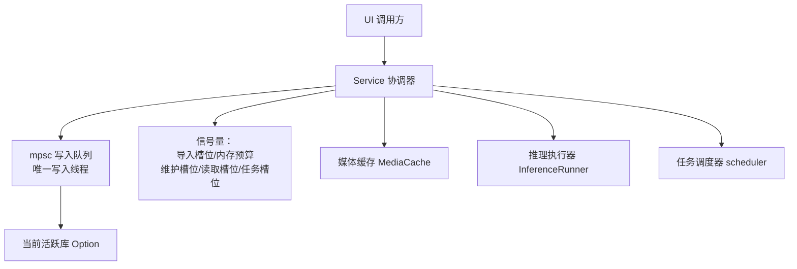

**图表来源**
- [lib.rs:100-170](../../../crates/moriq-app/src/lib.rs#L100-L170)
- [lib.rs:240-330](../../../crates/moriq-app/src/lib.rs#L240-L330)

**章节来源**
- [lib.rs:1-200](../../../crates/moriq-app/src/lib.rs#L1-L200)
- [lib.rs:201-446](../../../crates/moriq-app/src/lib.rs#L201-L446)

## 核心组件
### Service 结构体字段与职责边界
| 字段 | 类型 | 职责 | 线程特性 |
|---|---|---|---|
| `workspace` | `Option<ProjectId>` | 冻结本次调用的项目范围；用于 `library.set_workspace` 临时作用域。 | 随 `for_project` 克隆复制。 |
| `media_cache` | `Arc<cache::MediaCache>` | 共享媒体缓存，供读取计划和预览使用。 | `Arc` 共享。 |
| `inference` | `Arc<dyn inference::InferenceRunner>` | 抽象推理后端；默认使用本地实现。 | `Arc` 共享。 |
| `queue` | `mpsc::Sender<Job>` | 所有需要修改 Library 的请求都经此发送。 | 唯一写入线程接收并执行闭包。 |
| `import_slots` | `Arc<Semaphore>` | 限制同时进行的恢复/导入工作数量。 | 共享许可。 |
| `import_memory` | `Arc<Semaphore>` | 以 MiB 为单位的内存预算许可，限制导入、推理、读取计划的并发占用。 | 共享许可。 |
| `maintenance_slot` | `Arc<Semaphore>` | 保证维护类操作互斥。 | 容量为 1。 |
| `read_slots` | `Arc<Semaphore>` | 限制同时进行读取计划的数量。 | 容量为 4。 |
| `job_slot` | `Arc<Semaphore>` | 限制后台任务驱动循环的并发度。 | 容量为 1。 |
| `job_cancel` | `scheduler::Cancellation` | 按库、作业或交互推理登记取消标志。 | 共享取消状态。 |

**章节来源**
- [lib.rs:100-170](../../../crates/moriq-app/src/lib.rs#L100-L170)

### ImportControl 设计
`ImportControl` 是导入和恢复流程的可观察、可取消、可配置的控制对象。

| 字段 | 含义 | 行为 |
|---|---|---|
| `cancel` | 取消标志 | 用户或上层逻辑设置后，导入流程停止。 |
| `finished` | 已完成项数 | 每处理完一个恢复计划递增。 |
| `total` | 待处理总数 | 由恢复计划数量初始化。 |
| `referenced` | 引用语义标记 | 用于区分不同导入策略。 |
| `workers` | 工作线程数 | 根据系统并行度和导入偏好计算。 |
| `memory_mib` | 最大允许单个导入预计内存 | 默认来自偏好，构造时钳制到 256～4096。 |
| `discovered` | 已发现项数 | 原子计数器，用于进度统计。 |
| `scanning` | 扫描中标志 | 原子布尔值。 |
| `active` | 当前活跃导入数 | 使用 `ImportActivity` RAII 自动增减。 |
| `peak` | 历史峰值活跃数 | 在活跃计数变化时更新。 |
| `waiting_memory` | 等待内存预算的导入数 | 申请内存前增加，申请成功后减少。 |
| `largest_mib` | 已见最大预估内存 | 记录恢复工作预估的最大内存。 |

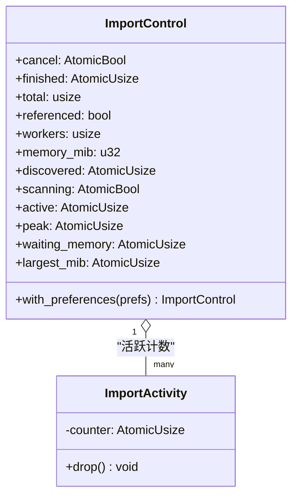

**图表来源**
- [lib.rs:130-200](../../../crates/moriq-app/src/lib.rs#L130-L200)

**章节来源**
- [lib.rs:130-200](../../../crates/moriq-app/src/lib.rs#L130-L200)

## 架构总览
Service 协调器的运行时由三个关键部分组成：
1. **单写者写入队列**：所有修改 Library 的操作通过 `mpsc::Sender` 发送到唯一写入线程。
2. **共享资源预算**：通过多个 `Semaphore` 控制导入并发、内存占用、维护互斥、读取并发和任务驱动并发。
3. **上下文隔离**：通过 `workspace` 和项目校验函数，确保 UI 请求不会错误地落到已关闭或切换后的库。

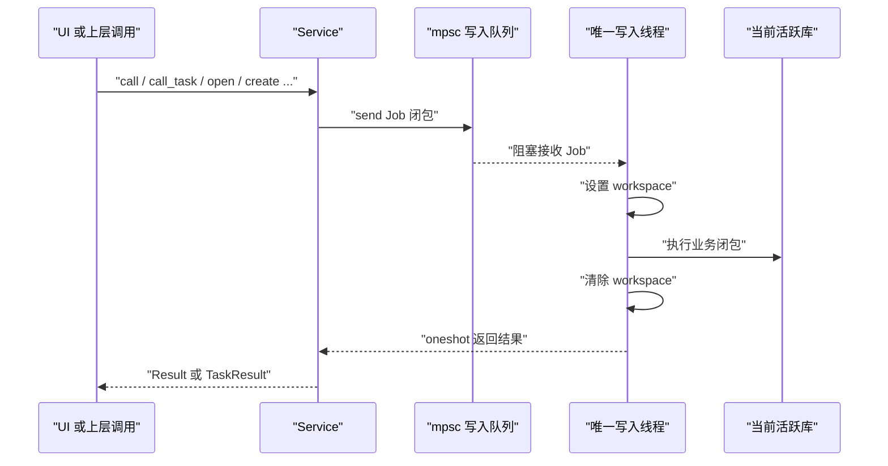

**图表来源**
- [lib.rs:240-330](../../../crates/moriq-app/src/lib.rs#L240-L330)

## 详细组件分析

### 单写者协调器模式
Service 不直接持有 `Library`，而是通过 `queue` 将闭包发送给写入线程。写入线程内部维护 `active: Option<Library>`，并在执行每个闭包前设置项目工作区，执行后清除。这样可以保证：
- 任意时刻只有一个闭包能修改 Library；
- 闭包内可以安全借用 `&mut Library`；
- UI 侧只看到最终结果或错误。

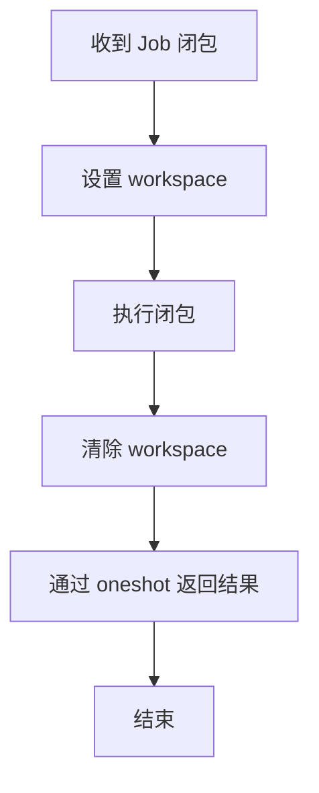

**图表来源**
- [lib.rs:240-330](../../../crates/moriq-app/src/lib.rs#L240-L330)

**章节来源**
- [lib.rs:240-330](../../../crates/moriq-app/src/lib.rs#L240-L330)

### for_project 方法：项目范围隔离
`for_project` 会克隆当前 Service，但把 `workspace` 替换为指定项目 ID。此后所有通过该句柄发出的 `call`/`call_task`，都会在写入线程中调用 `library.set_workspace(Some(project))`，再在返回前清除。这样：
- UI 可以创建“绑定到某个项目”的服务副本；
- 后续请求即使 UI 切换到其他页面，也不会改变写入线程中当前库的工作区；
- 若 UI 错误地向已关闭的资源库发起请求，仍可被 `check` 或 `check_task` 拒绝。

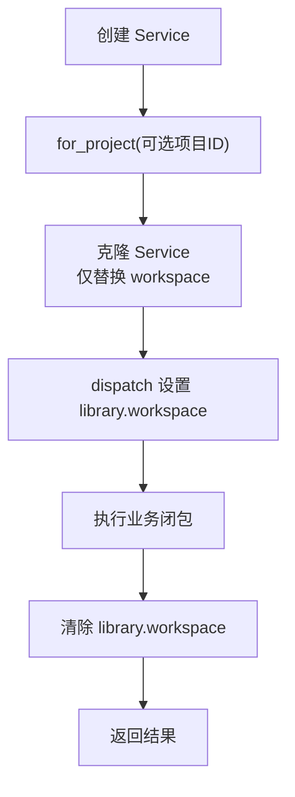

**图表来源**
- [lib.rs:170-190](../../../crates/moriq-app/src/lib.rs#L170-L190)
- [lib.rs:240-330](../../../crates/moriq-app/src/lib.rs#L240-L330)

**章节来源**
- [lib.rs:170-190](../../../crates/moriq-app/src/lib.rs#L170-L190)
- [lib.rs:240-330](../../../crates/moriq-app/src/lib.rs#L240-L330)

### Service::call 与 dispatch：安全访问当前活跃库
`call` 和 `call_task` 都是 `dispatch` 的薄封装：
- `call` 用于普通 `Result<String>` 场景；
- `call_task` 用于任务相关 `TaskResult` 场景；
- `dispatch` 负责把闭包包装成 `Job` 发送到写入队列，并通过 `oneshot` 接收结果。

关键点：
- 如果调用方丢弃接收端且 `cancellable=true`，写入线程会跳过结果发送；
- 写入线程在执行闭包前后分别设置和清除 `library.set_workspace`；
- 如果 `queue` 被关闭，转换为 `DispatchError::Closed`；
- 如果 `oneshot` 接收失败，转换为 `DispatchError::Interrupted`。

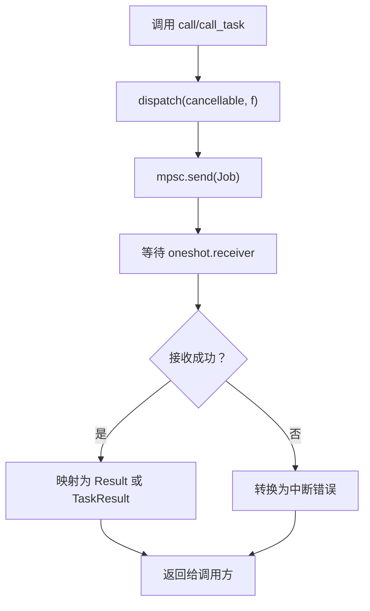

**图表来源**
- [lib.rs:240-330](../../../crates/moriq-app/src/lib.rs#L240-L330)

**章节来源**
- [lib.rs:240-330](../../../crates/moriq-app/src/lib.rs#L240-L330)

### check 与 check_task：拒绝旧库请求
`check` 和 `check_task` 是两个重要的守卫函数：
- `check(active, expected)`：先判断 `active` 是否为空，再比较 `library.id()`；不匹配返回字符串错误。
- `check_task(active, expected)`：同样检查活动库身份，但返回 `TaskError::StaleLibrary`。

这保证了 UI 请求不会重定向到已关闭、切换或不再活动的库。

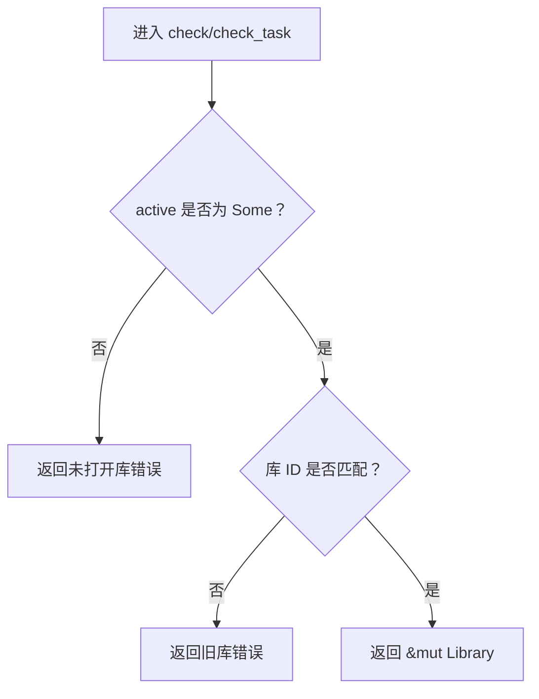

**图表来源**
- [lib.rs:400-446](../../../crates/moriq-app/src/lib.rs#L400-L446)

**章节来源**
- [lib.rs:400-446](../../../crates/moriq-app/src/lib.rs#L400-L446)

### 资源库打开、创建与关闭
- `open(path)`：尝试打开候选库；若库被锁定则重试；打开成功后停止旧库取消令牌并替换 `active`。
- `create(parent, name)`：创建新库，可能应用分类模板，成功后替换 `active`。
- `close()`：停止取消、清空媒体缓存、清空 `active`，并等待推理模型卸载。

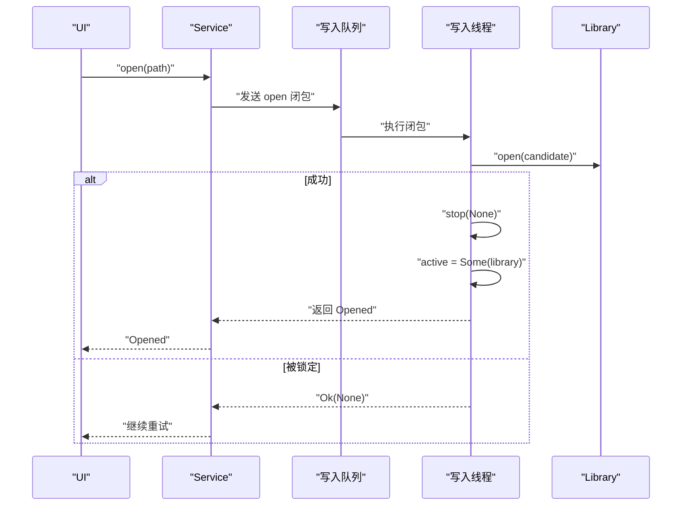

**图表来源**
- [lib.rs:330-400](../../../crates/moriq-app/src/lib.rs#L330-L400)

**章节来源**
- [lib.rs:330-400](../../../crates/moriq-app/src/lib.rs#L330-L400)

### 恢复导入流程：ImportControl 与 mpsc 通道
恢复导入入口包括：
- `recover(id)`：使用默认 `ImportControl`；
- `recover_controlled(id, control)`：暴露完整控制对象，便于监控进度和取消。

恢复流程关键步骤：
1. 注册取消标志；
2. 查询恢复计划；
3. 设置 `control.discovered`；
4. 对每个计划：
   - 检查 `control.cancel`；
   - 申请恢复槽位；
   - 探测最小内存许可；
   - 在阻塞线程冻结工作并估算内存；
   - 检查预估内存是否超过 `memory_mib`；
   - 更新 `largest_mib`；
   - 增加 `waiting_memory`；
   - 申请实际内存许可；
   - 准备恢复工作；
   - 提交到当前库完成恢复；
   - 更新 `finished`。

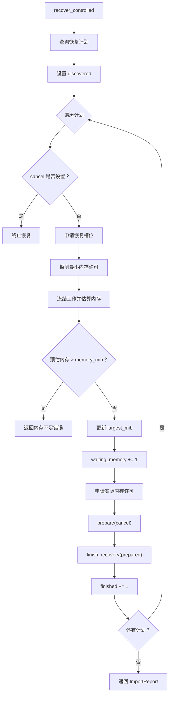

**图表来源**
- [import.rs:1-200](../../../crates/moriq-app/src/import.rs#L1-L200)

**章节来源**
- [import.rs:1-200](../../../crates/moriq-app/src/import.rs#L1-L200)

### 工作队列的 mpsc 通道实现
Service 启动时：
- 创建容量为 16 的 `mpsc::channel::<Job>`；
- 在新线程中运行接收循环；
- 每次从通道取出 `Job` 并调用 `job(&mut active)`；
- `Job` 类型为 `Box<dyn FnOnce(&mut Option<Library>) + Send>`。

这意味着：
- 所有修改 Library 的逻辑都必须包装成闭包；
- UI 无法直接持有 `Library`；
- 通道关闭表示服务不可用；
- 写入线程名称固定为 `moriq-library-writer`，便于诊断。

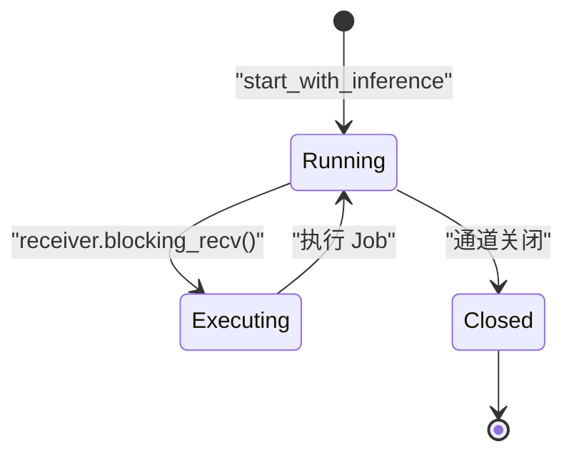

**图表来源**
- [lib.rs:240-330](../../../crates/moriq-app/src/lib.rs#L240-L330)

**章节来源**
- [lib.rs:240-330](../../../crates/moriq-app/src/lib.rs#L240-L330)

### 后台任务与推理集成
`jobs.rs` 中的 `drive_job_step` 展示了 Service 如何协调：
1. 获取 `job_slot` 许可；
2. 从当前库领取下一步工作；
3. 如需模型推理，先检查推理执行器是否就绪；
4. 申请 `import_memory` 预算；
5. 在阻塞线程执行推理；
6. 提交结果或中止任务；
7. 如果单次循环耗时过长，限制批量步数。

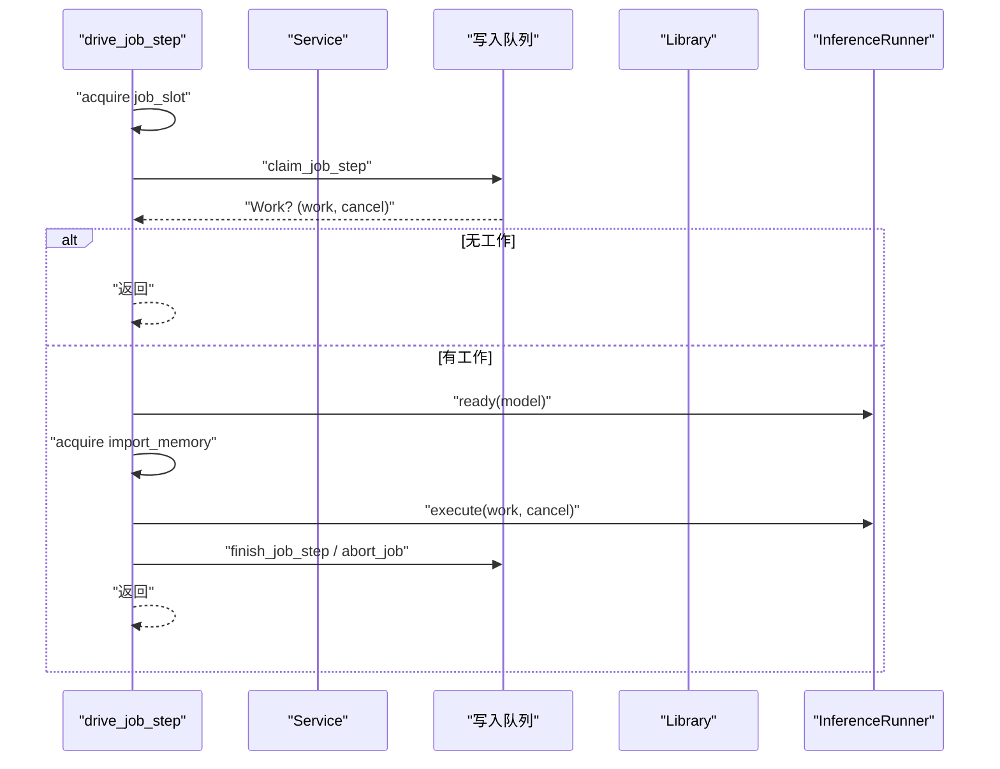

**图表来源**
- [jobs.rs:1-175](../../../crates/moriq-app/src/jobs.rs#L1-L175)

**章节来源**
- [jobs.rs:1-175](../../../crates/moriq-app/src/jobs.rs#L1-L175)

### 推理执行器与取消机制
`inference.rs` 定义了 `InferenceRunner` trait，并提供本地实现 `LocalInference`。关键设计：
- 所有推理接口接受 `AtomicBool` 取消标志；
- 在推理前后检查取消；
- `execute` 根据工作种类分派人脸推理、通用推理、分类和描述；
- `Service.inference_cancel` 通过 `job_cancel` 登记交互推理取消；
- `semantic_search` 复用 `import_memory` 作为向量推理的内存预算。

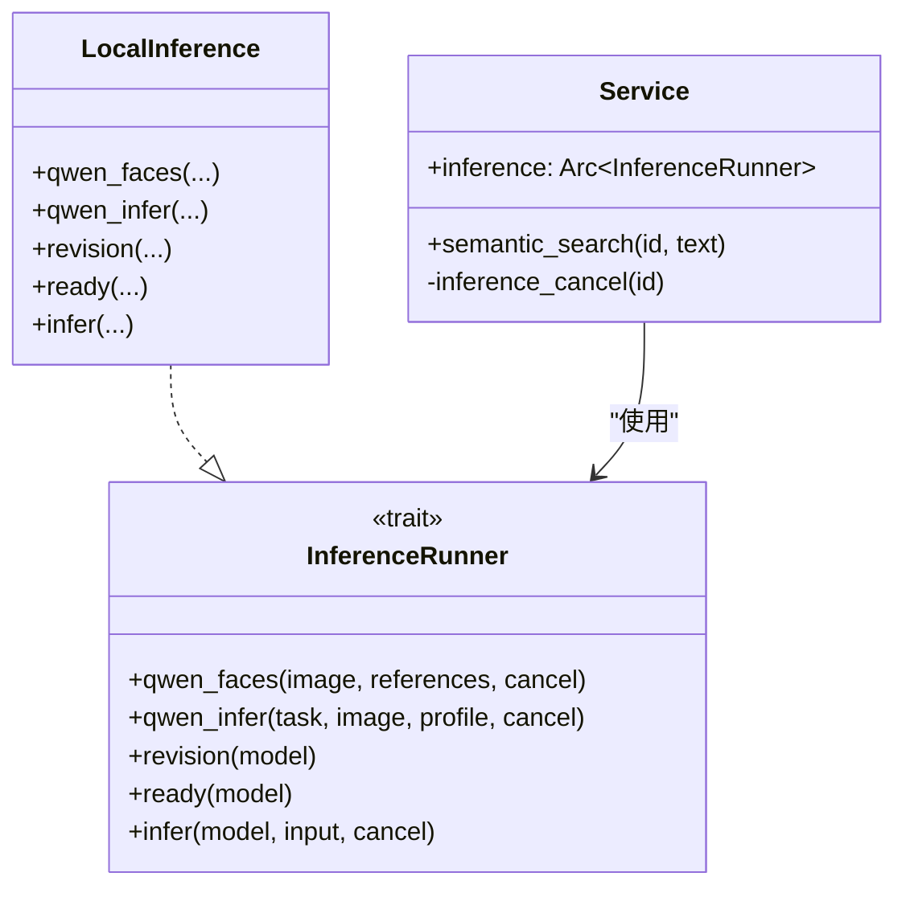

**图表来源**
- [inference.rs:1-200](../../../crates/moriq-app/src/inference.rs#L1-L200)
- [lib.rs:100-170](../../../crates/moriq-app/src/lib.rs#L100-L170)

**章节来源**
- [inference.rs:1-200](../../../crates/moriq-app/src/inference.rs#L1-L200)
- [lib.rs:100-170](../../../crates/moriq-app/src/lib.rs#L100-L170)

## 依赖关系分析
Service 协调器的依赖关系呈现清晰的层次：
- UI 层依赖 `Service`；
- `Service` 依赖 `Library`（通过写入队列间接访问）；
- `Service` 依赖 `InferenceRunner`；
- `Service` 依赖 `scheduler::Cancellation`；
- `Service` 依赖多个 `Semaphore`；
- `import.rs` 和 `jobs.rs` 是 `Service` 的行为扩展。

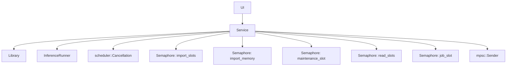

**图表来源**
- [lib.rs:100-170](../../../crates/moriq-app/src/lib.rs#L100-L170)
- [lib.rs:240-330](../../../crates/moriq-app/src/lib.rs#L240-L330)
- [jobs.rs:1-175](../../../crates/moriq-app/src/jobs.rs#L1-L175)

**章节来源**
- [lib.rs:100-170](../../../crates/moriq-app/src/lib.rs#L100-L170)
- [jobs.rs:1-175](../../../crates/moriq-app/src/jobs.rs#L1-L175)

## 性能考虑
- **单写者队列容量**：写入通道容量为 16，避免 UI 无限积压请求。
- **导入并发上限**：`import_slots` 初始值为 32，防止过多恢复工作竞争磁盘和 CPU。
- **内存预算**：`import_memory` 初始值为 4096 MiB，结合 `memory_mib` 和用户偏好，限制导入和推理的总体内存占用。
- **读取并发**：`read_slots` 容量为 4，避免大量读取计划同时阻塞。
- **任务驱动并发**：`job_slot` 容量为 1，确保后台任务驱动逻辑有序。
- **恢复内存检查**：恢复工作预估内存超过 `memory_mib` 时会提前失败，避免 OOM。
- **阻塞线程执行**：媒体处理和推理放在 `spawn_blocking` 中，避免阻塞异步运行时。

[本节提供一般性指导，不直接分析具体代码行]

## 故障排查指南
### 常见错误来源
| 现象 | 可能原因 | 排查建议 |
|---|---|---|
| “后台服务已关闭” | 写入通道关闭或服务已停止 | 检查 `close()` 是否被调用，或进程是否退出。 |
| “后台服务中断” | `oneshot` 接收失败 | 检查调用方是否过早丢弃 future。 |
| “请先创建或打开资源库” | `active` 为空 | 调用 `open` 或 `create` 后再执行库操作。 |
| “资源库已经切换，旧操作已停止” | 库 ID 不匹配 | 确认请求绑定的库仍为当前活跃库。 |
| “恢复媒体预计需要更多内存” | 预估内存超过 `memory_mib` | 提高导入内存预算或减少并发。 |
| “模型仍在停止，请稍后再次关闭应用” | 推理模型卸载超时 | 等待应用完全退出或减少推理负载。 |

**章节来源**
- [lib.rs:240-330](../../../crates/moriq-app/src/lib.rs#L240-L330)
- [lib.rs:400-446](../../../crates/moriq-app/src/lib.rs#L400-L446)
- [import.rs:1-200](../../../crates/moriq-app/src/import.rs#L1-L200)

## 结论
Service 协调器通过单写者队列、项目范围隔离、有界通道和信号量预算，构建了一个稳定、可观测、可取消的应用层协调器。它把 UI 与底层资源库、媒体 I/O、推理执行解耦，同时保证：
- 同一时刻只有一个写入路径；
- UI 请求不会误落到已关闭或切换后的库；
- 导入和推理具有可控的并发和内存占用；
- 取消信号可以在恢复、推理和后台任务中传播；
- 错误被转换为 UI 可读消息或类型化任务错误。

对于使用者而言，推荐实践是：
- 使用 `Service::start` 或 `Service::start_with_inference` 创建服务；
- 使用 `for_project` 绑定项目上下文；
- 使用 `open`/`create` 管理当前库；
- 使用 `call`/`call_task` 执行库操作；
- 使用 `ImportControl` 监控和取消导入；
- 通过 `background_jobs` 和 `job_failures` 观察后台任务状态。

[本节总结整体设计，不直接分析具体代码行]