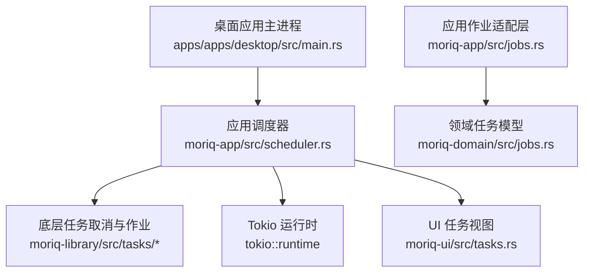
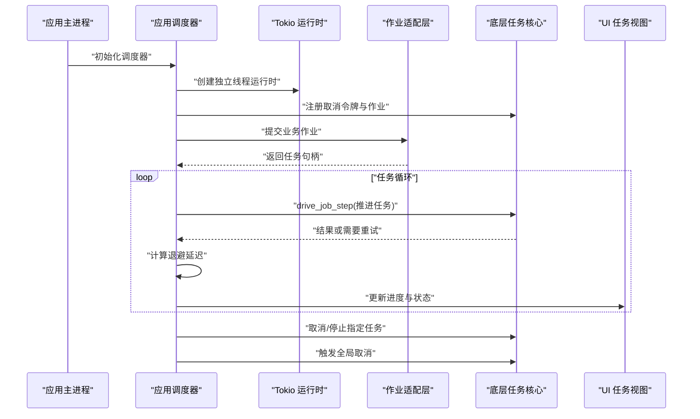
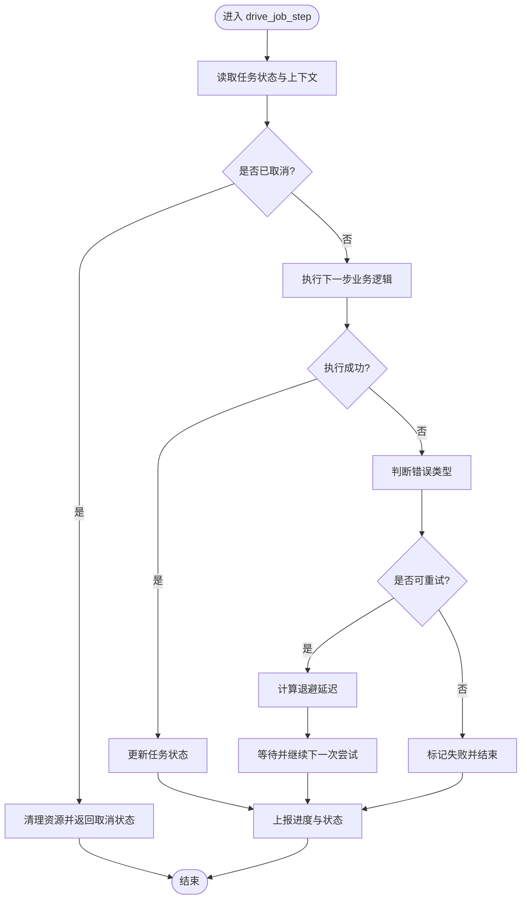
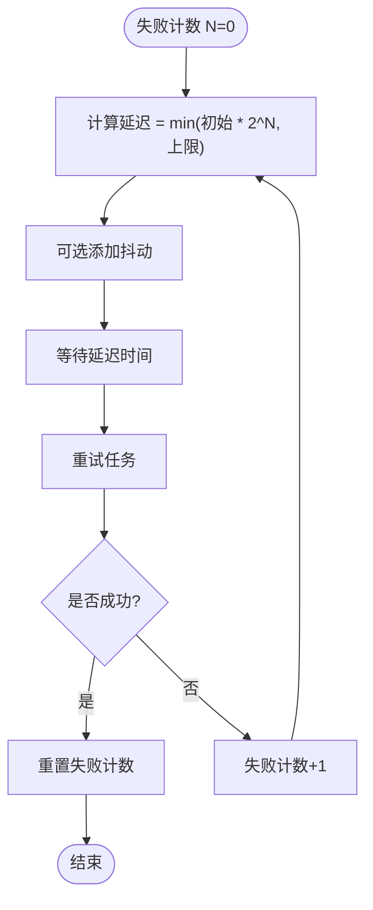
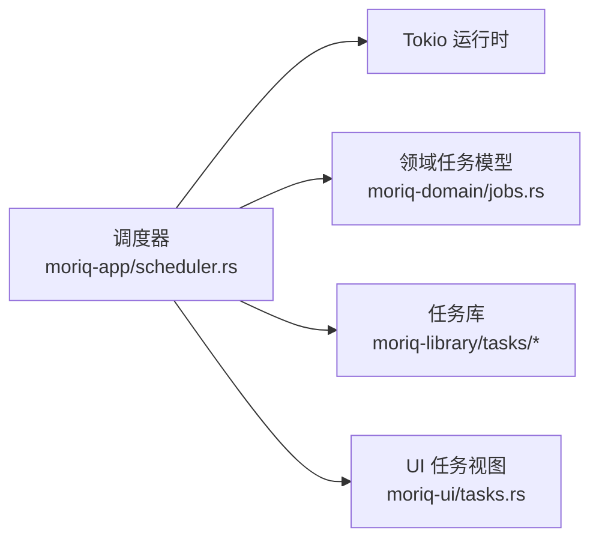

# 任务调度器

> Repo Wiki 节点 `job-scheduler`
> 导出自 Qoder 知识库快照 `8fbe02f6-57c2-4874-b725-1a8130851fd9`，代码基线 `7a7a8e75e18bd90294e09cd422dd7ed5a04813a0`（分支 main，zh-CN）。

<cite>
**本文引用的文件**   
- [apps/apps/desktop/src/main.rs](../../../apps/apps/desktop/src/main.rs)
- [crates/crates/moriq-app/src/scheduler.rs](../../../crates/crates/moriq-app/src/scheduler.rs)
- [crates/crates/moriq-app/src/jobs.rs](../../../crates/crates/moriq-app/src/jobs.rs)
- [crates/crates/moriq-domain/src/jobs.rs](../../../crates/crates/moriq-domain/src/jobs.rs)
- [crates/crates/moriq-library/src/tasks/cancel.rs](../../../crates/crates/moriq-library/src/tasks/cancel.rs)
- [crates/crates/moriq-library/src/tasks/jobs.rs](../../../crates/crates/moriq-library/src/tasks/jobs.rs)
- [crates/crates/moriq-ui/src/tasks.rs](../../../crates/crates/moriq-ui/src/tasks.rs)
</cite>

## 目录
1. [引言](#引言)
2. [项目结构](#项目结构)
3. [核心组件](#核心组件)
4. [架构总览](#架构总览)
5. [详细组件分析](#详细组件分析)
6. [依赖关系分析](#依赖关系分析)
7. [性能与资源管理](#性能与资源管理)
8. [故障排查指南](#故障排查指南)
9. [结论](#结论)

## 引言
本文件聚焦于任务调度器的设计与实现，重点围绕以下目标展开：
- 解析取消令牌 Cancellation 的设计，包括弱引用管理与内存泄漏防护。
- 说明调度器线程的启动流程，以及如何基于 tokio::runtime 在独立线程中运行异步任务。
- 详解 drive_job_step 的执行逻辑，包括步骤推进、错误处理与重试策略。
- 解释指数退避算法的具体行为，连续失败时延迟从 250ms 增长到 30s 的策略。
- 说明任务暂停机制：当连续失败超过阈值后自动暂停后续任务，等待用户干预恢复。
- 提供注册取消令牌、停止特定任务和全局取消的使用示例路径。
- 给出调试技巧与常见问题解决方案，包括任务卡死、内存泄漏和性能瓶颈诊断。

该文档力求兼顾技术深度与可读性，帮助不同背景的读者理解并正确使用任务调度子系统。

## 项目结构
任务调度相关代码分布在多个 crate 中，形成分层职责清晰的体系：
- 应用层调度入口与 UI 交互：位于 apps/apps/desktop 与 crates/moriq-app。
- 领域模型与任务类型定义：位于 crates/moriq-domain。
- 底层任务取消与作业状态机：位于 crates/moriq-library/tasks。
- UI 任务视图与展示：位于 crates/moriq-ui。

图表来源
- [apps/apps/desktop/src/main.rs](../../../apps/apps/desktop/src/main.rs)
- [crates/crates/moriq-app/src/scheduler.rs](../../../crates/crates/moriq-app/src/scheduler.rs)
- [crates/crates/moriq-app/src/jobs.rs](../../../crates/crates/moriq-app/src/jobs.rs)
- [crates/crates/moriq-domain/src/jobs.rs](../../../crates/crates/moriq-domain/src/jobs.rs)
- [crates/crates/moriq-library/src/tasks/cancel.rs](../../../crates/crates/moriq-library/src/tasks/cancel.rs)
- [crates/crates/moriq-library/src/tasks/jobs.rs](../../../crates/crates/moriq-library/src/tasks/jobs.rs)
- [crates/crates/moriq-ui/src/tasks.rs](../../../crates/crates/moriq-ui/src/tasks.rs)

章节来源
- [apps/apps/desktop/src/main.rs](../../../apps/apps/desktop/src/main.rs)
- [crates/crates/moriq-app/src/scheduler.rs](../../../crates/crates/moriq-app/src/scheduler.rs)
- [crates/crates/moriq-app/src/jobs.rs](../../../crates/crates/moriq-app/src/jobs.rs)
- [crates/crates/moriq-domain/src/jobs.rs](../../../crates/crates/moriq-domain/src/jobs.rs)
- [crates/crates/moriq-library/src/tasks/cancel.rs](../../../crates/crates/moriq-library/src/tasks/cancel.rs)
- [crates/crates/moriq-library/src/tasks/jobs.rs](../../../crates/crates/moriq-library/src/tasks/jobs.rs)
- [crates/crates/moriq-ui/src/tasks.rs](../../../crates/crates/moriq-ui/src/tasks.rs)

## 核心组件
本节概述任务调度系统的核心角色及其职责：
- 应用调度器（moriq-app scheduler）：负责创建并持有 tokio::runtime，协调任务生命周期、进度上报、取消与重试。
- 应用作业适配层（moriq-app jobs）：将上层业务作业映射为调度器可执行的任务单元，并处理领域模型与调度器之间的数据转换。
- 领域任务模型（moriq-domain jobs）：定义任务的抽象类型、阶段、元数据与状态机。
- 底层任务取消与作业（moriq-library tasks）：提供取消令牌 Cancellation、任务状态推进、重试与退避等通用能力。
- UI 任务视图（moriq-ui tasks）：渲染任务状态、进度条、取消按钮、暂停/恢复提示等用户界面。

章节来源
- [crates/crates/moriq-app/src/scheduler.rs](../../../crates/crates/moriq-app/src/scheduler.rs)
- [crates/crates/moriq-app/src/jobs.rs](../../../crates/crates/moriq-app/src/jobs.rs)
- [crates/crates/moriq-domain/src/jobs.rs](../../../crates/crates/moriq-domain/src/jobs.rs)
- [crates/crates/moriq-library/src/tasks/cancel.rs](../../../crates/crates/moriq-library/src/tasks/cancel.rs)
- [crates/crates/moriq-library/src/tasks/jobs.rs](../../../crates/crates/moriq-library/src/tasks/jobs.rs)
- [crates/crates/moriq-ui/src/tasks.rs](../../../crates/crates/moriq-ui/src/tasks.rs)

## 架构总览
下图展示了从应用主进程到调度器、底层任务系统、UI 以及 tokio 运行时的整体交互关系。

图表来源
- [apps/apps/desktop/src/main.rs](../../../apps/apps/desktop/src/main.rs)
- [crates/crates/moriq-app/src/scheduler.rs](../../../crates/crates/moriq-app/src/scheduler.rs)
- [crates/crates/moriq-library/src/tasks/jobs.rs](../../../crates/crates/mtori-moriq-library/src/tasks/jobs.rs)

## 详细组件分析

### 取消令牌 Cancellation 设计
Cancellation 是任务取消与生命周期管理的核心对象。其设计要点包括：
- 弱引用管理：通过弱引用避免强引用环，防止内存泄漏。当持有方被释放时，取消令牌不会阻止相关对象回收。
- 精确取消：支持针对单个任务的取消信号，也支持广播式的全局取消信号，确保任务能在合适的取消点及时退出。
- 安全共享：在异步环境中保证并发访问安全，通常借助原子标志位与通道通知来传播取消状态。
- 与任务状态解耦：取消状态不直接等同于任务完成状态，任务可能因取消而提前终止，但需明确记录原因以便 UI 显示与日志追踪。

建议的使用模式：
- 为每个任务创建一个 Cancellation 实例，并在任务开始处注册检查点。
- 在长时间运行的 I/O 或 CPU 密集操作前轮询取消标志。
- 任务结束时清理关联资源，确保弱引用不再参与存活周期。

章节来源
- [crates/crates/moriq-library/src/tasks/cancel.rs](../../../crates/crates/moriq-library/src/tasks/cancel.rs)

### 调度器线程与 tokio::runtime
调度器使用 tokio::runtime 在独立线程中运行异步任务，以避免阻塞主线程并提升响应性。关键流程如下：
- 启动阶段：应用主进程创建调度器，调度器构建并启动一个 tokio::runtime 实例，绑定到专用工作线程。
- 任务提交：上层业务通过作业适配层提交任务，调度器将任务包装成可调度的 future，投递到 runtime 的事件循环。
- 生命周期管理：调度器负责跟踪所有活跃任务，提供停止特定任务与全局取消的能力。
- 资源隔离：通过独立的 runtime 将任务执行与 UI 主线程解耦，降低互斥与锁竞争风险。

章节来源
- [apps/apps/desktop/src/main.rs](../../../apps/apps/desktop/src/main.rs)
- [crates/crates/moriq-app/src/scheduler.rs](../../../crates/crates/moriq-app/src/scheduler.rs)

### drive_job_step 执行逻辑
drive_job_step 是任务推进的核心方法，负责驱动任务从一个步骤进入下一个步骤，并处理错误与重试。典型流程包括：
- 读取当前任务状态与上下文，确定下一步要执行的操作。
- 调用具体业务逻辑或底层 IO 操作，并将结果写回任务状态。
- 若操作失败，则根据错误类型决定是否重试；若是可恢复错误，则进入退避等待；否则标记失败并结束任务。
- 若取消已触发，立即中断执行，清理资源并返回取消状态。
- 每次推进后向 UI 或观察者上报进度与状态变更。

图表来源
- [crates/crates/moriq-app/src/scheduler.rs](../../../crates/crates/moriq-app/src/scheduler.rs)
- [crates/crates/moriq-library/src/tasks/jobs.rs](../../../crates/crates/moriq-library/src/tasks/jobs.rs)

章节来源
- [crates/crates/moriq-app/src/scheduler.rs](../../../crates/crates/moriq-app/src/scheduler.rs)
- [crates/crates/moriq-library/src/tasks/jobs.rs](../../../crates/crates/moriq-library/src/tasks/jobs.rs)

### 指数退避算法
当任务连续失败时，调度器采用指数退避策略增加重试间隔，避免雪崩与资源争用。该策略的关键特性包括：
- 初始延迟：首次失败后的等待时间约为 250ms。
- 指数增长：每次失败后延迟翻倍，逐步增加等待时间。
- 上限限制：最大延迟不超过 30s，避免无限等待。
- 抖动与随机化：可选加入抖动因子，减少多个任务同时重试造成的同步风暴。
- 可配置参数：允许通过配置调整初始值、倍增系数与上限，以适应不同场景。

图表来源
- [crates/crates/moriq-app/src/scheduler.rs](../../../crates/crates/moriq-app/src/scheduler.rs)

章节来源
- [crates/crates/moriq-app/src/scheduler.rs](../../../crates/crates/moriq-app/src/scheduler.rs)

### 任务暂停机制
为避免持续失败导致系统过载，调度器引入任务暂停机制：
- 连续失败阈值：当某任务连续失败次数超过设定阈值，调度器自动暂停该任务的后续推进。
- 暂停状态：任务进入“暂停”状态，UI 显示需要用户干预的提示。
- 恢复条件：用户手动点击恢复，或满足特定条件（如依赖资源就绪）后，调度器重新启用任务。
- 影响范围：暂停仅影响该任务，不影响其他任务继续执行，保证系统整体的鲁棒性。

章节来源
- [crates/crates/moriq-app/src/scheduler.rs](../../../crates/crates/moriq-app/src/scheduler.rs)
- [crates/crates/moriq-ui/src/tasks.rs](../../../crates/crates/moriq-ui/src/tasks.rs)

### 使用示例与最佳实践
以下为常见用例的参考路径，用于演示如何注册取消令牌、停止特定任务与触发全局取消：
- 注册取消令牌：在任务开始时创建 Cancellation，并将其注入任务上下文，供任务内部轮询检查。
  - 参考路径：[crates/crates/moriq-library/src/tasks/cancel.rs](../../../crates/crates/moriq-library/src/tasks/cancel.rs)
- 停止特定任务：通过任务 ID 或句柄调用调度器的取消接口，使对应任务尽快退出。
  - 参考路径：[crates/crates/moriq-app/src/scheduler.rs](../../../crates/crates/moriq-app/src/scheduler.rs)
- 全局取消：触发全局取消信号，让所有活跃任务收到取消通知并有序退出。
  - 参考路径：[crates/crates/moriq-app/src/scheduler.rs](../../../crates/crates/moriq-app/src/scheduler.rs)

章节来源
- [crates/crates/moriq-library/src/tasks/cancel.rs](../../../crates/crates/moriq-library/src/tasks/cancel.rs)
- [crates/crates/moriq-app/src/scheduler.rs](../../../crates/crates/moriq-app/src/scheduler.rs)

## 依赖关系分析
任务调度子系统依赖以下关键模块与外部库：
- tokio::runtime：提供事件循环与线程池，支撑异步任务的并发执行。
- moriq-domain/jobs：定义任务类型、状态与生命周期，作为调度器与业务层的契约。
- moriq-library/tasks：提供取消、重试、退避等通用能力，被调度器复用。
- moriq-ui/tasks：消费调度器的状态变化，渲染用户界面。

图表来源
- [crates/crates/moriq-app/src/scheduler.rs](../../../crates/crates/moriq-app/src/scheduler.rs)
- [crates/crates/moriq-domain/src/jobs.rs](../../../crates/crates/moriq-domain/src/jobs.rs)
- [crates/crates/moriq-library/src/tasks/cancel.rs](../../../crates/crates/moriq-library/src/tasks/cancel.rs)
- [crates/crates/moriq-library/src/tasks/jobs.rs](../../../crates/crates/moriq-library/src/tasks/jobs.rs)
- [crates/crates/moriq-ui/src/tasks.rs](../../../crates/crates/moriq-ui/src/tasks.rs)

章节来源
- [crates/crates/moriq-app/src/scheduler.rs](../../../crates/crates/moriq-app/src/scheduler.rs)
- [crates/crates/moriq-domain/src/jobs.rs](../../../crates/crates/moriq-domain/src/jobs.rs)
- [crates/crates/moriq-library/src/tasks/cancel.rs](../../../crates/crates/moriq-library/src/tasks/cancel.rs)
- [crates/crates/moriq-library/src/tasks/jobs.rs](../../../crates/crates/moriq-library/src/tasks/jobs.rs)
- [crates/crates/moriq-ui/src/tasks.rs](../../../crates/crates/moriq-ui/src/tasks.rs)

## 性能与资源管理
- 线程隔离：通过将任务运行在独立 tokio::runtime 中，避免 UI 主线程阻塞，提高响应性与吞吐。
- 取消优化：利用弱引用与取消标志，快速释放未使用的任务资源，减少内存占用。
- 退避控制：指数退避降低瞬时重试压力，配合上限与抖动，避免重试风暴。
- 进度上报：最小化的状态更新频率，降低 UI 刷新开销。
- 可观测性：建议为关键路径添加日志与指标，便于监控与定位性能瓶颈。

## 故障排查指南
- 任务卡死
  - 检查任务是否在取消点轮询取消标志，必要时增加取消检查频率。
  - 查看 drive_job_step 的错误分支是否进入异常重试路径。
  - 参考路径：[crates/crates/moriq-app/src/scheduler.rs](../../../crates/crates/moriq-app/src/scheduler.rs)
- 内存泄漏
  - 确认 Cancellation 的弱引用未被误用为强引用，避免环状引用。
  - 检查任务结束后是否清理了回调、订阅与临时数据结构。
  - 参考路径：[crates/crates/moriq-library/src/tasks/cancel.rs](../../../crates/crates/moriq-library/src/tasks/cancel.rs)
- 性能瓶颈
  - 评估指数退避的参数设置，必要时调小初始延迟或上限。
  - 观察 UI 进度上报频率，降低高频刷新带来的绘制成本。
  - 参考路径：[crates/crates/moriq-app/src/scheduler.rs](../../../crates/crates/moriq-app/src/scheduler.rs)
- 无法停止任务
  - 验证取消令牌是否正确注入任务上下文。
  - 检查是否存在长耗时且不可取消的 I/O 或 CPU 操作。
  - 参考路径：[crates/crates/moriq-library/src/tasks/cancel.rs](../../../crates/crates/moriq-library/src/tasks/cancel.rs)

章节来源
- [crates/crates/moriq-app/src/scheduler.rs](../../../crates/crates/moriq-app/src/scheduler.rs)
- [crates/crates/moriq-library/src/tasks/cancel.rs](../../../crates/crates/moriq-library/src/tasks/cancel.rs)

## 结论
本任务调度器以 Cancellation 为核心，结合 tokio::runtime 的独立线程执行、drive_job_step 的步骤推进、指数退避的重试策略与任务暂停机制，实现了稳定、可控且可扩展的任务执行框架。通过弱引用管理与精确取消，系统在资源使用与可维护性上达到良好平衡。实际使用中，建议结合日志与指标进行监控，并根据业务需求微调退避参数与暂停阈值，以获得最佳的性能与用户体验。