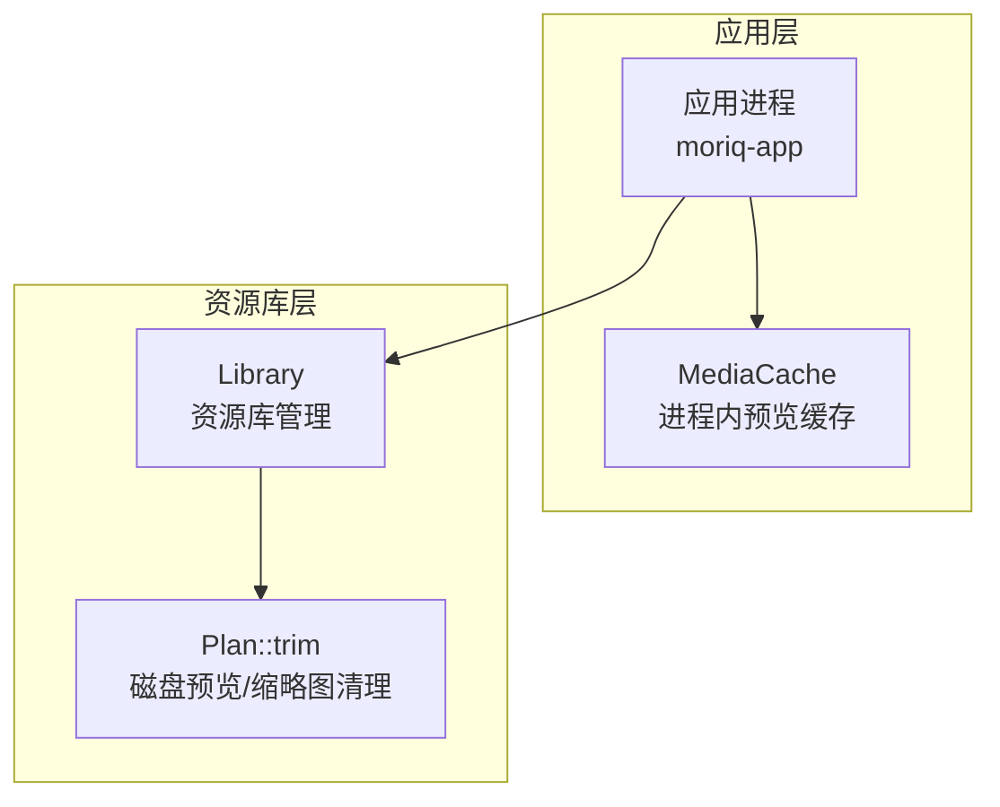
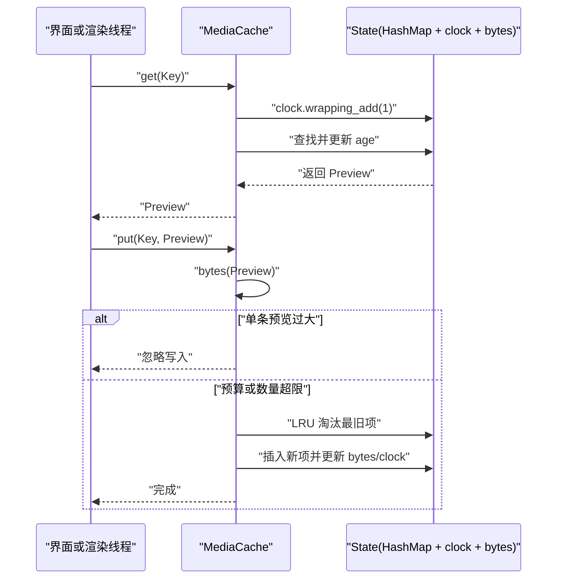
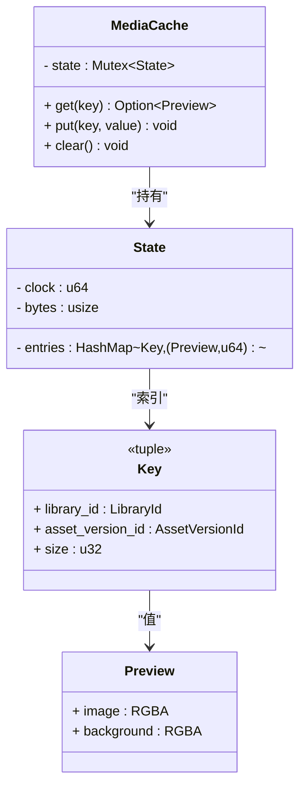
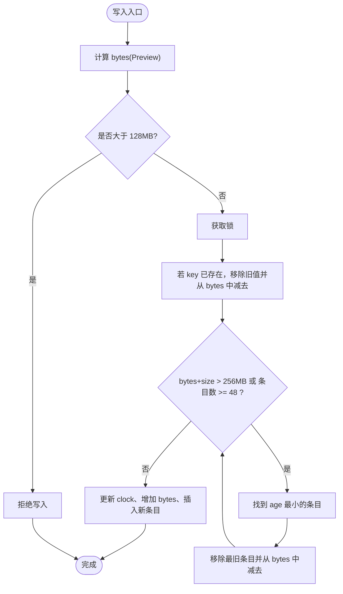
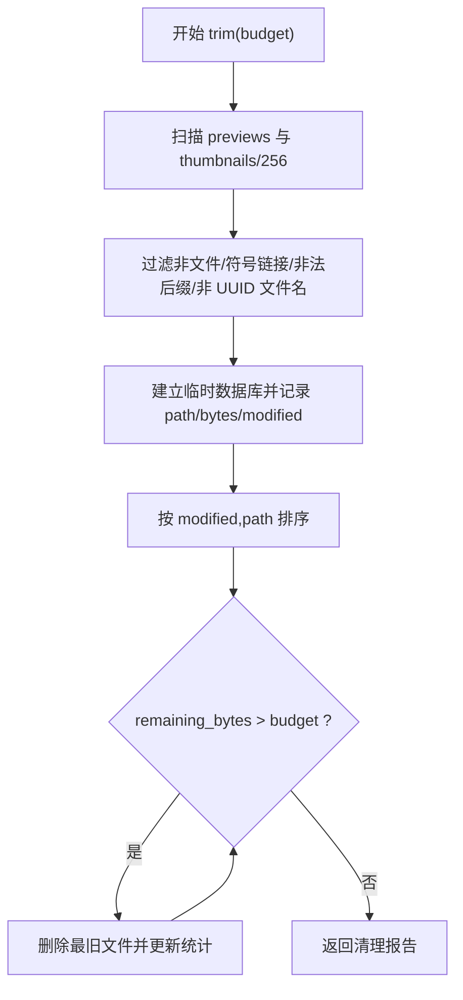
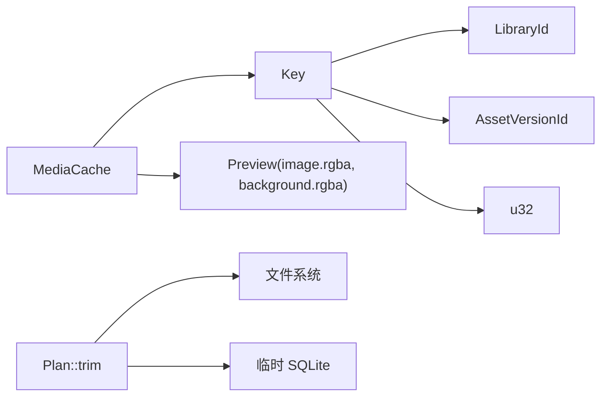

# 媒体缓存

> Repo Wiki 节点 `media-cache`
> 导出自 Qoder 知识库快照 `8fbe02f6-57c2-4874-b725-1a8130851fd9`，代码基线 `7a7a8e75e18bd90294e09cd422dd7ed5a04813a0`（分支 main，zh-CN）。

<cite>
**本文引用的文件**   
- [crates/moriq-app/src/cache.rs](../../../crates/moriq-app/src/cache.rs)
- [crates/moriq-library/src/media/cache.rs](../../../crates/moriq-library/src/media/cache.rs)
</cite>

## 目录
1. [引言](#引言)
2. [项目结构](#项目结构)
3. [核心组件](#核心组件)
4. [架构总览](#架构总览)
5. [详细组件分析](#详细组件分析)
6. [依赖关系分析](#依赖关系分析)
7. [性能与内存特性](#性能与内存特性)
8. [故障排查指南](#故障排查指南)
9. [结论](#结论)
10. [附录：使用示例与最佳实践](#附录使用示例与最佳实践)

## 引言
本文件聚焦于应用层内存中的“媒体预览缓存”，即 `MediaCache`。它负责在进程内为当前资源库的预览图像提供快速访问，并通过 LRU（最近最少使用）淘汰策略、字节预算与条目数量上限控制内存占用。同时，文档还区分了进程内的 `MediaCache` 与磁盘侧可重建预览缓存清理逻辑 `Plan::trim`，以便读者完整理解预览数据的生命周期。

## 项目结构
媒体预览相关代码分布在两个位置：
- 应用层内存缓存：`crates/moriq-app/src/cache.rs`
- 资源库侧磁盘缓存清理：`crates/moriq-library/src/media/cache.rs`

**图示来源**
- [crates/moriq-app/src/cache.rs:5-64](../../../crates/moriq-app/src/cache.rs#L5-L64)
- [crates/moriq-library/src/media/cache.rs:3-87](../../../crates/moriq-library/src/media/cache.rs#L3-L87)

**章节来源**
- [crates/moriq-app/src/cache.rs:1-65](../../../crates/moriq-app/src/cache.rs#L1-L65)
- [crates/moriq-library/src/media/cache.rs:1-87](../../../crates/moriq-library/src/media/cache.rs#L1-L87)

## 核心组件
本节梳理与预览缓存直接相关的核心类型与方法。

| 组件 | 职责 | 关键行为 |
|---|---|---|
| `Key` | 复合键类型 | 由 `(LibraryId, AssetVersionId, u32)` 组成，分别表示资源库、素材版本与尺寸 |
| `State` | 内部状态 | 维护条目映射、时间戳轮和已用字节数 |
| `MediaCache` | 对外缓存接口 | 提供 `get`、`put`、`clear` |
| `bytes` | 内存估算函数 | 计算预览前景像素与背景像素的 RGBA 字节总数 |
| `Plan::trim` | 磁盘缓存清理 | 按修改时间与字节预算删除旧预览与缩略图 |

**章节来源**
- [crates/moriq-app/src/cache.rs:3-17](../../../crates/moriq-app/src/cache.rs#L3-L17)
- [crates/moriq-library/src/media/cache.rs:3-17](../../../crates/moriq-library/src/media/cache.rs#L3-L17)

## 架构总览
`MediaCache` 是单例式的应用级缓存，通过互斥锁保护共享状态。读取会更新时间戳，写入会触发 LRU 淘汰；当切换资源库时，应调用 `clear` 清空进程内缓存，避免跨库预览数据污染。磁盘侧预览文件则由 `Plan::trim` 周期性清理。

**图示来源**
- [crates/moriq-app/src/cache.rs:18-58](../../../crates/moriq-app/src/cache.rs#L18-L58)

## 详细组件分析

### 复合键设计：基于 LibraryId 与 AssetVersionId
- 键类型为 `(LibraryId, AssetVersionId, u32)`，其中第三维通常表示预览尺寸。
- 该设计确保不同资源库之间、同一资源库中不同素材版本之间、以及同一素材的不同尺寸预览不会互相覆盖。
- 这种隔离对缓存命中率与安全都有帮助：同库同版本同尺寸的预览可被重复命中；跨库或跨版本则强制重新生成。

**章节来源**
- [crates/moriq-app/src/cache.rs:3-5](../../../crates/moriq-app/src/cache.rs#L3-L5)

### 双缓冲存储：前景图像与背景像素
- 每个 `Preview` 包含前景图像与背景像素，二者均以 RGBA 形式存储。
- 内存大小由 `bytes` 函数计算：前景 RGBA 长度加上背景 RGBA 长度。
- 由于两者都计入内存预算，因此大分辨率或高分辨率背景会显著影响缓存容量。

**图示来源**
- [crates/moriq-app/src/cache.rs:3-17](../../../crates/moriq-app/src/cache.rs#L3-L17)
- [crates/moriq-app/src/cache.rs:18-64](../../../crates/moriq-app/src/cache.rs#L18-L64)

**章节来源**
- [crates/moriq-app/src/cache.rs:15-17](../../../crates/moriq-app/src/cache.rs#L15-L17)

### LRU 淘汰算法与时间戳轮转
- 时间戳来自 `State.clock`，每次读写前执行 `wrapping_add(1)`，以无符号整数回绕方式避免溢出问题。
- 读操作会将命中项的 `age` 更新为最新时钟值，体现“最近使用”。
- 写操作在插入前循环淘汰 `age` 最小的条目，直到满足以下约束：
  - 总字节数不超过 256MB；
  - 条目数不超过 48。
- 若某次写入的单条预览大小超过 128MB，则直接忽略写入，防止单条超大对象挤占缓存。

**图示来源**
- [crates/moriq-app/src/cache.rs:30-58](../../../crates/moriq-app/src/cache.rs#L30-L58)

**章节来源**
- [crates/moriq-app/src/cache.rs:20-58](../../../crates/moriq-app/src/cache.rs#L20-L58)

### 内存预算管理：256MB 总量与 48 条上限
- 总字节预算为 256MB，用于限制所有预览与背景像素的总和。
- 条目数量上限为 48，避免过多小对象导致哈希表开销增大。
- 这两个约束共同作用，既防止内存膨胀，也降低频繁分配与竞争的概率。
- 如果单个预览本身已超过 128MB，会被直接丢弃，这体现了“防御性缓存”的设计思路。

**章节来源**
- [crates/moriq-app/src/cache.rs:30-41](../../../crates/moriq-app/src/cache.rs#L30-L41)

### bytes 函数：RGBA 字节数计算
- `bytes` 将 `Preview.image.rgba.len()` 与 `Preview.background.rgba.len()` 相加。
- 这意味着每份预览的内存成本 = 前景像素字节数 + 背景像素字节数。
- 对于常见 RGBA 格式，每像素通常为 4 字节；因此预估内存可按“宽 × 高 × 4 × 通道数”估算前景与背景的总和。

**章节来源**
- [crates/moriq-app/src/cache.rs:15-17](../../../crates/moriq-app/src/cache.rs#L15-L17)

### clear 方法：资源库切换时的缓存隔离
- `clear` 将 `State` 重置为默认空状态，释放所有已缓存的预览。
- 在切换资源库之前调用 `clear`，可以防止上一个资源库的预览误命中到新库的同键场景。
- 虽然键中包含 `LibraryId`，但 `clear` 提供更明确的语义边界，便于在库生命周期事件中进行一致性管理。

**章节来源**
- [crates/moriq-app/src/cache.rs:59-64](../../../crates/moriq-app/src/cache.rs#L59-L64)

### 磁盘侧预览缓存清理：Plan::trim
- `Plan::trim` 扫描资源库下的 `previews` 与 `thumbnails/256` 目录。
- 仅处理 PNG 与特定 RGBA 后缀的文件，且文件名前 36 个字符需为有效 UUID。
- 构建临时 SQLite 数据库，记录路径、大小与修改时间，并按修改时间升序删除，直到剩余字节数低于预算。
- 该过程独立于进程内 `MediaCache`，用于长期磁盘空间管理。

**图示来源**
- [crates/moriq-library/src/media/cache.rs:18-87](../../../crates/moriq-library/src/media/cache.rs#L18-L87)

**章节来源**
- [crates/moriq-library/src/media/cache.rs:18-87](../../../crates/moriq-library/src/media/cache.rs#L18-L87)

## 依赖关系分析
- `MediaCache` 依赖：
  - `std::collections::HashMap`：保存键到 `(Preview, age)` 的映射。
  - `std::sync::Mutex`：保证并发安全。
  - `moriq_library::media::Preview`：缓存的值类型，包含前景与背景 RGBA。
- `Key` 依赖 `LibraryId` 与 `AssetVersionId`，确保命名空间隔离。
- `Plan::trim` 依赖文件系统、UUID 解析与临时 SQLite 数据库进行有序清理。

**图示来源**
- [crates/moriq-app/src/cache.rs:3-17](../../../crates/moriq-app/src/cache.rs#L3-L17)
- [crates/moriq-library/src/media/cache.rs:18-87](../../../crates/moriq-library/src/media/cache.rs#L18-L87)

**章节来源**
- [crates/moriq-app/src/cache.rs:1-17](../../../crates/moriq-app/src/cache.rs#L1-L17)
- [crates/moriq-library/src/media/cache.rs:18-87](../../../crates/moriq-library/src/media/cache.rs#L18-L87)

## 性能与内存特性
- 时间复杂度
  - `get`：平均 O(1)，随后进行年龄更新。
  - `put`：可能触发多次 LRU 淘汰，每次淘汰需要扫描 `HashMap` 找最小 `age`，近似 O(n)；整体取决于淘汰次数。
- 空间复杂度
  - 最多 48 个条目，每个条目包含一个 `Preview` 及其年龄。
  - 总内存受 256MB 字节预算限制。
- 并发模型
  - 使用单一互斥锁保护整个状态，简单可靠，但在高频访问下可能成为瓶颈。
- 溢出防护
  - 使用 `wrapping_add` 避免时间戳溢出；使用 `saturating_sub` 避免字节计数下溢。
- 磁盘缓存
  - `Plan::trim` 按修改时间顺序清理，适合批量回收磁盘空间，但不直接影响进程内 `MediaCache`。

[本节为通用性能讨论，不直接分析具体源码行]

## 故障排查指南
- 预览未命中
  - 检查键是否正确：`LibraryId`、`AssetVersionId`、尺寸必须一致。
  - 确认是否在切换资源库后调用了 `clear`。
- 内存增长过快
  - 检查是否存在超大预览被意外放入缓存；超过 128MB 的单条预览会被拒绝，但仍需关注接近该阈值的预览。
  - 监控 `State.bytes` 与条目数，评估是否需要调整预算或尺寸。
- 卡顿或延迟
  - 大量写入可能触发多次 LRU 扫描；建议减少频繁重建相同尺寸预览的频率。
- 磁盘空间不足
  - 运行 `Plan::trim` 指定预算，定期清理历史预览与缩略图。

**章节来源**
- [crates/moriq-app/src/cache.rs:18-64](../../../crates/moriq-app/src/cache.rs#L18-L64)
- [crates/moriq-library/src/media/cache.rs:18-87](../../../crates/moriq-library/src/media/cache.rs#L18-L87)

## 结论
`MediaCache` 以简洁而稳健的方式实现了进程内预览缓存：通过复合键隔离数据域，通过 LRU 与双重预算（字节与条目数）控制内存，通过时间戳轮转规避溢出风险，并通过 `clear` 支持资源库切换时的清晰边界。配合磁盘侧 `Plan::trim`，系统可在内存与磁盘两个层面维持预览数据的可用性与整洁性。

[本节为总结性内容，不直接分析具体源码行]

## 附录：使用示例与最佳实践

### 存取预览缓存
- 读取
  - 构造键：`(library_id, asset_version_id, preview_size)`。
  - 调用 `MediaCache::get(key)` 获取 `Option<Preview>`。
  - 若命中，可直接渲染前景图像；背景可用于填充边缘或虚化背景。
- 写入
  - 先估算预览大小，确保其合理。
  - 调用 `MediaCache::put(key, preview)`。
  - 若预览过大，将被自动忽略。

参考实现位置：
- [crates/moriq-app/src/cache.rs:18-58](../../../crates/moriq-app/src/cache.rs#L18-L58)

### 清理缓存
- 在资源库切换前调用 `MediaCache::clear()`，避免旧库预览污染新库视图。
- 定期运行 `Plan::trim(budget)`，按磁盘预算回收历史预览与缩略图。

参考实现位置：
- [crates/moriq-app/src/cache.rs:59-64](../../../crates/moriq-app/src/cache.rs#L59-L64)
- [crates/moriq-library/src/media/cache.rs:18-87](../../../crates/moriq-library/src/media/cache.rs#L18-L87)

### 处理大图像
- 单条预览超过 128MB 会被直接丢弃，避免单条对象破坏预算。
- 建议对超大图像使用更小尺寸预览或渐进式加载。
- 如需保留原始大图，不应依赖 `MediaCache`，而应走其他持久化或流式读取路径。

参考实现位置：
- [crates/moriq-app/src/cache.rs:30-34](../../../crates/moriq-app/src/cache.rs#L30-L34)

### 缓存命中率优化建议
- 稳定使用相同的预览尺寸，避免频繁变更第三维键。
- 优先复用已有 `AssetVersionId`，避免版本变化导致缓存失效。
- 在用户浏览画廊时，按浏览顺序预取相邻预览，提升局部热点命中率。
- 避免在同一帧内对同一键重复写入；必要时先 `get` 再按需 `put`。

[本节为概念性指导，不直接分析具体源码行]

### 内存使用监控方法
- 监控指标
  - 当前字节数：`State.bytes`
  - 当前条目数：`State.entries.len()`
  - 时间戳轮：`State.clock`（用于诊断 LRU 是否活跃）
- 采样时机
  - 在 `get`、`put`、`clear` 之后采样。
  - 在资源库切换前后对比，验证 `clear` 是否生效。
- 告警阈值
  - 字节数接近 256MB 时发出警告。
  - 条目数接近 48 时提示可能频繁淘汰。

参考实现位置：
- [crates/moriq-app/src/cache.rs:5-17](../../../crates/moriq-app/src/cache.rs#L5-L17)
- [crates/moriq-app/src/cache.rs:18-64](../../../crates/moriq-app/src/cache.rs#L18-L64)