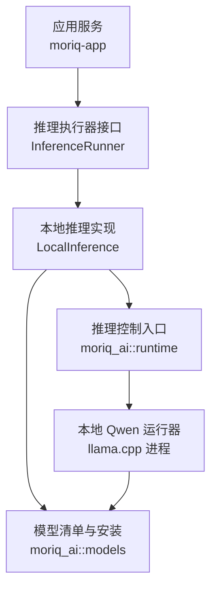
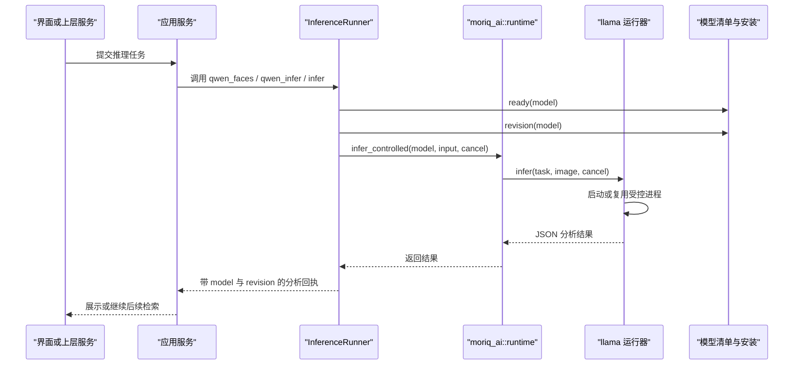
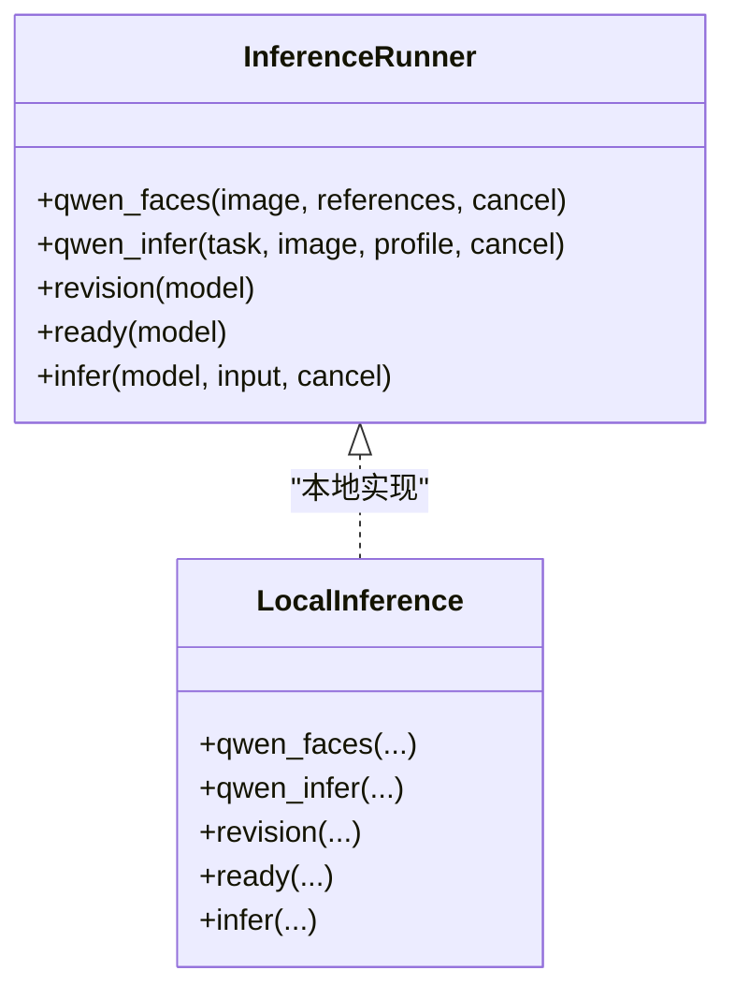
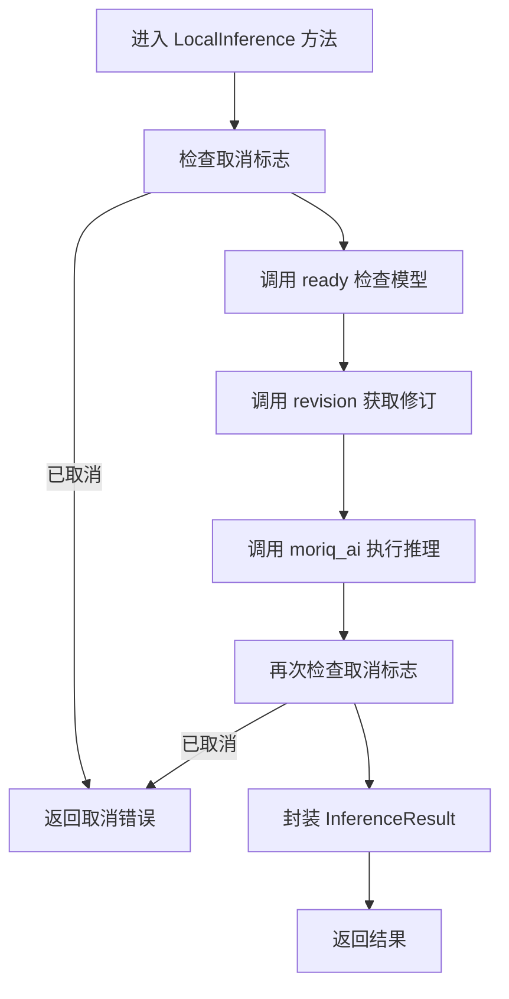
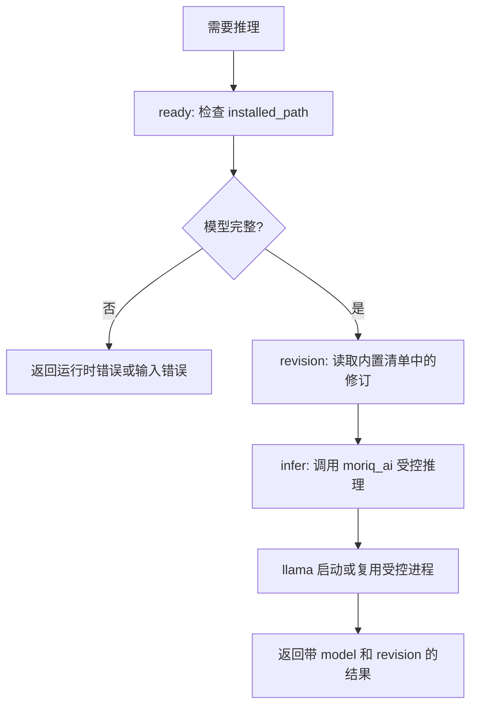
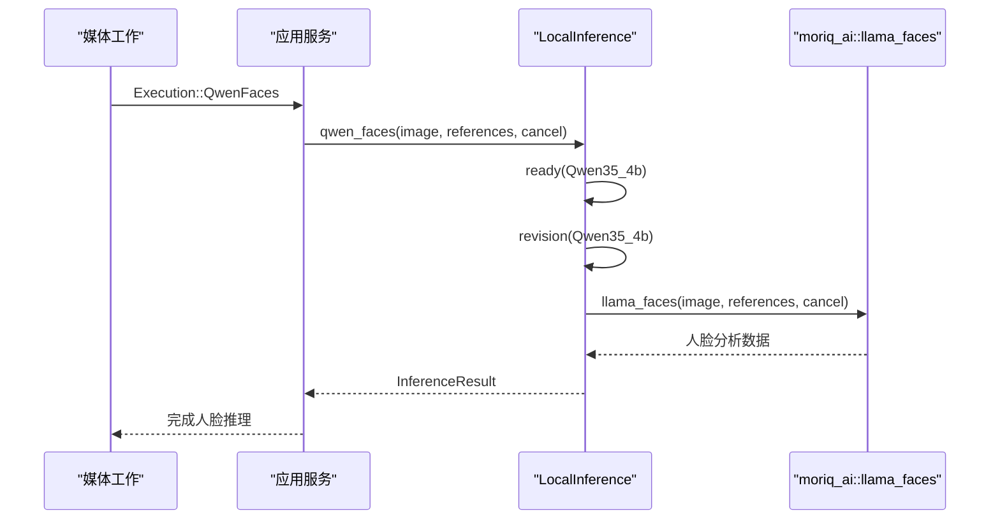
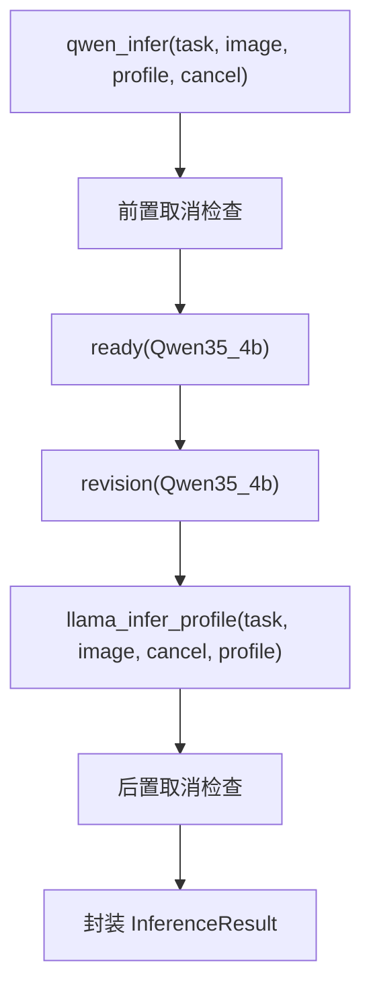
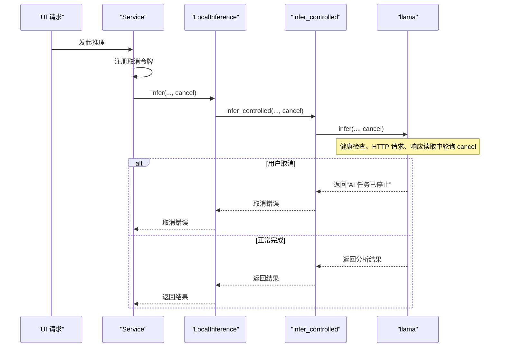
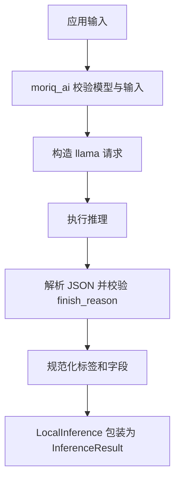
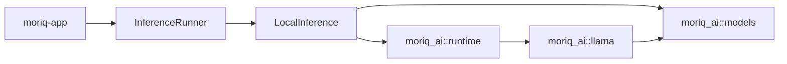

# 推理引擎

> Repo Wiki 节点 `inference-engine`
> 导出自 Qoder 知识库快照 `8fbe02f6-57c2-4874-b725-1a8130851fd9`，代码基线 `7a7a8e75e18bd90294e09cd422dd7ed5a04813a0`（分支 main，zh-CN）。

<cite>
**本文引用的文件**   
- [moriq-app/inference.rs](../../../crates/moriq-app/src/inference.rs)
- [moriq-ai/runtime.rs](../../../crates/moriq-ai/src/runtime.rs)
- [moriq-ai/llama.rs](../../../crates/moriq-ai/src/llama.rs)
- [moriq-ai/models.rs](../../../crates/moriq-ai/src/models.rs)
- [moriq-ai/examples/infer_model.rs](../../../crates/moriq-ai/examples/infer_model.rs)
- [moriq-ai/examples/infer_qwen.rs](../../../crates/moriq-ai/examples/infer_qwen.rs)
- [moriq-ai/examples/install_model.rs](../../../crates/moriq-ai/examples/install_model.rs)
- [moriq-ai/examples/cancel_inference.rs](../../../crates/moriq-ai/examples/cancel_inference.rs)
- [ARCHITECTURE.md](../../../ARCHITECTURE.md)
</cite>

## 目录
1. [引言](#引言)
2. [项目结构](#项目结构)
3. [核心组件](#核心组件)
4. [架构总览](#架构总览)
5. [详细组件分析](#详细组件分析)
6. [依赖关系分析](#依赖关系分析)
7. [性能与优化](#性能与优化)
8. [故障排查](#故障排查)
9. [结论](#结论)

## 引言
本文件聚焦 Moriq Space 的推理引擎，围绕 `InferenceRunner` trait 的统一接口设计、本地 Qwen 模型推理实现、模型生命周期管理、取消机制以及与 `moriq_ai` 模块的交互进行系统性说明。目标是帮助开发者理解从“模型可用检查”到“修订信息获取”，再到“实际推理执行”的完整流程，并提供人脸识别、内容分析和自定义推理任务的具体使用方式。

## 项目结构
推理相关代码主要分布在两个层面：
- 应用层 `moriq-app`：定义统一的推理执行器抽象 `InferenceRunner`，并给出本地实现 `LocalInference`，负责调度媒体任务、模型准备、结果封装和 UI 集成。
- AI 运行时层 `moriq-ai`：封装 llama.cpp 受控进程、模型清单、下载安装、校验与卸载、硬件能力探测等基础设施。

**图表来源**
- [moriq-app/inference.rs:8-100](../../../crates/moriq-app/src/inference.rs#L8-L100)
- [moriq-ai/runtime.rs:1-46](../../../crates/moriq-ai/src/runtime.rs#L1-L46)
- [moriq-ai/llama.rs:1-120](../../../crates/moriq-ai/src/llama.rs#L1-L120)
- [moriq-ai/models.rs:53-155](../../../crates/moriq-ai/src/models.rs#L53-L155)

**章节来源**
- [ARCHITECTURE.md:12-29](../../../ARCHITECTURE.md#L12-L29)

## 核心组件
- `InferenceRunner`：统一推理接口，暴露人脸推理、Qwen 分类/描述推理、模型修订查询、模型可用性检查、通用推理入口等能力。
- `LocalInference`：基于本地已安装 Qwen 模型的默认实现，负责路径验证、修订绑定、错误转换和取消检测。
- `moriq_ai::runtime`：历史模型 ID 兼容边界，限定当前支持的模型为 Qwen，提供可取消推理入口和 Windows 保护进程包装。
- `moriq_ai::llama`：本地 llama.cpp 服务器生命周期管理、请求构造、响应解析、提示词模板、输出规范化及会话复用。
- `moriq_ai::models`：模型清单、硬件能力、安装状态、下载续传、完整性校验、租约锁和卸载逻辑。

**章节来源**
- [moriq-app/inference.rs:8-120](../../../crates/moriq-app/src/inference.rs#L8-L120)
- [moriq-ai/runtime.rs:7-46](../../../crates/moriq-ai/src/runtime.rs#L7-L46)
- [moriq-ai/llama.rs:1-120](../../../crates/moriq-ai/src/llama.rs#L1-L120)
- [moriq-ai/models.rs:53-155](../../../crates/moriq-ai/src/models.rs#L53-L155)

## 架构总览
推理引擎采用“接口 + 本地实现 + 运行时封装 + 模型基础设施”的分层设计：
- 上层应用通过 `InferenceRunner` 调用推理，不关心后端细节。
- `LocalInference` 把业务语义（人脸、分类、描述、通用推理）映射到 `moriq_ai` 提供的可控接口。
- `runtime` 做协议适配、模型白名单、请求参数校验。
- `llama` 启动受控 llama.cpp 子进程，完成图片编码、提示词生成、JSON Schema 约束输出和结果标准化。
- `models` 保证模型清单、下载、校验、版本一致性、并发安全和卸载安全。

**图表来源**
- [moriq-app/inference.rs:8-120](../../../crates/moriq-app/src/inference.rs#L8-L120)
- [moriq-ai/runtime.rs:19-46](../../../crates/moriq-ai/src/runtime.rs#L19-L46)
- [moriq-ai/llama.rs:315-430](../../../crates/moriq-ai/src/llama.rs#L315-L430)
- [moriq-ai/models.rs:127-155](../../../crates/moriq-ai/src/models.rs#L127-L155)

## 详细组件分析

### InferenceRunner 接口设计
`InferenceRunner` 是推理系统的稳定契约，屏蔽本地 llama.cpp、未来远程服务等后端差异。其关键职责包括：
- 人脸推理：接收图像与参考图像列表，返回 `InferenceResult`。
- Qwen 推理：按任务类型执行分类或描述，绑定模型修订。
- 修订查询：从内置清单返回固定版本标识。
- 可用性检查：确认模型已安装且完整。
- 通用推理：接收任意 JSON 输入和取消标志，返回结构化分析结果。

**图表来源**
- [moriq-app/inference.rs:8-120](../../../crates/moriq-app/src/inference.rs#L8-L120)

**章节来源**
- [moriq-app/inference.rs:8-120](../../../crates/moriq-app/src/inference.rs#L8-L120)

### LocalInference 实现
`LocalInference` 是当前默认后端，所有方法都遵循相同模式：
1. 在必要时检查取消标志。
2. 调用 `ready` 确保模型可用。
3. 调用 `revision` 绑定模型修订。
4. 调用 `moriq_ai` 对应函数执行推理。
5. 再次检查取消标志，避免发布被中断的任务结果。
6. 将底层运行时错误转换为应用层任务错误。

**图表来源**
- [moriq-app/inference.rs:40-120](../../../crates/moriq-app/src/inference.rs#L40-L120)

**章节来源**
- [moriq-app/inference.rs:40-120](../../../crates/moriq-app/src/inference.rs#L40-L120)

### 模型生命周期管理
模型生命周期包含三个关键阶段：

| 阶段 | 行为 | 关键位置 |
|---|---|---|
| 模型检查 ready | 通过 `installed_path` 验证模型目录、`current.json`、权重文件和 SHA-256 校验和 | [moriq-ai/models.rs:155-200](../../../crates/moriq-ai/src/models.rs#L155-L200) |
| 修订信息 revision | 从内置清单查找模型规格，返回固定 revision | [moriq-app/inference.rs:85-93](../../../crates/moriq-app/src/inference.rs#L85-L93), [moriq-ai/models.rs:66-75](../../../crates/moriq-ai/src/models.rs#L66-L75) |
| 实际推理 infer | 通过 runtime 校验模型身份后交给 llama 执行 | [moriq-ai/runtime.rs:19-46](../../../crates/moriq-ai/src/runtime.rs#L19-L46), [moriq-ai/llama.rs:315-430](../../../crates/moriq-ai/src/llama.rs#L315-L430) |

**图表来源**
- [moriq-app/inference.rs:85-120](../../../crates/moriq-app/src/inference.rs#L85-L120)
- [moriq-ai/models.rs:155-200](../../../crates/moriq-ai/src/models.rs#L155-L200)
- [moriq-ai/runtime.rs:19-46](../../../crates/moriq-ai/src/runtime.rs#L19-L46)

**章节来源**
- [moriq-app/inference.rs:85-120](../../../crates/moriq-app/src/inference.rs#L85-L120)
- [moriq-ai/models.rs:127-200](../../../crates/moriq-ai/src/models.rs#L127-L200)
- [moriq-ai/runtime.rs:19-46](../../../crates/moriq-ai/src/runtime.rs#L19-L46)

### Qwen 人脸识别与内容分析
#### 人脸识别
`LocalInference::qwen_faces` 用于 Qwen 人脸推理：
- 先检查 `Qwen35_4b` 是否就绪。
- 获取固定修订。
- 调用 `moriq_ai::llama_faces` 执行人脸分析。
- 返回包含模型标识、修订和分析数据的 `InferenceResult`。

该流程由应用侧工作调度触发，典型调用链如下：

**图表来源**
- [moriq-app/inference.rs:42-60](../../../crates/moriq-app/src/inference.rs#L42-L60)

**章节来源**
- [moriq-app/inference.rs:42-60](../../../crates/moriq-app/src/inference.rs#L42-L60)

#### 内容分析
Qwen 内容分析分为两类：
- 分类：根据 `AiProfile` 中的启用类别生成分类提示词，输出媒介、主题和不确定性字段。
- 描述：生成中文描述和标签，限制长度、数量和词汇规范。

两者均通过 `LocalInference::qwen_infer` 调用 `moriq_ai::llama_infer_profile`，并把结果包装为带修订的 `InferenceResult`。

**图表来源**
- [moriq-app/inference.rs:61-84](../../../crates/moriq-app/src/inference.rs#L61-L84)

**章节来源**
- [moriq-app/inference.rs:61-84](../../../crates/moriq-app/src/inference.rs#L61-L84)

### 取消机制集成
取消机制贯穿整个推理链路，避免长时间运行的任务阻塞资源：
- `AtomicBool` 作为共享取消标志。
- `LocalInference` 在进入推理前、推理后进行检查。
- `moriq_ai::runtime::infer_controlled` 拒绝退役模型，仅允许 Qwen。
- `moriq_ai::llama` 在健康检查、请求发送、响应读取、会话复用和进程释放过程中轮询取消标志。
- 应用层还维护 `CancelOnDrop`，当 UI 请求 Future 被丢弃时主动设置取消信号。

**图表来源**
- [moriq-app/inference.rs:120-180](../../../crates/moriq-app/src/inference.rs#L120-L180)
- [moriq-ai/runtime.rs:19-46](../../../crates/moriq-ai/src/runtime.rs#L19-L46)
- [moriq-ai/llama.rs:201-260](../../../crates/moriq-ai/src/llama.rs#L201-L260)

**章节来源**
- [moriq-app/inference.rs:120-180](../../../crates/moriq-app/src/inference.rs#L120-L180)
- [moriq-ai/llama.rs:201-260](../../../crates/moriq-ai/src/llama.rs#L201-L260)

### 与 moriq_ai 模块的交互
#### 模型路径验证
- `LocalInference::ready` 调用 `moriq_ai::installed_path`，要求模型版本一致、权重文件存在且校验通过。
- `moriq_ai::models::installed_path` 会检查 `current.json`、模型目录和每个文件的 SHA-256。

#### 推理参数传递
- 通用推理：`infer` 接收 `ModelId`、JSON 输入和取消标志。
- Qwen 分类/描述：`qwen_infer` 接收任务名、图像路径、`AiProfile` 和取消标志。
- runtime 层校验模型 ID，只允许 `qwen35-4b`，并要求输入包含图片路径。

#### 结果格式转换
- `LocalInference` 将底层 `Value` 转换为 `InferenceResult`，附带模型标识和修订。
- `moriq_ai::llama` 对 Qwen 输出进行严格校验：必须完整结束、必须为 JSON、标签需去重和规范化。

**图表来源**
- [moriq-app/inference.rs:100-120](../../../crates/moriq-app/src/inference.rs#L100-L120)
- [moriq-ai/runtime.rs:19-46](../../../crates/moriq-ai/src/runtime.rs#L19-L46)
- [moriq-ai/llama.rs:315-430](../../../crates/moriq-ai/src/llama.rs#L315-L430)

**章节来源**
- [moriq-app/inference.rs:100-120](../../../crates/moriq-app/src/inference.rs#L100-L120)
- [moriq-ai/runtime.rs:19-46](../../../crates/moriq-ai/src/runtime.rs#L19-L46)
- [moriq-ai/llama.rs:315-430](../../../crates/moriq-ai/src/llama.rs#L315-L430)

### 代码示例

#### 执行人脸识别
人脸识别由应用侧工作调度触发，最终调用 `LocalInference::qwen_faces`。开发者通常不需要直接构造该调用，而是通过库的工作队列提交人脸任务；底层会完成模型就绪检查、修订绑定和结果封装。

参考实现路径：
- [moriq-app/inference.rs:42-60](../../../crates/moriq-app/src/inference.rs#L42-L60)

#### 执行内容分析
内容分析可通过示例程序演示：
- 分类或描述任务。
- 可选加载 `AiProfile`。
- 调用 `moriq_ai::llama_infer_profile`。
- 结束后释放 llama 运行器。

参考实现路径：
- [moriq-ai/examples/infer_qwen.rs:1-33](../../../crates/moriq-ai/examples/infer_qwen.rs#L1-L33)

#### 执行自定义推理任务
通用推理示例通过正式模型租约和推理桥接执行一次验证：
- 构造 JSON 请求。
- 调用 `moriq_ai::infer`。
- 卸载模型。
- 输出 provider、向量长度、标签、人脸数和描述等摘要。

参考实现路径：
- [moriq-ai/examples/infer_model.rs:1-25](../../../crates/moriq-ai/examples/infer_model.rs#L1-L25)

#### 安装模型
模型安装使用与桌面端一致的校验和与续传路径：
- 支持镜像源或官方源。
- 显示已下载字节数。
- 打印安装后的模型路径。

参考实现路径：
- [moriq-ai/examples/install_model.rs:1-26](../../../crates/moriq-ai/examples/install_model.rs#L1-L26)

#### 取消推理
取消示例展示主动取消已安装模型推理：
- 设置常驻策略。
- 启动推理。
- 后台线程设置取消标志。
- 验证错误消息包含“已停止”。

参考实现路径：
- [moriq-ai/examples/cancel_inference.rs:1-35](../../../crates/moriq-ai/examples/cancel_inference.rs#L1-L35)

**章节来源**
- [moriq-ai/examples/infer_qwen.rs:1-33](../../../crates/moriq-ai/examples/infer_qwen.rs#L1-L33)
- [moriq-ai/examples/infer_model.rs:1-25](../../../crates/moriq-ai/examples/infer_model.rs#L1-L25)
- [moriq-ai/examples/install_model.rs:1-26](../../../crates/moriq-ai/examples/install_model.rs#L1-L26)
- [moriq-ai/examples/cancel_inference.rs:1-35](../../../crates/moriq-ai/examples/cancel_inference.rs#L1-L35)

## 依赖关系分析
推理引擎的关键依赖关系如下：

- `moriq-app` 依赖 `InferenceRunner`，并通过 `LocalInference` 使用本地推理。
- `LocalInference` 依赖 `moriq_ai` 的 runtime 和 models。
- `runtime` 依赖 `llama` 和平台保护进程。
- `llama` 依赖 `models` 获取模型路径和校验。

**图表来源**
- [moriq-app/inference.rs:8-120](../../../crates/moriq-app/src/inference.rs#L8-L120)
- [moriq-ai/runtime.rs:1-46](../../../crates/moriq-ai/src/runtime.rs#L1-L46)
- [moriq-ai/llama.rs:1-120](../../../crates/moriq-ai/src/llama.rs#L1-L120)
- [moriq-ai/models.rs:53-155](../../../crates/moriq-ai/src/models.rs#L53-L155)

**章节来源**
- [moriq-app/inference.rs:8-120](../../../crates/moriq-app/src/inference.rs#L8-L120)
- [moriq-ai/runtime.rs:1-46](../../../crates/moriq-ai/src/runtime.rs#L1-L46)
- [moriq-ai/llama.rs:1-120](../../../crates/moriq-ai/src/llama.rs#L1-L120)
- [moriq-ai/models.rs:53-155](../../../crates/moriq-ai/src/models.rs#L53-L155)

## 性能与优化
- 内存预算：应用层在执行语义检索和图像推理前申请共享内存预算，避免同时过多推理任务耗尽系统内存。
- 线程与并行：llama 推理通过 `hardware().logical_cpus` 计算线程数，并进行范围钳制。
- GPU/CPU 分层：启用语言模型层 GPU offload，关闭视觉投影 offload，限制图像最大 token 数量，降低 Vulkan 分配器压力。
- 常驻策略：通过 `set_keep_loaded` 控制模型服务是否常驻；关闭常驻时空闲实例会被释放。
- 超时与限流：健康检查、请求超时、响应大小上限、下载重试和限速共同防止长时间挂起。

建议：
- 优先保证可用内存大于模型最低需求。
- 合理使用常驻策略，避免频繁启动销毁。
- 对批量任务使用应用层取消和预算控制。
- 在模型下载失败时切换镜像源并利用断点续传。

**章节来源**
- [moriq-ai/llama.rs:120-200](../../../crates/moriq-ai/src/llama.rs#L120-L200)
- [moriq-ai/models.rs:53-75](../../../crates/moriq-ai/src/models.rs#L53-L75)
- [moriq-ai/models.rs:264-589](../../../crates/moriq-ai/src/models.rs#L264-L589)

## 故障排查
常见问题及定位方式：

| 现象 | 可能原因 | 排查位置 |
|---|---|---|
| 未配置 Qwen 人脸推理 | 未注入 `InferenceRunner` 或未实现人脸方法 | [moriq-app/inference.rs:10-18](../../../crates/moriq-app/src/inference.rs#L10-L18) |
| 模型未登记 | 模型 ID 不在内置清单 | [moriq-app/inference.rs:85-93](../../../crates/moriq-app/src/inference.rs#L85-L93) |
| 模型版本需要升级 | `current.json` 与清单不一致 | [moriq-ai/models.rs:155-200](../../../crates/moriq-ai/src/models.rs#L155-L200) |
| 模型文件缺失或损坏 | 权重不存在或 SHA-256 不匹配 | [moriq-ai/models.rs:155-200](../../../crates/moriq-ai/src/models.rs#L155-L200) |
| 当前可用内存不足 | 可用内存低于阈值 | [moriq-ai/llama.rs:230-260](../../../crates/moriq-ai/src/llama.rs#L230-L260) |
| Qwen 运行器启动超时 | 子进程未健康或退出 | [moriq-ai/llama.rs:201-230](../../../crates/moriq-ai/src/llama.rs#L201-L230) |
| 推理失败且无明确原因 | HTTP 状态非成功或响应体截断 | [moriq-ai/llama.rs:350-420](../../../crates/moriq-ai/src/llama.rs#L350-L420) |
| 输出未完整结束 | finish_reason 不是 stop | [moriq-ai/llama.rs:380-430](../../../crates/moriq-ai/src/llama.rs#L380-L430) |
| 模型下载失败 | 网络错误、重定向不受信任、续传范围异常 | [moriq-ai/models.rs:264-589](../../../crates/moriq-ai/src/models.rs#L264-L589) |

**章节来源**
- [moriq-app/inference.rs:10-120](../../../crates/moriq-app/src/inference.rs#L10-L120)
- [moriq-ai/llama.rs:201-430](../../../crates/moriq-ai/src/llama.rs#L201-L430)
- [moriq-ai/models.rs:155-589](../../../crates/moriq-ai/src/models.rs#L155-L589)

## 结论
推理引擎以 `InferenceRunner` 为核心抽象，将应用层推理需求与本地 Qwen 实现解耦。通过 `LocalInference`，系统实现了统一的模型就绪检查、修订绑定、结果封装和取消处理；通过 `moriq_ai`，系统提供了安全的模型清单、下载、校验、进程管理和推理执行能力。整体设计强调安全性、可取消性、可观测性和可扩展性，便于未来接入更多后端，同时保持当前本地 llama.cpp 实现的稳定与可控。