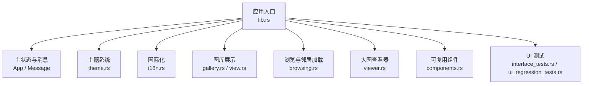
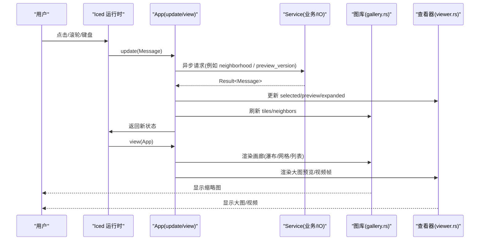
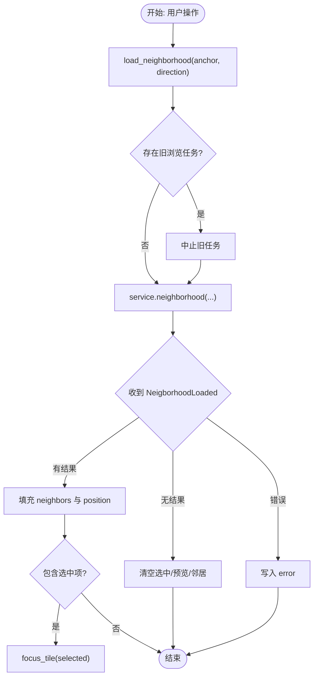
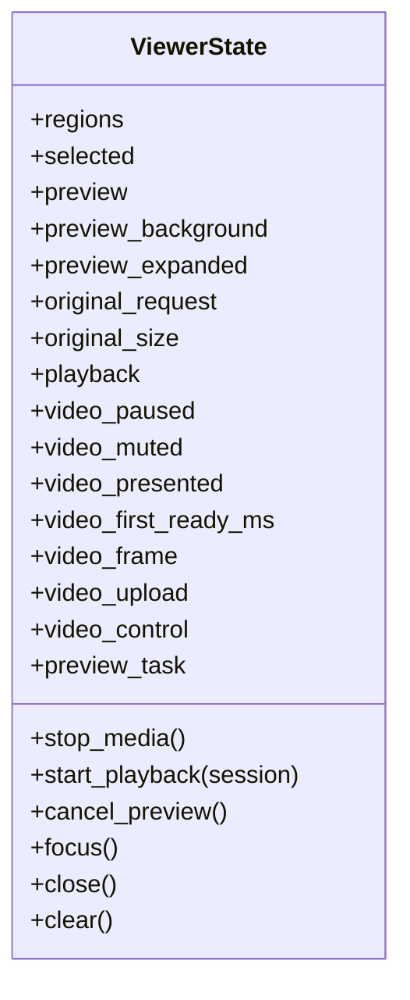
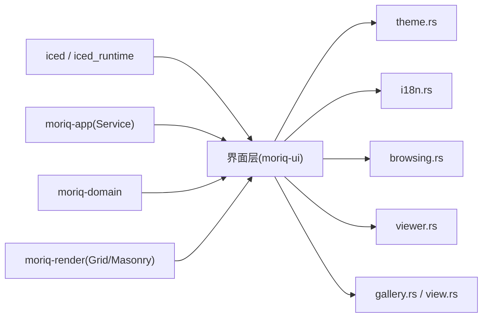

# 界面层 (moriq-ui)

> Repo Wiki 节点 `ui-layer`
> 导出自 Qoder 知识库快照 `8fbe02f6-57c2-4874-b725-1a8130851fd9`，代码基线 `7a7a8e75e18bd90294e09cd422dd7ed5a04813a0`（分支 main，zh-CN）。

<cite>
**本文引用的文件**   
- [crates/moriq-ui/Cargo.toml](../../../crates/moriq-ui/Cargo.toml)
- [crates/moriq-ui/src/lib.rs](../../../crates/moriq-ui/src/lib.rs)
- [crates/moriq-ui/src/browsing.rs](../../../crates/moriq-ui/src/browsing.rs)
- [crates/moriq-ui/src/viewer.rs](../../../crates/moriq-ui/src/viewer.rs)
- [crates/moriq-ui/src/theme.rs](../../../crates/moriq-ui/src/theme.rs)
- [crates/moriq-ui/src/i18n.rs](../../../crates/moriq-ui/src/i18n.rs)
- [crates/moriq-ui/src/gallery.rs](../../../crates/moriq-ui/src/gallery.rs)
- [crates/moriq-ui/src/view.rs](../../../crates/moriq-ui/src/view.rs)
- [crates/moriq-ui/src/components.rs](../../../crates/moriq-ui/src/components.rs)
- [crates/moriq-ui/src/ui_regression_tests.rs](../../../crates/moriq-ui/src/ui_regression_tests.rs)
- [crates/moriq-ui/src/interface_tests.rs](../../../crates/moriq-ui/src/interface_tests.rs)
</cite>

## 目录
1. [简介](#简介)
2. [项目结构](#项目结构)
3. [核心组件](#核心组件)
4. [架构总览](#架构总览)
5. [详细组件分析](#详细组件分析)
6. [依赖分析](#依赖分析)
7. [性能考虑](#性能考虑)
8. [故障排查指南](#故障排查指南)
9. [结论](#结论)
10. [附录](#附录)

## 简介
本文件面向 Moriq Space 的界面层，聚焦基于 Iced GUI 框架的应用架构与实现。文档重点包括：
- 事件驱动模型、状态管理与消息传递机制
- 主界面 Screen 枚举（Overview、Assets、Models）与 Dialog 对话框系统
- 浏览功能 browsing.rs 中的画廊视图、瀑布流布局、网格视图与列表视图切换逻辑
- 大图查看器 viewer.rs 的缩放、平移、旋转交互与版本对比能力
- 主题系统 theme.rs 的颜色配置、字体设置与响应式适配
- 国际化 i18n.rs 的多语言资源管理
- UI 测试策略与视觉回归测试方案

该文档避免直接粘贴源码，而是通过“代码片段路径”和图示帮助读者定位并理解实现。

## 项目结构
moriq-ui 是桌面应用的原生界面层，负责将业务服务（Service）暴露的状态转换为 Iced 可渲染的界面元素。其关键组织方式如下：
- 应用入口与主循环位于 lib.rs，定义 App 状态、Screen/Dialog 枚举、Message 枚举以及 run() 启动流程
- 功能模块按职责拆分：browsing.rs 处理素材浏览与邻居加载；viewer.rs 管理预览生命周期；theme.rs 提供主题；i18n.rs 提供本地化宏
- 图库展示由 gallery.rs 与 view.rs 协同完成，支持瀑布流、网格与列表三种视图
- 组件库 components.rs 提供可复用控件
- 测试覆盖 interface_tests.rs 与 ui_regression_tests.rs

图表来源
- [crates/moriq-ui/src/lib.rs:1-200](../../../crates/moriq-ui/src/lib.rs#L1-L200)
- [crates/moriq-ui/src/theme.rs](../../../crates/moriq-ui/src/theme.rs)
- [crates/moriq-ui/src/i18n.rs](../../../crates/moriq-ui/src/i18n.rs)
- [crates/moriq-ui/src/gallery.rs](../../../crates/moriq-ui/src/gallery.rs)
- [crates/moriq-ui/src/view.rs](../../../crates/moriq-ui/src/view.rs)
- [crates/moriq-ui/src/browsing.rs:1-214](../../../crates/moriq-ui/src/browsing.rs#L1-L214)
- [crates/moriq-ui/src/viewer.rs:1-108](../../../crates/moriq-ui/src/viewer.rs#L1-L108)
- [crates/moriq-ui/src/components.rs](../../../crates/moriq-ui/src/components.rs)
- [crates/moriq-ui/src/ui_regression_tests.rs](../../../crates/moriq-ui/src/ui_regression_tests.rs)
- [crates/moriq-ui/src/interface_tests.rs](../../../crates/moriq-ui/src/interface_tests.rs)

章节来源
- [crates/moriq-ui/Cargo.toml:1-25](../../../crates/moriq-ui/Cargo.toml#L1-L25)
- [crates/moriq-ui/src/lib.rs:1-200](../../../crates/moriq-ui/src/lib.rs#L1-L200)

## 核心组件
- 应用入口与运行循环
  - 通过 run() 创建 Iced 应用实例，绑定 App::new、App::update、App::view、App::subscription
  - 窗口默认关闭原生装饰，使用自定义标题栏与平台特定样式
  - 主题通过 theme::application_theme 注入，默认字体为 Microsoft YaHei UI
- 主状态 App
  - 维护当前 Screen（Overview、Assets、Models）、Dialog（CreateLibrary、CreateProject、RenameLibrary、RenameAsset、Settings）
  - 持有 Service、Opened 库上下文、查询 Query、画廊数据 tiles/total/offset/generation
  - 管理 viewer、gallery、compare、navigation、preferences、libraries、tasks 等子状态
- 消息系统 Message
  - 涵盖导航、浏览、画廊视口滚动、打开图片、选择、比较、任务、播放控制、设置保存、截图取证等
  - 采用异步 Task 包装 Service 调用，并通过 Message 回调更新界面状态

章节来源
- [crates/moriq-ui/src/lib.rs:1-200](../../../crates/moriq-ui/src/lib.rs#L1-L200)
- [crates/moriq-ui/src/lib.rs:201-500](../../../crates/moriq-ui/src/lib.rs#L201-L500)

## 架构总览
界面层遵循事件驱动架构：用户输入或外部事件触发 Subscription，Iced 调用 update 转换 Message 到新的 App 状态，随后 view 渲染。Service 作为后端桥接层，在后台执行磁盘、编解码、目录查询等操作，结果以 Message 形式回传。

图表来源
- [crates/moriq-ui/src/lib.rs:1-200](../../../crates/moriq-ui/src/lib.rs#L1-L200)
- [crates/moriq-ui/src/browsing.rs:1-214](../../../crates/moriq-ui/src/browsing.rs#L1-L214)
- [crates/moriq-ui/src/viewer.rs:1-108](../../../crates/moriq-ui/src/viewer.rs#L1-L108)

## 详细组件分析

### 主界面 Screen 与 Dialog 系统
- Screen 枚举
  - Overview：概览页
  - Assets：资产浏览页
  - Models：模型管理页
- Dialog 枚举
  - CreateLibrary、CreateProject、RenameLibrary、RenameAsset、Settings
- 行为说明
  - App 根据 launch.screen 初始化默认屏幕
  - 通过 dialog: Option<Dialog> 控制模态对话框的显示与隐藏
  - 界面标题、窗口最小尺寸、抗锯齿与风格通过 run() 统一配置

章节来源
- [crates/moriq-ui/src/lib.rs:1-200](../../../crates/moriq-ui/src/lib.rs#L1-L200)
- [crates/moriq-ui/src/lib.rs:201-500](../../../crates/moriq-ui/src/lib.rs#L201-L500)

### 浏览功能 browsing.rs
- 相邻素材加载
  - load_neighborhood(anchor, direction) 发起异步查询 service.neighborhood(...)，携带当前 query 与锚点
  - 使用 browse_request 版本号丢弃过期回执，避免旧结果污染当前浏览上下文
  - 成功后填充 neighbors 与 neighbor_position，必要时自动 focus_tile(result.selected)
- 焦点与预览协调
  - focus_tile(tile) 会：
    - 若选中项与预览任务未完成则复用进行中预览
    - 清理上一素材的详情、标签编辑状态与背景预览
    - 触发 preview_version(library, id, version) 异步加载大图与背景
    - 若处于展开模式，调用 set_viewer(true) 调整布局
- 错误与边界处理
  - NeighborhoodLoaded(None) 时清空选中、预览与邻居，并提示原先选择已不在查询中
  - 错误路径写入 error 字段供上层显示

图表来源
- [crates/moriq-ui/src/browsing.rs:1-214](../../../crates/moriq-ui/src/browsing.rs#L1-L214)

章节来源
- [crates/moriq-ui/src/browsing.rs:1-214](../../../crates/moriq-ui/src/browsing.rs#L1-L214)

### 大图查看器 viewer.rs
- 生命周期管理
  - stop_media：重置区域、递增 original_request、释放播放与视频帧
  - cancel_preview：中止未完成的预览任务
  - focus/clear/close：在不同场景下清理媒体与预览状态
- 播放与视频
  - start_playback 启动 Playback，重置暂停、静音、首帧时间等
  - 通过 video_control 版本号同步控制命令
- 对比与版本
  - compare 模块与 full preview 组合支持版本对比
  - 当切换 asset 或 version 时，确保旧预览与背景被清理，避免跨版本混用

图表来源
- [crates/moriq-ui/src/viewer.rs:1-108](../../../crates/moriq-ui/src/viewer.rs#L1-L108)

章节来源
- [crates/moriq-ui/src/viewer.rs:1-108](../../../crates/moriq-ui/src/viewer.rs#L1-L108)

### 画廊视图与布局切换
- 视图类型
  - 瀑布流（Masonry）：适合不规则缩略图，提升空间利用率
  - 网格（Grid）：规整排列，便于对齐与扫描
  - 列表（List）：信息密度高，适合快速浏览与筛选
- 切换逻辑
  - App 维护 list 布尔值与 masonry_mode 标志位，配合 viewport/card_width 计算每行/列数量
  - 滚动与视口变化通过 PageScrolled/GalleryViewport 等消息驱动重排
  - 邻居加载与焦点选择与视图模式解耦，保证一致的用户体验

章节来源
- [crates/moriq-ui/src/lib.rs:201-500](../../../crates/moriq-ui/src/lib.rs#L201-L500)
- [crates/moriq-ui/src/gallery.rs](../../../crates/moriq-ui/src/gallery.rs)
- [crates/moriq-ui/src/view.rs](../../../crates/moriq-ui/src/view.rs)

### 主题系统 theme.rs
- 颜色配置
  - 提供 application_theme(appearance)，按外观（亮/暗）返回 Theme
  - 通过 style 钩子注入背景色与文本色，与主题调色板联动
- 字体设置
  - 默认字体设置为 Microsoft YaHei UI，保障中文渲染效果
- 响应式设计
  - 结合 App::responsiveness 与窗口尺寸变化，动态调整字号、间距与控件尺寸
  - 与 DPI 变化消息联动，确保高分屏清晰度

章节来源
- [crates/moriq-ui/src/lib.rs:1-200](../../../crates/moriq-ui/src/lib.rs#L1-L200)
- [crates/moriq-ui/src/theme.rs](../../../crates/moriq-ui/src/theme.rs)

### 国际化 i18n.rs
- 多语言资源管理
  - 通过 tr! 宏进行字符串翻译，示例：在 browsing.rs 中使用 tr!(language, "原先选择的素材已不在此查询中" => "...")
- 语言切换
  - Message 中包含 LanguageChanged，App 更新 preferences.language 并刷新界面文案
- 扩展建议
  - 新增文案应优先使用 tr! 宏包裹，键名保持可读性，便于后续替换

章节来源
- [crates/moriq-ui/src/i18n.rs](../../../crates/moriq-ui/src/i18n.rs)
- [crates/moriq-ui/src/browsing.rs:201-214](../../../crates/moriq-ui/src/browsing.rs#L201-L214)

### 具体代码示例与最佳实践

#### 创建自定义组件
- 参考 components.rs 的组织方式，将常用控件封装为独立函数，返回 Element
- 通过 App 状态或局部状态驱动组件参数，避免在 view 中堆砌复杂逻辑

章节来源
- [crates/moriq-ui/src/components.rs](../../../crates/moriq-ui/src/components.rs)

#### 处理用户交互与更新界面状态
- 典型流程
  - 用户在画廊点击卡片 -> 触发 CardPressed/Select -> App.update 更新 viewer.selected 与 preview
  - 异步加载 FullPreviewLoaded -> 更新 viewer.preview 与 preview_background
  - 根据 preview_expanded 决定是否展开查看器
- 关键点
  - 使用 Message 区分不同交互语义
  - 对异步结果进行 request/version 校验，避免陈旧数据覆盖

章节来源
- [crates/moriq-ui/src/lib.rs:201-500](../../../crates/moriq-ui/src/lib.rs#L201-L500)
- [crates/moriq-ui/src/browsing.rs:1-214](../../../crates/moriq-ui/src/browsing.rs#L1-L214)

#### 添加新的界面功能
- 步骤
  - 在 App 中添加必要状态字段
  - 定义新的 Message 变体
  - 在 update 中处理消息并调用 Service
  - 在 view 中渲染对应 UI
  - 在 subscription 中订阅外部事件（如窗口尺寸、DPI 变化）

章节来源
- [crates/moriq-ui/src/lib.rs:1-200](../../../crates/moriq-ui/src/lib.rs#L1-L200)
- [crates/moriq-ui/src/lib.rs:201-500](../../../crates/moriq-ui/src/lib.rs#L201-L500)

## 依赖分析
- 外部依赖
  - iced、iced_runtime：GUI 框架与运行时
  - moriq-app、moriq-domain、moriq-render：业务服务、领域模型与网格/瀑布流渲染
  - tokio、chrono、rfd：异步运行时、时间与文件选择
- 内部耦合
  - App 高度聚合多个子系统状态，但通过模块化消息与子模块降低内聚度
  - browsing.rs 与 viewer.rs 共享 App 的 viewer 状态与 Service 接口
  - theme.rs 与 i18n.rs 作为横切关注点被多处引用

图表来源
- [crates/moriq-ui/Cargo.toml:1-25](../../../crates/moriq-ui/Cargo.toml#L1-L25)
- [crates/moriq-ui/src/lib.rs:1-200](../../../crates/moriq-ui/src/lib.rs#L1-L200)

章节来源
- [crates/moriq-ui/Cargo.toml:1-25](../../../crates/moriq-ui/Cargo.toml#L1-L25)

## 性能考虑
- 异步 IO 与取消
  - 所有耗时操作均通过 Task::perform 与 abortable handle 管理，避免阻塞 UI 线程
  - 使用 request 版本号（browse_request、original_request、video_control）丢弃陈旧结果
- 图像与媒体缓存
  - 复用 image::Handle，避免重复解码
  - 关闭查看器保留适应窗口的预览，减少重绘与解码开销
- 布局与滚动
  - 合理划分 tiles/total/offset，按需加载更多
  - 使用 GalleryViewport 与 PageScrolled 节流重排
- 主题与字体
  - 默认字体与主题在应用启动时设置，减少频繁变更带来的重绘

[本节为通用指导，无需具体文件分析]

## 故障排查指南
- 预览未更新或错乱
  - 检查是否命中陈旧回执（browse_request/original_request），确认已正确递增与校验
  - 验证 focus_tile 是否正确清理 preview_background 与 details
- 视频播放异常
  - 检查 start_playback 与 stop_media 的调用时机
  - 核对 video_control 版本号是否与 UI 控制命令匹配
- 画廊视图错位
  - 确认 viewport/card_width/list/masonry_mode 的计算逻辑
  - 检查 PageScrolled/GalleryViewport 消息是否及时更新布局
- 主题或字体异常
  - 确认 theme::application_theme 返回有效 Theme
  - 检查默认字体与 DPI 变化处理

章节来源
- [crates/moriq-ui/src/browsing.rs:1-214](../../../crates/moriq-ui/src/browsing.rs#L1-L214)
- [crates/moriq-ui/src/viewer.rs:1-108](../../../crates/moriq-ui/src/viewer.rs#L1-L108)
- [crates/moriq-ui/src/lib.rs:1-200](../../../crates/moriq-ui/src/lib.rs#L1-L200)

## 结论
moriq-ui 以 Iced 为基础，采用清晰的事件驱动架构与模块化设计，将浏览、查看、主题与国际化等功能解耦。通过严格的异步任务管理与版本号校验，保证了界面的一致性与性能。建议在新增功能时延续现有模式：明确 Message、在 update 中协调状态、在 view 中专注渲染，并配套单元测试与视觉回归测试。

[本节为总结，无需具体文件分析]

## 附录

### UI 测试策略
- 单元与集成测试
  - 针对关键交互编写测试用例，例如 selecting_and_opening_same_version_reuses_pending_and_completed_preview
  - 使用 crate::tests::app() 构建最小化 App 状态，断言状态流转与 Task 行为
- 视觉回归测试
  - 通过 ui_regression_tests.rs 捕获截图并与基线比对，确保主题、布局与动画稳定性
  - 可结合 capture 特性开关，在 CI 中批量生成基准图像

章节来源
- [crates/moriq-ui/src/browsing.rs:1-200](../../../crates/moriq-ui/src/browsing.rs#L1-L200)
- [crates/moriq-ui/src/ui_regression_tests.rs](../../../crates/moriq-ui/src/ui_regression_tests.rs)
- [crates/moriq-ui/src/interface_tests.rs](../../../crates/moriq-ui/src/interface_tests.rs)