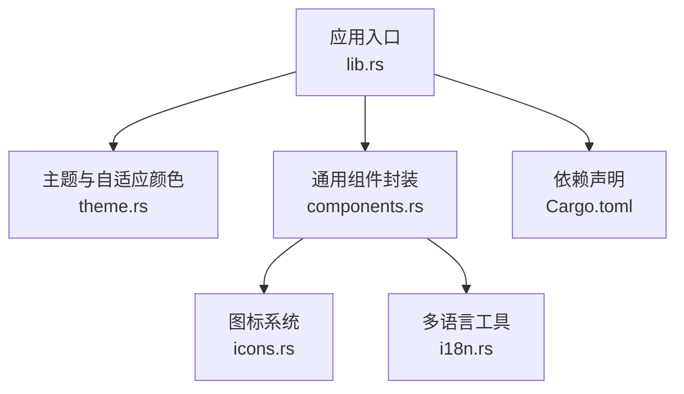
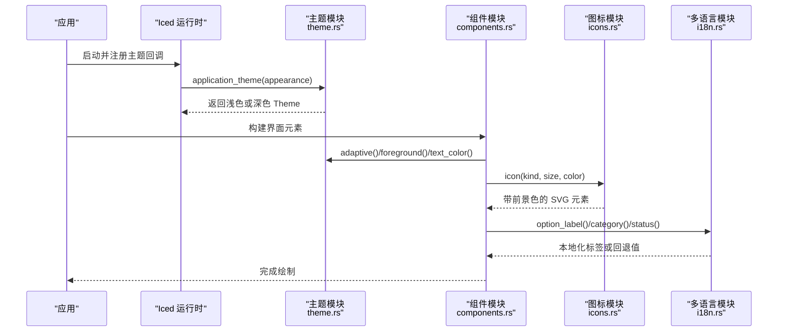
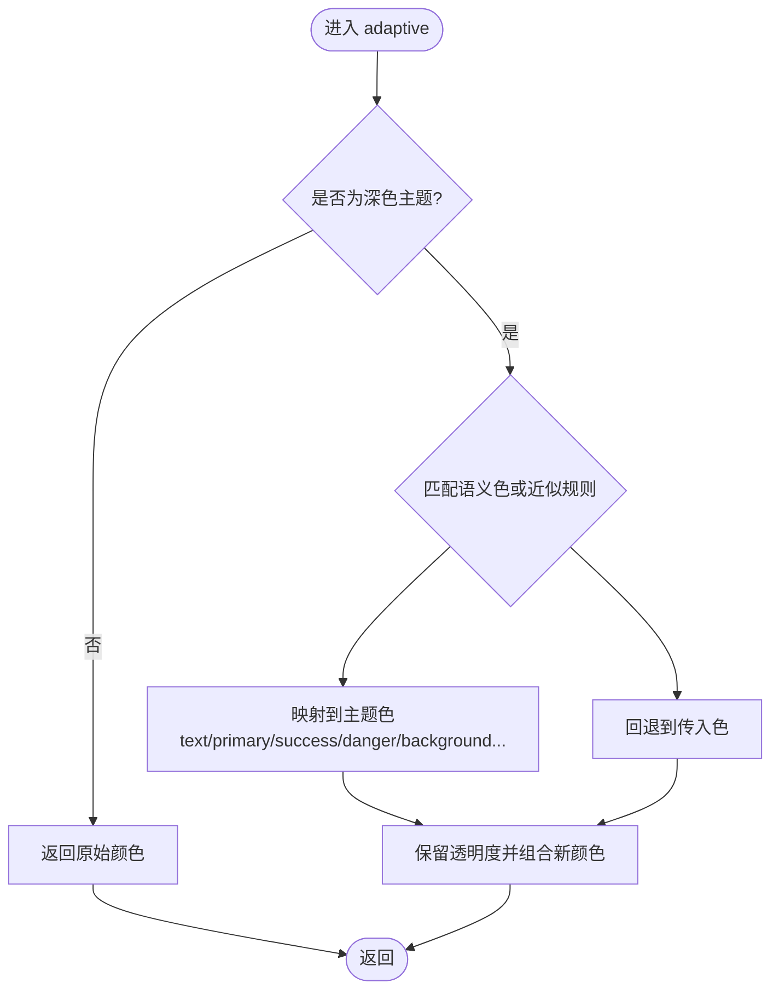
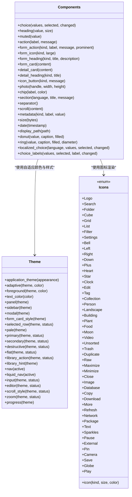
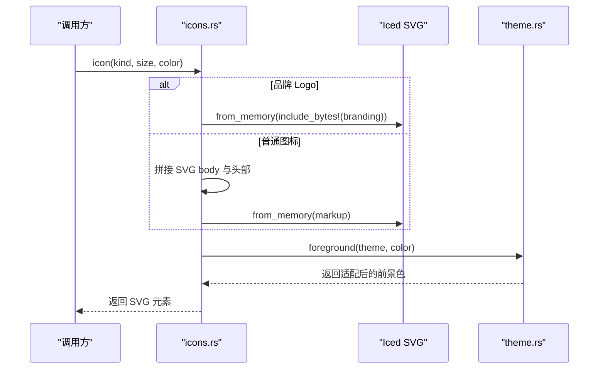
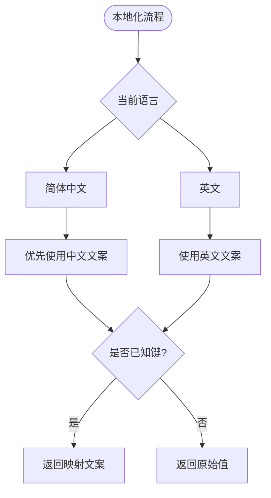
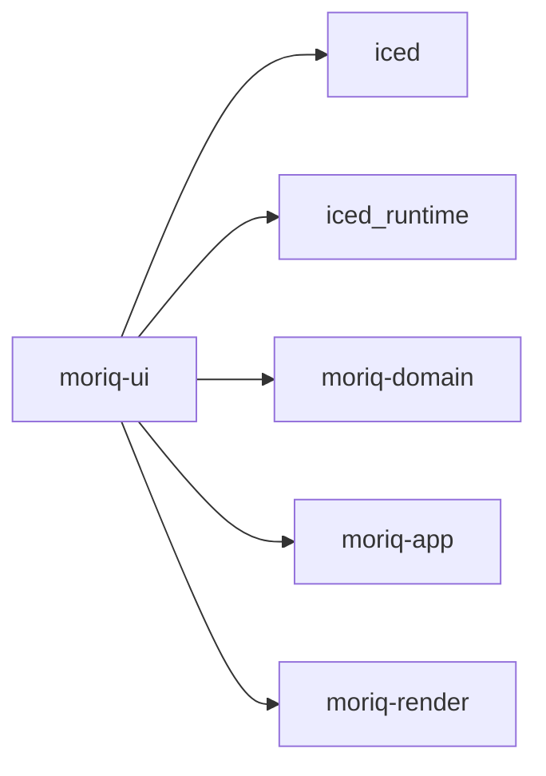

# 主题与样式系统

> Repo Wiki 节点 `theme-system`
> 导出自 Qoder 知识库快照 `8fbe02f6-57c2-4874-b725-1a8130851fd9`，代码基线 `7a7a8e75e18bd90294e09cd422dd7ed5a04813a0`（分支 main，zh-CN）。

<cite>
**本文引用的文件**
- [theme.rs](../../../crates/moriq-ui/src/theme.rs)
- [icons.rs](../../../crates/moriq-ui/src/icons.rs)
- [i18n.rs](../../../crates/moriq-ui/src/i18n.rs)
- [components.rs](../../../crates/moriq-ui/src/components.rs)
- [lib.rs](../../../crates/moriq-ui/src/lib.rs)
- [Cargo.toml](../../../crates/moriq-ui/Cargo.toml)
</cite>

## 目录
1. [引言](#引言)
2. [项目结构](#项目结构)
3. [核心组件](#核心组件)
4. [架构总览](#架构总览)
5. [详细组件分析](#详细组件分析)
6. [依赖关系分析](#依赖关系分析)
7. [性能与可维护性](#性能与可维护性)
8. [故障排查](#故障排查)
9. [结论](#结论)
10. [附录：开发示例与最佳实践](#附录开发示例与最佳实践)

## 引言
本文件系统性说明 Iced Theme 在该项目中的定制机制，包括明暗主题切换、语义化调色板、自适应颜色函数、统一组件样式封装、图标系统与字体配置，以及多语言支持。文档同时提供扩展主题、创建自定义控件样式和实现响应式布局的实践路径，并总结主题开发与兼容性注意事项。

## 项目结构
UI 层位于 `crates/moriq-ui` 中，主题与样式相关代码主要集中在以下模块：
- 主题定义与自适应颜色：`theme.rs`
- 图标资源与动态渲染：`icons.rs`
- 多语言与本地化选项：`i18n.rs`
- 通用 UI 组件封装：`components.rs`
- 应用入口与主题注入：`lib.rs`
- 依赖声明：`Cargo.toml`

**图表来源**
- [lib.rs:415-430](../../../crates/moriq-ui/src/lib.rs#L415-L430)
- [theme.rs:1-120](../../../crates/moriq-ui/src/theme.rs#L1-L120)
- [components.rs:1-60](../../../crates/moriq-ui/src/components.rs#L1-L60)
- [icons.rs:1-40](../../../crates/moriq-ui/src/icons.rs#L1-L40)
- [i18n.rs:1-40](../../../crates/moriq-ui/src/i18n.rs#L1-L40)
- [Cargo.toml:1-25](../../../crates/moriq-ui/Cargo.toml#L1-L25)

**章节来源**
- [lib.rs:415-430](../../../crates/moriq-ui/src/lib.rs#L415-L430)
- [Cargo.toml:1-25](../../../crates/moriq-ui/Cargo.toml#L1-L25)

## 核心组件
- 主题选择与持久化外观：根据 `Appearance` 返回 Iced 的 `Theme`，内置浅色与深色两套 `Palette`。
- 自适应颜色系统：`adaptive` 将语义色映射到当前主题，保证明暗主题下的一致性。
- 组件样式工厂：按钮、文本输入框、编辑器、滚动条、滑块、进度条等统一风格。
- 图标系统：集中枚举所有图标名称，通过内嵌 SVG 字符串或外部品牌资源进行渲染。
- 多语言支持：固定 UI 文案与分类标签按当前语言展示，用户内容不翻译。
- 通用 UI 组件：选择控件、标题/辅助文本、按钮、表单卡片、分隔线、环形统计图等。

**章节来源**
- [theme.rs:1-200](../../../crates/moriq-ui/src/theme.rs#L1-L200)
- [theme.rs:201-483](../../../crates/moriq-ui/src/theme.rs#L201-L483)
- [icons.rs:1-163](../../../crates/moriq-ui/src/icons.rs#L1-L163)
- [i18n.rs:1-163](../../../crates/moriq-ui/src/i18n.rs#L1-L163)
- [components.rs:1-200](../../../crates/moriq-ui/src/components.rs#L1-L200)
- [components.rs:201-352](../../../crates/moriq-ui/src/components.rs#L201-L352)

## 架构总览
Iced 运行时通过应用入口设置主题回调，业务组件使用统一的样式工厂与图标工具，多语言工具负责显示文案。

**图表来源**
- [lib.rs:415-430](../../../crates/moriq-ui/src/lib.rs#L415-L430)
- [theme.rs:1-120](../../../crates/moriq-ui/src/theme.rs#L1-L120)
- [components.rs:1-60](../../../crates/moriq-ui/src/components.rs#L1-L60)
- [icons.rs:1-40](../../../crates/moriq-ui/src/icons.rs#L1-L40)
- [i18n.rs:1-40](../../../crates/moriq-ui/src/i18n.rs#L1-L40)

## 详细组件分析

### 主题与自适应颜色系统
主题模块定义了语义色常量，如主色、文本色、弱化文本、图标色、分割线、背景、浅蓝底、成功色、紫色、控制边框线等；并根据 `Appearance` 返回 Iced 的 `Theme`，其中浅色主题基于 `iced::theme::Palette::LIGHT`，深色主题基于 `iced::theme::Palette::DARK`，并通过覆盖关键字段完成品牌配色。

自适应函数 `adaptive(theme, color)` 是核心：当主题为浅色时直接返回原色；在深色主题下，根据传入语义色或近似色匹配规则替换为对应深色调值。例如：
- 语义色 `TEXT`、`BLUE`、`GREEN` 映射为主题调色板的文本、主色、成功色。
- 背景、线条、弱底色等都有对应的深色值。
- 对接近白色或高亮区域做特殊处理，避免在图片等复杂背景上误用主题色。

此外，`foreground` 用于在照片或主按钮上使用纯白前景，其他场景走 `adaptive`；`text_color` 生成文本样式闭包，方便 Iced 文本控件接入。

**图表来源**
- [theme.rs:1-120](../../../crates/moriq-ui/src/theme.rs#L1-L120)

**章节来源**
- [theme.rs:1-120](../../../crates/moriq-ui/src/theme.rs#L1-L120)

### 组件样式封装
组件模块对常用控件进行统一封装，确保视觉一致性，同时把交互状态（悬停、按下、禁用、聚焦）纳入样式决策：
- 选择控件 `choice`：统一字号、内边距、下拉菜单背景、选中项高亮、边框与阴影。
- 标题与辅助文本：`heading`、`muted` 使用统一字体权重与颜色。
- 按钮族：`action`、`form_action`、`icon_button`、`flat`、`library_action`、`library_hint`、`nav`、`liquid_nav`、`primary`、`secondary`、`destructive` 等，覆盖主要、次要、破坏性、轻量、导航、液体组导航等多种场景。
- 输入控件：`input` 与 `editor` 分别针对单行和多行编辑器，区分焦点态与非焦点态的背景、边框、占位符、选择区颜色。
- 滚动与缩放：`scroll_style`、`zoom` 提供一致的轨道、滑块、圆角与阴影。
- 进度条：`progress` 提供语义化的进度填充与背景。

**图表来源**
- [theme.rs:1-483](../../../crates/moriq-ui/src/theme.rs#L1-L483)
- [components.rs:1-352](../../../crates/moriq-ui/src/components.rs#L1-L352)
- [icons.rs:1-163](../../../crates/moriq-ui/src/icons.rs#L1-L163)

**章节来源**
- [components.rs:1-200](../../../crates/moriq-ui/src/components.rs#L1-L200)
- [components.rs:201-352](../../../crates/moriq-ui/src/components.rs#L201-L352)
- [theme.rs:201-483](../../../crates/moriq-ui/src/theme.rs#L201-L483)

### 图标系统
图标系统以枚举 `Icon` 集中管理所有图标名称，并提供 `icon(kind, size, color)` 函数：
- 品牌 Logo 从内存中的 SVG 文件加载。
- 其余图标以内嵌 SVG 字符串形式定义，统一使用 `viewBox="0 0 24 24"`、描边风格与线宽。
- 最终通过 Iced 的 `svg` 组件渲染，并使用 `theme::foreground` 将图标颜色适配到当前主题。

**图表来源**
- [icons.rs:1-163](../../../crates/moriq-ui/src/icons.rs#L1-L163)
- [theme.rs:1-120](../../../crates/moriq-ui/src/theme.rs#L1-L120)

**章节来源**
- [icons.rs:1-163](../../../crates/moriq-ui/src/icons.rs#L1-L163)

### 多语言支持
多语言模块采用显式、按应用范围的本地化策略：
- 宏 `tr!` 与 `trf!` 在编译期根据 `Language` 选择中文或英文文案。
- `option_label` 将固定下拉选项标签翻译成英文，未知值保持回退。
- `category` 翻译内置分类名称，不替换用户自定义分类。
- `status` 翻译内部状态提示文本，支持双向匹配以避免重复。

组件层通过 `localized_choice` 与 `choice_labels` 将稳定值与本地化标签分离，确保选择控件的值比较稳定，而显示标签随语言变化。

**图表来源**
- [i18n.rs:1-163](../../../crates/moriq-ui/src/i18n.rs#L1-L163)
- [components.rs:201-352](../../../crates/moriq-ui/src/components.rs#L201-L352)

**章节来源**
- [i18n.rs:1-163](../../../crates/moriq-ui/src/i18n.rs#L1-L163)
- [components.rs:201-352](../../../crates/moriq-ui/src/components.rs#L201-L352)

### 字体配置
字体方面，组件层通过 Iced 的 `Font` 指定字重（如 `Semibold`），并结合 `text_size`、`wrapping` 等属性形成一致的文字排版。主题层则通过 `text_color` 与 `foreground` 控制文字颜色，确保在不同主题下可读性。

- 标题文本使用加粗字重与统一字号。
- 辅助文本使用较小字号与弱化颜色。
- 详情元数据行使用固定宽度标签与可换行的值文本。

**章节来源**
- [components.rs:1-120](../../../crates/moriq-ui/src/components.rs#L1-L120)
- [theme.rs:1-120](../../../crates/moriq-ui/src/theme.rs#L1-L120)

## 依赖关系分析
UI 模块依赖 Iced 运行时、领域模型与渲染库。主题与图标由 UI 模块内部组织，不直接耦合业务逻辑。

**图表来源**
- [Cargo.toml:1-25](../../../crates/moriq-ui/Cargo.toml#L1-L25)

**章节来源**
- [Cargo.toml:1-25](../../../crates/moriq-ui/Cargo.toml#L1-L25)

## 性能与可维护性
- 主题对象使用静态懒加载缓存，避免重复构造 `Theme` 带来的开销。
- `adaptive` 通过少量分支与常量判断完成颜色解析，复杂度低，适合频繁调用。
- 组件样式工厂将样式与交互状态解耦，便于扩展与维护。
- 图标使用内嵌 SVG 字符串减少资源加载成本，Logo 使用一次性内存加载。
- 多语言宏在编译期展开，运行时无额外负担。

[本节为通用建议，不涉及具体文件分析]

## 故障排查
- 主题未生效
  - 检查应用入口是否正确注册主题回调并传入 `appearance`。
  - 确认 `ApplicationTheme` 的明暗模式是否与偏好一致。
- 颜色异常
  - 确认组件是否通过 `adaptive` 或 `foreground` 获取颜色，而非直接使用硬编码色值。
  - 检查是否在图片等复杂背景下使用了不适合的主题色。
- 图标颜色不正确
  - 确认图标渲染调用使用了 `theme::foreground` 传递前景色。
- 多语言文案缺失
  - 检查文案键是否被 `option_label`、`category` 或 `status` 覆盖；未知键会回退原始值。
- 选择控件值不稳定
  - 使用 `localized_choice` 或 `choice_labels`，确保比较基于稳定值而非本地化标签。

**章节来源**
- [lib.rs:415-430](../../../crates/moriq-ui/src/lib.rs#L415-L430)
- [theme.rs:1-120](../../../crates/moriq-ui/src/theme.rs#L1-L120)
- [icons.rs:1-163](../../../crates/moriq-ui/src/icons.rs#L1-L163)
- [i18n.rs:1-163](../../../crates/moriq-ui/src/i18n.rs#L1-L163)
- [components.rs:201-352](../../../crates/moriq-ui/src/components.rs#L201-L352)

## 结论
该项目的主题与样式系统围绕 Iced 的 `Theme` 与 `Palette` 构建，通过语义色与 `adaptive` 函数实现明暗主题的一致体验。组件样式工厂与图标系统进一步封装了常见交互与视觉规范，多语言模块提供稳定的本地化能力。整体设计清晰、可扩展性强，便于团队在统一设计语言下进行主题定制与功能扩展。

[本节为总结性内容，不涉及具体文件分析]

## 附录：开发示例与最佳实践

### 如何创建自定义组件样式
- 新建一个样式工厂函数，接收 `&Theme` 与控件状态，返回 Iced 控件样式。
- 所有颜色必须通过 `adaptive` 或 `foreground` 获取，以保证明暗主题一致。
- 将悬停、按下、禁用、聚焦等状态分别处理，提供清晰的视觉反馈。
- 参考现有按钮样式：主要、次要、破坏性、轻量、导航等。

**参考路径**
- [theme.rs:201-483](../../../crates/moriq-ui/src/theme.rs#L201-L483)

### 如何扩展主题配置
- 在 `application_theme` 中添加新的语义色常量，并在 `adaptive` 中增加映射规则。
- 对于接近白色或红色系的颜色，注意添加特殊分支，避免与背景冲突。
- 为新组件提供专门的容器或按钮样式，复用已有面板、边框、圆角与阴影规范。

**参考路径**
- [theme.rs:1-120](../../../crates/moriq-ui/src/theme.rs#L1-L120)
- [theme.rs:201-483](../../../crates/moriq-ui/src/theme.rs#L201-L483)

### 如何实现响应式设计
- 使用组件层的尺寸与布局工具（如 `Length::Fill`、`spacing`、`align_y`）构建弹性布局。
- 对于图表类控件，根据直径调整字号与比例，例如环形统计图。
- 滚动区域统一使用 `scroll` 与 `scroll_style`，保持一致的滚动条与轨道样式。

**参考路径**
- [components.rs:201-352](../../../crates/moriq-ui/src/components.rs#L201-L352)

### 最佳实践
- 始终通过主题系统获取颜色，不要硬编码色值。
- 使用语义色命名，如“主色”“成功色”“弱化文本”，避免使用描述性色名。
- 对图标颜色使用 `foreground`，确保在不同背景下的可读性。
- 本地化只翻译固定 UI 文案，不翻译用户内容。
- 组件样式尽量幂等，避免副作用；交互状态通过参数传入。

[本节为通用指导，不涉及具体文件分析]