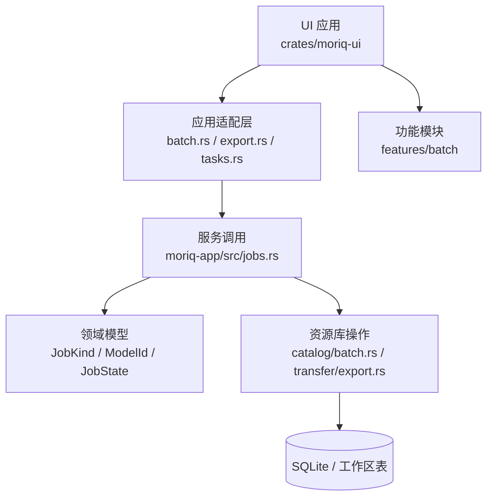
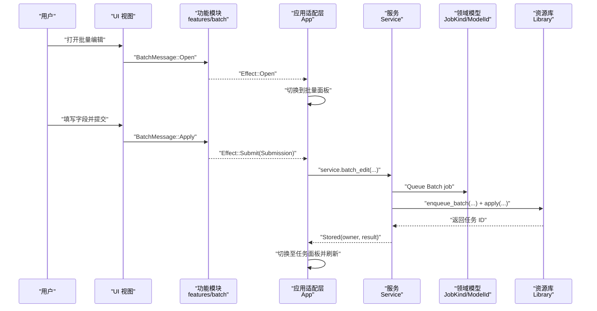
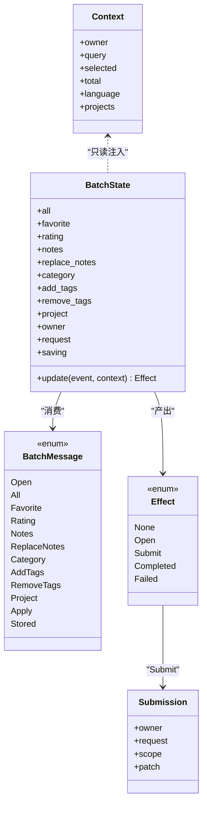
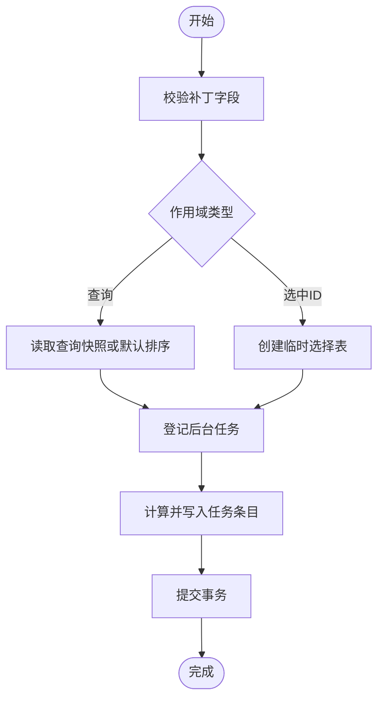
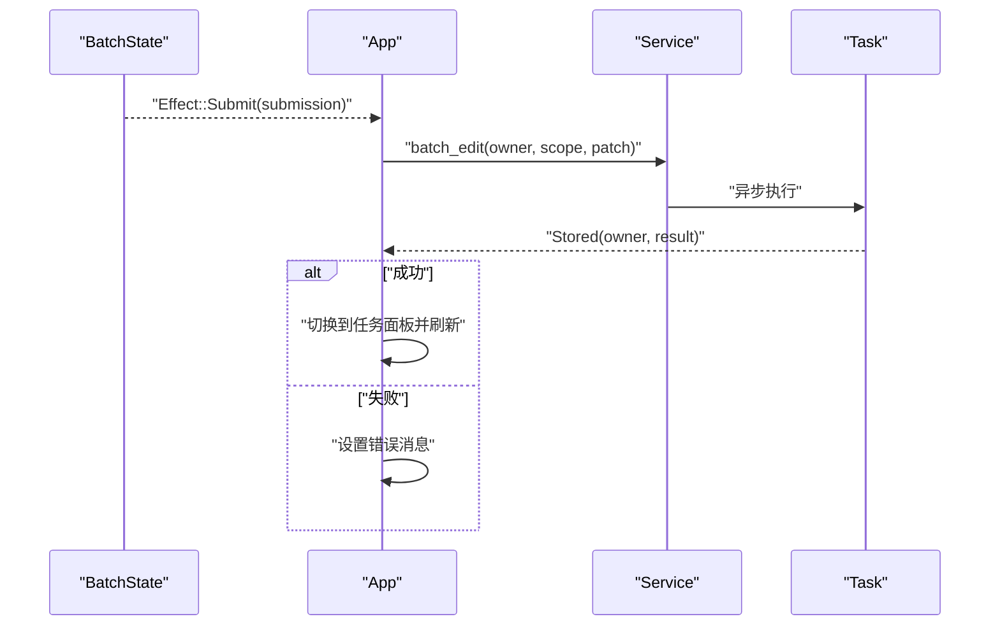
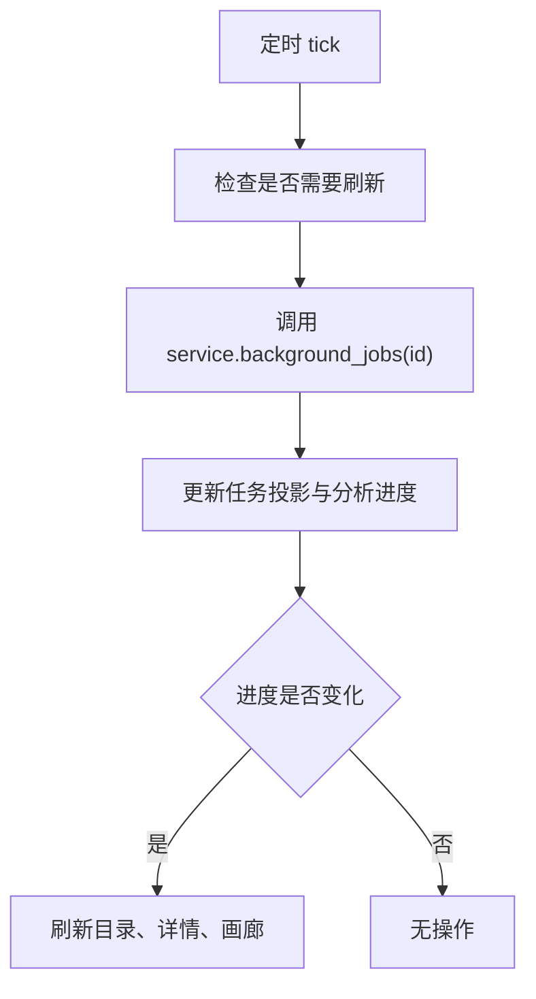
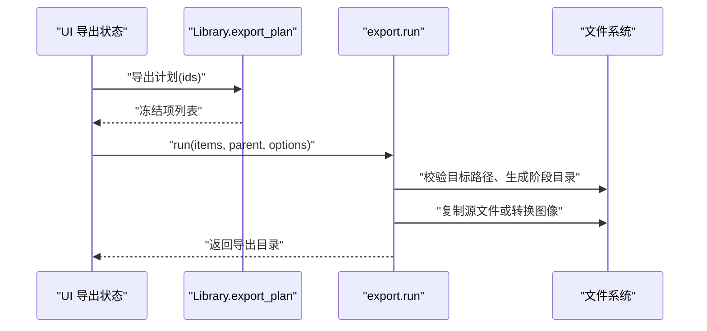
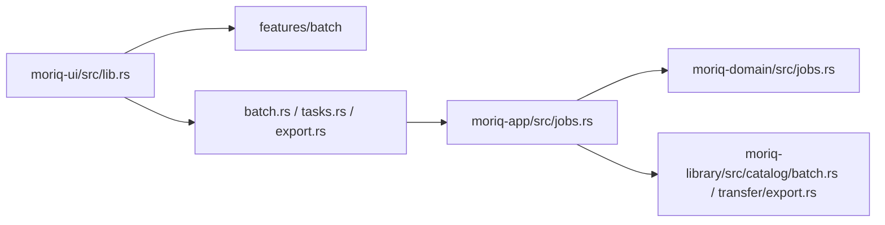

# 功能模块组件

> Repo Wiki 节点 `feature-modules`
> 导出自 Qoder 知识库快照 `8fbe02f6-57c2-4874-b725-1a8130851fd9`，代码基线 `7a7a8e75e18bd90294e09cd422dd7ed5a04813a0`（分支 main，zh-CN）。

<cite>
**本文引用的文件**   
- [crates/moriq-ui/src/lib.rs](../../../../crates/moriq-ui/src/lib.rs)
- [crates/moriq-ui/src/features/mod.rs](../../../../crates/moriq-ui/src/features/mod.rs)
- [crates/moriq-ui/src/features/batch/mod.rs](../../../../crates/moriq-ui/src/features/batch/mod.rs)
- [crates/moriq-ui/src/features/batch/view.rs](../../../../crates/moriq-ui/src/features/batch/view.rs)
- [crates/moriq-ui/src/features/batch/tests.rs](../../../../crates/moriq-ui/src/features/batch/tests.rs)
- [crates/moriq-ui/src/batch.rs](../../../../crates/moriq-ui/src/batch.rs)
- [crates/moriq-ui/src/components.rs](../../../../crates/moriq-ui/src/components.rs)
- [crates/moriq-ui/src/tasks.rs](../../../../crates/moriq-ui/src/tasks.rs)
- [crates/moriq-library/src/catalog/batch.rs](../../../../crates/moriq-library/src/catalog/batch.rs)
- [crates/moriq-app/src/jobs.rs](../../../../crates/moriq-app/src/jobs.rs)
- [crates/moriq-domain/src/jobs.rs](../../../../crates/moriq-domain/src/jobs.rs)
- [crates/moriq-library/src/transfer/export.rs](../../../../crates/moriq-library/src/transfer/export.rs)
- [crates/moriq-ui/src/export.rs](../../../../crates/moriq-ui/src/export.rs)
</cite>

## 目录
1. [简介](#简介)
2. [项目结构](#项目结构)
3. [核心组件](#核心组件)
4. [架构总览](#架构总览)
5. [详细组件分析](#详细组件分析)
6. [依赖关系分析](#依赖关系分析)
7. [性能与进度跟踪](#性能与进度跟踪)
8. [自定义组件开发模式](#自定义组件开发模式)
9. [测试策略](#测试策略)
10. [故障排查](#故障排查)
11. [结论](#结论)

## 简介
本文面向 Moriq Space 的“功能模块组件”设计，重点说明 features 模块的组织方式、批处理高级功能的实现，以及 UI 层如何与后台任务、AI 分析和导出等能力集成。文档从系统架构、数据流、错误处理和性能特征出发，逐步深入到批处理状态机、消息传递、进度跟踪和自定义组件复用模式，并给出扩展新模块的实践建议。

## 项目结构
Moriq 采用多 crate 分层组织：UI 层负责界面、状态和事件；应用层协调服务、任务调度；领域层定义任务类型和协议；库层提供资源库操作、批量编辑、导出等核心能力。

**图表来源**
- [crates/moriq-ui/src/lib.rs:201-350](../../../../crates/moriq-ui/src/lib.rs#L201-L350)
- [crates/moriq-ui/src/batch.rs:1-76](../../../../crates/moriq-ui/src/batch.rs#L1-L76)
- [crates/moriq-app/src/jobs.rs:1-175](../../../../crates/moriq-app/src/jobs.rs#L1-L175)
- [crates/moriq-domain/src/jobs.rs:1-200](../../../../crates/moriq-domain/src/jobs.rs#L1-L200)
- [crates/moriq-library/src/catalog/batch.rs:1-159](../../../../crates/moriq-library/src/catalog/batch.rs#L1-L159)

**章节来源**
- [crates/moriq-ui/src/lib.rs:201-350](../../../../crates/moriq-ui/src/lib.rs#L201-L350)
- [crates/moriq-ui/src/features/mod.rs:1-1](../../../../crates/moriq-ui/src/features/mod.rs#L1-L1)

## 核心组件
- UI 主应用状态集中管理各功能模块的状态，例如批量编辑、任务列表、导出选项、AI 分析等。
- features 模块是 UI 层的特性隔离单元，当前已暴露 batch 子模块，并通过主模块注册。
- 每个功能模块通常包含：
  - 本地状态与消息枚举
  - 视图构建函数
  - 与应用适配层的交互接口（提交、回执、错误）

**章节来源**
- [crates/moriq-ui/src/lib.rs:201-350](../../../../crates/moriq-ui/src/lib.rs#L201-L350)
- [crates/moriq-ui/src/features/mod.rs:1-1](../../../../crates/moriq-ui/src/features/mod.rs#L1-L1)

## 架构总览
UI 通过 Iced 的消息循环驱动 App::update，将功能模块产生的 Effect 转换为 Task<Message>，再调用 Service 执行异步后台操作。Service 将任务登记到持久化队列，由调度器驱动执行，并将进度回推给 UI。

**图表来源**
- [crates/moriq-ui/src/features/batch/mod.rs:1-153](../../../../crates/moriq-ui/src/features/batch/mod.rs#L1-L153)
- [crates/moriq-ui/src/batch.rs:1-76](../../../../crates/moriq-ui/src/batch.rs#L1-L76)
- [crates/moriq-app/src/jobs.rs:1-175](../../../../crates/moriq-app/src/jobs.rs#L1-L175)
- [crates/moriq-library/src/catalog/batch.rs:1-159](../../../../crates/moriq-library/src/catalog/batch.rs#L1-L159)

## 详细组件分析

### 批处理功能模块
批处理模块位于 `features/batch`，职责清晰：维护本地草稿、渲染表单、构造提交内容，并通过效果通知应用层执行后台任务。它不持有根 App 或 Service，从而保持纯函数式更新和可测试性。

#### 关键数据结构
- `Context`：向模块注入当前库、项目、查询、选中项、总数、语言和项目列表。
- `BatchState`：保存批量编辑的草稿字段、是否全选、请求序号、保存标志。
- `BatchMessage`：描述用户输入、打开、提交和存储回执。
- `Submission`：冻结后的提交内容，包括作用域、补丁对象、请求号和所属者。
- `Effect`：模块输出给应用层的副作用，如打开、提交、完成、失败。

**图表来源**
- [crates/moriq-ui/src/features/batch/mod.rs:1-153](../../../../crates/moriq-ui/src/features/batch/mod.rs#L1-L153)

#### 批处理流程
批处理的核心在于“冻结范围”和“事务内逐个素材更新”。UI 层将选择或查询结果转为 `BatchScope`，服务端将其持久化为后台任务，并在执行时按条目顺序更新数据库。

**图表来源**
- [crates/moriq-library/src/catalog/batch.rs:1-159](../../../../crates/moriq-library/src/catalog/batch.rs#L1-L159)

**章节来源**
- [crates/moriq-ui/src/features/batch/mod.rs:1-153](../../../../crates/moriq-ui/src/features/batch/mod.rs#L1-L153)
- [crates/moriq-ui/src/features/batch/view.rs:1-85](../../../../crates/moriq-ui/src/features/batch/view.rs#L1-L85)
- [crates/moriq-library/src/catalog/batch.rs:1-159](../../../../crates/moriq-library/src/catalog/batch.rs#L1-L159)

#### 批处理与主界面集成
主应用负责把 `BatchState` 的 Effect 映射为 UI 行为：
- `Effect::Open`：切换到批量面板。
- `Effect::Submit`：调用 `service.batch_edit`，并通过 `Task::perform` 包装异步回调。
- `Effect::Completed`：跳转到任务面板，显示提示并刷新组织视图。
- `Effect::Failed`：记录错误信息。

**图表来源**
- [crates/moriq-ui/src/batch.rs:1-76](../../../../crates/moriq-ui/src/batch.rs#L1-L76)

**章节来源**
- [crates/moriq-ui/src/batch.rs:1-76](../../../../crates/moriq-ui/src/batch.rs#L1-L76)

### 后台任务与 AI 分析
后台任务模块统一管理导入、AI 分析、索引、缩略图重建等任务。其特点：
- 使用轮询与请求号防抖，避免重复刷新。
- 根据任务种类展示不同标题、状态和控制按钮。
- 对模型类任务支持暂停、恢复、停止和优先级调整。
- 当分析进度变化时，仅刷新受影响的分类、详情和画廊布局。

**图表来源**
- [crates/moriq-ui/src/tasks.rs:1-509](../../../../crates/moriq-ui/src/tasks.rs#L1-L509)

**章节来源**
- [crates/moriq-ui/src/tasks.rs:1-509](../../../../crates/moriq-ui/src/tasks.rs#L1-L509)
- [crates/moriq-domain/src/jobs.rs:1-200](../../../../crates/moriq-domain/src/jobs.rs#L1-L200)
- [crates/moriq-app/src/jobs.rs:1-175](../../../../crates/moriq-app/src/jobs.rs#L1-L175)

### 批量导出
导出功能在 UI 层维护 `ExportState`，将用户选择的格式、尺寸、质量、旋转、重采样算法、目录布局和元数据侧边栏选项映射为类型化配置。底层资源库负责冻结版本、校验哈希、生成导出计划，并在工作线程中复制文件或转换图像。

**图表来源**
- [crates/moriq-ui/src/export.rs:1-125](../../../../crates/moriq-ui/src/export.rs#L1-L125)
- [crates/moriq-library/src/transfer/export.rs:1-200](../../../../crates/moriq-library/src/transfer/export.rs#L1-L200)

**章节来源**
- [crates/moriq-ui/src/export.rs:1-125](../../../../crates/moriq-ui/src/export.rs#L1-L125)
- [crates/moriq-library/src/transfer/export.rs:1-200](../../../../crates/moriq-library/src/transfer/export.rs#L1-L200)

### 自定义组件复用模式
UI 层通过 `components.rs` 提供统一风格的控件工厂，包括选择框、按钮、卡片、环形图和标签等。这些组件封装了样式、尺寸、图标和本地化逻辑，使业务模块专注于数据与交互。

典型模式：
- 使用 `choice` 封装下拉选择，统一菜单样式和边框。
- 使用 `action` 或 `form_action` 封装操作按钮，绑定消息。
- 使用 `localized_choice` 将稳定值与翻译标签分离，便于国际化。
- 使用 `form_card`、`detail_card`、`section` 组织表单区块。

**章节来源**
- [crates/moriq-ui/src/components.rs:1-352](../../../../crates/moriq-ui/src/components.rs#L1-L352)

## 依赖关系分析
- UI 层通过 `pub(crate)` 暴露模块消息类型，供 App 路由分发。
- features 模块仅依赖领域模型中的资产、项目和查询类型，不直接依赖 Service。
- 应用适配层桥接 UI 与 Service，承担参数组装、错误处理和界面导航。
- Service 统一处理任务入队、控制、执行和失败明细查询。
- 领域模型定义稳定的任务类型、模型标识和状态协议，确保跨进程和持久化的兼容性。
- 资源库层负责批量编辑和导出的具体数据库与文件系统操作。

**图表来源**
- [crates/moriq-ui/src/lib.rs:201-350](../../../../crates/moriq-ui/src/lib.rs#L201-L350)
- [crates/moriq-ui/src/batch.rs:1-76](../../../../crates/moriq-ui/src/batch.rs#L1-L76)
- [crates/moriq-ui/src/tasks.rs:1-509](../../../../crates/moriq-ui/src/tasks.rs#L1-L509)
- [crates/moriq-ui/src/export.rs:1-125](../../../../crates/moriq-ui/src/export.rs#L1-L125)
- [crates/moriq-app/src/jobs.rs:1-175](../../../../crates/moriq-app/src/jobs.rs#L1-L175)
- [crates/moriq-domain/src/jobs.rs:1-200](../../../../crates/moriq-domain/src/jobs.rs#L1-L200)
- [crates/moriq-library/src/catalog/batch.rs:1-159](../../../../crates/moriq-library/src/catalog/batch.rs#L1-L159)
- [crates/moriq-library/src/transfer/export.rs:1-200](../../../../crates/moriq-library/src/transfer/export.rs#L1-L200)

**章节来源**
- [crates/moriq-ui/src/lib.rs:201-350](../../../../crates/moriq-ui/src/lib.rs#L201-L350)
- [crates/moriq-app/src/jobs.rs:1-175](../../../../crates/moriq-app/src/jobs.rs#L1-L175)
- [crates/moriq-domain/src/jobs.rs:1-200](../../../../crates/moriq-domain/src/jobs.rs#L1-L200)

## 性能与进度跟踪
- 批量编辑在服务端使用 SQLite 事务和临时选择表，限制单个任务条目数量，防止一次性加载过大集合。
- 后台任务通过内存预算和令牌桶机制控制并发，模型类任务分配更高内存预算，普通任务优先保证响应。
- UI 的任务刷新采用 tick 计数和请求号校验，避免无效重绘；仅在分析进度变化或任务结束触发必要的分类、详情和画廊重建。
- 导出过程先冻结元数据并校验源文件哈希，再在工作线程中处理文件，避免阻塞 UI。

实践建议：
- 对大批量操作，优先使用查询快照而非长生命周期选择集。
- 对模型推理任务，合理设置内存预算，并结合暂停/恢复能力提升吞吐。
- 对导出大体积媒体，建议使用原文件模式减少解码开销，或在批量场景下分批次发布。

**章节来源**
- [crates/moriq-library/src/catalog/batch.rs:1-159](../../../../crates/moriq-library/src/catalog/batch.rs#L1-L159)
- [crates/moriq-app/src/jobs.rs:1-175](../../../../crates/moriq-app/src/jobs.rs#L1-L175)
- [crates/moriq-ui/src/tasks.rs:1-509](../../../../crates/moriq-ui/src/tasks.rs#L1-L509)
- [crates/moriq-library/src/transfer/export.rs:1-200](../../../../crates/moriq-library/src/transfer/export.rs#L1-L200)

## 自定义组件开发模式
以批处理为例，新增一个功能模块的建议步骤如下：

1. 在 `features` 下新建子模块，例如 `ai_analysis`。
2. 定义模块状态、上下文和消息枚举，确保消息类型最小且可序列化。
3. 实现 `update` 方法，将用户输入转换为 `Effect`。
4. 实现 `view` 方法，复用 `components` 提供的选择、按钮、卡片和国际化组件。
5. 在 `features/mod.rs` 中公开该模块。
6. 在 `lib.rs` 中声明模块并使用 `pub(crate)` 暴露消息类型。
7. 在 `App` 中添加对应的字段和方法，将 Effect 转换为 Task 并调用 Service。
8. 在视图中挂载模块视图，并通过 `map(Message::YourModule)` 转发消息。
9. 编写单元测试，覆盖边界条件、旧回执拒绝、状态重置和错误分支。

组件复用要点：
- 使用 `LocalizedOption` 与 `localized_choice` 分离稳定值与显示标签。
- 使用 `choice_labels` 为固定取值集合生成本地化下拉选项。
- 使用 `form_action` 和 `action` 统一按钮样式与禁用状态。
- 使用 `form_card` 与 `section` 组织复杂表单，提高可读性和可维护性。

第三方库集成建议：
- 在领域层或应用层定义稳定的协议枚举，避免 UI 直接依赖外部库的具体实现。
- 将耗时操作放入 Service 或独立任务执行器，并通过消息回执反馈结果。
- 对需要 GPU 或推理能力的库，结合 `JobKind::model()` 进行模型准备和资源预算控制。

**章节来源**
- [crates/moriq-ui/src/features/batch/mod.rs:1-153](../../../../crates/moriq-ui/src/features/batch/mod.rs#L1-L153)
- [crates/moriq-ui/src/features/batch/view.rs:1-85](../../../../crates/moriq-ui/src/features/batch/view.rs#L1-L85)
- [crates/moriq-ui/src/components.rs:1-352](../../../../crates/moriq-ui/src/components.rs#L1-L352)
- [crates/moriq-ui/src/lib.rs:201-350](../../../../crates/moriq-ui/src/lib.rs#L201-L350)

## 测试策略
- 模块级单元测试应覆盖：
  - 状态初始化和打开流程。
  - 输入解析与字段校验。
  - 提交冻结作用域和补丁内容。
  - 旧回执和错误所有者被拒绝。
  - 成功后进入任务面板和刷新逻辑。
- 任务模块测试应覆盖：
  - 空任务投影仍可刷新。
  - 旧请求回执被忽略。
  - 分析进度变化触发必要刷新而不造成轮询死循环。
- 导出测试应覆盖：
  - 选项合法性和非法值拒绝。
  - 导出路径安全检查。
  - 文件名冲突处理与序列编号。

示例测试路径：
- 批处理模块测试：[crates/moriq-ui/src/features/batch/tests.rs:1-76](../../../../crates/moriq-ui/src/features/batch/tests.rs#L1-L76)
- 任务模块测试：[crates/moriq-ui/src/tasks.rs:1-509](../../../../crates/moriq-ui/src/tasks.rs#L1-L509)

**章节来源**
- [crates/moriq-ui/src/features/batch/tests.rs:1-76](../../../../crates/moriq-ui/src/features/batch/tests.rs#L1-L76)
- [crates/moriq-ui/src/tasks.rs:1-509](../../../../crates/moriq-ui/src/tasks.rs#L1-L509)

## 故障排查
常见问题与定位建议：
- 批量编辑无响应：
  - 检查 `BatchState.saving` 是否阻止重复提交。
  - 确认 `Submission.owner` 与当前上下文一致。
  - 查看后端 `enqueue_batch` 是否通过校验并登记任务。
- 任务列表不刷新：
  - 检查 `jobs.request` 是否递增，旧回执是否被丢弃。
  - 确认 `job_tick` 是否因加载态或未到达间隔而跳过。
- 导出失败：
  - 核对导出目标不在资源库目录内。
  - 检查源文件哈希是否与计划一致。
  - 验证视频导出是否误用图片转换选项。

错误传播路径：
- UI 层将错误存入 `App.error` 并显示提示。
- Service 层将存储错误转换为任务错误并记录日志。
- 资源库层对无效输入进行明确拒绝，避免脏数据入库。

**章节来源**
- [crates/moriq-ui/src/batch.rs:1-76](../../../../crates/moriq-ui/src/batch.rs#L1-L76)
- [crates/moriq-ui/src/tasks.rs:1-509](../../../../crates/moriq-ui/src/tasks.rs#L1-L509)
- [crates/moriq-library/src/transfer/export.rs:1-200](../../../../crates/moriq-library/src/transfer/export.rs#L1-L200)

## 结论
Moriq 的功能模块组件通过清晰的职责划分、稳定的领域协议和可测试的状态机设计，实现了批处理、AI 分析与导出等高级能力的模块化。UI 层使用统一的组件工厂和消息机制，与服务层解耦；后台任务通过预算控制和进度跟踪保障性能与用户体验。按照本文的模式，开发者可以安全地扩展新功能模块、复用现有组件并集成第三方库，同时保持良好的可测试性与可维护性。