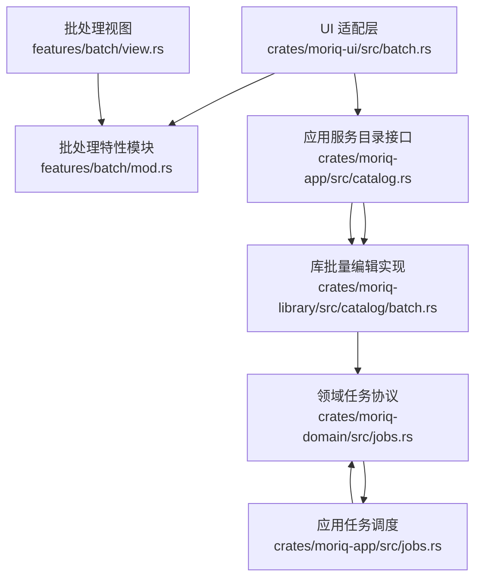
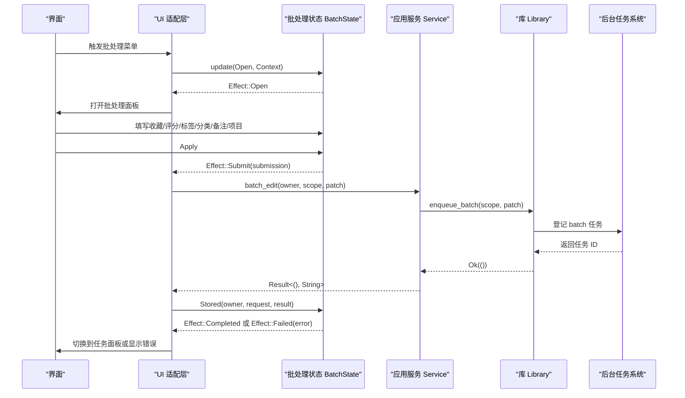
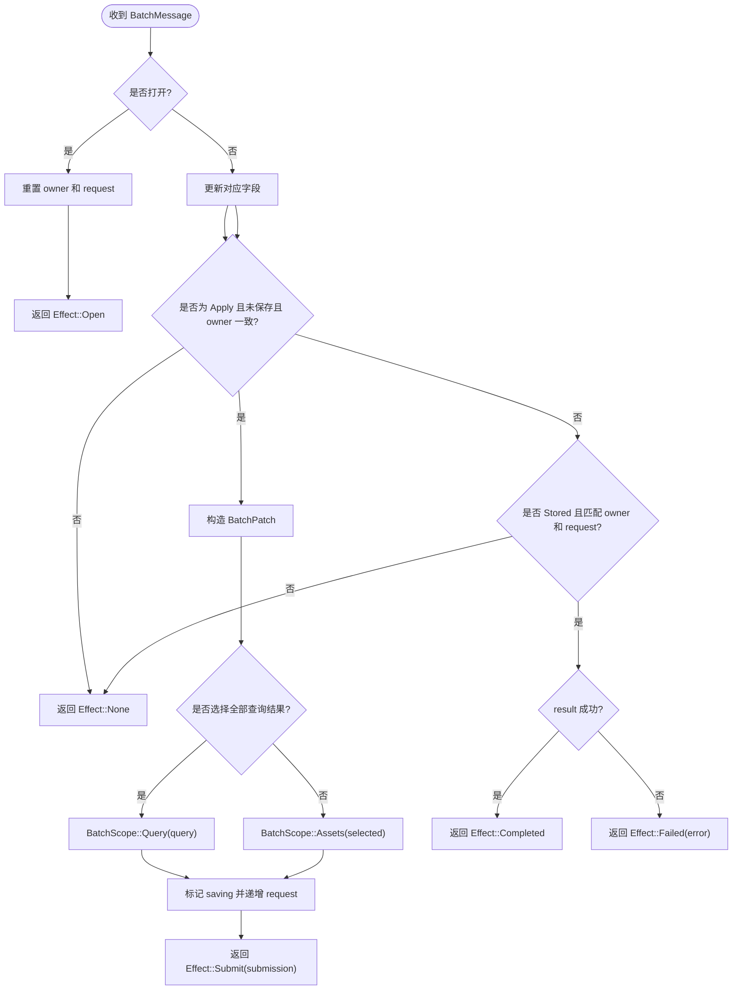
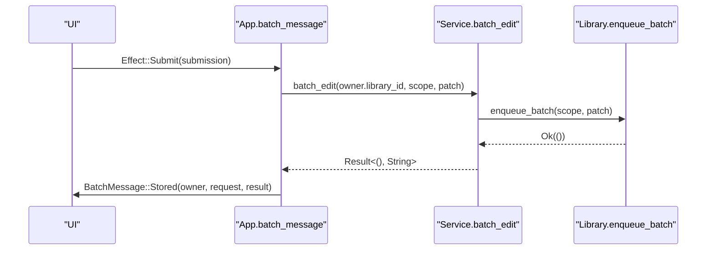
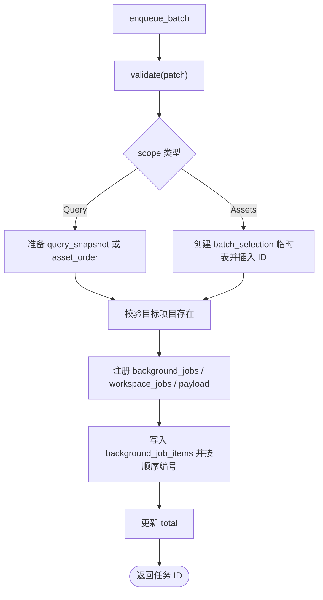
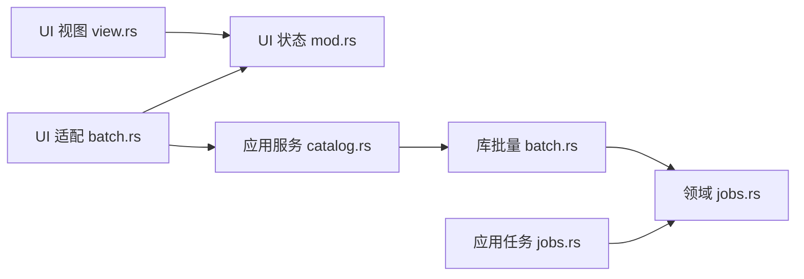

# 批处理编辑

> Repo Wiki 节点 `batch-editing`
> 导出自 Qoder 知识库快照 `8fbe02f6-57c2-4874-b725-1a8130851fd9`，代码基线 `7a7a8e75e18bd90294e09cd422dd7ed5a04813a0`（分支 main，zh-CN）。

<cite>
**本文引用的文件**
- [crates/moriq-ui/src/batch.rs](../../../../crates/moriq-ui/src/batch.rs)
- [crates/moriq-ui/src/features/batch/mod.rs](../../../../crates/moriq-ui/src/features/batch/mod.rs)
- [crates/moriq-ui/src/features/batch/view.rs](../../../../crates/moriq-ui/src/features/batch/view.rs)
- [crates/moriq-ui/src/features/batch/tests.rs](../../../../crates/moriq-ui/src/features/batch/tests.rs)
- [crates/moriq-library/src/catalog/batch.rs](../../../../crates/moriq-library/src/catalog/batch.rs)
- [crates/moriq-domain/src/jobs.rs](../../../../crates/moriq-domain/src/jobs.rs)
- [crates/moriq-app/src/catalog.rs](../../../../crates/moriq-app/src/catalog.rs)
- [crates/moriq-app/src/jobs.rs](../../../../crates/moriq-app/src/jobs.rs)
</cite>

## 目录
1. [简介](#简介)
2. [项目结构](#项目结构)
3. [核心组件](#核心组件)
4. [架构总览](#架构总览)
5. [详细组件分析](#详细组件分析)
6. [依赖关系分析](#依赖关系分析)
7. [性能考虑](#性能考虑)
8. [故障排查指南](#故障排查指南)
9. [结论](#结论)
10. [附录：扩展与集成示例](#附录扩展与集成示例)

## 简介
本文件面向“批处理编辑”功能，系统性说明其架构设计、状态管理、消息系统、效果处理机制、作用域选择逻辑、任务提交流程，以及 UI 表单构建、交互处理和国际化支持。同时给出如何扩展新的批量操作类型、自定义验证规则及集成后台任务系统的实践建议，并总结错误处理策略和性能优化要点。

该功能允许用户对当前选中素材或全部查询结果进行批量修改，支持的批量操作包括：
- 收藏状态切换
- 评分设置
- 标签增删
- 分类修改
- 备注更新
- 项目归属调整

这些修改最终被冻结为不可变的提交请求，并登记为可暂停、可恢复的后台任务。

## 项目结构
批处理编辑跨越 UI 层、应用服务层和库持久化层，涉及以下关键文件：

**图示来源**
- [crates/moriq-ui/src/batch.rs:1-76](../../../../crates/moriq-ui/src/batch.rs#L1-L76)
- [crates/moriq-ui/src/features/batch/mod.rs:1-153](../../../../crates/moriq-ui/src/features/batch/mod.rs#L1-L153)
- [crates/moriq-ui/src/features/batch/view.rs:1-85](../../../../crates/moriq-ui/src/features/batch/view.rs#L1-L85)
- [crates/moriq-app/src/catalog.rs:1-120](../../../../crates/moriq-app/src/catalog.rs#L1-L120)
- [crates/moriq-library/src/catalog/batch.rs:1-159](../../../../crates/moriq-library/src/catalog/batch.rs#L1-L159)
- [crates/moriq-domain/src/jobs.rs:1-229](../../../../crates/moriq-domain/src/jobs.rs#L1-L229)
- [crates/moriq-app/src/jobs.rs:1-175](../../../../crates/moriq-app/src/jobs.rs#L1-L175)

**章节来源**
- [crates/moriq-ui/src/batch.rs:1-76](../../../../crates/moriq-ui/src/batch.rs#L1-L76)
- [crates/moriq-ui/src/features/batch/mod.rs:1-153](../../../../crates/moriq-ui/src/features/batch/mod.rs#L1-L153)
- [crates/moriq-ui/src/features/batch/view.rs:1-85](../../../../crates/moriq-ui/src/features/batch/view.rs#L1-L85)
- [crates/moriq-library/src/catalog/batch.rs:1-159](../../../../crates/moriq-library/src/catalog/batch.rs#L1-L159)
- [crates/moriq-domain/src/jobs.rs:1-229](../../../../crates/moriq-domain/src/jobs.rs#L1-L229)
- [crates/moriq-app/src/catalog.rs:1-120](../../../../crates/moriq-app/src/catalog.rs#L1-L120)
- [crates/moriq-app/src/jobs.rs:1-175](../../../../crates/moriq-app/src/jobs.rs#L1-L175)

## 核心组件
批处理编辑由三层协作完成：

1. **UI 适配层**
   - 提供 `batch_context`，把当前资源库、查询条件、选中项、总数、语言和项目列表封装成批处理上下文。
   - 处理 `BatchMessage`，根据 `Effect` 打开面板、提交后台任务、显示完成或失败状态。
   - 通过 `Task::perform` 调用 `Service.batch_edit`，并将结果映射回 `BatchMessage::Stored`。

2. **批处理特性模块**
   - `BatchState` 维护用户草稿：是否作用于全部查询结果、收藏、评分、备注、分类、标签增删、目标项目等。
   - `BatchMessage` 表达用户交互事件和后台回执。
   - `Effect` 表示状态机输出：无变化、打开面板、提交、完成、失败。
   - `update` 负责将用户输入转换为 `BatchPatch` 和 `BatchScope`，并生成 `Submission`。

3. **库与领域层**
   - `Library.enqueue_batch` 校验并提交批量编辑任务，记录任务 ID、工作区、负载和逐项素材版本。
   - `apply` 在事务中按 `BatchPatch` 执行资产字段、分类、标签和项目归属变更。
   - 领域层定义任务种类、状态、内存预算等通用协议，供调度器统一使用。

**章节来源**
- [crates/moriq-ui/src/batch.rs:1-76](../../../../crates/moriq-ui/src/batch.rs#L1-L76)
- [crates/moriq-ui/src/features/batch/mod.rs:1-153](../../../../crates/moriq-ui/src/features/batch/mod.rs#L1-L153)
- [crates/moriq-library/src/catalog/batch.rs:1-159](../../../../crates/moriq-library/src/catalog/batch.rs#L1-L159)
- [crates/moriq-domain/src/jobs.rs:1-229](../../../../crates/moriq-domain/src/jobs.rs#L1-L229)

## 架构总览
批处理编辑采用“前端状态 + 后端持久化任务”的分层架构。用户在前端编辑表单后，状态机冻结作用域和补丁内容；应用服务层校验资源库身份并登记任务；库层写入任务元数据、负载和待处理项；任务调度器在工作线程中逐个应用修改。

**图示来源**
- [crates/moriq-ui/src/batch.rs:20-76](../../../../crates/moriq-ui/src/batch.rs#L20-L76)
- [crates/moriq-ui/src/features/batch/mod.rs:40-153](../../../../crates/moriq-ui/src/features/batch/mod.rs#L40-L153)
- [crates/moriq-app/src/catalog.rs:88-110](../../../../crates/moriq-app/src/catalog.rs#L88-L110)
- [crates/moriq-library/src/catalog/batch.rs:17-159](../../../../crates/moriq-library/src/catalog/batch.rs#L17-L159)
- [crates/moriq-domain/src/jobs.rs:41-120](../../../../crates/moriq-domain/src/jobs.rs#L41-L120)

## 详细组件分析

### 状态管理与消息系统
`BatchState` 是批处理编辑的核心状态容器，包含：
- 作用域开关 `all`：是否选择全部查询结果。
- 编辑字段：favorite、rating、notes、replace_notes、category、add_tags、remove_tags、project。
- 提交控制：owner、request、saving。

`BatchMessage` 承载所有用户交互和后台回调，例如：
- 打开面板：`Open`
- 用户输入：`All`、`Favorite`、`Rating`、`Notes`、`ReplaceNotes`、`Category`、`AddTags`、`RemoveTags`、`Project`
- 提交入口：`Apply`
- 后台回执：`Stored(Owner, u64, Result<(), String>)`

`update` 方法的关键流程如下：

**图示来源**
- [crates/moriq-ui/src/features/batch/mod.rs:40-153](../../../../crates/moriq-ui/src/features/batch/mod.rs#L40-L153)

**章节来源**
- [crates/moriq-ui/src/features/batch/mod.rs:1-153](../../../../crates/moriq-ui/src/features/batch/mod.rs#L1-L153)
- [crates/moriq-ui/src/features/batch/tests.rs:1-76](../../../../crates/moriq-ui/src/features/batch/tests.rs#L1-L76)

### 作用域选择逻辑
作用域分为两类：

| 作用域 | 含义 | 约束 |
|---|---|---|
| `BatchScope::Assets(selected)` | 仅对当前选中的素材集合生效 | 不能为空，不能超过 10000 个 |
| `BatchScope::Query(query)` | 对当前查询的全部结果生效，跨分页 | 默认查询时可能使用 `asset_order`，否则使用 `query_snapshot` |

当用户勾选“选择全部查询结果”时，状态机会把 `context.query` 冻结到提交中；否则使用 `context.selected`。库层会进一步校验选择数量，并为选择型作用域创建临时表以固定快照。

**章节来源**
- [crates/moriq-ui/src/features/batch/mod.rs:90-130](../../../../crates/moriq-ui/src/features/batch/mod.rs#L90-L130)
- [crates/moriq-library/src/catalog/batch.rs:22-70](../../../../crates/moriq-library/src/catalog/batch.rs#L22-L70)

### 批量操作类型与补丁模型
`BatchPatch` 表达一次批量修改的具体内容，当前支持：

| 字段 | 行为 | 说明 |
|---|---|---|
| `favorite` | 可选布尔值 | 设置为收藏或取消收藏 |
| `rating` | 可选 0～5 的整数 | 设置评分 |
| `notes` | 可选字符串 | 仅在启用替换模式时更新 |
| `category` | 可选非空短字符串 | 设置人工分类 |
| `add_tags` | 字符串数组 | 追加标签 |
| `remove_tags` | 字符串数组 | 移除标签 |
| `project` | 可选项目 ID | 调整项目归属 |

UI 会将用户输入规范化：
- 收藏选项解析为 `true`、`false` 或保持原值。
- 评分解析为 0～5 的可选值。
- 标签按逗号分隔，去除空白和空项。
- 分类去空格后若为空则保持原值。
- 备注是否替换由复选框决定。
- 项目归属可为“保持”，也可设为具体项目。

**章节来源**
- [crates/moriq-ui/src/features/batch/mod.rs:90-130](../../../../crates/moriq-ui/src/features/batch/mod.rs#L90-L130)
- [crates/moriq-ui/src/features/batch/view.rs:10-85](../../../../crates/moriq-ui/src/features/batch/view.rs#L10-L85)

### 任务提交流程
UI 适配层在收到 `Effect::Submit(submission)` 后：
1. 从当前 `owner` 获取服务实例。
2. 调用 `service.batch_edit(owner.library_id, submission.scope, submission.patch)`。
3. 使用异步任务包装调用，并将结果映射为 `BatchMessage::Stored(owner, request, result)`。
4. 成功时切换到任务面板并刷新管理器；失败时将错误写入全局错误状态。

**图示来源**
- [crates/moriq-ui/src/batch.rs:30-60](../../../../crates/moriq-ui/src/batch.rs#L30-L60)
- [crates/moriq-app/src/catalog.rs:88-110](../../../../crates/moriq-app/src/catalog.rs#L88-L110)
- [crates/moriq-library/src/catalog/batch.rs:22-100](../../../../crates/moriq-library/src/catalog/batch.rs#L22-L100)

**章节来源**
- [crates/moriq-ui/src/batch.rs:20-76](../../../../crates/moriq-ui/src/batch.rs#L20-L76)
- [crates/moriq-app/src/catalog.rs:88-110](../../../../crates/moriq-app/src/catalog.rs#L88-L110)

### UI 组件与国际化
批处理视图由以下元素组成：
- 项目归属选择器：默认包含“保持项目归属”，再拼接可用项目列表。
- 作用域提示：展示当前选中数量和查询结果总数，并说明任务会保存图片范围快照。
- 全选复选框：用于切换作用域为全部查询结果。
- 收藏下拉选择：保持/收藏/取消收藏。
- 评分下拉选择：保持/0～5。
- 标签输入框：逗号分隔，分别用于添加和移除。
- 分类输入框：留空保持原值。
- 备注复选框和文本框：可清空或替换备注。
- 应用按钮：禁用状态防止重复提交。

国际化通过 `tr!` 和 `trf!` 宏提供多语言文案，例如“选择全部查询结果（跨越所有分页）”“以上字段一起保存；每个素材的修改在单个事务内完成”等。

**章节来源**
- [crates/moriq-ui/src/features/batch/view.rs:1-85](../../../../crates/moriq-ui/src/features/batch/view.rs#L1-L85)

### 批量修改执行与数据一致性
库层的 `enqueue_batch` 负责：
- 校验补丁内容。
- 根据作用域选择排序表或临时选择表。
- 校验目标项目是否存在。
- 插入 `background_jobs`、`workspace_jobs`、`background_job_payload`。
- 将待处理资产版本编号写入 `background_job_items`。
- 计算任务总数。

`apply` 在事务中对单个资产执行：
- 更新 favorite、rating、notes、edited_at。
- 更新人工分类。
- 删除指定标签并记录自动拒绝标签。
- 新增标签并关联。
- 调整项目归属：若资产已分配到其他项目，则克隆资产副本；否则直接加入目标项目并重新定位资产。

**图示来源**
- [crates/moriq-library/src/catalog/batch.rs:17-100](../../../../crates/moriq-library/src/catalog/batch.rs#L17-L100)

**章节来源**
- [crates/moriq-library/src/catalog/batch.rs:17-159](../../../../crates/moriq-library/src/catalog/batch.rs#L17-L159)

### 后台任务系统与状态机
领域层定义：
- `JobKind::Batch`：批量编辑任务种类。
- `JobState`：queued、running、paused、completed、cancelled。
- `memory_mib`：批量任务内存预算为 128 MiB。
- `TaskError`：任务错误类型，包括无效输入、存储错误、运行时错误、库过期等。

应用服务层提供：
- `queue_media_job`：登记媒体任务。
- `control_job` / `control_model_jobs`：暂停或取消任务，并向运行中任务发送取消信号。
- `drive_job_step`：领取任务步骤，等待内存预算，执行任务，完成后提交回执。
- `background_jobs`：读取任务投影供界面展示。

**章节来源**
- [crates/moriq-domain/src/jobs.rs:1-229](../../../../crates/moriq-domain/src/jobs.rs#L1-L229)
- [crates/moriq-app/src/jobs.rs:1-175](../../../../crates/moriq-app/src/jobs.rs#L1-L175)

## 依赖关系分析
批处理编辑的依赖关系呈现清晰的单向流：

- UI 视图只依赖状态和通用组件，不直接访问服务。
- UI 适配层依赖应用服务进行写操作。
- 应用服务只做身份校验和委托，业务逻辑集中在库层。
- 库层依赖领域任务协议，但不依赖 UI。
- 任务调度器与领域协议解耦，可复用其他任务类型。

**图示来源**
- [crates/moriq-ui/src/features/batch/view.rs:1-85](../../../../crates/moriq-ui/src/features/batch/view.rs#L1-L85)
- [crates/moriq-ui/src/features/batch/mod.rs:1-153](../../../../crates/moriq-ui/src/features/batch/mod.rs#L1-L153)
- [crates/moriq-ui/src/batch.rs:1-76](../../../../crates/moriq-ui/src/batch.rs#L1-L76)
- [crates/moriq-app/src/catalog.rs:1-120](../../../../crates/moriq-app/src/catalog.rs#L1-L120)
- [crates/moriq-library/src/catalog/batch.rs:1-159](../../../../crates/moriq-library/src/catalog/batch.rs#L1-L159)
- [crates/moriq-domain/src/jobs.rs:1-229](../../../../crates/moriq-domain/src/jobs.rs#L1-L229)
- [crates/moriq-app/src/jobs.rs:1-175](../../../../crates/moriq-app/src/jobs.rs#L1-L175)

**章节来源**
- [crates/moriq-ui/src/batch.rs:1-76](../../../../crates/moriq-ui/src/batch.rs#L1-L76)
- [crates/moriq-ui/src/features/batch/mod.rs:1-153](../../../../crates/moriq-ui/src/features/batch/mod.rs#L1-L153)
- [crates/moriq-library/src/catalog/batch.rs:1-159](../../../../crates/moriq-library/src/catalog/batch.rs#L1-L159)
- [crates/moriq-domain/src/jobs.rs:1-229](../../../../crates/moriq-domain/src/jobs.rs#L1-L229)
- [crates/moriq-app/src/catalog.rs:1-120](../../../../crates/moriq-app/src/catalog.rs#L1-L120)
- [crates/moriq-app/src/jobs.rs:1-175](../../../../crates/moriq-app/src/jobs.rs#L1-L175)

## 性能考虑
- **作用域快照**：对查询作用域使用 `query_snapshot` 或 `asset_order`，对选择作用域使用临时表，避免后续查询变化影响任务范围。
- **批量上限**：选择作用域限制最多 10000 个素材，避免一次性提交过大任务。
- **标签预算**：`add_tags` 与 `remove_tags` 合计不超过 64 项，每项不超过 128 字节。
- **备注长度**：备注最大 65536 字节，分类最大 128 字节。
- **评分范围**：评分必须在 0～5 之间。
- **事务性**：每条资产的修改在单个数据库事务内完成，保证一致性。
- **任务内存预算**：批量任务使用 128 MiB 共享内存准入预算，适合 I/O 密集但非大模型推理的任务。
- **异步提交**：UI 通过 `Task::perform` 异步调用服务，避免阻塞界面。
- **任务分批推进**：调度器每次最多尝试 64 步，并在超过 250ms 时让出时间片，提高整体响应性。

[本节为通用性能指导，不直接分析具体代码片段]

## 故障排查指南
常见错误和处理方式：

| 场景 | 原因 | 处理方式 |
|---|---|---|
| 点击应用无反应 | 已处于保存状态 `saving=true` | 等待任务回执或重试新请求 |
| 提交被忽略 | owner 不一致 | 状态机拒绝不同资源库或项目的提交 |
| 回执延迟 | 后台任务尚未完成 | 界面切换到任务面板查看进度 |
| 提交失败 | 批量字段无效或没有实际修改 | 检查收藏、评分、备注、分类、标签、项目任一字段是否有效 |
| 选择作用域过大 | 超过 10000 个素材 | 缩小选择范围或使用完整查询 |
| 目标项目不存在 | 项目已被删除 | 重新选择有效项目 |
| 任务无法继续 | 资源库已切换或后台服务关闭 | 根据 `TaskError` 提示重新加载库或重启服务 |

错误来源主要分布在：
- UI 状态机：拒绝非法 owner 和重复提交。
- 库层校验：批量字段长度、取值和数量限制。
- 任务系统：任务状态、内存预算、取消信号和库身份校验。

**章节来源**
- [crates/moriq-ui/src/features/batch/mod.rs:90-153](../../../../crates/moriq-ui/src/features/batch/mod.rs#L90-L153)
- [crates/moriq-library/src/catalog/batch.rs:17-70](../../../../crates/moriq-library/src/catalog/batch.rs#L17-L70)
- [crates/moriq-domain/src/jobs.rs:120-229](../../../../crates/moriq-domain/src/jobs.rs#L120-L229)
- [crates/moriq-app/src/jobs.rs:1-175](../../../../crates/moriq-app/src/jobs.rs#L1-L175)

## 结论
批处理编辑通过清晰的状态机、消息系统和效果处理机制，将用户意图转化为不可变提交，并由后台任务系统安全执行。它既支持细粒度的当前选择，也支持跨分页的全量查询范围；既支持轻量级元数据修改，也支持复杂的标签与项目归属调整。通过在 UI、服务和库层之间明确职责边界，该功能具备良好的可扩展性和可维护性。

[本节为总结性内容，不直接分析具体代码片段]

## 附录：扩展与集成示例

### 扩展新的批量操作类型
若要新增一个批量字段，例如“是否允许分享”：

1. **扩展补丁模型**
   - 在领域层或库层定义的 `BatchPatch` 中添加新字段。
   - 确保序列化格式稳定，便于后台任务持久化和回放。

2. **扩展 UI 输入**
   - 在 `view.rs` 中添加对应的表单控件。
   - 使用 `localized_choice`、`checkbox` 或 `text_input` 绑定 `BatchMessage`。
   - 在 `mod.rs` 的 `update` 中将用户输入解析为补丁字段。

3. **扩展校验逻辑**
   - 在 `catalog/batch.rs` 的 `validate` 中添加字段合法性检查。
   - 对于枚举或范围字段，优先使用强类型解析，避免静默失败。

4. **扩展执行逻辑**
   - 在 `apply` 中为新字段写入数据库。
   - 如涉及跨表或外键约束，使用事务保证一致性。
   - 如影响查询快照，使相关缓存失效。

5. **扩展测试**
   - 在 `features/batch/tests.rs` 中增加用例，覆盖正常路径、空值路径和非法输入路径。
   - 验证作用域冻结、owner 校验和 request 唯一性。

**参考路径**
- [crates/moriq-ui/src/features/batch/view.rs:10-85](../../../../crates/moriq-ui/src/features/batch/view.rs#L10-L85)
- [crates/moriq-ui/src/features/batch/mod.rs:40-153](../../../../crates/moriq-ui/src/features/batch/mod.rs#L40-L153)
- [crates/moriq-library/src/catalog/batch.rs:17-159](../../../../crates/moriq-library/src/catalog/batch.rs#L17-L159)
- [crates/moriq-ui/src/features/batch/tests.rs:1-76](../../../../crates/moriq-ui/src/features/batch/tests.rs#L1-L76)

### 自定义验证规则
建议在库层集中实现验证，而不是分散在 UI 层。推荐规则包括：
- 字段非空但长度受限。
- 枚举值必须合法。
- 数组长度和单项长度受限。
- 至少有一个字段发生变化。
- 外键存在性校验，例如目标项目必须存在。

**参考路径**
- [crates/moriq-library/src/catalog/batch.rs:17-70](../../../../crates/moriq-library/src/catalog/batch.rs#L17-L70)

### 集成后台任务系统
若批量操作需要更复杂的执行过程，应遵循现有任务协议：
- 使用 `JobKind::Batch` 或新增任务种类。
- 在 `enqueue_batch` 或类似函数中登记任务负载和逐项条目。
- 在任务执行阶段按版本顺序处理，避免并发冲突。
- 使用 `TaskError` 区分无效输入、存储错误和运行时错误。
- 在 UI 中展示任务状态，并支持暂停、恢复和查看失败详情。

**参考路径**
- [crates/moriq-domain/src/jobs.rs:41-120](../../../../crates/moriq-domain/src/jobs.rs#L41-L120)
- [crates/moriq-app/src/jobs.rs:1-175](../../../../crates/moriq-app/src/jobs.rs#L1-L175)
- [crates/moriq-library/src/catalog/batch.rs:70-159](../../../../crates/moriq-library/src/catalog/batch.rs#L70-L159)