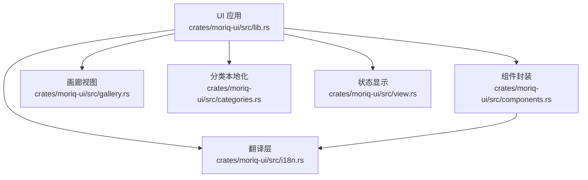
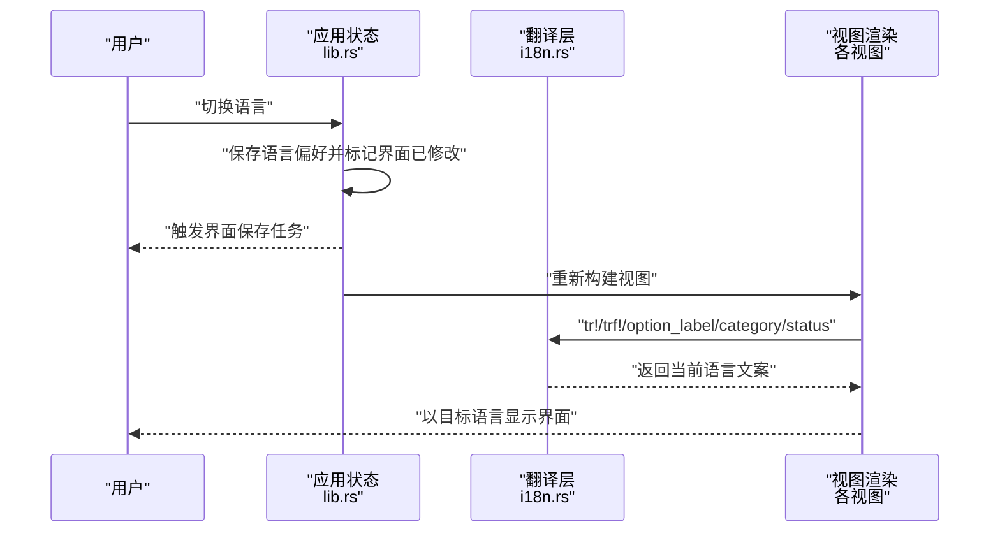
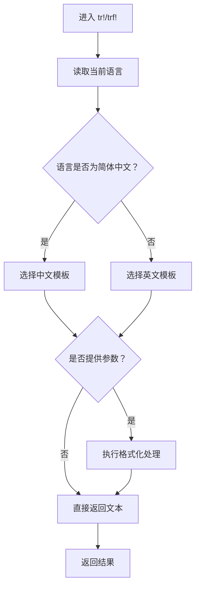
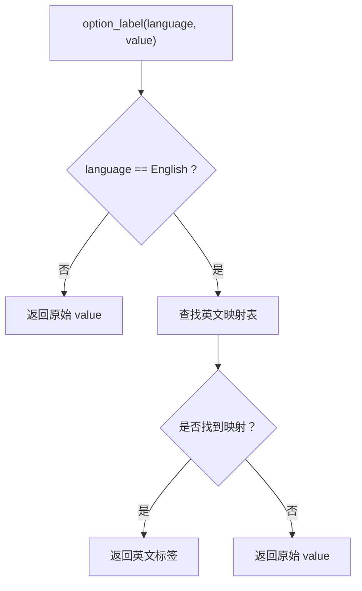
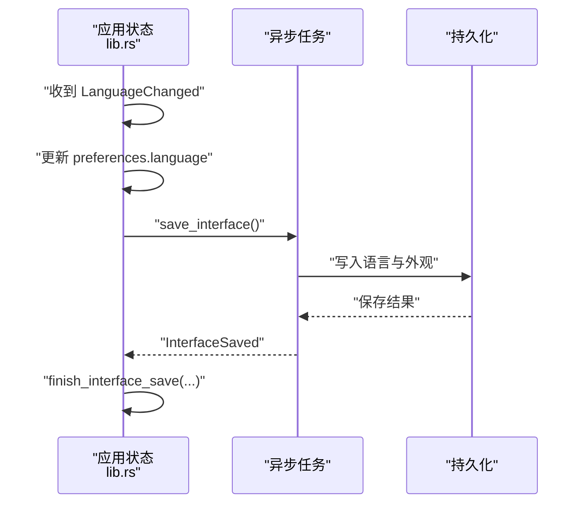
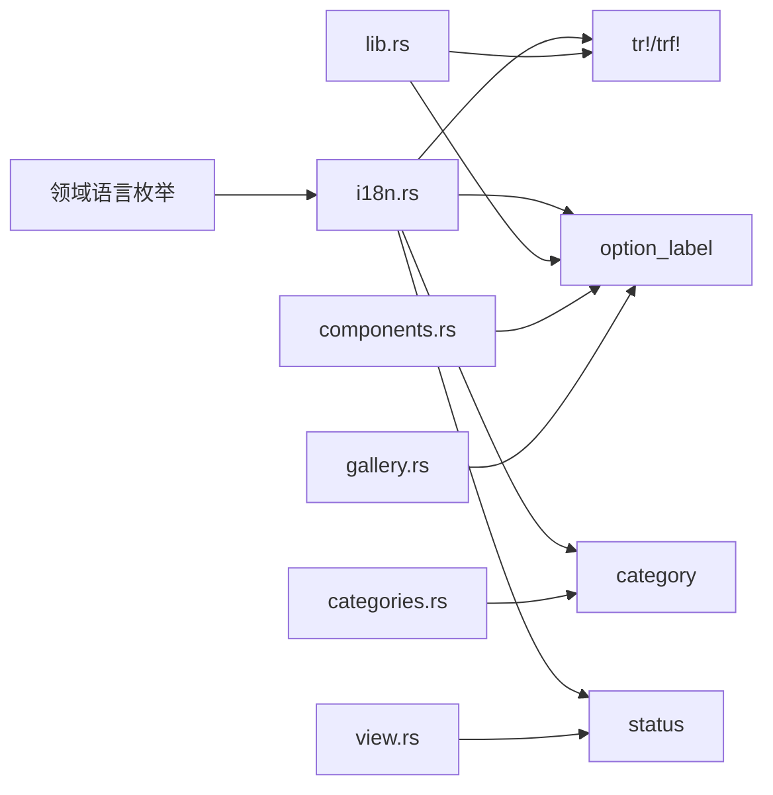

# 国际化支持

> Repo Wiki 节点 `internationalization`
> 导出自 Qoder 知识库快照 `8fbe02f6-57c2-4874-b725-1a8130851fd9`，代码基线 `7a7a8e75e18bd90294e09cd422dd7ed5a04813a0`（分支 main，zh-CN）。

<cite>
**本文引用的文件**   
- [i18n.rs](../../../crates/moriq-ui/src/i18n.rs)
- [lib.rs](../../../crates/moriq-ui/src/lib.rs)
- [components.rs](../../../crates/moriq-ui/src/components.rs)
- [categories.rs](../../../crates/moriq-ui/src/categories.rs)
- [gallery.rs](../../../crates/moriq-ui/src/gallery.rs)
- [view.rs](../../../crates/moriq-ui/src/view.rs)
- [interface_tests.rs](../../../crates/moriq-ui/src/interface_tests.rs)
- [ai.rs](../../../crates/moriq-ui/src/ai.rs)
- [deletion.rs](../../../crates/moriq-ui/src/deletion.rs)
- [drop_import.rs](../../../crates/moriq-ui/src/drop_import.rs)
</cite>

## 目录
1. [引言](#引言)
2. [项目结构](#项目结构)
3. [核心组件](#核心组件)
4. [架构总览](#架构总览)
5. [详细组件分析](#详细组件分析)
6. [依赖分析](#依赖分析)
7. [性能与扩展性](#性能与扩展性)
8. [新增语言流程与最佳实践](#新增语言流程与最佳实践)
9. [使用指南：翻译宏、复数与动态文本](#使用指南翻译宏复数与动态文本)
10. [多语言测试策略](#多语言测试策略)
11. [常见陷阱与排查](#常见陷阱与排查)
12. [结论](#结论)

## 引言
本文件系统化梳理项目的国际化机制，重点解释 `tr!` 与 `trf!` 宏的工作原理、简体中文与英文的双语支持方式、固定选项标签的翻译策略、用户内容不翻译原则、新语言添加流程，以及多语言测试方法与常见陷阱。该实现位于 UI 层，通过语言枚举在渲染前完成界面文案选择与格式化，确保用户数据保持原样。

## 项目结构
国际化相关代码集中在 UI crate 中：
- 翻译宏与固定资源映射：`crates/moriq-ui/src/i18n.rs`
- 应用状态、语言设置与消息分发：`crates/moriq-ui/src/lib.rs`
- 下拉菜单与本地化选择器封装：`crates/moriq-ui/src/components.rs`
- 分类标签本地化：`crates/moriq-ui/src/categories.rs`
- 画廊等界面的文案格式化：`crates/moriq-ui/src/gallery.rs`
- 状态信息本地化：`crates/moriq-ui/src/view.rs`
- 多语言断言测试：`crates/moriq-ui/src/interface_tests.rs`

**图表来源**
- [lib.rs:853-859](../../../crates/moriq-ui/src/lib.rs#L853-L859)
- [i18n.rs:1-163](../../../crates/moriq-ui/src/i18n.rs#L1-L163)
- [components.rs:321-333](../../../crates/moriq-ui/src/components.rs#L321-L333)
- [categories.rs:59-59](../../../crates/moriq-ui/src/categories.rs#L59-L59)
- [gallery.rs:150-150](../../../crates/moriq-ui/src/gallery.rs#L150-L150)
- [view.rs:106-106](../../../crates/moriq-ui/src/view.rs#L106-L106)

**章节来源**
- [i18n.rs:1-163](../../../crates/moriq-ui/src/i18n.rs#L1-L163)
- [lib.rs:853-859](../../../crates/moriq-ui/src/lib.rs#L853-L859)
- [components.rs:321-333](../../../crates/moriq-ui/src/components.rs#L321-L333)
- [categories.rs:59-59](../../../crates/moriq-ui/src/categories.rs#L59-L59)
- [gallery.rs:150-150](../../../crates/moriq-ui/src/gallery.rs#L150-L150)
- [view.rs:106-106](../../../crates/moriq-ui/src/view.rs#L106-L106)

## 核心组件
- 翻译宏 `tr!`：根据当前语言返回静态双语字符串之一。
- 翻译宏 `trf!`：在 `tr!` 基础上支持参数格式化，适合“复数”“计数”“拼接变量”等场景。
- 固定选项标签翻译 `option_label`：仅翻译固定下拉选项，未知值回退为原始值。
- 内置分类名称翻译 `category`：仅翻译系统内置分类，保留用户自定义分类。
- 内部状态文本翻译 `status`：将内部状态源文本转换为当前语言的展示说明。

**章节来源**
- [i18n.rs:1-22](../../../crates/moriq-ui/src/i18n.rs#L1-L22)
- [i18n.rs:24-113](../../../crates/moriq-ui/src/i18n.rs#L24-L113)
- [i18n.rs:114-140](../../../crates/moriq-ui/src/i18n.rs#L114-L140)
- [i18n.rs:141-163](../../../crates/moriq-ui/src/i18n.rs#L141-L163)

## 架构总览
UI 在渲染时持有当前语言偏好；所有界面文案通过 `tr!` / `trf!` 或 `option_label` / `category` / `status` 获取目标语言文本。语言变更会触发界面保存与重绘，但不会改变用户生成数据的存储值。

**图表来源**
- [lib.rs:1147-1152](../../../crates/moriq-ui/src/lib.rs#L1147-L1152)
- [lib.rs:2271-2275](../../../crates/moriq-ui/src/lib.rs#L2271-L2275)
- [i18n.rs:1-22](../../../crates/moriq-ui/src/i18n.rs#L1-L22)
- [i18n.rs:24-163](../../../crates/moriq-ui/src/i18n.rs#L24-L163)

## 详细组件分析

### 翻译宏 `tr!` 与 `trf!`
- `tr!`：接收语言表达式和一对中文字面量与英文字面量，匹配语言后返回对应静态字符串。
- `trf!`：在 `tr!` 基础上接受可选格式化参数，按当前语言对中文或英文模板进行 `format!` 处理。

设计要点：
- 语言分支是编译期可追踪的简单匹配，避免运行时字典查找开销。
- `trf!` 复用 Rust 标准库格式化能力，自然支持整数、浮点数、字符串等参数。
- 两个宏都要求开发者显式提供双语字面量，便于静态检查与审计。

**图表来源**
- [i18n.rs:1-22](../../../crates/moriq-ui/src/i18n.rs#L1-L22)

**章节来源**
- [i18n.rs:1-22](../../../crates/moriq-ui/src/i18n.rs#L1-L22)

### 固定选项标签翻译策略 `option_label`
- 适用范围：下拉菜单、筛选器等固定选项的显示标签。
- 行为规则：
  - 非英文语言直接返回原始值，保证简体中文及其他语言下仍显示已有中文标签。
  - 英文语言下进行已知标签映射。
  - 未知标签回退为原始值，确保未来新增或外部值不会导致显示异常。
- 回调语义：下拉菜单回调始终保留原始内部值，仅显示层做本地化。

**图表来源**
- [i18n.rs:24-113](../../../crates/moriq-ui/src/i18n.rs#L24-L113)

**章节来源**
- [i18n.rs:24-113](../../../crates/moriq-ui/src/i18n.rs#L24-L113)
- [components.rs:321-333](../../../crates/moriq-ui/src/components.rs#L321-L333)
- [gallery.rs:150-150](../../../crates/moriq-ui/src/gallery.rs#L150-L150)
- [manage.rs:2027-2027](../../../crates/moriq-ui/src/manage.rs#L2027-L2027)

### 内置分类名称翻译 `category`
- 适用范围：系统内置分类名称，如人像、风景、城市等。
- 行为规则：
  - 非英文语言返回原始值。
  - 英文语言下映射到英文分类名。
  - 用户自定义分类不翻译，保持用户数据完整性。

**章节来源**
- [i18n.rs:114-140](../../../crates/moriq-ui/src/i18n.rs#L114-L140)
- [categories.rs:59-59](../../../crates/moriq-ui/src/categories.rs#L59-L59)
- [categories.rs:519-519](../../../crates/moriq-ui/src/categories.rs#L519-L519)
- [gallery.rs:43-43](../../../crates/moriq-ui/src/gallery.rs#L43-L43)

### 内部状态文本翻译 `status`
- 用途：将内部状态源文本转换为当前语言的展示说明。
- 特点：同时匹配中文源文本与英文源文本，保证状态在不同语言间一致呈现。
- 未识别状态：直接返回原始值，避免丢失诊断信息。

**章节来源**
- [i18n.rs:141-163](../../../crates/moriq-ui/src/i18n.rs#L141-L163)
- [view.rs:106-106](../../../crates/moriq-ui/src/view.rs#L106-L106)

### 语言切换与界面持久化
- 应用维护 `preferences.language`，并在消息处理中响应 `LanguageChanged`。
- 关闭或退出时检测语言变化，触发界面保存任务。
- 界面保存完成后更新已保存的语言与外观组合，避免重复保存。

**图表来源**
- [lib.rs:1147-1152](../../../crates/moriq-ui/src/lib.rs#L1147-L1152)
- [lib.rs:2271-2275](../../../crates/moriq-ui/src/lib.rs#L2271-L2275)

**章节来源**
- [lib.rs:1147-1152](../../../crates/moriq-ui/src/lib.rs#L1147-L1152)
- [lib.rs:2271-2275](../../../crates/moriq-ui/src/lib.rs#L2271-L2275)

## 依赖分析
- `i18n.rs` 依赖领域层的语言枚举，用于决定文案分支。
- UI 各模块通过 `tr!` / `trf!` 直接消费翻译宏。
- 下拉组件通过 `localized_choice` 包装 `option_label`，使 UI 值稳定而显示本地化。
- 分类显示通过 `category` 区分系统内置分类与用户自定义分类。
- 状态显示通过 `status` 将内部状态文本统一为当前语言。

**图表来源**
- [i18n.rs:1-163](../../../crates/moriq-ui/src/i18n.rs#L1-L163)
- [lib.rs:853-859](../../../crates/moriq-ui/src/lib.rs#L853-L859)
- [components.rs:321-333](../../../crates/moriq-ui/src/components.rs#L321-L333)
- [categories.rs:59-59](../../../crates/moriq-ui/src/categories.rs#L59-L59)
- [gallery.rs:150-150](../../../crates/moriq-ui/src/gallery.rs#L150-L150)
- [view.rs:106-106](../../../crates/moriq-ui/src/view.rs#L106-L106)

**章节来源**
- [i18n.rs:1-163](../../../crates/moriq-ui/src/i18n.rs#L1-L163)
- [lib.rs:853-859](../../../crates/moriq-ui/src/lib.rs#L853-L859)
- [components.rs:321-333](../../../crates/moriq-ui/src/components.rs#L321-L333)
- [categories.rs:59-59](../../../crates/moriq-ui/src/categories.rs#L59-L59)
- [gallery.rs:150-150](../../../crates/moriq-ui/src/gallery.rs#L150-L150)
- [view.rs:106-106](../../../crates/moriq-ui/src/view.rs#L106-L106)

## 性能与扩展性
- 时间复杂度：
  - `tr!` / `trf!` 为常数时间语言分支。
  - `option_label` 为线性匹配，但键集有限且主要用于 UI 展示，影响较小。
  - `category` 与 `status` 同样为有限集合匹配。
- 空间复杂度：
  - 翻译资源为内联字面量，无额外字典结构。
- 扩展建议：
  - 若新增语言，应优先评估是否沿用“简体中文为主、英文为辅”的策略；若需要更多语言，应考虑引入可扩展的语言枚举与翻译表，但仍需坚持用户内容不翻译。

[本节为通用指导，不直接分析具体文件]

## 新增语言流程与最佳实践
1. 确定语言枚举与默认语言：
   - 在领域或 UI 层明确新增语言枚举项，并定义默认语言。
2. 扩展翻译宏：
   - 为 `tr!` / `trf!` 增加新语言分支。
3. 扩展固定资源映射：
   - 为 `option_label`、`category`、`status` 补充新语言映射。
4. 更新界面组件：
   - 确保下拉菜单、分类、状态显示均能传入新语言。
5. 更新测试：
   - 为新增语言添加断言，尤其覆盖回退路径与用户自定义值。
6. 文档与审查：
   - 记录新增文案、翻译差异及潜在歧义。
   - 审查是否误将用户内容纳入翻译。

[本节为通用流程说明，不直接分析具体文件]

## 使用指南：翻译宏、复数与动态文本

### 使用 `tr!` 展示静态双语文案
适用场景：按钮、标题、提示等不需要参数的界面文案。

示例参考位置：
- [lib.rs:177-184](../../../crates/moriq-ui/src/lib.rs#L177-L184)

### 使用 `trf!` 处理复数、计数与动态文本
适用场景：包含数量、名称、尺寸、进度等的文案，例如：
- “{} 张素材”
- “人脸：{}”
- “删除项目「{}」”
- “已处理 {} / {} 张 · 失败 {} 张”

示例参考位置：
- [ai.rs:44-49](../../../crates/moriq-ui/src/ai.rs#L44-L49)
- [ai.rs:755-763](../../../crates/moriq-ui/src/ai.rs#L755-L763)
- [ai.rs:1080-1080](../../../crates/moriq-ui/src/ai.rs#L1080-L1080)
- [deletion.rs:257-288](../../../crates/moriq-ui/src/deletion.rs#L257-L288)
- [drop_import.rs:216-216](../../../crates/moriq-ui/src/drop_import.rs#L216-L216)
- [drop_import.rs:340-340](../../../crates/moriq-ui/src/drop_import.rs#L340-L340)
- [gallery.rs:66-66](../../../crates/moriq-ui/src/gallery.rs#L66-L66)
- [gallery.rs:139-139](../../../crates/moriq-ui/src/gallery.rs#L139-L139)
- [gallery.rs:202-202](../../../crates/moriq-ui/src/gallery.rs#L202-L202)
- [gallery.rs:1227-1228](../../../crates/moriq-ui/src/gallery.rs#L1227-L1228)
- [journal.rs:229-229](../../../crates/moriq-ui/src/journal.rs#L229-L229)
- [models.rs:71-71](../../../crates/moriq-ui/src/models.rs#L71-L71)
- [models.rs:508-509](../../../crates/moriq-ui/src/models.rs#L508-L509)
- [models.rs:616-647](../../../crates/moriq-ui/src/models.rs#L616-L647)
- [overview.rs:227-227](../../../crates/moriq-ui/src/overview.rs#L227-L227)
- [overview.rs:564-573](../../../crates/moriq-ui/src/overview.rs#L564-L573)
- [project_form.rs:105-152](../../../crates/moriq-ui/src/project_form.rs#L105-L152)
- [settings.rs:239-250](../../../crates/moriq-ui/src/settings.rs#L239-L250)
- [tasks.rs:313-313](../../../crates/moriq-ui/src/tasks.rs#L313-L313)
- [tasks.rs:383-383](../../../crates/moriq-ui/src/tasks.rs#L383-L383)
- [tasks.rs:453-498](../../../crates/moriq-ui/src/tasks.rs#L453-L498)
- [storage.rs:121-121](../../../crates/moriq-ui/src/storage.rs#L121-L121)
- [storage.rs:154-164](../../../crates/moriq-ui/src/storage.rs#L154-L164)

### 复数与数量的注意事项
- 使用 `trf!` 的占位符传递数字或文本，由目标语言模板决定语序和单位。
- 不要在中英文模板之间硬编码不同占位符数量，应保持参数个数一致。
- 对于“张”“个”等单位，应在模板中体现，而不是在调用处拼接。

**章节来源**
- [i18n.rs:1-22](../../../crates/moriq-ui/src/i18n.rs#L1-L22)
- [ai.rs:44-49](../../../crates/moriq-ui/src/ai.rs#L44-L49)
- [deletion.rs:257-288](../../../crates/moriq-ui/src/deletion.rs#L257-L288)
- [drop_import.rs:216-216](../../../crates/moriq-ui/src/drop_import.rs#L216-L216)
- [gallery.rs:66-66](../../../crates/moriq-ui/src/gallery.rs#L66-L66)
- [gallery.rs:139-139](../../../crates/moriq-ui/src/gallery.rs#L139-L139)
- [gallery.rs:202-202](../../../crates/moriq-ui/src/gallery.rs#L202-L202)
- [gallery.rs:1227-1228](../../../crates/moriq-ui/src/gallery.rs#L1227-L1228)

## 多语言测试策略
- 断言内置分类翻译：
  - 验证英文下系统分类被正确翻译。
  - 验证用户自定义分类不被翻译。
- 断言语言切换不影响业务数据：
  - 切换语言后，查询类别、标签、备注等用户内容保持不变。
- 断言界面文案一致性：
  - 对关键界面元素断言中英文输出。

示例参考位置：
- [interface_tests.rs:154-171](../../../crates/moriq-ui/src/interface_tests.rs#L154-L171)
- [interface_tests.rs:316-320](../../../crates/moriq-ui/src/interface_tests.rs#L316-L320)

**章节来源**
- [interface_tests.rs:154-171](../../../crates/moriq-ui/src/interface_tests.rs#L154-L171)
- [interface_tests.rs:316-320](../../../crates/moriq-ui/src/interface_tests.rs#L316-L320)

## 常见陷阱与排查
- 将用户内容作为翻译键：
  - 只应对固定文案、固定选项、内置分类进行翻译；用户生成的名称、备注、标签不应进入翻译逻辑。
- 下拉菜单回调值被本地化：
  - 必须确保 `option_label` 仅改变显示文本，回调值仍为稳定的内部值。
- 新增语言未覆盖回退路径：
  - 检查 `tr!` / `trf!`、`option_label`、`category`、`status` 是否均有新语言分支或回退逻辑。
- 中英文模板参数不一致：
  - `trf!` 的中英文模板必须拥有相同数量和类型的参数。
- 状态文本未双向兼容：
  - `status` 应同时匹配中文源文本与英文源文本，避免因后端文案变化导致显示异常。

**章节来源**
- [i18n.rs:24-163](../../../crates/moriq-ui/src/i18n.rs#L24-L163)
- [components.rs:321-333](../../../crates/moriq-ui/src/components.rs#L321-L333)
- [interface_tests.rs:316-320](../../../crates/moriq-ui/src/interface_tests.rs#L316-L320)

## 结论
该项目的国际化方案以轻量宏和固定映射为核心，强调：
- 界面文案可翻译，用户数据绝不翻译。
- 固定选项通过 `option_label` 安全本地化，同时保留稳定内部值。
- 内置分类通过 `category` 区分系统名称与用户自定义名称。
- 状态文本通过 `status` 统一为当前语言展示。
- 语言切换通过应用状态与界面保存流程协调，保证体验一致。

遵循本文的使用指南、测试策略与常见陷阱清单，可在不破坏数据完整性的前提下，稳健扩展和维护多语言支持。