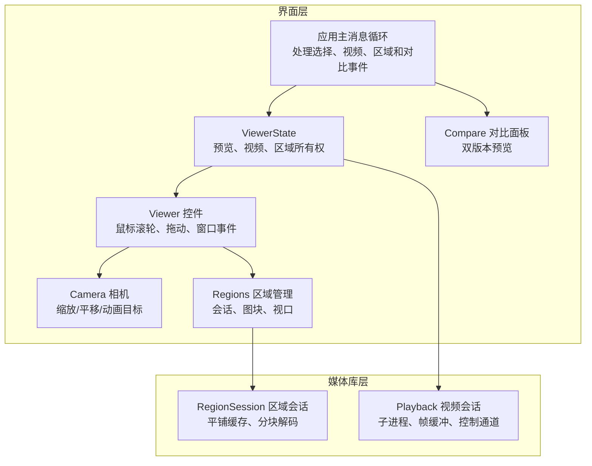
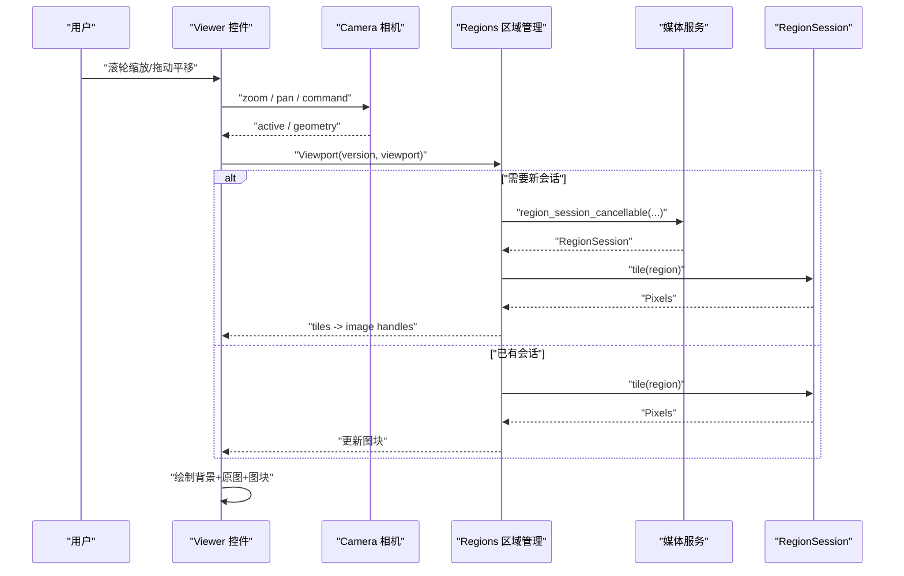
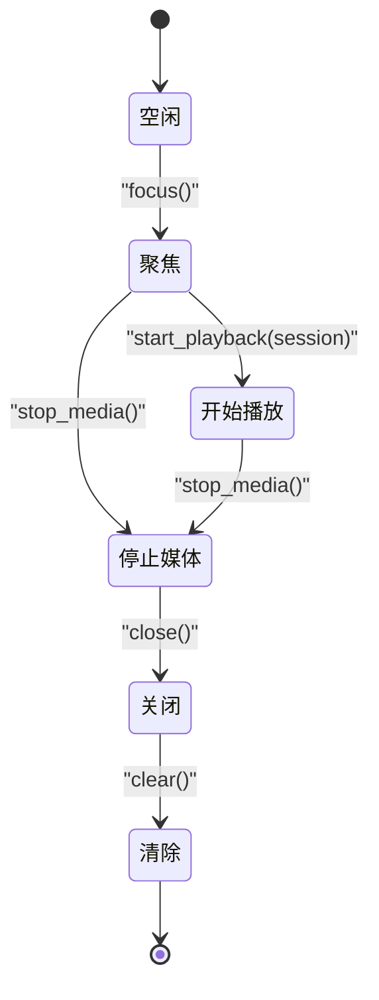
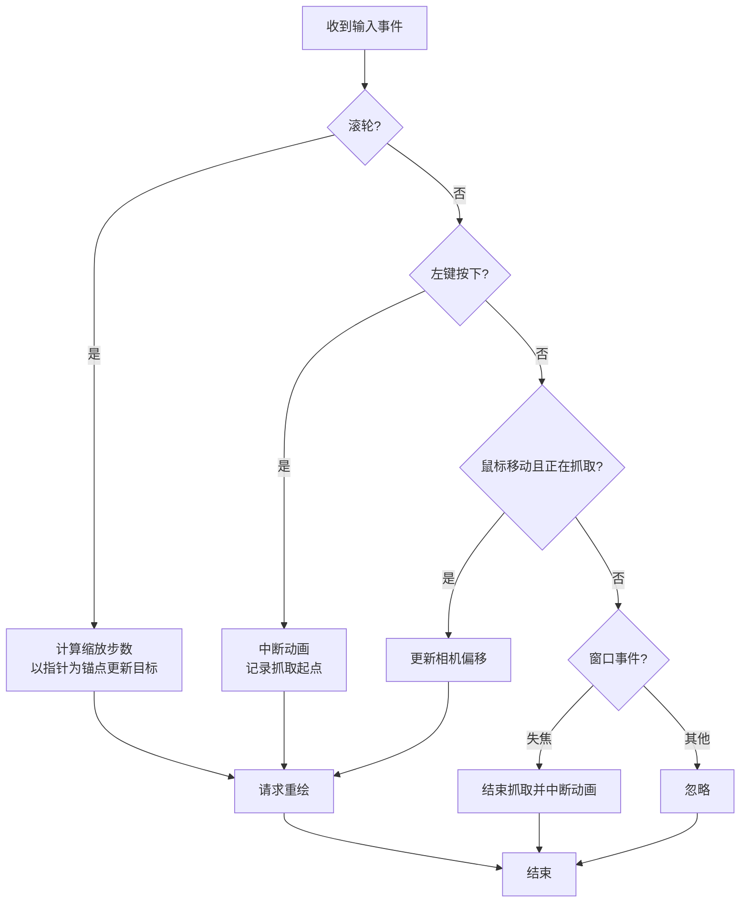
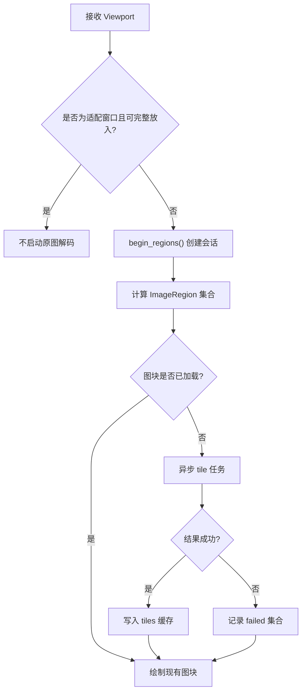
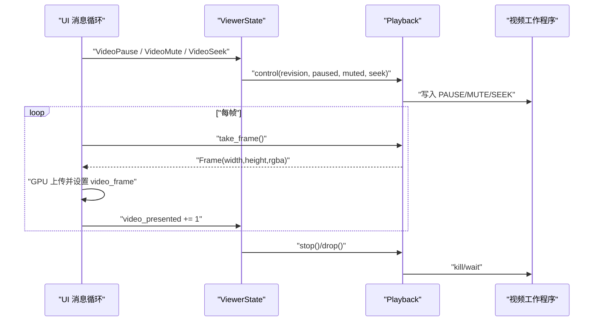
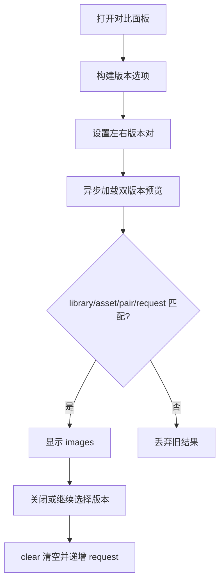
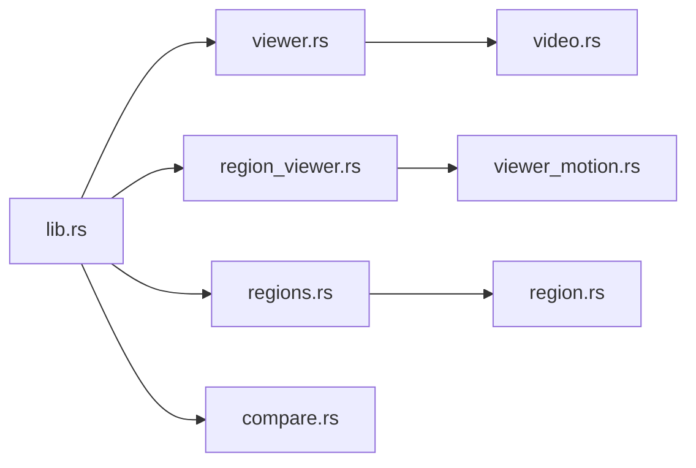

# 大图查看器

> Repo Wiki 节点 `viewer-large-preview`
> 导出自 Qoder 知识库快照 `8fbe02f6-57c2-4874-b725-1a8130851fd9`，代码基线 `7a7a8e75e18bd90294e09cd422dd7ed5a04813a0`（分支 main，zh-CN）。

<cite>
**本文引用的文件**   
- [viewer.rs](../../../crates/moriq-ui/src/viewer.rs)
- [region_viewer.rs](../../../crates/moriq-ui/src/region_viewer.rs)
- [viewer_motion.rs](../../../crates/moriq-ui/src/viewer_motion.rs)
- [regions.rs](../../../crates/moriq-ui/src/regions.rs)
- [compare.rs](../../../crates/moriq-ui/src/compare.rs)
- [video.rs](../../../crates/moriq-library/src/media/video.rs)
- [region.rs](../../../crates/moriq-library/src/media/region.rs)
- [lib.rs](../../../crates/moriq-ui/src/lib.rs)
- [preview.rs](../../../crates/moriq-ui/src/preview.rs)
- [ARCHITECTURE.md](../../../ARCHITECTURE.md)
</cite>

## 目录
1. [简介](#简介)
2. [项目结构](#项目结构)
3. [核心组件](#核心组件)
4. [架构总览](#架构总览)
5. [详细组件分析](#详细组件分析)
6. [依赖关系分析](#依赖关系分析)
7. [性能考虑](#性能考虑)
8. [故障排除指南](#故障排除指南)
9. [结论](#结论)
10. [附录：实现示例与最佳实践](#附录实现示例与最佳实践)

## 简介
本文件面向大图查看器的设计与实现，重点覆盖以下内容：
- ViewerState 状态管理与预览图片生命周期。
- 视频播放控制、进度展示和媒体资源释放策略。
- 区域标注系统与分块解码、GPU 贴图渲染流程。
- 缩放、平移、旋转等交互操作的实现原理与动画机制。
- 版本对比功能的双图加载、显示与请求失效语义。
- 性能调优建议与常见故障排查方法。

该查看器以 UI 层状态与底层媒体服务为边界：UI 负责用户交互、视图状态和异步回执校验；底层库负责原图解码、视频播放子进程、区域缓存和内存预算控制。

## 项目结构
与大图查看器直接相关的代码分布在 UI 层和媒体库层：
- UI 层：ViewerState、Viewer 控件、Camera 相机、Regions 区域管理、Compare 对比面板、应用主消息循环。
- 媒体库层：Video 播放器会话、Region 区域会话与分块读取。

**图表来源**
- [viewer.rs:1-38](../../../crates/moriq-ui/src/viewer.rs#L1-L38)
- [region_viewer.rs:1-60](../../../crates/moriq-ui/src/region_viewer.rs#L1-L60)
- [viewer_motion.rs:1-40](../../../crates/moriq-ui/src/viewer_motion.rs#L1-L40)
- [regions.rs:1-120](../../../crates/moriq-ui/src/regions.rs#L1-L120)
- [video.rs:180-260](../../../crates/moriq-library/src/media/video.rs#L180-L260)
- [region.rs:1-60](../../../crates/moriq-library/src/media/region.rs#L1-L60)

**章节来源**
- [ARCHITECTURE.md:1-40](../../../ARCHITECTURE.md#L1-L40)

## 核心组件
- ViewerState：集中持有当前选中素材、预览图像、背景预览、展开状态、原始尺寸、视频播放会话、视频帧、上传标志、控制版本号、预览任务句柄、区域系统。
- Viewer 控件：封装 Iced Widget，处理缩放、平移、重绘调度，并向 Regions 发送视口变化。
- Camera：有界相机状态机，维护 pose/target、飞行动画、适配缩放、指针锚点缩放和平移约束。
- Regions：管理原图区域会话、图块缓存、可见视口、取消信号和异步会话/图块任务。
- Compare：版本对比面板，维护版本列表、双图句柄、加载状态和请求序号。
- Playback：视频播放会话，封装 FFmpeg 工作程序、帧管道、控制写入、诊断信息和资源清理。
- RegionSession：原图区域会话，支持平铺缓存、SVG 向量路径、Windows 原生解码器和 Rust 通用解码路径。

**章节来源**
- [viewer.rs:1-38](../../../crates/moriq-ui/src/viewer.rs#L1-L38)
- [region_viewer.rs:1-60](../../../crates/moriq-ui/src/region_viewer.rs#L1-L60)
- [viewer_motion.rs:1-40](../../../crates/moriq-ui/src/viewer_motion.rs#L1-L40)
- [regions.rs:1-120](../../../crates/moriq-ui/src/regions.rs#L1-L120)
- [compare.rs:1-60](../../../crates/moriq-ui/src/compare.rs#L1-L60)
- [video.rs:180-260](../../../crates/moriq-library/src/media/video.rs#L180-L260)
- [region.rs:1-60](../../../crates/moriq-library/src/media/region.rs#L1-L60)

## 架构总览
大图查看器采用“状态拥有者 + 控件 + 相机 + 区域管理 + 媒体服务”的分层设计：
- ViewerState 是单一所有权中心，避免多个模块各自维护预览和视频状态导致泄漏或竞态。
- Viewer 控件只关心输入与绘制；实际解码由 Regions 与底层媒体库完成。
- Camera 抽象所有变换，使滚轮缩放、适应窗口、实际大小、拖动平移共享同一套几何与动画逻辑。
- Regions 将视口转化为 ImageRegion，按格式选择缓存、原生解码或 Rust 解码路径。
- Playback 通过子进程解复用并返回 RGBA 帧，UI 仅做 GPU 上传和呈现。

**图表来源**
- [region_viewer.rs:60-180](../../../crates/moriq-ui/src/region_viewer.rs#L60-L180)
- [regions.rs:120-220](../../../crates/moriq-ui/src/regions.rs#L120-L220)
- [region.rs:200-370](../../../crates/moriq-library/src/media/region.rs#L200-L370)

**章节来源**
- [ARCHITECTURE.md:40-80](../../../ARCHITECTURE.md#L40-L80)

## 详细组件分析

### ViewerState 状态管理与预览生命周期
ViewerState 统一管理三类资源：
- 预览图像：fit 预览、背景预览、展开标志、原始尺寸、异步预览任务。
- 视频资源：Playback 会话、暂停/静音标志、已呈现帧计数、首帧 GPU 就绪时间、待上传帧、控制版本号。
- 区域系统：Regions 实例、选中资产、原始媒体回执序列号。

关键生命周期方法：
- stop_media：重置区域、递增 original_request、清空原始尺寸、移除 playback、清空视频帧与控制计数。
- start_playback：初始化播放状态并绑定 Playback 会话。
- cancel_preview：中止未完成的预览读取任务。
- focus/clear/close：不同退出场景下保留或释放 fit 预览，确保旧回执失效。

**图表来源**
- [viewer.rs:1-38](../../../crates/moriq-ui/src/viewer.rs#L1-L38)

**章节来源**
- [viewer.rs:1-108](../../../crates/moriq-ui/src/viewer.rs#L1-L108)

### 缩放、平移与旋转交互
Viewer 控件继承 Iced Widget，内部维护 State：
- camera：Camera 对象，包含 pose/target 和飞行动画。
- grab：拖动起点。
- last：上一次 Viewport，用于去抖重复视口上报。

交互处理：
- 滚轮：根据像素或行滚动步数计算 zoom steps，以鼠标位置为锚点进行缩放。
- 左键按下：中断动画，记录抓取起点和相机 offset 起始值。
- 鼠标移动：更新相机 pan。
- 窗口失焦：结束抓取并中断动画。
- 重绘调度：动画期间每 16ms 请求一次重绘；必要时立即 request_redraw。

Camera 提供：
- configure：同步图片与视口尺寸，校准适配缩放。
- geometry：根据 pose 计算 scale 和 origin。
- clamped：限制 zoom 在 0.1 到最大允许值之间，限制 offset 不超出图像边界。
- zoom：指针锚点缩放，使用三次缓动过渡到目标。
- command：从上层传入 target_scale，转换为相机目标。
- interrupt：拖动接管时冻结当前 pose 为目标。
- pan：拖动平移并重新 clamp。
- active：是否仍有飞行动画。

**图表来源**
- [region_viewer.rs:60-180](../../../crates/moriq-ui/src/region_viewer.rs#L60-L180)
- [viewer_motion.rs:120-220](../../../crates/moriq-ui/src/viewer_motion.rs#L120-L220)

**章节来源**
- [region_viewer.rs:1-257](../../../crates/moriq-ui/src/region_viewer.rs#L1-L257)
- [viewer_motion.rs:1-273](../../../crates/moriq-ui/src/viewer_motion.rs#L1-L273)

### 区域标注系统与分块解码
Regions 维护：
- owner/version：会话所属库与版本。
- session：RegionSession 引用。
- visible/tiles/pending/failed：可见区域、已加载图块、等待中区域、失败区域。
- viewport/target_scale/zoom_request：视口与缩放命令。
- cancelled/session_task/tile_tasks：取消信号与异步任务句柄。

视口变化处理：
- 若处于 fit 模式且视口能完整放入原图，则不启动原图解码。
- 放大后，调用 begin_regions 创建 RegionSession。
- 每次视口变化会过滤出 ImageRegion，并为尚未缓存的区域发起 tile 任务。
- 图块结果回调会去重、去陈旧、并将 handle 写入 tiles。

RegionSession 解码路径：
- 若存在 flat 平铺缓存，直接按 level 步进读取 RGBA。
- Windows 非 SVG：调用原生 worker 解码指定 region，输出 512 以内像素块。
- 其他平台或非原生路径：Rust raster 解码，裁剪并按需缩放到 512。
- SVG：走 vector::svg_region 向量路径。

**图表来源**
- [regions.rs:120-220](../../../crates/moriq-ui/src/regions.rs#L120-L220)
- [region.rs:200-370](../../../crates/moriq-library/src/media/region.rs#L200-L370)

**章节来源**
- [regions.rs:1-200](../../../crates/moriq-ui/src/regions.rs#L1-L200)
- [region.rs:1-370](../../../crates/moriq-library/src/media/region.rs#L1-L370)

### 视频播放器控制逻辑
Playback 会话封装：
- 子进程：FFmpeg 视频工作程序。
- 帧缓冲：latest/position/duration/received/error。
- 控制通道：PAUSE/MUTE/SEEK。
- 快照：硬链接或临时复制，保护外部路径变化。

UI 侧控制流：
- VideoPause：若到达结尾附近则自动复位并开始播放；否则切换 paused。
- VideoMute：切换 muted。
- VideoSeek：按比例映射到毫秒并 SEEK。
- control(revision, paused, muted, seek)：保证旧修订被丢弃，防止竞态覆盖。
- take_frame：取出最新帧并消费；若有错误则上抛。
- progress：返回 position 与 duration，供进度条使用。

**图表来源**
- [lib.rs:2000-2150](../../../crates/moriq-ui/src/lib.rs#L2000-L2150)
- [video.rs:260-399](../../../crates/moriq-library/src/media/video.rs#L260-L399)

**章节来源**
- [video.rs:180-399](../../../crates/moriq-library/src/media/video.rs#L180-L399)
- [lib.rs:2000-2150](../../../crates/moriq-ui/src/lib.rs#L2000-L2150)

### 版本对比功能
Compare 面板维护：
- choices：版本选项列表。
- pair：左右两个 AssetVersionId。
- images：双图 image::Handle。
- request/task/loading：请求序号、异步任务与加载标志。

行为要点：
- Open：填充版本选择项，默认选择当前版本与最后一个版本。
- Pick：根据左右索引更新 pair。
- Loaded：仅在 library/asset/pair/request 完全匹配时才替换 images。
- clear：中止任务并递增 request，使旧结果失效。

双图显示：
- 两侧独立选择版本，不改变当前展示版本。
- 预览边长上限为 1600 像素。
- 未接入 ICC/HDR 色彩校准。

透明度调节与对齐模式：
- 当前对比面板以左右并列为主，未见透明度滑块或对齐模式开关的实现。
- 若需扩展，可在 compare_panel 中添加透明度滑块与对齐下拉，并在渲染时叠加两张 image::Handle。

**图表来源**
- [compare.rs:1-231](../../../crates/moriq-ui/src/compare.rs#L1-L231)

**章节来源**
- [compare.rs:1-231](../../../crates/moriq-ui/src/compare.rs#L1-L231)

### 媒体资源释放与内存管理
- ViewerState.stop_media：重置 regions、original_request、playback、video_frame、video_upload、video_control。
- Regions.reset：设置 cancelled=true，中止 session_task 和 tile_tasks，递增 request。
- RegionSession.tile_memory_mib：flat 缓存时 16 MiB，无 flat 时 1024 MiB 作为预算提示。
- RegionSession.tile：限制 region 层级、宽高、越界检查；Windows 原生路径限制输出不超过 512×512；Rust 路径按需 resize 到 512。
- Playback.drop：kill 子进程，后台线程 wait，释放 source/lease/diagnostics。
- Playback.stop：显式停止工作程序，删除临时源文件。
- PreviewTask：cancel_preview 中止异步预览任务，避免旧预览覆盖新内容。

**章节来源**
- [viewer.rs:1-38](../../../crates/moriq-ui/src/viewer.rs#L1-L38)
- [regions.rs:1-120](../../../crates/moriq-ui/src/regions.rs#L1-L120)
- [region.rs:200-370](../../../crates/moriq-library/src/media/region.rs#L200-L370)
- [video.rs:260-399](../../../crates/moriq-library/src/media/video.rs#L260-L399)

## 依赖关系分析
- UI 层：
  - lib.rs 协调 App 全局状态、视图构建和消息分发。
  - viewer.rs 定义 ViewerState 生命周期。
  - region_viewer.rs 实现 Viewer Widget 的交互与绘制。
  - viewer_motion.rs 提供 Camera 相机模型。
  - regions.rs 管理区域会话与图块。
  - compare.rs 实现对比面板。
  - preview.rs 提供图库布局与瀑布流几何辅助。
- 媒体库层：
  - video.rs 实现 Playback 会话、帧管道和控制。
  - region.rs 实现 RegionSession、分块解码与缓存。

**图表来源**
- [lib.rs:1660-1710](../../../crates/moriq-ui/src/lib.rs#L1660-L1710)
- [viewer.rs:1-38](../../../crates/moriq-ui/src/viewer.rs#L1-L38)
- [region_viewer.rs:1-60](../../../crates/moriq-ui/src/region_viewer.rs#L1-L60)
- [regions.rs:1-120](../../../crates/moriq-ui/src/regions.rs#L1-L120)
- [compare.rs:1-60](../../../crates/moriq-ui/src/compare.rs#L1-L60)
- [video.rs:180-260](../../../crates/moriq-library/src/media/video.rs#L180-L260)
- [region.rs:1-60](../../../crates/moriq-library/src/media/region.rs#L1-L60)

**章节来源**
- [ARCHITECTURE.md:1-40](../../../ARCHITECTURE.md#L1-L40)

## 性能考虑
- 视口驱动解码：只有当视口无法适配原图时才启动原图解码，避免无谓解码。
- 图块缓存：tiles HashMap 按 ImageRegion 复用 GPU image handle，减少重复上传。
- 动画节流：Camera.active 只在飞行动画期间请求重绘，静止状态不持续刷新。
- 视频帧不排队：receive_frames 用 latest 替换旧帧，防止慢渲染堆积分钟级视频。
- 内存预算：RegionSession.tile_memory_mib 区分 flat 与非 flat 路径；region 输出限制 512。
- 异步上传：Iced 大图像异步上传，UI 保留最后分配直到 GPU 就绪，避免闪烁。
- 布局优化：preview.rs 计算 gallery_width/details_width/sidebar_width，避免无效重建。

[本节为通用性能建议，不直接分析具体文件]

## 故障排除指南
常见问题与定位方式：
- 视频无法播放：
  - 检查 video.rs 工具路径与运行时目录，确认 ffmpeg/ffprobe 存在且校验通过。
  - 检查 Playback.start 是否返回 Ok(session)，以及 control 是否报错。
  - 使用 diagnostics 收集 prepare_spawn_ms、received frames、position 和 error。
- 区域解码失败：
  - 查看 region.rs run 超时、native worker 返回值、header 校验失败信息。
  - 若 flat 缓存损坏，session.tile 会重建缓存；确认缓存目录权限与空间。
- 旧结果覆盖：
  - 确保 use original_request、compare.request、regions.request 等回执进行比对。
  - 切换素材或关闭查看器时应调用 stop_media/clear/reset。
- 卡顿或掉帧：
  - 检查 Camera.active 是否长时间为真；确认 reduced motion 模式下是否跳过动画。
  - 检查 Regions.pending 是否长期积压，必要时 abort 旧 tile_tasks。
- 内存增长：
  - 确认 video_frame 已被替换而非累积。
  - 确认 regions.tiles 不再持有无用 handle，避免重复放大缩小产生过多缓存。

**章节来源**
- [video.rs:260-399](../../../crates/moriq-library/src/media/video.rs#L260-L399)
- [region.rs:200-370](../../../crates/moriq-library/src/media/region.rs#L200-L370)
- [viewer.rs:1-38](../../../crates/moriq-ui/src/viewer.rs#L1-L38)
- [regions.rs:1-120](../../../crates/moriq-ui/src/regions.rs#L1-L120)

## 结论
大图查看器通过 ViewerState 统一生命周期，Camera 统一变换语义，Regions 统一区域解码与缓存，Playback 统一视频控制与资源回收，形成清晰职责边界。交互方面以指针锚点缩放和拖动接管为核心；数据流以视口驱动解码、图块缓存和 GPU 上传为关键路径；对比功能以请求回执保障结果一致性。未来可扩展透明度叠加、对齐模式和快捷键体系，但应遵循现有回执与资源释放契约。

[本节为总结性内容，不直接分析具体文件]

## 附录：实现示例与最佳实践

### 自定义缩放算法
目标：以固定最小步长实现平滑缩放，同时保持指针锚点不变。
步骤：
- 在 Viewer.update 中捕获 mouse::Event::WheelScrolled。
- 将 delta 转换为 steps，并通过 Camera.zoom(steps, position, bounds, now, reduced_motion) 更新目标。
- 在 Camera.zoom 中计算新 zoom，并以 position 为锚点反算 offset，然后 move_to。
- 若启用 reduced motion，直接使用最终目标，不产生飞行动画。

参考路径：
- [region_viewer.rs:60-180](../../../crates/moriq-ui/src/region_viewer.rs#L60-L180)
- [viewer_motion.rs:160-220](../../../crates/moriq-ui/src/viewer_motion.rs#L160-L220)

**章节来源**
- [region_viewer.rs:60-180](../../../crates/moriq-ui/src/region_viewer.rs#L60-L180)
- [viewer_motion.rs:120-220](../../../crates/moriq-ui/src/viewer_motion.rs#L120-L220)

### 处理键盘快捷键
现有键盘事件集中在 lib.rs 的主事件分支：
- 支持字符输入、方向键、Delete、Enter、Space、F1、Escape、Alt+Left/Right 等。
- 可将视频控制快捷键映射到 Message::VideoPause / VideoMute / VideoSeek。
- 建议将快捷键组合与业务语义分离，例如：
  - Space：切换播放/暂停。
  - M：切换静音。
  - Left/Right：跳转前后若干秒。
  - Escape：关闭展开查看器或浮层。

参考路径：
- [lib.rs:736-848](../../../crates/moriq-ui/src/lib.rs#L736-L848)
- [lib.rs:2000-2150](../../../crates/moriq-ui/src/lib.rs#L2000-L2150)

**章节来源**
- [lib.rs:736-848](../../../crates/moriq-ui/src/lib.rs#L736-L848)
- [lib.rs:2000-2150](../../../crates/moriq-ui/src/lib.rs#L2000-L2150)

### 实现流畅动画效果
原则：
- 使用 Camera.flight 与 sample 实现三次缓动。
- 在 reduced motion 模式下跳过插值，直接稳定到目标。
- 仅在 active 时请求重绘，避免空闲帧浪费。
- 拖动时 interrupt 动画，让手势立即响应。

参考路径：
- [viewer_motion.rs:1-120](../../../crates/moriq-ui/src/viewer_motion.rs#L1-L120)
- [viewer_motion.rs:220-273](../../../crates/moriq-ui/src/viewer_motion.rs#L220-L273)

**章节来源**
- [viewer_motion.rs:1-273](../../../crates/moriq-ui/src/viewer_motion.rs#L1-L273)

### 添加透明度叠加与对齐模式
建议方案：
- 在 Compare 中添加 opacity: f32 与 alignment: enum { Left, Center, Right }。
- 在 compare_panel 中渲染透明度滑块和对齐下拉。
- 渲染时将左侧图作为背景，右侧图以 opacity 叠加，并根据 alignment 调整 origin。
- 注意保持请求回执语义，避免旧结果覆盖。

参考路径：
- [compare.rs:1-231](../../../crates/moriq-ui/src/compare.rs#L1-L231)
- [region_viewer.rs:200-257](../../../crates/moriq-ui/src/region_viewer.rs#L200-L257)

**章节来源**
- [compare.rs:1-231](../../../crates/moriq-ui/src/compare.rs#L1-L231)
- [region_viewer.rs:200-257](../../../crates/moriq-ui/src/region_viewer.rs#L200-L257)