# 应用架构与状态管理

> Repo Wiki 节点 `ui-application-architecture`
> 导出自 Qoder 知识库快照 `8fbe02f6-57c2-4874-b725-1a8130851fd9`，代码基线 `7a7a8e75e18bd90294e09cd422dd7ed5a04813a0`（分支 main，zh-CN）。

<cite>
**本文引用的文件**   
- [apps/desktop/src/main.rs](../../../apps/desktop/src/main.rs)
- [apps/desktop/Cargo.toml](../../../apps/desktop/Cargo.toml)
- [crates/moriq-ui/Cargo.toml](../../../crates/moriq-ui/Cargo.toml)
- [crates/moriq-ui/src/lib.rs](../../../crates/moriq-ui/src/lib.rs)
- [crates/moriq-ui/src/view.rs](../../../crates/moriq-ui/src/view.rs)
- [crates/moriq-ui/src/navigation.rs](../../../crates/moriq-ui/src/navigation.rs)
- [crates/moriq-ui/src/overview.rs](../../../crates/moriq-ui/src/overview.rs)
- [crates/moriq-ui/src/models.rs](../../../crates/moriq-ui/src/models.rs)
- [crates/moriq-ui/src/components.rs](../../../crates/moriq-ui/src/components.rs)
- [crates/moriq-ui/src/lifecycle.rs](../../../crates/moriq-ui/src/lifecycle.rs)
- [crates/moriq-ui/src/tasks.rs](../../../crates/moriq-ui/src/tasks.rs)
- [crates/moriq-ui/src/startup.rs](../../../crates/moriq-ui/src/startup.rs)
- [crates/moriq-ui/src/polling.rs](../../../crates/moriq-ui/src/polling.rs)
- [crates/moriq-app/src/lib.rs](../../../crates/moriq-app/src/lib.rs)
</cite>

## 目录
1. [引言](#引言)
2. [项目结构](#项目结构)
3. [核心组件](#核心组件)
4. [架构总览](#架构总览)
5. [详细组件分析](#详细组件分析)
6. [依赖关系分析](#依赖关系分析)
7. [性能考虑](#性能考虑)
8. [故障排查指南](#故障排查指南)
9. [结论](#结论)

## 引言
本文件面向 Moriq Space 桌面界面的界面层架构，重点说明基于 Iced GUI 框架的 Evented 应用模型。文档围绕以下主题展开：
- `App` 结构体的生命周期、初始化流程与视图渲染。
- `Message` 消息枚举及其在 `update` 方法中的事件处理流程。
- `Screen` 枚举（Overview、Assets、Models）和 `Dialog` 对话框系统的导航逻辑。
- Service 层集成方式，包括如何与 `moriq-app` 服务进行异步通信。
- 组件初始化、订阅机制与任务调度。
- 自定义 Message 类型、用户交互事件处理和界面状态更新实践。
- 错误处理与调试技巧。

该文档尽量使用仓库中已有实现作为依据，并通过图示帮助读者理解整体架构和数据流。

## 项目结构
Moriq Space 的桌面端由多个 crate 组成：
- `moriq-desktop`：桌面应用入口，负责参数解析、日志初始化与窗口图标加载，最终调用 UI 层的启动函数。
- `moriq-ui`：基于 Iced 的界面实现，包含 `App`、`Message`、`Screen`、`Dialog`、视图构建、导航历史、页面状态、后台任务、生命周期管理等。
- `moriq-app`：单写者协调器与服务抽象，封装资源库打开、查询、导入、维护、推理等后端能力。
- `moriq-domain`、`moriq-render`、`iced*`：领域模型、渲染网格、Iced 运行时与图形框架。

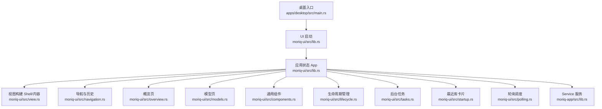

**图表来源**
- [apps/desktop/src/main.rs:1-97](../../../apps/desktop/src/main.rs#L1-L97)
- [crates/moriq-ui/src/lib.rs:1-200](../../../crates/moriq-ui/src/lib.rs#L1-L200)
- [crates/moriq-ui/src/view.rs:1-200](../../../crates/moriq-ui/src/view.rs#L1-L200)
- [crates/moriq-ui/src/navigation.rs:1-200](../../../crates/moriq-ui/src/navigation.rs#L1-L200)
- [crates/moriq-ui/src/overview.rs:1-200](../../../crates/moriq-ui/src/overview.rs#L1-L200)
- [crates/moriq-ui/src/models.rs:1-200](../../../crates/moriq-ui/src/models.rs#L1-L200)
- [crates/moriq-ui/src/components.rs:1-200](../../../crates/moriq-ui/src/components.rs#L1-L200)
- [crates/moriq-ui/src/lifecycle.rs:1-200](../../../crates/moriq-ui/src/lifecycle.rs#L1-L200)
- [crates/moriq-ui/src/tasks.rs:1-200](../../../crates/moriq-ui/src/tasks.rs#L1-L200)
- [crates/moriq-ui/src/startup.rs:1-38](../../../crates/moriq-ui/src/startup.rs#L1-L38)
- [crates/moriq-ui/src/polling.rs:1-73](../../../crates/moriq-ui/src/polling.rs#L1-L73)
- [crates/moriq-app/src/lib.rs:1-200](../../../crates/moriq-app/src/lib.rs#L1-L200)

**章节来源**
- [apps/desktop/src/main.rs:1-97](../../../apps/desktop/src/main.rs#L1-L97)
- [apps/desktop/Cargo.toml:1-21](../../../apps/desktop/Cargo.toml#L1-L21)
- [crates/moriq-ui/Cargo.toml:1-25](../../../crates/moriq-ui/Cargo.toml#L1-L25)

## 核心组件
- `App`：Iced 应用的状态中心，持有 UI 偏好、当前资源库、屏幕选择、查询条件、分页状态、任务状态、对话框状态、导航历史、服务句柄等。
- `Message`：所有界面事件的统一枚举，涵盖用户输入、异步结果、系统事件、功能模块子消息等。
- `Screen`：主界面导航的三个页面枚举值，分别对应概览、素材列表与模型管理。
- `Dialog`：覆盖式对话框枚举，如新建资源库、新建项目、重命名、设置等。
- `Service`：来自 `moriq-app` 的服务句柄，提供打开资源库、读取页面、后台任务、设置、导入、维护等异步接口。

关键职责划分：
- 界面层只负责状态展示和用户交互；磁盘、数据库、媒体解码等重量级操作全部委托给 Service。
- 异步任务通过 `Task::perform` 或 `Task::run` 发起，回调返回具体 `Message`，再由 `update` 更新状态。
- 导航和历史保存在轻量化的 `Location` 结构中，避免持久化大图或数据库句柄。

**章节来源**
- [crates/moriq-ui/src/lib.rs:1-200](../../../crates/moriq-ui/src/lib.rs#L1-L200)
- [crates/moriq-ui/src/lib.rs:201-651](../../../crates/moriq-ui/src/lib.rs#L201-L651)
- [crates/moriq-app/src/lib.rs:1-200](../../../crates/moriq-app/src/lib.rs#L1-L200)

## 架构总览
下面的序列图展示从桌面入口到 Iced 运行循环的关键流程：

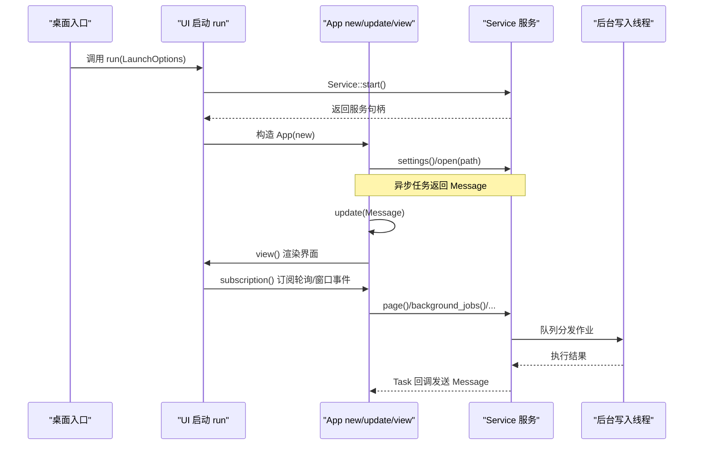

**图表来源**
- [apps/desktop/src/main.rs:1-97](../../../apps/desktop/src/main.rs#L1-L97)
- [crates/moriq-ui/src/lib.rs:1-200](../../../crates/moriq-ui/src/lib.rs#L1-L200)
- [crates/moriq-app/src/lib.rs:201-446](../../../crates/moriq-app/src/lib.rs#L201-L446)

## 详细组件分析

### App 生命周期与 Iced Evented 模型
`App` 遵循 Iced 的 `Application` 模式：
- `new(service, launch)`：初始化状态、并发请求设置和可选的资源库打开任务。
- `update(message)`：根据 `Message` 分支更新状态、调度后续任务、切换屏幕或对话框。
- `view()`：根据当前 `screen`、`dialog`、`library_picker` 决定显示欢迎页、Shell 外壳及内容区域。
- `subscription()`：注册轮询、窗口缩放因子、视频帧等周期性事件。

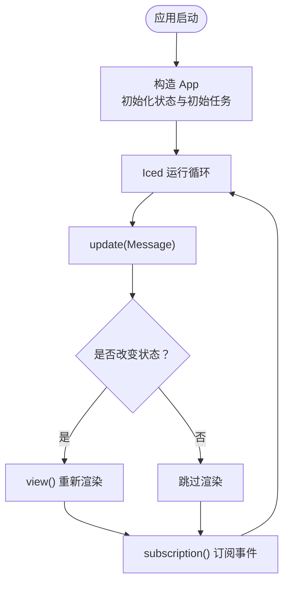

**图表来源**
- [crates/moriq-ui/src/lib.rs:1-200](../../../crates/moriq-ui/src/lib.rs#L1-L200)
- [crates/moriq-ui/src/lib.rs:201-651](../../../crates/moriq-ui/src/lib.rs#L201-L651)

**章节来源**
- [crates/moriq-ui/src/lib.rs:1-200](../../../crates/moriq-ui/src/lib.rs#L1-L200)
- [crates/moriq-ui/src/lib.rs:201-651](../../../crates/moriq-ui/src/lib.rs#L201-L651)

### Screen 与 Dialog 导航逻辑
- `Screen` 定义三个主页面：`Overview`、`Assets`、`Models`。
- `Dialog` 定义覆盖式对话框：创建资源库、创建项目、重命名资源库、重命名素材、设置。
- `content_screen()` 决定当前内容区域是否可渲染：若处于资源库选择器则不渲染主内容；否则根据当前 `screen` 和是否已打开资源库决定。
- `shell()` 组合标题栏、侧边栏、内容区、底部状态栏，并在存在 `dialog` 时叠加对话框层。

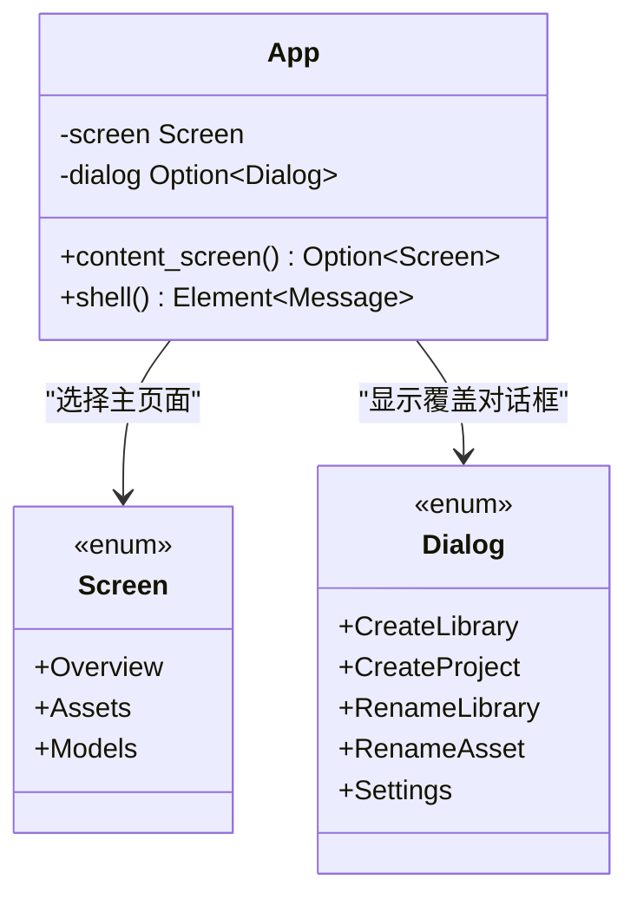

**图表来源**
- [crates/moriq-ui/src/lib.rs:1-200](../../../crates/moriq-ui/src/lib.rs#L1-L200)
- [crates/moriq-ui/src/view.rs:1-200](../../../crates/moriq-ui/src/view.rs#L1-L200)

**章节来源**
- [crates/moriq-ui/src/lib.rs:1-200](../../../crates/moriq-ui/src/lib.rs#L1-L200)
- [crates/moriq-ui/src/view.rs:1-200](../../../crates/moriq-ui/src/view.rs#L1-L200)

### 概览页、素材页与模型页
- 概览页 `overview()`：展示资源库封面、描述、路径、统计信息、快速操作按钮。
- 素材页 `assets()`：由 Shell 内容区域驱动，结合查询、分页、网格布局与滚动状态。
- 模型页 `models()`：展示智能整理入口、分类、模型安装与任务控制。

这些页面通过 `App` 的状态字段驱动渲染，例如 `library`、`query`、`ai.models`、`manager.organizer` 等。

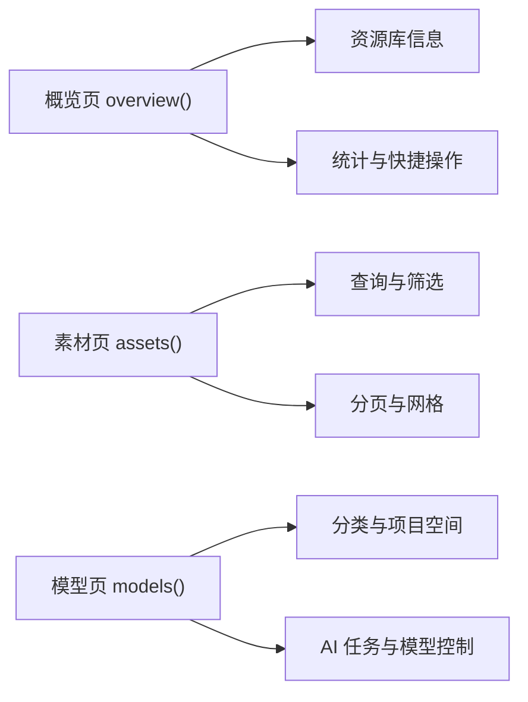

**图表来源**
- [crates/moriq-ui/src/overview.rs:1-200](../../../crates/moriq-ui/src/overview.rs#L1-L200)
- [crates/moriq-ui/src/models.rs:1-200](../../../crates/moriq-ui/src/models.rs#L1-L200)

**章节来源**
- [crates/moriq-ui/src/overview.rs:1-200](../../../crates/moriq-ui/src/overview.rs#L1-L200)
- [crates/moriq-ui/src/models.rs:1-200](../../../crates/moriq-ui/src/models.rs#L1-L200)

### 导航历史与持久化
导航历史以轻量元数据形式保存，不包含大图或数据库句柄：
- `Location` 记录当前表面、面板、对话框、屏幕、查询、滚动位置、选中项、多选状态、布局选项等。
- `History` 维护后退栈和前进栈，限制最大长度，并提供 `can_back`、`can_forward`。
- `navigation_snapshot()` 生成可持久化的 `SavedNavigation`。
- `persist_navigation()` 通过 `service.save_navigation` 异步保存历史。
- `navigation_loaded()` 接收加载结果并恢复历史，同时校验库身份和请求版本。

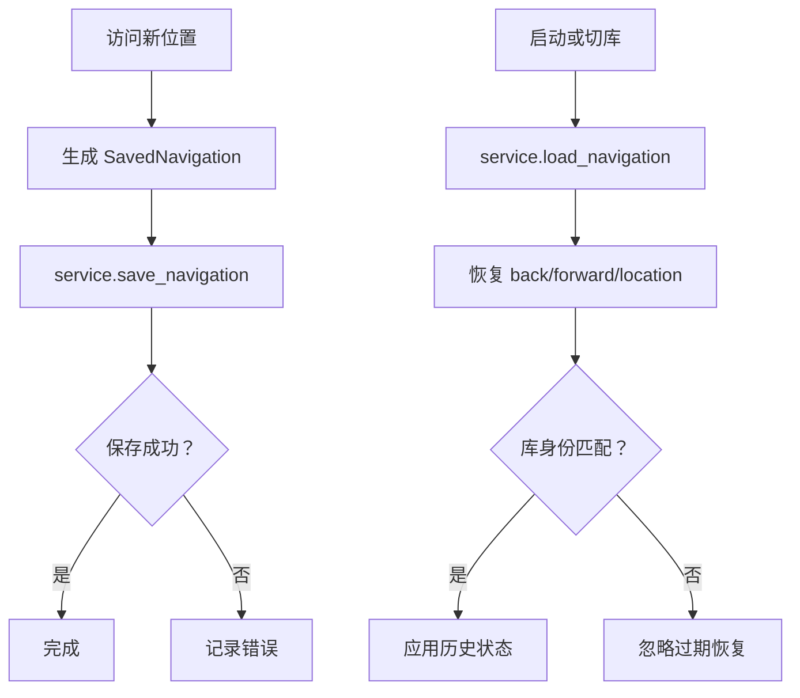

**图表来源**
- [crates/moriq-ui/src/navigation.rs:1-200](../../../crates/moriq-ui/src/navigation.rs#L1-L200)

**章节来源**
- [crates/moriq-ui/src/navigation.rs:1-200](../../../crates/moriq-ui/src/navigation.rs#L1-L200)

### 组件初始化流程与订阅机制
- 桌面入口 `main.rs` 负责日志初始化、图标加载、命令行参数解析，并最终调用 `moriq_ui::run(launch)`。
- `run()` 构建 `Service::start()`，注册 `App::new`、`App::update`、`App::view`，并配置窗口、主题、字体、样式与订阅。
- `App::new` 初始化状态后，批量启动设置加载、资源库打开、DPI 获取等任务。
- `subscription()` 将轮询、窗口缩放因子等事件注入应用循环。
- `polling.rs` 中的 `tick()` 负责页面轮询、导入进度刷新、人物肖像刷新、播放器状态清理、后台任务轮询等。

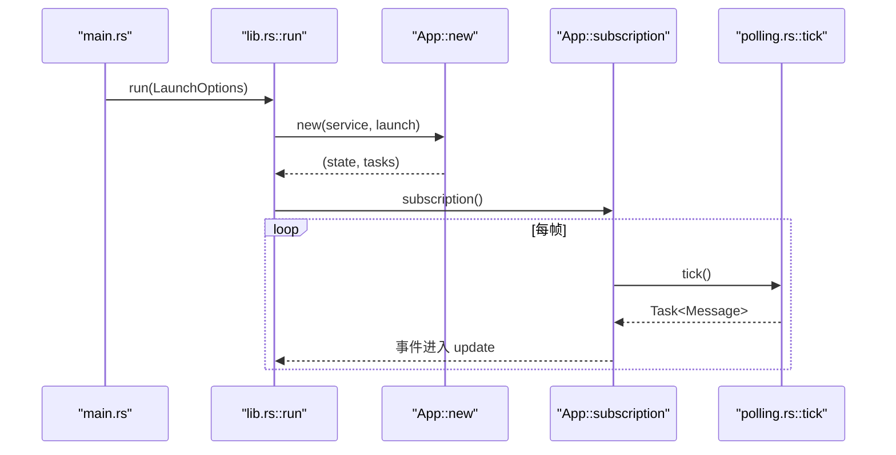

**图表来源**
- [apps/desktop/src/main.rs:1-97](../../../apps/desktop/src/main.rs#L1-L97)
- [crates/moriq-ui/src/lib.rs:1-200](../../../crates/moriq-ui/src/lib.rs#L1-L200)
- [crates/moriq-ui/src/polling.rs:1-73](../../../crates/moriq-ui/src/polling.rs#L1-L73)

**章节来源**
- [apps/desktop/src/main.rs:1-97](../../../apps/desktop/src/main.rs#L1-L97)
- [crates/moriq-ui/src/lib.rs:1-200](../../../crates/moriq-ui/src/lib.rs#L1-L200)
- [crates/moriq-ui/src/polling.rs:1-73](../../../crates/moriq-ui/src/polling.rs#L1-L73)

### Service 层集成与异步通信
`Service` 是 UI 与底层库之间的桥梁：
- `Service::start()` 启动单写线程、调度器与共享信号量。
- `call`、`call_task`、`dispatch` 将闭包投递到单写队列，保证对 `Library` 的串行访问。
- `open`、`create`、`page`、`background_jobs`、`save_navigation`、`settings` 等方法暴露给 UI。
- UI 通过 `Task::perform` 调用 Service，回调包装为 `Message`，再由 `update` 处理结果。

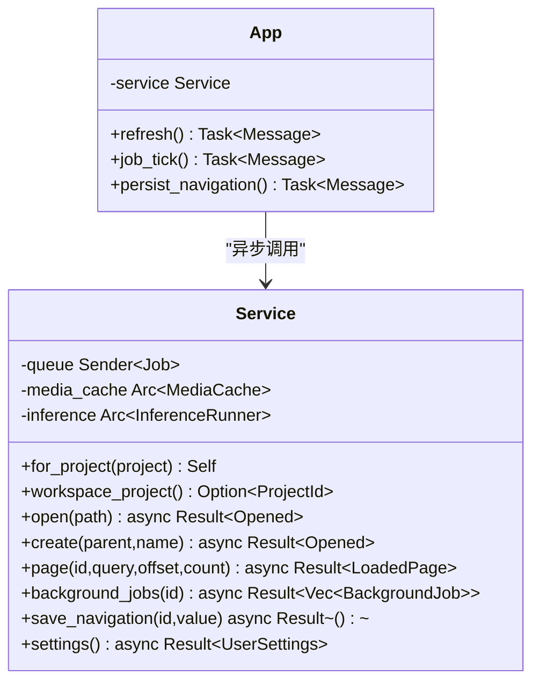

**图表来源**
- [crates/moriq-app/src/lib.rs:1-200](../../../crates/moriq-app/src/lib.rs#L1-L200)
- [crates/moriq-app/src/lib.rs:201-446](../../../crates/moriq-app/src/lib.rs#L201-L446)
- [crates/moriq-ui/src/lib.rs:201-651](../../../crates/moriq-ui/src/lib.rs#L201-L651)
- [crates/moriq-ui/src/tasks.rs:1-200](../../../crates/moriq-ui/src/tasks.rs#L1-L200)
- [crates/moriq-ui/src/navigation.rs:1-200](../../../crates/moriq-ui/src/navigation.rs#L1-L200)

**章节来源**
- [crates/moriq-app/src/lib.rs:1-200](../../../crates/moriq-app/src/lib.rs#L1-L200)
- [crates/moriq-app/src/lib.rs:201-446](../../../crates/moriq-app/src/lib.rs#L201-L446)
- [crates/moriq-ui/src/lib.rs:201-651](../../../crates/moriq-ui/src/lib.rs#L201-L651)
- [crates/moriq-ui/src/tasks.rs:1-200](../../../crates/moriq-ui/src/tasks.rs#L1-L200)
- [crates/moriq-ui/src/navigation.rs:1-200](../../../crates/moriq-ui/src/navigation.rs#L1-L200)

### 任务调度与轮询
- `tasks.rs` 中的 `TaskState` 管理后台任务的加载状态、错误、请求编号、分析进度和失败详情。
- `job_tick()` 定期轮询 `service.background_jobs`，并通过 `JobMessage::Refreshed` 更新界面。
- `polling.rs` 的 `tick()` 综合处理导入进度、人物肖像、播放器停止、AI 模型加载、Synco 同步轮询与任务轮询。
- `startup.rs` 的 `load_library_cards()` 并行加载最近资源库卡片与封面，避免阻塞启动。

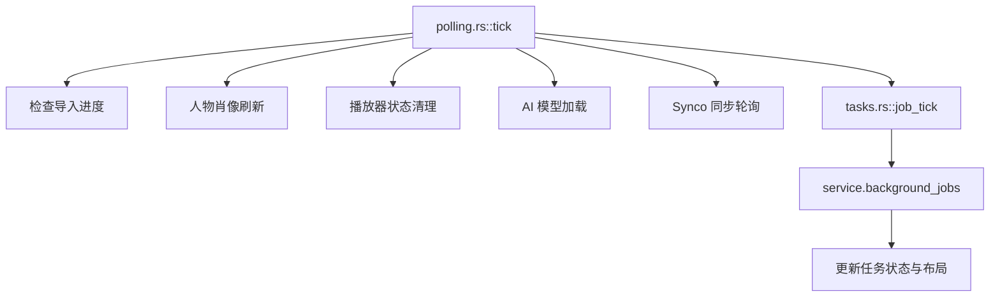

**图表来源**
- [crates/moriq-ui/src/polling.rs:1-73](../../../crates/moriq-ui/src/polling.rs#L1-L73)
- [crates/moriq-ui/src/tasks.rs:1-200](../../../crates/moriq-ui/src/tasks.rs#L1-L200)
- [crates/moriq-ui/src/startup.rs:1-38](../../../crates/moriq-ui/src/startup.rs#L1-L38)

**章节来源**
- [crates/moriq-ui/src/polling.rs:1-73](../../../crates/moriq-ui/src/polling.rs#L1-L73)
- [crates/moriq-ui/src/tasks.rs:1-200](../../../crates/moriq-ui/src/tasks.rs#L1-L200)
- [crates/moriq-ui/src/startup.rs:1-38](../../../crates/moriq-ui/src/startup.rs#L1-L38)

### 组件初始化与通用 UI 组件
- `components.rs` 提供统一样式的选择控件、标题文本、辅助文本、操作按钮、表单按钮、图片包装、标签标记、分组标题、分隔线等。
- 这些组件在概览页、模型页、设置页、资产管理页中被广泛复用，保持视觉一致性。

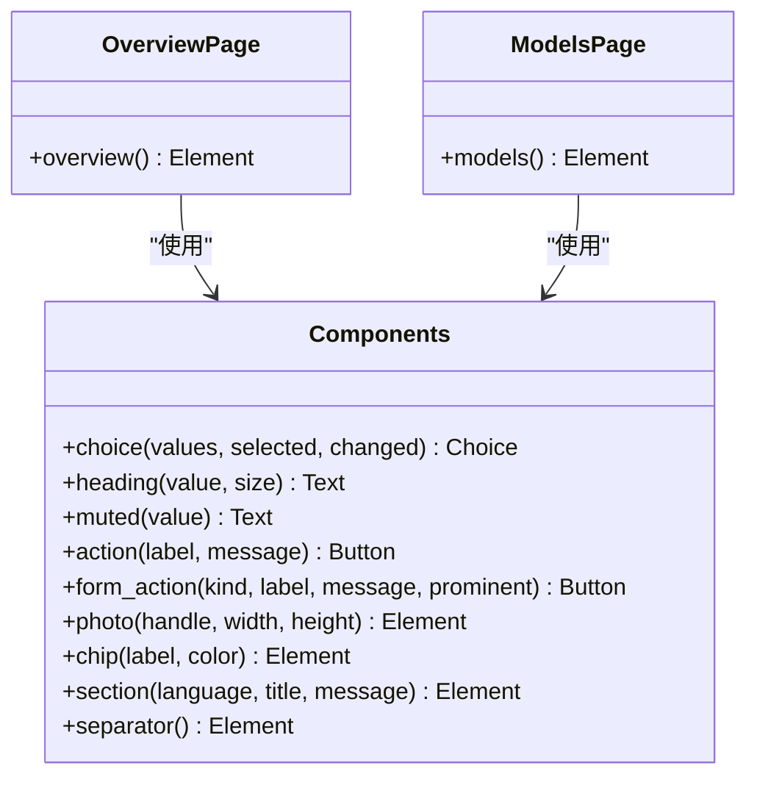

**图表来源**
- [crates/moriq-ui/src/components.rs:1-200](../../../crates/moriq-ui/src/components.rs#L1-L200)
- [crates/moriq-ui/src/overview.rs:1-200](../../../crates/moriq-ui/src/overview.rs#L1-L200)
- [crates/moriq-ui/src/models.rs:1-200](../../../crates/moriq-ui/src/models.rs#L1-L200)

**章节来源**
- [crates/moriq-ui/src/components.rs:1-200](../../../crates/moriq-ui/src/components.rs#L1-L200)
- [crates/moriq-ui/src/overview.rs:1-200](../../../crates/moriq-ui/src/overview.rs#L1-L200)
- [crates/moriq-ui/src/models.rs:1-200](../../../crates/moriq-ui/src/models.rs#L1-L200)

### 自定义 Message 类型与用户交互处理
扩展 UI 功能时，建议遵循以下模式：
- 在 `Message` 中添加一个清晰命名的变体，携带必要上下文数据。
- 若涉及外部异步操作，使用 `Task::perform` 调用 `service`，并将结果包装为新的 `Message`。
- 在 `update` 中处理该消息：验证库身份、请求编号、业务前置条件，然后更新状态并触发必要的刷新。
- 如需长期轮询，可在 `subscription` 或 `tick` 中安排周期任务。

示例思路（不直接展示代码内容）：
- 新增“导出报告”功能：定义 `ExportReportRequested`、`ExportReportLoaded` 两个消息；前者触发 `service.export_report`，后者更新 `export.report` 与状态提示。
- 新增“批量重命名”交互：定义 `BatchRenameChanged`、`BatchRenamePreview`、`BatchRenameConfirmed`；在预览阶段计算影响范围，确认阶段调用 `service.batch_rename`。
- 新增“截图对比”功能：定义 `CompareScreenshot`、`CompareResult`；在 capture feature 下捕获窗口截图，比较前后差异并显示提示。

这些模式可在现有 `Message` 分支中找到类似实现，例如分页加载、任务轮询、导航保存、设置加载、AI 模型控制等。

**章节来源**
- [crates/moriq-ui/src/lib.rs:201-651](../../../crates/moriq-ui/src/lib.rs#L201-L651)
- [crates/moriq-ui/src/tasks.rs:1-200](../../../crates/moriq-ui/src/tasks.rs#L1-L200)
- [crates/moriq-ui/src/navigation.rs:1-200](../../../crates/moriq-ui/src/navigation.rs#L1-L200)

### 错误处理与调试技巧
- 桌面入口在 `run` 失败时使用 `rfd::MessageDialog` 弹出错误信息，确保启动失败有明确出口。
- `moriq-app` 将调度错误转换为字符串错误，例如“后台服务已关闭”“后台服务中断”，便于 UI 提示。
- `App` 中多处使用 `error: Option<String>` 存储界面层错误，并在底部状态栏或错误区域展示。
- 诊断日志可通过 `diagnostic_logging_enabled()` 控制；Windows 下写入 `LOCALAPPDATA/MORIQ/logs/desktop.log`，其他平台写入 `HOME/.local/state/moriq/desktop.log`。
- 调试建议：
  - 启用诊断日志，观察 `moriq=info,wgpu=warn` 输出。
  - 在 `update` 分支中添加日志，追踪关键消息处理路径。
  - 使用 `capture` feature 录制界面帧，配合回归测试定位渲染问题。
  - 针对导航历史，检查 `navigation_request` 版本号与库 ID，避免旧回执覆盖新状态。

**章节来源**
- [apps/desktop/src/main.rs:1-97](../../../apps/desktop/src/main.rs#L1-L97)
- [crates/moriq-app/src/lib.rs:201-446](../../../crates/moriq-app/src/lib.rs#L201-L446)
- [crates/moriq-ui/src/lib.rs:1-200](../../../crates/moriq-ui/src/lib.rs#L1-L200)

## 依赖关系分析
- `moriq-desktop` 依赖 `moriq-ui`、`iced`、`tracing-subscriber`、`rfd`、`image`。
- `moriq-ui` 依赖 `moriq-domain`、`moriq-app`、`moriq-render`、`iced`、`iced_runtime`、`tokio`、`rfd`、`chrono`。
- `moriq-app` 依赖 `moriq-library`、`moriq-ai`、`futures`、`tokio`、`tracing`。

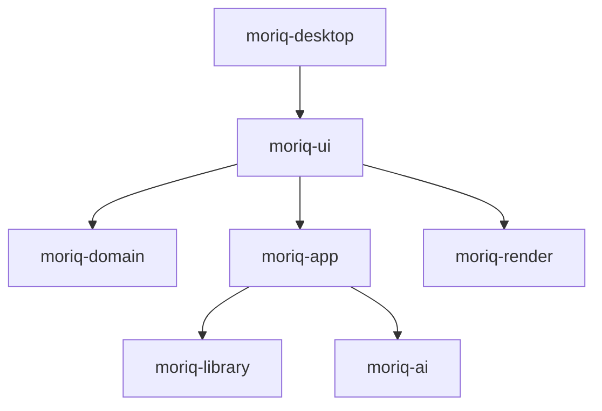

**图表来源**
- [apps/desktop/Cargo.toml:1-21](../../../apps/desktop/Cargo.toml#L1-L21)
- [crates/moriq-ui/Cargo.toml:1-25](../../../crates/moriq-ui/Cargo.toml#L1-L25)
- [crates/moriq-app/src/lib.rs:1-200](../../../crates/moriq-app/src/lib.rs#L1-L200)

**章节来源**
- [apps/desktop/Cargo.toml:1-21](../../../apps/desktop/Cargo.toml#L1-L21)
- [crates/moriq-ui/Cargo.toml:1-25](../../../crates/moriq-ui/Cargo.toml#L1-L25)
- [crates/moriq-app/src/lib.rs:1-200](../../../crates/moriq-app/src/lib.rs#L1-L200)

## 性能考虑
- 网格布局与分页：`grid()` 根据可视高度与卡片宽度计算列数，限制每页可见缩略图数量，避免高 DPI 下无限重载。
- 异步 I/O：所有媒体读取、数据库查询、导入任务均通过 Service 的后台线程执行，UI 线程仅处理轻量状态更新。
- 信号量限流：Service 使用 `read_slots`、`import_memory`、`job_slot`、`maintenance_slot` 控制并发与内存预算。
- 轮询节流：`tick()` 只在必要时刷新导入进度、人物肖像、任务列表，避免隐藏页面重复读取。
- 导航历史裁剪：历史栈限制最大长度，避免无界增长。

[本节为通用性能指导，不直接分析具体文件]

## 故障排查指南
- 启动失败：检查桌面入口的错误弹窗与日志文件路径是否正确。
- 资源库无法打开：查看 Service 的 `open` 返回错误，可能是锁占用或路径无效。
- 界面卡顿：检查是否有未取消的 `Task::perform`，或轮询频率过高。
- 导航异常：确认 `navigation_request` 版本号与库 ID 是否匹配。
- 任务不刷新：检查 `job_tick` 是否被 `loading` 或 `ticks` 节流，以及 `background_jobs` 是否返回预期结果。
- AI 模型未加载：确认 `AiMessage::Refresh` 是否触发，以及 `service` 是否可用。

**章节来源**
- [apps/desktop/src/main.rs:1-97](../../../apps/desktop/src/main.rs#L1-L97)
- [crates/moriq-app/src/lib.rs:201-446](../../../crates/moriq-app/src/lib.rs#L201-L446)
- [crates/moriq-ui/src/polling.rs:1-73](../../../crates/moriq-ui/src/polling.rs#L1-L73)
- [crates/moriq-ui/src/tasks.rs:1-200](../../../crates/moriq-ui/src/tasks.rs#L1-L200)
- [crates/moriq-ui/src/navigation.rs:1-200](../../../crates/moriq-ui/src/navigation.rs#L1-L200)

## 结论
Moriq Space 的界面层采用清晰的 Iced Evented 模型：`App` 集中管理状态，`Message` 统一表达事件，`Service` 隔离后端复杂度。通过 `Screen` 与 `Dialog` 实现主页面与对话框导航，通过 `History` 与 `Location` 实现轻量导航历史，通过 `Task::perform` 与轮询机制实现异步通信与状态刷新。这种分层设计使 UI 易于扩展、调试与维护，同时保证了资源库操作的安全性与性能。

[本节为总结性内容，不直接分析具体文件]