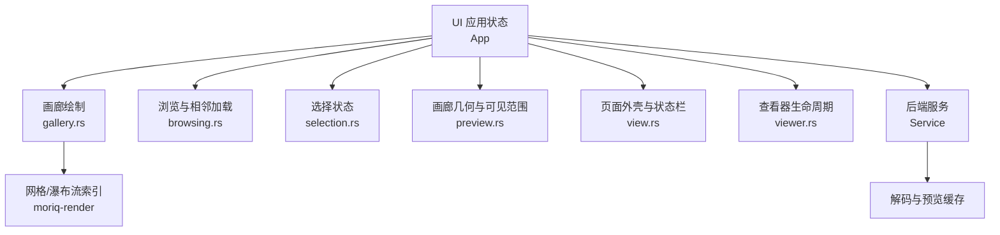
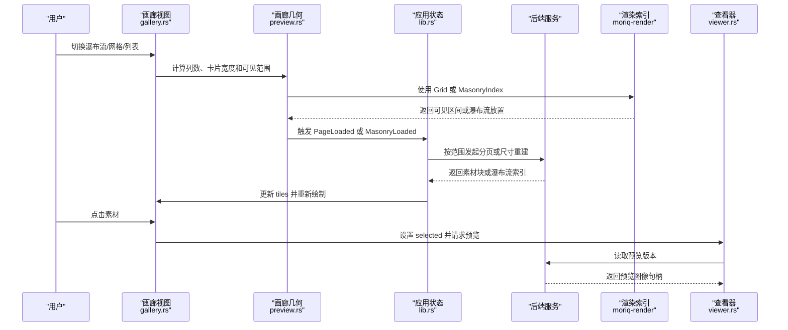
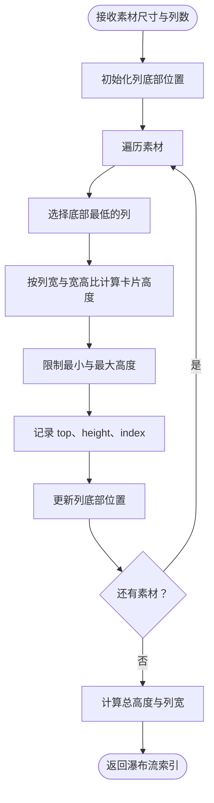
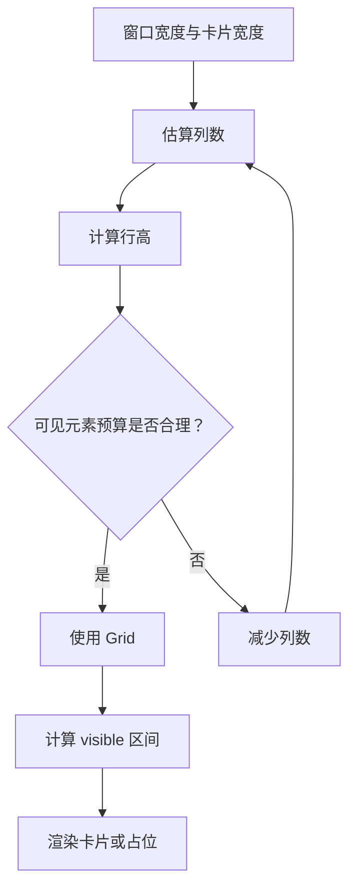
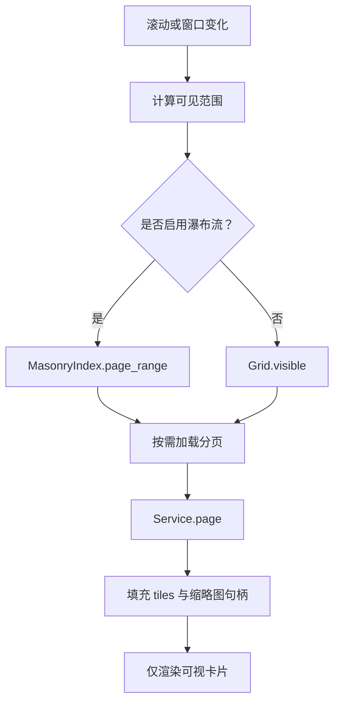
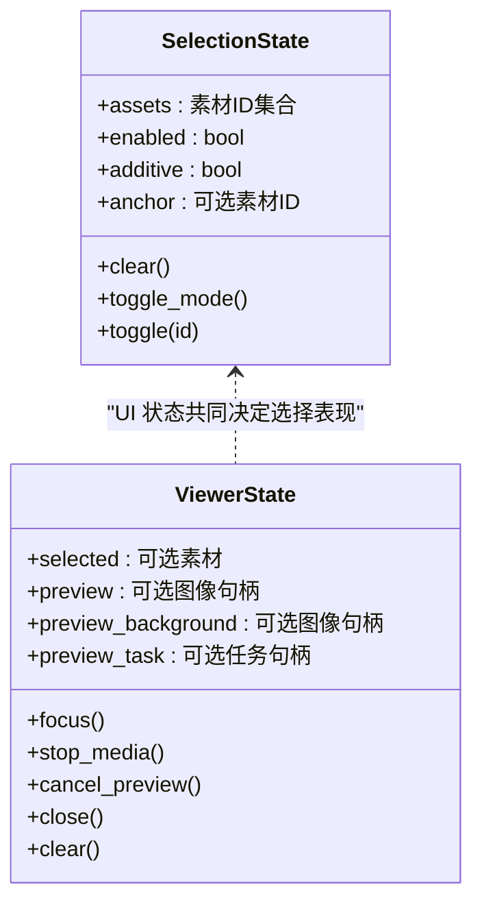
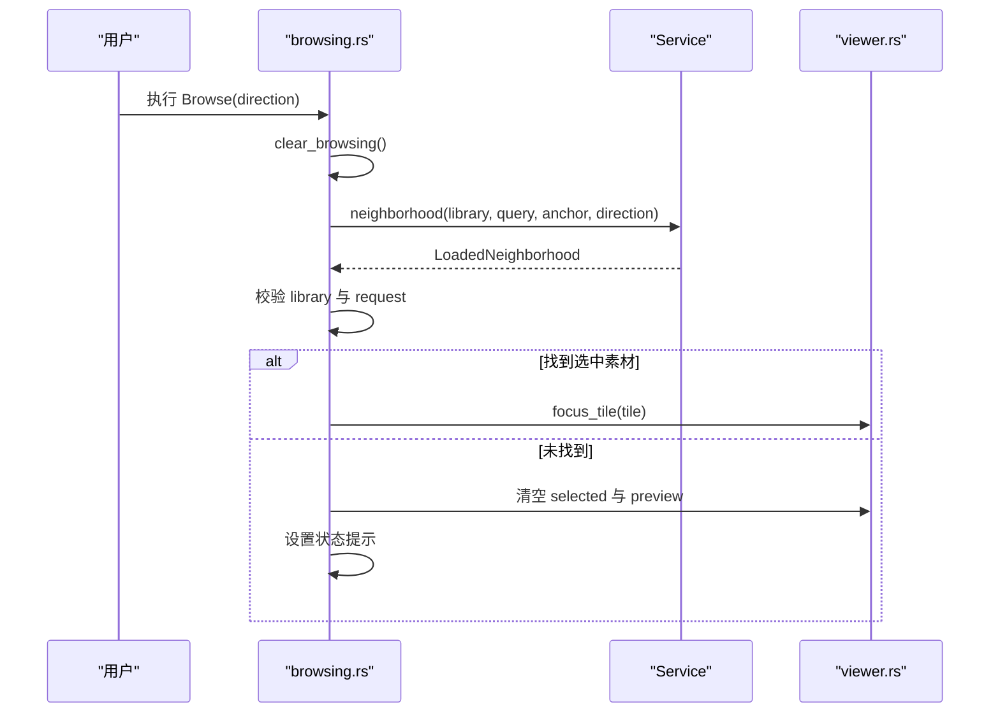
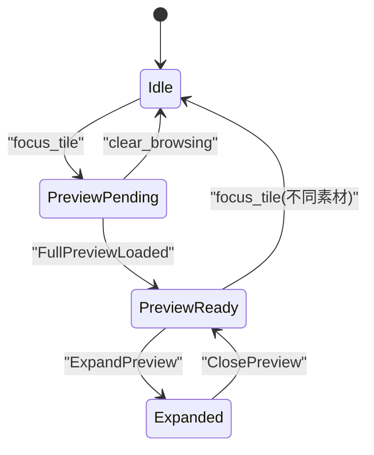
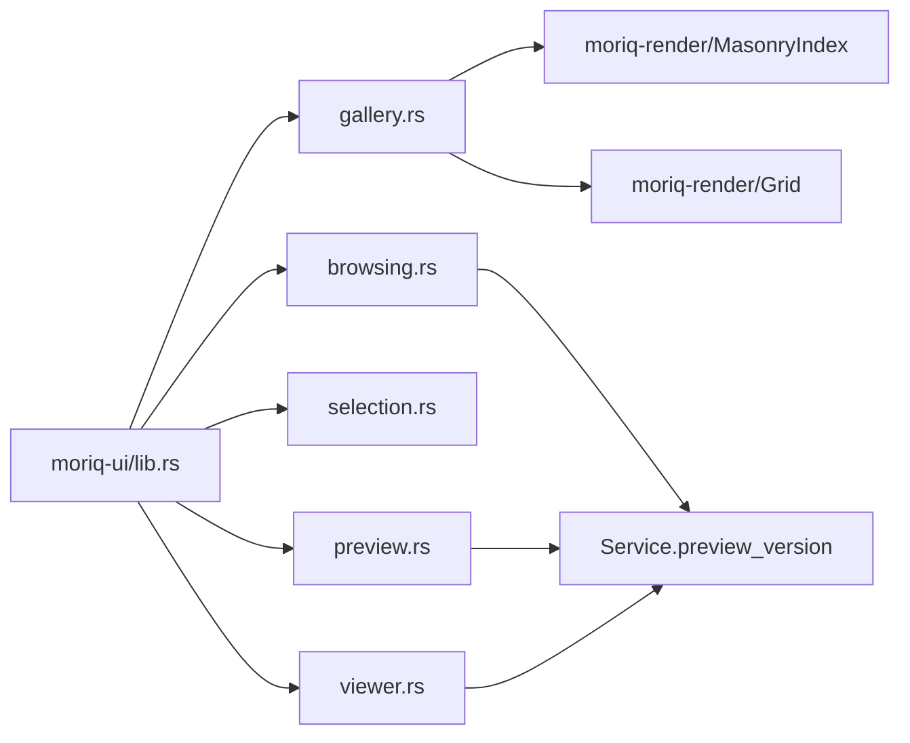

# 浏览与画廊系统

> Repo Wiki 节点 `browsing-gallery`
> 导出自 Qoder 知识库快照 `8fbe02f6-57c2-4874-b725-1a8130851fd9`，代码基线 `7a7a8e75e18bd90294e09cd422dd7ed5a04813a0`（分支 main，zh-CN）。

<cite>
**本文引用的文件**   
- [gallery.rs](../../../../crates/moriq-ui/src/gallery.rs)
- [browsing.rs](../../../../crates/moriq-ui/src/browsing.rs)
- [selection.rs](../../../../crates/moriq-ui/src/selection.rs)
- [preview.rs](../../../../crates/moriq-ui/src/preview.rs)
- [view.rs](../../../../crates/moriq-ui/src/view.rs)
- [viewer.rs](../../../../crates/moriq-ui/src/viewer.rs)
- [lib.rs](../../../../crates/moriq-ui/src/lib.rs)
- [lib.rs（渲染层）](../../../../crates/moriq-render/src/lib.rs)
- [preview_benchmark.rs](../../../../crates/moriq-app/examples/preview_benchmark.rs)
</cite>

## 目录

1. [引言](#引言)
2. [项目结构](#项目结构)
3. [核心组件](#核心组件)
4. [架构总览](#架构总览)
5. [详细组件分析](#详细组件分析)
6. [依赖关系分析](#依赖关系分析)
7. [性能考量](#性能考量)
8. [故障排查指南](#故障排查指南)
9. [结论](#结论)

## 引言

本文件系统性地梳理 Moriq Space 的“浏览与画廊”子系统，重点覆盖以下能力：

- 画廊视图三种展示模式：瀑布流布局、网格视图和列表视图。
- 素材加载策略：懒加载、预加载、分页请求与缓存复用。
- 选择状态管理：单选、多选、批量操作及范围锚点。
- 相邻素材异步加载与锚点定位。
- 预览图片复用机制、视频播放生命周期和内存优化策略。
- 常见问题：滚动卡顿、内存泄漏、旧查询结果重定向等。

该文档面向需要理解或扩展 UI 浏览体验的开发者，同时为使用者提供可操作的优化建议。

## 项目结构

浏览与画廊相关代码主要分布在 UI 层与应用服务之间：

- UI 应用入口、消息类型与主状态位于 `moriq-ui`。
- 画廊绘制、卡片交互位于 `gallery.rs`。
- 浏览、相邻素材与焦点切换逻辑位于 `browsing.rs`。
- 选择状态与同步轮退避逻辑位于 `selection.rs`。
- 画廊几何、可见范围与瀑布流重建逻辑位于 `preview.rs`。
- 固定页面外壳、页脚状态与导航壳层位于 `view.rs`。
- 查看器生命周期、预览任务与媒体资源位于 `viewer.rs`。
- 常量时间网格计算与瀑布流索引位于 `moriq-render`。
- 预览冷启动、磁盘缓存与内存缓存基准测试位于示例程序。

**图表来源**
- [lib.rs:200-420](../../../../crates/moriq-ui/src/lib.rs#L200-L420)
- [gallery.rs:201-380](../../../../crates/moriq-ui/src/gallery.rs#L201-L380)
- [browsing.rs:1-120](../../../../crates/moriq-ui/src/browsing.rs#L1-L120)
- [preview.rs:1-98](../../../../crates/moriq-ui/src/preview.rs#L1-L98)
- [lib.rs（渲染层）:1-120](../../../../crates/moriq-render/src/lib.rs#L1-L120)

**章节来源**
- [lib.rs:200-420](../../../../crates/moriq-ui/src/lib.rs#L200-L420)
- [view.rs:1-120](../../../../crates/moriq-ui/src/view.rs#L1-L120)

## 核心组件

### 画廊容器与标题工具栏

画廊页面由标题栏、筛选区、主内容区和右侧详情面板组成。标题栏包含素材数量、缩放滑块、瀑布流按钮、列表按钮以及更多设置入口。筛选区支持类型、时间、标签、评分、文件大小和导入方式等过滤条件。

当没有匹配素材时，显示空状态引导；否则进入画廊主体。画廊主体根据是否启用列表模式，分别渲染瀑布流或网格/列表行。

**章节来源**
- [gallery.rs:1-120](../../../../crates/moriq-ui/src/gallery.rs#L1-L120)
- [gallery.rs:201-280](../../../../crates/moriq-ui/src/gallery.rs#L201-L280)

### 素材卡片与列表项

每个素材在画廊中表现为一个卡片或列表行。卡片包含缩略图、收藏按钮、上下文菜单入口、类型标识和悬停反馈。选中状态下会改变边框颜色与宽度，并支持双击打开预览、右键弹出上下文菜单。

列表模式用于信息密度更高的场景，每行显示缩略图、名称、格式、分辨率和大小。

**章节来源**
- [gallery.rs:380-550](../../../../crates/moriq-ui/src/gallery.rs#L380-L550)

### 选择状态模型

选择状态独立维护已选素材集合、多选模式开关、增量选择标志和范围锚点。清空选择时会清除锚点，避免旧查询导致的选择泄漏。切换多选模式会重置当前选择集合。

同步轮询退避状态则用于控制后台同步任务的轮询间隔，成功时恢复短等待，失败时指数增长但设置上限。

**章节来源**
- [selection.rs:1-88](../../../../crates/moriq-ui/src/selection.rs#L1-L88)

### 查看器状态

查看器统一管理当前选中素材、预览图像、背景图像、展开状态、原图请求号、视频播放会话和预览任务句柄。关闭查看器会停止媒体、取消预览任务并清理视频帧；完全清除还会释放选择关联和预览句柄。

**章节来源**
- [viewer.rs:1-108](../../../../crates/moriq-ui/src/viewer.rs#L1-L108)

## 架构总览

浏览与画廊系统的整体流程如下：

**图表来源**
- [gallery.rs:201-380](../../../../crates/moriq-ui/src/gallery.rs#L201-L380)
- [preview.rs:1-98](../../../../crates/moriq-ui/src/preview.rs#L1-L98)
- [lib.rs:520-651](../../../../crates/moriq-ui/src/lib.rs#L520-L651)
- [viewer.rs:1-60](../../../../crates/moriq-ui/src/viewer.rs#L1-L60)

## 详细组件分析

### 画廊视图与布局切换

#### 瀑布流布局

瀑布流通过 `MasonryIndex` 构建。输入是素材宽高数组、列数和可用宽度，内部按最短列优先放置素材，并根据目标宽度计算每张卡片的高度，同时限制高度在一个合理范围内。每个列维护顶部位置和高度，最终得到总高度和各列宽度。

可见性计算采用两阶段：

1. `visible` 根据滚动顶部和视口高度，使用分区点快速裁剪出当前可视区域。
2. `page_range` 将可视区域的素材索引转换为有界范围，用于控制预取。

**图表来源**
- [lib.rs（渲染层）:1-120](../../../../crates/moriq-render/src/lib.rs#L1-L120)

#### 网格视图

网格视图使用 `Grid`，根据可用宽度、卡片宽度和行高计算列数。为了在高分辨率下保持稳定的控件预算，系统会尝试让可见元素总数不超过一定阈值；如果卡片变大导致可见行数增加，则回退减少列数。

网格的可见范围基于滚动位置、行高和视口高度直接计算，复杂度接近常数级。

#### 列表视图

列表视图将列数固定为 1，行高固定为较大值，适合查看元数据密集的场景。画廊在列表模式下跳过瀑布流，改用网格渲染路径，并通过 `list` 标志区分卡片样式。

**图表来源**
- [lib.rs:520-651](../../../../crates/moriq-ui/src/lib.rs#L520-L651)
- [lib.rs（渲染层）:120-192](../../../../crates/moriq-render/src/lib.rs#L120-L192)

**章节来源**
- [gallery.rs:201-550](../../../../crates/moriq-ui/src/gallery.rs#L201-L550)
- [preview.rs:1-98](../../../../crates/moriq-ui/src/preview.rs#L1-L98)
- [lib.rs:520-651](../../../../crates/moriq-ui/src/lib.rs#L520-L651)
- [lib.rs（渲染层）:1-192](../../../../crates/moriq-render/src/lib.rs#L1-L192)

### 素材加载策略

#### 懒加载

画廊不会一次性加载全部素材，而是根据滚动位置计算 `visible_range`。瀑布流模式下使用 `MasonryIndex::page_range`，网格模式下使用 `Grid::visible`。UI 只渲染当前可视范围内的素材卡片，空白区域用占位填充。

#### 预加载

瀑布流在可见范围基础上向外扩展约 1.5 倍卡片宽度作为预取缓冲，使快速滚动时仍能保持流畅。网格模式也在首尾预留若干行，减少频繁翻页抖动。

#### 分页与去抖

每次刷新画廊时，UI 会：

1. 递增生成号。
2. 取消尚未完成的前一页任务。
3. 计算可见范围。
4. 调用服务端的 `page` 接口，并附带起始偏移和长度。
5. 收到回执后仅处理最新生成号的结果。

这避免了旧查询覆盖新查询导致的闪烁或错位。

#### 缓存机制

预览缓存分为三层：

- 内存缓存：同一进程内重复读取相同预览通常更快。
- 磁盘缓存：库重启后仍可从本地缓存恢复预览像素。
- 应用级句柄复用：同一个素材的缩略图句柄可在多个卡片间复用。

示例基准程序分别测量首次解码、磁盘缓存重开和内存缓存命中，并校验像素一致性。

**图表来源**
- [preview.rs:1-98](../../../../crates/moriq-ui/src/preview.rs#L1-L98)
- [lib.rs:520-651](../../../../crates/moriq-ui/src/lib.rs#L520-L651)
- [preview_benchmark.rs:1-96](../../../../crates/moriq-app/examples/preview_benchmark.rs#L1-L96)

**章节来源**
- [preview.rs:1-98](../../../../crates/moriq-ui/src/preview.rs#L1-L98)
- [lib.rs:520-651](../../../../crates/moriq-ui/src/lib.rs#L520-L651)
- [preview_benchmark.rs:1-96](../../../../crates/moriq-app/examples/preview_benchmark.rs#L1-L96)

### 选择状态管理

#### 单选

单选由 `ViewerState.selected` 表示。点击素材卡片会调用 `focus_tile`，更新选中素材、笔记和标签输入框，并请求对应版本的预览。若已经是相同素材且已有预览任务或背景预览，则直接复用，不重复解码。

#### 多选

多选模式由 `SelectionState.enabled` 控制。开启后，卡片选中状态判断改为检查 `SelectionState.assets`。勾选某个素材会设置 `anchor`，并切换该素材是否在集合中。

#### 批量操作

画廊标题区显示“整理 N 张”，其中 N 来自多选集合大小或当前选中素材。批量操作入口包括整理、筛选、保存智能集合等。

#### 范围锚点与旧查询防护

`SelectionState.clear` 会清除已选集合和 `anchor`，避免从旧查询结果跳转到新查询后仍然保留错误范围。同步轮询退避也保证后台同步不会因频繁失败而无限重试。

**图表来源**
- [selection.rs:1-88](../../../../crates/moriq-ui/src/selection.rs#L1-L88)
- [viewer.rs:1-60](../../../../crates/moriq-ui/src/viewer.rs#L1-L60)

**章节来源**
- [selection.rs:1-88](../../../../crates/moriq-ui/src/selection.rs#L1-L88)
- [gallery.rs:380-550](../../../../crates/moriq-ui/src/gallery.rs#L380-L550)
- [viewer.rs:1-108](../../../../crates/moriq-ui/src/viewer.rs#L1-L108)

### 相邻素材异步加载与锚点定位

当用户在画廊中前后浏览时，系统调用 `load_neighborhood`：

1. 取消上一个浏览任务。
2. 递增浏览请求号。
3. 克隆当前库 ID、查询条件和锚点素材 ID。
4. 异步调用服务端的 `neighborhood`。
5. 收到回执后仅接受当前库和当前请求号。
6. 将返回的相邻素材转为 `Tile`，并按选中素材定位焦点。

如果返回结果为空，说明原先选择的素材不再属于当前查询，系统会清空选择、预览和邻居列表，并提示用户。

**图表来源**
- [browsing.rs:1-120](../../../../crates/moriq-ui/src/browsing.rs#L1-L120)
- [browsing.rs:201-214](../../../../crates/moriq-ui/src/browsing.rs#L201-L214)

**章节来源**
- [browsing.rs:1-120](../../../../crates/moriq-ui/src/browsing.rs#L1-L120)
- [browsing.rs:201-214](../../../../crates/moriq-ui/src/browsing.rs#L201-L214)

### 预览图片复用与内存优化

预览复用发生在多个层面：

1. **缩略图句柄复用**：同一素材的 `image::Handle` 被保存在 `tiles` 中，多个卡片共享。
2. **进行中预览复用**：如果当前焦点素材已经存在预览任务或背景预览，再次打开相同素材不会重建请求。
3. **版本变更检测**：只有素材 ID 和版本 ID 都相同时才复用；版本变化会丢弃背景预览并重新请求。
4. **查看器生命周期管理**：切换素材时停止视频、重置区域、递增原图请求号，防止旧媒体回调污染新素材。
5. **关闭 vs 清除**：关闭查看器保留适应窗口预览，完全清除才会释放预览句柄。

**图表来源**
- [browsing.rs:1-120](../../../../crates/moriq-ui/src/browsing.rs#L1-L120)
- [viewer.rs:1-60](../../../../crates/moriq-ui/src/viewer.rs#L1-L60)

**章节来源**
- [browsing.rs:1-120](../../../../crates/moriq-ui/src/browsing.rs#L1-L120)
- [viewer.rs:1-108](../../../../crates/moriq-ui/src/viewer.rs#L1-L108)

### 自定义画廊布局实现参考

虽然本仓库未暴露完整的布局抽象接口，但可以基于现有实现模式实现自定义布局：

1. **定义布局参数**：新增类似 `Grid` 的结构体，包含列数、行高、视口高度或列宽。
2. **实现可见范围计算**：提供 `visible(scroll_y, viewport_height)` 方法，确保返回的区间始终小于控件预算。
3. **实现分页范围**：提供 `page_range(scroll_y, viewport_height)` 方法，供懒加载预取。
4. **集成到 UI**：在 `App` 中添加布局枚举或配置字段，并在 `gallery()` 中根据配置分支渲染。
5. **处理手势与交互**：在卡片外层包裹鼠标区域或触摸区域，转发 `CardPressed`、`OpenImage`、`Favorite` 等消息。
6. **绑定滚动事件**：使用滚动容器的滚动回调更新 `scroll_y`，并触发 `refresh()` 或 `rebuild_masonry()`。

推荐遵循现有约束：

- 不直接持有大图像像素，只持有轻量 `image::Handle`。
- 所有 I/O 和解码通过 `Task::perform` 提交到非界面线程。
- 所有异步回执必须携带请求号或生成号进行版本校验。
- 滚动计算应保持 O(1) 或 O(log n)，避免对全量素材排序。

**章节来源**
- [lib.rs:520-651](../../../../crates/moriq-ui/src/lib.rs#L520-L651)
- [lib.rs（渲染层）:1-192](../../../../crates/moriq-render/src/lib.rs#L1-L192)
- [gallery.rs:201-550](../../../../crates/moriq-ui/src/gallery.rs#L201-L550)

## 依赖关系分析

**图表来源**
- [lib.rs:200-420](../../../../crates/moriq-ui/src/lib.rs#L200-L420)
- [gallery.rs:201-380](../../../../crates/moriq-ui/src/gallery.rs#L201-L380)
- [preview.rs:1-98](../../../../crates/moriq-ui/src/preview.rs#L1-L98)
- [browsing.rs:1-120](../../../../crates/moriq-ui/src/browsing.rs#L1-L120)
- [lib.rs（渲染层）:1-192](../../../../crates/moriq-render/src/lib.rs#L1-L192)

耦合特点：

- UI 层职责清晰：`gallery.rs` 负责绘制，`browsing.rs` 负责导航与相邻加载，`preview.rs` 负责几何计算，`viewer.rs` 负责预览生命周期。
- 渲染层与 UI 层解耦：`moriq-render` 不依赖 UI，只提供纯函数式的位置与范围计算。
- 服务层隐藏存储、解码和缓存细节，UI 只消费结构化结果。

**章节来源**
- [lib.rs:200-420](../../../../crates/moriq-ui/src/lib.rs#L200-L420)
- [lib.rs（渲染层）:1-192](../../../../crates/moriq-render/src/lib.rs#L1-L192)

## 性能考量

### 滚动性能

- 瀑布流和网格均只渲染可视区域，而不是全量素材。
- `MasonryIndex::visible` 和 `Grid::visible` 使用分区点和数学公式，避免线性扫描全表。
- 瀑布流预取范围控制在可视区域两侧约 1.5 倍宽度内。
- 网格模式对高分辨率显示器主动降低列数，避免单屏控件过多。

### 内存优化

- 缩略图以 `image::Handle` 形式复用，不重复解码同素材。
- 预览任务具有唯一请求号，旧任务完成后会被忽略。
- 切换素材时停止视频播放、重置区域和清空视频帧。
- 关闭查看器保留适应窗口预览，完全清除时才释放预览句柄。
- 邻居列表、浏览任务和浏览请求号一起清理，避免陈旧结果误导。

### 解码与缓存

- 首次预览可能较慢，属于冷启动。
- 库重新打开后可利用磁盘缓存。
- 同一进程内多次读取可利用内存缓存。
- 基准测试会校验像素一致性，确保缓存未退化。

### 潜在瓶颈

- 大量不同尺寸素材重建瀑布流索引时，应等待前一次任务结束再重建。
- 快速滚动时应避免频繁重建 `MasonryIndex`。
- 大图预览解码不应阻塞界面线程。
- 多图批量操作应避免同时发起大量同步或预览请求。

[本节为通用性能指导，不直接分析具体代码片段]

## 故障排查指南

### 滚动卡顿

**现象**：快速滚动时出现明显掉帧或布局抖动。

**可能原因**：

- 瀑布流重建过于频繁。
- 单屏控件数量过大。
- 缩略图解码阻塞界面线程。
- 可视范围计算返回了过多元素。

**处理建议**：

1. 确认 `active_masonry` 只在模式、布局和查询一致时生效。
2. 检查 `grid()` 是否因高分辨率自动降列。
3. 确保 `refresh()` 会取消旧任务并仅处理最新生成号。
4. 验证 `MasonryIndex::page_range` 返回的范围有界。

**章节来源**
- [preview.rs:1-98](../../../../crates/moriq-ui/src/preview.rs#L1-L98)
- [lib.rs:520-651](../../../../crates/moriq-ui/src/lib.rs#L520-L651)
- [lib.rs（渲染层）:1-192](../../../../crates/moriq-render/src/lib.rs#L1-L192)

### 内存泄漏

**现象**：长时间浏览后内存持续增长，切换素材后仍有大图残留。

**可能原因**：

- 预览任务未取消。
- 查看器未调用 `stop_media` 或 `clear`。
- 旧查询结果仍持有素材句柄。
- 邻居列表未清理。

**处理建议**：

1. 切换素材时调用 `viewer.focus()`。
2. 离开画廊时调用 `clear_browsing()`。
3. 关闭查看器时调用 `close()`；完全退出时调用 `clear()`。
4. 浏览回执必须校验库 ID 和请求号。

**章节来源**
- [viewer.rs:1-108](../../../../crates/moriq-ui/src/viewer.rs#L1-L108)
- [browsing.rs:1-120](../../../../crates/moriq-ui/src/browsing.rs#L1-L120)
- [browsing.rs:201-214](../../../../crates/moriq-ui/src/browsing.rs#L201-L214)

### 打开素材后预览不更新

**现象**：切换到新版本素材后，仍显示旧预览。

**可能原因**：

- 新旧素材 ID 相同但版本不同。
- 复用逻辑未检测到版本变化。
- 旧预览任务仍在运行。

**处理建议**：

1. 比较素材 ID 和版本 ID。
2. 版本变化时清空 `preview_background`。
3. 调用 `focus_tile` 重新发起预览请求。
4. 使用 `original_request` 版本号拒绝旧回执。

**章节来源**
- [browsing.rs:1-120](../../../../crates/moriq-ui/src/browsing.rs#L1-L120)
- [viewer.rs:1-60](../../../../crates/moriq-ui/src/viewer.rs#L1-L60)

### 相邻素材加载后定位错误

**现象**：点击“前一素材”或“后一素材”后，焦点跳到错误位置。

**可能原因**：

- 旧浏览任务回执覆盖了新结果。
- 查询条件变化后未清空邻居列表。
- 返回结果中未包含选中素材。

**处理建议**：

1. 使用 `browse_request` 和库 ID 双重校验。
2. 调用 `clear_browsing()` 重置邻居、锚点和滚动状态。
3. 如果未找到选中素材，清空选择并给出提示。

**章节来源**
- [browsing.rs:1-120](../../../../crates/moriq-ui/src/browsing.rs#L1-L120)
- [browsing.rs:201-214](../../../../crates/moriq-ui/src/browsing.rs#L201-L214)

## 结论

浏览与画廊系统围绕“可视范围驱动加载”这一核心思想构建：UI 层负责绘制与交互，渲染层提供高效的布局与可见性计算，服务层负责分页、解码和缓存。瀑布流、网格和列表三种视图共用同一套素材数据结构，但各自有不同的渲染与可见范围策略。

关键设计要点包括：

- 使用 `Grid` 和 `MasonryIndex` 实现常量或近常量时间的可见范围计算。
- 通过生成号和请求号隔离旧查询与新查询。
- 通过 `ViewerState` 统一管理预览、背景和媒体生命周期。
- 通过 `SelectionState` 管理多选与范围锚点，避免旧查询污染。
- 通过缩略图句柄复用和预览缓存降低内存和延迟。

对于扩展者而言，最稳妥的方式是沿用现有的消息、任务、生成号和几何计算模式，而不是直接在 UI 层持有重型媒体对象。对于使用者而言，遇到滚动卡顿或内存问题时，应优先检查可视范围计算、任务取消逻辑和查看器生命周期管理。