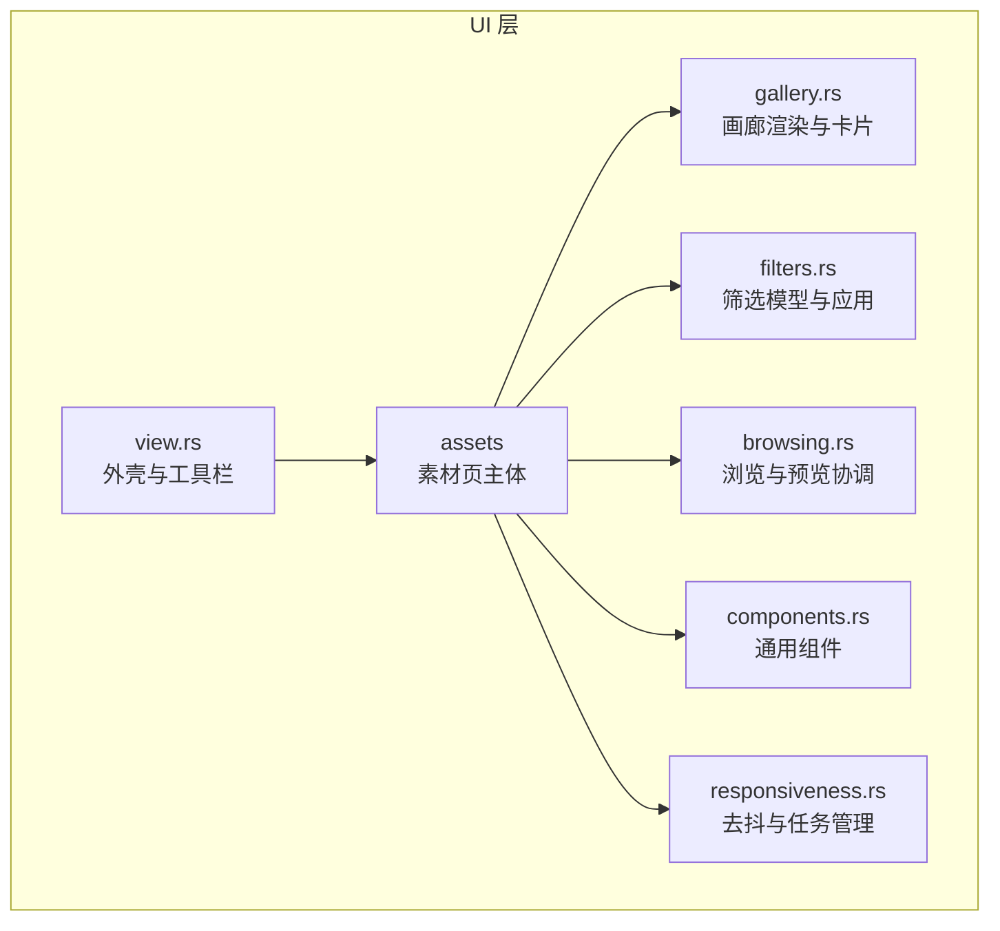
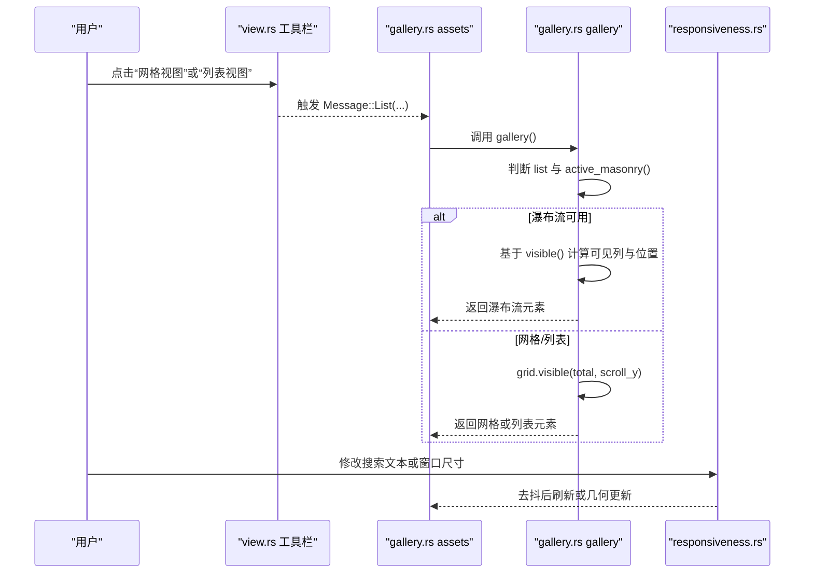
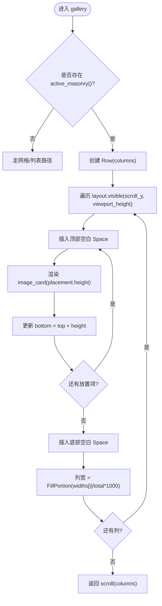
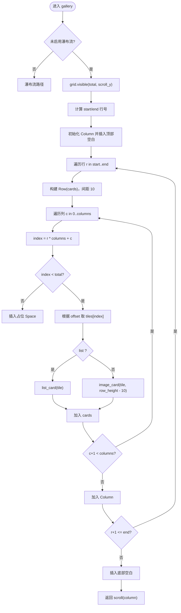
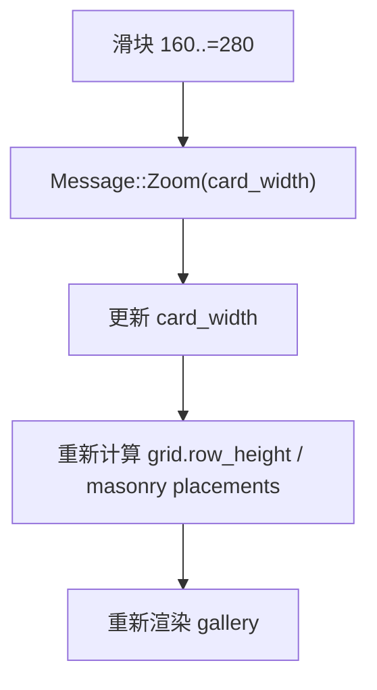
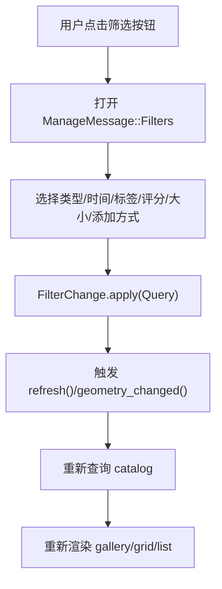
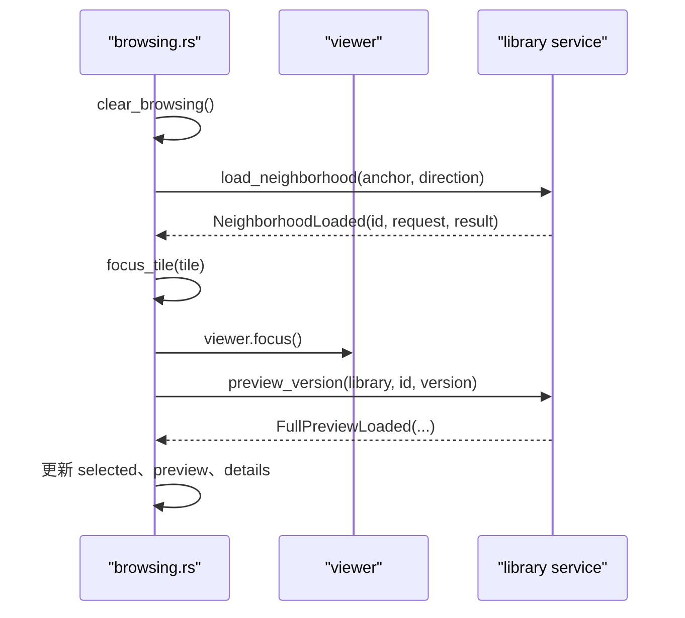
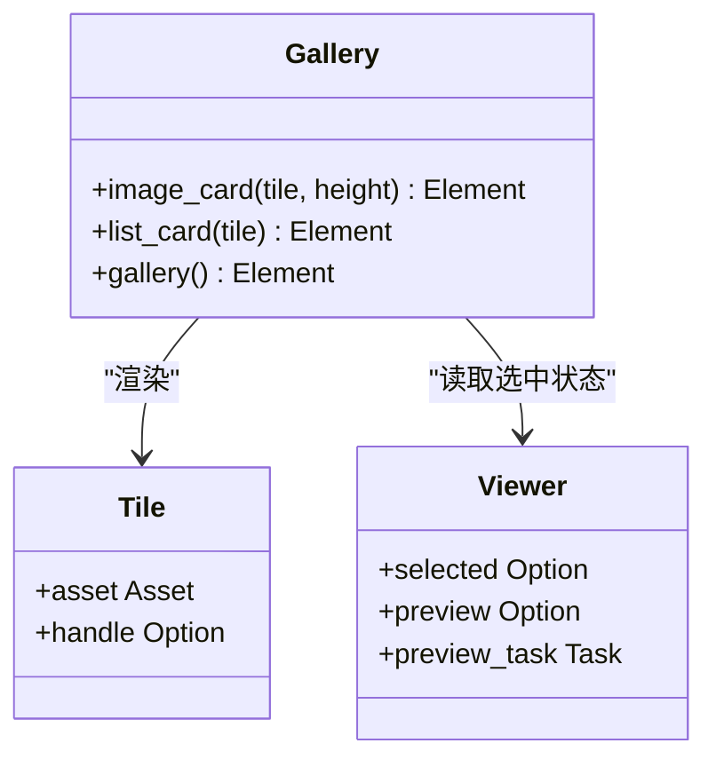
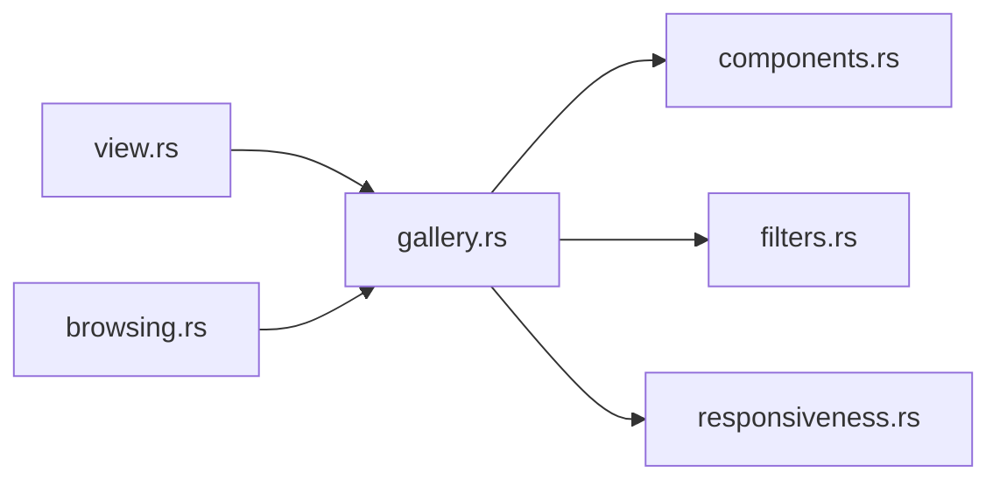

# 画廊布局与视图模式

> Repo Wiki 节点 `gallery-layout`
> 导出自 Qoder 知识库快照 `8fbe02f6-57c2-4874-b725-1a8130851fd9`，代码基线 `7a7a8e75e18bd90294e09cd422dd7ed5a04813a0`（分支 main，zh-CN）。

<cite>
**本文引用的文件**   
- [gallery.rs](../../../../crates/moriq-ui/src/gallery.rs)
- [view.rs](../../../../crates/moriq-ui/src/view.rs)
- [filters.rs](../../../../crates/moriq-ui/src/filters.rs)
- [browsing.rs](../../../../crates/moriq-ui/src/browsing.rs)
- [components.rs](../../../../crates/moriq-ui/src/components.rs)
- [responsiveness.rs](../../../../crates/moriq-ui/src/responsiveness.rs)
</cite>

## 目录
1. [简介](#简介)
2. [项目结构](#项目结构)
3. [核心组件](#核心组件)
4. [架构总览](#架构总览)
5. [详细组件分析](#详细组件分析)
6. [依赖关系分析](#依赖关系分析)
7. [性能考虑](#性能考虑)
8. [故障排查指南](#故障排查指南)
9. [结论](#结论)

## 简介
本文聚焦图库界面的布局与视图模式，重点说明：
- 瀑布流（masonry）布局的渲染流程、列宽分配、间距控制与可见区域计算。
- 网格视图与列表视图的切换逻辑、不同模式下的卡片渲染策略。
- 标题栏中的缩放滑块如何调整卡片尺寸，以及过滤器的状态建模与应用。
- 窗口大小变化与搜索输入的去抖合并机制。
- 可操作的扩展点：自定义布局算法、响应式适配、按需渲染与虚拟滚动思路。

本仓库使用 Iced 构建 UI，图库主体由 `assets` 页面组合标题栏、过滤器行与主内容区；主内容在瀑布流与网格/列表之间切换；右侧为详情面板；全局响应式层负责搜索与几何变化的去抖与任务取消。

## 项目结构
图库相关代码主要位于 UI crate 中：
- `gallery.rs`：素材页主体、标题栏、过滤器行、画廊渲染、卡片与列表项、详情入口。
- `view.rs`：应用外壳、顶部工具栏、侧边导航、视图切换按钮、状态栏。
- `filters.rs`：筛选条件枚举、内置快捷查询、筛选变更应用到查询模型。
- `browsing.rs`：浏览上下文清理、相邻素材异步加载、焦点卡片选择与预览协调。
- `components.rs`：通用 UI 组件（图标按钮、照片占位、分组、分隔线等）。
- `responsiveness.rs`：搜索与几何变化去抖、旧任务取消、保留旧页面与提交新结果。

图表来源
- [gallery.rs:1-200](../../../../crates/moriq-ui/src/gallery.rs#L1-L200)
- [view.rs:1-200](../../../../crates/moriq-ui/src/view.rs#L1-L200)
- [filters.rs:1-200](../../../../crates/moriq-ui/src/filters.rs#L1-L200)
- [browsing.rs:1-200](../../../../crates/moriq-ui/src/browsing.rs#L1-L200)
- [components.rs:1-200](../../../../crates/moriq-ui/src/components.rs#L1-L200)
- [responsiveness.rs:1-200](../../../../crates/moriq-ui/src/responsiveness.rs#L1-L200)

章节来源
- [gallery.rs:1-200](../../../../crates/moriq-ui/src/gallery.rs#L1-L200)
- [view.rs:1-200](../../../../crates/moriq-ui/src/view.rs#L1-L200)

## 核心组件
- 素材页主体 `assets`：根据当前查询与选择状态决定标题、标题栏控件、过滤器行与主内容区；当存在展开预览时优先显示大图预览。
- 画廊渲染 `gallery`：在瀑布流与网格/列表之间分支；瀑布流通过 `active_masonry` 获取布局，网格/列表通过 `grid.visible` 计算可见行并仅渲染可视范围。
- 卡片与列表项：`image_card` 展示缩略图、收藏与上下文操作；`list_card` 以紧凑行形式展示名称、格式、尺寸与文件大小。
- 筛选器：标题栏快速筛选按钮与“筛选与排序”弹窗；类型、时间、标签、评分、大小、添加方式等字段映射到查询模型。
- 缩放滑块：160–280 像素区间，更新 `card_width`，驱动卡片高度或网格行高。
- 响应式层：搜索输入与窗口几何变化均通过延迟调度合并；旧任务被取消，避免竞态与无效重排。

章节来源
- [gallery.rs:1-200](../../../../crates/moriq-ui/src/gallery.rs#L1-L200)
- [gallery.rs:201-587](../../../../crates/moriq-ui/src/gallery.rs#L201-L587)
- [filters.rs:1-200](../../../../crates/moriq-ui/src/filters.rs#L1-L200)
- [components.rs:1-200](../../../../crates/moriq-ui/src/components.rs#L1-L200)
- [responsiveness.rs:1-200](../../../../crates/moriq-ui/src/responsiveness.rs#L1-L200)

## 架构总览
图库界面由三层协作完成：
- 表现层：`assets` 组装标题栏、过滤器、画廊与详情；`gallery` 实现具体布局。
- 交互层：`view.rs` 提供工具栏、侧边栏、全屏/最小化等应用级命令；`browsing.rs` 处理相邻浏览、预览与选中状态。
- 数据与响应层：`filters.rs` 将用户选项转换为 `Query`；`responsiveness.rs` 保证输入与窗口变化的稳定性与幂等。

图表来源
- [view.rs:500-750](../../../../crates/moriq-ui/src/view.rs#L500-L750)
- [gallery.rs:201-587](../../../../crates/moriq-ui/src/gallery.rs#L201-L587)
- [responsiveness.rs:1-200](../../../../crates/moriq-ui/src/responsiveness.rs#L1-L200)

## 详细组件分析

### 瀑布流（masonry）布局
瀑布流在画廊渲染函数中优先于网格/列表生效。其流程如下：
- 若启用瀑布流且存在有效布局，则遍历布局中的每一列，按列内放置信息依次插入垂直间距、卡片与底部留白。
- 每列宽度通过 `FillPortion` 按比例分配，比例来源于布局计算的列宽总和。
- 滚动回调收集视口偏移与视口高度，供后续可见性计算使用。

图表来源
- [gallery.rs:300-337](../../../../crates/moriq-ui/src/gallery.rs#L300-L337)

关键要点
- 列间距：外层 `Row` 统一设置 10 像素间距。
- 卡片高度：来自瀑布流布局每个放置项的 `height`。
- 列宽自适应：按布局提供的列宽占比分配 `FillPortion`。
- 滚动监听：通过 `on_scroll` 上报绝对偏移与视口高度，便于可见性计算。

章节来源
- [gallery.rs:300-337](../../../../crates/moriq-ui/src/gallery.rs#L300-L337)

### 网格视图与列表视图
非瀑布流时，系统通过 `grid.visible(total, scroll_y)` 计算可见行范围，再按列遍历构造卡片：
- 网格视图：每行固定高度 `row_height`，每列一张图片卡片，卡片高度为 `row_height - 10`。
- 列表视图：同一行渲染一行列表项，使用 `list_card`，固定缩略图宽高与元数据行。
- 首尾空白：通过首行前空白和末尾空白补齐可视区域外的空间，确保滚动条长度正确。

图表来源
- [gallery.rs:337-370](../../../../crates/moriq-ui/src/gallery.rs#L337-L370)

章节来源
- [gallery.rs:337-370](../../../../crates/moriq-ui/src/gallery.rs#L337-L370)

### 缩放滑块与卡片尺寸
标题栏包含一个 160–280 像素的滑块，绑定 `Message::Zoom`，用于更新 `card_width`。该值影响：
- 瀑布流卡片的高度，由布局放置项的 `height` 决定。
- 网格视图的行高，从而影响卡片高度与可视行数。
- 列表视图的缩略图尺寸保持固定，但整体卡片宽度仍受容器宽度约束。

图表来源
- [gallery.rs:71-81](../../../../crates/moriq-ui/src/gallery.rs#L71-L81)
- [gallery.rs:300-370](../../../../crates/moriq-ui/src/gallery.rs#L300-L370)

章节来源
- [gallery.rs:71-81](../../../../crates/moriq-ui/src/gallery.rs#L71-L81)
- [gallery.rs:300-370](../../../../crates/moriq-ui/src/gallery.rs#L300-L370)

### 标题栏过滤器机制
标题栏提供多组快速筛选入口，并在需要时打开“筛选与排序”对话框：
- 类型：RAW、视频或特定格式。
- 时间：自某时刻起或至某时刻止。
- 标签：全部、具体标签与管理更多标签。
- 评分：最低星级。
- 文件大小：最小/最大字节数。
- 添加方式：托管导入、外部引用。

这些选项最终映射到 `Query` 模型，并通过 `FilterChange.apply` 写入对应字段。

图表来源
- [gallery.rs:82-200](../../../../crates/moriq-ui/src/gallery.rs#L82-L200)
- [filters.rs:1-200](../../../../crates/moriq-ui/src/filters.rs#L1-L200)

章节来源
- [gallery.rs:82-200](../../../../crates/moriq-ui/src/gallery.rs#L82-L200)
- [filters.rs:1-200](../../../../crates/moriq-ui/src/filters.rs#L1-L200)

### 浏览与预览协调
`browsing.rs` 负责：
- 清除浏览锚点、取消相邻读取任务、清空邻居缓存。
- 异步加载相邻素材，仅接受当前查询与请求版本的结果。
- 选择卡片时复用进行中的预览任务或已完成预览，避免重复解码。
- 切换不同资产或版本时清理背景预览与详情缓存。

图表来源
- [browsing.rs:1-200](../../../../crates/moriq-ui/src/browsing.rs#L1-L200)

章节来源
- [browsing.rs:1-200](../../../../crates/moriq-ui/src/browsing.rs#L1-L200)

### 卡片与列表项渲染
- 图片卡片 `image_card`：显示缩略图、收藏按钮、上下文菜单、类型标识；支持悬停边框与阴影反馈；双击打开大图。
- 列表卡片 `list_card`：左侧缩略图，中间名称与元数据（格式、尺寸、文件大小），右侧收藏与上下文按钮；选中行高亮。

图表来源
- [gallery.rs:370-587](../../../../crates/moriq-ui/src/gallery.rs#L370-L587)

章节来源
- [gallery.rs:370-587](../../../../crates/moriq-ui/src/gallery.rs#L370-L587)

## 依赖关系分析
图库渲染依赖于多个模块协同：
- `gallery.rs` 依赖 `components.rs` 提供的通用组件。
- `gallery.rs` 与 `filters.rs` 通过 `Query` 关联筛选状态。
- `gallery.rs` 与 `responsiveness.rs` 通过消息与状态字段联动，保证输入与几何变化的稳定性。
- `view.rs` 提供应用壳与工具栏，驱动 `assets` 页面的切换与状态。

图表来源
- [gallery.rs:1-200](../../../../crates/moriq-ui/src/gallery.rs#L1-L200)
- [view.rs:1-200](../../../../crates/moriq-ui/src/view.rs#L1-L200)
- [filters.rs:1-200](../../../../crates/moriq-ui/src/filters.rs#L1-L200)
- [browsing.rs:1-200](../../../../crates/moriq-ui/src/browsing.rs#L1-L200)
- [components.rs:1-200](../../../../crates/moriq-ui/src/components.rs#L1-L200)
- [responsiveness.rs:1-200](../../../../crates/moriq-ui/src/responsiveness.rs#L1-L200)

章节来源
- [gallery.rs:1-200](../../../../crates/moriq-ui/src/gallery.rs#L1-L200)
- [view.rs:1-200](../../../../crates/moriq-ui/src/view.rs#L1-L200)

## 性能考虑
- 可见区域渲染：网格/列表通过 `visible(total, scroll_y)` 仅渲染可视行，减少 DOM/Widget 树规模。
- 瀑布流列布局：按列顺序渲染，结合视口高度限制放置项数量，避免一次性构建巨大树。
- 滚动监听：仅在画廊根节点注册一次 `on_scroll`，集中维护视口状态。
- 去抖与任务取消：搜索与几何变化通过延迟调度合并，旧任务被中止，避免重复查询与无效重排。
- 预览复用：选择相同资产与版本时复用进行中或已完成的预览任务，减少解码与内存占用。

建议扩展
- 虚拟滚动：对超大数据集采用更细粒度的虚拟节点池，仅在视口边界增减节点。
- 懒加载缩略图：缩略图按需解码与缓存，配合缩略图队列与优先级。
- 布局计算分片：将瀑布流布局计算拆分为微任务，避免阻塞主线程。
- 增量更新：根据可见范围差异最小化重绘区域。

[本节为一般性指导，不直接分析具体文件]

## 故障排查指南
常见问题与定位方法：
- 搜索结果未提交导致旧画面保留：检查 `responsiveness.replacing()` 是否为真；确认是否触发了 `search_ready` 与 `cancel_search`。
- 滚动卡顿：确认 `gallery` 的 `on_scroll` 是否正确上报视口信息；检查 `visible_range` 与 `offset` 是否匹配。
- 卡片尺寸异常：确认滑块绑定的 `card_width` 是否在 160–280 范围内；检查网格行高与瀑布流放置高度是否一致。
- 筛选未生效：确认 `FilterChange.apply` 是否正确更新 `Query`；检查筛选弹窗是否触发 `refresh()` 或 `geometry_changed()`。
- 预览不刷新：确认 `focus_tile` 是否清理了背景预览；检查 `FullPreviewLoaded` 回执是否与当前资产与版本匹配。

章节来源
- [responsiveness.rs:1-200](../../../../crates/moriq-ui/src/responsiveness.rs#L1-L200)
- [gallery.rs:300-370](../../../../crates/moriq-ui/src/gallery.rs#L300-L370)
- [filters.rs:1-200](../../../../crates/moriq-ui/src/filters.rs#L1-L200)
- [browsing.rs:1-200](../../../../crates/moriq-ui/src/browsing.rs#L1-L200)

## 结论
图库的布局与视图模式通过清晰的职责划分实现：
- `gallery.rs` 负责具体布局与卡片渲染，区分瀑布流与网格/列表。
- `filters.rs` 将用户筛选意图转化为结构化查询。
- `responsiveness.rs` 保障输入与窗口变化的稳定性，避免竞态与多余重排。
- `view.rs` 提供应用级工具栏与导航，驱动页面切换。
- `browsing.rs` 协调浏览上下文与预览任务，提升交互流畅度。

在实际扩展中，推荐：
- 自定义布局算法时，遵循现有 `visible` 接口，返回可视放置序列。
- 响应式设计时，优先使用去抖与任务取消，避免频繁重建。
- 大规模数据场景下，引入虚拟滚动与按需解码，提高性能与内存效率。