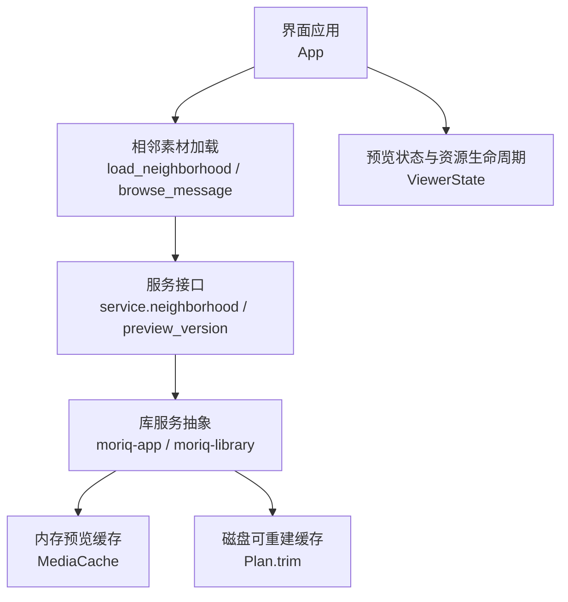
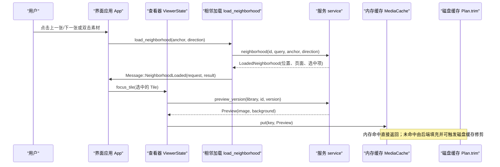
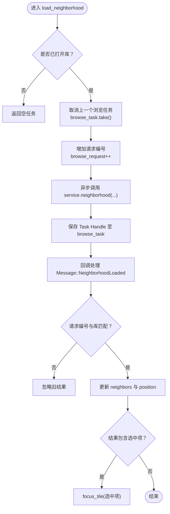
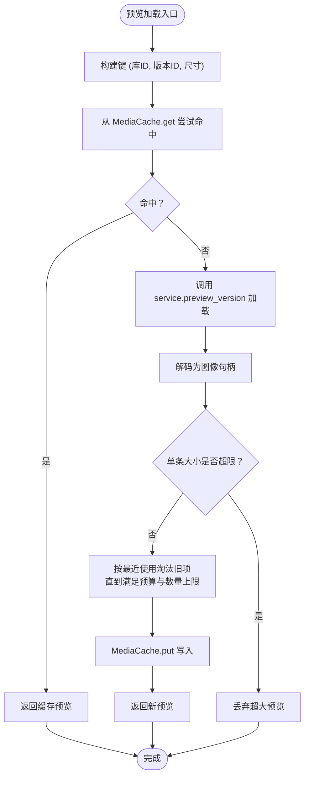
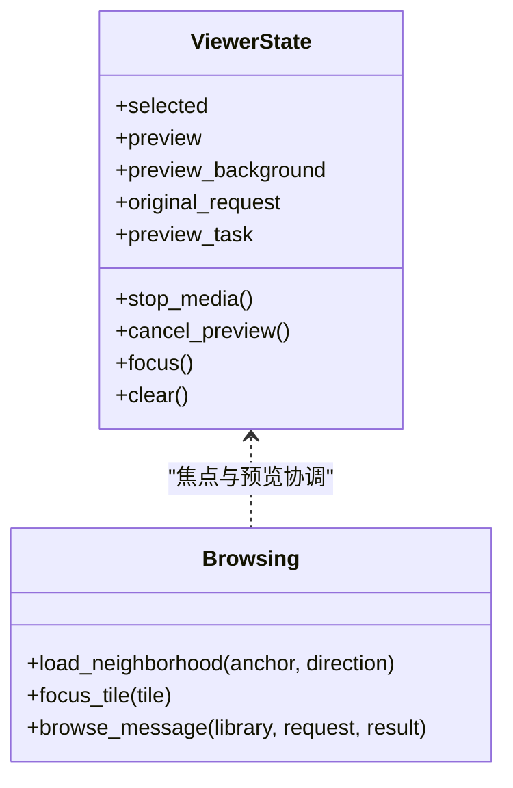
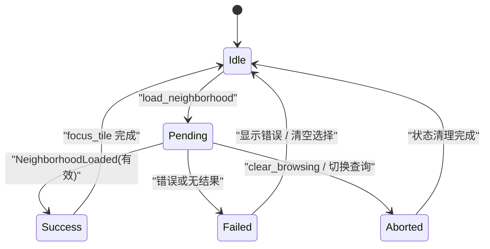
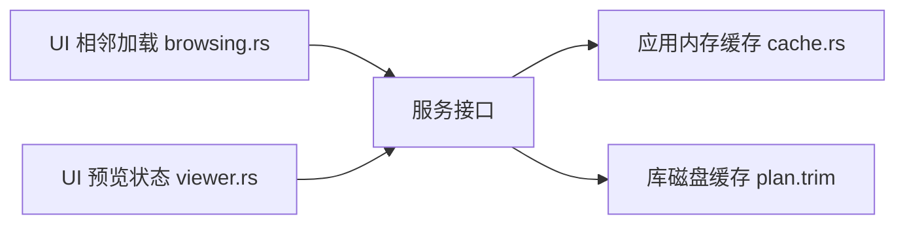

# 素材加载与缓存机制

> Repo Wiki 节点 `asset-loading`
> 导出自 Qoder 知识库快照 `8fbe02f6-57c2-4874-b725-1a8130851fd9`，代码基线 `7a7a8e75e18bd90294e09cd422dd7ed5a04813a0`（分支 main，zh-CN）。

<cite>
**本文引用的文件**   
- [browsing.rs](../../../../crates/moriq-ui/src/browsing.rs)
- [viewer.rs](../../../../crates/moriq-ui/src/viewer.rs)
- [lib.rs](../../../../crates/moriq-ui/src/lib.rs)
- [cache.rs](../../../../crates/moriq-app/src/cache.rs)
- [cache.rs](../../../../crates/moriq-library/src/media/cache.rs)
</cite>

## 目录
1. [引言](#引言)
2. [项目结构](#项目结构)
3. [核心组件](#核心组件)
4. [架构总览](#架构总览)
5. [详细组件分析](#详细组件分析)
6. [依赖关系分析](#依赖关系分析)
7. [性能考虑](#性能考虑)
8. [故障排查指南](#故障排查指南)
9. [结论](#结论)

## 引言
本文聚焦于素材浏览、预览图片加载与缓存的整体机制，重点说明以下能力：
- 相邻素材异步加载：方向判断、请求去重、结果回调与焦点定位。
- 预览图片懒加载策略：预加载阈值、内存预算、淘汰与清理。
- 锚点定位：确保查看器聚焦到正确的素材版本。
- 浏览任务生命周期：取消、复用与失效。
同时提供可操作的优化建议与常见问题解决方案，帮助在大量素材场景下保持流畅的浏览体验。

## 项目结构
该功能横跨界面层与应用服务层：
- 界面层负责发起相邻素材请求、处理回执消息、维护预览状态与焦点。
- 应用层提供内存预览缓存与磁盘可重建路径缓存管理。
- UI 侧通过 Iced 的任务模型进行异步执行与取消。

**图表来源**
- [browsing.rs:59-78](../../../../crates/moriq-ui/src/browsing.rs#L59-L78)
- [browsing.rs:138-163](../../../../crates/moriq-ui/src/browsing.rs#L138-L163)
- [viewer.rs:5-23](../../../../crates/moriq-ui/src/viewer.rs#L5-L23)
- [cache.rs:5-15](../../../../crates/moriq-app/src/cache.rs#L5-L15)
- [cache.rs:1-10](../../../../crates/moriq-library/src/media/cache.rs#L1-L10)

**章节来源**
- [lib.rs:310-323](../../../../crates/moriq-ui/src/lib.rs#L310-L323)
- [browsing.rs:59-78](../../../../crates/moriq-ui/src/browsing.rs#L59-L78)
- [viewer.rs:5-23](../../../../crates/moriq-ui/src/viewer.rs#L5-L23)
- [cache.rs:5-15](../../../../crates/moriq-app/src/cache.rs#L5-L15)
- [cache.rs:1-10](../../../../crates/moriq-library/src/media/cache.rs#L1-L10)

## 核心组件
- 相邻素材加载器：负责按查询与锚点发起异步邻居读取，并保证请求唯一性与正确回调。
- 预览任务控制器：绑定预览原图与背景图的请求、取消、复用与失效。
- 内存预览缓存：基于键（库、版本、尺寸）的最近使用顺序缓存，限制条目数与总字节。
- 磁盘可重建缓存计划：对预览与缩略图等可重建路径做预算裁剪，释放空间。

**章节来源**
- [browsing.rs:59-78](../../../../crates/moriq-ui/src/browsing.rs#L59-L78)
- [browsing.rs:138-163](../../../../crates/moriq-ui/src/browsing.rs#L138-L163)
- [cache.rs:5-15](../../../../crates/moriq-app/src/cache.rs#L5-L15)
- [cache.rs:1-10](../../../../crates/moriq-library/src/media/cache.rs#L1-L10)

## 架构总览
相邻素材加载与预览缓存的流程如下：

**图表来源**
- [browsing.rs:59-78](../../../../crates/moriq-ui/src/browsing.rs#L59-L78)
- [browsing.rs:138-163](../../../../crates/moriq-ui/src/browsing.rs#L138-L163)
- [cache.rs:5-15](../../../../crates/moriq-app/src/cache.rs#L5-L15)
- [cache.rs:1-10](../../../../crates/moriq-library/src/media/cache.rs#L1-L10)

## 详细组件分析

### 相邻素材异步加载（load_neighborhood）
该流程围绕“方向+锚点”决定下一页或上一页的起始素材，并通过请求编号防止旧结果覆盖新结果。

- 方向判断：调用方传入方向参数（例如上一张或下一张），服务层根据当前查询和锚点计算相邻范围。
- 请求去重：每次发起前递增 `browse_request`，并保留上一次 `browse_task` 句柄用于取消；只有最新请求的回调才会被接受。
- 结果回调：收到成功后更新邻居列表、页码位置；若结果中包含“选中项”，则自动调用焦点逻辑将其聚焦。
- 失败与清空：查询为空时清空选择与预览；错误信息写入状态供界面展示。

**图表来源**
- [browsing.rs:59-78](../../../../crates/moriq-ui/src/browsing.rs#L59-L78)
- [browsing.rs:199-214](../../../../crates/moriq-ui/src/browsing.rs#L199-L214)

**章节来源**
- [browsing.rs:59-78](../../../../crates/moriq-ui/src/browsing.rs#L59-L78)
- [browsing.rs:199-214](../../../../crates/moriq-ui/src/browsing.rs#L199-L214)

### 预览图片懒加载与缓存策略
预览加载分为两个阶段：
- 懒加载触发：当素材切换或首次显示时，启动 `preview_version` 任务，获取主图与背景图句柄。
- 内存缓存：成功解码后写入 `MediaCache`，后续相同键可直接命中。
- 淘汰策略：每条预览记录附带最近使用时间戳；当总字节超过预算或条目数达到上限时，淘汰最久未使用的项。
- 单条大小保护：过大预览直接丢弃，避免异常大对象撑爆内存。
- 清理时机：切换库或需要强制刷新时，调用 `clear` 清空缓存，避免跨库污染。

**图表来源**
- [cache.rs:5-15](../../../../crates/moriq-app/src/cache.rs#L5-L15)
- [cache.rs:1-10](../../../../crates/moriq-library/src/media/cache.rs#L1-L10)

**章节来源**
- [cache.rs:5-15](../../../../crates/moriq-app/src/cache.rs#L5-L15)
- [cache.rs:1-10](../../../../crates/moriq-library/src/media/cache.rs#L1-L10)

### 锚点定位与焦点协调
锚点定位确保用户期望的素材成为当前焦点，且不会因旧请求造成错位：
- 视图状态持有当前选中素材、预览句柄、背景图与视频等媒体资源。
- 切换焦点时先停止媒体、取消预览任务、递增原始请求号，使旧回执失效。
- 相邻加载完成后，若结果包含选中项，会再次调用 `focus_tile` 将目标素材设为当前焦点。
- 若选择的素材与当前预览属于同一版本，且已有进行中或已完成预览，则复用该预览，避免重复加载。

**图表来源**
- [viewer.rs:5-23](../../../../crates/moriq-ui/src/viewer.rs#L5-L23)
- [browsing.rs:81-163](../../../../crates/moriq-ui/src/browsing.rs#L81-L163)

**章节来源**
- [viewer.rs:5-23](../../../../crates/moriq-ui/src/viewer.rs#L5-L23)
- [browsing.rs:81-163](../../../../crates/moriq-ui/src/browsing.rs#L81-L163)

### 浏览任务的生命周期管理
- 任务创建：`load_neighborhood` 通过 `Task::perform(...).abortable()` 创建可取消任务，并保存句柄。
- 任务取消：切换查询、打开其他页面或清除浏览状态时，调用 `handle.abort()` 并重置 `browse_task`。
- 请求编号：每次新建任务递增 `browse_request`；回调中校验 `browse_request == request` 且库标识一致才处理结果。
- 状态清理：清除浏览时还会清空邻居列表、位置、滚动偏移与笔记恢复标记，避免旧数据影响新浏览。

**图表来源**
- [browsing.rs:59-78](../../../../crates/moriq-ui/src/browsing.rs#L59-L78)
- [browsing.rs:199-214](../../../../crates/moriq-ui/src/browsing.rs#L199-L214)

**章节来源**
- [browsing.rs:59-78](../../../../crates/moriq-ui/src/browsing.rs#L59-L78)
- [browsing.rs:199-214](../../../../crates/moriq-ui/src/browsing.rs#L199-L214)

## 依赖关系分析
- UI 层依赖服务接口进行异步数据读取，不直接访问底层存储。
- 内存预览缓存位于应用层，供 UI 层快速获取已解码预览。
- 磁盘缓存计划由库层提供，用于在后台或维护阶段按预算裁剪可重建文件。

**图表来源**
- [browsing.rs:59-78](../../../../crates/moriq-ui/src/browsing.rs#L59-L78)
- [viewer.rs:5-23](../../../../crates/moriq-ui/src/viewer.rs#L5-L23)
- [cache.rs:5-15](../../../../crates/moriq-app/src/cache.rs#L5-L15)
- [cache.rs:1-10](../../../../crates/moriq-library/src/media/cache.rs#L1-L10)

**章节来源**
- [lib.rs:310-323](../../../../crates/moriq-ui/src/lib.rs#L310-L323)
- [browsing.rs:59-78](../../../../crates/moriq-ui/src/browsing.rs#L59-L78)
- [viewer.rs:5-23](../../../../crates/moriq-ui/src/viewer.rs#L5-L23)
- [cache.rs:5-15](../../../../crates/moriq-app/src/cache.rs#L5-L15)
- [cache.rs:1-10](../../../../crates/moriq-library/src/media/cache.rs#L1-L10)

## 性能考虑
- 相邻加载并发控制：每次只保留一个活跃浏览任务，旧任务立即取消，避免并行重复请求。
- 请求去重：通过递增请求编号与库标识双重校验，确保仅最新结果生效。
- 预览复用：同一素材版本的进行中或已完成预览可复用，减少重复解码。
- 内存预算：预览缓存限制最大条目数与总字节，淘汰最久未使用项；单条过大预览直接丢弃。
- 磁盘缓存裁剪：对可重建文件按修改时间与路径排序，逐步删除以满足预算，降低磁盘占用。

[本节为通用性能建议，无需具体代码引用]

## 故障排查指南
- 重复请求问题
  - 现象：快速切换相邻素材时出现多次网络请求或重复解码。
  - 原因：旧浏览任务未被取消，或回调未校验请求编号。
  - 处理：确认 `load_neighborhood` 在每次新建任务前调用 `handle.abort()`，并在回调中校验 `browse_request` 与库标识。
  - 参考实现位置：
    - [browsing.rs:59-78](../../../../crates/moriq-ui/src/browsing.rs#L59-L78)
    - [browsing.rs:199-214](../../../../crates/moriq-ui/src/browsing.rs#L199-L214)

- 内存泄漏或卡顿
  - 现象：长时间浏览后内存持续增长，切换库后仍残留旧素材像素。
  - 原因：预览缓存未清理或单条预览过大。
  - 处理：在切换库或必要时调用 `MediaCache.clear()`；确保超大预览被丢弃。
  - 参考实现位置：
    - [cache.rs:5-15](../../../../crates/moriq-app/src/cache.rs#L5-L15)

- 预览错位或焦点不正确
  - 现象：相邻加载完成后，查看器聚焦到了错误的素材。
  - 原因：旧预览任务仍在运行，或 `original_request` 未递增导致回执无效化失败。
  - 处理：切换焦点前调用 `ViewerState.focus()` 以停止媒体、取消预览、递增请求号；相邻加载成功后再调用 `focus_tile`。
  - 参考实现位置：
    - [viewer.rs:5-23](../../../../crates/moriq-ui/src/viewer.rs#L5-L23)
    - [browsing.rs:81-163](../../../../crates/moriq-ui/src/browsing.rs#L81-L163)

- 磁盘缓存未释放
  - 现象：预览与缩略图占满磁盘。
  - 原因：未执行可重建路径裁剪。
  - 处理：调用 `Plan.trim(budget)` 按预算删除旧文件。
  - 参考实现位置：
    - [cache.rs:1-10](../../../../crates/moriq-library/src/media/cache.rs#L1-L10)

**章节来源**
- [browsing.rs:59-78](../../../../crates/moriq-ui/src/browsing.rs#L59-L78)
- [browsing.rs:81-163](../../../../crates/moriq-ui/src/browsing.rs#L81-L163)
- [browsing.rs:199-214](../../../../crates/moriq-ui/src/browsing.rs#L199-L214)
- [viewer.rs:5-23](../../../../crates/moriq-ui/src/viewer.rs#L5-L23)
- [cache.rs:5-15](../../../../crates/moriq-app/src/cache.rs#L5-L15)
- [cache.rs:1-10](../../../../crates/moriq-library/src/media/cache.rs#L1-L10)

## 结论
该素材加载与缓存机制通过相邻素材异步加载、请求去重、预览懒加载与内存预算控制，实现了高吞吐、低延迟的浏览体验。锚点定位与查看器生命周期管理确保了焦点一致性，避免旧任务干扰。配合磁盘可重建缓存裁剪，可在大数据集上维持稳定的内存与磁盘占用。实际使用中，应重点关注任务取消、请求编号校验与缓存清理策略，以规避重复请求与内存泄漏等问题。