# 选择状态管理

> Repo Wiki 节点 `selection-management`
> 导出自 Qoder 知识库快照 `8fbe02f6-57c2-4874-b725-1a8130851fd9`，代码基线 `7a7a8e75e18bd90294e09cd422dd7ed5a04813a0`（分支 main，zh-CN）。

<cite>
**本文引用的文件**
- [selection.rs](../../../../crates/moriq-ui/src/selection.rs)
- [manage.rs](../../../../crates/moriq-ui/src/manage.rs)
- [lib.rs](../../../../crates/moriq-ui/src/lib.rs)
- [polling.rs](../../../../crates/moriq-ui/src/polling.rs)
- [synco.rs](../../../../crates/moriq-library/src/transfer/synco.rs)
</cite>

## 目录
1. [引言](#引言)
2. [项目结构](#项目结构)
3. [核心组件](#核心组件)
4. [架构总览](#架构总览)
5. [详细组件分析](#详细组件分析)
6. [依赖关系分析](#依赖关系分析)
7. [性能与行为特征](#性能与行为特征)
8. [故障排查指南](#故障排查指南)
9. [结论](#结论)
10. [附录：测试与调试技巧](#附录测试与调试技巧)

## 引言
本文聚焦于应用中的“选择状态管理”，覆盖以下关键主题：
- SelectionState 的设计与实现，包括单选、多选和范围选择的交互语义。
- 选择锚点 anchor 的作用机制，以及如何避免旧查询导致的选择泄漏。
- additive 模式下的批量操作逻辑。
- SyncoState 的状态机、轮询退避算法和错误恢复策略。
- 选择状态与图库点击、拖拽和键盘快捷键的协作关系。
- 复杂选中逻辑、边界情况处理与外部状态同步的实现思路。
- 测试用例与调试建议。

该文档以源码为依据，通过图示和路径引用帮助读者快速定位相关实现。

## 项目结构
与选择状态相关的代码主要分布在 UI 层和库层之间：
- UI 层负责用户交互、选择集合、范围选择和轮询控制。
- 库层负责 Synco 任务准备、状态持久化与副本清理。

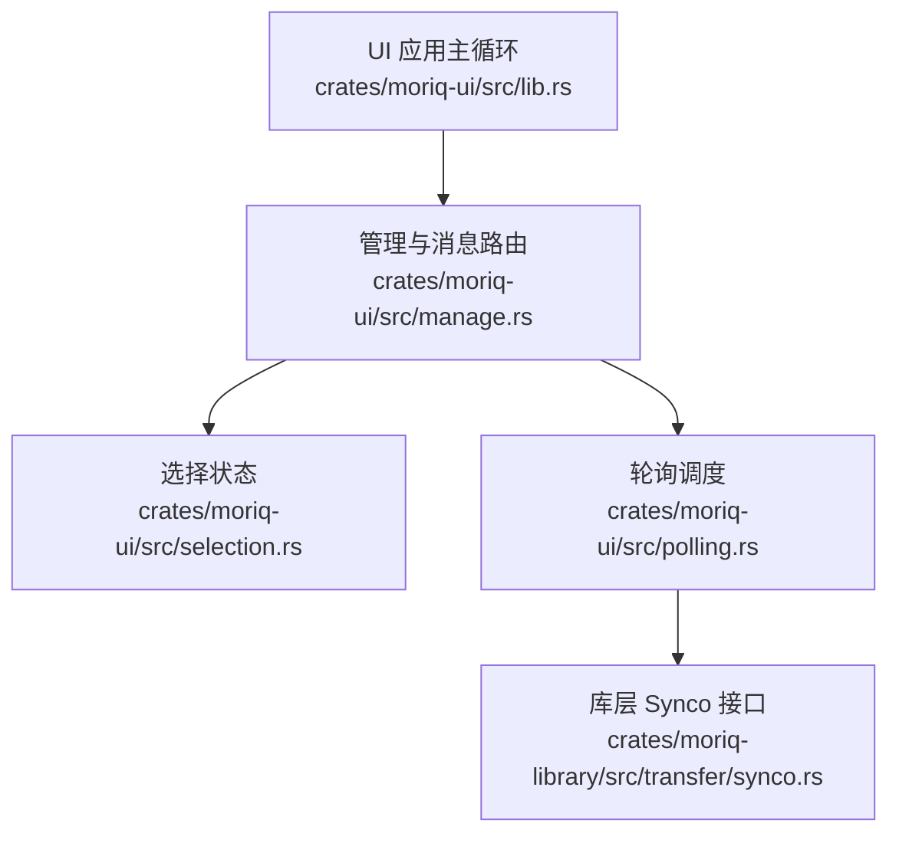

**图表来源**
- [lib.rs:1962-1976](../../../../crates/moriq-ui/src/lib.rs#L1962-L1976)
- [manage.rs:1005-1047](../../../../crates/moriq-ui/src/manage.rs#L1005-L1047)
- [selection.rs:1-88](../../../../crates/moriq-ui/src/selection.rs#L1-L88)
- [polling.rs:1-73](../../../../crates/moriq-ui/src/polling.rs#L1-L73)
- [synco.rs:75-210](../../../../crates/moriq-library/src/transfer/synco.rs#L75-L210)

**章节来源**
- [selection.rs:1-88](../../../../crates/moriq-ui/src/selection.rs#L1-L88)
- [manage.rs:1005-1047](../../../../crates/moriq-ui/src/manage.rs#L1005-L1047)
- [lib.rs:1962-1976](../../../../crates/moriq-ui/src/lib.rs#L1962-L1976)
- [polling.rs:1-73](../../../../crates/moriq-ui/src/polling.rs#L1-L73)
- [synco.rs:75-210](../../../../crates/moriq-library/src/transfer/synco.rs#L75-L210)

## 核心组件
本节概述三个核心数据结构及其职责：
- SelectionState：维护已选素材集合、多选开关、additive 模式和选择锚点。
- SyncoState：维护 Synco 轮询的运行状态、等待计数和指数退避间隔。
- Library 的 Synco 接口：负责准备任务、记录错误、处理远端确认和副本清理。

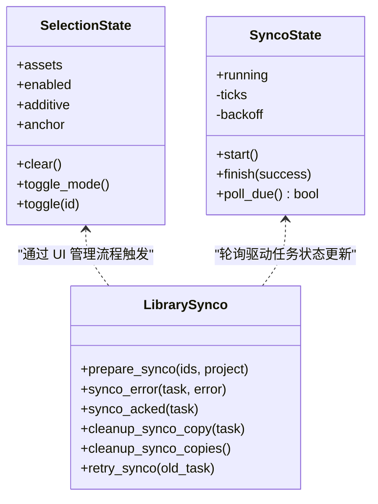

**图表来源**
- [selection.rs:4-56](../../../../crates/moriq-ui/src/selection.rs#L4-L56)
- [synco.rs:75-210](../../../../crates/moriq-library/src/transfer/synco.rs#L75-L210)

**章节来源**
- [selection.rs:4-56](../../../../crates/moriq-ui/src/selection.rs#L4-L56)
- [synco.rs:75-210](../../../../crates/moriq-library/src/transfer/synco.rs#L75-L210)

## 架构总览
下图展示了从用户点击到选择状态更新、再到 Synco 轮询和任务处理的完整链路。

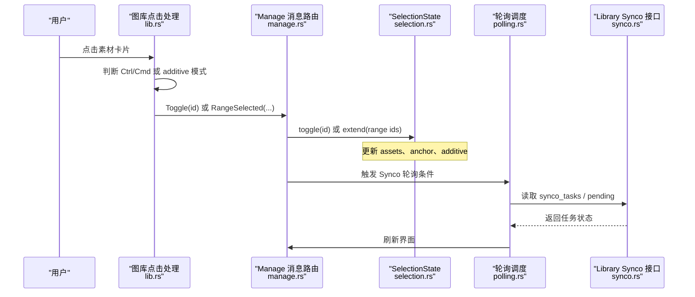

**图表来源**
- [lib.rs:1962-1976](../../../../crates/moriq-ui/src/lib.rs#L1962-L1976)
- [manage.rs:1005-1047](../../../../crates/moriq-ui/src/manage.rs#L1005-L1047)
- [selection.rs:10-26](../../../../crates/moriq-ui/src/selection.rs#L10-L26)
- [polling.rs:53-66](../../../../crates/moriq-ui/src/polling.rs#L53-L66)
- [synco.rs:13-210](../../../../crates/moriq-library/src/transfer/synco.rs#L13-L210)

## 详细组件分析

### SelectionState：单选、多选与范围选择
SelectionState 的核心设计要点：
- assets 使用哈希集合存储已选素材 ID，支持 O(1) 插入与移除。
- enabled 表示是否进入多选模式；toggle_mode 会切换该标志并清空选择。
- additive 表示当前是否在 additive 模式下累积选择；clear 会重置该标志。
- anchor 保存最后一次操作的素材 ID，用于后续范围选择计算；clear 会清空 anchor，防止旧查询残留。

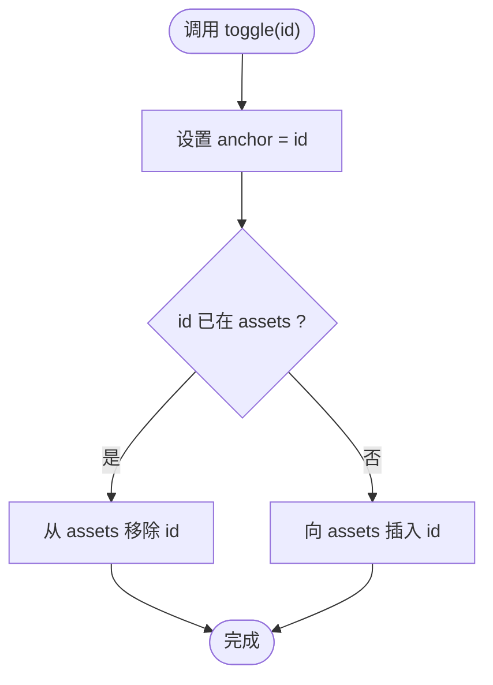

**图表来源**
- [selection.rs:23-26](../../../../crates/moriq-ui/src/selection.rs#L23-L26)

关键行为说明：
- clear：清空 assets、anchor 和 additive，避免旧查询导致的范围选择泄漏。
- toggle_mode：切换 enabled，并调用 clear 重置选择状态。
- toggle：每次操作都会把 anchor 更新为当前素材 ID，确保范围选择总是基于最近一次点击。

复杂度分析：
- toggle：O(1) 平均时间（HashSet）。
- clear：O(n) 清空集合。
- 扩展 range ids：O(k)，k 为返回的素材数量。

**章节来源**
- [selection.rs:4-26](../../../../crates/moriq-ui/src/selection.rs#L4-L26)

### 选择锚点（anchor）机制
anchor 是范围选择的起点。其作用机制如下：
- 当用户按住 Shift 点击时，UI 层根据当前 anchor 和目标 ID 发起异步范围查询。
- 如果未设置 anchor，Shift 点击不会触发范围选择。
- 任何普通点击（非 Shift）都会通过 toggle 更新 anchor，保证下一次 Shift 点击能基于最新位置计算范围。
- clear 会清除 anchor，避免在切换查询或退出多选后继续使用旧的起点。

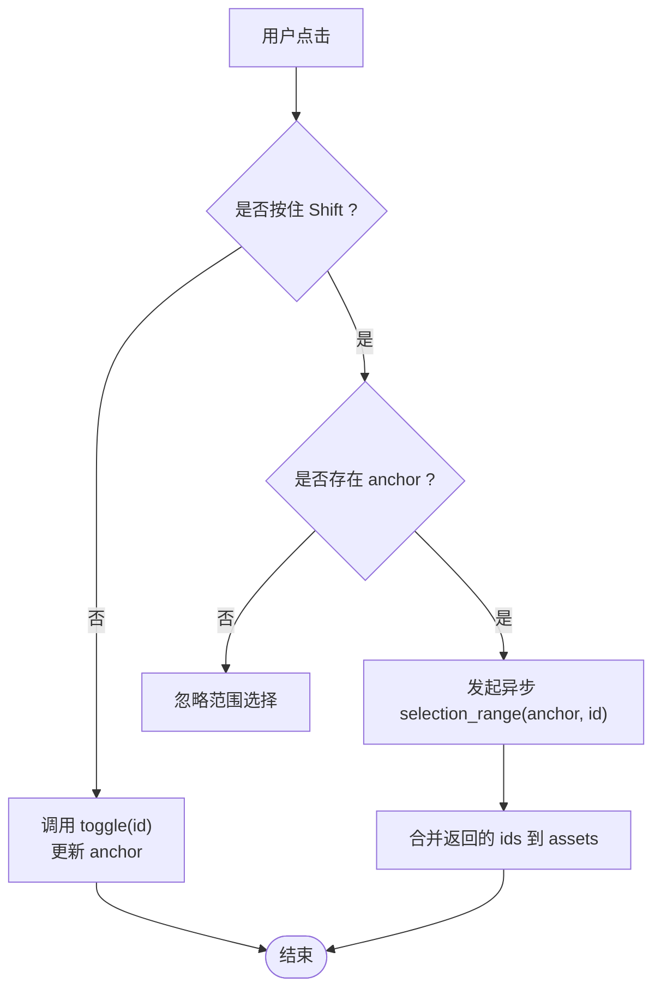

**图表来源**
- [manage.rs:1016-1036](../../../../crates/moriq-ui/src/manage.rs#L1016-L1036)
- [selection.rs:23-26](../../../../crates/moriq-ui/src/selection.rs#L23-L26)

**章节来源**
- [manage.rs:1016-1036](../../../../crates/moriq-ui/src/manage.rs#L1016-L1036)
- [selection.rs:12-26](../../../../crates/moriq-ui/src/selection.rs#L12-L26)

### additive 模式与批量操作
additive 模式用于在点击过程中累积选择，而不是替换选择集合。典型场景：
- 首次点击且处于 additive 模式时，UI 层会先启用多选模式，并保留当前预览项作为初始选择。
- 随后点击其他素材会直接 toggle，将目标加入或移除选择集合。
- 退出 additive 模式或切换查询时，UI 层会 clear 选择集合，避免跨页面或跨查询污染。

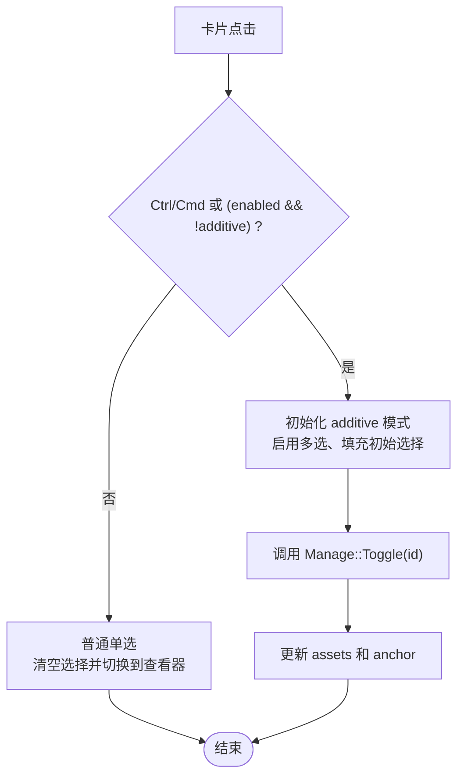

**图表来源**
- [lib.rs:1962-1976](../../../../crates/moriq-ui/src/lib.rs#L1962-L1976)
- [manage.rs:1036-1047](../../../../crates/moriq-ui/src/manage.rs#L1036-L1047)

**章节来源**
- [lib.rs:1962-1976](../../../../crates/moriq-ui/src/lib.rs#L1962-L1976)
- [manage.rs:1036-1047](../../../../crates/moriq-ui/src/manage.rs#L1036-L1047)

### SyncoState：轮询退避与错误恢复
SyncoState 是一个轻量级状态机，用于控制 UI 对 Synco 任务的轮询频率，避免频繁请求：
- running：标记当前是否有正在执行的轮询任务。
- ticks：累计 tick 次数。
- backoff：最小轮询间隔，失败时指数增长，成功时恢复默认值。

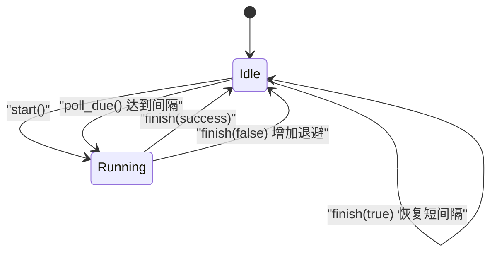

**图表来源**
- [selection.rs:31-56](../../../../crates/moriq-ui/src/selection.rs#L31-L56)

退避算法要点：
- poll_due 每次递增 ticks，当 ticks 大于等于 max(backoff, 8) 且不在运行中时才允许轮询。
- finish(false) 将 backoff 翻倍，下限为 8，上限为 120。
- finish(true) 将 backoff 恢复为 8，并重置 ticks。

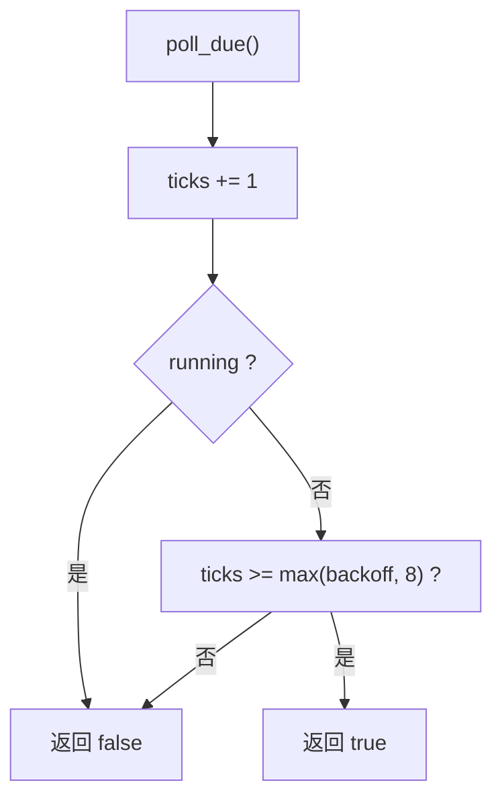

**图表来源**
- [selection.rs:53-56](../../../../crates/moriq-ui/src/selection.rs#L53-L56)

**章节来源**
- [selection.rs:31-56](../../../../crates/moriq-ui/src/selection.rs#L31-L56)

### 选择状态与画廊交互
画廊点击与键盘修饰键共同决定选择行为：
- 普通点击：关闭多选模式，清空选择，进入预览视图。
- Ctrl/Cmd 点击或 additive 模式：进入或维持 additive 模式，并调用 Manage::Toggle。
- Shift 点击：若存在 anchor，则发起异步范围选择，并将结果合并到 assets。
- 可见区域选择：启用多选并选择当前可见范围内的素材。

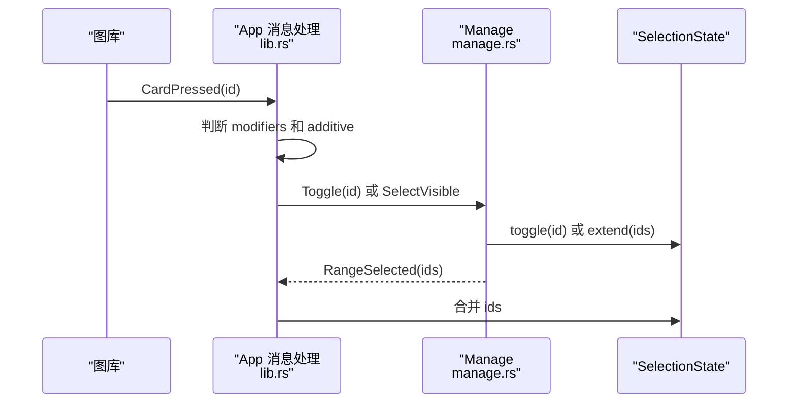

**图表来源**
- [lib.rs:1962-1976](../../../../crates/moriq-ui/src/lib.rs#L1962-L1976)
- [manage.rs:1005-1047](../../../../crates/moriq-ui/src/manage.rs#L1005-L1047)

**章节来源**
- [lib.rs:1962-1976](../../../../crates/moriq-ui/src/lib.rs#L1962-L1976)
- [manage.rs:1005-1047](../../../../crates/moriq-ui/src/manage.rs#L1005-L1047)

### Synco 轮询与任务处理
轮询由 polling 模块驱动，结合 SyncoState 的退避策略：
- 当 synco.poll_due() 为真，且存在待处理或活跃任务时，触发 ManageMessage::SyncoPoll。
- Library 提供 prepare_synco、synco_error、synco_acked、cleanup_synco_copy 等方法，用于任务生命周期管理。

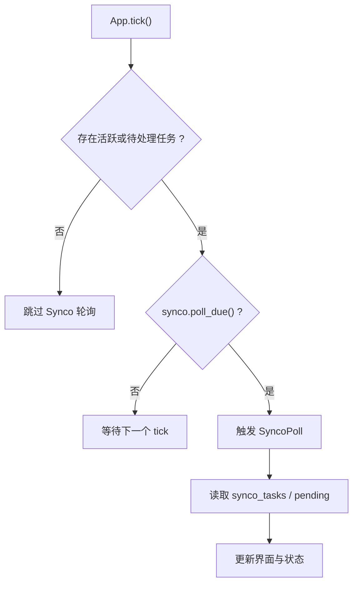

**图表来源**
- [polling.rs:53-66](../../../../crates/moriq-ui/src/polling.rs#L53-L66)
- [synco.rs:13-210](../../../../crates/moriq-library/src/transfer/synco.rs#L13-L210)

**章节来源**
- [polling.rs:53-66](../../../../crates/moriq-ui/src/polling.rs#L53-L66)
- [synco.rs:13-210](../../../../crates/moriq-library/src/transfer/synco.rs#L13-L210)

## 依赖关系分析
选择状态与 UI、轮询和库层之间存在清晰的单向依赖：
- UI 层依赖 SelectionState 进行选择集合操作。
- UI 层依赖 SyncoState 控制轮询节奏。
- UI 层通过 manage 消息路由触发 Library 的 Synco 接口。
- Library 层负责数据库事务、文件复制、哈希校验和副本清理。

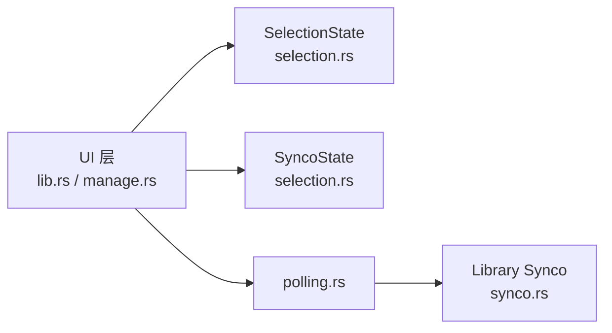

**图表来源**
- [lib.rs:1962-1976](../../../../crates/moriq-ui/src/lib.rs#L1962-L1976)
- [manage.rs:1005-1047](../../../../crates/moriq-ui/src/manage.rs#L1005-L1047)
- [selection.rs:4-56](../../../../crates/moriq-ui/src/selection.rs#L4-L56)
- [polling.rs:53-66](../../../../crates/moriq-ui/src/polling.rs#L53-L66)
- [synco.rs:75-210](../../../../crates/moriq-library/src/transfer/synco.rs#L75-L210)

**章节来源**
- [lib.rs:1962-1976](../../../../crates/moriq-ui/src/lib.rs#L1962-L1976)
- [manage.rs:1005-1047](../../../../crates/moriq-ui/src/manage.rs#L1005-L1047)
- [selection.rs:4-56](../../../../crates/moriq-ui/src/selection.rs#L4-L56)
- [polling.rs:53-66](../../../../crates/moriq-ui/src/polling.rs#L53-L66)
- [synco.rs:75-210](../../../../crates/moriq-library/src/transfer/synco.rs#L75-L210)

## 性能与行为特征
- 选择集合使用 HashSet，插入与删除为 O(1) 平均时间；适合大量素材的快速增删。
- anchor 仅在需要范围选择时使用，避免不必要的范围查询。
- SyncoState 的退避机制有效降低轮询频率，失败时最大退避间隔为 120，成功时恢复为 8。
- Library 层的 prepare_synco 限制每批最多 100 个素材，防止过大批量导致性能问题。
- 文件复制后进行哈希校验，确保传输副本与源版本一致。

[本节为通用性能讨论，不直接分析具体文件]

## 故障排查指南
常见问题与定位方法：
- 范围选择无效：检查是否存在 anchor；确认 Shift 点击前是否已有普通点击更新 anchor。
- 选择集合污染：确认 clear 是否在查询切换或多选退出时被调用。
- 轮询过于频繁：检查 SyncoState 的 backoff 是否正确恢复；确认 finish(true) 是否在成功后被调用。
- Synco 任务失败：查看 Library 层的 synco_error 返回值与数据库状态；检查文件路径和格式限制。
- 副本未清理：确认 cleanup_synco_copy 是否被执行；检查 copy_removed 标志和 ack 状态。

**章节来源**
- [selection.rs:12-26](../../../../crates/moriq-ui/src/selection.rs#L12-L26)
- [selection.rs:31-56](../../../../crates/moriq-ui/src/selection.rs#L31-L56)
- [synco.rs:75-210](../../../../crates/moriq-library/src/transfer/synco.rs#L75-L210)

## 结论
SelectionState 通过 anchor 和 additive 模式实现了直观的单选、多选与范围选择体验；SyncoState 提供了稳健的轮询退避策略；Library 层确保了 Synco 任务的生命周期完整性。三者协同工作，使选择状态既具备交互灵活性，又具备良好的可维护性和性能表现。

[本节为总结性内容，不直接分析具体文件]

## 附录：测试与调试技巧
推荐测试场景：
- 验证 clear 是否同时清空 assets、anchor 和 additive。
- 验证 toggle_mode 是否能正确切换 enabled 并重置选择。
- 验证 toggle 是否每次都更新 anchor，并正确增删 assets。
- 验证 SyncoState 的 poll_due 在 running 状态下始终返回 false。
- 验证 finish(false) 会增加 backoff，finish(true) 会恢复默认值。
- 验证 prepare_synco 对空列表、超过 100 个素材、非法格式的拒绝行为。
- 验证 synco_acked 后会清理受管副本并更新状态。

调试技巧：
- 在选择操作中打印 anchor 和 additive 状态，确认范围选择起点是否正确。
- 在 Synco 轮询入口记录 backoff 和 ticks，观察退避变化。
- 在 Library 层记录 prepare_synco 的参数和返回值，确认任务生成是否符合预期。
- 使用单元测试覆盖边界情况，例如无 anchor 的 Shift 点击、多次失败后的 backoff 上限。

**章节来源**
- [selection.rs:64-88](../../../../crates/moriq-ui/src/selection.rs#L64-L88)
- [synco.rs:75-210](../../../../crates/moriq-library/src/transfer/synco.rs#L75-L210)