# AI 分析结果存储

> Repo Wiki 节点 `ai-analysis-results`
> 导出自 Qoder 知识库快照 `8fbe02f6-57c2-4874-b725-1a8130851fd9`，代码基线 `7a7a8e75e18bd90294e09cd422dd7ed5a04813a0`（分支 main，zh-CN）。

<cite>
**本文引用的文件**   
- [schema.sql](../../../../crates/moriq-library/src/database/schema.sql)
- [migration_23.sql](../../../../crates/moriq-library/src/database/migrations/migration_23.sql)
- [migration_24.sql](../../../../crates/moriq-library/src/database/migrations/migration_24.sql)
- [migration_26.sql](../../../../crates/moriq-library/src/database/migrations/migration_26.sql)
- [migration_27.sql](../../../../crates/moriq-library/src/database/migrations/migration_27.sql)
- [analysis.rs](../../../../crates/moriq-library/src/ai/analysis.rs)
- [ai_content.rs](../../../../crates/moriq-library/src/ai/ai_content.rs)
- [ai.rs](../../../../crates/moriq-domain/src/ai.rs)
- [inference.rs](../../../../crates/moriq-app/src/inference.rs)
- [ai.rs](../../../../crates/moriq-ui/src/ai.rs)
- [ai_content_tests.rs](../../../../crates/moriq-library/src/tests/ai_content_tests.rs)
</cite>

## 目录
1. [引言](#引言)
2. [项目结构](#项目结构)
3. [核心组件](#核心组件)
4. [架构总览](#架构总览)
5. [详细组件分析](#详细组件分析)
6. [依赖关系分析](#依赖关系分析)
7. [性能与一致性考虑](#性能与一致性考虑)
8. [故障排查指南](#故障排查指南)
9. [结论](#结论)
10. [附录：数据流示例](#附录数据流示例)

## 引言
本文聚焦 Moriq 的 AI 分析结果存储方案，重点解释以下内容：
- `ai_analysis_runs` 表如何记录版本绑定的历史分析回执。
- `ai_effective_results` 表如何通过有效结果指针维护每个素材当前版本的最新 AI 分析结果。
- `ai_overrides` 表如何持久化人工分类、主题列表和描述覆盖。
- `ai_rejected_tags` 表如何实现标签拒绝机制，防止自动标签重复显示。
- 内容详情查询逻辑如何合并自动分析与人工覆盖，并过滤被拒绝的标签。
- 从模型推理到前端展示的完整数据流。
- 事务性编辑和数据一致性保障机制。

该设计将“不可变的历史回执”“当前版本的有效指针”“人工覆盖”“可见标签过滤”分层解耦，既保留分析可追溯性，又支持灵活的人工修正与项目隔离。

## 项目结构
AI 分析相关的数据定义和实现分布在以下位置：
- 数据库基础结构与迁移脚本位于 `crates/moriq-library/src/database/schema.sql` 与各 `migration_*.sql`。
- AI 分析输入校验、结果归一化和存储逻辑位于 `crates/moriq-library/src/ai/analysis.rs`。
- 有效结果保存、人工编辑、拒绝标签和内容详情读取位于 `crates/moriq-library/src/ai/ai_content.rs`。
- AI 领域模型、分类词表和编辑操作枚举位于 `crates/moriq-domain/src/ai.rs`。
- 应用层推理任务调度与本地推理执行器位于 `crates/moriq-app/src/inference.rs`。
- 前端 AI 状态、消息处理和展示交互位于 `crates/moriq-ui/src/ai.rs`。
- AI 内容行为测试位于 `crates/moriq-library/src/tests/ai_content_tests.rs`。

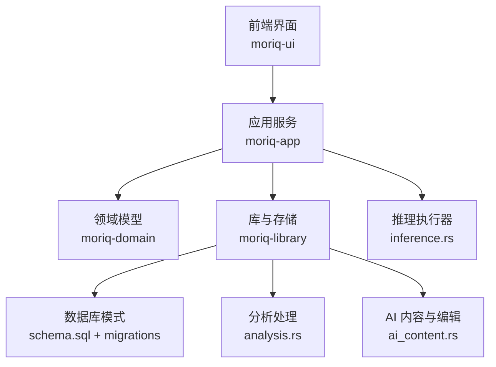

**图示来源**
- [schema.sql:1-42](../../../../crates/moriq-library/src/database/schema.sql#L1-L42)
- [analysis.rs:1-200](../../../../crates/moriq-library/src/ai/analysis.rs#L1-L200)
- [ai_content.rs:1-169](../../../../crates/moriq-library/src/ai/ai_content.rs#L1-L169)
- [ai.rs:1-187](../../../../crates/moriq-domain/src/ai.rs#L1-L187)
- [inference.rs:1-200](../../../../crates/moriq-app/src/inference.rs#L1-L200)

**章节来源**
- [schema.sql:1-42](../../../../crates/moriq-library/src/database/schema.sql#L1-L42)
- [migration_23.sql:1-128](../../../../crates/moriq-library/src/database/migrations/migration_23.sql#L1-L128)
- [migration_26.sql:1-47](../../../../crates/moriq-library/src/database/migrations/migration_26.sql#L1-L47)
- [migration_27.sql:1-9](../../../../crates/moriq-library/src/database/migrations/migration_27.sql#L1-L9)

## 核心组件
本节从数据结构和职责角度说明 AI 分析结果存储的核心组件。

| 组件 | 主要职责 | 关键约束或行为 |
|---|---|---|
| `ai_analysis_runs` | 记录每个素材版本的历史 AI 分析回执 | 包含任务类型、模型修订号、预处理标识、原始 JSON 数据和创建时间；任务类型限定为 `qwen_classification` 与 `qwen_description`。 |
| `ai_effective_results` | 维护每个素材版本对某个任务的最新分析结果指针 | 主键为 `(version_id, task)`，通过外键指向 `ai_analysis_runs`，删除会级联。 |
| `ai_overrides` | 持久化人工覆盖的分类、主题和描述 | 主键为 `version_id`，主题为 JSON 数组且需合法，字段可为空表示未覆盖。 |
| `ai_rejected_tags` | 记录用户拒绝的自动标签 | 主键为 `(version_id, name)`，用于过滤可见自动标签。 |
| `ai_effective_content` | 视图，合并人工覆盖与有效分析结果 | 提供 `medium`、`themes`、`description`、`tags` 及人工覆盖标记。 |
| `ai_visible_tags` | 视图，输出当前版本可见的自动标签 | 基于最新描述任务的结果展开标签，并排除拒绝标签。 |
| `AiEdit` | 前端到后端的人工编辑操作枚举 | 包括分类、媒介、主题、描述、拒绝标签、提升标签和重置拒绝标签。 |

**章节来源**
- [migration_23.sql:3-18](../../../../crates/moriq-library/src/database/migrations/migration_23.sql#L3-L18)
- [migration_27.sql:1-9](../../../../crates/moriq-library/src/database/migrations/migration_27.sql#L1-L9)
- [ai_content.rs:1-169](../../../../crates/moriq-library/src/ai/ai_content.rs#L1-L169)
- [ai.rs:145-187](../../../../crates/moriq-domain/src/ai.rs#L145-L187)

## 架构总览
AI 分析结果存储采用“历史不可变 + 有效指针 + 人工覆盖 + 视图合并”的分层架构：

1. **模型推理阶段**：应用层调用本地推理执行器，返回带模型身份和修订号的 `InferenceResult`。
2. **分析归一化阶段**：库层对 Qwen 输出进行任务校验、字段规范化、词表过滤和配置摘要。
3. **历史写入阶段**：`ai_analysis_runs` 插入新的分析回执，保留完整历史。
4. **有效指针更新阶段**：`ai_effective_results` 将当前任务的最新行 ID 绑定到 `(version_id, task)`。
5. **人工覆盖阶段**：`ai_overrides` 持久化人工修改；拒绝标签写入 `ai_rejected_tags`。
6. **查询展示阶段**：视图 `ai_effective_content` 和 `ai_visible_tags` 合并自动与人工结果，供前端展示和搜索。

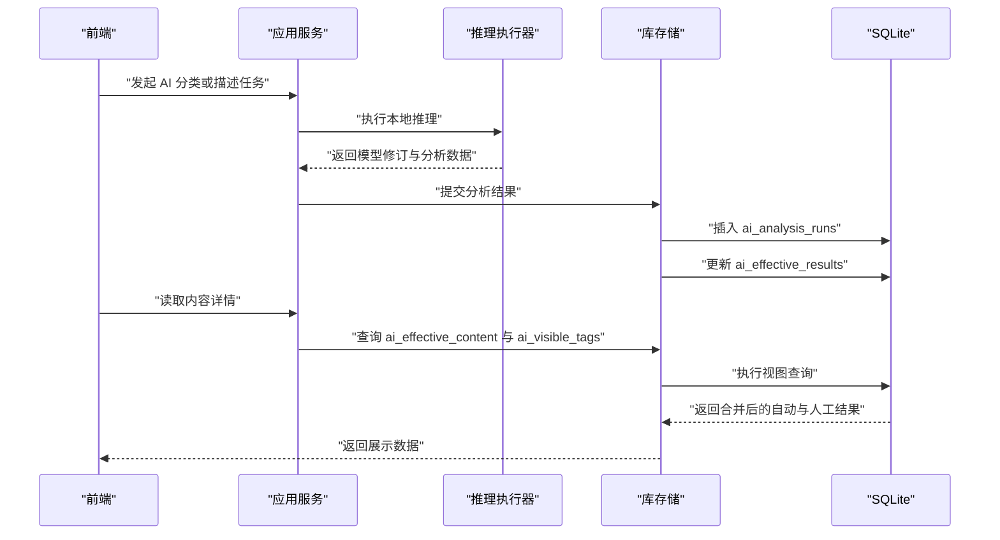

**图示来源**
- [inference.rs:1-200](../../../../crates/moriq-app/src/inference.rs#L1-L200)
- [analysis.rs:1-200](../../../../crates/moriq-library/src/ai/analysis.rs#L1-L200)
- [ai_content.rs:1-169](../../../../crates/moriq-library/src/ai/ai_content.rs#L1-L169)
- [migration_23.sql:3-18](../../../../crates/moriq-library/src/database/migrations/migration_23.sql#L3-L18)

## 详细组件分析

### `ai_analysis_runs`：历史分析回执
`ai_analysis_runs` 是 AI 分析结果的核心历史记录表。它的设计目标是：
- 以素材版本为主维度，避免不同版本互相污染。
- 按任务类型区分分类任务和描述任务。
- 固定预处理标识，便于识别同一批预处理策略下的结果。
- 记录模型修订号，保证结果可追溯到具体模型版本。
- 保存完整的 JSON 数据，便于审计、回放和后续扩展。

关键字段含义如下：
- `id`：自增主键，作为有效结果的外键引用。
- `version_id`：绑定到 `asset_versions.id`，所有 AI 结果都跟随素材版本生命周期。
- `task`：任务类型，限定为 `qwen_classification` 或 `qwen_description`。
- `revision`：模型修订号，由推理执行器注入。
- `preprocessing`：预处理标识，代码中固定为 `srgb-1024-v1`。
- `data`：JSON 格式的分析结果，受 `json_valid(data)` 约束。
- `created_at`：创建时间戳。

此外，迁移脚本为该表创建了 `(version_id, task, id)` 唯一约束和索引，以保证同一版本下任务与历史行之间的稳定关系，并提升查询效率。

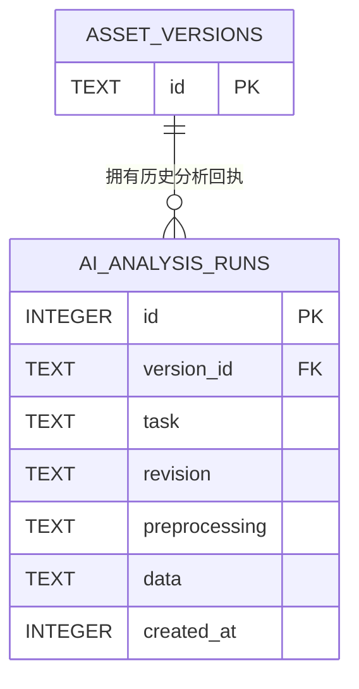

**图示来源**
- [migration_23.sql:3-8](../../../../crates/moriq-library/src/database/migrations/migration_23.sql#L3-L8)

**章节来源**
- [migration_23.sql:3-8](../../../../crates/moriq-library/src/database/migrations/migration_23.sql#L3-L8)
- [analysis.rs:1-200](../../../../crates/moriq-library/src/ai/analysis.rs#L1-L200)

### `ai_effective_results`：有效结果指针
`ai_effective_results` 不是存储完整分析数据的表，而是“指针表”。它为每个 `(version_id, task)` 保存最新的 `run_id`。这样做的优点是：
- 历史不会丢失：旧分析仍保存在 `ai_analysis_runs`。
- 当前结果查找成本低：直接按 `(version_id, task)` 取最新行。
- 删除一致：外键级联删除确保无效历史不会被孤立引用。

有效结果指针的更新由 `save_run` 完成：
1. 校验任务类型为 `qwen_classification` 或 `qwen_description`。
2. 向 `ai_analysis_runs` 插入新回执。
3. 使用 `INSERT ... ON CONFLICT(version_id, task) DO UPDATE SET run_id=excluded.run_id` 更新指针。

这意味着每次成功写入都会把对应任务的最新行 ID 覆盖到有效结果指针上。

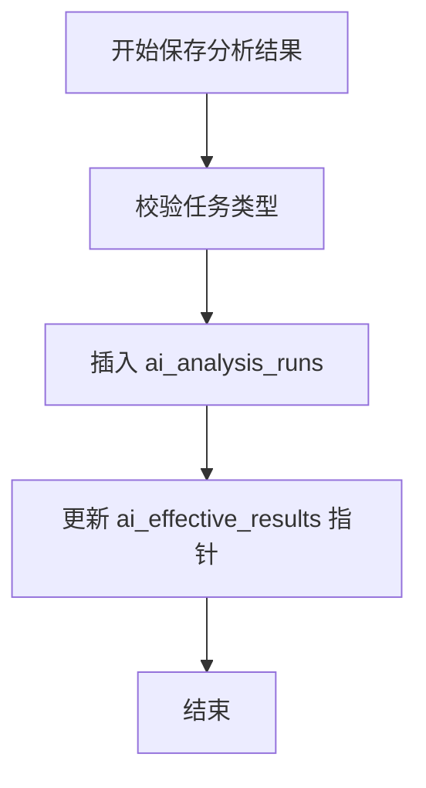

**图示来源**
- [ai_content.rs:1-169](../../../../crates/moriq-library/src/ai/ai_content.rs#L1-L169)
- [migration_23.sql:9-13](../../../../crates/moriq-library/src/database/migrations/migration_23.sql#L9-L13)

**章节来源**
- [migration_23.sql:9-13](../../../../crates/moriq-library/src/database/migrations/migration_23.sql#L9-L13)
- [ai_content.rs:1-30](../../../../crates/moriq-library/src/ai/ai_content.rs#L1-L30)

### `ai_overrides`：人工覆盖机制
`ai_overrides` 表用于持久化用户对 AI 结果的覆盖。它的主键是 `version_id`，因此每个素材版本最多一条覆盖记录。字段含义如下：
- `medium`：人工选择的媒介类型。
- `themes`：人工选择的主题列表，必须是合法的 JSON 数组。
- `description`：人工描述的文本。

当这些字段为空时，表示该字段未被人工覆盖；当存在值时，查询视图会使用人工值替代自动值。

人工编辑通过 `edit_ai_content` 统一处理，包括：
- 验证素材仍处于当前显示版本。
- 验证媒介和主题属于允许的词表。
- 限制主题数量、描述长度和标签长度。
- 支持拒绝标签和提升标签。
- 在事务内更新 `ai_overrides` 和 `assets.edited_at`。

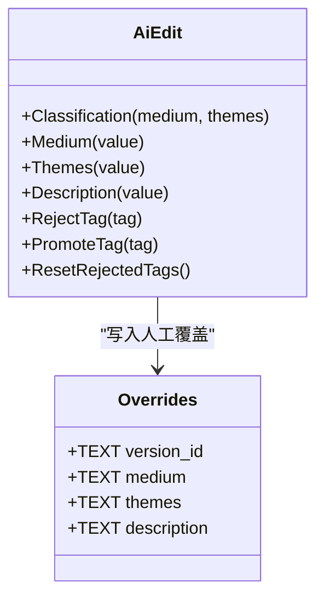

**图示来源**
- [ai.rs:160-187](../../../../crates/moriq-domain/src/ai.rs#L160-L187)
- [migration_23.sql:14-18](../../../../crates/moriq-library/src/database/migrations/migration_23.sql#L14-L18)
- [ai_content.rs:70-169](../../../../crates/moriq-library/src/ai/ai_content.rs#L70-L169)

**章节来源**
- [migration_23.sql:14-18](../../../../crates/moriq-library/src/database/migrations/migration_23.sql#L14-L18)
- [ai_content.rs:70-169](../../../../crates/moriq-library/src/ai/ai_content.rs#L70-L169)
- [ai.rs:160-187](../../../../crates/moriq-domain/src/ai.rs#L160-L187)

### `ai_rejected_tags`：标签拒绝机制
`ai_rejected_tags` 是一个简单的拒绝表，主键为 `(version_id, name)`。它的用途是：
- 用户拒绝某个自动标签后，系统记录该拒绝关系。
- 可见标签视图在展开自动标签时会排除被拒绝的标签。
- 提升标签不会自动恢复已拒绝项；拒绝与提升是两个独立操作。

拒绝标签通过 `reject_tag` 写入，并以 `INSERT OR IGNORE` 避免重复记录。重置拒绝标签则清空该版本的全部拒绝记录。

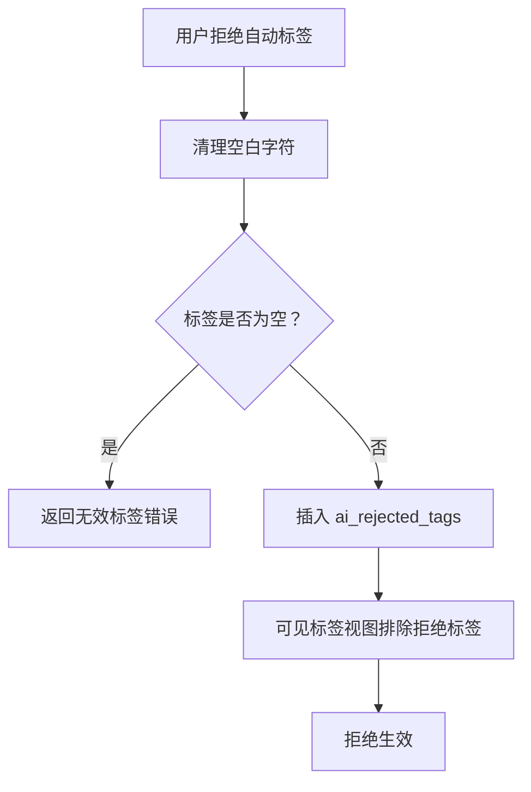

**图示来源**
- [migration_23.sql:18-22](../../../../crates/moriq-library/src/database/migrations/migration_23.sql#L18-L22)
- [ai_content.rs:32-40](../../../../crates/moriq-library/src/ai/ai_content.rs#L32-L40)
- [migration_27.sql:1-9](../../../../crates/moriq-library/src/database/migrations/migration_27.sql#L1-L9)

**章节来源**
- [migration_23.sql:18-22](../../../../crates/moriq-library/src/database/migrations/migration_23.sql#L18-L22)
- [ai_content.rs:32-40](../../../../crates/moriq-library/src/ai/ai_content.rs#L32-L40)
- [migration_27.sql:1-9](../../../../crates/moriq-library/src/database/migrations/migration_27.sql#L1-L9)

### `ai_effective_content`：自动与人工合并视图
`ai_effective_content` 是查询 AI 分析结果的主要视图。它将三类来源合并：
1. **人工覆盖优先**：如果 `ai_overrides` 中存在对应字段，则使用人工值。
2. **自动分类结果**：如果没有人工覆盖，则使用 `qwen_classification` 对应的 `ai_analysis_runs.data`。
3. **自动描述结果**：如果没有人工覆盖，则使用 `qwen_description` 对应的 `ai_analysis_runs.data`。

同时，视图还提供 `manual_medium`、`manual_themes`、`manual_description` 布尔标记，用于前端判断哪些字段来自人工覆盖。

在较新版本中，主题还会经过工作区词表过滤，只保留启用且属于当前项目的主题。

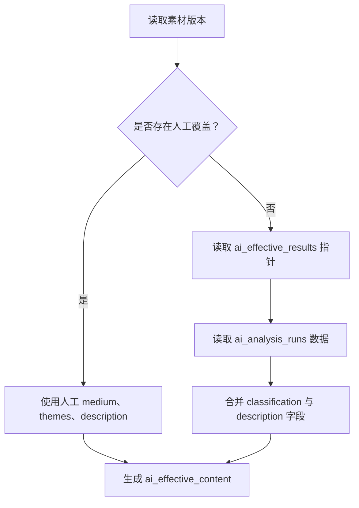

**图示来源**
- [migration_23.sql:37-48](../../../../crates/moriq-library/src/database/migrations/migration_23.sql#L37-L48)
- [migration_26.sql:29-40](../../../../crates/moriq-library/src/database/migrations/migration_26.sql#L29-L40)
- [ai_content.rs:42-68](../../../../crates/moriq-library/src/ai/ai_content.rs#L42-L68)

**章节来源**
- [migration_23.sql:37-48](../../../../crates/moriq-library/src/database/migrations/migration_23.sql#L37-L48)
- [migration_26.sql:29-40](../../../../crates/moriq-library/src/database/migrations/migration_26.sql#L29-L40)
- [ai_content.rs:42-68](../../../../crates/moriq-library/src/ai/ai_content.rs#L42-L68)

### `ai_visible_tags`：可见自动标签视图
`ai_visible_tags` 负责输出当前版本可见的自动标签。最新版本（迁移 27）将标签来源收窄为“当前生效的描述任务”：
- 从 `ai_effective_results` 找到 `qwen_description` 的最新行。
- 展开该行的 `tags` JSON 数组。
- 过滤空标签。
- 排除 `ai_rejected_tags` 中的标签。

这避免了旧版本需要展开整个 `ai_effective_content` 的额外开销，也符合“标签来自描述任务”的职责划分。

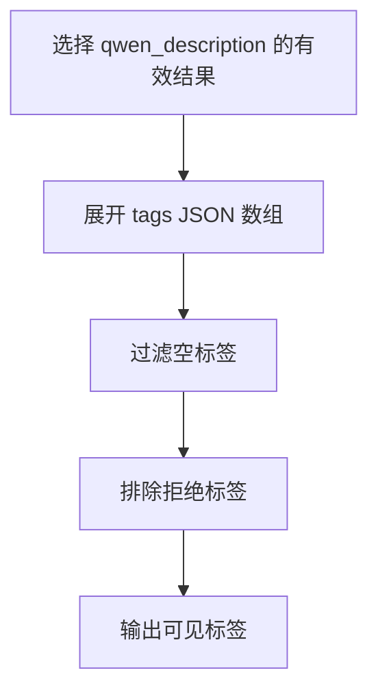

**图示来源**
- [migration_27.sql:1-9](../../../../crates/moriq-library/src/database/migrations/migration_27.sql#L1-L9)

**章节来源**
- [migration_27.sql:1-9](../../../../crates/moriq-library/src/database/migrations/migration_27.sql#L1-L9)

### 内容详情查询逻辑
内容详情查询由 `Library::content_details` 完成。它执行以下操作：
1. 从 `ai_effective_content` 读取 `medium`、`themes`、`description` 以及人工覆盖字段。
2. 将 `themes` JSON 字符串解析为前端可用的主题列表。
3. 从 `ai_visible_tags` 读取自动标签。
4. 从 `tags` 与 `asset_tags` 关联表中读取人工标签。

最终前端得到：
- 自动媒介、主题、描述。
- 人工媒介、主题、描述。
- 自动标签列表。
- 人工标签列表。

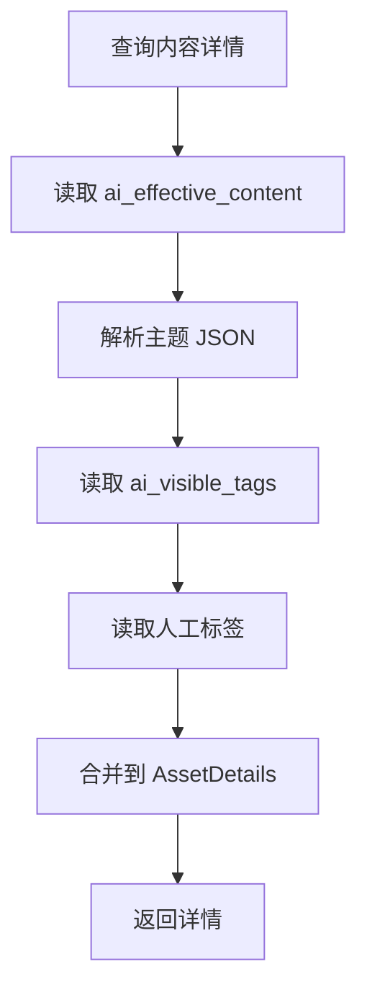

**图示来源**
- [ai_content.rs:42-68](../../../../crates/moriq-library/src/ai/ai_content.rs#L42-L68)

**章节来源**
- [ai_content.rs:42-68](../../../../crates/moriq-library/src/ai/ai_content.rs#L42-L68)

## 依赖关系分析

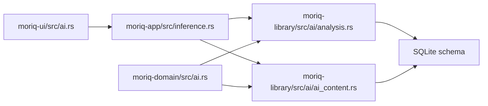

**图示来源**
- [ai.rs:1-187](../../../../crates/moriq-domain/src/ai.rs#L1-L187)
- [inference.rs:1-200](../../../../crates/moriq-app/src/inference.rs#L1-L200)
- [analysis.rs:1-200](../../../../crates/moriq-library/src/ai/analysis.rs#L1-L200)
- [ai_content.rs:1-169](../../../../crates/moriq-library/src/ai/ai_content.rs#L1-L169)

依赖关系总结：
- 前端不直接访问数据库，而是通过应用服务和库接口操作 AI 内容。
- 领域模型提供稳定的分类词表和编辑枚举。
- 应用层负责推理执行、取消控制和任务分发。
- 库层负责分析结果校验、持久化和视图查询。
- 数据库迁移脚本负责表结构、视图、触发器和初始数据。

**章节来源**
- [ai.rs:1-187](../../../../crates/moriq-domain/src/ai.rs#L1-L187)
- [inference.rs:1-200](../../../../crates/moriq-app/src/inference.rs#L1-L200)
- [analysis.rs:1-200](../../../../crates/moriq-library/src/ai/analysis.rs#L1-L200)
- [ai_content.rs:1-169](../../../../crates/moriq-library/src/ai/ai_content.rs#L1-L169)

## 性能与一致性考虑

### 性能特性
- **历史不可变**：`ai_analysis_runs` 是追加型历史表，适合审计和回溯，但长期积累会增加体积。
- **有效指针快速定位**：`ai_effective_results` 以 `(version_id, task)` 为主键，查询当前结果接近 O(1)。
- **标签视图优化**：迁移 27 将 `ai_visible_tags` 限定到当前描述任务，减少不必要的分类视图展开。
- **JSON 字段查询**：主题和标签使用 JSON 存储，查询时需要展开，应避免对超大 JSON 频繁全量扫描。
- **视图计算成本**：`ai_effective_content` 和 `ai_search_source` 涉及多表 JOIN 与 JSON 函数，复杂查询可能较慢。

### 一致性保障
- **外键约束**：`ai_analysis_runs`、`ai_effective_results`、`ai_overrides`、`ai_rejected_tags` 均通过 `version_id` 与 `asset_versions` 建立外键关系。
- **级联删除**：删除素材版本会级联删除其分析历史、有效指针、人工覆盖和拒绝标签。
- **任务类型检查**：`ai_analysis_runs.task` 使用 CHECK 约束，仅接受两种任务。
- **JSON 合法性检查**：`ai_analysis_runs.data` 和 `ai_overrides.themes` 要求 JSON 合法。
- **事务性编辑**：`edit_ai_content` 在单个事务内完成版本校验、覆盖写入、拒绝标签更新和资产更新时间戳。
- **指针原子更新**：`save_run` 先插入历史行，再原子更新有效指针，避免指针指向不存在的历史行。

**章节来源**
- [migration_23.sql:3-18](../../../../crates/moriq-library/src/database/migrations/migration_23.sql#L3-L18)
- [migration_27.sql:1-9](../../../../crates/moriq-library/src/database/migrations/migration_27.sql#L1-L9)
- [ai_content.rs:70-169](../../../../crates/moriq-library/src/ai/ai_content.rs#L70-L169)
- [ai_content.rs:1-30](../../../../crates/moriq-library/src/ai/ai_content.rs#L1-L30)

## 故障排查指南

| 现象 | 可能原因 | 排查建议 |
|---|---|---|
| 自动标签再次出现 | 用户未拒绝该标签，或拒绝记录不在当前版本 | 检查 `ai_rejected_tags` 是否包含该版本和标签；确认拒绝操作是否成功提交事务。 |
| 人工分类未生效 | 覆盖字段为空，或主题不在当前项目词表 | 检查 `ai_overrides`；确认主题属于启用状态且属于当前工作区。 |
| 描述标签不显示 | 标签被拒绝，或描述结果为空 | 检查 `ai_visible_tags` 和 `ai_analysis_runs` 中 `qwen_description` 的 tags。 |
| 内容详情缺少主题 | 主题 JSON 解析失败或主题未启用 | 检查 `ai_effective_content` 的主题字段；确认主题在 `workspace_vocabulary` 中启用。 |
| 分析结果无法回滚 | 历史行不可变，但有效指针已更新 | 历史无法直接回滚；可通过重新提交正确分析结果覆盖有效指针，或使用人工覆盖。 |
| 推理中断后仍有结果 | 取消标志未正确传递或业务层未丢弃未来 | 检查推理执行器中的取消检查点，确认前端请求销毁时发出取消信号。 |

**章节来源**
- [ai_content.rs:32-40](../../../../crates/moriq-library/src/ai/ai_content.rs#L32-L40)
- [ai_content.rs:42-68](../../../../crates/moriq-library/src/ai/ai_content.rs#L42-L68)
- [migration_27.sql:1-9](../../../../crates/moriq-library/src/database/migrations/migration_27.sql#L1-L9)
- [inference.rs:1-200](../../../../crates/moriq-app/src/inference.rs#L1-L200)

## 结论
AI 分析结果存储通过四层设计实现了清晰的数据边界：
- `ai_analysis_runs` 保留完整历史，支持可追溯性。
- `ai_effective_results` 维护当前版本的有效指针，保证查询性能。
- `ai_overrides` 提供人工覆盖能力，允许用户修正自动结果。
- `ai_rejected_tags` 实现细粒度的标签拒绝控制。
- 视图层统一合并自动与人工结果，并对外暴露稳定查询接口。

这种设计既满足 AI 分析的自动化需求，也保留了人工干预的空间，同时通过事务、外键、CHECK 约束和视图规则保障数据一致性。

[无章节来源，因为本节为总结性内容]

## 附录：数据流示例

### 完整 AI 分析数据流
下面以一个素材为例，说明从模型推理到前端展示的完整流程：

1. **前端准备**：用户在 AI 页面选择素材，选择分类或描述任务，并提交请求。
2. **应用层分发**：应用服务根据任务类型调用本地推理执行器。
3. **推理执行**：本地执行器加载模型、注入修订号、执行推理，并返回 `InferenceResult`。
4. **结果校验**：库层对 Qwen 输出进行任务类型、字段、长度和词表校验。
5. **历史写入**：`ai_analysis_runs` 插入新回执。
6. **指针更新**：`ai_effective_results` 更新对应任务的最新行 ID。
7. **人工覆盖可选**：用户可修改媒介、主题、描述或拒绝标签，写入 `ai_overrides` 或 `ai_rejected_tags`。
8. **内容查询**：前端读取 `ai_effective_content` 和 `ai_visible_tags`，获取合并后的结果。
9. **展示输出**：前端显示自动分类、主题、描述、自动标签，以及人工覆盖字段和人工标签。

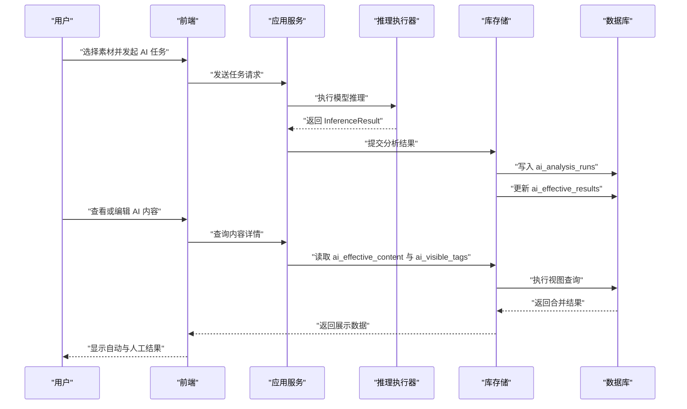

**图示来源**
- [inference.rs:1-200](../../../../crates/moriq-app/src/inference.rs#L1-L200)
- [analysis.rs:1-200](../../../../crates/moriq-library/src/ai/analysis.rs#L1-L200)
- [ai_content.rs:1-169](../../../../crates/moriq-library/src/ai/ai_content.rs#L1-L169)
- [ai.rs:1-187](../../../../crates/moriq-domain/src/ai.rs#L1-L187)

### 事务性编辑最佳实践
在进行人工编辑时应遵循以下原则：
- 始终在事务内执行编辑，避免部分写入。
- 先校验素材是否仍为当前显示版本。
- 校验所有输入字段，包括类型、长度和词表。
- 写入 `ai_overrides` 时保留 NULL 语义，表示未覆盖字段。
- 拒绝标签前先清理空白字符，避免脏数据。
- 提升标签时先创建标签名，再关联到素材。
- 更新 `assets.edited_at`，使缓存失效。
- 提交事务后清除内存快照，保证下次查询命中数据库。

**章节来源**
- [ai_content.rs:70-169](../../../../crates/moriq-library/src/ai/ai_content.rs#L70-L169)
- [ai_content_tests.rs:1-200](../../../../crates/moriq-library/src/tests/ai_content_tests.rs#L1-L200)