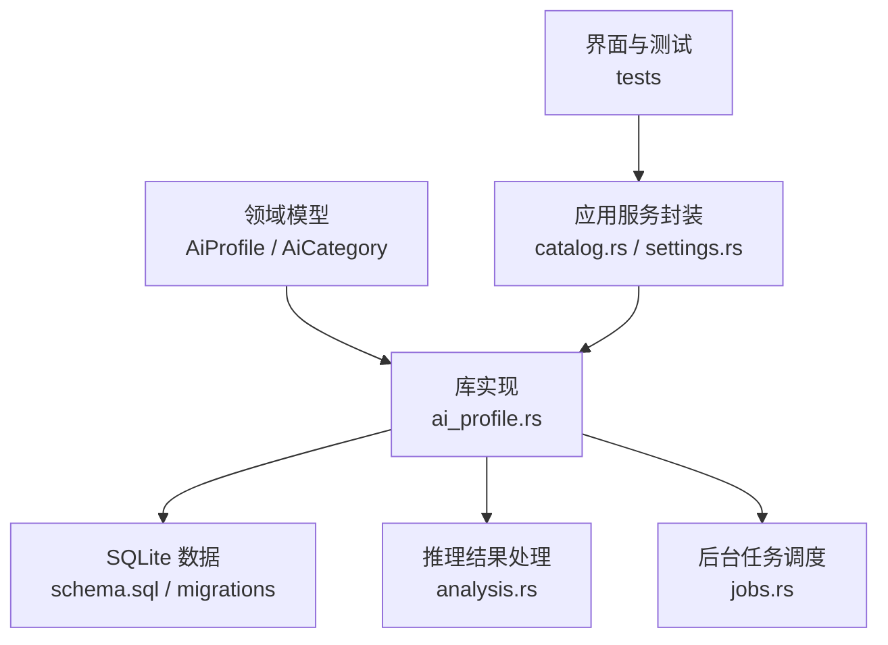
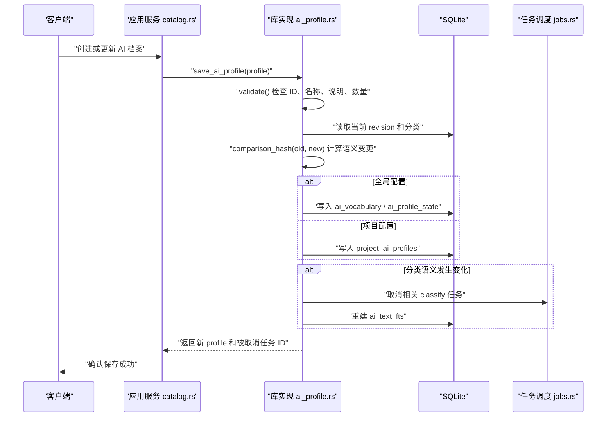
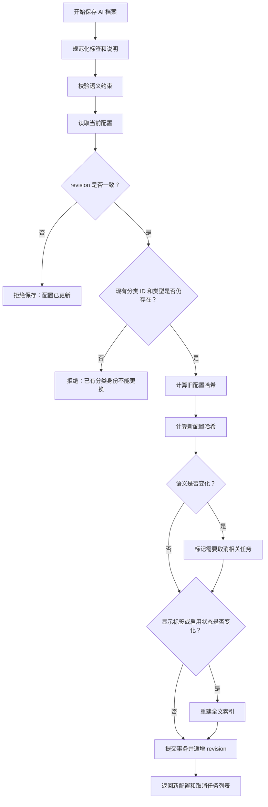
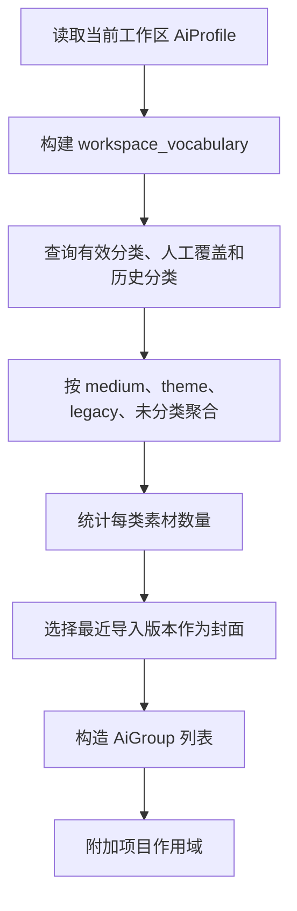
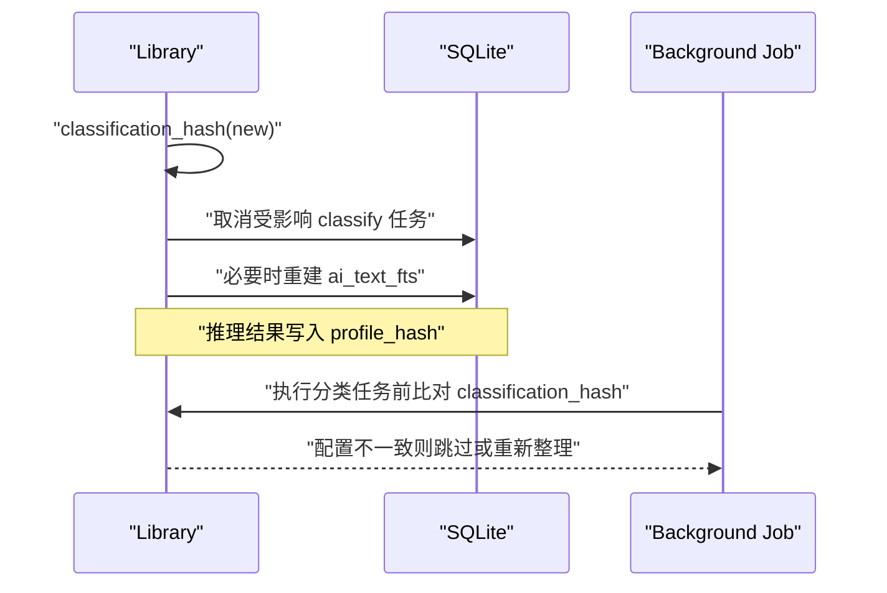
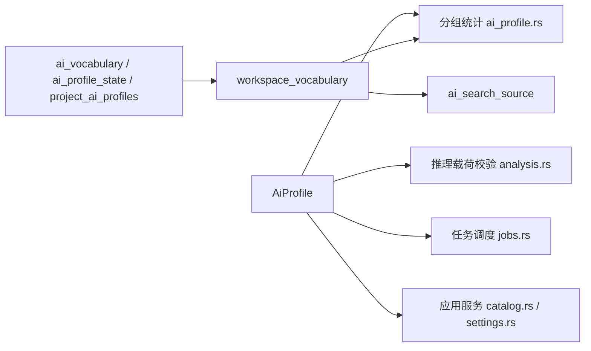

# AI 档案配置管理

> Repo Wiki 节点 `ai-profile-management`
> 导出自 Qoder 知识库快照 `8fbe02f6-57c2-4874-b725-1a8130851fd9`，代码基线 `7a7a8e75e18bd90294e09cd422dd7ed5a04813a0`（分支 main，zh-CN）。

<cite>
**本文引用的文件**   
- [ai_profile.rs](../../../../crates/moriq-library/src/ai/ai_profile.rs)
- [ai.rs](../../../../crates/moriq-domain/src/ai.rs)
- [analysis.rs](../../../../crates/moriq-library/src/ai/analysis.rs)
- [schema.sql](../../../../crates/moriq-library/src/database/schema.sql)
- [migration_23.sql](../../../../crates/moriq-library/src/database/migrations/migration_23.sql)
- [migration_24.sql](../../../../crates/moriq-library/src/database/migrations/migration_24.sql)
- [migration_26.sql](../../../../crates/moriq-library/src/database/migrations/migration_26.sql)
- [jobs.rs](../../../../crates/moriq-library/src/tasks/jobs.rs)
- [catalog.rs](../../../../crates/moriq-app/src/catalog.rs)
- [settings.rs](../../../../crates/moriq-app/src/settings.rs)
- [workspace_tests.rs](../../../../crates/moriq-library/src/tests/workspace_tests.rs)
- [ai_profile_tests.rs](../../../../crates/moriq-library/src/tests/ai_profile_tests.rs)
</cite>

## 目录
1. [简介](#简介)
2. [项目结构](#项目结构)
3. [核心数据结构](#核心数据结构)
4. [数据库设计](#数据库设计)
5. [架构总览](#架构总览)
6. [详细组件分析](#详细组件分析)
7. [依赖关系分析](#依赖关系分析)
8. [性能与扩展性](#性能与扩展性)
9. [故障排查](#故障排查)
10. [结论](#结论)
11. [附录：配置管理 API 参考](#附录配置管理-api-参考)

## 简介
AI 档案配置管理负责维护分类词表、启用状态、主题数量限制和修订号，驱动本地模型推理、素材卡片展示、筛选器以及侧边栏分组。系统支持全局分类词表和每个项目的分类覆盖，并通过 `classification_hash` 检测配置语义变化，触发任务失效、全文索引重建或增量同步。保存流程包含严格的 ID 校验、语义约束和冲突检测，保证旧分类身份不被替换、固定媒介不可删除、启用主题数量和说明长度受控。

## 项目结构
AI 档案相关代码主要分布在领域模型、库实现、数据库迁移、任务执行和应用层封装中：



**图表来源**
- [ai.rs:1-60](../../../../crates/moriq-domain/src/ai.rs#L1-L60)
- [ai_profile.rs:1-60](../../../../crates/moriq-library/src/ai/ai_profile.rs#L1-L60)
- [analysis.rs:1-60](../../../../crates/moriq-library/src/ai/analysis.rs#L1-L60)
- [schema.sql:1-42](../../../../crates/moriq-library/src/database/schema.sql#L1-L42)
- [migration_23.sql:21-35](../../../../crates/moriq-library/src/database/migrations/migration_23.sql#L21-L35)
- [migration_24.sql:1-10](../../../../crates/moriq-library/src/database/migrations/migration_24.sql#L1-L10)
- [migration_26.sql:1-12](../../../../crates/moriq-library/src/database/migrations/migration_26.sql#L1-L12)

**章节来源**
- [ai.rs:1-60](../../../../crates/moriq-domain/src/ai.rs#L1-L60)
- [ai_profile.rs:1-60](../../../../crates/moriq-library/src/ai/ai_profile.rs#L1-L60)
- [schema.sql:1-42](../../../../crates/moriq-library/src/database/schema.sql#L1-L42)

## 核心数据结构
### AiCategory
表示一个分类项，包括稳定标识符、分类类型、显示名称、识别说明和启用状态。分类类型分为“媒介”和“主题”，其中媒介用于判断摄影、插画、三维渲染等成像来源，主题用于人像、风景、建筑等业务标签。

| 字段 | 含义 | 约束与行为 |
|---|---|---|
| `id` | 分类稳定标识 | 小写字母、数字和下划线；不能为空、不能以 `_` 开头、长度不超过 64；全局唯一 |
| `kind` | 分类类型 | `medium` 为媒介，`theme` 为主题 |
| `label` | 显示名称 | 去空白后非空、不重复、不超过 32 字，不能使用“未分类” |
| `definition` | 识别说明 | 去空白后非空、不超过 512 字，用于提示本地模型如何判断该分类 |
| `enabled` | 启用状态 | 控制是否参与推理和分组统计 |

### AiProfile
AI 档案由修订号、主题上限和分类列表组成：

| 字段 | 含义 | 约束与行为 |
|---|---|---|
| `revision` | 配置修订号 | 每次成功保存递增；保存时要求客户端传入的修订号与当前一致，否则拒绝并发修改 |
| `max_themes` | 单条素材允许的主题数量 | 取值范围 1～8；也作为推理输出校验上限 |
| `categories` | 分类词表 | 总数最多 64；启用主题最多 24；启用主题的识别说明合计字符数不超过 1600；固定媒介不能删除 |

默认档案会生成固定媒介分类和预设主题分类，并为固定媒介提供默认识别说明。模板合并逻辑会保留已有分类身份，同时隐藏模板新增但当前档案未包含的分类。

**章节来源**
- [ai.rs:1-120](../../../../crates/moriq-domain/src/ai.rs#L1-L120)

## 数据库设计
### ai_vocabulary 表
全局分类词表定义分类的身份、类型、显示名、识别说明、顺序和启用状态：

| 列 | 类型 | 约束 |
|---|---|---|
| `kind` | TEXT | NOT NULL，取 `medium` 或 `theme` |
| `id` | TEXT | 主键 |
| `label` | TEXT | 唯一 |
| `definition` | TEXT | NOT NULL，默认空字符串 |
| `position` | INTEGER | NOT NULL，默认 0 |
| `enabled` | INTEGER | NOT NULL，默认 1，仅允许 0 或 1 |

该表在初始迁移中插入固定媒介和预设主题，后续迁移增加说明、位置和启用状态。

### ai_profile_state 表
全局档案元数据表，只有一行记录：

| 列 | 类型 | 约束 |
|---|---|---|
| `id` | INTEGER | 主键，固定为 1 |
| `revision` | INTEGER | NOT NULL |
| `max_themes` | INTEGER | NOT NULL，取值范围 1～8 |

### project_ai_profiles 表
项目级分类配置，继承并覆盖全局词表：

| 列 | 类型 | 约束 |
|---|---|---|
| `project_id` | TEXT | 主键，引用项目表，级联删除 |
| `revision` | INTEGER | NOT NULL |
| `max_themes` | INTEGER | NOT NULL |
| `categories` | TEXT | JSON 数组，保存分类定义 |

### workspace_vocabulary 视图
统一视图将全局词表与项目级词表合并。项目存在时使用项目配置，不存在时使用全局配置。这使查询、分组、搜索和推理均可按工作区范围解析分类。

**章节来源**
- [migration_23.sql:21-35](../../../../crates/moriq-library/src/database/migrations/migration_23.sql#L21-L35)
- [migration_24.sql:1-10](../../../../crates/moriq-library/src/database/migrations/migration_24.sql#L1-L10)
- [migration_26.sql:1-20](../../../../crates/moriq-library/src/database/migrations/migration_26.sql#L1-L20)

## 架构总览
AI 档案配置的生命周期如下：



**图表来源**
- [catalog.rs:37-41](../../../../crates/moriq-app/src/catalog.rs#L37-L41)
- [ai_profile.rs:60-180](../../../../crates/moriq-library/src/ai/ai_profile.rs#L60-L180)
- [jobs.rs:582-589](../../../../crates/moriq-library/src/tasks/jobs.rs#L582-L589)

## 详细组件分析

### AiProfile 结构与分类哈希
`AiProfile` 是配置入口。其关键机制包括：

1. **分类哈希计算**  
   `classification_hash` 对已启用的分类进行序列化，排序后计算 SHA-256，并与 `max_themes` 一起形成配置摘要。该哈希用于判断分类定义是否发生语义变化，而不是简单比较文本。

2. **配置加载优先级**  
   - 如果工作区对应项目存在，则从 `project_ai_profiles` 读取 `revision`、`max_themes` 和 JSON 分类。
   - 否则从 `ai_profile_state` 读取全局 `revision` 和 `max_themes`，并从 `ai_vocabulary` 读取全局分类。

3. **配置验证**  
   - 启用主题数量不超过 24。
   - 启用主题识别说明总字符数不超过 1600。
   - `max_themes` 必须在 1～8。
   - 分类总数不超过 64。
   - 分类 ID 必须合法且唯一；标签必须非空、唯一、不使用“未分类”。
   - 媒介分类必须是固定集合中的 ID，新增内容应使用主题分类。
   - 固定媒介不能被删除，只能禁用。

4. **并发保护**  
   保存前读取当前 `revision`，若客户端传入的 `revision` 不一致，直接拒绝，提示用户重新打开编辑器。



**图表来源**
- [ai_profile.rs:1-60](../../../../crates/moriq-library/src/ai/ai_profile.rs#L1-L60)
- [ai_profile.rs:60-180](../../../../crates/moriq-library/src/ai/ai_profile.rs#L60-L180)
- [ai.rs:47-120](../../../../crates/moriq-domain/src/ai.rs#L47-L120)

**章节来源**
- [ai_profile.rs:1-180](../../../../crates/moriq-library/src/ai/ai_profile.rs#L1-L180)
- [ai.rs:1-120](../../../../crates/moriq-domain/src/ai.rs#L1-L120)

### 全局配置与项目级配置的继承关系
- 全局配置存储在 `ai_vocabulary` 和 `ai_profile_state`。
- 项目级配置存储在 `project_ai_profiles.categories`，通过 JSON 保存分类。
- `workspace_vocabulary` 视图把两者合并：项目存在时优先使用项目配置，否则回退到全局配置。
- 这意味着项目可以完全覆盖全局词表，也可以部分启用不同标签，而不会破坏全局默认值。

```mermaid
erDiagram
  PROJECTS {
    text id PK
    text name
  }
  AI_VOCABULARY {
    text kind
    text id PK
    text label UK
    text definition
    integer position
    integer enabled
  }
  AI_PROFILE_STATE {
    integer id PK
    integer revision
    integer max_themes
  }
  PROJECT_AI_PROFILES {
    text project_id PK
    integer revision
    integer max_themes
    text categories
  }

  PROJECTS ||--o{ PROJECT_AI_PROFILES : "拥有"
  AI_VOCABULARY ||..|| AI_PROFILE_STATE : "全局配置"
  PROJECT_AI_PROFILES ..|| AI_VOCABULARY : "覆盖或继承"
```

**图表来源**
- [migration_23.sql:21-35](../../../../crates/moriq-library/src/database/migrations/migration_23.sql#L21-L35)
- [migration_24.sql:1-10](../../../../crates/moriq-library/src/database/migrations/migration_24.sql#L1-L10)
- [migration_26.sql:1-20](../../../../crates/moriq-library/src/database/migrations/migration_26.sql#L1-L20)

**章节来源**
- [migration_26.sql:1-20](../../../../crates/moriq-library/src/database/migrations/migration_26.sql#L1-L20)
- [ai_profile.rs:20-60](../../../../crates/moriq-library/src/ai/ai_profile.rs#L20-L60)

### 分类组统计逻辑
`ai_groups` 根据当前工作区的可见分类生成分组，包括：

1. **分类来源**  
   - 有效分类结果来自 `ai_effective_results` 关联的 `ai_analysis_runs`。
   - 人工覆盖来自 `ai_overrides`。
   - 历史分类来自 `asset_classification`，用于兼容旧数据。
   - “未分类”分组聚合没有有效媒介、历史分类为“未分类”或没有分类的情况。

2. **主题过滤**  
   主题分类只统计启用的主题，并使用 `workspace_vocabulary` 限定工作区范围。

3. **计数与封面版本**  
   每个分组统计命中素材数量，并选取最近导入的版本作为封面。

4. **查询对象**  
   每个分组返回 `AiGroup`，包含分类 ID、标签、查询条件、数量和封面版本。查询最终会带上项目作用域，使分组结果与工作区隔离。



**图表来源**
- [ai_profile.rs:180-279](../../../../crates/moriq-library/src/ai/ai_profile.rs#L180-L279)
- [migration_26.sql:20-47](../../../../crates/moriq-library/src/database/migrations/migration_26.sql#L20-L47)

**章节来源**
- [ai_profile.rs:180-279](../../../../crates/moriq-library/src/ai/ai_profile.rs#L180-L279)

### 配置变更对任务的影响
配置变更可能产生三类影响：

1. **任务取消**  
   当分类语义发生变化时，系统会取消仍在排队、运行或暂停状态的 `analysis:qwen35-4b/classify` 任务，并写入错误信息，提示分类定义已更新。

2. **索引重建**  
   如果分类的显示标签或启用状态发生变化，系统会重建 `ai_text_fts` 全文索引，确保搜索和概览反映最新分类名称。

3. **增量同步与过期检测**  
   - 推理结果中会保存 `profile_hash`。
   - `outdated_ai_count` 统计有效分类结果中 `profile_hash` 与当前配置哈希不同的素材数量。
   - 任务调度在执行分类任务前也会比较配置哈希，避免继续使用过期配置。



**图表来源**
- [ai_profile.rs:60-180](../../../../crates/moriq-library/src/ai/ai_profile.rs#L60-L180)
- [ai_profile.rs:250-279](../../../../crates/moriq-library/src/ai/ai_profile.rs#L250-L279)
- [analysis.rs:120-180](../../../../crates/moriq-library/src/ai/analysis.rs#L120-L180)
- [jobs.rs:582-589](../../../../crates/moriq-library/src/tasks/jobs.rs#L582-L589)

**章节来源**
- [ai_profile.rs:60-180](../../../../crates/moriq-library/src/ai/ai_profile.rs#L60-L180)
- [ai_profile.rs:250-279](../../../../crates/moriq-library/src/ai/ai_profile.rs#L250-L279)
- [analysis.rs:120-180](../../../../crates/moriq-library/src/ai/analysis.rs#L120-L180)
- [jobs.rs:582-589](../../../../crates/moriq-library/src/tasks/jobs.rs#L582-L589)

## 依赖关系分析
AI 档案配置被多个子系统消费：



**图表来源**
- [analysis.rs:120-180](../../../../crates/moriq-library/src/ai/analysis.rs#L120-L180)
- [ai_profile.rs:180-279](../../../../crates/moriq-library/src/ai/ai_profile.rs#L180-L279)
- [jobs.rs:582-589](../../../../crates/moriq-library/src/tasks/jobs.rs#L582-L589)
- [migration_26.sql:20-47](../../../../crates/moriq-library/src/database/migrations/migration_26.sql#L20-L47)

**章节来源**
- [analysis.rs:120-180](../../../../crates/moriq-library/src/ai/analysis.rs#L120-L180)
- [ai_profile.rs:180-279](../../../../crates/moriq-library/src/ai/ai_profile.rs#L180-L279)
- [jobs.rs:582-589](../../../../crates/moriq-library/src/tasks/jobs.rs#L582-L589)
- [migration_26.sql:20-47](../../../../crates/moriq-library/src/database/migrations/migration_26.sql#L20-L47)

## 性能与扩展性
- **分类哈希** 只对启用分类序列化并排序，时间复杂度与启用分类数量线性相关，空间开销较小，适合频繁调用。
- **分组统计** 使用物化 CTE 和工作区分片视图，避免重复扫描全库分类，同时通过 `LIMIT` 和封面版本选择控制 UI 渲染成本。
- **全文索引重建** 仅在显示标签或启用状态变化时触发，避免每次保存都重建索引。
- **并发安全** 通过 `revision` 乐观锁防止覆盖编辑；项目作用域隔离减少全局配置冲突。
- **可扩展点**：新增分类应优先使用主题分类；固定媒介由默认模板和校验逻辑保护，新增业务标签应走主题路径。

[本节为通用性能建议，不直接分析具体代码行]

## 故障排查
常见问题及处理方式：

| 现象 | 可能原因 | 处理建议 |
|---|---|---|
| 保存失败，提示分类配置已更新 | 客户端 `revision` 与当前不一致 | 重新加载配置后再保存 |
| 保存失败，提示已有分类 ID 和类型不能更换 | 尝试修改或删除已有分类身份 | 保留原 ID 和类型，改为禁用或删除整个分类 |
| 保存失败，提示启用主题过多或说明过长 | 启用主题超过 24 个，或说明总字数超过 1600 | 合并主题、精简说明 |
| 保存失败，提示主题上限或分类总数无效 | `max_themes` 不在 1～8，或分类总数超过 64 | 调整参数 |
| 保存失败，提示固定媒介不能删除 | 删除了固定媒介分类 | 恢复固定媒介，或使用禁用方式 |
| 分类结果不生效 | 分类语义变化后任务仍使用旧配置 | 等待任务被取消并重新整理 |
| 搜索名称未更新 | 分类标签变化但未重建索引 | 重新保存分类以触发 `ai_text_fts` 重建 |
| 分组数量为 0 | 分类未启用、无有效分类结果或处于“未分类” | 检查启用状态、运行分类任务、查看历史分类 |

**章节来源**
- [ai_profile.rs:60-180](../../../../crates/moriq-library/src/ai/ai_profile.rs#L60-L180)
- [ai_profile.rs:180-279](../../../../crates/moriq-library/src/ai/ai_profile.rs#L180-L279)
- [ai_profile_tests.rs:183-332](../../../../crates/moriq-library/src/tests/ai_profile_tests.rs#L183-L332)

## 结论
AI 档案配置管理以 `AiProfile` 为中心，结合 `ai_vocabulary`、`ai_profile_state` 和 `project_ai_profiles` 实现全局与项目级分类治理。`classification_hash` 提供稳定的语义变更检测，配合 `revision` 乐观锁、任务取消和索引重建，确保分类变更后系统状态可预期。分组统计基于有效分类、人工覆盖和历史分类，兼顾向后兼容。对外暴露的配置 API 应遵循领域模型的校验规则，并在 UI 层及时刷新 `AiProfile` 的 `revision`。

[本节为总结性内容，不直接分析具体代码行]

## 附录：配置管理 API 参考

### 创建与初始化
- 使用默认 AI 档案生成固定媒介和预设主题分类。
- 可通过模板合并保留已有分类身份，同时引入新分类。
- 首次保存时会写入全局词表和档案状态，或写入项目配置。

参考路径：
- [ai.rs:23-46](../../../../crates/moriq-domain/src/ai.rs#L23-L46)
- [ai.rs:47-80](../../../../crates/moriq-domain/src/ai.rs#L47-L80)
- [ai_profile.rs:20-60](../../../../crates/moriq-library/src/ai/ai_profile.rs#L20-L60)

### 更新配置
- 客户端必须携带当前 `revision`。
- 不允许更改已有分类的 ID 和类型。
- 允许新增主题分类、调整标签和说明、切换启用状态。
- 语义变化会取消相关分类任务并重建全文索引。

参考路径：
- [ai_profile.rs:60-180](../../../../crates/moriq-library/src/ai/ai_profile.rs#L60-L180)
- [ai_profile_tests.rs:207-256](../../../../crates/moriq-library/src/tests/ai_profile_tests.rs#L207-L256)

### 查询配置
- 查询当前工作区的实际 AI 档案。
- 查询分类分组、数量和封面版本。
- 查询需要重新分类的素材数量。

参考路径：
- [ai_profile.rs:20-60](../../../../crates/moriq-library/src/ai/ai_profile.rs#L20-L60)
- [ai_profile.rs:180-279](../../../../crates/moriq-library/src/ai/ai_profile.rs#L180-L279)

### 批量操作
- 批量启用或禁用主题分类。
- 批量调整 `max_themes`。
- 批量更新分类标签和说明。
- 批量保存后应根据返回值处理取消的任务 ID，并刷新 UI。

参考路径：
- [workspace_tests.rs:219-236](../../../../crates/moriq-library/src/tests/workspace_tests.rs#L219-L236)
- [workspace_tests.rs:339-345](../../../../crates/moriq-library/src/tests/workspace_tests.rs#L339-L345)

### 配置迁移与向后兼容
- 旧版 Qwen 回执会在迁移中将显示标签映射为稳定分类 ID。
- 旧分类结果会被迁移到新的分析运行表，并建立有效结果指针。
- `workspace_vocabulary` 视图兼容项目级 JSON 分类。
- 分组统计兼容历史手动分类和“未分类”状态。

参考路径：
- [migration_23.sql:30-35](../../../../crates/moriq-library/src/database/migrations/migration_23.sql#L30-L35)
- [migration_23.sql:56-62](../../../../crates/moriq-library/src/database/migrations/migration_23.sql#L56-L62)
- [migration_26.sql:19-20](../../../../crates/moriq-library/src/database/migrations/migration_26.sql#L19-L20)

**章节来源**
- [ai.rs:23-80](../../../../crates/moriq-domain/src/ai.rs#L23-L80)
- [ai_profile.rs:20-279](../../../../crates/moriq-library/src/ai/ai_profile.rs#L20-L279)
- [workspace_tests.rs:219-345](../../../../crates/moriq-library/src/tests/workspace_tests.rs#L219-L345)
- [migration_23.sql:30-62](../../../../crates/moriq-library/src/database/migrations/migration_23.sql#L30-L62)
- [migration_26.sql:19-20](../../../../crates/moriq-library/src/database/migrations/migration_26.sql#L19-L20)