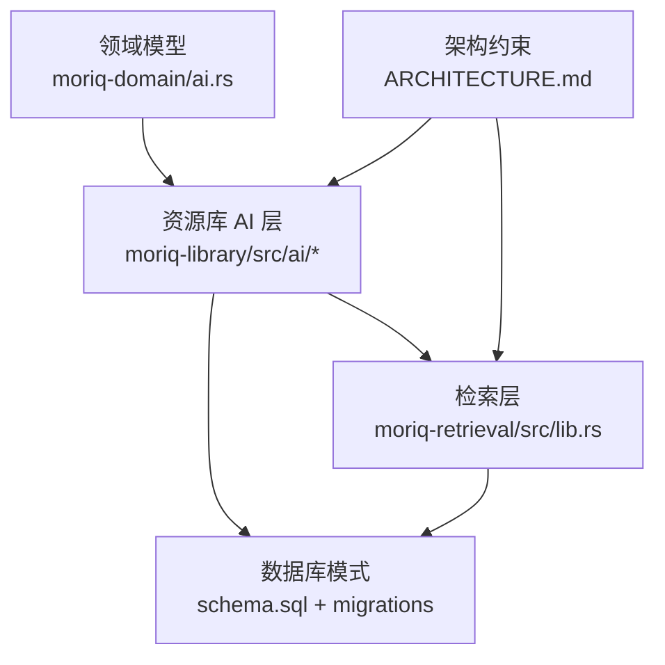
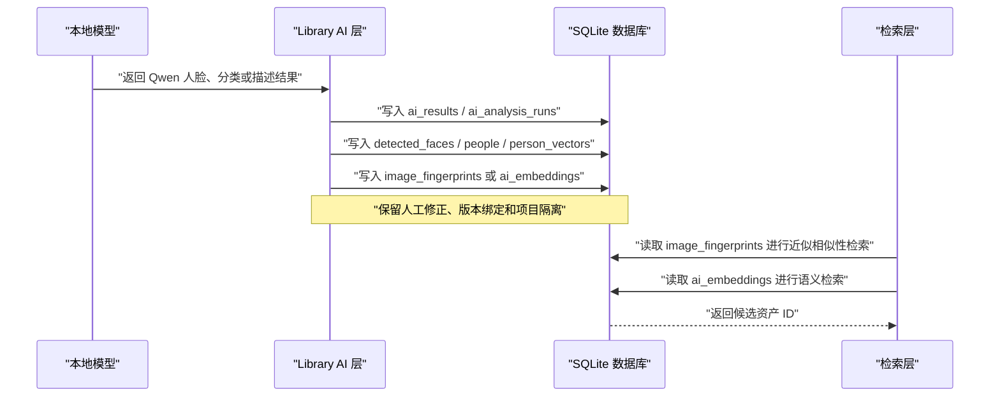
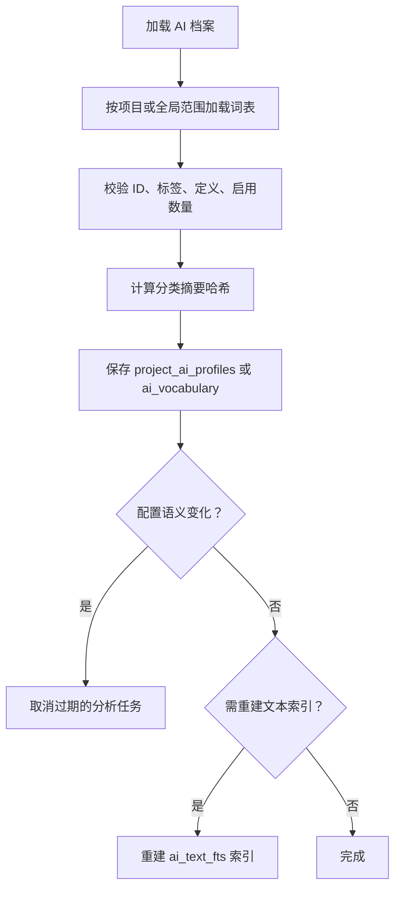
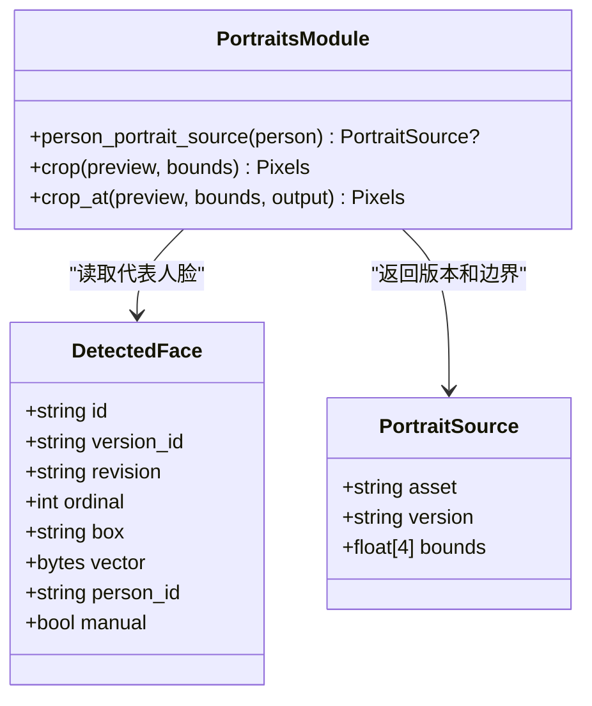
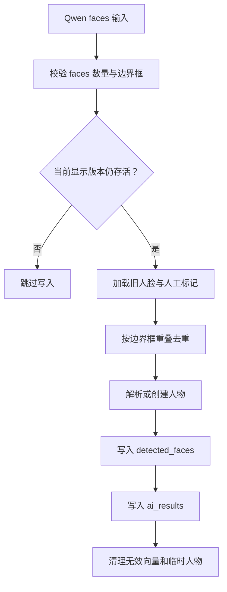
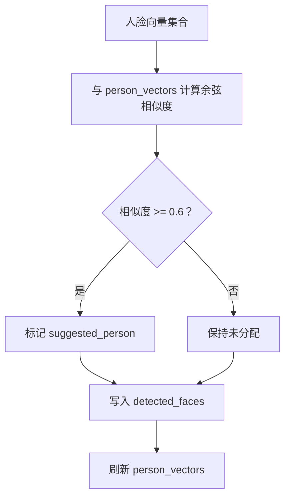
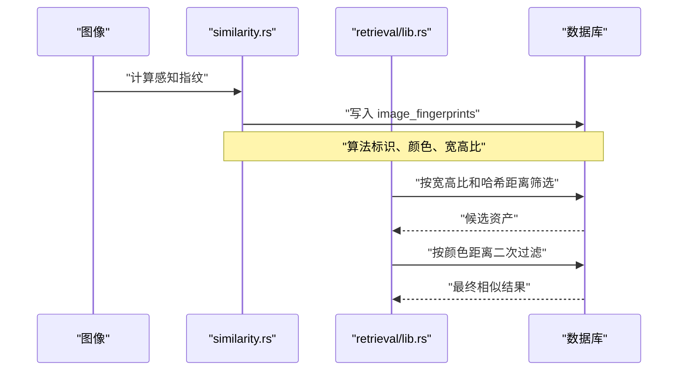
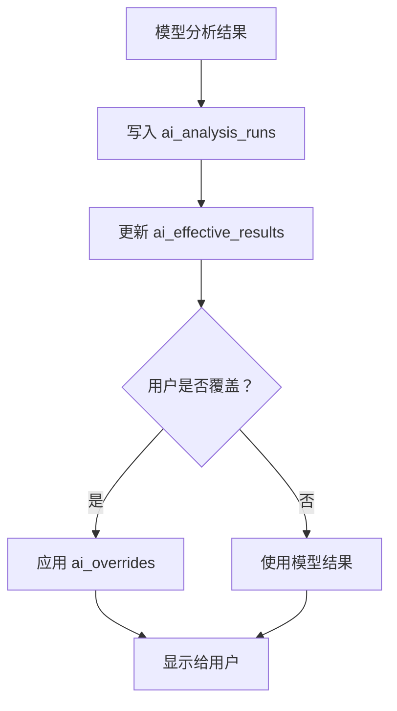
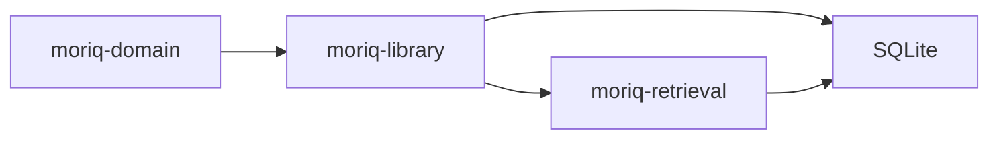

# AI 功能数据存储

> Repo Wiki 节点 `ai-storage`
> 导出自 Qoder 知识库快照 `8fbe02f6-57c2-4874-b725-1a8130851fd9`，代码基线 `7a7a8e75e18bd90294e09cd422dd7ed5a04813a0`（分支 main，zh-CN）。

<cite>
**本文引用的文件**   
- [moriq-library/ai/qwen_faces.rs](../../../../crates/moriq-library/src/ai/qwen_faces.rs)
- [moriq-library/ai/portraits.rs](../../../../crates/moriq-library/src/ai/portraits.rs)
- [moriq-library/ai/similarity.rs](../../../../crates/moriq-library/src/ai/similarity.rs)
- [moriq-library/ai/analysis.rs](../../../../crates/moriq-library/src/ai/analysis.rs)
- [moriq-library/ai/ai_content.rs](../../../../crates/moriq-library/src/ai/ai_content.rs)
- [moriq-library/ai/ai_profile.rs](../../../../crates/moriq-library/src/ai/ai_profile.rs)
- [moriq-domain/ai.rs](../../../../crates/moriq-domain/src/ai.rs)
- [moriq-retrieval/lib.rs](../../../../crates/moriq-retrieval/src/lib.rs)
- [moriq-library/library/core.rs](../../../../crates/moriq-library/src/library/core.rs)
- [moriq-library/database/schema.sql](../../../../crates/moriq-library/src/database/schema.sql)
- [moriq-library/database/migrations/migration_14.sql](../../../../crates/moriq-library/src/database/migrations/migration_14.sql)
- [moriq-library/database/migrations/migration_15.sql](../../../../crates/moriq-library/src/database/migrations/migration_15.sql)
- [moriq-library/database/migrations/migration_21.sql](../../../../crates/moriq-library/src/database/migrations/migration_21.sql)
- [moriq-library/database/migrations/migration_23.sql](../../../../crates/moriq-library/src/database/migrations/migration_23.sql)
- [moriq-library/database/migrations/migration_24.sql](../../../../crates/moriq-library/src/database/migrations/migration_24.sql)
- [ARCHITECTURE.md](../../../../ARCHITECTURE.md)
</cite>

## 目录
1. [引言](#引言)
2. [项目结构](#项目结构)
3. [核心组件](#核心组件)
4. [架构总览](#架构总览)
5. [详细组件分析](#详细组件分析)
6. [依赖关系分析](#依赖关系分析)
7. [性能与索引策略](#性能与索引策略)
8. [故障排查指南](#故障排查指南)
9. [结论](#结论)

## 引言
本文围绕 Moriq Space 的 AI 功能数据持久化展开，重点说明以下内容：
- 人脸识别结果、面部特征向量、人物关联关系的存储设计。
- AI 档案系统，包括分类词表、主题配置、用户偏好和任务回执。
- 肖像管理，包括代表头像选择、人脸裁剪、人物分组和相册组织。
- Qwen 人脸识别模型的数据结构与约束。
- 相似性搜索和语义检索的数据流、向量索引及优化方式。
- 批量更新、增量同步和索引重建策略。
- 完整的 AI 数据流示例与性能建议。

该文档以代码仓库中的 `moriq-library`、`moriq-domain`、`moriq-retrieval` 以及数据库迁移脚本为依据，面向需要理解 AI 数据如何落库、如何被检索和如何演进的用户。

## 项目结构
AI 相关数据主要分布在以下模块：
- 领域模型：`moriq-domain/src/ai.rs` 定义分类类型、AI 档案、编辑操作等稳定数据结构。
- 资源库实现：`moriq-library/src/ai/*` 封装识别结果持久化、肖像、相似性、分析和内容覆盖。
- 检索层：`moriq-retrieval/src/lib.rs` 提供无状态的范围化相似性和语义检索。
- 数据库模式：`schema.sql` 为基础结构，AI 能力通过迁移脚本逐步扩展。

**图表来源**
- [moriq-domain/ai.rs:1-187](../../../../crates/moriq-domain/src/ai.rs#L1-L187)
- [moriq-library/ai/analysis.rs:1-848](../../../../crates/moriq-library/src/ai/analysis.rs#L1-L848)
- [moriq-retrieval/lib.rs:1-214](../../../../crates/moriq-retrieval/src/lib.rs#L1-L214)
- [moriq-library/database/schema.sql:1-42](../../../../crates/moriq-library/src/database/schema.sql#L1-L42)
- [ARCHITECTURE.md:1-155](../../../../ARCHITECTURE.md#L1-L155)

**章节来源**
- [ARCHITECTURE.md:1-60](../../../../ARCHITECTURE.md#L1-L60)
- [moriq-library/database/schema.sql:1-42](../../../../crates/moriq-library/src/database/schema.sql#L1-L42)

## 核心组件
本节从“数据实体”的角度总结 AI 功能的关键持久化对象。

| 实体 | 职责 | 关键字段或含义 | 存储位置 |
|---|---|---|---|
| 素材版本 | AI 结果绑定到显示版本，避免跨版本污染 | `id`、`asset_id`、`parent_version_id`、`sha256`、`format`、尺寸、字节数 | `asset_versions` |
| 检测人脸 | 保存每张图的人脸框、向量、人物归属和人工标记 | `id`、`version_id`、`revision`、`ordinal`、`box`、`vector`、`person_id`、`manual` | `detected_faces` |
| 人物 | 人物身份、名称、创建信息 | `id`、`name`、`revision`、时间戳 | `people` |
| 人物向量 | 按人物和模型修订聚合的代表向量 | `person_id`、`revision`、`vector`、样本数 | `person_vectors` |
| 分析结果 | 记录模型推理原始 JSON | `version_id`、`model_id`、`revision`、`preprocessing`、`data`、`created_at` | `ai_results` |
| 嵌入向量 | CLIP 等模型的语义向量 | `version_id`、`model_id`、`revision`、`vector` | `ai_embeddings` |
| 有效结果 | 当前版本每个任务的最新分析运行指针 | `version_id`、`task`、`run_id` | `ai_effective_results` |
| 分析运行 | 不可变的历史分析记录 | `version_id`、`task`、`revision`、`preprocessing`、`data`、`created_at` | `ai_analysis_runs` |
| 人工覆盖 | 用户对媒介、主题、描述的人工覆盖 | `version_id`、`medium`、`themes`、`description` | `ai_overrides` |
| 拒绝标签 | 用户拒绝自动标签，防止重复出现 | `version_id`、`tag` | `ai_rejected_tags` |
| 分类词表 | 全局分类模板、标签、启用状态 | `kind`、`id`、`label`、`definition`、`position`、`enabled` | `ai_vocabulary` |
| 项目词表 | 项目范围分类配置 | `project_id`、`revision`、`max_themes`、`categories` | `project_ai_profiles` |
| 图片指纹 | 感知哈希、颜色、宽高比，用于近似相似性 | `version_id`、`hash`、RGB、`aspect`、`algorithm` | `image_fingerprints` |
| 人工分类 | 用户手动分类结果 | `asset_id`、`category`、`manual` | `asset_classification` |

**章节来源**
- [moriq-library/database/migrations/migration_14.sql:11-11](../../../../crates/moriq-library/src/database/migrations/migration_14.sql#L11-L11)
- [moriq-library/database/migrations/migration_15.sql:11-15](../../../../crates/moriq-library/src/database/migrations/migration_15.sql#L11-L15)
- [moriq-library/database/migrations/migration_21.sql:2-2](../../../../crates/moriq-library/src/database/migrations/migration_21.sql#L2-L2)
- [moriq-library/database/migrations/migration_23.sql:3-21](../../../../crates/moriq-library/src/database/migrations/migration_23.sql#L3-L21)
- [moriq-library/database/migrations/migration_24.sql:6-6](../../../../crates/moriq-library/src/database/migrations/migration_24.sql#L6-L6)

## 架构总览
AI 数据流分为三条主线：
1. **人像识别与人物分组**：Qwen 人脸检测结果写入 `detected_faces`，并维护 `people` 与 `person_vectors`。
2. **语义分析与内容覆盖**：Qwen 文本类任务（分类、描述）写入 `ai_results` 和 `ai_analysis_runs`，并通过 `ai_effective_results` 暴露当前有效值；用户可修改 `ai_overrides`。
3. **相似性与推荐**：图像感知指纹写入 `image_fingerprints`，CLIP 向量写入 `ai_embeddings`，由 `moriq-retrieval` 执行相似性检索和语义检索。

**图表来源**
- [moriq-library/ai/analysis.rs:201-602](../../../../crates/moriq-library/src/ai/analysis.rs#L201-L602)
- [moriq-library/ai/qwen_faces.rs:1-200](../../../../crates/moriq-library/src/ai/qwen_faces.rs#L1-L200)
- [moriq-library/ai/similarity.rs:1-131](../../../../crates/moriq-library/src/ai/similarity.rs#L1-L131)
- [moriq-retrieval/lib.rs:1-214](../../../../crates/moriq-retrieval/src/lib.rs#L1-L214)

**章节来源**
- [ARCHITECTURE.md:1-60](../../../../ARCHITECTURE.md#L1-L60)
- [moriq-library/library/core.rs:1-200](../../../../crates/moriq-library/src/library/core.rs#L1-L200)

## 详细组件分析

### AI 档案系统与分类词表
AI 档案是分类推理、卡片展示、过滤和侧边栏分组的统一配置。它包含：
- 分类修订号，用于判断配置是否变化。
- 主题数量上限。
- 分类列表，每项包含 ID、类别（媒介或主题）、标签、定义、启用状态。

默认档案由固定媒介分类和预设主题分类组成；用户可通过模板合并已有分类，但不得改变固定媒介的分类身份。保存时会对标签长度、定义长度、启用主题数量和上下文预算做校验。

**图表来源**
- [moriq-domain/ai.rs:1-187](../../../../crates/moriq-domain/src/ai.rs#L1-L187)
- [moriq-library/ai/ai_profile.rs:1-279](../../../../crates/moriq-library/src/ai/ai_profile.rs#L1-L279)

**章节来源**
- [moriq-domain/ai.rs:1-187](../../../../crates/moriq-domain/src/ai.rs#L1-L187)
- [moriq-library/ai/ai_profile.rs:1-279](../../../../crates/moriq-library/src/ai/ai_profile.rs#L1-L279)

### 肖像管理与代表头像
肖像管理负责把检测到的人脸映射到可用素材的真实预览，并裁剪出代表头像。关键点：
- 代表头像必须来自当前项目的活跃显示版本。
- 选择逻辑优先面积较大的人脸，并按导入时间和 ID 排序。
- 裁剪函数会校验边界框、像素尺寸，并拒绝不完整像素。
- Qwen 人脸识别不使用合成人脸嵌入，而是直接使用真实人脸截图进行匹配。

**图表来源**
- [moriq-library/ai/portraits.rs:1-166](../../../../crates/moriq-library/src/ai/portraits.rs#L1-L166)
- [moriq-library/database/migrations/migration_15.sql:15-15](../../../../crates/moriq-library/src/database/migrations/migration_15.sql#L15-L15)

**章节来源**
- [moriq-library/ai/portraits.rs:1-166](../../../../crates/moriq-library/src/ai/portraits.rs#L1-L166)
- [moriq-library/ai/qwen_faces.rs:1-120](../../../../crates/moriq-library/src/ai/qwen_faces.rs#L1-L120)

### Qwen 人脸识别输出与持久化
Qwen 人脸识别输出的核心是 `faces` 数组。每条人脸包含：
- `box`：归一化的边界框坐标 `[x, y, width, height]`。
- `person`：可选的人物 ID。
- 其他人脸字段可能包含向量或属性，但在 Qwen 人脸路径中，系统明确不生成合成人脸嵌入。

持久化过程：
1. 验证 `faces` 存在且不超过协议限制。
2. 检查素材是否为当前显示版本且未被回收。
3. 解析并校验边界框。
4. 删除当前版本中非人工设置的新检测人脸。
5. 根据旧人脸边界框重叠度进行去重。
6. 若外部模型给出人物 ID，则校验其属于当前工作区；否则创建新人物。
7. 写入 `detected_faces`，同时写入 `ai_results`。
8. 清理空向量对应的人物向量，并清理无人脸关联的临时人物。

**图表来源**
- [moriq-library/ai/qwen_faces.rs:1-200](../../../../crates/moriq-library/src/ai/qwen_faces.rs#L1-L200)

**章节来源**
- [moriq-library/ai/qwen_faces.rs:1-200](../../../../crates/moriq-library/src/ai/qwen_faces.rs#L1-L200)
- [moriq-library/database/migrations/migration_15.sql:15-15](../../../../crates/moriq-library/src/database/migrations/migration_15.sql#L15-L15)

### 人脸关联关系与人物向量
除了 Qwen 直接比较肖像的路径外，通用人脸处理还会使用向量相似度：
- 对每张人脸向量查询已存在的 `person_vectors`。
- 余弦相似度达到阈值时标记建议人物。
- 同一张图中不会将不同人脸自动归为同一个人。
- 写入 `detected_faces` 后，刷新受影响人物的代表向量。

人物代表向量按人物和模型修订聚合，取多条有效人脸向量求和后归一化，作为后续匹配的候选。

**图表来源**
- [moriq-library/ai/analysis.rs:201-602](../../../../crates/moriq-library/src/ai/analysis.rs#L201-L602)
- [moriq-library/database/migrations/migration_21.sql:2-2](../../../../crates/moriq-library/src/database/migrations/migration_21.sql#L2-L2)

**章节来源**
- [moriq-library/ai/analysis.rs:201-602](../../../../crates/moriq-library/src/ai/analysis.rs#L201-L602)
- [moriq-library/database/migrations/migration_21.sql:2-2](../../../../crates/moriq-library/src/database/migrations/migration_21.sql#L2-L2)

### 相似性搜索与向量索引
相似性搜索分为两类：
1. **近似相似性**：基于感知指纹、颜色和宽高比，适合缩放、重压缩的图片。
2. **语义相似性**：基于 CLIP 等模型的向量嵌入，适合语义内容检索。

近似相似性流程：
- 将图像缩放到固定尺寸，计算 DCT 风格的低频系数。
- 统计颜色均值和宽高比。
- 将指纹、颜色、宽高比写入 `image_fingerprints`。
- 检索时先按宽高比范围过滤，再用汉明距离和颜色距离筛选。

语义相似性流程：
- 将浮点向量编码为小端字节序列。
- 写入 `ai_embeddings`。
- 检索时按模型修订和工作区范围过滤，计算余弦相似度并取 Top-K。

**图表来源**
- [moriq-library/ai/similarity.rs:1-131](../../../../crates/moriq-library/src/ai/similarity.rs#L1-L131)
- [moriq-retrieval/lib.rs:1-214](../../../../crates/moriq-retrieval/src/lib.rs#L1-L214)
- [moriq-library/database/migrations/migration_14.sql:11-11](../../../../crates/moriq-library/src/database/migrations/migration_14.sql#L11-L11)

**章节来源**
- [moriq-library/ai/similarity.rs:1-131](../../../../crates/moriq-library/src/ai/similarity.rs#L1-L131)
- [moriq-retrieval/lib.rs:1-214](../../../../crates/moriq-retrieval/src/lib.rs#L1-L214)

### AI 内容与用户覆盖
AI 内容不仅包含模型输出，还包含用户人工覆盖：
- 每次成功分析都会追加一条不可变的 `ai_analysis_runs`。
- `ai_effective_results` 指向当前版本每个任务的有效运行。
- 用户可修改媒介、主题、描述，也可拒绝或提升自动标签。
- 拒绝标签会阻止相同标签再次出现在自动结果中。
- 人工分类优先级高于自动分类。

**图表来源**
- [moriq-library/ai/ai_content.rs:1-169](../../../../crates/moriq-library/src/ai/ai_content.rs#L1-L169)
- [moriq-library/database/migrations/migration_23.sql:9-18](../../../../crates/moriq-library/src/database/migrations/migration_23.sql#L9-L18)

**章节来源**
- [moriq-library/ai/ai_content.rs:1-169](../../../../crates/moriq-library/src/ai/ai_content.rs#L1-L169)
- [moriq-library/database/migrations/migration_23.sql:3-21](../../../../crates/moriq-library/src/database/migrations/migration_23.sql#L3-L21)

## 依赖关系分析
AI 数据的依赖关系遵循明确的边界：
- `moriq-domain` 只定义可序列化类型和输入校验，不包含 I/O。
- `moriq-library` 负责 SQLite 写入、版本绑定、工作区隔离和生命周期。
- `moriq-retrieval` 只做范围化读取，不依赖 Library、UI、媒体解码器或模型运行时。
- 所有查询都显式指定库范围、未分配范围或项目范围，避免隐式默认。

**图表来源**
- [ARCHITECTURE.md:1-60](../../../../ARCHITECTURE.md#L1-L60)
- [moriq-retrieval/lib.rs:1-60](../../../../crates/moriq-retrieval/src/lib.rs#L1-L60)

**章节来源**
- [ARCHITECTURE.md:1-60](../../../../ARCHITECTURE.md#L1-L60)
- [moriq-retrieval/lib.rs:1-60](../../../../crates/moriq-retrieval/src/lib.rs#L1-L60)

## 性能与索引策略
### 快速查找
- 人脸读取使用 `ordinal` 保证同一版本内人脸顺序稳定。
- 人物分组查询通过 `display_version_id` 与 `deleted_at` 过滤，避免回收站和旧版本。
- 相似性检索先按宽高比范围缩小候选集，再按哈希和颜色过滤。
- 语义检索按模型修订和工作区过滤，避免跨版本和跨项目误匹配。

### 批量更新
- Qwen 人脸结果先删除当前版本非人工检测项，再按顺序插入，避免部分更新导致中间态不一致。
- 人物向量在写入人脸后统一刷新，减少多次扫描。
- AI 分类配置变更时，可同时取消过期任务并重建全文索引。

### 增量同步
- 有效结果通过 `ai_effective_results` 指针增量暴露，而不是每次重新聚合全部历史。
- 用户覆盖保存在 `ai_overrides`，与模型历史解耦。
- 拒绝标签通过 `ai_rejected_tags` 增量控制标签可见性。

### 优化建议
- 对高频查询字段建立索引，例如 `detected_faces.version_id`、`person_vectors.person_id`、`ai_embeddings.model_id+revision`、`image_fingerprints.version_id`。
- 对大库场景，限制单次相似性检索返回数量，避免全量排序。
- 对语义检索，确保模型修订一致后再查询，避免因向量维度或分布变化产生错误结果。
- 对 Qwen 人脸参考图生成，尽量复用预览缓存，避免重复解码大图。
- 对人物合并、重命名等操作，保持事务原子性，并在完成后刷新人物向量。

[本节为通用指导，不直接分析具体代码行]

## 故障排查指南
常见问题与定位方法：

| 问题 | 可能原因 | 排查位置 |
|---|---|---|
| Qwen 人脸结果无法写入 | 边界框无效、素材不在当前显示版本、已被回收 | `qwen_faces.rs` 中边界框校验与存活检查 |
| 人物分组不稳定 | 人脸框重叠阈值低、向量维度不一致、人物向量未刷新 | `analysis.rs` 中 overlap、cosine、refresh_person_vectors |
| 相似性检索返回空 | 尚未建立指纹索引或语义向量 | `similarity.rs` 与 `retrieval/lib.rs` 的错误提示 |
| 分类结果未生效 | 分类配置修订号不一致、任务被取消、文本索引未重建 | `ai_profile.rs` 与 `ai_content.rs` |
| 人物无法重命名或合并 | 人物不存在、目标人物已变化、参数为空 | `analysis.rs` 中 rename_person 与 merge_people |
| 向量解码失败 | 向量长度非法或非有限数值 | `analysis.rs` 中 decode_vector 与 query_vector |

**章节来源**
- [moriq-library/ai/qwen_faces.rs:120-200](../../../../crates/moriq-library/src/ai/qwen_faces.rs#L120-L200)
- [moriq-library/ai/analysis.rs:201-602](../../../../crates/moriq-library/src/ai/analysis.rs#L201-L602)
- [moriq-library/ai/similarity.rs:1-131](../../../../crates/moriq-library/src/ai/similarity.rs#L1-L131)
- [moriq-library/ai/ai_profile.rs:1-279](../../../../crates/moriq-library/src/ai/ai_profile.rs#L1-L279)
- [moriq-library/ai/ai_content.rs:1-169](../../../../crates/moriq-library/src/ai/ai_content.rs#L1-L169)

## 结论
Moriq Space 的 AI 数据存储采用“版本绑定、人工优先、工作区隔离”的设计：
- 所有 AI 结果都绑定到素材的显示版本，避免旧结果污染当前视图。
- 人工分类、人物归属、拒绝标签和用户覆盖具有明确优先级。
- 人像识别既支持 Qwen 直接比较真实肖像，也支持向量相似度辅助分组。
- 相似性检索通过感知指纹和语义向量分层优化，兼顾性能和精度。
- AI 档案系统统一管理分类词表、主题数量和上下文预算。
- 数据库迁移与 WAL 模式保证了数据一致性、可扩展性和恢复能力。

这套设计适合中等规模本地资源库，能够在不依赖外部向量数据库的情况下，完成人脸识别、人物分组、分类推理和相似检索。对于更大规模场景，建议结合外部索引服务、更严格的批处理窗口和量化向量策略进一步扩展。

[本节为总结性内容，不直接分析具体代码行]