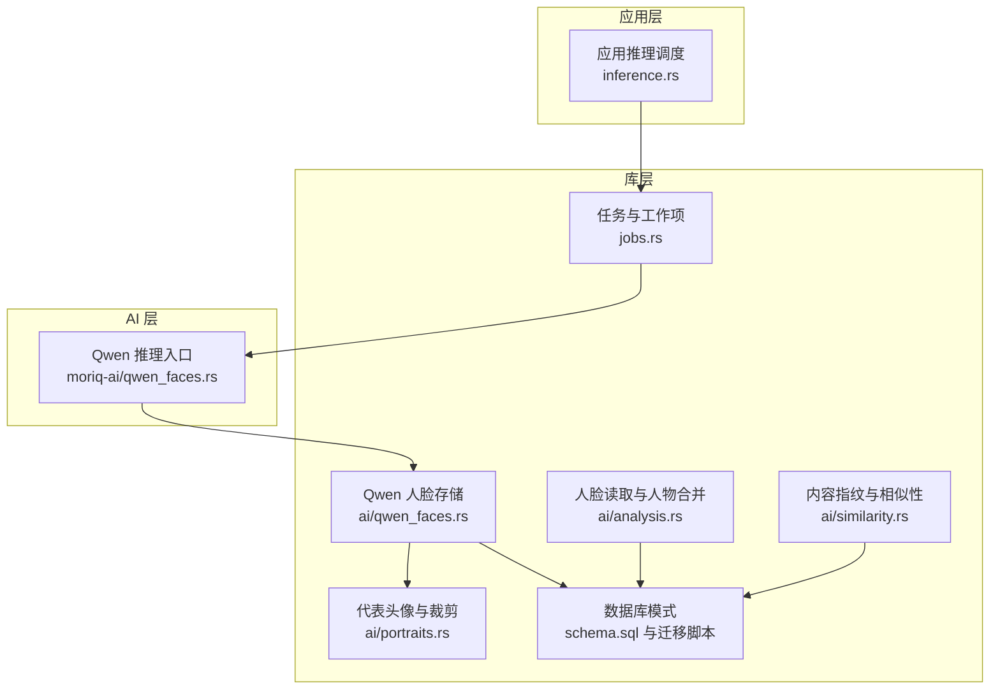
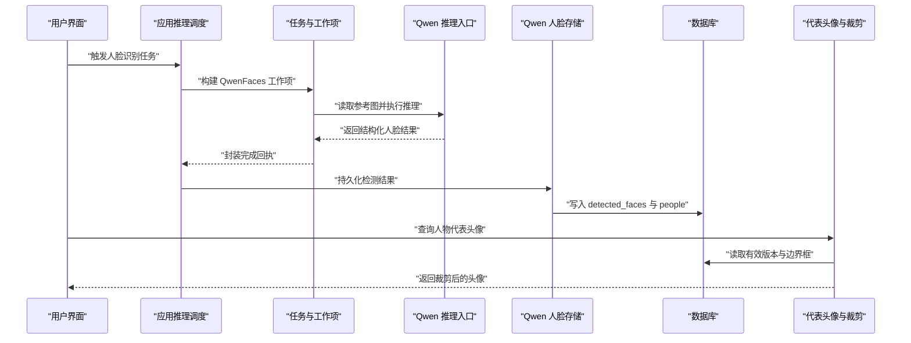
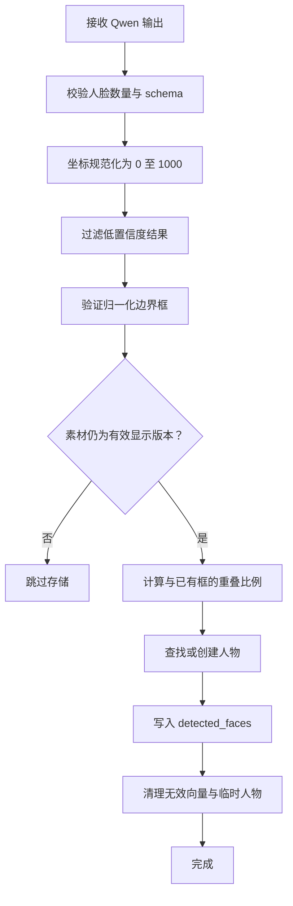
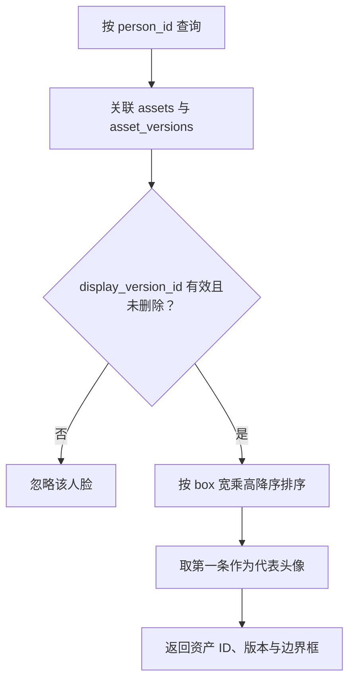
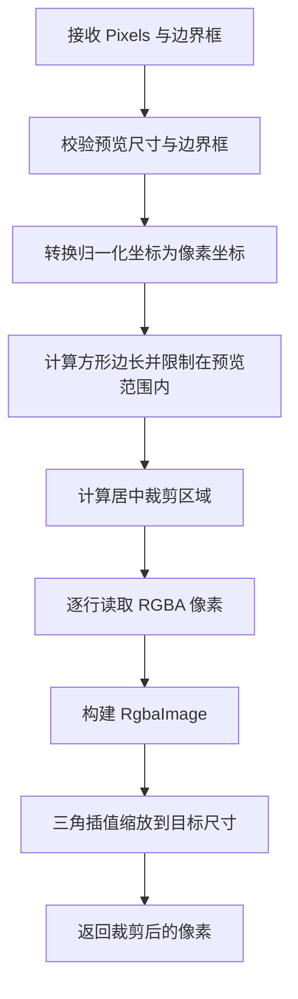
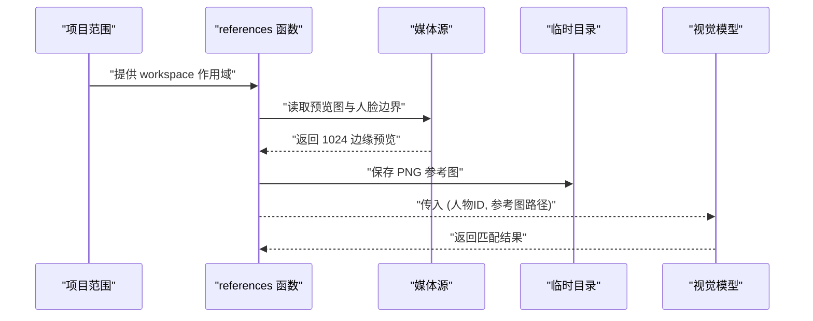
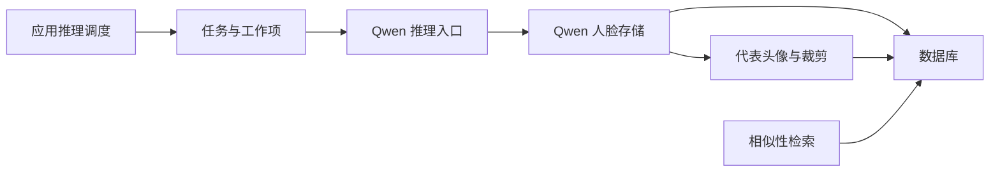
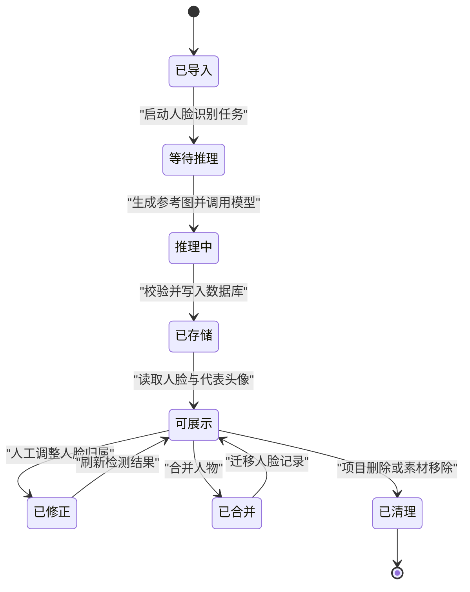

# 人脸识别数据存储

> Repo Wiki 节点 `face-recognition-storage`
> 导出自 Qoder 知识库快照 `8fbe02f6-57c2-4874-b725-1a8130851fd9`，代码基线 `7a7a8e75e18bd90294e09cd422dd7ed5a04813a0`（分支 main，zh-CN）。

<cite>
**本文引用的文件**
- [数据库模式定义](../../../../crates/moriq-library/src/database/schema.sql)
- [人物与人脸检测迁移脚本](../../../../crates/moriq-library/src/database/migrations/migration_15.sql)
- [人物向量索引迁移脚本](../../../../crates/moriq-library/src/database/migrations/migration_21.sql)
- [工作区人物归属迁移脚本](../../../../crates/moriq-library/src/database/migrations/migration_26.sql)
- [Qwen 人脸存储逻辑](../../../../crates/moriq-library/src/ai/qwen_faces.rs)
- [代表头像选择与裁剪逻辑](../../../../crates/moriq-library/src/ai/portraits.rs)
- [内容指纹与相似性检索](../../../../crates/moriq-library/src/ai/similarity.rs)
- [Qwen 推理入口与参考图生成](../../../../crates/moriq-ai/src/qwen_faces.rs)
- [应用推理任务调度](../../../../crates/moriq-app/src/inference.rs)
- [任务与工作项执行流程](../../../../crates/moriq-library/src/tasks/jobs.rs)
- [人脸读取与人物合并接口](../../../../crates/moriq-library/src/ai/analysis.rs)
</cite>

## 目录
1. [引言](#引言)
2. [项目结构](#项目结构)
3. [核心数据模型](#核心数据模型)
4. [架构总览](#架构总览)
5. [详细组件分析](#详细组件分析)
6. [依赖关系分析](#依赖关系分析)
7. [性能考虑](#性能考虑)
8. [故障排查指南](#故障排查指南)
9. [结论](#结论)
10. [附录：完整生命周期示例](#附录完整生命周期示例)

## 引言
本文围绕 Qwen 人脸识别在 Moriq Space 中的数据存储、处理流程和展示机制展开，重点说明以下方面：
- `detected_faces` 表的人脸边界框、人物关联、版本号、修订号与序列号语义。
- `people` 表的人物管理、项目归属及清理策略。
- Qwen 模型输出的校验、重叠去重和人面匹配算法。
- 代表头像的选择规则、素材版本有效性检查以及像素裁剪流程。
- 参考图片的生成机制和临时文件管理。
- 从检测到存储再到展示的完整数据生命周期。
- 面向实际部署的性能优化建议与常见问题解决方案。

该文档既适合需要理解数据库结构的维护人员，也适合需要调用或扩展人脸识别功能的开发者。

## 项目结构
人脸识别相关代码分布在库层、AI 运行时和应用层三个层次：
- 库层负责数据库模式、AI 结果持久化、头像裁剪、相似性检索和任务编排。
- AI 层负责 Qwen 视觉模型的输入构造、提示词约束、输出解析和参考图生成。
- 应用层负责模型可用性检查、修订信息获取、取消控制和任务结果封装。

**图表来源**
- [应用推理任务调度:1-200](../../../../crates/moriq-app/src/inference.rs#L1-L200)
- [任务与工作项执行流程:100-290](../../../../crates/moriq-library/src/tasks/jobs.rs#L100-L290)
- [Qwen 推理入口与参考图生成:1-172](../../../../crates/moriq-ai/src/qwen_faces.rs#L1-L172)
- [Qwen 人脸存储逻辑:1-200](../../../../crates/moriq-library/src/ai/qwen_faces.rs#L1-L200)
- [代表头像选择与裁剪逻辑:1-166](../../../../crates/moriq-library/src/ai/portraits.rs#L1-L166)
- [内容指纹与相似性检索:1-131](../../../../crates/moriq-library/src/ai/similarity.rs#L1-L131)
- [人脸读取与人物合并接口:540-630](../../../../crates/moriq-library/src/ai/analysis.rs#L540-L630)
- [数据库模式定义:1-42](../../../../crates/moriq-library/src/database/schema.sql#L1-L42)

**章节来源**
- [应用推理任务调度:1-200](../../../../crates/moriq-app/src/inference.rs#L1-L200)
- [任务与工作项执行流程:100-290](../../../../crates/moriq-library/src/tasks/jobs.rs#L100-L290)
- [Qwen 推理入口与参考图生成:1-172](../../../../crates/moriq-ai/src/qwen_faces.rs#L1-L172)
- [Qwen 人脸存储逻辑:1-200](../../../../crates/moriq-library/src/ai/qwen_faces.rs#L1-L200)
- [代表头像选择与裁剪逻辑:1-166](../../../../crates/moriq-library/src/ai/portraits.rs#L1-L166)
- [内容指纹与相似性检索:1-131](../../../../crates/moriq-library/src/ai/similarity.rs#L1-L131)
- [人脸读取与人物合并接口:540-630](../../../../crates/moriq-library/src/ai/analysis.rs#L540-L630)
- [数据库模式定义:1-42](../../../../crates/moriq-library/src/database/schema.sql#L1-L42)

## 核心数据模型
### 人脸检测结果表
`detected_faces` 用于记录每个素材当前版本的检测结果，核心字段如下：
- `id`：检测结果主键。
- `version_id`：绑定到素材的具体版本，删除素材版本时级联删除人脸记录。
- `revision`：模型或处理流程的修订标识，例如 Qwen 人脸处理的修订前缀。
- `ordinal`：同版本内的人脸顺序号，保证同一批次检测结果可排序。
- `box`：以 JSON 字符串存储归一化边界框 `[左上x, 左上y, 宽, 高]`。
- `vector`：人物向量；Qwen 方案不存储合成嵌入，因此初始为空字节。
- `person_id`：可选的人物外键，删除人物时设为空。
- `manual`：是否人工修正标记；人工修正不会被自动覆盖。

该表还包含唯一约束 `(version_id, revision, ordinal)`，防止同一版本同一修订重复写入相同序号。

**章节来源**
- [人物与人脸检测迁移脚本:14-15](../../../../crates/moriq-library/src/database/migrations/migration_15.sql#L14-L15)
- [人物向量索引迁移脚本:1-5](../../../../crates/moriq-library/src/database/migrations/migration_21.sql#L1-L5)

### 人物表
`people` 表用于管理已识别或人工创建的人物：
- `id`：人物主键。
- `name`：人物名称。
- `revision`：人物首次创建时绑定的模型修订标识。
- `created_at`：人物记录创建时间戳。

人物还通过 `workspace_people` 表与工作区或项目关联，支持按项目隔离人物、任务和集合，并在项目删除时级联清理。

**章节来源**
- [人物与人脸检测迁移脚本:14](../../../../crates/moriq-library/src/database/migrations/migration_15.sql#L14)
- [工作区人物归属迁移脚本:1-12](../../../../crates/moriq-library/src/database/migrations/migration_26.sql#L1-L12)

### 其他相关表
- `asset_versions`：素材版本元数据，包括路径、哈希、格式、尺寸和字节数。
- `assets`：素材聚合记录，关联当前显示版本。
- `ai_results`：保存 AI 原始回执，包括模型 ID、修订、预处理类型和数据体。
- `person_vectors`：按人物和模型修订聚合的代表向量，便于后续检索和比较。
- `image_fingerprints`：图像感知指纹，用于相似素材检索，不是人脸识别向量。

**章节来源**
- [数据库模式定义:1-42](../../../../crates/moriq-library/src/database/schema.sql#L1-L42)
- [人物向量索引迁移脚本:1-5](../../../../crates/moriq-library/src/database/migrations/migration_21.sql#L1-L5)
- [内容指纹与相似性检索:1-131](../../../../crates/moriq-library/src/ai/similarity.rs#L1-L131)

## 架构总览
人脸识别的数据流分为三个阶段：
1. **推理阶段**：应用层调用本地推理器，AI 层使用 Qwen 视觉模型进行人脸检测和身份比较。
2. **存储阶段**：库层对检测结果进行合法性校验、重叠检测、人物匹配和数据库持久化。
3. **展示阶段**：库层根据人物查询有效的人脸检测结果，选择面积最大且版本有效的代表头像，并生成裁剪预览。

**图表来源**
- [应用推理任务调度:1-200](../../../../crates/moriq-app/src/inference.rs#L1-L200)
- [任务与工作项执行流程:100-290](../../../../crates/moriq-library/src/tasks/jobs.rs#L100-L290)
- [Qwen 推理入口与参考图生成:1-172](../../../../crates/moriq-ai/src/qwen_faces.rs#L1-L172)
- [Qwen 人脸存储逻辑:1-200](../../../../crates/moriq-library/src/ai/qwen_faces.rs#L1-L200)
- [代表头像选择与裁剪逻辑:1-166](../../../../crates/moriq-library/src/ai/portraits.rs#L1-L166)

## 详细组件分析

### Qwen 人脸识别模型输出数据处理
#### 坐标规范化与置信度过滤
AI 层首先接收 Qwen 视觉模型的原始输出，并按 schema 限制人脸数量和坐标范围。坐标被标准化为 0 到 1000 的整数，再转换为归一化浮点坐标 `[左上x, 左上y, 宽, 高]`。置信度低于阈值的结果会被丢弃，避免将模糊或不确定的人脸纳入后续流程。

#### 边界框验证
库层在持久化前再次验证边界框：
- 所有坐标必须有限且落在 0 到 1 之间。
- 宽高必须为正数。
- 左上角加宽高不能超过图像边界，允许极小误差。
- 非数字、越界或退化矩形直接报错。

#### 重叠检测与去重
对于同一素材同一批次的多个检测结果，系统计算候选框与已有框的重叠比例。当重叠比例达到阈值时，认为可能是重复检测；若已有框来自人工修正，则保留人工结果，不再覆盖。

#### 人面匹配算法
Qwen 推理阶段会为每个人脸生成裁剪图，并与当前项目的参考人脸拼接成对比图，再让模型判断是否为同一个人。只有当模型判定一致且置信度达到较高阈值时，才将该人脸分配给对应人物。若没有明确匹配，则人脸保持未分组状态。

**图表来源**
- [Qwen 推理入口与参考图生成:1-172](../../../../crates/moriq-ai/src/qwen_faces.rs#L1-L172)
- [Qwen 人脸存储逻辑:1-200](../../../../crates/moriq-library/src/ai/qwen_faces.rs#L1-L200)

**章节来源**
- [Qwen 推理入口与参考图生成:1-172](../../../../crates/moriq-ai/src/qwen_faces.rs#L1-L172)
- [Qwen 人脸存储逻辑:1-200](../../../../crates/moriq-library/src/ai/qwen_faces.rs#L1-L200)

### 代表头像选择逻辑
代表头像用于人物卡片、侧边栏和搜索结果预览。选择规则如下：
- 仅考虑仍为素材当前显示版本的人脸。
- 排除已进入回收站或删除的素材。
- 按人脸框面积降序排序，即优先选择更大、更清晰的人脸。
- 若素材大小变更或切换显示版本，旧人脸会被忽略。
- 若人物没有任何有效人脸，则返回空结果。

**图表来源**
- [代表头像选择与裁剪逻辑:1-166](../../../../crates/moriq-library/src/ai/portraits.rs#L1-L166)

**章节来源**
- [代表头像选择与裁剪逻辑:1-166](../../../../crates/moriq-library/src/ai/portraits.rs#L1-L166)

### 人脸裁剪功能
人脸裁剪从已准备的人脸预览中提取像素区域，并缩放到目标尺寸。关键实现要点包括：
- 输入像素宽度、高度不能为零，且不能超过安全上限。
- 边界框必须位于 0 到 1 范围内，宽高为正，且不能退化为单点或单线。
- 像素坐标由归一化边界框乘以预览尺寸得到。
- 中心位置会加入少量上下文，使裁剪框略大于人脸本身。
- 最终使用三角插值缩放至固定输出尺寸，避免逐像素复制整张图像。

**图表来源**
- [代表头像选择与裁剪逻辑:1-166](../../../../crates/moriq-library/src/ai/portraits.rs#L1-L166)

**章节来源**
- [代表头像选择与裁剪逻辑:1-166](../../../../crates/moriq-library/src/ai/portraits.rs#L1-L166)

### 参考图片生成机制
参考图片用于将待检测人脸与已知人物照片并列呈现，辅助 Qwen 进行身份判断。流程如下：
- 从项目中读取每个人物的“参考人脸”，优先选择人工指定或面积最大的人脸。
- 读取该人脸所在素材的预览图，并按边界框裁剪出头像。
- 将裁剪结果保存到临时目录，文件名按顺序编号。
- 推理时将目标人脸与参考人脸拼接到一张对比图中，再提交给视觉模型。
- 临时目录随引用对象生命周期释放，避免长期占用磁盘。

**图表来源**
- [Qwen 人脸存储逻辑:1-200](../../../../crates/moriq-library/src/ai/qwen_faces.rs#L1-L200)
- [Qwen 推理入口与参考图生成:1-172](../../../../crates/moriq-ai/src/qwen_faces.rs#L1-L172)

**章节来源**
- [Qwen 人脸存储逻辑:1-200](../../../../crates/moriq-library/src/ai/qwen_faces.rs#L1-L200)
- [Qwen 推理入口与参考图生成:1-172](../../../../crates/moriq-ai/src/qwen_faces.rs#L1-L172)

### 人脸读取与人物管理接口
库层提供读取素材人脸列表和合并人物的能力：
- `faces(asset)` 返回素材当前显示版本下的全部人脸，包括人物 ID、人物名称和边界框。
- `merge_people(source, target)` 将源人物下的人脸转移到目标人物，并将这些人脸标记为人工修正。
- `assign_face(face, person)` 支持人工调整某个人脸的归属，同时检查工作区一致性。

这些接口确保人脸数据不仅可用于展示，还能支持后期整理、纠错和批量操作。

**章节来源**
- [人脸读取与人物合并接口:540-630](../../../../crates/moriq-library/src/ai/analysis.rs#L540-L630)

## 依赖关系分析
人脸识别模块的依赖关系可以按职责分层理解：
- 应用层依赖推理接口，但不直接访问数据库。
- 任务层负责冻结工作区范围、准备图像路径、读取参考人脸并封装结果。
- AI 层依赖视觉会话、图像解码、临时文件和 Qwen 提示词 schema。
- 库层依赖数据库事务、素材版本约束、工作区隔离和图像像素操作。

**图表来源**
- [应用推理任务调度:1-200](../../../../crates/moriq-app/src/inference.rs#L1-L200)
- [任务与工作项执行流程:100-290](../../../../crates/moriq-library/src/tasks/jobs.rs#L100-L290)
- [Qwen 推理入口与参考图生成:1-172](../../../../crates/moriq-ai/src/qwen_faces.rs#L1-L172)
- [Qwen 人脸存储逻辑:1-200](../../../../crates/moriq-library/src/ai/qwen_faces.rs#L1-L200)
- [代表头像选择与裁剪逻辑:1-166](../../../../crates/moriq-library/src/ai/portraits.rs#L1-L166)
- [内容指纹与相似性检索:1-131](../../../../crates/moriq-library/src/ai/similarity.rs#L1-L131)

**章节来源**
- [应用推理任务调度:1-200](../../../../crates/moriq-app/src/inference.rs#L1-L200)
- [任务与工作项执行流程:100-290](../../../../crates/moriq-library/src/tasks/jobs.rs#L100-L290)
- [Qwen 推理入口与参考图生成:1-172](../../../../crates/moriq-ai/src/qwen_faces.rs#L1-L172)
- [Qwen 人脸存储逻辑:1-200](../../../../crates/moriq-library/src/ai/qwen_faces.rs#L1-L200)
- [代表头像选择与裁剪逻辑:1-166](../../../../crates/moriq-library/src/ai/portraits.rs#L1-L166)
- [内容指纹与相似性检索:1-131](../../../../crates/moriq-library/src/ai/similarity.rs#L1-L131)

## 性能考虑
- **预览图尺寸控制**：AI 推理时对输入图像设置宽高上限和内存分配上限，避免超大图片或异常资源消耗。
- **像素裁剪优化**：头像裁剪采用逐行拷贝而非克隆整张图像，减少中间对象分配。
- **参考图缓存**：reference 列表在单次任务中复用临时目录，避免重复读取和重建。
- **数据库索引**：`detected_faces` 按人物建立索引，`person_vectors` 按修订建立索引，提升人物查询和向量聚合效率。
- **相似度与人脸区分**：`image_fingerprints` 用于相似素材检索，不与人像向量混用，避免误判。
- **任务取消**：推理、参考图生成和存储路径均检查取消标志，防止后台任务阻塞或产生无用结果。

[本节为通用性能建议，不直接分析具体代码片段]

## 故障排查指南
### 常见错误与原因
- **人脸位置无效**：边界框坐标超出 0 到 1 范围、宽高非正或左上角加宽高越界。
- **人脸预览位置无效**：预览图为零尺寸、边界框非法或像素不完整。
- **人脸预览像素不完整**：RGBA 缓冲区长度不足，无法按行读取。
- **Qwen 人脸回执缺少 faces**：模型输出不符合预期 schema。
- **Qwen 人脸数量超出预算**：单次检测人脸过多，超过协议限制。
- **未配置 Qwen 人脸推理**：应用层未安装或未就绪模型运行环境。
- **人物记录已不存在**：合并或分配人脸时，目标人物已被删除。
- **请进入人脸所属项目后修改人物分组**：工作区不一致，禁止跨项目修改人脸归属。

### 排查步骤
1. 检查 AI 原始回执是否包含合法 `faces` 数组。
2. 确认人脸坐标已归一化且宽高为正。
3. 确认素材仍处于有效显示版本且未被删除。
4. 检查人物是否存在于当前工作区。
5. 查看 `ai_results` 中的原始数据，定位模型输出问题。
6. 若代表头像为空，检查是否有有效人脸且素材未进入回收站。
7. 若人脸未更新，检查是否有人工修正标记阻止自动覆盖。

**章节来源**
- [Qwen 推理入口与参考图生成:1-172](../../../../crates/moriq-ai/src/qwen_faces.rs#L1-L172)
- [Qwen 人脸存储逻辑:1-200](../../../../crates/moriq-library/src/ai/qwen_faces.rs#L1-L200)
- [代表头像选择与裁剪逻辑:1-166](../../../../crates/moriq-library/src/ai/portraits.rs#L1-L166)
- [人脸读取与人物合并接口:540-630](../../../../crates/moriq-library/src/ai/analysis.rs#L540-L630)

## 结论
该项目的人脸识别方案以 Qwen 视觉模型为核心，结合严格的输入校验、重叠检测、人物匹配和数据库约束，实现了从检测到展示的可追溯流程。`detected_faces` 与 `people` 表分别承担检测结果与人物管理职责，并通过工作区隔离保障多项目安全性。代表头像选择、像素裁剪和参考图生成共同支撑稳定的前端展示体验。通过预览图限制、索引优化和任务取消机制，系统在准确性和性能之间取得平衡。

[本节为总结性内容，不直接分析具体文件]

## 附录：完整生命周期示例
以下是一个典型的人脸识别数据生命周期示例：

1. **导入素材**：素材被导入后获得 `asset_id` 和 `asset_version_id`，并写入 `assets` 与 `asset_versions`。
2. **启动人脸识别任务**：应用层构建 `QwenFaces` 工作项，任务层读取项目范围内的参考人脸。
3. **生成参考图**：库层查询人物有效人脸，读取预览图并按边界框裁剪，保存到临时目录。
4. **执行 Qwen 推理**：AI 层解码图像、构造提示词、调用视觉模型，并对输出进行坐标与置信度校验。
5. **存储检测结果**：库层验证边界框、计算重叠、匹配或创建人物，写入 `detected_faces` 和 `people`，并记录 `ai_results`。
6. **展示人脸**：前端或库层调用 `faces(asset)` 读取当前版本的人脸列表。
7. **生成人物头像**：系统按面积选择有效代表头像，并进行像素裁剪和缩放。
8. **人工修正**：用户可调整人脸归属，系统将相应记录标记为 `manual=1`，避免下次自动覆盖。
9. **人物合并**：用户合并两个人物时，系统迁移人脸记录并刷新代表向量。
10. **项目清理**：项目删除时，关联的工作区人物、任务和集合会被级联清理。

**图表来源**
- [任务与工作项执行流程:100-290](../../../../crates/moriq-library/src/tasks/jobs.rs#L100-L290)
- [Qwen 推理入口与参考图生成:1-172](../../../../crates/moriq-ai/src/qwen_faces.rs#L1-L172)
- [Qwen 人脸存储逻辑:1-200](../../../../crates/moriq-library/src/ai/qwen_faces.rs#L1-L200)
- [人脸读取与人物合并接口:540-630](../../../../crates/moriq-library/src/ai/analysis.rs#L540-L630)
- [工作区人物归属迁移脚本:1-12](../../../../crates/moriq-library/src/database/migrations/migration_26.sql#L1-L12)