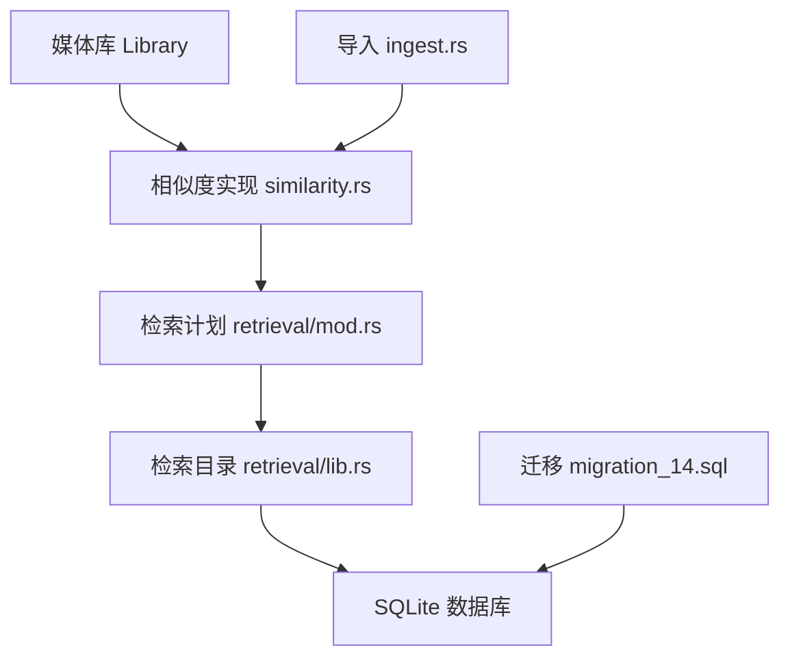
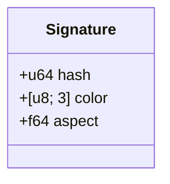
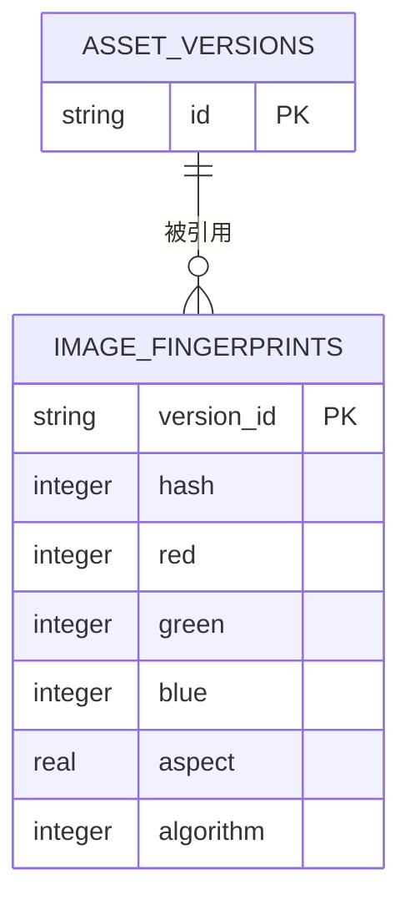
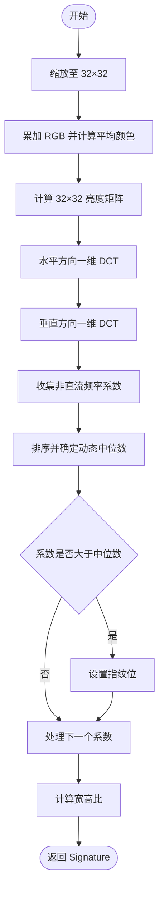
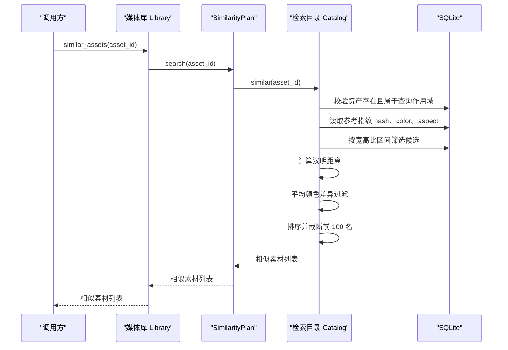
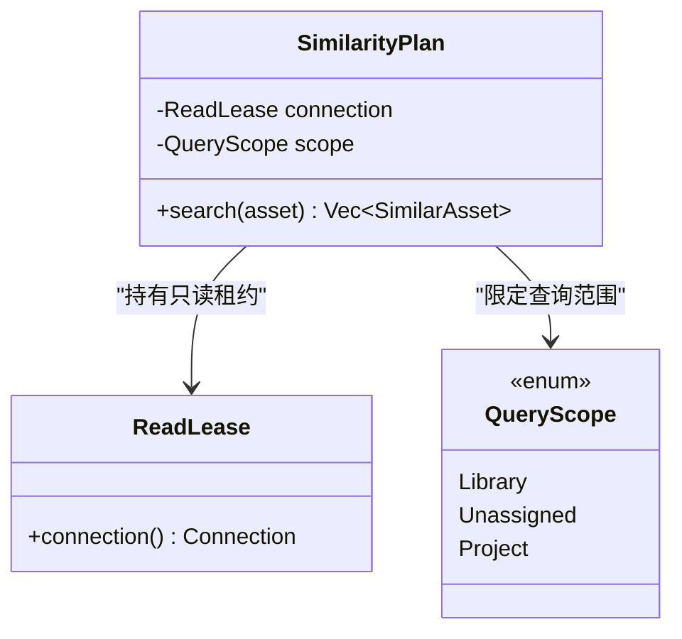
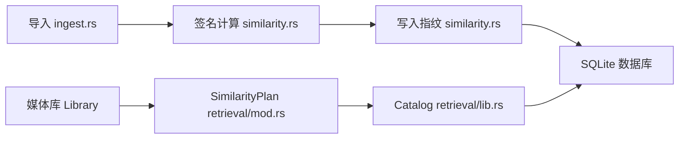
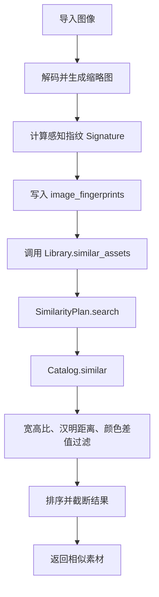

# 相似性搜索存储

> Repo Wiki 节点 `similarity-search-storage`
> 导出自 Qoder 知识库快照 `8fbe02f6-57c2-4874-b725-1a8130851fd9`，代码基线 `7a7a8e75e18bd90294e09cd422dd7ed5a04813a0`（分支 main，zh-CN）。

<cite>
**本文引用的文件**   
- [similarity.rs](../../../../crates/moriq-library/src/ai/similarity.rs)
- [mod.rs（检索计划）](../../../../crates/moriq-library/src/retrieval/mod.rs)
- [lib.rs（检索目录）](../../../../crates/moriq-retrieval/src/lib.rs)
- [migration_14.sql](../../../../crates/moriq-library/src/database/migrations/migration_14.sql)
- [ingest.rs](../../../../crates/moriq-library/src/transfer/ingest.rs)
</cite>

## 目录
1. [引言](#引言)
2. [项目结构定位](#项目结构定位)
3. [核心数据结构](#核心数据结构)
4. [数据库存储设计](#数据库存储设计)
5. [感知指纹计算算法](#感知指纹计算算法)
6. [相似性搜索执行流程](#相似性搜索执行流程)
7. [SimilarityPlan 设计模式](#similariplan-设计模式)
8. [依赖关系分析](#依赖关系分析)
9. [性能与索引优化](#性能与索引优化)
10. [完整使用示例](#完整使用示例)
11. [算法参数调优与误判控制](#算法参数调优与误判控制)
12. [故障排查指南](#故障排查指南)
13. [结论](#结论)

## 引言
本文件聚焦于该项目中的图像相似性搜索存储实现，重点说明以下方面：
- `Signature` 结构体如何表达感知指纹、平均颜色和宽高比。
- `image_fingerprints` 表如何持久化指纹、色彩分量、尺寸特征和算法标识。
- 基于离散余弦变换的感知指纹计算过程。
- 相似性检索从指纹读取、候选过滤、汉明距离计算到结果排序的完整链路。
- `SimilarityPlan` 如何通过只读租约和查询作用域隔离相似性查询。
- 可操作的参数调优建议，用于平衡召回率、误判率和查询延迟。

该能力主要位于媒体库模块、检索模块和数据迁移脚本中，由导入流程生成指纹，再由相似性接口对外暴露。

## 项目结构定位
相似性搜索相关代码分布在四个关键位置：
- 媒体库侧的相似度实现与对外接口：`crates/moriq-library/src/ai/similarity.rs`。
- 媒体库侧的只读检索计划封装：`crates/moriq-library/src/retrieval/mod.rs`。
- 纯检索逻辑与 SQL 查询：`crates/moriq-retrieval/src/lib.rs`。
- 图像指纹表的创建迁移脚本：`crates/moriq-library/src/database/migrations/migration_14.sql`。
- 导入过程中生成缩略图并计算签名：`crates/moriq-library/src/transfer/ingest.rs`。

**图表来源**
- [similarity.rs:1-131](../../../../crates/moriq-library/src/ai/similarity.rs#L1-L131)
- [mod.rs（检索计划）:1-58](../../../../crates/moriq-library/src/retrieval/mod.rs#L1-L58)
- [lib.rs（检索目录）:1-200](../../../../crates/moriq-retrieval/src/lib.rs#L1-L200)
- [migration_14.sql:1-12](../../../../crates/moriq-library/src/database/migrations/migration_14.sql#L1-L12)
- [ingest.rs:200-260](../../../../crates/moriq-library/src/transfer/ingest.rs#L200-L260)

**章节来源**
- [similarity.rs:1-131](../../../../crates/moriq-library/src/ai/similarity.rs#L1-L131)
- [mod.rs（检索计划）:1-58](../../../../crates/moriq-library/src/retrieval/mod.rs#L1-L58)
- [lib.rs（检索目录）:1-200](../../../../crates/moriq-retrieval/src/lib.rs#L1-L200)
- [migration_14.sql:1-12](../../../../crates/moriq-library/src/database/migrations/migration_14.sql#L1-L12)
- [ingest.rs:200-260](../../../../crates/moriq-library/src/transfer/ingest.rs#L200-L260)

## 核心数据结构
### Signature 结构体
`Signature` 是相似性搜索的核心特征载体，包含三个字段：
- `hash`：感知指纹，类型为 `u64`。它通过 DCT 系数与阈值比较得到，每个位对应一个非直流频率系数是否高于动态中位数。
- `color`：平均颜色，类型为 `[u8; 3]`，表示 R、G、B 三个通道在缩放后图像上的累加平均值。
- `aspect`：宽高比，类型为 `f64`，由原始图像宽度和高度计算得出，用于按形状约束候选范围。

**图表来源**
- [similarity.rs:3-10](../../../../crates/moriq-library/src/ai/similarity.rs#L3-L10)

**章节来源**
- [similarity.rs:3-10](../../../../crates/moriq-library/src/ai/similarity.rs#L3-L10)

## 数据库存储设计
### image_fingerprints 表
相似性指纹存储在 `image_fingerprints` 表中，其关键字段如下：
- `version_id`：主键，关联素材版本。
- `hash`：整数形式的感知指纹。
- `red`、`green`、`blue`：R、G、B 三个通道的平均颜色分量。
- `aspect`：浮点型宽高比。
- `algorithm`：指纹算法标识；写入时固定为 `1`，查询时强制匹配该值。

该表通过迁移脚本创建，并与 `asset_versions` 建立外键关系，删除素材版本时级联删除指纹记录。

| 字段 | 类型 | 含义 | 约束或默认值 |
|---|---|---|---|
| `version_id` | TEXT | 素材版本标识 | 主键，外键引用 `asset_versions.id` |
| `hash` | INTEGER | 感知指纹 | 非空 |
| `red` | INTEGER | 红色分量 | 非空 |
| `green` | INTEGER | 绿色分量 | 非空 |
| `blue` | INTEGER | 蓝色分量 | 非空 |
| `aspect` | REAL | 宽高比 | 非空 |
| `algorithm` | INTEGER | 算法标识 | 默认值为 `1` |

**图表来源**
- [migration_14.sql:1-12](../../../../crates/moriq-library/src/database/migrations/migration_14.sql#L1-L12)

**章节来源**
- [migration_14.sql:1-12](../../../../crates/moriq-library/src/database/migrations/migration_14.sql#L1-L12)

## 感知指纹计算算法
`signature` 函数负责将一张有界图像转换为 `Signature`。整体流程如下：

1. **图像缩放**  
   将输入图像缩放到 `32×32`，使用三角形滤波，便于稳定地提取低频视觉特征。

2. **平均颜色计算**  
   遍历缩放后的像素，对每个通道进行带透明度的加权累加，最后除以固定归一化因子得到三通道平均颜色。

3. **灰度亮度矩阵**  
   根据 RGB 线性组合公式计算每个像素的亮度，形成 `32×32` 亮度矩阵。

4. **二维 DCT 近似**  
   先沿水平方向做一维 DCT，再沿垂直方向做一维 DCT，得到近似二维 DCT 系数。余弦基表通过一次性初始化缓存，避免重复计算。

5. **系数选择与阈值比较**  
   - 去掉直流分量，取剩余 63 个频率系数。
   - 对这些系数排序得到中位数。
   - 将直流分量的绝对值的千分之一作为下界保护，防止极低对比度图像产生全零阈值。
   - 若某个频率系数大于“中位数加上微小容差”，则对应位设为 `1`，最终拼接成 `u64` 指纹。

6. **宽高比计算**  
   使用原始图像宽高比，作为后续相似性检索中的形状约束。

**图表来源**
- [similarity.rs:12-70](../../../../crates/moriq-library/src/ai/similarity.rs#L12-L70)

**章节来源**
- [similarity.rs:12-70](../../../../crates/moriq-library/src/ai/similarity.rs#L12-L70)

## 相似性搜索执行流程
相似性搜索分为两个阶段：
1. **指纹生成与持久化**：导入流程解码媒体、生成缩略图、计算 `Signature`，并通过 `store` 写入 `image_fingerprints`。
2. **相似性查询**：通过 `Library::similar_assets` 获取 `SimilarityPlan`，再调用检索目录的 `similar` 方法完成查询。

**图表来源**
- [similarity.rs:90-110](../../../../crates/moriq-library/src/ai/similarity.rs#L90-L110)
- [mod.rs（检索计划）:10-20](../../../../crates/moriq-library/src/retrieval/mod.rs#L10-L20)
- [lib.rs（检索目录）:59-110](../../../../crates/moriq-retrieval/src/lib.rs#L59-L110)

### 指纹检索
检索目录首先验证目标素材有效，然后从 `image_fingerprints` 与 `assets` 连接表中读取参考指纹。查询条件包括：
- 仅读取 `algorithm = 1` 的记录。
- 排除已删除素材。
- 受查询作用域控制，例如项目范围或全局资源库范围。

如果找不到指纹，会返回错误，提示尚未建立相似索引。

### 候选过滤与相似度计算
候选过滤采用两级策略：
1. **形状预筛**：通过宽高比上下浮动 `5%` 的区间缩小候选集。
2. **感知相似度**：
   - 使用两个 `u64` 指纹的异或结果统计 `1` 的数量，即汉明距离。
   - 汉明距离不超过 `8` 才进入颜色检查。
   - 对候选颜色与参考颜色的 R、G、B 差值求和，要求总和不超过 `100`。

### 结果排序
满足条件的结果按汉明距离升序排序，距离相同时按名称排序。中间结果超过一定数量时会提前截断，最终最多返回 `100` 条相似素材。

**章节来源**
- [lib.rs（检索目录）:59-110](../../../../crates/moriq-retrieval/src/lib.rs#L59-L110)
- [similarity.rs:90-110](../../../../crates/moriq-library/src/ai/similarity.rs#L90-L110)

## SimilarityPlan 设计模式
`SimilarityPlan` 是一个轻量级只读检索计划对象，核心职责是：
- 持有来自读连接池的只读租约。
- 保存查询作用域，确保相似性查询不会访问当前用户或项目范围之外的数据。
- 不直接持有媒体解码器、模型运行时或写入端连接。

### 读取租约管理
`Library::similarity_plan` 通过 `readers.checkout()` 获取只读连接租约，并将其与 `query_scope()` 一起交给 `SimilarityPlan::new`。这样相似性查询可以复用稳定的只读连接，而不会阻塞写入事务。

### 查询作用域控制
查询作用域支持三种语义：
- 全局资源库。
- 未分配内容。
- 指定项目。

检索目录在查询资产存在性和相似性扫描时，都会结合作用域过滤工作区，保证相似性结果始终落在合法范围内。

**图表来源**
- [mod.rs（检索计划）:1-20](../../../../crates/moriq-library/src/retrieval/mod.rs#L1-L20)
- [lib.rs（检索目录）:1-20](../../../../crates/moriq-retrieval/src/lib.rs#L1-L20)

**章节来源**
- [mod.rs（检索计划）:1-20](../../../../crates/moriq-library/src/retrieval/mod.rs#L1-L20)
- [lib.rs（检索目录）:1-20](../../../../crates/moriq-retrieval/src/lib.rs#L1-L20)

## 依赖关系分析
相似性搜索涉及的依赖关系如下：
- `similarity.rs` 定义 `Signature`、指纹计算、指纹写入以及 `Library` 的相似性接口。
- `retrieval/mod.rs` 将只读租约与查询作用域封装为 `SimilarityPlan`。
- `moriq-retrieval/src/lib.rs` 提供无媒体解码依赖的 `Catalog`，直接执行 SQL 并完成相似度计算。
- `ingest.rs` 在导入阶段生成缩略图和 `Signature`，但实际写入库由 `similarity.rs` 中的 `store` 完成。
- `migration_14.sql` 提供 `image_fingerprints` 表结构。

**图表来源**
- [ingest.rs:200-260](../../../../crates/moriq-library/src/transfer/ingest.rs#L200-L260)
- [similarity.rs:1-110](../../../../crates/moriq-library/src/ai/similarity.rs#L1-L110)
- [mod.rs（检索计划）:1-20](../../../../crates/moriq-library/src/retrieval/mod.rs#L1-L20)
- [lib.rs（检索目录）:59-110](../../../../crates/moriq-retrieval/src/lib.rs#L59-L110)

**章节来源**
- [ingest.rs:200-260](../../../../crates/moriq-library/src/transfer/ingest.rs#L200-L260)
- [similarity.rs:1-110](../../../../crates/moriq-library/src/ai/similarity.rs#L1-L110)
- [mod.rs（检索计划）:1-20](../../../../crates/moriq-library/src/retrieval/mod.rs#L1-L20)
- [lib.rs（检索目录）:59-110](../../../../crates/moriq-retrieval/src/lib.rs#L59-L110)

## 性能与索引优化
### 当前实现特点
- 指纹计算使用 `32×32` 低分辨率图像，DCT 计算规模固定，复杂度可控。
- 相似性检索首先用宽高比区间缩小候选集，再通过汉明距离和颜色差值过滤。
- 检索结果会在中间阶段提前截断，避免对大量候选进行全量排序。

### 潜在瓶颈
- `image_fingerprints` 表目前以 `version_id` 为主键，但没有针对 `hash`、`algorithm`、`aspect` 的显式索引。
- 相似性查询需要连接 `assets` 表并可能通过子查询获取工作区信息，这在大规模数据集上可能成为热点。
- 颜色差值和汉明距离是在应用层计算的，无法利用数据库索引加速。

### 优化建议
1. **复合索引**  
   为相似性查询高频条件创建复合索引，例如 `(algorithm, aspect)`，以减少宽高比范围扫描的成本。
2. **哈希索引或向量索引**  
   若未来扩展更多指纹维度，可考虑引入专门的近似最近邻索引结构；在当前 `u64` 汉明距离场景下，可通过预筛选降低计算压力。
3. **查询作用域索引**  
   若工作区过滤频繁，可为 `asset_workspaces` 或相关视图建立合适索引，减少子查询开销。
4. **批量构建指纹**  
   在后台任务中批量计算和写入指纹，避免导入高峰期同时承担解码、DCT 和写入压力。

**章节来源**
- [lib.rs（检索目录）:59-110](../../../../crates/moriq-retrieval/src/lib.rs#L59-L110)
- [migration_14.sql:1-12](../../../../crates/moriq-library/src/database/migrations/migration_14.sql#L1-L12)

## 完整使用示例
以下是一个从图像指纹生成到相似素材查找的端到端流程说明：

1. **导入图像**  
   调用媒体库导入接口，触发导入流程。导入流程会：
   - 复制暂存文件。
   - 解码媒体。
   - 生成缩略图。
   - 计算主导色。
   - 为非视频媒体计算 `Signature`。

2. **生成感知指纹**  
   对于普通图片，导入流程调用 `similarity::signature`，对缩略图执行缩放、DCT、阈值比较和宽高比计算，得到 `Signature`。

3. **写入指纹表**  
   指纹通过 `similarity::store` 写入 `image_fingerprints`，包含 `hash`、`red`、`green`、`blue`、`aspect` 和 `algorithm=1`。

4. **发起相似性查询**  
   调用 `Library::similar_assets`，内部获取 `SimilarityPlan` 并执行搜索。

5. **检索目录执行查询**  
   检索目录：
   - 校验素材存在且属于当前查询作用域。
   - 读取参考指纹。
   - 按宽高比区间筛选候选。
   - 计算汉明距离并进行颜色差值过滤。
   - 排序并返回最多 100 条相似素材。

**图表来源**
- [ingest.rs:200-260](../../../../crates/moriq-library/src/transfer/ingest.rs#L200-L260)
- [similarity.rs:12-110](../../../../crates/moriq-library/src/ai/similarity.rs#L12-L110)
- [lib.rs（检索目录）:59-110](../../../../crates/moriq-retrieval/src/lib.rs#L59-L110)

**章节来源**
- [ingest.rs:200-260](../../../../crates/moriq-library/src/transfer/ingest.rs#L200-L260)
- [similarity.rs:12-110](../../../../crates/moriq-library/src/ai/similarity.rs#L12-L110)
- [lib.rs（检索目录）:59-110](../../../../crates/moriq-retrieval/src/lib.rs#L59-L110)

## 算法参数调优与误判控制
### 可调参数
| 参数 | 当前行为 | 调优影响 |
|---|---|---|
| 缩放尺寸 | 固定 `32×32` | 增大可提高细节敏感度，但增加计算量；减小可提升鲁棒性但降低区分度。 |
| DCT 系数范围 | 使用除直流外的全部 63 个频率系数 | 可裁剪更高频系数以降低噪声影响，但可能降低相似区分能力。 |
| 动态阈值 | 非直流系数排序后的中位数，且不低于直流分量绝对值的千分之一 | 提高阈值可减少误报，但可能漏掉轻微压缩变体；降低阈值可提升召回，但增加误判。 |
| 宽高比容差 | `aspect × 0.95` 到 `aspect × 1.05` | 扩大容差可接受更大尺寸变化，但会引入更多无关候选。 |
| 汉明距离上限 | `≤ 8` | 提高可召回更多相似图像，但可能引入外观差异较大的素材。 |
| 颜色差值上限 | 三通道差值之和 `≤ 100` | 提高可容忍更大色调偏移，但降低颜色一致性；降低会更严格。 |
| 结果上限 | 中间截断后保留最多 `100` 条 | 调整业务展示数量，不影响底层过滤逻辑。 |

### 误判率控制建议
1. **优先收紧形状约束**  
   宽高比容差是最便宜的预筛条件，适合先调整。若发现相似结果中出现明显尺寸差异较大的图片，应缩小容差。
2. **逐步放宽相似度**  
   若召回不足，可先放宽汉明距离上限，再考虑放宽颜色差值上限。颜色差值对色调偏移更敏感，不宜过度放宽。
3. **关注压缩变体**  
   测试用例表明该算法能识别重压缩和缩放后的图片，但仍应避免把完全无关的图片纳入结果。可通过回归测试覆盖常见误判场景。
4. **结合业务阈值**  
   上层业务可在返回结果后再做一次二次过滤，例如根据展示需求进一步限制最大距离或最小名称排序优先级。

**章节来源**
- [similarity.rs:12-70](../../../../crates/moriq-library/src/ai/similarity.rs#L12-L70)
- [lib.rs（检索目录）:59-110](../../../../crates/moriq-retrieval/src/lib.rs#L59-L110)

## 故障排查指南
### 没有相似结果
常见原因：
- 素材尚未生成指纹。检索目录在未找到指纹时会返回错误，提示需要先建立索引。
- 素材已被删除。查询会排除 `deleted_at IS NOT NULL` 的记录。
- 查询作用域不正确。目标素材不属于当前项目或未分配范围。

排查步骤：
1. 确认导入流程是否成功生成 `Signature`。
2. 检查 `image_fingerprints` 中是否存在该 `version_id` 的记录。
3. 检查 `algorithm` 是否为 `1`。
4. 确认查询作用域是否与素材所属工作区一致。

### 相似结果过多或过少
- 结果过多：提高汉明距离上限的严格程度，缩小宽高比容差，或提高颜色差值上限的严格程度。
- 结果过少：适当放宽汉明距离上限或颜色差值上限，但不要同时过度放宽两者，否则会显著增加误判。

### 导入阶段异常
导入阶段会校验文件大小、解码尺寸、缩略图生成和签名计算。若失败，通常与媒体损坏、尺寸非法或解码内存预算有关。

**章节来源**
- [lib.rs（检索目录）:59-110](../../../../crates/moriq-retrieval/src/lib.rs#L59-L110)
- [similarity.rs:112-131](../../../../crates/moriq-library/src/ai/similarity.rs#L112-L131)
- [ingest.rs:200-260](../../../../crates/moriq-library/src/transfer/ingest.rs#L200-L260)

## 结论
该项目的相似性搜索存储围绕 `Signature` 这一紧凑特征结构展开，通过 `32×32` 缩放图像、近似二维 DCT、动态中位数阈值和宽高比约束，实现了兼顾鲁棒性与性能的图像相似检测。`image_fingerprints` 表以 `version_id` 为主键，存储感知指纹、平均颜色和算法标识；`SimilarityPlan` 通过只读租约和查询作用域确保相似性查询安全、稳定且与写入端解耦。

在实际使用中，建议优先通过宽高比容差、汉明距离和颜色差值三个层次控制召回与误判，并根据业务场景逐步调参。未来若数据规模增长，应重点关注 `image_fingerprints` 和相关连接查询的索引设计与执行计划优化。